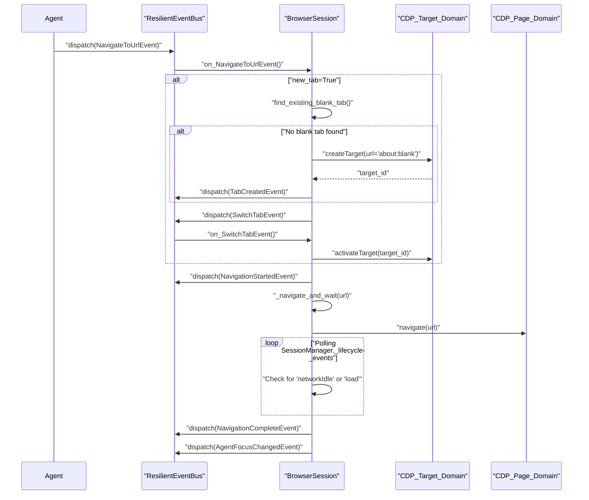
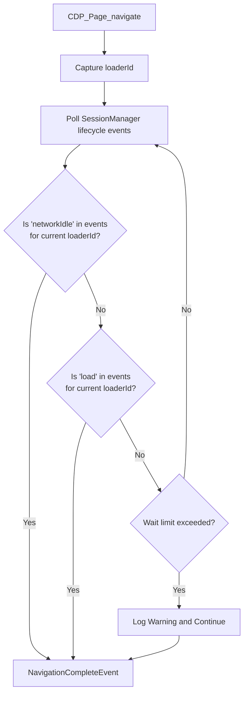
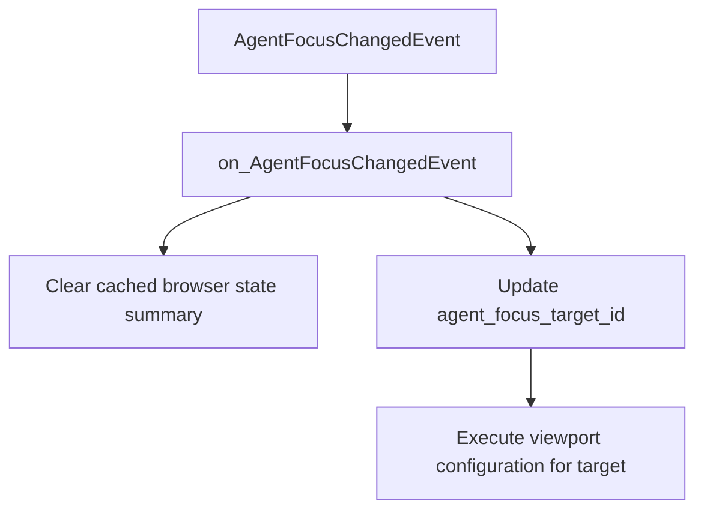

<!-- source: DeepWiki mcp.deepwiki.com · repo browser-use/browser-use · page 3.5 Navigation and Tab Control · fetched 2026-10-30 -->

# Navigation and Tab Control

Relevant source files

The following files were used as context for generating this wiki page:

- [browser_use/browser/events.py](browser_use/browser/events.py)
- [browser_use/browser/profile.py](browser_use/browser/profile.py)
- [browser_use/browser/session.py](browser_use/browser/session.py)
- [browser_use/browser/watchdog_base.py](browser_use/browser/watchdog_base.py)
- [tests/ci/browser/test_tabs.py](tests/ci/browser/test_tabs.py)

Navigation and tab control are core browser operations in `browser-use`. They are implemented as event-driven handlers within the `BrowserSession` class, which coordinates with the underlying Chrome DevTools Protocol (CDP) via the `SessionManager`. These mechanisms allow the agent to move between URLs, manage multiple browsing contexts, and maintain state across tab transitions.

---

## Overview

The navigation system provides high-level abstractions over low-level CDP commands. It is responsible for:

- **Page Navigation**: Loading URLs in the current tab or spawning new ones while managing lifecycle readiness [browser_use/browser/session.py:840-947]().
- **Tab Management**: Creating, switching, and closing tabs via the CDP `Target` domain [browser_use/browser/session.py:1048-1105]().
- **Focus Tracking**: Synchronizing the Agent's internal "active tab" state with the browser's foreground tab [browser_use/browser/session.py:228]().
- **Resource Optimization**: Automatically reusing blank tabs (e.g., `about:blank`) to reduce overhead [browser_use/browser/session.py:850-884]().

Sources: [browser_use/browser/session.py:1-54](), [browser_use/browser/session.py:134-154]()

---

## Navigation System

### NavigateToUrlEvent Flow

Navigation is triggered by dispatching a `NavigateToUrlEvent` [browser_use/browser/events.py:110-124](). The `BrowserSession` processes this through its `on_NavigateToUrlEvent` handler [browser_use/browser/session.py:840-947]().

**Navigation Logic and Code Entity Association**

Sources: [browser_use/browser/session.py:840-947](), [browser_use/browser/events.py:110-123](), [browser_use/browser/session.py:106-132]()

---

### Tab Reuse and Creation Logic

The system minimizes tab bloat by checking the state of existing tabs before opening new ones. This logic is primarily contained within the `on_NavigateToUrlEvent` handler [browser_use/browser/session.py:850-884]().

| Condition | Implementation Detail |
|-----------|-----------------------|
| **Current tab is blank** | If `new_tab=True` but the current tab is `about:blank`, it reuses the current tab instead of creating a new one [browser_use/browser/session.py:851-855](). |
| **Existing blank tab** | The session searches all open targets for an existing blank tab to recycle [browser_use/browser/session.py:863-875](). |
| **Target Creation** | Uses `CreateTargetParameters` via CDP to spawn a new browsing context [browser_use/browser/session.py:19](), [browser_use/browser/session.py:877-884](). |

Sources: [browser_use/browser/session.py:850-884](), [browser_use/utils.py:59]()

---

### Navigation Lifecycle Waiting

The `_navigate_and_wait` method ensures the Agent does not attempt to interact with a page that hasn't finished loading. It uses a centralized lifecycle monitoring system implemented via CDP events [browser_use/browser/session.py:949-1047]().

1. **Global Lifecycle Handler**: A single lifecycle event handler is registered on the root CDP client to route events for all targets into per-target deques [browser_use/browser/session.py:112-132]().
2. **Loader ID Matching**: It captures the `loaderId` from the initial navigation response to ensure events belong to the current navigation [browser_use/browser/session.py:965-970]().
3. **Readiness Checks**: Returns success as soon as the `networkIdle` or `load` event fires for the current loader [browser_use/browser/session.py:982-1000]().
4. **Same-Document Optimization**: If navigation returns no `loaderId`, the system assumes a fragment or History API navigation and completes immediately [tests/ci/browser/test_tabs.py:1-227]().

**Navigation Readiness State Machine**

Sources: [browser_use/browser/session.py:949-1047](), [tests/ci/browser/test_tabs.py:1-227]()

---

## Tab Control and Management

### Tab Switching and Activation

Tab switching is handled by `SwitchTabEvent` [browser_use/browser/events.py:169-175](). If no `target_id` is provided, the system defaults to the most recently opened tab [browser_use/browser/session.py:1053-1065]().

The `on_SwitchTabEvent` handler performs two critical tasks:
1. **CDP Activation**: Calls `Target.activateTarget` to bring the tab to the foreground in the browser [browser_use/browser/session.py:1083-1085]().
2. **State Update**: Updates `agent_focus_target_id` and dispatches an `AgentFocusChangedEvent` [browser_use/browser/session.py:1087-1089]().

Sources: [browser_use/browser/session.py:1048-1090](), [browser_use/browser/events.py:169-175]()

---

### Tab Closing and Focus Recovery

Closing a tab is managed via `CloseTabEvent` [browser_use/browser/events.py:177-183](). The `on_CloseTabEvent` handler dispatches a `TabClosedEvent` [browser_use/browser/session.py:1100]() and then executes the CDP `Target.closeTarget` command [browser_use/browser/session.py:1101-1103]().

**Focus Recovery Logic**:
If the closed tab was the one the Agent was focused on, the `on_TabClosedEvent` handler [browser_use/browser/session.py:1129-1139]() automatically triggers a `SwitchTabEvent(target_id=None)` to move the Agent's focus to the next available tab. Additionally, session management implements an event-driven focus recovery mechanism to handle cases where the focused target becomes stale or crashes [browser_use/browser/watchdog_base.py:1-164]().

Sources: [browser_use/browser/session.py:1092-1139](), [browser_use/browser/events.py:177-183](), [browser_use/browser/watchdog_base.py:1-164]()

---

## Agent Focus Tracking

The Agent's focus is the single source of truth for which tab is currently being observed and controlled. This is tracked via `BrowserSession.agent_focus_target_id` [browser_use/browser/session.py:228]().

**Focus Synchronization Flow**

The method `get_or_create_cdp_session` enforces this focus by ensuring that all commands (click, type, navigate) are routed to the `CDPSession` associated with the current focus target [browser_use/browser/session.py:1371-1457](). If a session is requested for a target that has detached, the session manager clears stale focus and triggers recovery [browser_use/browser/session.py:1-185]().

Sources: [browser_use/browser/session.py:1141-1173](), [browser_use/browser/session.py:1371-1457](), [browser_use/browser/session.py:228]()

---

