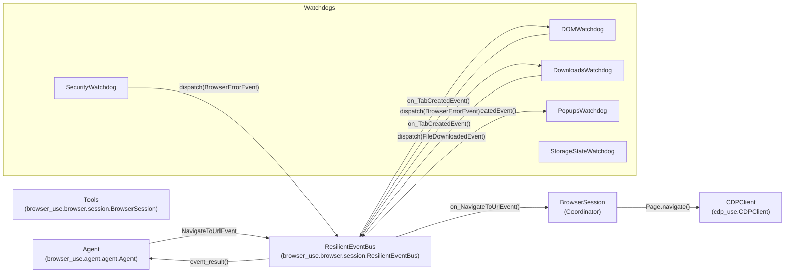
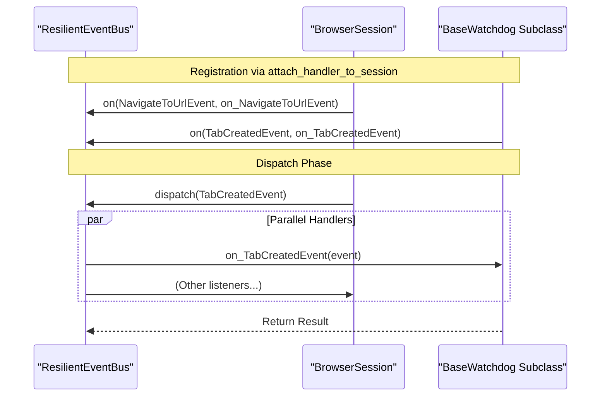
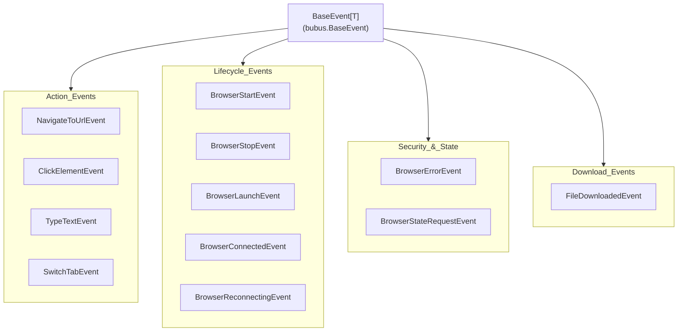

<!-- source: DeepWiki mcp.deepwiki.com · repo browser-use/browser-use · page 4 Event-Driven Architecture · fetched 2026-10-30 -->

# Event-Driven Architecture

Relevant source files

The following files were used as context for generating this wiki page:

- [browser_use/browser/events.py](browser_use/browser/events.py)
- [browser_use/browser/profile.py](browser_use/browser/profile.py)
- [browser_use/browser/session.py](browser_use/browser/session.py)
- [browser_use/browser/watchdog_base.py](browser_use/browser/watchdog_base.py)

**Purpose**: This document describes the event-driven architecture that powers browser-use's browser control system. The EventBus-based pub/sub pattern enables loose coupling between components, allowing watchdogs to monitor and react to browser events without direct dependencies. This architecture replaces traditional imperative browser control with a reactive, event-driven model.

**Scope**: Covers the EventBus system, event definitions, handler registration, the watchdog pattern, and event lifecycle management. For browser session lifecycle and CDP connection management, see [Browser Session Management](#3). For specific watchdog implementations, see [Core Watchdog Implementations](#4.4).

---

## Architecture Overview

The event-driven architecture consists of three core components working together:

1.  **EventBus**: Central message routing system using `ResilientEventBus` (a specialized subclass of `bubus.EventBus`) [browser_use/browser/session.py:106-132]().
2.  **Events**: Strongly-typed messages representing browser actions and state changes [browser_use/browser/events.py:51-203]().
3.  **Watchdogs**: Independent monitoring components that listen to and emit events [browser_use/browser/watchdog_base.py:15-38]().

This architecture provides several key benefits:
*   **Loose coupling**: Components communicate through events, not direct method calls.
*   **Extensibility**: New watchdogs can be added without modifying core code.
*   **Observability**: All interactions flow through the event bus and can be logged/traced [browser_use/browser/watchdog_base.py:148-150]().
*   **Resilience**: A "Circuit Breaker" pattern in `BaseWatchdog` prevents handlers from hanging if the CDP connection is lost or while reconnection is in progress [browser_use/browser/watchdog_base.py:95-124]().
*   **Warm Resume Support**: `ResilientEventBus` prevents crashes during warm-Lambda resumes (e.g., in AWS environments) by gracefully handling `step()` calls on torn-down buses [browser_use/browser/session.py:118-131]().

**Code Entity Mapping: Architecture**

Sources: [browser_use/browser/session.py:106-132](), [browser_use/browser/events.py:110](), [browser_use/browser/watchdog_base.py:15-38]()

---

## EventBus Fundamentals

The `ResilientEventBus` provides asynchronous pub/sub messaging with specialized handling for session persistence. For details on event flow and subscribers, see [Event System Overview](#4.1).

**Core Capabilities**:
*   **Type-safe dispatch**: Events inherit from `BaseEvent[T]` with return type specified via Pydantic models [browser_use/browser/events.py:51](), [browser_use/browser/events.py:110]().
*   **Multiple handlers**: Any number of watchdogs can listen to the same event.
*   **Result aggregation**: Handlers can return values that the dispatcher waits for [browser_use/browser/watchdog_base.py:153-168]().
*   **Event history**: The system tracks event history for debugging and state reconstruction [browser_use/browser/watchdog_base.py:126-147]().
*   **Timeout enforcement**: Each event type has configurable timeout limits via environment variables (e.g., `TIMEOUT_NavigateToUrlEvent`) [browser_use/browser/events.py:16-43]().
*   **Resilience**: Inherits from `EventBus` but modifies `step()` and `wait_until_idle()` to no-op on torn-down buses (where `event_queue` or `_on_idle` are `None`) instead of asserting [browser_use/browser/session.py:118-131]().

**Handler Registration Pattern**

Handlers follow a strict naming convention: `on_EventTypeName`. The `BaseWatchdog.attach_handler_to_session` method automates this registration by scanning for these methods and attaching them to the `EventBus` [browser_use/browser/watchdog_base.py:56-71]().

**Code Entity Mapping: Event Handling**

Sources: [browser_use/browser/session.py:106-132](), [browser_use/browser/watchdog_base.py:56-153](), [browser_use/browser/events.py:51-203]()

---

## Event Categories and Types

Events are organized into functional categories based on their purpose in the system. For a comprehensive list of all events and payloads, see [Event Types Reference](#4.2).

**Event Type Hierarchy**

**Event Categories Reference**

| Category | Key Events | Purpose |
|----------|------------|---------|
| **Action** | `NavigateToUrlEvent`, `ClickElementEvent`, `TypeTextEvent` | High-level browser actions requested by Agent/Tools [browser_use/browser/events.py:110-157](). |
| **Lifecycle** | `BrowserLaunchEvent`, `BrowserConnectedEvent`, `BrowserStopEvent`, `BrowserReconnectingEvent` | Browser process, connection, and recovery management [browser_use/browser/session.py:34-54](). |
| **State** | `BrowserStateRequestEvent` | State capture (DOM, screenshots) [browser_use/browser/events.py:194-201](). |
| **Download** | `FileDownloadedEvent` | File download tracking via `DownloadsWatchdog` [browser_use/browser/session.py:47](). |

Sources: [browser_use/browser/events.py:28-203](), [browser_use/browser/session.py:34-54]()

---

## Watchdog Pattern

Watchdogs are self-contained monitoring components that observe browser state and react to changes. They communicate exclusively through events, creating a loosely-coupled architecture. For details on base architecture and the circuit breaker pattern, see [Watchdog Pattern and Base Classes](#4.3).

**BaseWatchdog Class Structure**

The `BaseWatchdog` provides the foundation for all specialized monitors. It defines `LISTENS_TO` and `EMITS` class variables to declare its event contract [browser_use/browser/watchdog_base.py:33-34]().

| Feature | Description |
|----------|----------------|
| **Circuit Breaker** | Automatically skips or waits for reconnection if the CDP WebSocket is disconnected [browser_use/browser/watchdog_base.py:95-117](). |
| **Lifecycle Exemption** | Critical events (e.g. `BrowserStartEvent`, `BrowserReconnectingEvent`) bypass connection checks via `LIFECYCLE_EVENT_NAMES` to ensure recovery [browser_use/browser/watchdog_base.py:78-89](). |
| **Auto-Registration** | `attach_handler_to_session` validates and registers methods matching `on_EventTypeName` [browser_use/browser/watchdog_base.py:56-71](). |

Sources: [browser_use/browser/watchdog_base.py:15-153]()

---

## Child Pages

For deeper technical details on specific parts of the event system, refer to the following sub-pages:

- **[Event System Overview](#4.1)**: Detailed architecture of the `EventBus` and internal message flow.
- **[Event Types Reference](#4.2)**: Comprehensive list of all event classes and their parameters.
- **[Watchdog Pattern and Base Classes](#4.3)**: Implementation details of `BaseWatchdog` and automatic handler registration.
- **[Core Watchdog Implementations](#4.4)**: Deep dives into `DOMWatchdog`, `DownloadsWatchdog`, `PopupsWatchdog`, and others.
- **[Recording and HAR Watchdogs](#4.5)**: Video recording via `video_recorder.py`, HAR recording, and demo mode visualization.

---

