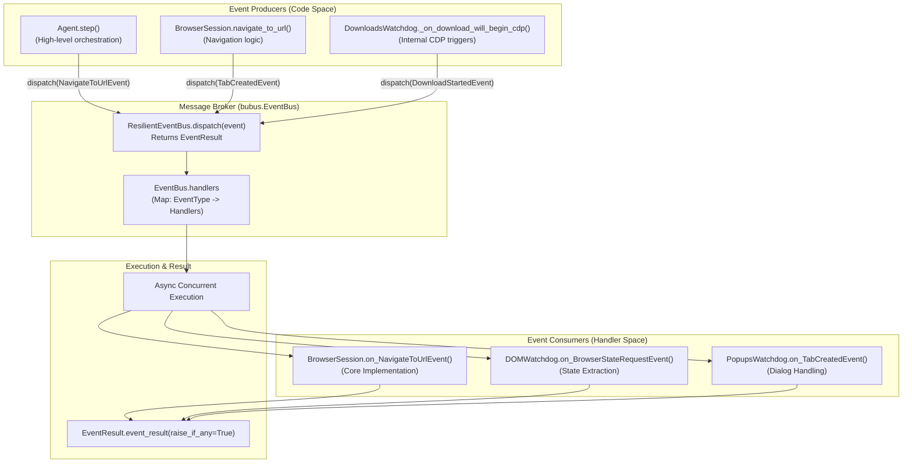
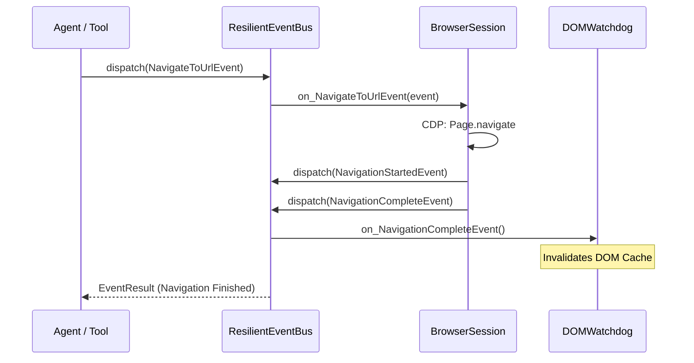
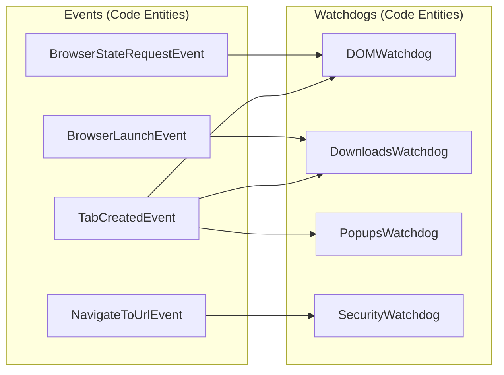

<!-- source: DeepWiki mcp.deepwiki.com · repo browser-use/browser-use · page 4.1 Event System Overview · fetched 2026-10-30 -->

# Event System Overview

Relevant source files

The following files were used as context for generating this wiki page:

- [browser_use/browser/events.py](browser_use/browser/events.py)
- [browser_use/browser/profile.py](browser_use/browser/profile.py)
- [browser_use/browser/session.py](browser_use/browser/session.py)
- [browser_use/browser/watchdog_base.py](browser_use/browser/watchdog_base.py)

## Purpose and Scope

The `browser-use` framework utilizes a sophisticated event-driven architecture to decouple browser control logic from agent orchestration. This system enables high extensibility, allowing specialized components (Watchdogs) to monitor and react to browser state changes without modifying the core execution loop. 

This page details the `EventBus` architecture, the flow from event producers to consumers, and the mechanisms ensuring robust, asynchronous communication.

**Sources:** [browser_use/browser/session.py:1-54](), [browser_use/browser/watchdog_base.py:1-22]()

---

## EventBus Architecture

The `BrowserSession` class serves as the owner of a central `EventBus` instance. In `browser-use`, this is specifically implemented as a `ResilientEventBus`, a subclass of the `bubus.EventBus` [browser_use/browser/session.py:106-132]().

### ResilientEventBus
The `ResilientEventBus` is designed to handle "warm-Lambda" resume scenarios or keep-alive sessions where an `Agent` might have closed, nulling async primitives to release the event loop [browser_use/browser/session.py:107-112](). It overrides `step()` and `wait_until_idle()` to no-op if the bus is torn down (i.e., `event_queue` or `_on_idle` are `None`), preventing assertion errors that occur in the base `bubus` implementation [browser_use/browser/session.py:118-131]().

### Lifecycle and Re-initialization
The `EventBus` persists for the duration of a `BrowserSession`. However, during critical resets (such as `stop()` or `kill()`), the bus is stopped to prevent stale events or pending tasks from affecting subsequent runs [browser_use/browser/session.py:500-510](). The `ResilientEventBus` ensures that if a new `dispatch()` is called after a teardown, the bus restarts correctly by recreating the internal queue [tests/ci/test_event_bus_resilience.py:52-70]().

**Sources:** [browser_use/browser/session.py:106-132](), [tests/ci/test_event_bus_resilience.py:1-6](), [tests/ci/test_event_bus_resilience.py:39-70]()

---

## Event Flow Architecture

The following diagram bridges the high-level system concepts to the specific code entities involved in event processing.

### System Flow: Natural Language to Code Entities

**Sources:** [browser_use/browser/events.py:110-201](), [browser_use/browser/watchdog_base.py:151-168](), [browser_use/browser/session.py:106-132]()

---

## Event Producers

Events are triggered by three primary layers within the architecture. The `BaseEvent` class provides the foundation for all events, including specialized fields like `event_timeout` which are often parsed from environment variables via `_get_timeout` [browser_use/browser/events.py:7-43]().

| Producer Layer | Primary Code Entities | Key Events Dispatched |
|:---|:---|:---|
| **Agent / Tools** | `Agent`, `Tools` registry | `NavigateToUrlEvent`, `ClickElementEvent`, `ScreenshotEvent` |
| **Browser Core** | `BrowserSession` | `BrowserStartEvent`, `TabCreatedEvent`, `AgentFocusChangedEvent` |
| **Watchdogs** | `DownloadsWatchdog`, `SecurityWatchdog` | `FileDownloadedEvent`, `BrowserErrorEvent`, `NavigationStartedEvent` |

### Sequence: Navigation and State Extraction
When an Agent requests a new URL, a chain of events ensures all components synchronize.

**Sources:** [browser_use/browser/events.py:110-123](), [browser_use/browser/session.py:34-54](), [browser_use/browser/watchdog_base.py:93-123]()

---

## Handler Registration and Safety

### Automatic Registration
Watchdogs inherit from `BaseWatchdog`, which uses a convention-based registration system. Any method prefixed with `on_` followed by an event class name is automatically attached to the `EventBus` via the `attach_handler_to_session` static method [browser_use/browser/watchdog_base.py:15-22](), [browser_use/browser/watchdog_base.py:56-72]().

### The Circuit Breaker Pattern
To prevent "zombie" handlers from trying to execute commands on a dead browser connection, the system wraps every handler in a circuit breaker within `make_unique_handler` [browser_use/browser/watchdog_base.py:93-123]().

1. **Lifecycle Exemption:** Events like `BrowserStartEvent`, `BrowserStopEvent`, `BrowserLaunchEvent`, and `BrowserReconnectedEvent` bypass the check as they manage the connection itself [browser_use/browser/watchdog_base.py:78-89]().
2. **Reconnection Wait:** If the CDP connection is lost but a reconnection is in progress (`browser_session.is_reconnecting`), the handler waits for `browser_session._reconnect_event.wait()` for a period defined by `RECONNECT_WAIT_TIMEOUT` [browser_use/browser/watchdog_base.py:100-111]().
3. **Silent Skip:** If CDP is disconnected and no reconnection is active, the handler execution is skipped to prevent hanging [browser_use/browser/watchdog_base.py:118-123]().

**Sources:** [browser_use/browser/watchdog_base.py:56-123](), [browser_use/browser/watchdog_base.py:15-38]()

---

## Core Watchdog Integration

Watchdogs are the primary consumers of the event system. They maintain specialized state by listening to the stream of browser events. Each watchdog defines `LISTENS_TO` and `EMITS` class variables to statically document its event interface [browser_use/browser/watchdog_base.py:31-34]().

| Watchdog | Key Listened Events | Role |
|:---|:---|:---|
| `DOMWatchdog` | `TabCreatedEvent`, `BrowserStateRequestEvent` | Manages DOM extraction and caches `SerializedDOMState`. |
| `DownloadsWatchdog` | `BrowserLaunchEvent`, `TabCreatedEvent` | Monitors CDP `Fetch` events and emits `FileDownloadedEvent`. |
| `PopupsWatchdog` | `TabCreatedEvent` | Monitors CDP `Page.javascriptDialogOpening` to handle alerts. |
| `SecurityWatchdog` | `NavigateToUrlEvent`, `TabCreatedEvent` | Enforces domain allowlists and blocks unauthorized navigation. |

### Code Entity Mapping: Watchdogs and Events

**Sources:** [browser_use/browser/events.py:110-201](), [browser_use/browser/watchdog_base.py:31-34]()

---

## Error Handling and Recovery

When an event handler fails, the system provides structured error management:

1. **Capture:** The `make_unique_handler` wrapper catches exceptions during the execution of the `actual_handler(event)` [browser_use/browser/watchdog_base.py:152-169]().
2. **Logging:** Detailed error info, including the parent event ID and the specific watchdog/handler name, is logged via `browser_session.logger` [browser_use/browser/watchdog_base.py:148-150](), [browser_use/browser/watchdog_base.py:173-180]().
3. **Re-raising:** The exception is re-raised (or the original error is preserved) to ensure the caller (e.g., the Agent or Tool) can handle the failure appropriately [browser_use/browser/watchdog_base.py:204]().

**Sources:** [browser_use/browser/watchdog_base.py:148-205]()

---

