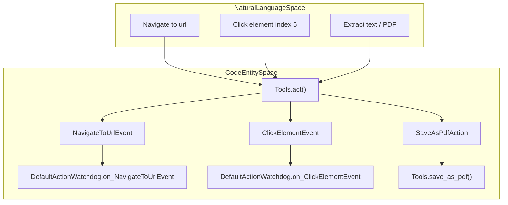
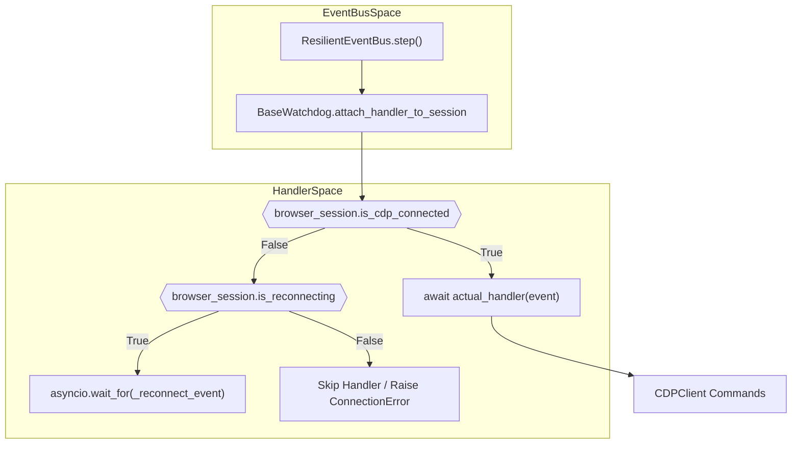
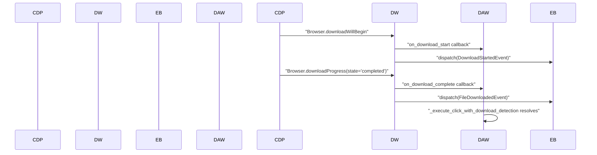

<!-- source: DeepWiki mcp.deepwiki.com · repo browser-use/browser-use · page 4.2 Event Types Reference · fetched 2026-10-30 -->

# Event Types Reference

Relevant source files

The following files were used as context for generating this wiki page:

- [browser_use/browser/events.py](browser_use/browser/events.py)
- [browser_use/browser/profile.py](browser_use/browser/profile.py)
- [browser_use/browser/session.py](browser_use/browser/session.py)
- [browser_use/browser/watchdog_base.py](browser_use/browser/watchdog_base.py)
- [browser_use/browser/watchdogs/default_action_watchdog.py](browser_use/browser/watchdogs/default_action_watchdog.py)
- [browser_use/tools/service.py](browser_use/tools/service.py)
- [browser_use/tools/views.py](browser_use/tools/views.py)
- [examples/features/save_as_pdf.py](examples/features/save_as_pdf.py)
- [tests/ci/browser/test_send_keys_literal_plus.py](tests/ci/browser/test_send_keys_literal_plus.py)
- [tests/ci/test_action_save_as_pdf.py](tests/ci/test_action_save_as_pdf.py)

## Purpose and Scope

This page provides a comprehensive reference of all event types defined in the `browser-use` event system. Events are the primary communication mechanism between components, enabling loose coupling between the `Agent`, `Tools`, `BaseWatchdog`, and `BrowserSession` layers. The system uses `bubus.BaseEvent` as the foundation for all event definitions, providing built-in support for timeouts, parent-child event tracking, and asynchronous result retrieval [browser_use/browser/events.py:7-10]().

For an introduction to the event-driven architecture and `EventBus`, see [Event System Overview](). For information about how watchdogs handle events, see [Watchdog Pattern and Base Classes](). For specific watchdog implementations, see [Core Watchdog Implementations]().

Sources: [browser_use/browser/events.py:1-10](), [browser_use/browser/watchdog_base.py:1-22]()

---

## Event Categories and Architecture Mapping

Events in `browser-use` are organized into primary categories based on their purpose and flow direction. This structure bridges the gap between high-level AI decisions and low-level browser execution.

### Natural Language Space to Code Entity Space

The following diagrams illustrate how natural language intents translate into specific event classes, watchdog handlers, and CDP operations across the system architecture.

**Natural Language to Event Mapping**

**Event Dispatch and Execution Flow**

Sources: [browser_use/browser/events.py:46-209](), [browser_use/browser/watchdog_base.py:56-123](), [browser_use/tools/service.py:18-61]()

---

## Control Events (Agent Actions)

Control events are dispatched by the `Agent` or `Tools` layer to request browser actions. These flow from high-level code to the browser layer through the `EventBus`.

### Navigation and Page Control

| Event Class | Purpose | Key Fields | Result Type | Default Timeout |
|-------------|---------|------------|-------------|-----------------|
| `NavigateToUrlEvent` | Navigate to a URL | `url: str` `wait_until: Literal['load', 'domcontentloaded', 'networkidle', 'commit']` `new_tab: bool` | `None` | 30s |
| `GoBackEvent` | Navigate back in history | None | `None` | 15s |
| `GoForwardEvent` | Navigate forward in history | None | `None` | 15s |
| `RefreshEvent` | Reload current page | None | `None` | 15s |
| `SwitchTabEvent` | Switch to different tab | `target_id: TargetID \| None` (None = most recent) | `TargetID` | 10s |
| `CloseTabEvent` | Close a tab | `target_id: TargetID` | `None` | 10s |

Sources: [browser_use/browser/events.py:110-123](), [browser_use/browser/events.py:169-183](), [browser_use/browser/watchdogs/default_action_watchdog.py:10-24]()

### Element Interaction

All element-related events inherit from `ElementSelectedEvent` [browser_use/browser/events.py:51](), which includes a Pydantic validator `serialize_node` [browser_use/browser/events.py:56-83]() to strip circular references (like `parent_node` or `children_nodes`) from `EnhancedDOMTreeNode` before dispatching.

| Event Class | Purpose | Key Fields | Result Type | Default Timeout |
|-------------|---------|------------|-------------|-----------------|
| `ClickElementEvent` | Click an element | `node: EnhancedDOMTreeNode` `button: Literal['left', 'right', 'middle']` | `dict[str, Any] \| None` | 15s |
| `ClickCoordinateEvent` | Click at coordinates | `coordinate_x: int` `coordinate_y: int` `button: Literal['left', 'right', 'middle']` `force: bool` | `dict` | 15s |
| `TypeTextEvent` | Type text into element | `node: EnhancedDOMTreeNode` `text: str` `clear: bool` `is_sensitive: bool` | `dict \| None` | 60s |
| `SendKeysEvent` | Send keyboard shortcuts | `keys: str` (e.g., "Escape", "Enter") | `None` | 60s |
| `UploadFileEvent` | Upload file to element | `node: EnhancedDOMTreeNode` `file_path: str` | `None` | 30s |

Sources: [browser_use/browser/events.py:51-83](), [browser_use/browser/events.py:125-157](), [browser_use/browser/watchdogs/default_action_watchdog.py:30-38]()

### Scrolling and Viewport

| Event Class | Purpose | Key Fields | Result Type | Default Timeout |
|-------------|---------|------------|-------------|-----------------|
| `ScrollEvent` | Scroll page or element | `direction: Literal['up', 'down', 'left', 'right']` `amount: int` (pixels) `node: EnhancedDOMTreeNode \| None` | `None` | 8s |
| `ScrollToTextEvent` | Scroll to specific text | `text: str` `direction: Literal['up', 'down']` | `None` | 15s |

Sources: [browser_use/browser/events.py:159-167](), [browser_use/browser/watchdogs/default_action_watchdog.py:17-18]()

### State Capture

| Event Class | Purpose | Key Fields | Result Type | Default Timeout |
|-------------|---------|------------|-------------|-----------------|
| `BrowserStateRequestEvent` | Request current browser state | `include_dom: bool` `include_screenshot: bool` `include_recent_events: bool` | `BrowserStateSummary` | 30s |
| `ScreenshotEvent` | Take a screenshot | `full_page: bool` `clip: dict[str, float] \| None` | `str` (base64) | 15s |
| `WaitEvent` | Wait for specified seconds | `seconds: float` `max_seconds: float` | `None` | 60s |

Sources: [browser_use/browser/events.py:185-209](), [browser_use/browser/session.py:43]()

---

## Lifecycle Events

Lifecycle events manage browser process lifecycle, connection state, and tab management. These are typically dispatched by `BrowserSession` or internal session managers.

### Browser Process Management

| Event Class | Purpose | Key Fields | Result Type | Default Timeout |
|-------------|---------|------------|-------------|-----------------|
| `BrowserLaunchEvent` | Launch local browser process | None | `BrowserLaunchResult` | 30s |
| `BrowserStartEvent` | Start/connect to browser | None | `None` | 30s |
| `BrowserStopEvent` | Stop/disconnect from browser | None | `None` | 45s |
| `BrowserStoppedEvent` | Browser has fully stopped | None | `None` | 30s |

Sources: [browser_use/browser/session.py:38-45](), [browser_use/browser/watchdog_base.py:78-89]()

### Connection and Tab Status

| Event Class | Purpose | Key Fields | Result Type | Default Timeout |
|-------------|---------|------------|-------------|-----------------|
| `BrowserConnectedEvent` | Browser has connected | None | `None` | 30s |
| `TabCreatedEvent` | New tab was created | None | `None` | 30s |
| `TabClosedEvent` | Tab was closed | `target_id: TargetID` | `None` | 10s |
| `AgentFocusChangedEvent` | Agent focus changed tab | `target_id: TargetID` `url: str` | `None` | 10s |

Sources: [browser_use/browser/session.py:35-53]()

---

## Notification and Error Events

These events inform components about browser state changes, navigation progress, and errors.

| Event Class | Purpose | Key Fields | Result Type | Default Timeout |
|-------------|---------|------------|-------------|-----------------|
| `NavigationStartedEvent` | Navigation has started | `target_id: TargetID` `url: str` | `None` | 30s |
| `NavigationCompleteEvent` | Navigation completed | `target_id: TargetID` | `None` | 30s |
| `BrowserErrorEvent` | General browser error | None | `None` | 30s |

Sources: [browser_use/browser/session.py:37-50]()

---

## Storage and File System Events

These events handle persistence and file I/O operations, typically managed by specialized watchdogs like `DownloadsWatchdog` [browser_use/browser/watchdogs/default_action_watchdog.py:108]().

### File Download Flow

The `DefaultActionWatchdog` implements `_execute_click_with_download_detection` to bridge the gap between a click action and the asynchronous file download it might trigger [browser_use/browser/watchdogs/default_action_watchdog.py:44-60]().

**Download Sequence**

| Event Class | Purpose | Key Fields | Result Type | Default Timeout |
|-------------|---------|------------|-------------|-----------------|
| `FileDownloadedEvent` | Download completed | None | `None` | 30s |

Sources: [browser_use/browser/session.py:47](), [browser_use/browser/watchdogs/default_action_watchdog.py:44-115]()

---

## Event Timeout Configuration

All events have configurable timeouts enforced by the `EventBus`. Timeouts prevent handlers from blocking the system indefinitely.

### Timeout Mechanism
The `_get_timeout` function [browser_use/browser/events.py:16-43]() looks for environment variables prefixed with `TIMEOUT_` (e.g., `TIMEOUT_NavigateToUrlEvent`). If not found, it uses the hardcoded default in the event's `Field` definition.

### Global Action Hang Guard
A separate global timeout `_DEFAULT_ACTION_TIMEOUT_S` (default 180s) is enforced at the `Tools` service level [browser_use/tools/service.py:142](). This acts as a last-resort guard against hung event handlers or dead CDP WebSocket connections [browser_use/tools/service.py:99-110]().

Sources: [browser_use/browser/events.py:16-43](), [browser_use/tools/service.py:99-142]()

---

