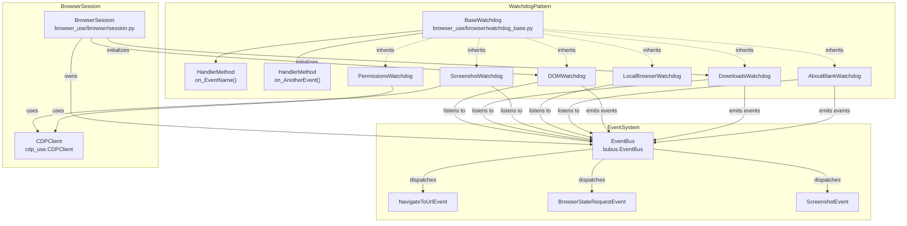
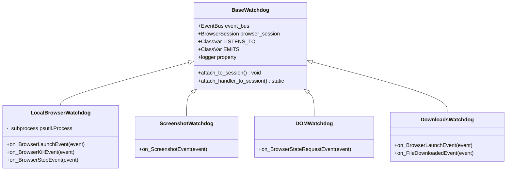
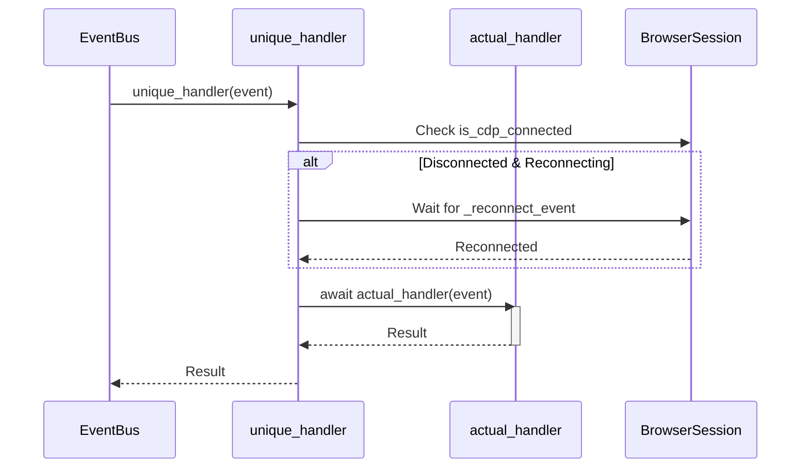

<!-- source: DeepWiki mcp.deepwiki.com · repo browser-use/browser-use · page 4.3 Watchdog Pattern and Base Classes · fetched 2026-10-30 -->

# Watchdog Pattern and Base Classes

<details>
<summary>Relevant source files</summary>

The following files were used as context for generating this wiki page:

- [browser_use/browser/events.py](browser_use/browser/events.py)
- [browser_use/browser/profile.py](browser_use/browser/profile.py)
- [browser_use/browser/session.py](browser_use/browser/session.py)
- [browser_use/browser/watchdog_base.py](browser_use/browser/watchdog_base.py)

</details>


This page documents the watchdog pattern used throughout `browser-use` for event-driven browser monitoring and control. Watchdogs are autonomous components that listen for specific events, perform actions, and emit new events. This page covers the `BaseWatchdog` architecture, automatic handler registration via `on_*` methods, and the circuit breaker pattern.

## Watchdog Architecture Overview

The watchdog pattern provides a decoupled, event-driven architecture where each watchdog monitors specific aspects of browser behavior without direct dependencies on other components. Watchdogs automatically register event handlers based on method naming conventions and coordinate through the `EventBus`.

### Watchdog Pattern Architecture



Sources: [browser_use/browser/watchdog_base.py:15-22](), [browser_use/browser/session.py:134-154](), [browser_use/browser/watchdogs/screenshot_watchdog.py:17-21](), [browser_use/browser/watchdogs/local_browser_watchdog.py:29-37]()

### Key Watchdog Properties

| Property | Type | Description |
|----------|------|-------------|
| `event_bus` | `EventBus` | Shared event bus for all watchdogs. |
| `browser_session` | `BrowserSession` | Browser session providing CDP access and state. |
| `LISTENS_TO` | `ClassVar[list[type[BaseEvent]]]` | Static definition of events this watchdog handles. |
| `EMITS` | `ClassVar[list[type[BaseEvent]]]` | Static definition of events this watchdog dispatches. |

Sources: [browser_use/browser/watchdog_base.py:33-38]()

## BaseWatchdog Class

`BaseWatchdog` is the base class for all browser monitoring components. It leverages Pydantic for configuration and `bubus` for event handling.

### Class Hierarchy and Entity Mapping



Sources: [browser_use/browser/watchdog_base.py:15-40](), [browser_use/browser/watchdogs/local_browser_watchdog.py:29-46](), [browser_use/browser/watchdogs/screenshot_watchdog.py:17-24]()

### Pydantic Configuration
`BaseWatchdog` uses strict Pydantic configuration to prevent implicit state and ensure instance stability during event loops.

```python
model_config = ConfigDict(
    arbitrary_types_allowed=True,  # allow EventBus/BrowserSession
    extra='forbid',                # dont allow implicit class/instance state
    validate_assignment=False,     # avoid re-triggering validators on every assignment
    revalidate_instances='never',  # avoid erasing private attrs
)
```

Sources: [browser_use/browser/watchdog_base.py:24-29]()

## Automatic Handler Registration

Watchdogs use a naming convention to automatically discover and register event handlers. Any method named `on_EventTypeName` is automatically registered as a handler for that event type.

### Registration Process
When `attach_to_session()` is called, the class inspects its own methods:

1.  **Discovery**: It looks for methods starting with `on_`. [browser_use/browser/watchdog_base.py:205-208]()
2.  **Event Mapping**: It maps the method name (e.g., `on_ScreenshotEvent`) to the corresponding event class. [browser_use/browser/watchdog_base.py:221-224]()
3.  **Validation**: If `LISTENS_TO` is defined, it verifies the event is declared. [browser_use/browser/watchdog_base.py:226-230]()
4.  **Wrapping**: It creates a unique handler wrapper that includes the **Circuit Breaker** logic and logging. [browser_use/browser/watchdog_base.py:93-168]()
5.  **Bus Registration**: It registers the wrapped handler with the `EventBus`. [browser_use/browser/watchdog_base.py:245-247]()

Sources: [browser_use/browser/watchdog_base.py:198-247]()

## Circuit Breaker Pattern

To prevent event handlers from hanging or failing cryptically when the browser connection is lost, `BaseWatchdog` implements a circuit breaker within the handler wrapper.

### Execution Flow
Every event handled by a watchdog passes through this logic:

1.  **Lifecycle Exemption**: Events like `BrowserStopEvent`, `BrowserStartEvent`, or `BrowserErrorEvent` always run to allow the system to clean up or report the crash. [browser_use/browser/watchdog_base.py:78-89]()
2.  **Connection Check**: If the event is not a lifecycle event, it checks `browser_session.is_cdp_connected`. [browser_use/browser/watchdog_base.py:98-98]()
3.  **Reconnection Wait**: If disconnected but `is_reconnecting` is True, the handler waits for up to `RECONNECT_WAIT_TIMEOUT`. [browser_use/browser/watchdog_base.py:100-112]()
4.  **Silent Skip**: If disconnected and not reconnecting, the handler is skipped with a debug log to prevent blocking the agent. [browser_use/browser/watchdog_base.py:118-123]()

Sources: [browser_use/browser/watchdog_base.py:93-124]()

### Handler Wrapper Logic
The wrapper provides detailed debug logging, showing the ancestry of events to help developers trace complex interactions.



Sources: [browser_use/browser/watchdog_base.py:147-168]()

## Core Watchdog Implementations

| Watchdog | Purpose | Key Events |
|----------|---------|------------|
| `LocalBrowserWatchdog` | Manages local browser subprocess lifecycle (launch, kill, cleanup). | `BrowserLaunchEvent`, `BrowserKillEvent`, `BrowserStopEvent` |
| `ScreenshotWatchdog` | Handles screenshot requests using CDP `Page.captureScreenshot`. | `ScreenshotEvent` |
| `DOMWatchdog` | Manages DOM tree building, serialization, and interactive element detection. | `BrowserStateRequestEvent`, `TabCreatedEvent` |
| `DownloadsWatchdog` | Monitors CDP for file downloads and emits completion events. | `BrowserLaunchEvent`, `FileDownloadedEvent` |
| `PopupsWatchdog` | Automatically handles/dismisses JavaScript alerts, confirms, and prompts. | `TabCreatedEvent` |
| `SecurityWatchdog` | Enforces URL allowlist/blocklist policies and blocks disallowed domains. | `NavigateToUrlEvent`, `NavigationCompleteEvent` |

Sources: [browser_use/browser/watchdogs/local_browser_watchdog.py:29-37](), [browser_use/browser/watchdogs/screenshot_watchdog.py:17-21](), [browser_use/browser/watchdog_base.py:78-89]()

### Specialized Behavior: LocalBrowserWatchdog
The `LocalBrowserWatchdog` handles the low-level orchestration of the browser process. It finds installed browser binaries [browser_use/browser/watchdogs/local_browser_watchdog.py:130-137](), launches them with specific `BrowserProfile` arguments [browser_use/browser/watchdogs/local_browser_watchdog.py:108-117](), and manages temporary user data directories to avoid singleton lock conflicts [browser_use/browser/watchdogs/local_browser_watchdog.py:183-185]().

Sources: [browser_use/browser/watchdogs/local_browser_watchdog.py:93-185]()

---

