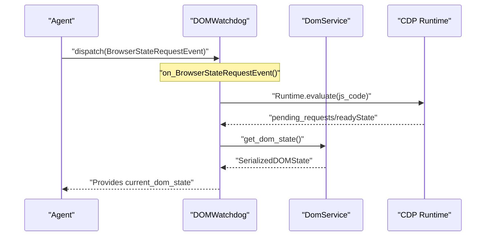
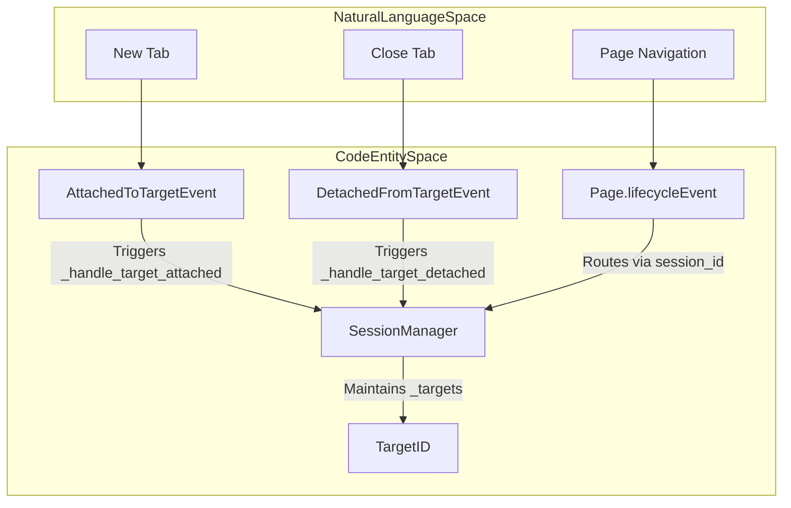

<!-- source: DeepWiki mcp.deepwiki.com · repo browser-use/browser-use · page 4.4 Core Watchdog Implementations · fetched 2026-10-30 -->

# Core Watchoid Implementations

Relevant source files

The following files were used as context for generating this wiki page:

- [.gitignore](.gitignore)
- [.python-version](.python-version)
- [browser_use/browser/demo_mode.py](browser_use/browser/demo_mode.py)
- [browser_use/browser/python_highlights.py](browser_use/browser/python_highlights.py)
- [browser_use/browser/session_manager.py](browser_use/browser/session_manager.py)
- [browser_use/browser/watchdogs/crash_watchdog.py](browser_use/browser/watchdogs/crash_watchdog.py)
- [browser_use/browser/watchdogs/dom_watchdog.py](browser_use/browser/watchdogs/dom_watchdog.py)
- [browser_use/browser/watchdogs/downloads_watchdog.py](browser_use/browser/watchdogs/downloads_watchdog.py)
- [browser_use/browser/watchdogs/local_browser_watchdog.py](browser_use/browser/watchdogs/local_browser_watchdog.py)
- [browser_use/browser/watchdogs/popups_watchdog.py](browser_use/browser/watchdogs/popups_watchdog.py)
- [browser_use/browser/watchdogs/screenshot_watchdog.py](browser_use/browser/watchdogs/screenshot_watchdog.py)
- [browser_use/browser/watchdogs/security_watchdog.py](browser_use/browser/watchdogs/security_watchdog.py)
- [browser_use/dom/serializer/eval_serializer.py](browser_use/dom/serializer/eval_serializer.py)
- [examples/features/large_blocklist.py](examples/features/large_blocklist.py)
- [tests/ci/security/test_ip_blocking.py](tests/ci/security/test_ip_blocking.py)
- [tests/ci/test_downloads_watchdog.py](tests/ci/test_downloads_watchdog.py)
- [tests/ci/test_remote_download_complete_callback.py](tests/ci/test_remote_download_complete_callback.py)

This page documents the concrete watchdog implementations that extend `BaseWatchdog` to provide browser monitoring, DOM processing, download handling, popup management, crash detection, local browser subprocess management, and security enforcement. These watchdogs coordinate via the event bus to implement browser-use's event-driven architecture.

---

## Watchdog Overview

Browser-use includes several specialized watchdog implementations that handle different aspects of browser control and monitoring:

| Watchdog | Primary Responsibility | Key Events Listened | Key Events Emitted |
|----------|----------------------|-------------------|-------------------|
| `DOMWatchdog` | DOM tree building and serialization | `BrowserStateRequestEvent`, `TabCreatedEvent` | `BrowserErrorEvent` |
| `DownloadsWatchdog` | File download monitoring and handling | `NavigationCompleteEvent`, `TabCreatedEvent`, `BrowserLaunchEvent` | `FileDownloadedEvent`, `DownloadStartedEvent`, `DownloadProgressEvent` |
| `LocalBrowserWatchdog` | Managing browser subprocess lifecycle | `BrowserLaunchEvent`, `BrowserKillEvent`, `BrowserStopEvent` | None |
| `PopupsWatchdog` | JavaScript dialog auto-dismissal | `TabCreatedEvent` | None (handles silently) |
| `ScreenshotWatchdog` | Handling screenshot requests using CDP | `ScreenshotEvent` | None |
| `CrashWatchdog` | Browser health and crash detection | `BrowserConnectedEvent`, `TabCreatedEvent`, `TabClosedEvent` | `BrowserErrorEvent` |
| `SecurityWatchdog` | URL access policy enforcement | `NavigateToUrlEvent`, `NavigationCompleteEvent`, `TabCreatedEvent` | `BrowserErrorEvent` |

Sources: [browser_use/browser/watchdogs/dom_watchdog.py:36-37](), [browser_use/browser/watchdogs/downloads_watchdog.py:111-125](), [browser_use/browser/watchdogs/local_browser_watchdog.py:33-40](), [browser_use/browser/watchdogs/screenshot_watchdog.py:21-24](), [browser_use/browser/watchdogs/security_watchdog.py:26-33]()

---

## Core Implementation Details

### DOMWatchdog

`DOMWatchdog` acts as the bridge between the event-driven browser session and the `DomService`. It maintains the `selector_map` used by the agent to interact with elements.

*   **State Cache**: Maintains public properties `selector_map`, `current_dom_state`, and `enhanced_dom_tree` for access by the Agent and other watchdogs [browser_use/browser/watchdogs/dom_watchdog.py:40-42]().
*   **Network Tracking**: Uses a sophisticated JavaScript injection via `Runtime.evaluate` to detect pending network requests. It filters out ads, tracking (e.g., `doubleclick.net`, `googlesyndication.com`), and non-critical resources like fonts/images if they exceed a specific loading duration [browser_use/browser/watchdogs/dom_watchdog.py:107-195]().
*   **Event Context**: Implements `_get_recent_events_str` to extract the last N events from the `EventBus` history, providing serialized JSON containing `event_type`, `timestamp`, and relevant metadata like `url` or `error_message` [browser_use/browser/watchdogs/dom_watchdog.py:54-91]().

Sources: [browser_use/browser/watchdogs/dom_watchdog.py:28-48](), [browser_use/browser/watchdogs/dom_watchdog.py:107-195]()

### DownloadsWatchdog

`DownloadsWatchdog` monitors both explicit CDP download events and implicit downloads triggered by network responses with specific MIME types or headers.

*   **Attachment Detection**: Uses `_filename_from_content_disposition` and MIME type checking to identify downloads that Chromium might otherwise render inline (e.g., PDFs) [browser_use/browser/watchdogs/downloads_watchdog.py:64-105]().
*   **Direct Callbacks**: To ensure synchronized execution during tool calls, it supports `register_download_callbacks`. This allows the `Agent` or `ClickAction` to receive immediate notification of `on_start`, `on_progress`, and `on_complete` without waiting for the asynchronous `EventBus` queue [browser_use/browser/watchdogs/downloads_watchdog.py:146-169]().
*   **Extension Filtering**: Maintains a list of recognized extensions (`pdf`, `docx`, `csv`, `zip`, etc.) in `_NETWORK_DOWNLOAD_FILE_EXTENSIONS` to filter network monitoring noise [browser_use/browser/watchdogs/downloads_watchdog.py:38-59]().

Sources: [browser_use/browser/watchdogs/downloads_watchdog.py:107-144](), [browser_use/browser/watchdogs/downloads_watchdog.py:146-169]()

### LocalBrowserWatchdog

`LocalBrowserWatchdog` is responsible for launching, controlling, and terminating local browser subprocesses using `psutil`.

*   **Lifecycle Handling**: Listens to `BrowserLaunchEvent`, `BrowserKillEvent`, and `BrowserStopEvent` to manage the browser process and associated temporary user data directories [browser_use/browser/watchdogs/local_browser_watchdog.py:33-40]().
*   **Subprocess Launch**: Executes the browser binary with assigned debugging ports and user data directories, falling back to Playwright installations if no local binary is located [browser_use/browser/watchdogs/local_browser_watchdog.py:93-161]().

Sources: [browser_use/browser/watchdogs/local_browser_watchdog.py:29-91]()

### ScreenshotWatchdog

`ScreenshotWatchdog` handles capturing screenshots of the active browser session via CDP.

*   **Event Handling**: Listens to `ScreenshotEvent` to trigger image captures [browser_use/browser/watchdogs/screenshot_watchdog.py:20-22]().
*   **Highlight Removal**: Automatically removes visual bounding box highlights before taking screenshots to ensure clean outputs, utilizing a robust internal timeout [browser_use/browser/watchdogs/screenshot_watchdog.py:55-62]().
*   **Parameter Assembly**: Constructs `CaptureScreenshotParameters` supporting full-page captures and custom clip rectangles [browser_use/browser/watchdogs/screenshot_watchdog.py:64-75]().

Sources: [browser_use/browser/watchdogs/screenshot_watchdog.py:17-88]()

### SecurityWatchdog

`SecurityWatchdog` enforces URL safety policies defined in the `BrowserProfile`.

*   **Interception**: On `NavigateToUrlEvent`, it validates the destination URL against `allowed_domains`. If disallowed, it raises a `ValueError`, which halts the event propagation and prevents the browser from initiating the request [browser_use/browser/watchdogs/security_watchdog.py:35-48]().
*   **Redirect Mitigation**: Since server-side redirects can bypass pre-navigation checks, `on_NavigationCompleteEvent` performs a second check. If a blocked domain is reached, it forces the session to `about:blank` via `Page.navigate` [browser_use/browser/watchdogs/security_watchdog.py:50-71]().
*   **Robust IP Blocking**: The `_is_ip_address` method handles non-standard IPv4 encodings (hex, octal) and Unicode normalization to prevent bypasses of the `block_ip_addresses` policy [browser_use/browser/watchdogs/security_watchdog.py:138-175]().

Sources: [browser_use/browser/watchdogs/security_watchdog.py:22-212](), [tests/ci/security/test_ip_blocking.py:14-144]()

### CrashWatchdog

`CrashWatchdog` monitors the health of the browser process and individual tab targets.

*   **Process Monitoring**: Listens to `Target.targetCrashed` CDP events. If the crashed target is the current `agent_focus_target_id`, it logs a critical error and relies on `SessionManager` for recovery [browser_use/browser/watchdogs/crash_watchdog.py:161-175]().
*   **Tab Lifecycle**: Tracks active listeners in `_targets_with_listeners` to prevent memory leaks, removing targets when `TabClosedEvent` is received [browser_use/browser/watchdogs/crash_watchdog.py:80-86]().

Sources: [browser_use/browser/watchdogs/crash_watchdog.py:38-121]()

---

## Code Entity Mapping

### DOM State Extraction Flow

This diagram bridges the natural language concept of "page observation" to the specific code entities in `DOMWatchdog` and its dependencies.

Title: DOM State Extraction Flow

Sources: [browser_use/browser/watchdogs/dom_watchdog.py:28-48](), [browser_use/browser/watchdogs/dom_watchdog.py:107-195]()

### Session and Target Management

This diagram bridges the "Session Manager" logic to the underlying CDP event entities it consumes, mapping system abstractions to concrete codebase identifiers.

Title: Session Manager Entity Mapping

Sources: [browser_use/browser/session_manager.py:19-132]()

---

## Specialized Systems

### PopupsWatchdog
Automatically dismisses JavaScript dialogs (`alert`, `confirm`, `prompt`) to prevent the automation from hanging.
*   **Mechanism**: Registers a global `Page.javascriptDialogOpening` handler. It attempts to dismiss the dialog using the detecting session first, then falls back to the focused agent session [browser_use/browser/watchdogs/popups_watchdog.py:62-121]().
*   **Policy**: It accepts `alert`, `confirm`, and `beforeunload` dialogs, but cancels `prompt` dialogs as the agent cannot provide immediate textual input through this native UI [browser_use/browser/watchdogs/popups_watchdog.py:74-79]().

Sources: [browser_use/browser/watchdogs/popups_watchdog.py:13-145]()

### Python Highlighting System
`python_highlights.py` provides high-performance image processing to annotate screenshots with element indices.
*   **Implementation**: Uses `PIL` (`ImageDraw`) to render dashed bounding boxes and index overlays directly on the screenshot bytes [browser_use/browser/python_highlights.py:108-145]().
*   **Color Scheme**: Differentiates element types visually, e.g., `#FF6B6B` for buttons and `#4ECDC4` for inputs [browser_use/browser/python_highlights.py:73-80]().
*   **Optimization**: Implements `get_cross_platform_font` with a `_FONT_CACHE` to avoid repeated IO and memory leaks [browser_use/browser/python_highlights.py:36-63]().

Sources: [browser_use/browser/python_highlights.py:1-108]()

### Demo Mode Injection
The `demo_mode.py` helper manages the in-browser log panel visible during execution.
*   **Injection**: Injects `_DEMO_PANEL_SCRIPT` which creates a shadow DOM-like panel to isolate the logger UI from the page's actual CSS [browser_use/browser/demo_mode.py:14-118]().
*   **Communication**: Logs are transmitted to the browser and appended to the panel with level-specific icons [browser_use/browser/demo_mode.py:26-41]().

Sources: [browser_use/browser/demo_mode.py:1-41]()

---

