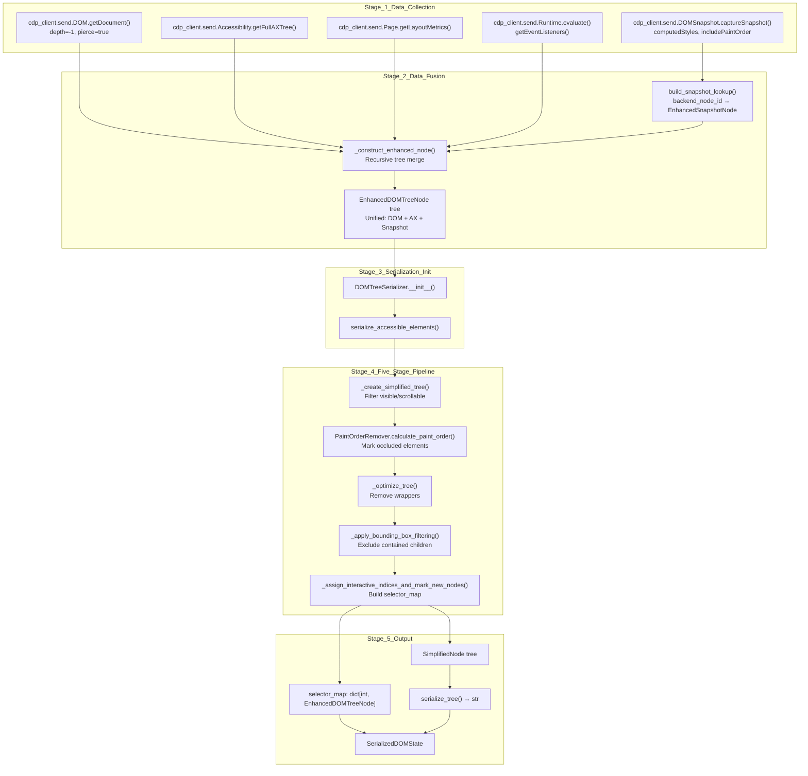
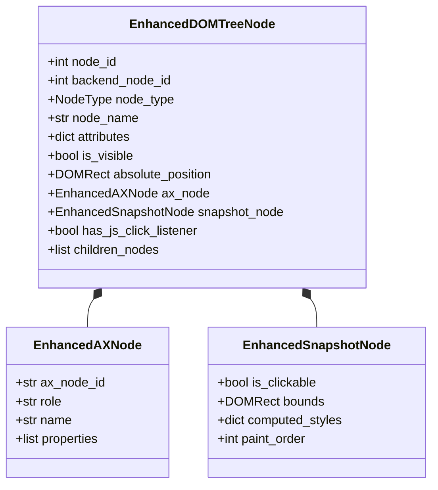

<!-- source: DeepWiki mcp.deepwiki.com · repo browser-use/browser-use · page 5 DOM Processing Engine · fetched 2026-10-30 -->

# DOM Processing Engine

Relevant source files

The following files were used as context for generating this wiki page:

- [browser_use/dom/enhanced_snapshot.py](browser_use/dom/enhanced_snapshot.py)
- [browser_use/dom/playground/extraction.py](browser_use/dom/playground/extraction.py)
- [browser_use/dom/serializer/serializer.py](browser_use/dom/serializer/serializer.py)
- [browser_use/dom/service.py](browser_use/dom/service.py)
- [browser_use/dom/views.py](browser_use/dom/views.py)
- [tests/ci/test_dom_live_input_value.py](tests/ci/test_dom_live_input_value.py)
- [tests/ci/test_image_only_dom_representation.py](tests/ci/test_image_only_dom_representation.py)

## Purpose and Scope

The DOM Processing Engine extracts web page structure from Chrome via CDP (Chrome DevTools Protocol), enhances it with accessibility and layout data, filters it to interactive elements, and serializes it into an LLM-consumable text representation. This system reduces raw DOM trees with 10,000+ nodes to ~200 interactive elements, typically resulting in ~5-10KB of text output, making browser automation feasible within LLM token limits.

For details, see:
- [DOM Tree Construction](#5.1) — `EnhancedDOMTreeNode` structure, parallel CDP requests, and multi-source data fusion.
- [DOM Serialization Pipeline](#5.2) — `DOMTreeSerializer` five-stage pipeline: simplification, paint order filtering, bounding box filtering, and index assignment.
- [Interactive Element Detection](#5.3) — `ClickableElementDetector` logic, native HTML elements, ARIA roles, cursor styles, and JS event listeners.
- [Visibility Calculation and Coordinate Transformation](#5.4) — CSS visibility checks, viewport intersection, iframe coordinate transformation, and scroll offset handling.
- [Screenshot Highlighting System](#5.5) — `python_highlights.py` annotation pipeline, element bounding boxes, color coding, and font rendering.
- [Browser State Summary](#5.6) — `BrowserStateSummary` structure, `TabInfo`, `PageInfo`, pagination detection, and network request tracking.
- [Markdown Extraction and HTML Serialization](#5.7) — `markdown_extractor.py` for converting DOM to markdown, `html_serializer` for structured page content, and chunking for LLM context limits.

**Sources:** [browser_use/dom/service.py:45-52](), [browser_use/dom/serializer/serializer.py:41-42]()

---

## Architecture Overview

The DOM processing engine transforms raw Chrome DevTools Protocol data through a multi-stage pipeline, merging DOM structure with Accessibility (AX) trees and Layout snapshots.

Title: DOM Extraction and Serialization Pipeline

**Key Code Symbols:**

| Component | File | Line Range |
|-----------|------|------------|
| `DomService.get_dom_tree()` | [browser_use/dom/service.py:643-1020]() | Main tree construction |
| `build_snapshot_lookup()` | [browser_use/dom/enhanced_snapshot.py:46-176]() | Snapshot data parsing |
| `DOMTreeSerializer.serialize_accessible_elements()` | [browser_use/dom/serializer/serializer.py:110-161]() | Pipeline entry point |
| `EnhancedDOMTreeNode` | [browser_use/dom/views.py:373-911]() | Unified node structure |
| `SimplifiedNode` | [browser_use/dom/views.py:218-259]() | Pipeline intermediate node |
| `SerializedDOMState` | [browser_use/dom/views.py:929-973]() | Final output container |

**Sources:** [browser_use/dom/service.py:45-1020](), [browser_use/dom/serializer/serializer.py:110-161](), [browser_use/dom/enhanced_snapshot.py:46-176]()

---

## Core Data Structures

### EnhancedDOMTreeNode

The unified node structure that combines DOM, accessibility, and layout data. It is the primary unit of data throughout the engine.

Title: EnhancedDOMTreeNode Entity Mapping

**Key Properties:**
- `ax_node`: Semantic information from the accessibility tree, including `role` and `name` [browser_use/dom/views.py:323-354]().
- `snapshot_node`: Layout and style data including `bounds` (coordinates) and `computed_styles` [browser_use/dom/views.py:302-315]().
- `absolute_position`: Document coordinates accounting for iframe nesting and scroll offsets [browser_use/dom/views.py:440-442]().

**Sources:** [browser_use/dom/views.py:373-911](), [browser_use/dom/service.py:184-210]()

### SimplifiedNode

An intermediate structure used by `DOMTreeSerializer` during the optimization stages. It wraps an `EnhancedDOMTreeNode` and tracks visibility, interactivity, and exclusion flags [browser_use/dom/views.py:218-259]().

**Sources:** [browser_use/dom/views.py:218-259]()

---

## DomService: Main Entry Point

The `DomService` class orchestrates DOM extraction and is the primary interface for the `Agent` via `BrowserSession` [browser_use/dom/service.py:45-52]().

### Initialization
The service is configured with parameters that control the depth and thoroughness of the extraction.

| Parameter | Default | Purpose |
|-----------|---------|---------|
| `cross_origin_iframes` | `False` | Process iframes from different origins [browser_use/dom/service.py:68]() |
| `paint_order_filtering` | `True` | Remove occluded elements [browser_use/dom/service.py:69]() |
| `viewport_threshold` | `1000` | Pixels beyond viewport to consider "visible" [browser_use/dom/service.py:72]() |

### Primary Methods
- `get_dom_tree()`: Fetches raw CDP data and constructs the `EnhancedDOMTreeNode` tree [browser_use/dom/service.py:643-1020]().
- `get_serialized_dom_tree()`: High-level wrapper that constructs the tree and then runs the serialization pipeline [browser_use/dom/service.py:1022-1050]().

**Sources:** [browser_use/dom/service.py:45-72](), [browser_use/dom/service.py:1022-1050]()

---

## Five-Stage Serialization Pipeline

The `DOMTreeSerializer` processes the tree to ensure it fits within LLM context limits while retaining all interactive context [browser_use/dom/serializer/serializer.py:42-161]().

1.  **Simplification**: Filters nodes based on visibility, scrollability, or shadow host status [browser_use/dom/serializer/serializer.py:435-540]().
2.  **Paint Order Filtering**: Uses `PaintOrderRemover` to identify elements hidden behind other elements [browser_use/dom/serializer/serializer.py:129-134]().
3.  **Optimization**: Removes unnecessary wrapper elements (e.g., empty divs) [browser_use/dom/serializer/serializer.py:542-576]().
4.  **Bounding Box Filtering**: Excludes children fully contained within parent interactive elements (like icons inside buttons) [browser_use/dom/serializer/serializer.py:729-880]().
5.  **Index Assignment**: Assigns interactive indices and builds the `selector_map` for action execution [browser_use/dom/serializer/serializer.py:617-727]().

For details, see [DOM Serialization Pipeline](#5.2).

**Sources:** [browser_use/dom/serializer/serializer.py:110-161]()

---

## Interactive Element Detection

The `ClickableElementDetector` uses a combination of HTML tags, ARIA roles, cursor styles, and JavaScript event listeners to determine if an element can be interacted with [browser_use/dom/serializer/clickable_elements.py:1-205]().

**Signals include:**
- **Tags**: `a`, `button`, `input`, `select`, `textarea` [browser_use/dom/serializer/clickable_elements.py:139-149]().
- **Roles**: `button`, `link`, `checkbox`, `menuitem`, `combobox`, etc. [browser_use/dom/serializer/clickable_elements.py:183-202]().
- **Heuristics**: `cursor: pointer` style or `isClickable` flag from CDP [browser_use/dom/serializer/clickable_elements.py:41-42]().
- **JS Listeners**: Detected via `getEventListeners()` in the browser context [browser_use/dom/service.py:429-517]().

For details, see [Interactive Element Detection](#5.3).

**Sources:** [browser_use/dom/serializer/clickable_elements.py:1-205](), [browser_use/dom/service.py:429-517]()

---

## Screenshot Highlighting System

The engine includes a Python-based highlighting system (`python_highlights.py`) that draws bounding boxes and index overlays directly on screenshots using PIL, replacing slower JavaScript-based highlighting [browser_use/browser/python_highlights.py:1-214]().

**Key Features:**
- **Color Coding**: Different colors for buttons, inputs, and links [browser_use/browser/python_highlights.py:72-80]().
- **Dashed Borders**: Visual indicators for element boundaries [browser_use/browser/python_highlights.py:121-145]().
- **Font Caching**: Cross-platform font loading with caching to prevent memory leaks [browser_use/browser/python_highlights.py:21-63]().

For details, see [Screenshot Highlighting System](#5.5).

**Sources:** [browser_use/browser/python_highlights.py:1-214]()

---

## Alternative Output: Markdown and HTML Serialization

In addition to the interactive-only serialization, the engine provides specialized serializers for content extraction:

- **DOMEvalSerializer**: Ultra-concise DOM serializer optimized for quick LLM query writing [browser_use/dom/serializer/eval_serializer.py:112-233]().
- **Markdown Extractor**: Converts the enhanced DOM to clean Markdown, handling tables and images [browser_use/dom/markdown_extractor.py:22-113]().
- **HTML Serialization**: Reconstructs structured page content for structured extraction [browser_use/dom/serializer/html_serializer.py:6-17]().

For details, see [Markdown Extraction and HTML Serialization](#5.7).

**Sources:** [browser_use/dom/serializer/eval_serializer.py:1-233](), [browser_use/dom/markdown_extractor.py:1-200]()

---

## Output: SerializedDOMState

The final output is a `SerializedDOMState` containing:
- **`selector_map`**: A dictionary mapping the indices the LLM sees (e.g., `[12]`) back to `EnhancedDOMTreeNode` objects [browser_use/dom/views.py:931]().
- **`llm_representation`**: The stringified tree format optimized for token efficiency [browser_use/dom/views.py:946-973]().

**Sources:** [browser_use/dom/views.py:929-973]()

---

