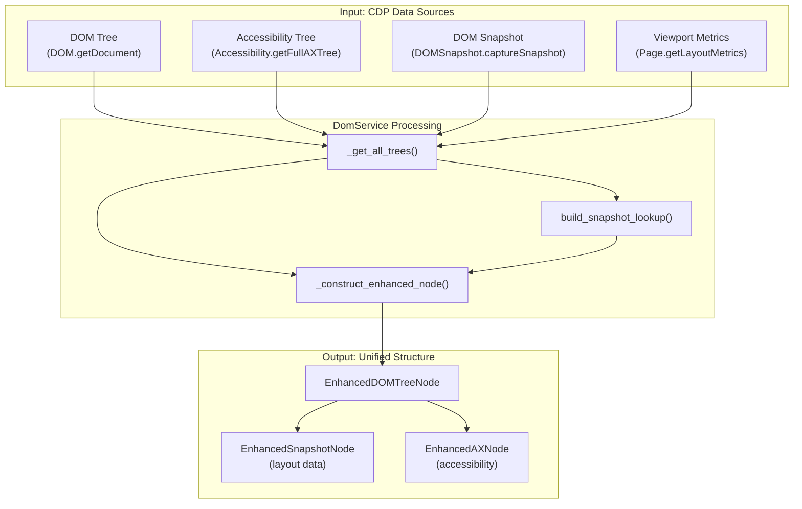
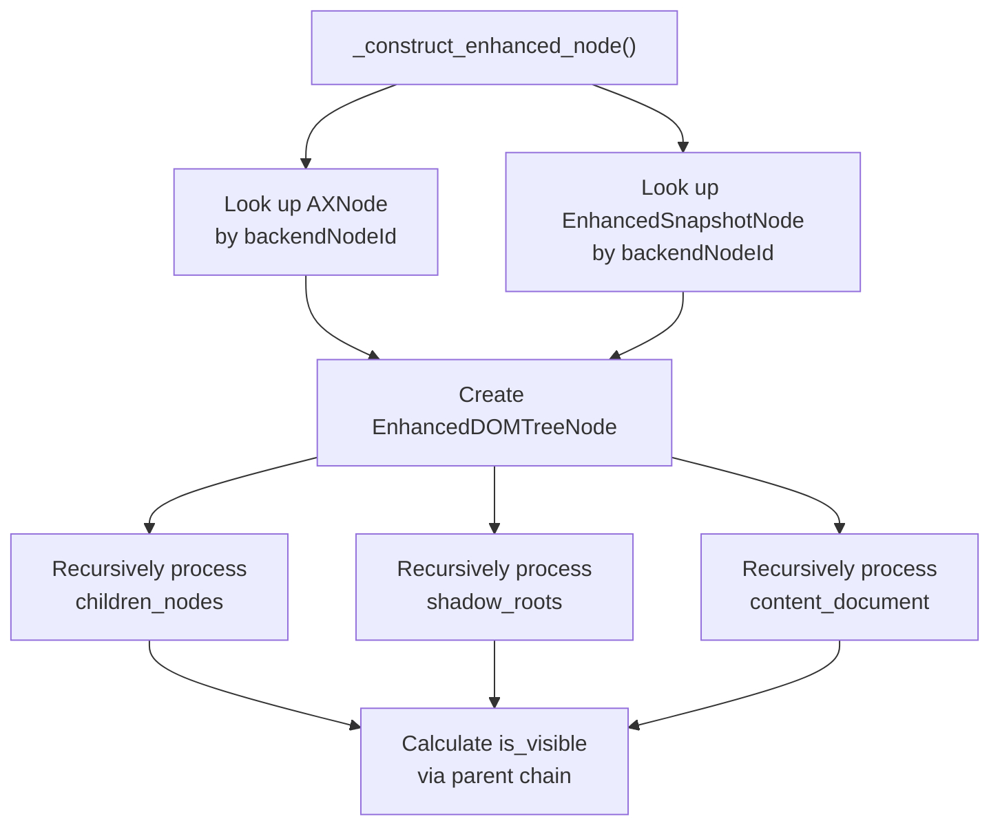

<!-- source: DeepWiki mcp.deepwiki.com · repo browser-use/browser-use · page 5.1 DOM Tree Construction · fetched 2026-10-30 -->

# DOM Tree Construction

Relevant source files

The following files were used as context for generating this wiki page:

- [browser_use/dom/enhanced_snapshot.py](browser_use/dom/enhanced_snapshot.py)
- [browser_use/dom/playground/extraction.py](browser_use/dom/playground/extraction.py)
- [browser_use/dom/serializer/serializer.py](browser_use/dom/serializer/serializer.py)
- [browser_use/dom/service.py](browser_use/dom/service.py)
- [browser_use/dom/views.py](browser_use/dom/views.py)
- [tests/ci/test_dom_live_input_value.py](tests/ci/test_dom_live_input_value.py)
- [tests/ci/test_image_only_dom_representation.py](tests/ci/test_image_only_dom_representation.py)

## Purpose and Scope

This page documents how `browser-use` constructs the enhanced DOM tree from Chrome DevTools Protocol (CDP) data sources. DOM Tree Construction is the first phase of the DOM Processing Engine, responsible for fetching raw CDP data and assembling it into unified `EnhancedDOMTreeNode` objects. [browser_use/dom/service.py:45-52]()

For information about:
- How the constructed tree is serialized for LLM consumption, see [DOM Serialization Pipeline](5.2)
- How interactive elements are detected within the tree, see [Interactive Element Detection](5.3)
- How visibility is calculated using CSS and viewport intersection, see [Visibility Calculation and Coordinate Transformation](5.4)
- How the final state is packaged for the agent, see [Browser State Summary](5.6)

## Overview: Three Trees to One

DOM Tree Construction merges independent CDP data sources into a unified, enhanced representation. The `DomService` class [browser_use/dom/service.py:45-72]() orchestrates parallel fetches from Chrome DevTools Protocol and recursively constructs `EnhancedDOMTreeNode` objects that contain structural, accessibility, and layout information.

### Data Fusion Architecture

The following diagram shows how `DomService` bridges the gap between raw CDP data and the `EnhancedDOMTreeNode` structure.

| System Component | Code Entity |
| :--- | :--- |
| **Orchestrator** | `DomService` [browser_use/dom/service.py:45]() |
| **Data Fetcher** | `_get_all_trees()` [browser_use/dom/service.py:537]() |
| **Snapshot Processor** | `build_snapshot_lookup()` [browser_use/dom/enhanced_snapshot.py:70]() |
| **Node Constructor** | `_construct_enhanced_node()` [browser_use/dom/service.py:695]() |

Title: DOM Construction Data Flow

Sources: [browser_use/dom/service.py:45-69](), [browser_use/dom/service.py:537-641](), [browser_use/dom/views.py:372-463]()

## Data Sources: CDP Trees

The DOM tree construction process fetches four independent data sources from Chrome DevTools Protocol in parallel [browser_use/dom/service.py:537-602]():

| CDP Domain | Command | Purpose | Key Data Extracted |
|------------|---------|---------|-------------------|
| **DOM** | `getDocument` | Hierarchical structure | Node relationships, attributes, frame IDs, shadow roots |
| **Accessibility** | `getFullAXTree` | Semantic information | Roles, names, descriptions, accessible properties |
| **DOMSnapshot** | `captureSnapshot` | Layout and visibility | Bounding boxes, computed styles, scroll rects, paint order |
| **Page** | `getLayoutMetrics` | Display metrics | Device pixel ratio, viewport dimensions |

### DOM Tree Structure
The DOM tree from `DOM.getDocument` provides the core hierarchical structure. Each node includes `nodeId`, `backendNodeId`, and `nodeType` [browser_use/dom/views.py:372-463]().

### Accessibility Tree
The accessibility tree from `Accessibility.getFullAXTree` provides semantic annotations like `role`, `name`, and `description` [browser_use/dom/views.py:298-321](). The AX tree is fetched for all frames by calling `getFullAXTree` for each frame ID and merging results [browser_use/dom/service.py:339-374]().

### DOM Snapshot & Live Input Values
The DOM snapshot from `DOMSnapshot.captureSnapshot` provides layout information. `build_snapshot_lookup()` processes this into a dictionary mapping backend node IDs to `EnhancedSnapshotNode` instances [browser_use/dom/enhanced_snapshot.py:70-175](). It specifically extracts essential computed styles defined in `REQUIRED_COMPUTED_STYLES` [browser_use/dom/enhanced_snapshot.py:17-29]().

Additionally, live form field values (`inputValue`, `textValue`, `inputChecked`) are captured directly from the snapshot layer to ensure agents see values populated by JavaScript frameworks or browser autofill [browser_use/dom/enhanced_snapshot.py:118-128](). To protect user privacy, sensitive input types (such as `password`, `file`, `hidden`) and sensitive autocomplete fields (like credit cards or one-time codes) are automatically filtered out via `_is_sensitive_input()` [browser_use/dom/enhanced_snapshot.py:46-67]().

Sources: [browser_use/dom/service.py:537-602](), [browser_use/dom/views.py:372-463](), [browser_use/dom/enhanced_snapshot.py:17-175]()

## Tree Construction Pipeline

### Phase 1: Parallel CDP Fetching
The `_get_all_trees()` method dispatches CDP requests in parallel using `asyncio.gather()` [browser_use/dom/service.py:537-602](). If any request times out, it is retried once with a 2-second timeout [browser_use/dom/service.py:587-595]().

### Phase 2: Snapshot Preprocessing
`build_snapshot_lookup()` processes raw snapshot data. It maps `backendNodeId` to snapshot indices and extracts bounds, computed styles, live input values, and paint order flags [browser_use/dom/enhanced_snapshot.py:70-175]().

**Key Optimization:** It pre-builds a `layout_index_map` to eliminate O(n²) double lookups [browser_use/dom/enhanced_snapshot.py:103-110](). It also converts raw list-based indices (such as `isClickable`) to Python `set` instances for O(1) membership checking [browser_use/dom/enhanced_snapshot.py:111-117]().

### Phase 3: Recursive Node Construction
`_construct_enhanced_node()` recursively builds the tree, tracking parent chains and coordinate offsets [browser_use/dom/service.py:695-877]().

Title: Recursive Node Construction Logic

Sources: [browser_use/dom/service.py:695-877](), [browser_use/dom/enhanced_snapshot.py:70-175]()

## EnhancedDOMTreeNode Structure

The `EnhancedDOMTreeNode` class unifies data from all three CDP trees [browser_use/dom/views.py:372-463]().

### Field Categories
- **DOM Tree Fields**: `node_id`, `backend_node_id`, `node_type`, `attributes`, `frame_id` [browser_use/dom/views.py:374-386]().
- **Accessibility Fields**: `ax_node` containing role, name, and properties [browser_use/dom/views.py:446]().
- **Layout Fields**: `snapshot_node` with `bounds`, `computed_styles`, and `paint_order` [browser_use/dom/views.py:447]().
- **Derived Fields**: `is_visible`, `is_scrollable`, and `absolute_position` [browser_use/dom/views.py:448-450]().

Sources: [browser_use/dom/views.py:372-463](), [browser_use/dom/views.py:298-321](), [browser_use/dom/views.py:323-354]()

## Coordinate Transformation for Nested Iframes

Maintaining accurate element positions through nested iframes is handled by accumulating a `total_frame_offset` [browser_use/dom/service.py:815-838]().

### Transformation Logic
1. **Iframe Entry**: When entering an iframe, the iframe's bounding box is added to the running offset [browser_use/dom/service.py:821-822]().
2. **HTML Scroll**: When encountering a scrollable HTML element, the scroll offset is subtracted [browser_use/dom/service.py:768-775]().
3. **Absolute Calculation**: The final `absolute_position` is the node's local bounds plus the accumulated `total_frame_offset` [browser_use/dom/service.py:844-849]().

Sources: [browser_use/dom/service.py:815-838](), [browser_use/dom/service.py:768-775](), [browser_use/dom/service.py:844-849]()

## JavaScript Click Listener Detection

`DomService` detects elements with JS event listeners by evaluating a script in the page context [browser_use/dom/service.py:429-516](). It uses the DevTools `getEventListeners()` API to identify elements with `click`, `mousedown`, or `mouseup` handlers [browser_use/dom/service.py:443-448](). These are resolved to `backendNodeId`s and stored in `js_click_listener_backend_ids` [browser_use/dom/service.py:494-516]().

Sources: [browser_use/dom/service.py:429-516]()

## Hidden Elements Analysis for Iframes

The `_count_hidden_elements_in_iframes()` method collects information about interactive elements hidden beyond the viewport threshold [browser_use/dom/service.py:80-192](). This supplies the agent with hints regarding off-screen content available via scrolling. Collection is capped at the top 10 elements per iframe to prevent context bloat [browser_use/dom/service.py:177]().

Sources: [browser_use/dom/service.py:80-192]()

## Performance Optimization

- **Parallel Fetching**: Uses `asyncio.gather()` for simultaneous CDP execution [browser_use/dom/service.py:537-602]().
- **Snapshot Map**: O(1) lookups for layout data and clickability. Converting `isClickable` lists to sets yielded massive performance gains for large DOM structures [browser_use/dom/enhanced_snapshot.py:80-117]().
- **Iframe Limits**: Configurable `max_iframes` and `max_iframe_depth` parameters on `DomService` initialization [browser_use/dom/service.py:62-63]().
- **Batch Processing**: CDP `DOM.describeNode` requests are batched to minimize protocol overhead [browser_use/dom/service.py:35]().
- **Timing Instrumentation**: Detailed phase-by-phase performance metrics are tracked and returned [browser_use/dom/service.py:634-640]().

Sources: [browser_use/dom/service.py:537-602](), [browser_use/dom/enhanced_snapshot.py:80-117](), [browser_use/dom/service.py:62-63](), [browser_use/dom/service.py:35](), [browser_use/dom/service.py:634-640]()

---

