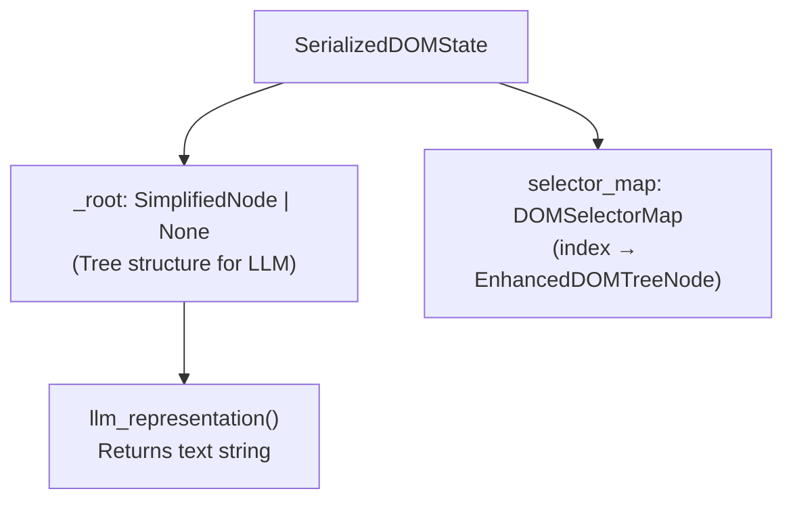
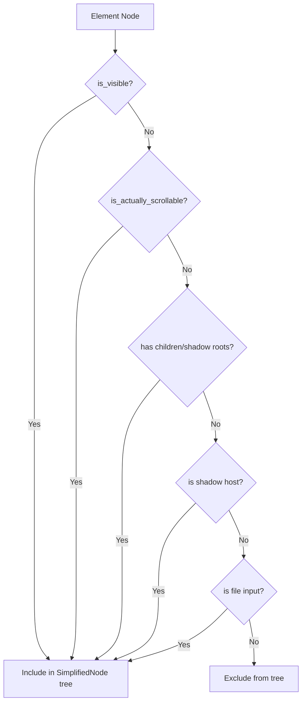

<!-- source: DeepWiki mcp.deepwiki.com · repo browser-use/browser-use · page 5.2 DOM Serialization Pipeline · fetched 2026-10-30 -->

# DOM Serialization Pipeline

<details>
<summary>Relevant source files</summary>

The following files were used as context for generating this wiki page:

- [browser_use/dom/enhanced_snapshot.py](browser_use/dom/enhanced_snapshot.py)
- [browser_use/dom/playground/extraction.py](browser_use/dom/playground/extraction.py)
- [browser_use/dom/serializer/paint_order.py](browser_use/dom/serializer/paint_order.py)
- [browser_use/dom/serializer/serializer.py](browser_use/dom/serializer/serializer.py)
- [browser_use/dom/service.py](browser_use/dom/service.py)
- [browser_use/dom/views.py](browser_use/dom/views.py)
- [tests/ci/browser/test_dom_serializer_session_identity.py](tests/ci/browser/test_dom_serializer_session_identity.py)
- [tests/ci/test_dom_live_input_value.py](tests/ci/test_dom_live_input_value.py)
- [tests/ci/test_image_only_dom_representation.py](tests/ci/test_image_only_dom_representation.py)

</details>


## Purpose and Scope

The DOM Serialization Pipeline transforms the `EnhancedDOMTreeNode` tree (constructed from raw CDP data) into an LLM-consumable text representation. This pipeline applies multiple filtering and optimization stages to reduce noise, remove occluded elements, and assign interactive indices. For information about how the `EnhancedDOMTreeNode` is initially constructed from CDP data, see [DOM Tree Construction (5.1)](). For details on how interactive elements are detected, see [Interactive Element Detection (5.3)]().

**Sources**: [browser_use/dom/serializer/serializer.py:1-40](), [browser_use/dom/service.py:35-62]()

---

## Pipeline Architecture

The serialization pipeline consists of five sequential stages within the `DOMTreeSerializer` class, each transforming the DOM tree representation:

"Natural Language Space to Code Entity Space: Serialization Pipeline"

```mermaid
graph LR
    Input["EnhancedDOMTreeNode<br/>(Full DOM Tree)"]
    
    Stage1["Stage 1:<br/>Create Simplified Tree<br/>_create_simplified_tree()"]
    Stage2["Stage 2:<br/>Paint Order Filtering<br/>PaintOrderRemover"]
    Stage3["Stage 3:<br/>Optimize Tree<br/>_optimize_tree()"]
    Stage4["Stage 4:<br/>Bounding Box Filtering<br/>_apply_bounding_box_filtering()"]
    Stage5["Stage 5:<br/>Assign Interactive Indices<br/>_assign_interactive_indices_and_mark_new_nodes()"]
    
    Output["SerializedDOMState<br/>(_root + selector_map)"]
    LLMText["LLM Text Representation<br/>llm_representation()"]
    
    Input --> Stage1
    Stage1 --> Stage2
    Stage2 --> Stage3
    Stage3 --> Stage4
    Stage4 --> Stage5
    Stage5 --> Output
    Output --> LLMText
```


The pipeline progressively reduces DOM complexity while preserving all interactive elements and their context. Each stage produces or modifies a `SimplifiedNode` tree that wraps the original `EnhancedDOMTreeNode` with additional metadata.

**Sources**: [browser_use/dom/serializer/serializer.py:110-161]()

---

## Data Structures

### SimplifiedNode Structure

The `SimplifiedNode` class wraps each `EnhancedDOMTreeNode` with serialization-specific metadata used to determine visibility in the final output:

| Field | Type | Purpose |
|-------|------|---------|
| `original_node` | `EnhancedDOMTreeNode` | Reference to the source DOM node [browser_use/dom/views.py:221]() |
| `children` | `list[SimplifiedNode]` | Filtered child nodes [browser_use/dom/views.py:222]() |
| `should_display` | `bool` | Whether to render this node in the LLM output [browser_use/dom/views.py:223]() |
| `is_interactive` | `bool` | True if the element is added to the `selector_map` [browser_use/dom/views.py:224]() |
| `is_new` | `bool` | Whether the node is new compared to the previous state [browser_use/dom/views.py:227]() |
| `ignored_by_paint_order` | `bool` | Occluded by a higher z-index element [browser_use/dom/views.py:229]() |
| `excluded_by_parent` | `bool` | Contained within a parent clickable element's bounds [browser_use/dom/views.py:230]() |
| `is_shadow_host` | `bool` | Indicates the node hosts a shadow DOM [browser_use/dom/views.py:231]() |
| `is_compound_component` | `bool` | Virtual component for complex controls (e.g., range sliders) [browser_use/dom/views.py:232]() |

**Sources**: [browser_use/dom/views.py:218-246]()

### SerializedDOMState Structure

The final output of the pipeline is a `SerializedDOMState` object containing the optimized tree and the interaction map:

"Natural Language Space to Code Entity Space: Serialized State Mapping"


- `_root`: The filtered `SimplifiedNode` tree used to generate the LLM text representation [browser_use/dom/views.py:931]().
- `selector_map`: Maps numeric indices (shown to the LLM) back to the actual `EnhancedDOMTreeNode` for action execution [browser_use/dom/views.py:932]().

**Sources**: [browser_use/dom/views.py:929-973]()

---

## Stage 1: Simplified Tree Creation

### Overview

The `_create_simplified_tree()` method performs the initial filtering pass, creating a `SimplifiedNode` tree. It excludes non-content elements and preserves visible, scrollable, or shadow DOM content. It also performs initial interactive element detection using `ClickableElementDetector`.

**Sources**: [browser_use/dom/serializer/serializer.py:435-540](), [browser_use/dom/serializer/clickable_elements.py:4-7]()

### Filtering Rules

Elements are included in the simplified tree if they satisfy **any** of these conditions:



**Sources**: [browser_use/dom/serializer/serializer.py:492-532]()

### Element Exclusions

Certain elements and their children are **always** excluded to save tokens:

| Category | Elements | Reason |
|----------|----------|--------|
| Non-content | `style`, `script`, `head`, `meta`, `link`, `title` | No visual or interactive value [browser_use/dom/serializer/serializer.py:18]() |
| SVG children | `path`, `rect`, `g`, `circle`, etc. | Decorative; parent `<svg>` is usually sufficient [browser_use/dom/serializer/serializer.py:21-38]() |
| Excluded by attribute | Elements with `data-browser-use-exclude` | Explicit manual exclusion [browser_use/dom/serializer/serializer.py:461-481]() |

**Sources**: [browser_use/dom/serializer/serializer.py:18-38](), [browser_use/dom/serializer/serializer.py:461-481]()

### Compound Component Detection

For complex HTML5 elements, the pipeline synthesizes virtual child components via `_add_compound_components` to help the LLM understand internal state:

| Element Type | Virtual Components | Purpose |
|--------------|-------------------|---------|
| `input type="range"` | Slider with min/max/current | Show range constraints [browser_use/dom/serializer/serializer.py:187-197]() |
| `input type="file"` | Browse button, Selection state | Show file upload status [browser_use/dom/serializer/serializer.py:218-228]() |
| `select` | Dropdown Toggle, Options preview | Show available choices [browser_use/dom/serializer/serializer.py:230-240]() |
| `audio` / `video` | Play/Pause, Progress, Mute | Show media controls [browser_use/dom/serializer/serializer.py:255-265]() |

**Sources**: [browser_use/dom/serializer/serializer.py:163-333]()

---

## Stage 2: Paint Order Filtering

### Purpose

The `PaintOrderRemover` identifies elements that are visually occluded by higher z-index elements and marks them as `ignored_by_paint_order=True`. This prevents the Agent from interacting with elements hidden behind overlays or modals.

**Sources**: [browser_use/dom/serializer/serializer.py:129-134](), [browser_use/dom/serializer/paint_order.py:146-154]()

### Paint Order Calculation

Paint order is determined by CDP's `paintOrders` attribute in the layout snapshot [browser_use/dom/enhanced_snapshot.py:136-138](). The `PaintOrderRemover` uses a `RectUnionPure` to maintain a disjoint set of rectangles representing opaque screen areas.

1. Elements are sorted by paint order (highest to lowest) [browser_use/dom/serializer/paint_order.py:181]().
2. For each element, if its bounding box is fully contained within the union of previously processed (higher) opaque rectangles, it is marked as ignored [browser_use/dom/serializer/paint_order.py:192-196]().
3. Elements with `opacity < 0.8` or transparent backgrounds do not contribute to the occlusion union [browser_use/dom/serializer/paint_order.py:186-190]().

**Sources**: [browser_use/dom/serializer/paint_order.py:176-210]()

---

## Stage 3: Tree Optimization

### Overview

The `_optimize_tree()` method removes unnecessary parent wrapper elements that don't add semantic value. This reduces token count while preserving the tree structure needed for context.

**Sources**: [browser_use/dom/serializer/serializer.py:542-576]()

### Optimization Rules

A node is **kept** if it is visible, scrollable, is a text node with content, or has children that survived optimization. Otherwise, the node is removed and its children are promoted to its parent's child list.

**Sources**: [browser_use/dom/serializer/serializer.py:557-575]()

---

## Stage 4: Bounding Box Filtering

### Purpose

Bounding box filtering (`_apply_bounding_box_filtering`) detects when child elements are **fully contained** within a parent clickable element's bounds. For example, a button containing an icon and text should show only the button index.

**Sources**: [browser_use/dom/serializer/serializer.py:142-150](), [browser_use/dom/serializer/serializer.py:729-735]()

### Propagating Elements

Certain elements defined in `PROPAGATING_ELEMENTS` propagate their bounds to descendants to filter redundant contained children:

| Tag | Role | Example |
|-----|------|---------|
| `a` | any | Link wrapping multiple elements [browser_use/dom/serializer/serializer.py:46]() |
| `button` | any | Button with icon + text [browser_use/dom/serializer/serializer.py:47]() |
| `div` | `button` / `combobox` | Custom UI components [browser_use/dom/serializer/serializer.py:48-49]() |

**Sources**: [browser_use/dom/serializer/serializer.py:45-56](), [browser_use/dom/serializer/serializer.py:868-880]()

---

## Stage 5: Interactive Index Assignment

### Overview

The final stage assigns numeric indices to interactive elements and builds the `DOMSelectorMap`. This occurs in `_assign_interactive_indices_and_mark_new_nodes`.

**Sources**: [browser_use/dom/serializer/serializer.py:151-156](), [browser_use/dom/serializer/serializer.py:617-625]()

### Selection Criteria

An element is indexed if it is not ignored by paint order or parent containment, and satisfies one of:
- Is interactive and visible (via `ClickableElementDetector.is_interactive`).
- Is scrollable with no interactive descendants.
- Is a dropdown container or file input.

**Sources**: [browser_use/dom/serializer/serializer.py:672-714](), [browser_use/dom/serializer/clickable_elements.py:6-7]()

---

## LLM Text Serialization

### Output Format

The `llm_representation()` method converts the `SimplifiedNode` tree into an indented text format [browser_use/dom/views.py:954]():

```
[123]<button id="submit" type="submit" /> "Submit Form"
|scroll element|<div class="content" /> (0.0 pages above, 2.3 pages below)
|SHADOW(open)|<custom-element />
	[456]<input type="text" />
```

**Sources**: [browser_use/dom/serializer/serializer.py:882-1088]()

### Attribute Filtering

The `DEFAULT_INCLUDE_ATTRIBUTES` list restricts which attributes are shown to the LLM, focusing on identity (`id`, `name`), state (`checked`, `disabled`), and accessibility (`aria-label`, `role`).

**Sources**: [browser_use/dom/views.py:18-82]()

---

## Performance and Integration

The pipeline is integrated into the `BrowserSession` state summary flow [browser_use/dom/playground/extraction.py:134](). It uses `build_snapshot_lookup` to pre-calculate layout data, achieving significant speedups (up to 3,000x) by converting list-based CDP lookups into set-based O(1) lookups for fields like `isClickable`.

**Sources**: [browser_use/dom/enhanced_snapshot.py:46-93](), [browser_use/dom/service.py:101-148]()

---

