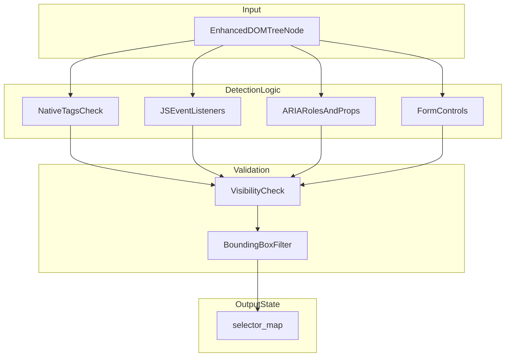
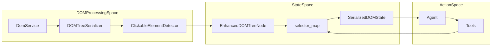

<!-- source: DeepWiki mcp.deepwiki.com · repo browser-use/browser-use · page 5.3 Interactive Element Detection · fetched 2026-10-30 -->

# Interactive Element Detection

Relevant source files

The following files were used as context for generating this wiki page:

- [.github/workflows/eval-on-pr.yml](.github/workflows/eval-on-pr.yml)
- [browser_use/dom/serializer/clickable_elements.py](browser_use/dom/serializer/clickable_elements.py)
- [tests/ci/browser/iframe_template.html](tests/ci/browser/iframe_template.html)
- [tests/ci/browser/test_cross_origin_click.py](tests/ci/browser/test_cross_origin_click.py)
- [tests/ci/browser/test_dom_listener_detection.py](tests/ci/browser/test_dom_listener_detection.py)
- [tests/ci/browser/test_dom_serializer.py](tests/ci/browser/test_dom_serializer.py)
- [tests/ci/browser/test_page_stacked_template.html](tests/ci/browser/test_page_stacked_template.html)
- [tests/ci/browser/test_page_template.html](tests/ci/browser/test_page_template.html)
- [tests/ci/test_prompt_step_meta_suffix.py](tests/ci/test_prompt_step_meta_suffix.py)

## Purpose and Scope

This page documents the interactive element detection system within the DOM Processing Engine (`browser_use/dom/`). It details the logic implemented in `ClickableElementDetector` [browser_use/dom/serializer/clickable_elements.py:4-188]() that identifies elements users can interact with, how these elements are catalogued in the `selector_map`, and how this information flows through the serialization pipeline to enable agent actions.

For information about how the DOM tree is initially constructed, see [5.1 DOM Tree Construction](). For details on the complete serialization pipeline that uses these interactive elements, see [5.2 DOM Serialization Pipeline]().

Sources: [browser_use/dom/serializer/clickable_elements.py:4-188](), [browser_use/dom/views.py:17-82]()

---

## Overview

Interactive element detection is the process of identifying which DOM elements are meaningful for agent interaction. The detection logic filters the raw DOM tree into a prioritized list of actionable nodes. This includes:

- **Native interactive elements**: `<button>`, `<a>`, `<input>`, `<select>`, `<textarea>`, `
`, `
`, `<option>`, `<optgroup>` [browser_use/dom/serializer/clickable_elements.py:139-152]().
- **Custom interactive elements**: Elements with JavaScript click handlers, specific ARIA roles, or cursor styles [browser_use/dom/serializer/clickable_elements.py:39-42](), [browser_use/dom/serializer/clickable_elements.py:105-135](), [browser_use/dom/serializer/clickable_elements.py:182-188]().
- **Scrollable containers**: `<iframe>` or `<frame>` elements larger than 100x100 pixels [browser_use/dom/serializer/clickable_elements.py:44-52]().
- **Shadow DOM elements**: Interactive elements nested inside open or closed shadow roots [tests/ci/browser/test_dom_serializer.py:168-170]().

The detection produces a selector map (`selector_map`) that maps stable integer indices to `EnhancedDOMTreeNode` objects, enabling the Agent to reference and interact with specific elements [browser_use/dom/views.py:218-232](), [browser_use/dom/serializer/serializer.py:709-714]().

Sources: [browser_use/dom/serializer/clickable_elements.py:4-188](), [browser_use/dom/views.py:218-232](), [browser_use/dom/serializer/serializer.py:709-714](), [tests/ci/browser/test_dom_serializer.py:168-170]()

---

## System Architecture

The following diagram illustrates the flow from a raw `EnhancedDOMTreeNode` to its inclusion in the `selector_map` based on interactivity heuristics.

### Interactivity Detection Flow

Sources: [browser_use/dom/serializer/clickable_elements.py:4-188](), [browser_use/dom/serializer/serializer.py:100-148](), [browser_use/dom/views.py:218-224]()

---

## ClickableElementDetector Logic

The `ClickableElementDetector` class in `browser_use/dom/serializer/clickable_elements.py` provides the static method `is_interactive(node)` which evaluates nodes against several tiers of heuristics [browser_use/dom/serializer/clickable_elements.py:4-6]().

### 1. Native HTML Elements
The detector maintains a set of `interactive_tags` that are inherently clickable:
- `button`, `input`, `select`, `textarea`, `a`, `details`, `summary`, `option`, `optgroup` [browser_use/dom/serializer/clickable_elements.py:139-152]().
- **Note**: `label` elements are intentionally excluded from the direct tag check to prevent double-activating associated inputs via the `for` attribute [browser_use/dom/serializer/clickable_elements.py:59-62](). Labels are instead evaluated by checking for nested form controls [browser_use/dom/serializer/clickable_elements.py:64-66]().

Sources: [browser_use/dom/serializer/clickable_elements.py:59-62](), [browser_use/dom/serializer/clickable_elements.py:139-152]()

### 2. JavaScript Event Listeners
The system handles modern frameworks (React, Vue, Angular) by checking the `has_js_click_listener` property [browser_use/dom/serializer/clickable_elements.py:39-42](). This property is populated during `DomService` processing using CDP's `DOM.describeNode` to detect elements with event listeners [tests/ci/browser/test_dom_listener_detection.py:68]() . To prevent performance degradation on listener-heavy pages, detection is capped at `_MAX_JS_CLICK_LISTENER_ELEMENTS` (default 50) [browser_use/dom/service.py:14](), [tests/ci/browser/test_dom_listener_detection.py:25-76]().

Sources: [browser_use/dom/serializer/clickable_elements.py:39-42](), [browser_use/dom/service.py:14](), [tests/ci/browser/test_dom_listener_detection.py:25-76]()

### 3. ARIA Roles and Properties
Elements are considered interactive if they possess specific ARIA roles or state properties:
- **Roles**: `button`, `link`, `menuitem`, `option`, `radio`, `checkbox`, `tab`, `textbox`, `combobox`, `slider`, `spinbutton`, `search`, `searchbox`, `row`, `cell`, `gridcell` [browser_use/dom/serializer/clickable_elements.py:182-188]().
- **Properties**: `checked`, `expanded`, `pressed`, `selected`, `focusable`, `editable`, `settable`, `required`, `autocomplete`, `keyshortcuts` [browser_use/dom/serializer/clickable_elements.py:118-132]().
- **Validation**: Elements with `disabled` or `hidden` accessibility properties set to true are explicitly excluded [browser_use/dom/serializer/clickable_elements.py:109-115]().

Sources: [browser_use/dom/serializer/clickable_elements.py:105-135](), [browser_use/dom/serializer/clickable_elements.py:182-188]()

### 4. Form Control Descendants
A specialized helper function `has_form_control_descendant` detects nested inputs within wrappers (like `label` or `span`). It searches up to a depth of 2 levels to identify patterns like `label > span > input` [browser_use/dom/serializer/clickable_elements.py:9-25]().

Sources: [browser_use/dom/serializer/clickable_elements.py:9-25](), [browser_use/dom/serializer/clickable_elements.py:58-72]()

---

## Performance and Caching

The `DOMTreeSerializer` maintains a `_clickable_cache` to avoid redundant calls to the detector during its multi-pass serialization process (simplification, optimization, and indexing) [browser_use/dom/serializer/serializer.py:74-75](), [browser_use/dom/serializer/serializer.py:417-433]().

Sources: [browser_use/dom/serializer/serializer.py:74-75](), [browser_use/dom/serializer/serializer.py:417-433]()

---

## Data Flow: From Detection to Action

The following diagram maps the code entities involved in converting a detected interactive element into an LLM-addressable index and subsequently back into a browser action.

### Mapping Space: Code Entities to Interaction

Sources: [browser_use/dom/service.py:35-62](), [browser_use/dom/serializer/serializer.py:41-82](), [browser_use/dom/views.py:913-914](), [browser_use/agent/service.py:17-20]()

---

## Special Detection Cases

### Iframe Interactivity
Iframes are marked as interactive if they are larger than 100x100 pixels [browser_use/dom/serializer/clickable_elements.py:44-52](). This allows the Agent to target the iframe itself for scrolling or focus management. Small iframes are treated as decorative. The system supports extracting interactive elements from cross-origin iframes via CDP target switching when `cross_origin_iframes=True` is configured in `BrowserProfile` [tests/ci/browser/test_dom_serializer.py:65-66]().

Sources: [browser_use/dom/serializer/clickable_elements.py:44-52](), [tests/ci/browser/test_dom_serializer.py:65-66](), [tests/ci/browser/test_cross_origin_click.py:32-138]()

### Search Element Heuristics
The detector performs a keyword search on attributes (`class`, `id`, `data-*`) for indicators like `search`, `magnify`, `glass`, `query`, or `lookup` [browser_use/dom/serializer/clickable_elements.py:75-103](). This ensures search icons that are technically `div` or `span` elements are correctly captured as interactive.

Sources: [browser_use/dom/serializer/clickable_elements.py:75-103]()

---

## Implementation Details: Index Assignment

During the final stage of serialization, the `_assign_interactive_indices_and_mark_new_nodes` method iterates through the filtered tree. If a node is interactive and meets visibility requirements, it is assigned a sequential integer index and added to the `selector_map` [browser_use/dom/serializer/serializer.py:617-727]().

If a browser state capture fails or times out, the `selector_map` is cleared to prevent the model from using stale or unsafe element indices [tests/ci/browser/test_dom_listener_detection.py:118-149]().

Sources: [browser_use/dom/serializer/serializer.py:617-727](), [browser_use/tools/service.py:91-125](), [tests/ci/browser/test_dom_listener_detection.py:118-149]()

---

