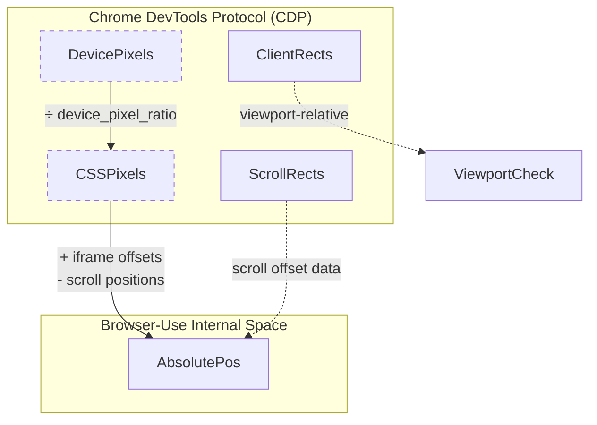

<!-- source: DeepWiki mcp.deepwiki.com · repo browser-use/browser-use · page 5.4 Visibility Calculation and Coordinate Transformation · fetched 2026-10-30 -->

# Visibility Calculation and Coordinate Transformation

<details>
<summary>Relevant source files</summary>

The following files were used as context for generating this wiki page:

- [browser_use/dom/enhanced_snapshot.py](browser_use/dom/enhanced_snapshot.py)
- [browser_use/dom/playground/extraction.py](browser_use/dom/playground/extraction.py)
- [browser_use/dom/serializer/serializer.py](browser_use/dom/serializer/serializer.py)
- [browser_use/dom/service.py](browser_use/dom/service.py)
- [browser_use/dom/views.py](browser_use/dom/views.py)
- [tests/ci/test_dom_live_input_value.py](tests/ci/test_dom_live_input_value.py)
- [tests/ci/test_dom_visibility.py](tests/ci/test_dom_visibility.py)
- [tests/ci/test_image_only_dom_representation.py](tests/ci/test_image_only_dom_representation.py)

</details>


## Purpose and Scope

This document explains how `browser-use` determines element visibility and transforms coordinates across different reference frames. The system must reconcile multiple coordinate systems, handle nested iframes with independent scroll positions, and apply CSS-based visibility rules to ensure the LLM receives accurate spatial data.

The core logic resides in `DomService` [browser_use/dom/service.py:45](), which processes raw Chrome DevTools Protocol (CDP) data into an `EnhancedDOMTreeNode` structure [browser_use/dom/views.py:21]().

Sources: [browser_use/dom/service.py:45](), [browser_use/dom/views.py:17-25]()

## Coordinate Systems Overview

Browser-use operates across four distinct coordinate systems that must be reconciled to allow an Agent to interact with elements accurately.

Title: "Coordinate Transformation Flow"


Sources: [browser_use/dom/enhanced_snapshot.py:70-161](), [browser_use/dom/service.py:692-776]()

### Device Pixels vs CSS Pixels

Chrome's CDP returns coordinates in **device pixels**, which differ from **CSS pixels** on high-DPI displays. The conversion formula used in `build_snapshot_lookup` [browser_use/dom/enhanced_snapshot.py:70]() ensures that coordinates are consistent with web standard CSS layouts:

`css_pixels = device_pixels / device_pixel_ratio` [browser_use/dom/enhanced_snapshot.py:153-161]()

The `device_pixel_ratio` is extracted via layout metrics during snapshot capture [browser_use/dom/views.py:197-202]().

Sources: [browser_use/dom/enhanced_snapshot.py:70-161](), [browser_use/dom/views.py:197-202]()

## Coordinate Transformation During Tree Construction

The DOM tree construction process recursively builds nodes while tracking coordinate offsets from parent iframes. This ensures every element's absolute position represents its true location relative to the top-level document's origin, without mutating shared snapshot bounding box structures [tests/ci/test_dom_visibility.py:65-104]().

### Frame Offset Accumulation

Title: "Nested Iframe Coordinate Mapping"
```mermaid
graph TD
    TopLevel["TopLevel"] --> Iframe1["Iframe1"]
    Iframe1 --> IframeHTML1["IframeHTML1"]
    IframeHTML1 --> Iframe2["Iframe2"]
    Iframe2 --> Button["Button"]

    TopLevel ["Top-Level Document<br/>offset = (0, 0)"]
    Iframe1 ["IFRAME at (100, 50)<br/>offset = (100, 50)"]
    IframeHTML1 ["HTML (scrolled 30px down)<br/>offset = (100, 20)"]
    Iframe2 ["Nested IFRAME at (50, 80)<br/>offset = (150, 100)"]
    Button ["Button at (20, 30)<br/>absolute_position = (170, 130)"]
```

Sources: [browser_use/dom/service.py:692-776](), [tests/ci/test_dom_visibility.py:65-104]()

### Cross-Origin Iframe Size Eligibility

When processing cross-origin iframes, the system applies a size filter via `_is_cross_origin_iframe_size_eligible` to include valid interactive frames (such as secure card input fields or native checkboxes) while dropping tiny tracking pixels [browser_use/dom/service.py:40-43](), [tests/ci/test_dom_visibility.py:106-129]().

Sources: [browser_use/dom/service.py:40-43](), [tests/ci/test_dom_visibility.py:106-129]()

## Visibility Calculation Algorithm

Visibility checks evaluate CSS properties, viewport intersection, and parent iframe constraints. Crucially, visibility checks are pure and idempotent, ensuring they never modify shared node snapshot bounds in place [tests/ci/test_dom_visibility.py:65-104]().

Title: "Visibility Logic Flow"
```mermaid
flowchart TD
    Start["Start"] --> CheckSnapshot["CheckSnapshot"]
    CheckSnapshot -->|No| CSSFail["CSSFail"]
    CheckSnapshot -->|Yes| CheckCSS["CheckCSS"]
    CheckCSS -->|CSS hidden| CSSFail
    CheckCSS -->|CSS visible| ThresholdCheck["ThresholdCheck"]
    
    ThresholdCheck -->|Yes| ReturnTrue["ReturnTrue"]
    ThresholdCheck -->|No| GetBounds["GetBounds"]
    
    GetBounds --> IterateFrames["IterateFrames"]
    IterateFrames --> CheckFrameType["CheckFrameType"]
    
    CheckFrameType -->|IFRAME| IframeTransform["IframeTransform"]
    CheckFrameType -->|HTML| HTMLIntersect["HTMLIntersect"]
    
    HTMLIntersect --> IntersectCheck["IntersectCheck"]
    IntersectCheck -->|No| CSSFail
    IntersectCheck -->|Yes| AdjustScroll["AdjustScroll"]
    
    AdjustScroll --> AllFramesDone["AllFramesDone"]
    AllFramesDone -->|Yes| FinalTrue["FinalTrue"]

    Start ["is_element_visible_according_to_all_parents()"]
    CheckSnapshot {"snapshot_node<br/>exists?"}
    CheckCSS ["Check CSS Properties:<br/>- display != none<br/>- visibility != hidden<br/>- opacity > 0"]
    CSSFail ["Return False"]
    ThresholdCheck {"viewport_threshold<br/>is None?"}
    ReturnTrue ["Return True<br/>(skip viewport checks)"]
    GetBounds ["current_bounds = element.bounds"]
    IterateFrames ["For each parent frame<br/>(reverse order)"]
    CheckFrameType {"Frame type?"}
    IframeTransform ["IFRAME/FRAME:<br/>Add iframe offset to bounds"]
    HTMLIntersect ["HTML frame:<br/>Check viewport intersection"]
    IntersectCheck {"Bounds intersect<br/>frame viewport?"}
    AdjustScroll ["Adjust bounds by scroll offset"]
    AllFramesDone {"All frames<br/>processed?"}
    FinalTrue ["Return True<br/>(visible in all frames)"]
```

Sources: [browser_use/dom/service.py:45-337](), [tests/ci/test_dom_visibility.py:65-104]()

### CSS Visibility Rules

The method checks computed styles extracted during snapshotting [browser_use/dom/enhanced_snapshot.py:17-29]():

| Property | Hidden Condition | Source |
|----------|------------------|--------|
| `display` | `none` | [browser_use/dom/service.py:93-97]() |
| `visibility` | `hidden` | [browser_use/dom/service.py:94-97]() |
| `opacity` | `<= 0` | [browser_use/dom/service.py:95-100]() |

Sources: [browser_use/dom/enhanced_snapshot.py:17-29](), [browser_use/dom/service.py:80-104]()

## Viewport Threshold Filtering

The `viewport_threshold` parameter (default 1000px) [browser_use/dom/service.py:64]() controls filtering of off-screen content. This reduces token usage for the LLM by excluding elements that reside too far outside the current viewport view.

Sources: [browser_use/dom/service.py:56-73]()

## Hidden Elements Detection in Iframes

The `_count_hidden_elements_in_iframes` method [browser_use/dom/service.py:80]() collects hidden interactive elements inside iframes to provide LLM hints about scrollable content. This prevents the Agent from getting stuck when target elements are scrolled out of view. It calculates distance in viewport heights ("pages") to guide scrolling behavior [browser_use/dom/service.py:124-128]().

Title: "Iframe Hidden Content Detection"
```mermaid
graph TD
    Node["Node"] -->|If Iframe| Interactive["Interactive"]
    Interactive -->|True| HiddenCheck["HiddenCheck"]
    HiddenCheck -->|True| CalcPages["CalcPages"]
    CalcPages -->|Result| Info["Info"]

    Node ["EnhancedDOMTreeNode"]
    Interactive ["ClickableElementDetector.is_interactive"]
    HiddenCheck ["is_hidden_by_threshold"]
    CalcPages ["y_pos / viewport_height"]
    Info ["hidden_elements_info"]
```

Sources: [browser_use/dom/service.py:80-192]()

## Data Structures

- **`DOMRect`**: Represents a rectangular bounding box in 2D space [browser_use/dom/views.py:18-18]().
- **`EnhancedSnapshotNode`**: Contains layout information extracted from CDP's `DOMSnapshot`, including document coordinates (`bounds`), viewport coordinates (`clientRects`), scrollable area information (`scrollRects`), and paint order [browser_use/dom/enhanced_snapshot.py:137-156]().
- **`EnhancedDOMTreeNode` Visibility Fields**: Tracks `is_visible`, `absolute_position` (`DOMRect`), and `hidden_elements_info` metadata for scrolled elements [browser_use/dom/service.py:177](), [tests/ci/test_dom_visibility.py:30-51]().

Sources: [browser_use/dom/views.py:17-25](), [browser_use/dom/enhanced_snapshot.py:137-156](), [browser_use/dom/service.py:177](), [tests/ci/test_dom_visibility.py:30-51]()

---

