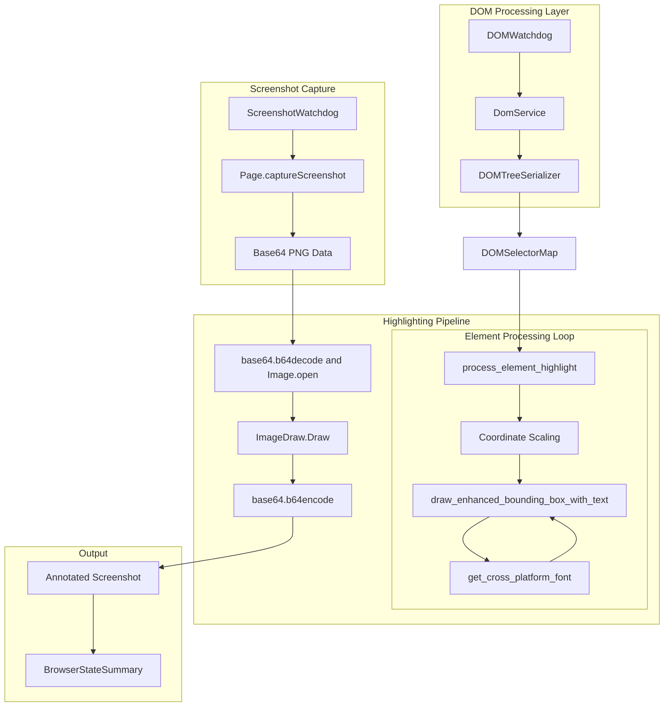
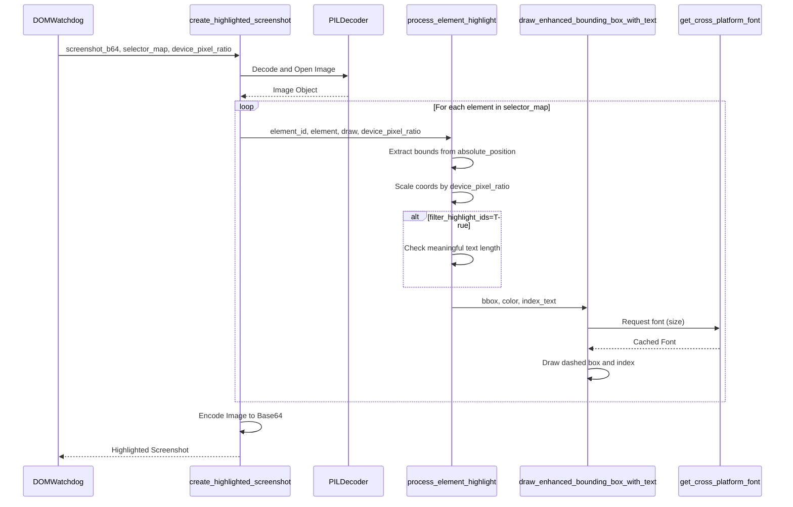
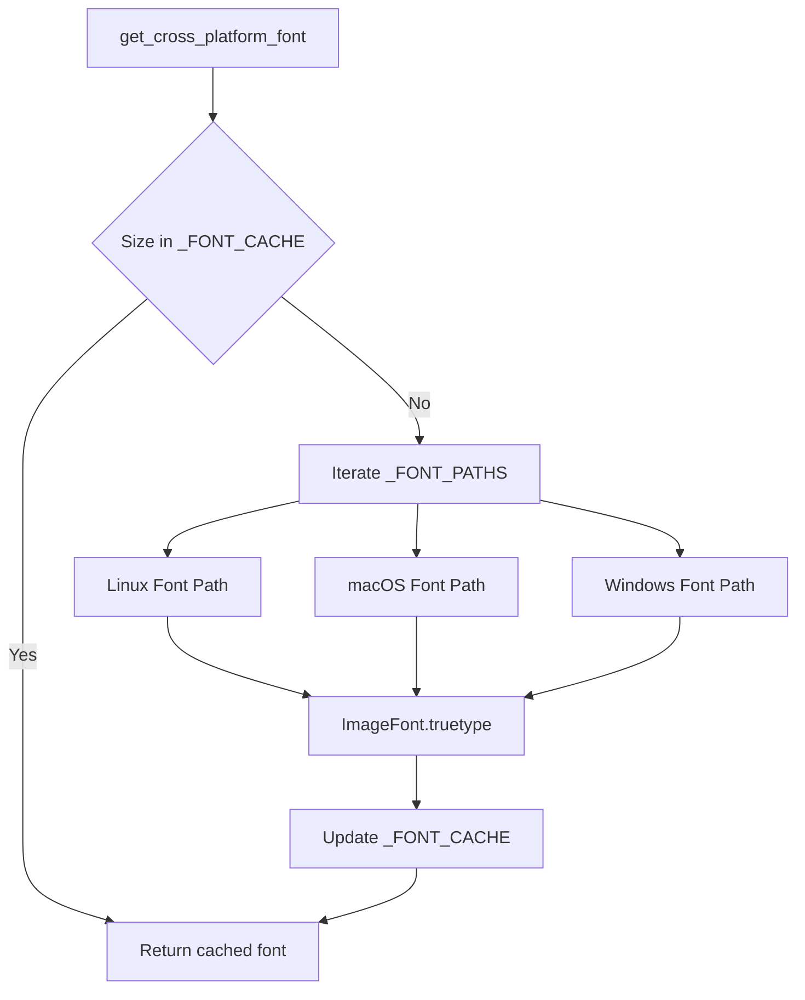

<!-- source: DeepWiki mcp.deepwiki.com · repo browser-use/browser-use · page 5.5 Screenshot Highlighting System · fetched 2026-10-30 -->

# Screenshot Highlighting System

<details>
<summary>Relevant source files</summary>

The following files were used as context for generating this wiki page:

- [.gitignore](.gitignore)
- [.python-version](.python-version)
- [browser_use/browser/python_highlights.py](browser_use/browser/python_highlights.py)
- [browser_use/browser/watchdogs/dom_watchdog.py](browser_use/browser/watchdogs/dom_watchdog.py)
- [browser_use/dom/serializer/eval_serializer.py](browser_use/dom/serializer/eval_serializer.py)

</details>


## Purpose and Scope

The Screenshot Highlighting System is a Python-based image processing subsystem implemented in `browser_use/browser/python_highlights.py` [browser_use/browser/python_highlights.py:1-5()]() that draws bounding boxes and indices on screenshots to help Large Language Models (LLMs) identify and reference interactive elements visually. It replaces older JavaScript-based highlighting approaches with fast PIL/Pillow image manipulation for better performance and reliability.

This page covers the image processing pipeline that occurs after DOM extraction and before screenshots are sent to the LLM. For information about DOM tree extraction, see [5.1 DOM Tree Construction]().

---

## System Overview

The highlighting system operates on base64-encoded screenshots and selector maps (`DOMSelectorMap`), which map element IDs to DOM nodes. It:

1. Decodes the screenshot from base64 [browser_use/browser/python_highlights.py:417-421]().
2. Iterates through interactive elements in the selector map [browser_use/browser/python_highlights.py:431-435]().
3. Transforms CSS pixel coordinates to device pixel coordinates using the `device_pixel_ratio` [browser_use/browser/python_highlights.py:357-362]().
4. Draws dashed bounding boxes around each element with type-specific colors via `draw_enhanced_bounding_box_with_text()` [browser_use/browser/python_highlights.py:108-146]().
5. Overlays index numbers for elements based on text length filtering [browser_use/browser/python_highlights.py:148-180]().
6. Re-encodes the result as base64 [browser_use/browser/python_highlights.py:504-509]().

The system is designed to be stateless and purely functional—it takes a screenshot and selector map as input and returns a highlighted screenshot as output.

Sources: `browser_use/browser/python_highlights.py:1-90` [browser_use/browser/python_highlights.py:1-90]()

---

## Architecture and Data Flow

### Screenshot Annotation Pipeline

Title: "Screenshot Highlighting Data Flow"


**Integration Flow:** The system is called via `create_highlighted_screenshot()` [browser_use/browser/python_highlights.py:407-415](). It utilizes the `DOMSelectorMap` [browser_use/dom/views.py:15-15]() which contains the interactive elements discovered during the DOM serialization phase. The `DOMWatchdog` maintains the `selector_map` and `current_dom_state` [browser_use/browser/watchdogs/dom_watchdog.py:38-40]() which are used by the agent to understand the page structure. Before capturing the screenshot, `ScreenshotWatchdog` explicitly calls `remove_highlights()` via the browser session to ensure the browser's native visual state is clean before applying the Python-based overlays. [browser_use/browser/watchdogs/screenshot_watchdog.py:55-62]()

Sources: `browser_use/browser/python_highlights.py:407-509` [browser_use/browser/python_highlights.py:407-509](), `browser_use/browser/watchdogs/dom_watchdog.py:26-46` [browser_use/browser/watchdogs/dom_watchdog.py:26-46](), `browser_use/browser/watchdogs/screenshot_watchdog.py:53-62` [browser_use/browser/watchdogs/screenshot_watchdog.py:53-62]()

---

## Core Highlighting Function

The main entry point is `create_highlighted_screenshot()` which processes the entire highlighting pipeline. [browser_use/browser/python_highlights.py:407-415]()

### Annotation Sequence

Title: "Highlighting Execution Sequence"


**Key Parameters:**
- `screenshot_b64`: Base64-encoded PNG screenshot from CDP.
- `selector_map`: `DOMSelectorMap` mapping element IDs to `EnhancedDOMTreeNode` objects [browser_use/dom/views.py:15-15]().
- `device_pixel_ratio`: Scaling factor from CSS pixels to device pixels.
- `filter_highlight_ids`: If `True`, only shows index overlays for elements with <3 characters of meaningful text [browser_use/browser/python_highlights.py:385-396]().

Sources: `browser_use/browser/python_highlights.py:407-509` [browser_use/browser/python_highlights.py:407-509]()

---

## Coordinate Transformation System

The highlighting system must handle coordinate space transformations because different parts of the system use different coordinate systems.

### Device Pixel Ratio Calculation

The device pixel ratio ensures that bounding boxes drawn on the image (device pixels) align with element positions defined in the DOM (CSS pixels).

| Coordinate System | Source | Usage |
|-------------------|--------|-------|
| **CSS Pixels** | `EnhancedDOMTreeNode.viewport_coordinates` | Element positions relative to the viewport. |
| **Device Pixels** | `Page.captureScreenshot` | Actual resolution of the PNG file. |

**Transformation Logic:**
```python
# Scaling CSS coordinates to image pixels
x1 = rect.x * device_pixel_ratio
y1 = rect.y * device_pixel_ratio
x2 = (rect.x + rect.width) * device_pixel_ratio
y2 = (rect.y + rect.height) * device_pixel_ratio
```
[browser_use/browser/python_highlights.py:357-362]()

Sources: `browser_use/browser/python_highlights.py:340-365` [browser_use/browser/python_highlights.py:340-365]()

---

## Font Management and Caching

The system uses a cross-platform font loading strategy via `get_cross_platform_font()` with aggressive caching in `_FONT_CACHE` to prevent memory leaks and redundant I/O [browser_use/browser/python_highlights.py:22-33]().

### Font Loading Logic

Title: "Cross-Platform Font Resolution"


Sources: `browser_use/browser/python_highlights.py:36-70` [browser_use/browser/python_highlights.py:36-70]()

---

## Color Coding System

Interactive elements are color-coded by tag type to help LLMs distinguish different element categories visually [browser_use/browser/python_highlights.py:72-80]().

| Element Type | Color Code | Hex Color | Logic |
|--------------|-----------|-----------|-------|
| `button` | Red | `#FF6B6B` | Buttons and `input[type="submit"]` [browser_use/browser/python_highlights.py:96-97](). |
| `input` | Teal | `#4ECDC4` | Standard text inputs [browser_use/browser/python_highlights.py:75](). |
| `select` | Blue | `#45B7D1` | Dropdown selects [browser_use/browser/python_highlights.py:76](). |
| `a` | Green | `#96CEB4` | Links/Anchors [browser_use/browser/python_highlights.py:77](). |
| `textarea` | Orange | `#FF8C42` | Multi-line text areas [browser_use/browser/python_highlights.py:78](). |
| `default` | Light Purple | `#DDA0DD` | Other interactive elements [browser_use/browser/python_highlights.py:79](). |

Sources: `browser_use/browser/python_highlights.py:72-101` [browser_use/browser/python_highlights.py:72-101]()

---

## Index Overlay Positioning

The system uses intelligent positioning logic in `draw_enhanced_bounding_box_with_text()` to place index numbers without obscuring element content [browser_use/browser/python_highlights.py:108-117]().

### Position Selection Algorithm

1. **Small Elements:** If width < 60px or height < 30px, the index is placed **above** the element to avoid blocking icons [browser_use/browser/python_highlights.py:186-188]().
2. **Regular Elements:** The index is placed **inside** the top-left corner with a small offset [browser_use/browser/python_highlights.py:190-191]().
3. **Clamping:** The index container is always clamped to remain within the image boundaries [browser_use/browser/python_highlights.py:201-212]().

Sources: `browser_use/browser/python_highlights.py:148-231` [browser_use/browser/python_highlights.py:148-231]()

---

## Index Filtering System

To reduce visual noise, the system can filter which elements receive index overlays based on their meaningful text content.

```python
# Logic in process_element_highlight
if filter_highlight_ids:
    meaningful_text = element.get_meaningful_text_for_llm()
    if len(meaningful_text) > 3:
        index_text = None  # Hide index if text is descriptive enough
```
[browser_use/browser/python_highlights.py:385-396]()

The `get_meaningful_text_for_llm()` method (implemented in the DOM node views) prioritizes attributes like `aria-label`, `title`, and `placeholder` over raw text.

Sources: `browser_use/browser/python_highlights.py:385-396` [browser_use/browser/python_highlights.py:385-396]()

---

## Cleanup and Memory Management

For long-running applications, the system provides `cleanup_font_cache()` to clear the font cache and prevent memory growth from multiple font sizes [browser_use/browser/python_highlights.py:66-69]().

```python
def cleanup_font_cache() -> None:
    """Clean up the font cache to prevent memory leaks."""
    global _FONT_CACHE
    _FONT_CACHE.clear()
```
[browser_use/browser/python_highlights.py:66-69]()

Sources: `browser_use/browser/python_highlights.py:66-70` [browser_use/browser/python_highlights.py:66-70]()

---

