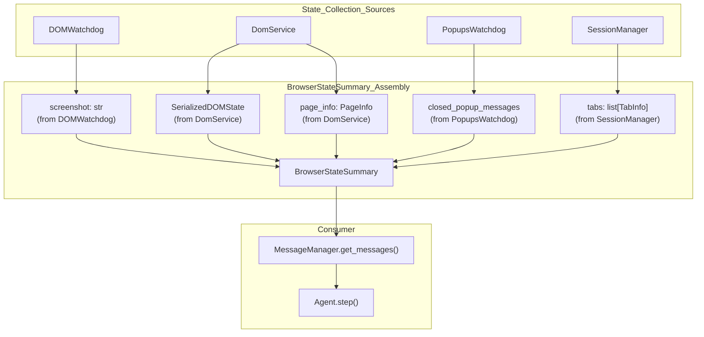
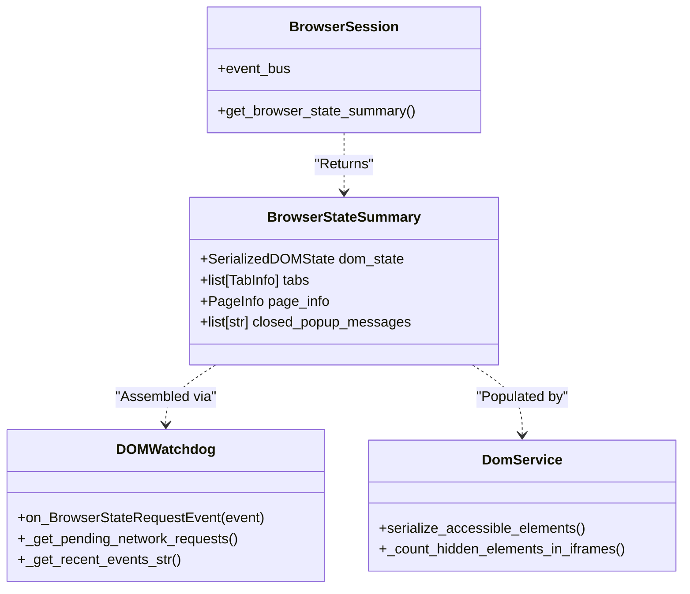

<!-- source: DeepWiki mcp.deepwiki.com · repo browser-use/browser-use · page 5.6 Browser State Summary · fetched 2026-10-30 -->

# Browser State Summary

Relevant source files

The following files were used as context for generating this wiki page:

- [.gitignore](.gitignore)
- [.python-version](.python-version)
- [browser_use/browser/python_highlights.py](browser_use/browser/python_highlights.py)
- [browser_use/browser/watchdogs/dom_watchdog.py](browser_use/browser/watchdogs/dom_watchdog.py)
- [browser_use/dom/enhanced_snapshot.py](browser_use/dom/enhanced_snapshot.py)
- [browser_use/dom/playground/extraction.py](browser_use/dom/playground/extraction.py)
- [browser_use/dom/serializer/eval_serializer.py](browser_use/dom/serializer/eval_serializer.py)
- [browser_use/dom/serializer/serializer.py](browser_use/dom/serializer/serializer.py)
- [browser_use/dom/service.py](browser_use/dom/service.py)
- [browser_use/dom/views.py](browser_use/dom/views.py)
- [tests/ci/test_dom_live_input_value.py](tests/ci/test_dom_live_input_value.py)
- [tests/ci/test_image_only_dom_representation.py](tests/ci/test_image_only_dom_representation.py)

## Purpose and Scope

This document describes the `BrowserStateSummary` data structure and its component models, which represent the browser's current state in a format optimized for LLM consumption. This structure is the primary interface between the browser control layer and the Agent's decision-making system.

The `BrowserStateSummary` consolidates browser state from multiple sources: the serialized DOM tree, viewport and scroll information, active tabs, network activity, pagination controls, and browser errors. It is generated during the agent's observation step and consumed by `MessageManager` when constructing LLM prompts.

**Sources:** [browser_use/dom/views.py:1-276](), [browser_use/browser/watchdogs/dom_watchdog.py:7-24]()

---

## BrowserStateSummary Structure

The `BrowserStateSummary` dataclass is the root container for all browser state information passed to the LLM. It aggregates data from multiple watchdogs and services into a single coherent snapshot.

### Core Fields

| Field | Type | Description |
|-------|------|-------------|
| `dom_state` | `SerializedDOMState` | LLM-formatted DOM tree with interactive element indices [browser_use/dom/views.py:263]() |
| `url` | `str` | Current page URL [browser_use/dom/views.py:265]() |
| `title` | `str` | Current page title [browser_use/dom/views.py:266]() |
| `tabs` | `list[TabInfo]` | All open browser tabs [browser_use/dom/views.py:267]() |
| `screenshot` | `str \| None` | Base64-encoded screenshot [browser_use/dom/views.py:268]() |
| `page_info` | `PageInfo \| None` | Viewport dimensions and scroll position [browser_use/dom/views.py:269]() |
| `browser_errors` | `list[str]` | Accumulated error messages from browser operations [browser_use/dom/views.py:274]() |
| `is_pdf_viewer` | `bool` | Whether current page is displaying a PDF [browser_use/dom/views.py:275]() |
| `recent_events` | `str \| None` | Text summary of recent browser events [browser_use/dom/views.py:276]() |
| `pending_network_requests` | `list[NetworkRequest]` | Currently loading network resources [browser_use/dom/views.py:277]() |
| `pagination_buttons` | `list[PaginationButton]` | Detected pagination controls on the page [browser_use/dom/views.py:278]() |
| `closed_popup_messages` | `list[str]` | Messages from auto-dismissed JavaScript dialogs [browser_use/dom/views.py:279]() |

### Data Flow Diagram

Title: "Browser State Summary Assembly and Data Flow"

**Sources:** [browser_use/dom/views.py:259-280](), [browser_use/browser/watchdogs/dom_watchdog.py:28-48](), [browser_use/dom/service.py:45-72]()

---

## TabInfo Model

The `TabInfo` Pydantic model represents metadata about a single browser tab or target. It uses aliases and custom serializers to minimize token usage in LLM prompts.

### Fields and Serialization

| Field | Type | Serialization Alias | Description |
|-------|------|---------------------|-------------|
| `url` | `str` | - | Full URL of the tab [browser_use/dom/views.py:197]() |
| `title` | `str` | - | Page title [browser_use/dom/views.py:198]() |
| `target_id` | `TargetID` | `tab_id` | CDP target identifier [browser_use/dom/views.py:199]() |
| `parent_target_id` | `TargetID \| None` | `parent_tab_id` | Parent target for popups/iframes [browser_use/dom/views.py:200]() |

### ID Truncation
The `target_id` and `parent_target_id` fields use custom serializers to truncate CDP target IDs to their last 4 characters to save tokens [browser_use/dom/views.py:204-210]().

**Sources:** [browser_use/dom/views.py:186-212]()

---

## PageInfo Model

The `PageInfo` Pydantic model provides comprehensive page size and scroll information.

| Category | Field | Type | Description |
|----------|-------|------|-------------|
| **Viewport** | `viewport_width` | `int` | Viewport width in pixels [browser_use/dom/views.py:217]() |
| | `viewport_height` | `int` | Viewport height in pixels [browser_use/dom/views.py:218]() |
| **Page Dimensions** | `page_width` | `int` | Total page width [browser_use/dom/views.py:221]() |
| | `page_height` | `int` | Total page height [browser_use/dom/views.py:222]() |
| **Scroll Position** | `scroll_x` | `int` | Horizontal scroll offset [browser_use/dom/views.py:225]() |
| | `scroll_y` | `int` | Vertical scroll offset [browser_use/dom/views.py:226]() |
| **Scroll Distances** | `pixels_above` | `int` | Pixels hidden above viewport [browser_use/dom/views.py:229]() |
| | `pixels_below` | `int` | Pixels hidden below viewport [browser_use/dom/views.py:230]() |

**Sources:** [browser_use/dom/views.py:213-236]()

---

## Network Request Tracking

The `DOMWatchdog` implements a network monitoring mechanism using the browser's performance API to detect pending requests.

### JS-Based Detection
The system executes an asynchronous JS block to check `document.readyState` and `performance.getEntriesByType('resource')` [browser_use/browser/watchdogs/dom_watchdog.py:109-113](). It filters out:
- **Ads/Tracking**: Domains like `doubleclick.net` or `googlesyndication.com` [browser_use/browser/watchdogs/dom_watchdog.py:119-134]().
- **Stale Requests**: Requests loading for more than 10 seconds [browser_use/browser/watchdogs/dom_watchdog.py:164]().
- **Non-critical Resources**: Images or fonts loading for more than 3 seconds [browser_use/browser/watchdogs/dom_watchdog.py:169-174]().

### NetworkRequest Structure
| Field | Type | Description |
|-------|------|-------------|
| `url` | `str` | Request URL [browser_use/dom/views.py:241]() |
| `method` | `str` | HTTP method [browser_use/dom/views.py:242]() |
| `loading_duration_ms` | `float` | Time elapsed since request start [browser_use/dom/views.py:243]() |
| `resource_type` | `str \| None` | Type of resource (e.g., 'xhr', 'fetch') [browser_use/dom/views.py:244]() |

**Sources:** [browser_use/browser/watchdogs/dom_watchdog.py:93-208](), [browser_use/dom/views.py:237-246]()

---

## Pagination Detection

The `PaginationButton` dataclass represents controls detected on the page to facilitate multi-page navigation.

| Field | Type | Description |
|-------|------|-------------|
| `button_type` | `str` | Category: `'next'`, `'prev'`, `'page_number'`, etc. [browser_use/dom/views.py:251]() |
| `backend_node_id` | `int` | CDP backend node ID for interaction [browser_use/dom/views.py:252]() |
| `text` | `str` | Visible text or page number [browser_use/dom/views.py:253]() |
| `selector` | `str` | Selector for the element [browser_use/dom/views.py:254]() |
| `is_disabled` | `bool` | Whether the button is non-functional [browser_use/dom/views.py:255]() |

**Sources:** [browser_use/dom/views.py:247-257]()

---

## Implementation Entity Mapping

This diagram maps high-level browser state concepts to their implementation classes and event handlers.

Title: "System Entity Mapping for Browser State"

**Sources:** [browser_use/dom/views.py:259-280](), [browser_use/browser/watchdogs/dom_watchdog.py:28-48](), [browser_use/dom/service.py:45-192]()

---

