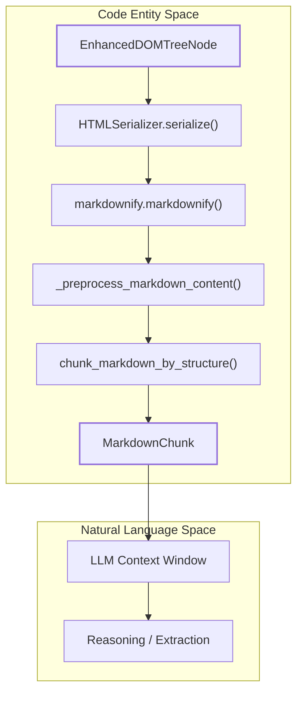
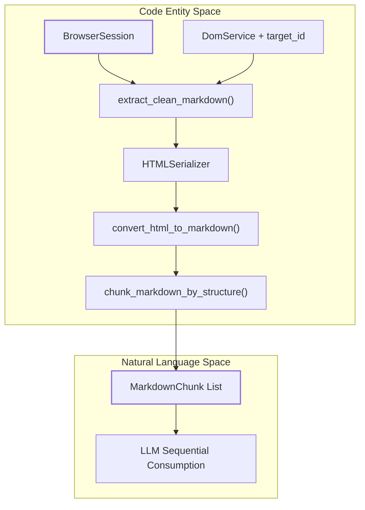

<!-- source: DeepWiki mcp.deepwiki.com · repo browser-use/browser-use · page 5.7 Markdown Extraction and HTML Serialization · fetched 2026-10-30 -->

# Markdown Extraction and HTML Serialization

Relevant source files

The following files were used as context for generating this wiki page:

- [browser_use/dom/markdown_extractor.py](browser_use/dom/markdown_extractor.py)
- [browser_use/dom/serializer/html_serializer.py](browser_use/dom/serializer/html_serializer.py)
- [tests/ci/test_extract_images.py](tests/ci/test_extract_images.py)
- [tests/ci/test_html_serializer_style.py](tests/ci/test_html_serializer_style.py)
- [tests/ci/test_markdown_chunking.py](tests/ci/test_markdown_chunking.py)
- [tests/ci/test_markdown_extractor.py](tests/ci/test_markdown_extractor.py)
- [tests/ci/test_search_find.py](tests/ci/test_search_find.py)

## Purpose and Scope

This page documents the DOM extraction and serialization pipeline in `browser-use`, focusing on `browser_use/dom/markdown_extractor.py` and `browser_use/dom/serializer/html_serializer.py`. The module is responsible for transforming raw, complex browser Document Object Models (DOMs)—including Shadow DOM components and iframes—into clean, LLM-friendly Markdown representations while managing context window constraints through structure-aware chunking.

---

## System Architecture and Data Flow

The markdown extraction pipeline bridges the gap between structured browser DOM objects (CDP / Enhanced DOM) and the text-based reasoning space required by Large Language Models.

### DOM to Markdown Pipeline

Sources: [browser_use/dom/markdown_extractor.py:23-88](), [browser_use/dom/serializer/html_serializer.py:27-156](), [browser_use/dom/views.py:1-18]()

---

## HTML Serialization

The `HTMLSerializer` class in `browser_use/dom/serializer/html_serializer.py` serializes enhanced DOM trees back into valid HTML strings, capturing hidden structural details vital for modern Single Page Applications (SPAs).

### Key Serialization Mechanisms
- **Shadow DOM Support**: Detects `NodeType.DOCUMENT_FRAGMENT_NODE` elements and wraps them in `<template shadowroot="...">` tags to expose encapsulated web components [browser_use/dom/serializer/html_serializer.py:46-63]().
- **Iframe Integration**: Recursively serializes `content_document` nodes within `<iframe>` and `<frame>` tags [browser_use/dom/serializer/html_serializer.py:133-138]().
- **Noise Filtering**: Automatically drops non-content structural tags (`<style>`, `<script>`, `<head>`, `<meta>`, `<link>`, `<title>`) [browser_use/dom/serializer/html_serializer.py:70-71]().
- **Table Normalization**: `_serialize_table_children` normalizes table structures by ensuring `<thead>` and `<tbody>` tags are present for accurate downstream Markdown conversion [browser_use/dom/serializer/html_serializer.py:172-218]().

| Feature | Code Implementation | Purpose |
| :--- | :--- | :--- |
| **Shadow Roots** | `serialize()` handling `NodeType.DOCUMENT_FRAGMENT_NODE` | Capture encapsulated component data |
| **Void Elements** | `void_elements` set | Proper self-closing tag syntax (e.g., ` `) |
| **Data Masking** | Style & ID attribute checks | Skip large JSON blobs hidden in `display:none` code tags |
| **Image Filtering** | Base64 URL checks | Skip inline tracking pixels or heavy placeholders |

Sources: [browser_use/dom/serializer/html_serializer.py:6-170](), [browser_use/dom/serializer/html_serializer.py:172-218]()

---

## Markdown Extraction and Preprocessing

The `extract_clean_markdown` function provides a unified entry point to extract clean markdown using either a `BrowserSession` (for agent tools) or a `DomService` with a `target_id` (for page actors) [browser_use/dom/markdown_extractor.py:23-63]().

### Preprocessing and Noise Reduction
The `_preprocess_markdown_content` function applies lightweight text cleansing:
- Removes large embedded JSON blobs (common in SPAs like LinkedIn and Facebook) by matching patterns like `{"$type":...}` or long code blocks [browser_use/dom/markdown_extractor.py:160-166]().
- Compresses excessive consecutive newlines [browser_use/dom/markdown_extractor.py:168]().
- Strips whitespace-only lines while preserving short content elements, list items, and state codes [browser_use/dom/markdown_extractor.py:170-171](), [tests/ci/test_markdown_extractor.py:9-50]().

### Image and Link Handling
The `extract_images` parameter controls whether inline image source URLs are retained inside table cells (`<td>`, `<th>`) or headings (`<h1>`–`<h6>`) [browser_use/dom/markdown_extractor.py:123-135](), [tests/ci/test_extract_images.py:1-9]().

Sources: [browser_use/dom/markdown_extractor.py:23-88](), [browser_use/dom/markdown_extractor.py:113-143](), [browser_use/dom/markdown_extractor.py:146-181]()

---

## Structure-Aware Chunking and Token Management

When extracted markdown exceeds LLM context windows, `chunk_markdown_by_structure` splits content into semantic segments (`MarkdownChunk` objects) [tests/ci/test_markdown_chunking.py:16-44]().

### Chunking Rules
1. **Header Boundaries**: Prefers splitting at ATX header boundaries (`#`, `##`) and avoids splitting code fences or table rows mid-row [tests/ci/test_markdown_chunking.py:64-76](), [tests/ci/test_markdown_chunking.py:114-122](), [tests/ci/test_markdown_chunking.py:135-152]().
2. **Table Continuity**: Carries table headers into subsequent chunks to maintain context [tests/ci/test_markdown_chunking.py:153-170]().

### Extraction Routing and Chunking Flow

Sources: [browser_use/dom/markdown_extractor.py:23-63](), [tests/ci/test_markdown_chunking.py:16-44](), [browser_use/dom/views.py:15-18]()

---

