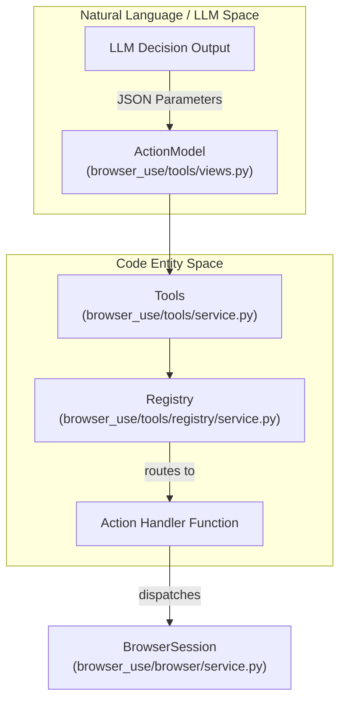
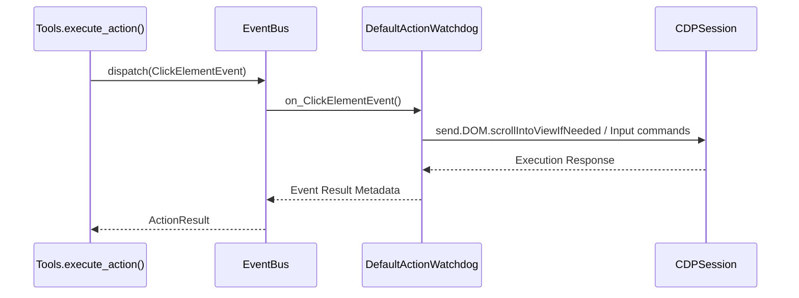

<!-- source: DeepWiki mcp.deepwiki.com · repo browser-use/browser-use · page 6 Tools and Action System · fetched 2026-10-30 -->

# Tools and Action System

Relevant source files

The following files were used as context for generating this wiki page:

- [browser_use/browser/watchdogs/default_action_watchdog.py](browser_use/browser/watchdogs/default_action_watchdog.py)
- [browser_use/tools/service.py](browser_use/tools/service.py)
- [browser_use/tools/views.py](browser_use/tools/views.py)
- [examples/features/save_as_pdf.py](examples/features/save_as_pdf.py)
- [tests/ci/browser/test_send_keys_literal_plus.py](tests/ci/browser/test_send_keys_literal_plus.py)
- [tests/ci/test_action_save_as_pdf.py](tests/ci/test_action_save_as_pdf.py)

The Tools and Action System provides the translation layer between the Agent's high-level decisions and concrete browser operations. It defines a registry of available actions (navigate, click, input, extract, etc.), validates parameters using Pydantic models, and executes actions by dispatching events to the `BrowserSession` and underlying CDP (Chrome DevTools Protocol) interfaces [browser_use/tools/service.py:1-40]().

As a parent page, this section introduces the high-level architecture of the tools system. For complete technical details, consult the child pages linked below.

---

## 6.1 Tools Registry and Action Models

The `Tools` class serves as the central manager and dispatcher for all agent-accessible actions. It maintains an internal `Registry` that dynamically constructs JSON schemas for LLM consumption and routes action requests to their respective handlers [browser_use/tools/service.py:345-356](). Actions are defined using Pydantic models that specify required and optional parameters, ensuring strict type safety and structured input validation [browser_use/tools/views.py:8-102]().

**Diagram: Tools Class and Registry Architecture**

Sources: [browser_use/tools/service.py:345-356](), [browser_use/tools/registry/service.py:32-54]()

For details on action registration, decorator patterns (`@registry.action`), domain filters, and parameter models, see [Tools Registry and Action Models](#6.1).

---

## 6.2 Built-in Actions Reference

Browser-use provides a robust suite of built-in actions covering navigation, interactive element manipulation, tab controls, data extraction, filesystem interactions, and utilities. Certain control-flow actions (such as `navigate`, `search`, and `go_back`) set flags like `terminates_sequence=True` to immediately halt remaining queued actions in a multi-act step when the DOM changes [browser_use/tools/service.py:362-479]().

For a complete reference of all built-in actions, their parameters, and behavioral flags, see [Built-in Actions Reference](#6.2).

Sources: [browser_use/tools/service.py:362-1214](), [browser_use/tools/registry/views.py:22-24]()

---

## 6.3 Action Execution Pipeline

When an action is invoked, it passes through an event-driven pipeline. `Tools` dispatches strongly typed events (e.g., `ClickElementEvent`, `TypeTextEvent`) to the event bus, where specialized watchdog classes—principally `DefaultActionWatchdog`—intercept them to execute CDP commands [browser_use/browser/watchdogs/default_action_watchdog.py:42-45](). The pipeline enforces global timeouts (`_DEFAULT_ACTION_TIMEOUT_S`) and aggregates results into an `ActionResult` [browser_use/tools/service.py:89-142]().

**Diagram: Action Execution Pipeline**

Sources: [browser_use/tools/service.py:89-142](), [browser_use/browser/watchdogs/default_action_watchdog.py:42-45]()

For details on event dispatching, watchdog wiring, CDP command aggregation, timeout safeguards, and error handling, see [Action Execution Pipeline](#6.3).

---

## 6.4 Custom Tools and Extensions

Developers can extend the framework by registering custom actions using decorators (`@tools.action` or `@registry.action`). The registry supports dependency injection for parameters such as `browser_session`, `cdp_client`, and custom context objects, enabling seamless integration of external APIs, custom 2FA handlers, or specialized automation steps [browser_use/tools/registry/service.py:56-120]().

For implementation patterns, context parameter usage, and extension examples, see [Custom Tools and Extensions](#6.4).

Sources: [browser_use/tools/registry/service.py:56-120](), [browser_use/tools/registry/views.py:120-175]()

---

## 6.5 Click Action Deep Dive

The click action supports both index-based element selection and viewport coordinate clicking. It includes robust logic for occlusion detection, print button interception (`_handle_print_button_click`), and automated download tracking via `_execute_click_with_download_detection` [browser_use/browser/watchdogs/default_action_watchdog.py:45-61]().

For details on click mechanics, download detection callbacks, and coordinate normalization, see [Click Action Deep Dive](#6.5).

Sources: [browser_use/tools/service.py:565-626](), [browser_use/browser/watchdogs/default_action_watchdog.py:45-118]()

---

## 6.6 Input Action and Autocomplete Detection

Text input operations handle focus acquisition, field clearing, and character-by-character key dispatch via CDP [browser_use/browser/watchdogs/default_action_watchdog.py:451-511](). The system includes detection for autocomplete dropdowns, value verification, and sensitive data masking through `_detect_sensitive_key_name` to prevent confidential information from leaking into logs [browser_use/tools/service.py:166-182]().

For text entry flows, autocomplete verification, and masking handling, see [Input Action and Autocomplete Detection](#6.6).

Sources: [browser_use/tools/service.py:166-182](), [browser_use/tools/service.py:638-719](), [browser_use/browser/watchdogs/default_action_watchdog.py:451-511]()

---

## 6.7 FileSystem Integration

The `FileSystem` manager handles file read/write operations within designated agent directories, supporting formats like Markdown, JSON, CSV, PDF, and DOCX [browser_use/filesystem/file_system.py:295-327](). It incorporates automatic CSV normalization and attachment tracking for generated outputs like PDFs.

For the class hierarchy, file type handlers, and persistence mechanisms, see [FileSystem Integration](#6.7).

Sources: [browser_use/filesystem/file_system.py:295-327](), [browser_use/tools/service.py:1037-1214]()

---

## 6.8 Structured Content Extraction

The `browser_use/tools/extraction` package provides specialized tools for extracting structured content from web pages. It utilizes schema utilities, structured extraction views, `page_extraction_llm` integrations, and DOM search helpers to parse LLM-ready data from raw HTML or markdown representations.

For extraction schemas, utilities, and search helper functions, see [Structured Content Extraction](#6.8).

Sources: [browser_use/tools/views.py:8-48]()

---

