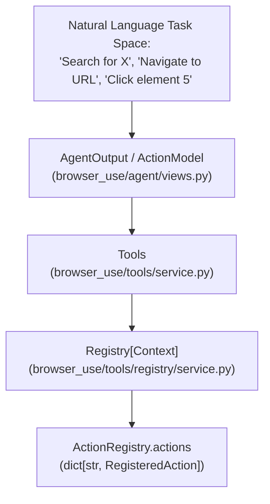
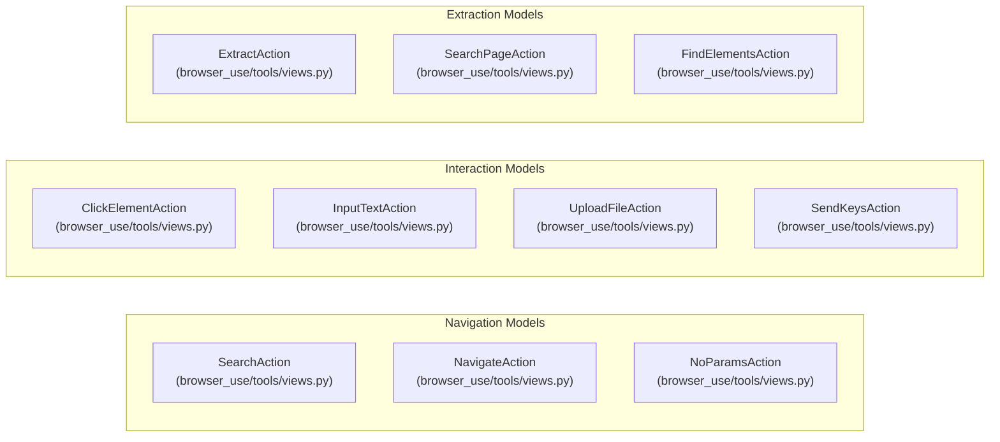
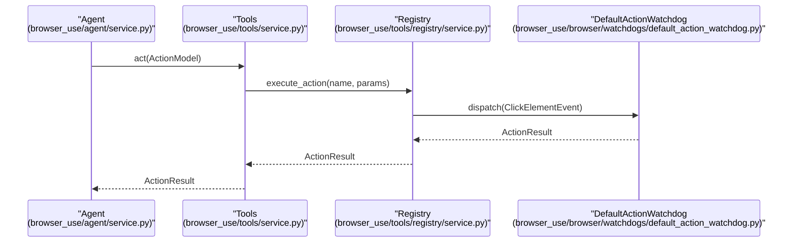

<!-- source: DeepWiki mcp.deepwiki.com · repo browser-use/browser-use · page 6.1 Tools Registry and Action Models · fetched 2026-10-30 -->

# Tools Registry and Action Models

Relevant source files

The following files were used as context for generating this wiki page:

- [browser_use/browser/watchdogs/default_action_watchdog.py](browser_use/browser/watchdogs/default_action_watchdog.py)
- [browser_use/tools/registry/service.py](browser_use/tools/registry/service.py)
- [browser_use/tools/registry/views.py](browser_use/tools/registry/views.py)
- [browser_use/tools/service.py](browser_use/tools/service.py)
- [browser_use/tools/views.py](browser_use/tools/views.py)
- [examples/features/save_as_pdf.py](examples/features/save_as_pdf.py)
- [tests/ci/browser/test_send_keys_literal_plus.py](tests/ci/browser/test_send_keys_literal_plus.py)
- [tests/ci/security/test_sensitive_data.py](tests/ci/security/test_sensitive_data.py)
- [tests/ci/test_action_save_as_pdf.py](tests/ci/test_action_save_as_pdf.py)
- [tests/ci/test_browser_error_passthrough.py](tests/ci/test_browser_error_passthrough.py)
- [tests/ci/test_multi_act_guards.py](tests/ci/test_multi_act_guards.py)
- [tests/ci/test_registry_empty_url_domain_filter.py](tests/ci/test_registry_empty_url_domain_filter.py)
- [tests/ci/test_screenshot_exclusion.py](tests/ci/test_screenshot_exclusion.py)

## Purpose and Scope

This document details the **Tools** and **Registry** architecture (`browser_use/tools/service.py:1-63` [browser_use/tools/service.py:1-63](), `browser_use/tools/registry/service.py:33-40` [browser_use/tools/registry/service.py:33-40]()), which serves as the core action dispatch and parameter modeling layer for browser automation. The `Tools` class bridges natural language action requests from the LLM agent to concrete browser control operations via `BrowserSession` events and Pydantic models (`browser_use/tools/views.py:8-182` [browser_use/tools/views.py:8-182]()).

Sources: [browser_use/tools/service.py:1-63](), [browser_use/tools/registry/service.py:33-40](), [browser_use/tools/views.py:8-182]()

## Tools Class Architecture

The `Tools` class initializes a `Registry` instance, manages built-in actions, and handles action execution routing.

**Tools and Registry Natural Language to Code Entity Mapping:**
This diagram maps abstract agent tasks to the concrete code entities (`Tools`, `Registry`, `RegisteredAction`) responsible for managing them.

Sources: [browser_use/tools/service.py:345-360](), [browser_use/tools/registry/service.py:33-41](), [browser_use/tools/registry/views.py:91-94]()

**Key initialization parameters:**
* `exclude_actions`: `list[str] | None` — Action names to exclude from the registry.
* `output_model`: `type[T] | None` — When provided, replaces `DoneAction` with `StructuredOutputAction[T]`.

Sources: [browser_use/tools/service.py:346-356](), [browser_use/tools/service.py:378-390]()

## Action Parameter Models

All action payloads are defined as Pydantic `BaseModel` subclasses in `browser_use/tools/views.py` [browser_use/tools/views.py:8-182](). These models enforce schema constraints (e.g., `ge=1` on element indices) and supply JSON schemas to the LLM.

**Core Action Models Hierarchy:**

Sources: [browser_use/tools/views.py:8-182]()

Sources: [browser_use/tools/views.py:8-182]()

## Built-in Actions Registry

The `Tools` class registers built-in actions mapping directly to browser event handlers (`browser_use/tools/service.py:362-479` [browser_use/tools/service.py:362-479]()).

| Action Name | Parameter Model | Event Dispatched | Description |
|-------------|----------------|------------------|-------------|
| `search` | `SearchAction` | `NavigateToUrlEvent` | Search via web search engine |
| `navigate` | `NavigateAction` | `NavigateToUrlEvent` | Navigate to URL |
| `click` | `ClickElementAction` | `ClickElementEvent` | Click element by index or coordinates |
| `input` | `InputTextAction` | `TypeTextEvent` | Type text into element |
| `extract` | `ExtractAction` | N/A | Extract content from page markdown |
| `done` | `DoneAction` | N/A | Signal task completion |

Sources: [browser_use/tools/service.py:362-479](), [browser_use/tools/views.py:8-103]()

## Action Registration Pattern

Actions are registered via the `@registry.action` decorator (`browser_use/tools/registry/service.py:75-165` [browser_use/tools/registry/service.py:75-165]()). The decorator normalizes signatures, separating action parameters from injected special parameters like `BrowserSession` or `FileSystem`.

Sources: [browser_use/tools/registry/service.py:75-165]()

## Action Execution Pipeline

Execution flows from the `Agent` through `Tools.act()` to `Registry.execute_action()`, which dispatches events to `DefaultActionWatchdog` (`browser_use/browser/watchdogs/default_action_watchdog.py:42-125` [browser_use/browser/watchdogs/default_action_watchdog.py:42-125]()).

**Execution Pipeline Code Entity Mapping:**

Sources: [browser_use/tools/service.py:304-338](), [browser_use/tools/registry/service.py:168-230](), [browser_use/browser/watchdogs/default_action_watchdog.py:42-125]()

### Global Action Timeout
A global timeout safeguard (`_ACTION_TIMEOUT_FALLBACK_S = 180.0`) ensures hung event handlers return an `ActionResult` with an error rather than blocking indefinitely (`browser_use/tools/service.py:99-143` [browser_use/tools/service.py:99-143]()).

Sources: [browser_use/tools/service.py:99-143]()

## Multi-Action Guards

Actions that modify page state (e.g., `navigate`, `search`, `go_back`, `switch`, `evaluate`) set `terminates_sequence=True` (`browser_use/tools/registry/views.py:22-24` [browser_use/tools/registry/views.py:22-24]()). When executed in `multi_act()`, remaining queued actions are aborted (`tests/ci/test_multi_act_guards.py:106-156` [tests/ci/test_multi_act_guards.py:106-156]()).

Sources: [browser_use/tools/registry/views.py:22-24](), [tests/ci/test_multi_act_guards.py:106-156]()

## Sensitive Data Handling

The system detects and masks sensitive placeholders in parameters using `_detect_sensitive_key_name()` (`browser_use/tools/service.py:166-182` [browser_use/tools/service.py:166-182](), `tests/ci/security/test_sensitive_data.py:54-85` [tests/ci/security/test_sensitive_data.py:54-85]()).

Sources: [browser_use/tools/service.py:166-182](), [tests/ci/security/test_sensitive_data.py:54-85]()

## Action Exclusion System

Actions can be excluded dynamically via `Tools.exclude_action(action_name)` (`browser_use/tools/registry/service.py:42-55` [browser_use/tools/registry/service.py:42-55]()), preventing their registration or prompt exposition (e.g., omitting `screenshot` when `use_vision` is disabled; `tests/ci/test_screenshot_exclusion.py:143-173` [tests/ci/test_screenshot_exclusion.py:143-173]()).

Sources: [browser_use/tools/registry/service.py:42-55](), [tests/ci/test_screenshot_exclusion.py:143-173]()

## Structured Output and Completion Models

`StructuredOutputAction` and `DoneAction` handle task conclusion (`browser_use/tools/views.py:89-120` [browser_use/tools/views.py:89-120]()). Schemas are optimized for LLM compatibility.

Sources: [browser_use/tools/views.py:89-120]()

## Special Parameters Injection

`SpecialActionParameters` defines injectable attributes (`browser_session`, `page_url`, `file_system`, `page_extraction_llm`, etc.) passed to registered actions (`browser_use/tools/registry/views.py:157-183` [browser_use/tools/registry/views.py:157-183]()).

Sources: [browser_use/tools/registry/views.py:157-183]()

## Error Handling and Recovery

Errors raised inside actions, such as `BrowserError`, are captured and converted into recoverable `ActionResult` objects containing `long_term_memory` or `extracted_content` (`tests/ci/test_browser_error_passthrough.py:9-30` [tests/ci/test_browser_error_passthrough.py:9-30]()).

Sources: [tests/ci/test_browser_error_passthrough.py:9-30]()

---

