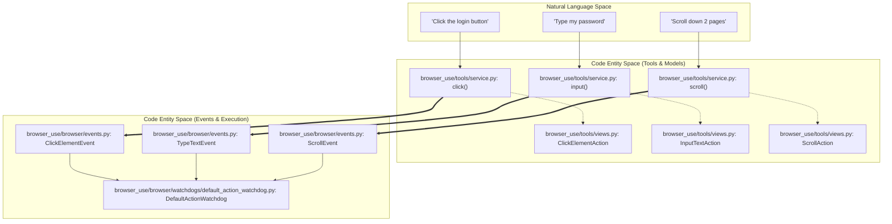
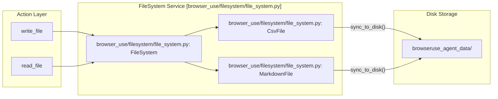
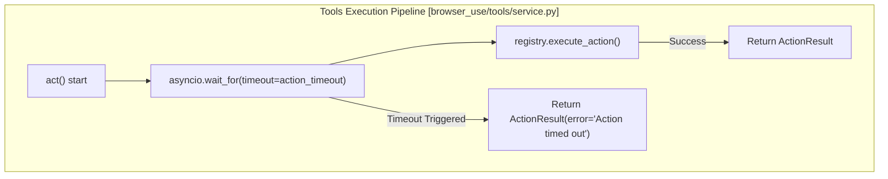

<!-- source: DeepWiki mcp.deepwiki.com · repo browser-use/browser-use · page 6.2 Built-in Actions Reference · fetched 2026-10-30 -->

# Built-in Actions Reference

Relevant source files

The following files were used as context for generating this wiki page:

- [browser_use/browser/watchdogs/default_action_watchdog.py](browser_use/browser/watchdogs/default_action_watchdog.py)
- [browser_use/tools/service.py](browser_use/tools/service.py)
- [browser_use/tools/views.py](browser_use/tools/views.py)
- [examples/features/save_as_pdf.py](examples/features/save_as_pdf.py)
- [tests/ci/browser/test_send_keys_literal_plus.py](tests/ci/browser/test_send_keys_literal_plus.py)
- [tests/ci/test_action_save_as_pdf.py](tests/ci/test_action_save_as_pdf.py)
- [tests/ci/test_tools.py](tests/ci/test_tools.py)

This page provides a technical reference for the built-in actions available to the agent. These actions are the primary interface through which the LLM interacts with the browser and the local file system. Each action is defined as a method in the `Tools` service, registered via the `Registry`, and mapped to Pydantic models for structured LLM interaction.

## Action Architecture and Data Flow

Actions follow a structured pipeline from LLM decision to browser execution. The `Registry` acts as the intermediary, ensuring that parameters are validated and system-level context (like the `BrowserSession` or `FileSystem`) is injected into the tool calls.

### Action to Event Mapping

The following diagram associates natural language action names with their corresponding code entities, specifically the Pydantic input models and the events they dispatch to the `DefaultActionWatchdog`.

**Diagram: Action Entity Mapping**

**Sources:** [browser_use/tools/service.py:16-60](), [browser_use/tools/views.py:69-135](), [browser_use/browser/watchdogs/default_action_watchdog.py:41-43]()

---

## Navigation & Browser Control

### search
Performs a web search using `duckduckgo` (default), `google`, or `bing`.
- **Model:** `SearchAction` [browser_use/tools/views.py:49-54]()
- **Behavior:** Constructs a search URL and dispatches a `NavigateToUrlEvent`. For Google, it appends `&udm=14` to bypass AI overviews and provide a cleaner result list.

### navigate
Navigates to a specific URL.
- **Model:** `NavigateAction` [browser_use/tools/views.py:60-63]()
- **Behavior:** Validates the URL and dispatches `NavigateToUrlEvent`. It handles common network errors and returns them as `ActionResult` errors rather than crashing the agent.

---

## Element Interaction

### click
Clicks an element by index or coordinates.
- **Model:** `ClickElementAction` [browser_use/tools/views.py:69-75]()
- **Key Logic:**
    - **Index-based:** Uses the element index from `browser_state`.
    - **Coordinate-based:** Translates LLM-space coordinates to viewport-space.
    - **Download Detection:** If a click triggers a download, `DefaultActionWatchdog._execute_click_with_download_detection` monitors the `DownloadsWatchdog` for start and completion events [browser_use/browser/watchdogs/default_action_watchdog.py:44-118]().

### input
Types text into an input field.
- **Model:** `InputTextAction` [browser_use/tools/views.py:83-87]()
- **Sensitive Data Handling:** The system uses `_detect_sensitive_key_name` [browser_use/tools/service.py:166-182]() to check if the input text matches any values in the `sensitive_data` dictionary. If matched, the action logs the key name (e.g., `<password>`) instead of the raw value.

---

## Content & Extraction

### extract
Extracts structured or unstructured data from the page markdown.
- **Model:** `ExtractAction` [browser_use/tools/views.py:8-27]()
- **Data Flow:**
    1. Converts DOM to markdown.
    2. Slices content if `start_from_char` is provided.
    3. Passes content to an extraction LLM.
    4. If the result is large, it is saved via the file system and a reference is returned.

### scroll
Scrolls the page or a specific element.
- **Model:** `ScrollAction` [browser_use/tools/views.py:130-134]()
- **Logic:** It calculates pixels based on viewport height. If `pages > 1.0`, it executes a loop of scrolls with short delays to allow for lazy-loading.

### save_as_pdf
Saves the current page as a PDF file using CDP commands.
- **Model:** `SaveAsPdfAction` [browser_use/tools/views.py:161-167]()
- **Features:** Supports custom filenames, paper sizes, and landscape orientation [browser_use/tools/views.py:161-167]().
- **Templates:** Uses default header and footer templates mirroring Chrome's print metadata, injecting magic classes like `date`, `url`, and `pageNumber` [browser_use/tools/service.py:84-96]().

---

## File System Integration

The `FileSystem` class manages a persistent directory where the agent can store results and maintain state across steps.

**Diagram: File System Data Flow**

**Sources:** [browser_use/filesystem/file_system.py:1-100]()

### File Type Handlers
- **CsvFile:** Automatically normalizes content using Python's `csv` module to fix common LLM mistakes like missing quotes around fields with commas [browser_use/filesystem/file_system.py:1-100]().
- **PdfFile:** Generates PDF documents from text content [browser_use/filesystem/file_system.py:1-100]().

---

## Form Controls

### dropdown_options
Retrieves all options from a dropdown element.
- **Model:** `GetDropdownOptionsAction` [browser_use/tools/views.py:1-120]()
- **Behavior:** Dispatches a `GetDropdownOptionsEvent`. The `DefaultActionWatchdog` handles native `<select>` and ARIA listboxes.

### select_dropdown
Selects a specific option by text.
- **Model:** `SelectDropdownOptionAction` [browser_use/tools/views.py:1-120]()
- **Behavior:** Dispatches a `SelectDropdownOptionEvent`.

---

## Task Completion

### done
Signals task completion and provides the final result.
- **Model:** `DoneAction` [browser_use/tools/views.py:89-101]()
- **Behavior:** This action is terminal. If `files_to_display` is provided, the agent will include those files in the final output [browser_use/tools/views.py:101]().

### structured_output
Provides data matching a specific Pydantic schema.
- **Model:** `StructuredOutputAction` [browser_use/tools/views.py:114-119]()
- **Behavior:** Returns validated JSON data matching the requested user schema.

---

## Action Safety and Timeouts

The system implements a global per-action timeout to prevent the agent from hanging indefinitely.

**Diagram: Action Timeout Guard**

- **Default Timeout:** 180 seconds, controlled by `_DEFAULT_ACTION_TIMEOUT_S` [browser_use/tools/service.py:142]().
- **Configuration:** Can be overridden via `BROWSER_USE_ACTION_TIMEOUT_S` environment variable [browser_use/tools/service.py:113-142]().
- **Graceful Fallback:** Invalid timeout values (NaN, Inf, <=0) fall back to the 180s default [browser_use/tools/service.py:121-138]().

**Sources:**
- `browser_use/tools/service.py`: [84-96](), [113-142](), [166-182]()
- `browser_use/tools/views.py`: [8-27](), [49-54](), [60-63](), [69-75](), [83-87](), [89-119](), [130-134](), [161-167]()
- `browser_use/browser/watchdogs/default_action_watchdog.py`: [44-118]()
- `browser_use/filesystem/file_system.py`: [1-100]()

---

