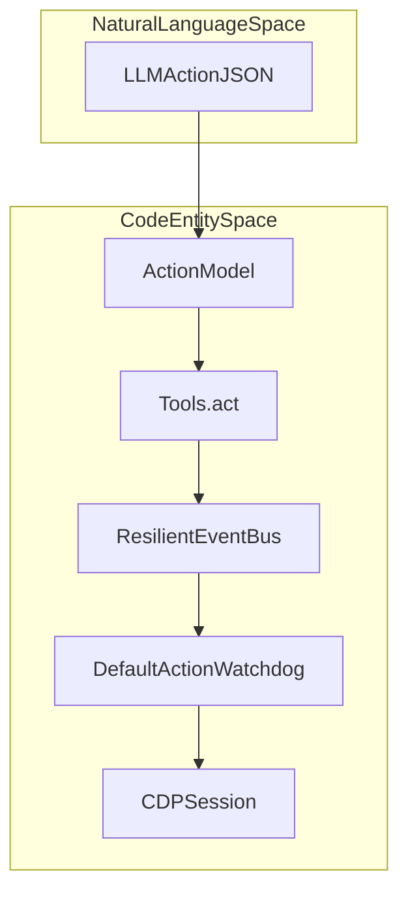
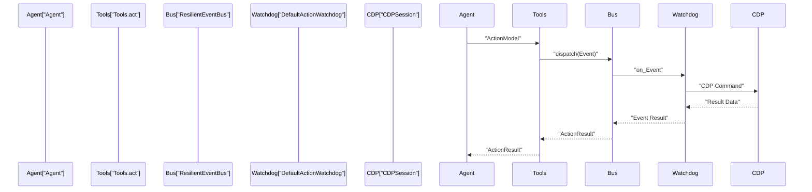
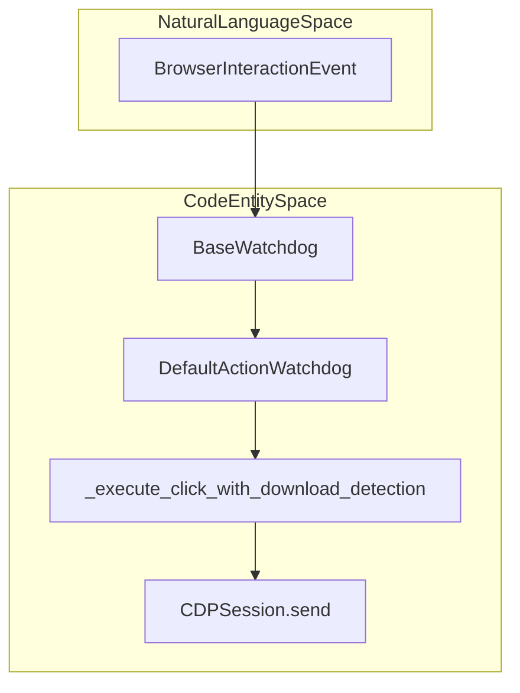

<!-- source: DeepWiki mcp.deepwiki.com · repo browser-use/browser-use · page 6.3 Action Execution Pipeline · fetched 2026-10-30 -->

# Action Execution Pipeline

Relevant source files

The following files were used as context for generating this wiki page:

- [browser_use/browser/watchdogs/default_action_watchdog.py](browser_use/browser/watchdogs/default_action_watchdog.py)
- [browser_use/tools/service.py](browser_use/tools/service.py)
- [browser_use/tools/views.py](browser_use/tools/views.py)
- [examples/features/save_as_pdf.py](examples/features/save_as_pdf.py)
- [tests/ci/browser/test_send_keys_literal_plus.py](tests/ci/browser/test_send_keys_literal_plus.py)
- [tests/ci/test_action_save_as_pdf.py](tests/ci/test_action_save_as_pdf.py)
- [tests/ci/test_action_timeout.py](tests/ci/test_action_timeout.py)

This page documents the action execution pipeline in `browser-use`, detailing how high-level agent intents are transformed into low-level CDP commands through `Tools` [browser_use/tools/service.py:16](), `ResilientEventBus` [browser_use/browser/session.py:106](), and `DefaultActionWatchdog` [browser_use/browser/watchdogs/default_action_watchdog.py:42](). It covers event dispatching, watchdog handling, timeout guards, result aggregation, and error recovery.

## 1. Overview

The action execution pipeline bridges the gap between LLM-generated JSON action objects and concrete browser modifications. When an agent decides to act, the execution transitions through validation, event routing, asynchronous execution via CDP, and result packaging into an `ActionResult` [browser_use/tools/service.py:16]().

Sources: `[browser_use/tools/service.py:16]()`, `[browser_use/browser/session.py:106-112]()`

## 2. Action Flow Architecture

The pipeline processes actions by mapping high-level instructions to concrete Python classes and CDP commands.

### Natural Language Space to Code Entity Space: Execution Mapping
Title: Action Pipeline Mapping

Sources: `[browser_use/tools/service.py:16]()`, `[browser_use/browser/watchdogs/default_action_watchdog.py:42-43]()`

### Action Execution Sequence
Title: Action Execution Sequence

Sources: `[browser_use/tools/service.py:16]`, `[browser_use/browser/watchdogs/default_action_watchdog.py:42-43]()`

## 3. Global Action Hang Guard and Timeouts

To prevent deadlocks from unresponsive CDP WebSockets or hanging event handlers, the pipeline enforces a global per-action timeout [browser_use/tools/service.py:99-104]().

*   **Default Timeout**: `_ACTION_TIMEOUT_FALLBACK_S` is set to `180.0` seconds [browser_use/tools/service.py:110]().
*   **Environment Configuration**: Parsed defensively via `_parse_env_action_timeout` to ensure positive finite values [browser_use/tools/service.py:113-142]().
*   **Normalization**: Caller overrides are validated using `_coerce_valid_action_timeout` [browser_use/tools/service.py:145-164]().
*   **Testing**: Validated against hanging handlers in `tests/ci/test_action_timeout.py` [tests/ci/test_action_timeout.py:36-73]().

Sources: `[browser_use/tools/service.py:99-164]()`, `[tests/ci/test_action_timeout.py:36-73]()`

## 4. Action Registration and Dispatch

Actions are registered in the `Tools` registry using parameter models defined in `browser_use/tools/views.py` [browser_use/tools/views.py:8-167](). Each action model (such as `ClickElementAction`, `NavigateAction`, or `InputTextAction`) defines strict Pydantic validation boundaries before events are dispatched to the event bus [browser_use/tools/views.py:60-87]().

Sources: `[browser_use/tools/views.py:8-167]()`, `[browser_use/tools/service.py:38]()`

## 5. Watchdog Event Handlers and Circuit Breakers

`DefaultActionWatchdog` implements handlers for browser events using CDP [browser_use/browser/watchdogs/default_action_watchdog.py:42-43](). It inherits from `BaseWatchdog`, providing automatic connection checks and session recovery [browser_use/browser/watchdog_base.py:15-175]().

### Natural Language Space to Code Entity Space: Watchdog Dispatch
Title: Watchdog Event Dispatch Mapping

Sources: `[browser_use/browser/watchdogs/default_action_watchdog.py:42-50]()`, `[browser_use/browser/watchdog_base.py:15-38]()`

Sources: `[browser_use/browser/watchdogs/default_action_watchdog.py:42-43]()`, `[browser_use/browser/watchdog_base.py:15-175]()`

## 6. Specialized Execution Logic

*   **Click with Download Detection**: `_execute_click_with_download_detection` listens for download signals via `_downloads_watchdog` [browser_use/browser/watchdogs/default_action_watchdog.py:45-115]().
*   **Input Action & Verification**: `TypeTextEvent` execution uses `DispatchKeyEventParameters` to send key inputs and verifies values post-execution [browser_use/browser/watchdogs/default_action_watchdog.py:7-22]().
*   **Sensitive Data Masking**: `_detect_sensitive_key_name` scans inputs against configured sensitive data dictionaries to prevent credential leakage [browser_use/tools/service.py:166-182]().
*   **PDF Generation**: `SaveAsPdfAction` utilizes Chrome print capabilities with configurable headers and footers [browser_use/tools/views.py:161-167](), [browser_use/tools/service.py:84-96](), tested in `tests/ci/test_action_save_as_pdf.py` [tests/ci/test_action_save_as_pdf.py:94-127]().

Sources: `[browser_use/browser/watchdogs/default_action_watchdog.py:45-115]()`, `[browser_use/tools/service.py:84-182]()`, `[tests/ci/test_action_save_as_pdf.py:94-127]()`, `[browser_use/tools/views.py:161-167]()`

## 7. Error Handling and Recovery

The execution pipeline handles failures across multiple tiers:
*   **Validation Errors**: Caught prior to event dispatch and transformed into descriptive failure results [browser_use/tools/service.py:597-610]().
*   **BrowserError**: Processed via `handle_browser_error` to attach short-term and long-term memory for LLM context [browser_use/tools/service.py:185-188]().
*   **CDP Connection Errors**: Managed by `BaseWatchdog` wrappers which attempt session repair before propagating exceptions [browser_use/browser/watchdog_base.py:123-175]().

Sources: `[browser_use/tools/service.py:185-188]`, `[browser_use/browser/watchdog_base.py:123-175]()`

---

