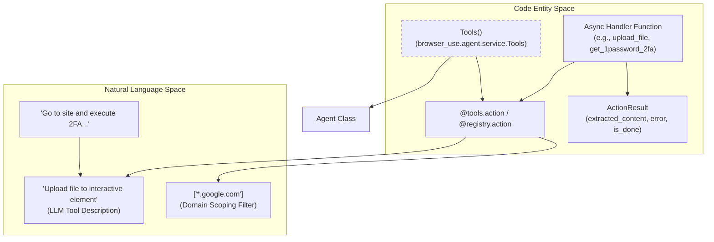
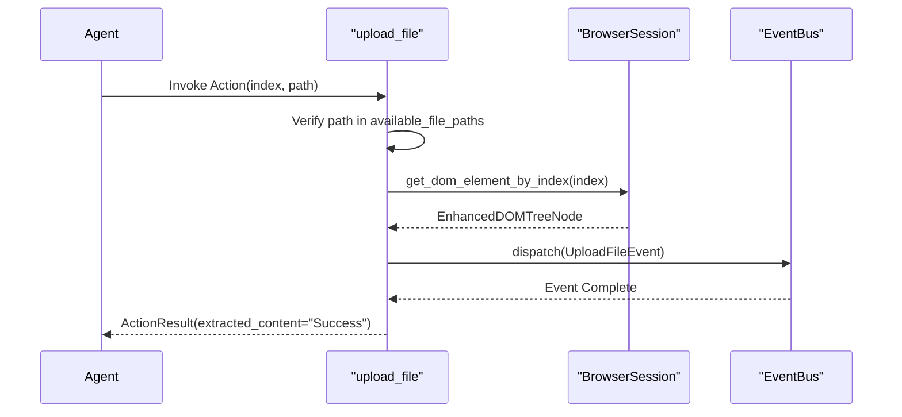

<!-- source: DeepWiki mcp.deepwiki.com · repo browser-use/browser-use · page 6.4 Custom Tools and Extensions · fetched 2026-10-30 -->

# Custom Tools and Extensions

<details>
<summary>Relevant source files</summary>

The following files were used as context for generating this wiki page:

- [.pre-commit-config.yaml](.pre-commit-config.yaml)
- [browser_use/llm/azure/chat.py](browser_use/llm/azure/chat.py)
- [browser_use/llm/base.py](browser_use/llm/base.py)
- [browser_use/llm/openai/responses_serializer.py](browser_use/llm/openai/responses_serializer.py)
- [examples/custom-functions/2fa.py](examples/custom-functions/2fa.py)
- [examples/custom-functions/action_filters.py](examples/custom-functions/action_filters.py)
- [examples/custom-functions/file_upload.py](examples/custom-functions/file_upload.py)
- [examples/custom-functions/notification.py](examples/custom-functions/notification.py)
- [examples/custom-functions/onepassword_2fa.py](examples/custom-functions/onepassword_2fa.py)
- [examples/features/secure.py](examples/features/secure.py)
- [examples/features/sensitive_data.py](examples/features/sensitive_data.py)
- [examples/models/azure_openai.py](examples/models/azure_openai.py)
- [examples/use-cases/extract_pdf_content.py](examples/use-cases/extract_pdf_content.py)
- [tests/ci/browser/test_navigation_slow_pages.py](tests/ci/browser/test_navigation_slow_pages.py)
- [tests/ci/models/test_azure_responses_api.py](tests/ci/models/test_azure_responses_api.py)

</details>


## Purpose and Scope

This page describes how to extend the browser-use agent's capabilities by registering custom actions using the `@tools.action` or `@registry.action` decorators. Custom actions allow developers to inject domain-specific functionality, interface with local file systems, integrate external credential managers like 1Password, execute notification side-effects, and implement site-specific logic.

For built-in actions reference, see [6.2 Built-in Actions Reference](). For details on how actions are dispatched and executed via the event pipeline, see [6.3 Action Execution Pipeline]().

---

## Overview: The Action Registration Pattern

Custom actions in `browser-use` rely on a decorator-based registration system managed through a central `Tools` container and its underlying registry [examples/custom-functions/file_upload.py:28-33](). The registry maps Python async handler functions to Pydantic parameter schemas and tool descriptions consumable by the LLM.



**Diagram 1: Code-to-Natural-Language Mapping for Custom Tools**

Sources: [examples/custom-functions/file_upload.py:28-33](), [examples/custom-functions/onepassword_2fa.py:24-28](), [browser_use/agent/views.py:22-22]()

---

## Creating Custom Actions and Decorators

The primary entry point for custom tools is the `Tools` class [examples/custom-functions/file_upload.py:28-29](). Decorating an async Python function with `@tools.action` or `@tools.registry.action` registers it into the action pool.

```python
from browser_use import ActionResult, Tools
from browser_use.browser import BrowserSession

tools = Tools()

@tools.action(description='Save specific data to a file', domains=['*'])
async def save_to_disk(content: str):
    with open('data.txt', 'a') as f:
        f.write(content)
    return ActionResult(extracted_content='Saved successfully')
```

### Key Decorator Parameters
- `description`: Textual explanation of what the action performs. This text is injected directly into the prompt context for the LLM [examples/custom-functions/action_filters.py:40-40]().
- `domains`: Restricts the availability of the tool to matching URL glob patterns (e.g., `['google.com', '*.google.com']`) [examples/custom-functions/action_filters.py:40-40]().
- `param_model`: Optional custom Pydantic model defining the action arguments [examples/custom-functions/action_filters.py:40-41]().

Sources: [examples/custom-functions/file_upload.py:28-33](), [examples/custom-functions/action_filters.py:40-41]()

---

## Action Filters and Domain Scoping

Action filters prevent decision fatigue and restrict the LLM from executing stateful or sensitive actions outside intended domains [examples/custom-functions/action_filters.py:8-10]().

- **Global Actions**: Using `domains=['*']` makes the action available on all pages [examples/custom-functions/action_filters.py:76-76]().
- **Restricted Domains**: Specifying domains like `['google.com', '*.google.com']` ensures the action metadata is only revealed to the LLM when browsing those origins [examples/custom-functions/action_filters.py:40-40]().

```python
@registry.action(description='Trigger disco mode', domains=['google.com', '*.google.com'])
async def disco_mode(browser_session: BrowserSession):
    cdp_session = await browser_session.get_or_create_cdp_session()
    # Execute custom JS
```

Sources: [examples/custom-functions/action_filters.py:2-18](), [examples/custom-functions/action_filters.py:40-56](), [examples/custom-functions/action_filters.py:76-76]()

---

## Dependency Injection and Context Parameters

Action handlers support automatic parameter injection based on type hints or parameter names.

- `browser_session`: Injects the active `BrowserSession`, giving direct access to CDP sessions, page targets, and DOM inspection methods [examples/custom-functions/file_upload.py:33-42]().
- `custom_context`: Arbitrary dictionary passed during `Agent` initialization (e.g., `custom_context={'available_file_paths': [...]}`) which action arguments can pull from [examples/custom-functions/file_upload.py:33-33](), [examples/custom-functions/file_upload.py:97-97]().

```python
@tools.action('Upload file')
async def upload_file(index: int, path: str, browser_session: BrowserSession, available_file_paths: list[str]):
    if path not in available_file_paths:
        return ActionResult(error=f'File path {path} is not available')
    # Execution logic...
```

Sources: [examples/custom-functions/file_upload.py:33-61](), [examples/custom-functions/file_upload.py:97-97]()

---

## Tool Integration Patterns

### 1. File Upload Integration
Custom tools can interact with the browser's event bus to perform complex tasks like file uploads. The action handler validates allowed paths, retrieves the target DOM node via the `BrowserSession`, and dispatches an `UploadFileEvent` [examples/custom-functions/file_upload.py:33-56]().



**Diagram 2: File Upload Execution Sequence**

Sources: [examples/custom-functions/file_upload.py:33-61](), [browser_use/browser/events.py:24-24]()

### 2. 2FA and Credential Manager Integration
Multi-factor authentication (2FA) and credential retrieval can be implemented as domain-restricted custom actions [examples/custom-functions/onepassword_2fa.py:27-41](). By utilizing external SDKs (such as the 1Password service account client), an agent can programmatically resolve one-time passcodes securely at runtime.

```python
@tools.registry.action('Get 2FA code from 1Password', domains=['*.google.com'])
async def get_1password_2fa() -> ActionResult:
    client = await Client.authenticate(auth=OP_SERVICE_ACCOUNT_TOKEN)
    mfa_code = await client.secrets.resolve(f'op://Private/{OP_ITEM_ID}/One-time passcode')
    return ActionResult(extracted_content=mfa_code)
```

Alternatively, sensitive static secrets can be injected using `sensitive_data` mappings and referenced inside prompt tasks [examples/custom-functions/2fa.py:13-29]().

Sources: [examples/custom-functions/onepassword_2fa.py:27-41](), [examples/custom-functions/2fa.py:13-29]()

### 3. Notification and Side-Effect Integration
Custom actions can trigger external webhooks, email notifications, or alerting services upon task completion or failure [examples/custom-functions/notification.py:16-31]().

```python
@tools.registry.action('Done with task')
async def done(text: str):
    yag = yagmail.SMTP('your_email@gmail.com', 'your_app_password')
    yag.send(to='recipient@example.com', subject='Task Complete', contents=text)
    return ActionResult(is_done=True, extracted_content='Email sent!')
```

Sources: [examples/custom-functions/notification.py:16-31]()

---

## Structured Output Integration

Custom tools and agents can be configured with a structured `output_model` Pydantic schema [examples/custom-functions/advanced_search.py:36-36]() to parse final agent deliverables cleanly.

```python
class PersonList(BaseModel):
    people: list[str]

tools = Tools(output_model=PersonList)
agent = Agent(task="...", tools=tools, llm=llm)
history = await agent.run()
result = PersonList.model_validate_json(history.final_result())
```

Sources: [examples/custom-functions/advanced_search.py:36-36](), [examples/custom-functions/advanced_search.py:101-103]()

---

