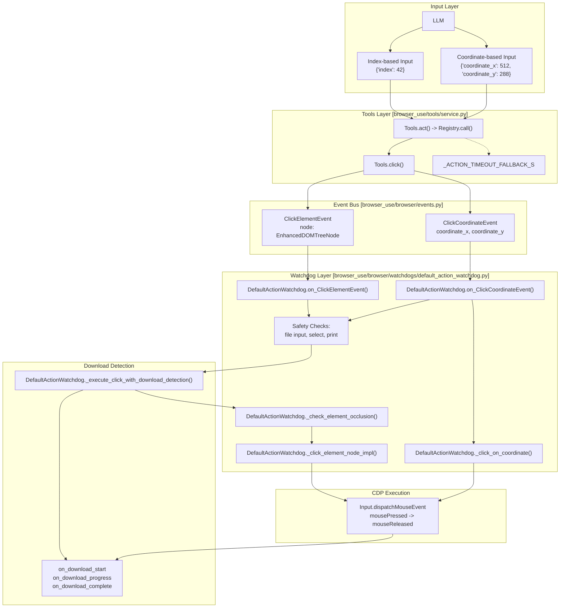
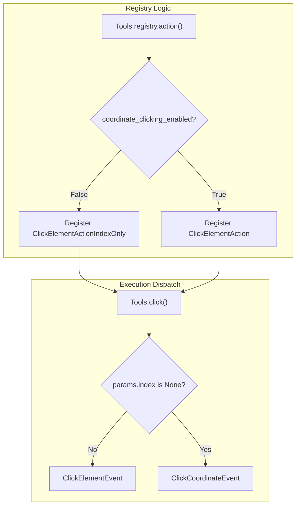

<!-- source: DeepWiki mcp.deepwiki.com · repo browser-use/browser-use · page 6.5 Click Action Deep Dive · fetched 2026-10-30 -->

# Click Action Deep Dive

Relevant source files

The following files were used as context for generating this wiki page:

- [browser_use/browser/watchdogs/default_action_watchdog.py](browser_use/browser/watchdogs/default_action_watchdog.py)
- [browser_use/tools/service.py](browser_use/tools/service.py)
- [browser_use/tools/views.py](browser_use/tools/views.py)
- [examples/features/save_as_pdf.py](examples/features/save_as_pdf.py)
- [tests/ci/browser/test_send_keys_literal_plus.py](tests/ci/browser/test_send_keys_literal_plus.py)
- [tests/ci/test_action_save_as_pdf.py](tests/ci/test_action_save_as_pdf.py)

## Purpose and Scope

The click action is one of the most sophisticated operations in `browser-use`, implementing advanced capabilities beyond basic mouse simulation. This page provides a technical deep dive into the click execution architecture, covering:

- **Dual-mode clicking**: Index-based (default) and coordinate-based (vision-enabled).
- **Coordinate conversion**: Translating LLM screenshot coordinates to actual viewport coordinates.
- **Occlusion detection**: Verifying elements are clickable before dispatching events.
- **Automatic download detection**: Monitoring and waiting for downloads triggered by click actions.
- **Print button handling**: Intercepting print interactions via CDP to generate PDFs.
- **Safety validations**: Preventing invalid interactions on elements like file inputs and select dropdowns.
- **Hang Guard**: Global per-action timeouts to prevent system locks.

Sources: [browser_use/tools/service.py:1-111](), [browser_use/browser/watchdogs/default_action_watchdog.py:42-120]()

---

## Click Action Architecture

The click action supports index-based and coordinate-based routing through the tools and event-bus layers.

### Click Action Execution Flow
Title: "Click Action Execution Flow"

Sources: [browser_use/tools/service.py:16-31](), [browser_use/browser/watchdogs/default_action_watchdog.py:11-25]()

---

## Coordinate Conversion Deep Dive

When vision features are active, screenshots supplied to LLMs may be scaled. The framework converts relative screenshot coordinates back into absolute viewport pixels.

### LLM to Viewport Coordinate Mapping
Title: "LLM to Viewport Coordinate Mapping"

```mermaid
graph LR
    subgraph "Screenshot Capture"
        Viewport["Browser Viewport<br/>1920x1080"]
        Capture["Screenshot captured"]
    end
    
    subgraph "LLM Preprocessing"
        Resize["Resize for vision LLM"]
        LLMImage["Resized screenshot"]
        Store["Store sizes:<br/>llm_screenshot_size<br/>_original_viewport_size"]
    end
    
    subgraph "LLM Response"
        Vision["Vision LLM"]
        Coords["Returns:<br/>coordinate_x, coordinate_y"]
    end
    
    subgraph "Conversion Function"
        Convert["Proportional Scaling"]
        Formula["actual_x = (llm_x / llm_w) * view_w"]
        Result["Viewport coordinates"]
    end
    
    subgraph "Execution"
        Click["ClickCoordinateEvent"]
    end
    
    Viewport --> Capture
    Capture --> Resize
    Resize --> LLMImage
    LLMImage --> Store
    Store --> Vision
    Vision --> Coords
    Coords --> Convert
    Convert --> Formula
    Formula --> Result
    Result --> Click
```

Sources: [browser_use/tools/service.py:1-62]()

---

## Occlusion Detection Deep Dive

Before executing an index-based click, the system evaluates whether the target element is unobstructed at its center coordinates via `_check_element_occlusion` within `DefaultActionWatchdog` [browser_use/browser/watchdogs/default_action_watchdog.py:42-50]().

### Occlusion Check Logic
The verification executes JavaScript via CDP `Runtime.callFunctionOn` to check the DOM node at the target coordinates [browser_use/browser/watchdogs/default_action_watchdog.py:42-120]().

| Condition | Description | Clickability |
|-----------|-------------|--------------|
| `this === elementAtPoint` | Target element is directly under the pointer | **Clickable** |
| `this.contains(elementAtPoint)` | Child element of the target is at the point | **Clickable** |
| `elementAtPoint.contains(this)` | Target resides inside a clickable parent container | **Clickable** |
| None of the above | Target is blocked by an overlay or banner | **Occluded** |

If an element is determined to be occluded, execution falls back to a direct DOM `element.click()` call via JavaScript rather than synthetic mouse events [browser_use/browser/watchdogs/default_action_watchdog.py:42-120]().

Sources: [browser_use/browser/watchdogs/default_action_watchdog.py:42-120]()

---

## Download Detection Deep Dive

Click actions capable of triggering file transfers are wrapped by `_execute_click_with_download_detection` inside `DefaultActionWatchdog` [browser_use/browser/watchdogs/default_action_watchdog.py:45-61]().

### Download Handling Sequence
1. **Callback Registration**: Binds `on_download_start`, `on_download_progress`, and `on_download_complete` handlers to the active `DownloadsWatchdog` [browser_use/browser/watchdogs/default_action_watchdog.py:107-116]().
2. **Click Execution**: Dispatches the underlying click coroutine [browser_use/browser/watchdogs/default_action_watchdog.py:121-122]().
3. **Start Timeout**: Waits up to 0.5 seconds for download initiation signals [browser_use/browser/watchdogs/default_action_watchdog.py:48]().
4. **Completion Timeout**: Waits up to 30.0 seconds for file transfer completion [browser_use/browser/watchdogs/default_action_watchdog.py:49]().
5. **Metadata Return**: Populates result dictionaries with file paths, sizes, and MIME types [browser_use/browser/watchdogs/default_action_watchdog.py:145-152]().

Sources: [browser_use/browser/watchdogs/default_action_watchdog.py:45-170]()

---

## Print Button Handling

Clicks targeting print buttons can trigger modal browser print dialogs. `browser-use` intercepts these by inspecting `onclick` expressions and element attributes [browser_use/browser/watchdogs/default_action_watchdog.py:42-120]().

### PDF Generation Pipeline
When a print trigger is identified:
- The system bypasses the interactive dialog and invokes CDP `Page.printToPDF` [browser_use/browser/watchdogs/default_action_watchdog.py:42-120]().
- Base64 binary outputs are decoded and persisted to the local file system using page titles [browser_use/browser/watchdogs/default_action_watchdog.py:42-120]().
- The `save_as_pdf` action configuration supports custom headers, footers, and page orientation properties [browser_use/tools/service.py:78-96](), [browser_use/tools/views.py:161-167]().

Sources: [browser_use/tools/service.py:78-96](), [browser_use/tools/views.py:161-167](), [browser_use/browser/watchdogs/default_action_watchdog.py:42-120]()

---

## Index vs. Coordinate Clicking Modes

Action schemas are dynamically registered based on user configuration settings.

### Action Models
- **`ClickElementActionIndexOnly`**: Accepts an element index from the current browser state representation [browser_use/tools/views.py:77-81]().
- **`ClickElementAction`**: Accepts either an `index` or `coordinate_x` / `coordinate_y` values [browser_use/tools/views.py:69-75]().

### Click Action Registry Management
Title: "Click Action Registry Management"

Sources: [browser_use/tools/views.py:69-81]()

---

## Safety Checks and Validation

`DefaultActionWatchdog` executes pre-click validation checks to catch malformed interactions [browser_use/browser/watchdogs/default_action_watchdog.py:42-120]().

| Check | Target | Action Response |
|-------|--------|-----------------|
| **File Input** | `input[type="file"]` | Rejects click and instructs agent to use `upload_file` [browser_use/browser/watchdogs/default_action_watchdog.py:42-120]() |
| **Select Dropdown** | `select` tag | Rejects click and instructs agent to use dropdown selection actions [browser_use/browser/watchdogs/default_action_watchdog.py:42-120]() |
| **Print Button** | Print triggers | Intercepted for automated background PDF rendering [browser_use/browser/watchdogs/default_action_watchdog.py:42-120]() |

Sources: [browser_use/browser/watchdogs/default_action_watchdog.py:42-120]()

---

## Hang Guard and Timeouts

To guard against stalled event loops or unresponsive CDP sessions, action executions are constrained by a global timeout mechanism [browser_use/tools/service.py:99-110]().

- **Default Timeout**: Configured to `180.0` seconds via `_ACTION_TIMEOUT_FALLBACK_S` [browser_use/tools/service.py:110]().
- **Environment Override**: Configurable using the `BROWSER_USE_ACTION_TIMEOUT_S` environment variable [browser_use/tools/service.py:109]().
- **Defensive Parsing**: Non-numeric, infinite, or negative values trigger warnings and fall back to safe defaults [browser_use/tools/service.py:113-139]().

Sources: [browser_use/tools/service.py:99-163]()

---

## CDP Mouse Event Execution

Low-level mouse simulation uses CDP `Input.dispatchMouseEvent` sequences [browser_use/browser/watchdogs/default_action_watchdog.py:1-25]().

1. **`mouseMoved`**: Positions the cursor over target coordinates [browser_use/browser/watchdogs/default_action_watchdog.py:1-25]().
2. **`mousePressed`**: Dispatches button-down events with execution timeouts [browser_use/browser/watchdogs/default_action_watchdog.py:1-25]().
3. **`mouseReleased`**: Dispatches button-up events to conclude the click lifecycle [browser_use/browser/watchdogs/default_action_watchdog.py:1-25]().

Sources: [browser_use/browser/watchdogs/default_action_watchdog.py:1-25]()

---

