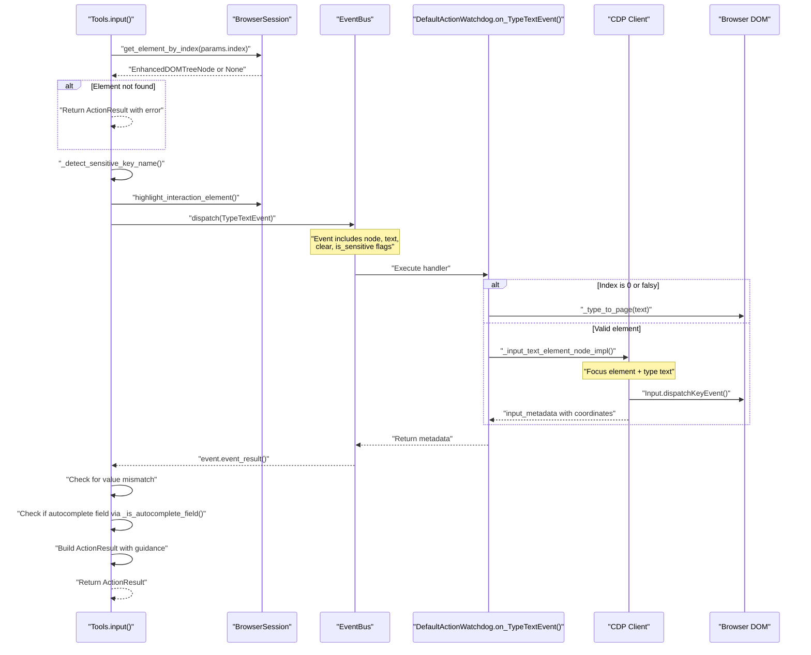
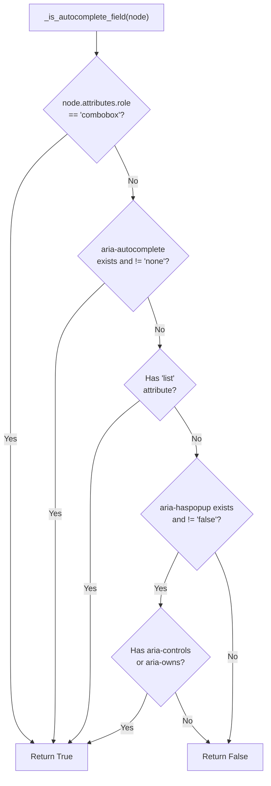
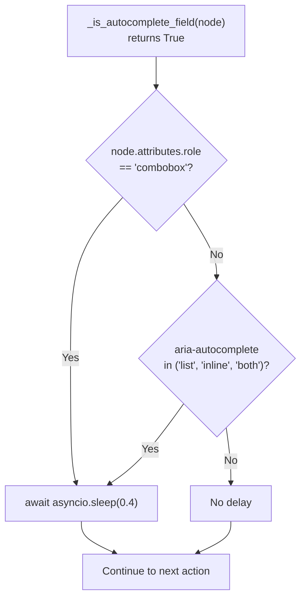
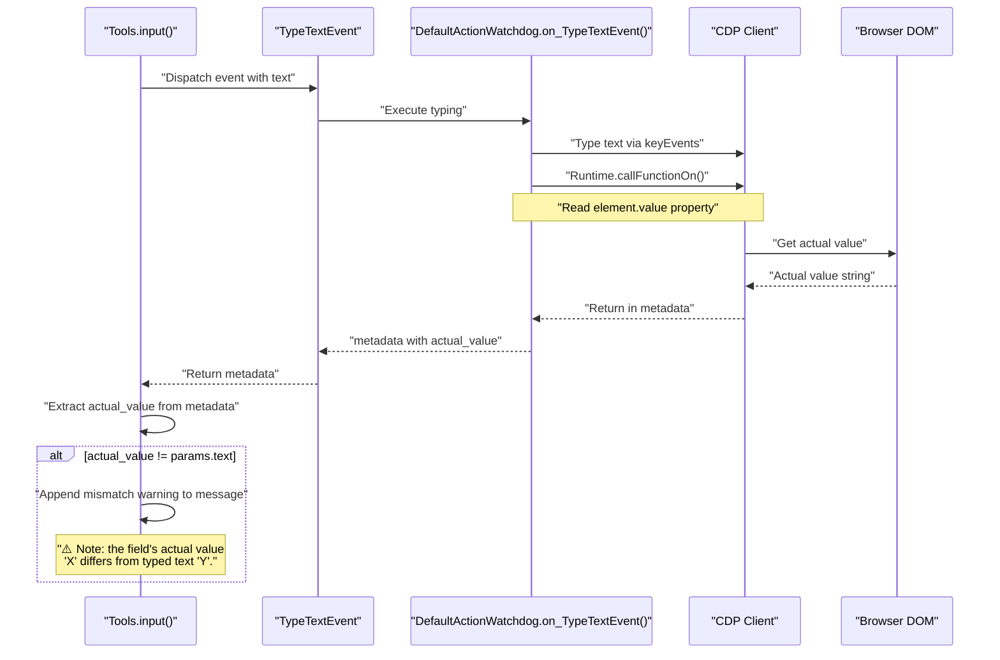
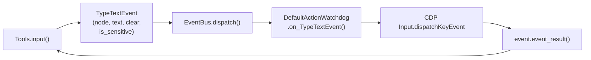

<!-- source: DeepWiki mcp.deepwiki.com · repo browser-use/browser-use · page 6.6 Input Action and Autocomplete Detection · fetched 2026-10-30 -->

# Input Action and Autocomplete Detection

<details>
<summary>Relevant source files</summary>

The following files were used as context for generating this wiki page:

- [browser_use/browser/watchdogs/default_action_watchdog.py](browser_use/browser/watchdogs/default_action_watchdog.py)
- [browser_use/tools/service.py](browser_use/tools/service.py)
- [browser_use/tools/views.py](browser_use/tools/views.py)
- [examples/features/save_as_pdf.py](examples/features/save_as_pdf.py)
- [tests/ci/browser/test_send_keys_literal_plus.py](tests/ci/browser/test_send_keys_literal_plus.py)
- [tests/ci/test_action_save_as_pdf.py](tests/ci/test_action_save_as_pdf.py)

</details>


## Purpose and Scope

This page documents the `input` action's implementation, focusing on its intelligent handling of autocomplete fields, value verification, and sensitive data protection. The input action types text into web page elements using element indices from the browser state. It automatically detects autocomplete/combobox fields, verifies that typed text matches the actual DOM value, and handles clearing pre-filled inputs.

For information about other browser actions, see [6.2. Built-in Actions Reference](). For custom action implementation, see [6.4. Custom Tools and Extensions](). For the overall action execution pipeline, see [6.3. Action Execution Pipeline]().

Sources: [browser_use/tools/service.py:1-188](), [browser_use/tools/views.py:83-87]()

---

## Input Action Model and Registration

The input action is registered in the `Tools` class [browser_use/tools/service.py:635-641]() and accepts three parameters through the `InputTextAction` model:

| Parameter | Type | Default | Description |
|-----------|------|---------|-------------|
| `index` | `int` | required | Element index from `browser_state` (>= 0) |
| `text` | `str` | required | Text to type into the element |
| `clear` | `bool` | `True` | Whether to clear existing content before typing |

The action model is defined by `InputTextAction`:

Sources: [browser_use/tools/views.py:83-87]()

The action is registered in the `Tools` service with logic to handle sensitive data and browser state interactions:

Sources: [browser_use/tools/service.py:635-641]()

---

## Input Action Execution Flow

The input action follows a multi-stage execution pipeline bridging the high-level tool invocation (`Tools.input`) down to the CDP command handler (`DefaultActionWatchdog.on_TypeTextEvent`).

### Sequence Diagram: Input Action Execution Flow



Sources: [browser_use/tools/service.py:636-719](), [browser_use/browser/watchdogs/default_action_watchdog.py:451-511]()

---

## Autocomplete Field Detection

The input action automatically detects autocomplete and combobox fields using the `_is_autocomplete_field()` helper function. This detection enables special handling for fields that may show dropdown suggestions.

### Detection Logic Flow



The detection logic examines four ARIA/HTML attributes:

1. **`role="combobox"`** - Explicit ARIA combobox role. [browser_use/tools/service.py:330-331]()
2. **`aria-autocomplete`** - Set to "list", "inline", or "both" (not "none"). [browser_use/tools/service.py:333-334]()
3. **`list` attribute** - Points to a `<datalist>` element. [browser_use/tools/service.py:336-337]()
4. **`aria-haspopup` + `aria-controls`/`aria-owns`** - Combined presence indicates dropdown control. [browser_use/tools/service.py:339-340]()

Sources: [browser_use/tools/service.py:329-342]()

### Autocomplete Guidance

When an autocomplete field is detected, the action result includes specific guidance for the agent:

> "💡 This is an autocomplete field. Wait for suggestions to appear, then click the correct suggestion instead of pressing Enter."

Sources: [browser_use/tools/service.py:699-700]()

---

## Autocomplete Delay Mechanism

For JavaScript-driven autocomplete fields (detected via ARIA roles or attributes, excluding native `<datalist>`), the input action adds a 400ms mechanical delay after typing (`asyncio.sleep(0.4)`). This allows dropdown suggestions to populate before the agent takes its next observation or action.

### Delay Conditions



The delay is **not applied** to native `<datalist>` fields because the browser handles their population instantly. This prevents unnecessary waiting while ensuring JS-driven dropdowns have time to render.

Sources: [browser_use/tools/service.py:703-705]()

---

## Value Mismatch Detection and Warning

After typing text, the input action reads back the element's actual DOM value via CDP (`Runtime.callFunctionOn`) and compares it to the typed text. If they differ, it warns the agent that the page may have reformatted or autocompleted the input.

### Value Verification Process



Sources: [browser_use/tools/service.py:690-696](), [browser_use/browser/watchdogs/default_action_watchdog.py:479-485]()

---

## Sensitive Data Handling

The input action supports typing sensitive data (passwords, API keys) while preventing it from appearing in logs or history. When sensitive data is detected, value mismatch warnings are **skipped** to avoid exposing the sensitive text.

### Sensitive Key Detection

The `_detect_sensitive_key_name()` function matches the typed text against values in the `sensitive_data` dictionary to identify which credential is being used. This supports both flat format and domain-keyed format (e.g., `{domain: {key: value}}`).

Sources: [browser_use/tools/service.py:166-182]()

### Sensitive Logging

When sensitive data is typed, the system masks the value in logs:

| Condition | Log Output | Agent Message |
|-----------|-----------|---------------|
| Key name found | `⌨️ Typed <password> into element` | `Typed password` |
| Key name not found | `⌨️ Typed <sensitive> into element` | `Typed sensitive data` |
| Not sensitive | `⌨️ Typed "hello" into element` | `Typed 'hello'` |

Sources: [browser_use/tools/service.py:676-696]()

---

## Clear Mode Behavior

The `clear` parameter (default `True`) controls whether existing content is removed before typing. This is handled at the CDP level by `_input_text_element_node_impl()` inside `DefaultActionWatchdog`.

### Clear Implementation

1. **Focus the element**: Ensure element has keyboard focus.
2. **Select all (if clear=True)**: Dispatches `Control+A` (or `Command+A` on Mac) to select existing text.
3. **Type text**: Dispatch key events character-by-character.

Sources: [browser_use/browser/watchdogs/default_action_watchdog.py:474-478]()

---

## Action Result Structure

The input action returns an `ActionResult` containing the outcome and metadata. It includes specialized logic to handle `BrowserError` by propagating long-term memory to the LLM.

```python
ActionResult(
    extracted_content: str,      # Success message + warnings/guidance
    include_extracted_content_only_once: bool,
    error: str | None           # Error message if failed
)
```

Sources: [browser_use/tools/service.py:708-712](), [browser_use/tools/service.py:185-192]()

---

## Integration with Event System

The input action uses the event-driven architecture via `TypeTextEvent`.



Sources: [browser_use/browser/events.py:27-31](), [browser_use/tools/service.py:664-671]()

---

## Error Handling and Timeouts

The input action handles several error conditions and enforces a per-action timeout to prevent hangs.

- **Element Not Found**: Returns an `ActionResult` stating the index is unavailable. [browser_use/tools/service.py:646-650]()
- **Browser Errors**: Uses `handle_browser_error()` to propagate long-term memory to the LLM. [browser_use/tools/service.py:713-719]()
- **Fallback Strategy**: If element-specific typing fails, the watchdog attempts to focus the element and type to the page globally. [browser_use/browser/watchdogs/default_action_watchdog.py:490-506]()
- **Per-Action Timeout**: Every action is wrapped in a timeout (default 180s) via `_ACTION_TIMEOUT_FALLBACK_S`. This ensures that if a CDP WebSocket goes silent, the agent does not hang indefinitely. [browser_use/tools/service.py:110-142]()

Sources: [browser_use/tools/service.py:110-142](), [browser_use/tools/service.py:185-196](), [browser_use/browser/watchdogs/default_action_watchdog.py:490-506]()

---

