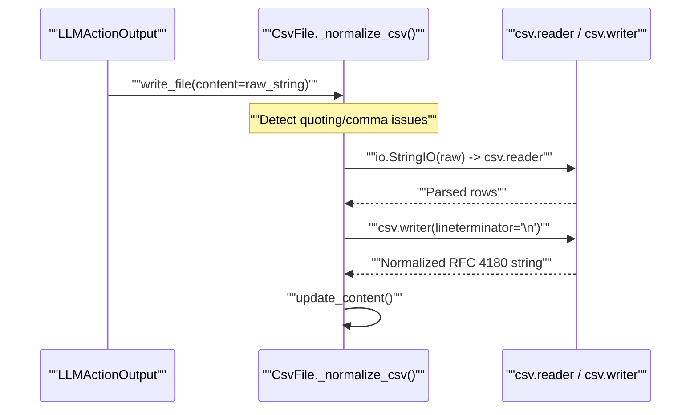

<!-- source: DeepWiki mcp.deepwiki.com · repo browser-use/browser-use · page 6.7 FileSystem Integration · fetched 2026-10-30 -->

# FileSystem Integration

<details>
<summary>Relevant source files</summary>

The following files were used as context for generating this wiki page:

- [browser_use/filesystem/file_system.py](browser_use/filesystem/file_system.py)
- [examples/browser/custom_headers.py](examples/browser/custom_headers.py)
- [examples/features/csv_file_generation.py](examples/features/csv_file_generation.py)
- [examples/features/custom_system_prompt.py](examples/features/custom_system_prompt.py)
- [examples/features/initial_actions.py](examples/features/initial_actions.py)
- [examples/features/small_model_for_extraction.py](examples/features/small_model_for_extraction.py)
- [examples/file_system/alphabet_earnings.py](examples/file_system/alphabet_earnings.py)
- [examples/file_system/file_system.py](examples/file_system/file_system.py)
- [tests/ci/infrastructure/test_filesystem.py](tests/ci/infrastructure/test_filesystem.py)
- [tests/ci/test_file_system_docx.py](tests/ci/test_file_system_docx.py)
- [tests/ci/test_file_system_images.py](tests/ci/test_file_system_images.py)
- [tests/ci/test_file_system_llm_integration.py](tests/ci/test_file_system_llm_integration.py)

</details>


## Purpose and Scope

The `FileSystem` component provides robust file management for the `browser-use` agent, bridging the gap between high-level LLM tasks and low-level OS operations. It handles in-memory file state, disk persistence, and specialized formatting for various file types. It is deeply integrated with the agent's action registry, enabling tasks like data extraction to CSV, report generation in PDF/DOCX, and handling file uploads/downloads.

Sources: [browser_use/filesystem/file_system.py:1-34]()

## Architecture Overview

The FileSystem architecture uses a class hierarchy to handle different file formats while maintaining a unified interface for the `Agent`.

**Natural Language to Code Entity Space: FileSystem Hierarchy**
```mermaid
graph TB
    subgraph "NaturalLanguageSpace"
        Task[""TaskExecution""]
        UserGoal[""SaveAndExtractData""]
    end

    subgraph "CodeEntitySpace"
        Agent[""Agent (agent.py)""]
        Tools[""Tools Registry (service.py)""]
        FS[""FileSystem Class (file_system.py)""]
        BaseFile[""BaseFile (file_system.py)""]
        
        subgraph "FileImplementations"
            CSV[""CsvFile""]
            PDF[""PdfFile""]
            DOCX[""DocxFile""]
            MD[""MarkdownFile""]
            JSON[""JsonFile""]
        end
    end
    
    Task --> Agent
    UserGoal --> Agent
    Agent --> Tools
    Tools --> FS
    FS --> BaseFile
    BaseFile --> CSV
    BaseFile --> PDF
    BaseFile --> DOCX
    BaseFile --> MD
    BaseFile --> JSON
```
Sources: [browser_use/filesystem/file_system.py:126-220](), [tests/ci/infrastructure/test_filesystem.py:10-23]()

## Core Components

### FileSystem Class
The `FileSystem` class manages a workspace directory (defaulting to `DEFAULT_FILE_SYSTEM_PATH` = `'browseruse_agent_data'`) and maintains a dictionary of `BaseFile` objects. It serves as the primary interface for all file-related agent actions.

- **Isolation:** All operations are confined to the workspace directory to prevent directory traversal.
- **State Persistence:** The `FileSystemState` Pydantic model allows the entire file system (including in-memory content) to be serialized and restored.
- **Async Disk I/O:** The class uses `ThreadPoolExecutor` and event loop executors to perform non-blocking disk writes via `sync_to_disk()`.

Sources: [browser_use/filesystem/file_system.py:117-184]()

### File Type Hierarchy
All file types inherit from `BaseFile`, which defines common operations like `sync_to_disk`, `write`, `append`, and `read`.

| Class | Extension | Implementation Detail |
| :--- | :--- | :--- |
| `TxtFile` | `.txt` | Plain text file implementation [browser_use/filesystem/file_system.py:193-199]() |
| `MarkdownFile` | `.md` | Markdown file implementation [browser_use/filesystem/file_system.py:185-191]() |
| `CsvFile` | `.csv` | Implements RFC 4180 normalization via `_normalize_csv` [browser_use/filesystem/file_system.py:209-222]() |
| `JsonFile` | `.json` | JSON file implementation [browser_use/filesystem/file_system.py:201-207]() |

Sources: [browser_use/filesystem/file_system.py:126-222](), [tests/ci/infrastructure/test_filesystem.py:49-137]()

## Specialized Features

### CSV Normalization
The `CsvFile` class includes logic to fix common LLM mistakes, such as unquoted fields containing commas or empty field inconsistencies. The `_normalize_csv` static method parses raw strings through Python's `csv` module to guarantee well-formed RFC 4180 output.

**Logic Flow: CSV Normalization Pipeline**

Sources: [browser_use/filesystem/file_system.py:209-225](), [examples/features/csv_file_generation.py:1-15]()

### PDF and DOCX Support
- **PDF Generation & Extraction:** The system supports reading and generating PDF outputs, interacting with external readers such as `PdfReader`.
- **DOCX Generation:** `DocxFile` translates structured content into document paragraphs using workspace buffers.

Sources: [tests/ci/test_file_system_docx.py:1-40](), [tests/ci/infrastructure/test_filesystem.py:25-48]()

## Integration with Tools and Browser

**Natural Language to Code Entity Space: File Read/Upload Pipeline**
```mermaid
graph LR
    subgraph "NaturalLanguageSpace"
        UserRequest[""AnalyzeExternalFileOrImage""]
    end

    subgraph "CodeEntitySpace"
        FS[""FileSystem.read_file_structured()""]
        ImageTest[""TestImageFiles (test_file_system_images.py)""]
        DocTest[""TestDocxFile (test_file_system_docx.py)""]
        CDP[""BrowserSession File Inputs""]
    end

    UserRequest --> FS
    FS --> ImageTest
    FS --> DocTest
    FS --> CDP
```
Sources: [tests/ci/test_file_system_images.py:25-47](), [tests/ci/test_file_system_docx.py:31-62]()

## Security and Validation

### Binary File Protection
The `FileSystem` explicitly blocks writing to binary formats via the `UNSUPPORTED_BINARY_EXTENSIONS` set to prevent file corruption or security risks.

```python
UNSUPPORTED_BINARY_EXTENSIONS = {
	'bmp', 'svg', 'ico', 'mp3', 'mp4', 'wav', 'avi', 'mov',
	'zip', 'tar', 'gz', 'rar', 'exe', 'bin', 'dll', 'so',
}
```

If an agent attempts to write to an unsupported or binary extension, `_build_filename_error_message` returns a descriptive error explaining that only text-based files are supported.

Sources: [browser_use/filesystem/file_system.py:16-70]()

---

