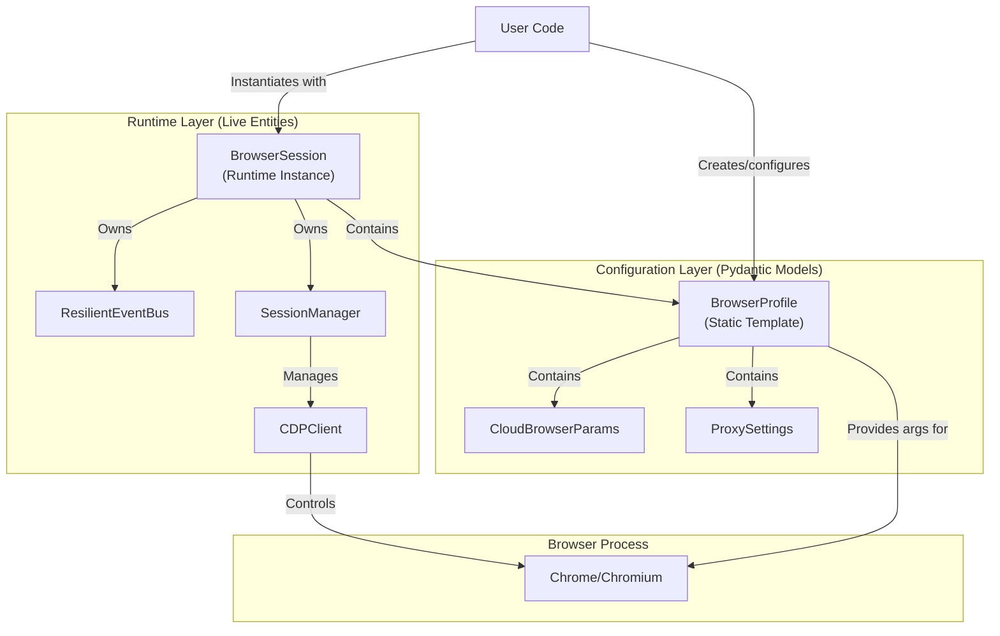
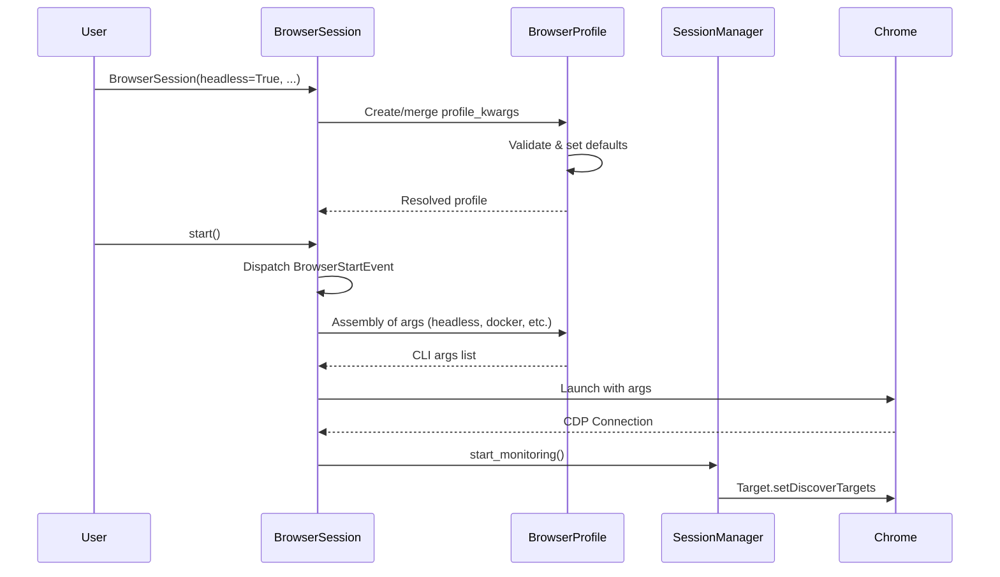

<!-- source: DeepWiki mcp.deepwiki.com · repo browser-use/browser-use · page 7 Browser Configuration · fetched 2026-10-30 -->

# Browser Configuration

Relevant source files

The following files were used as context for generating this wiki page:

- [browser_use/browser/chrome.py](browser_use/browser/chrome.py)
- [examples/custom-functions/advanced_search.py](examples/custom-functions/advanced_search.py)
- [examples/custom-functions/save_to_file_hugging_face.py](examples/custom-functions/save_to_file_hugging_face.py)
- [examples/features/custom_output.py](examples/features/custom_output.py)
- [examples/use-cases/find_influencer_profiles.py](examples/use-cases/find_influencer_profiles.py)

## Purpose and Scope

This page documents the browser configuration system in browser-use, explaining how to customize browser launch parameters, runtime behavior, and session management through the `BrowserProfile` and `BrowserSession` classes. It serves as a central hub for understanding how the library interfaces with Chrome/Chromium and how various watchdogs are orchestrated based on configuration.

**Related pages:**
- For Chrome-specific launch arguments and flags, see [Chrome Launch Arguments](#7.1)
- For download detection and file handling, see [Download Detection and Handling](#7.2)
- For cookie and storage state persistence, see [Storage State and Persistence](#7.3)
- For automatic popup and dialog handling, see [Popup and Dialog Handling](#7.4)
- For browser session lifecycle management, see [BrowserSession Lifecycle](#3.1)
- For browser target and frame management, see [Target and Frame Management](#3.4)

---

## Configuration Architecture Overview

Browser configuration in browser-use follows a two-layer architecture that separates static configuration templates from runtime session instances. The `BrowserProfile` acts as the configuration blueprint, while `BrowserSession` manages the live browser instance and its associated services.

Title: Configuration Layer to Runtime Entity Mapping

Sources: [browser_use/browser/session.py:134-154](), [browser_use/browser/profile.py:304-520](), [browser_use/browser/session_manager.py:19-31]()

### Key Classes

| Class | Purpose | Mutability | Scope |
|-------|---------|------------|-------|
| `BrowserProfile` | Static configuration template containing all browser launch, connect, and context parameters. | Immutable after creation | Reusable across sessions |
| `BrowserSession` | Runtime browser session instance with event-driven orchestration. Supports local and cloud modes. | Mutable state | Single session lifecycle |
| `SessionManager` | The single source of truth for all active CDP targets and sessions. | Dynamic | Session-scoped |
| `ResilientEventBus` | Specialized `EventBus` that handles graceful teardown and warm-Lambda resume scenarios. | Dynamic | Session-scoped |

Sources: [browser_use/browser/profile.py:304-520](), [browser_use/browser/session.py:134-154](), [browser_use/browser/session_manager.py:19-31](), [browser_use/browser/session.py:106-132]()

---

## Configuration Data Flow

The following diagram shows how configuration flows from user code through the system to the actual browser process and how it is managed via the `EventBus`.

Title: Configuration Flow to Browser Execution

Sources: [browser_use/browser/session.py:165-200](), [browser_use/browser/session_manager.py:63-80](), [browser_use/browser/profile.py:304-520]()

---

## BrowserProfile Configuration

### Launch and Connection Configuration

`BrowserProfile` aggregates various configuration models to handle local launching, remote CDP connections, and persistent context settings.

| Field | Type | Default | Description |
|-------|------|---------|-------------|
| `cdp_url` | `str \| None` | `None` | CDP URL for connecting to an existing browser instance. |
| `headless` | `bool \| None` | `None` | Run in headless mode. Uses `CHROME_HEADLESS_ARGS`. |
| `executable_path` | `str \| Path \| None` | `None` | Path to the browser executable. |
| `args` | `list[str]` | `[]` | Extra CLI arguments to pass to the browser process. |
| `proxy` | `ProxySettings \| None` | `None` | Proxy configuration for the browser. |

Sources: [browser_use/browser/profile.py:359-426](), [browser_use/browser/profile.py:116-118](), [browser_use/browser/profile.py:120-130]()

### Security and Behavioral Settings

| Category | Field | Default | Description |
|----------|-------|---------|-------------|
| **Security** | `disable_security` | `False` | Adds flags like `--disable-web-security` and `--ignore-certificate-errors`. |
| **Persistence** | `storage_state` | `None` | Path to a JSON file for persisting cookies and localStorage. |
| **Automation** | `auto_download_pdfs` | `True` | Automatically triggers downloads for PDFs instead of viewing. |
| **UI** | `demo_mode` | `False` | Injects an in-browser log panel via `DemoMode`. |
| **Extensions** | `enable_default_extensions` | `True` | Whether to load default browser extensions (controlled by `BROWSER_USE_DISABLE_EXTENSIONS` env). |

Sources: [browser_use/browser/profile.py:133-141](), [browser_use/browser/profile.py:400-420](), [browser_use/browser/demo_mode.py:14-50](), [browser_use/browser/profile.py:19-25]()

---

## Configuration and Watchdogs

Configuration flags in the `BrowserProfile` directly control the initialization and behavior of various `BaseWatchdog` components. These watchdogs listen to events on the `EventBus` and react according to the session's configuration.

| Watchdog | Controlling Config | Purpose |
|----------|-------------------|---------|
| `DownloadsWatchdog` | `auto_download_pdfs` | Monitors `DownloadWillBeginEvent` and manages file saving. Supports direct callback registration via `register_download_callbacks`. For details, see [Download Detection and Handling](#7.2). |
| `PopupsWatchdog` | Always active | Automatically handles JS `alert`, `confirm`, and `prompt` dialogs by accepting/dismissing immediately. For details, see [Popup and Dialog Handling](#7.4). |
| `StorageStateWatchdog`| `storage_state` | Periodically saves/loads cookies via `SaveStorageStateEvent` and `LoadStorageStateEvent`. For details, see [Storage State and Persistence](#7.3). |
| `CrashWatchdog` | `check_interval_seconds` | Monitors browser health for target crashes using `Target.targetCrashed` CDP events. |
| `HarRecordingWatchdog`| `record_har_path` | Captures HTTPS network activity into a HAR 1.2 file on browser shutdown. |

Sources: [browser_use/browser/watchdogs/downloads_watchdog.py:107-168](), [browser_use/browser/watchdogs/popups_watchdog.py:13-61](), [browser_use/browser/watchdogs/crash_watchdog.py:38-49]()

---

## Related Documentation

**Detailed child pages:**
- [Chrome Launch Arguments](#7.1) — Detailed list of all CLI flags and component disabling.
- [Download Detection and Handling](#7.2) — Technical details on `DownloadsWatchdog` and network monitoring.
- [Storage State and Persistence](#7.3) — How to save and load browser state.
- [Popup and Dialog Handling](#7.4) — Details on the `PopupsWatchdog` implementation.

---

## Sources

Primary source files for this documentation:
- [browser_use/browser/session.py:106-200]()
- [browser_use/browser/profile.py:19-152](), [browser_use/browser/profile.py:304-520]()
- [browser_use/browser/session_manager.py:19-138]()
- [browser_use/browser/watchdogs/downloads_watchdog.py:107-168]()
- [browser_use/browser/watchdogs/popups_watchdog.py:13-145]()
- [browser_use/browser/watchdogs/crash_watchdog.py:38-122]()
- [browser_use/browser/demo_mode.py:1-50]()

---

