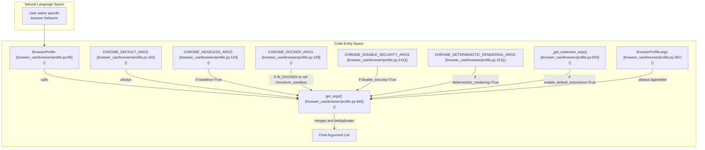
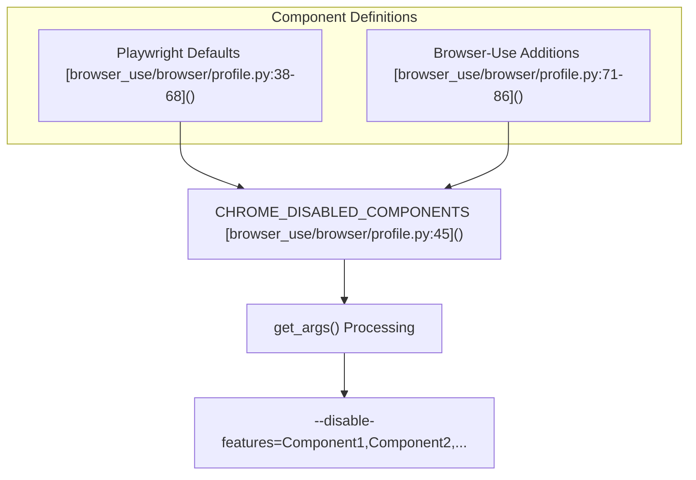
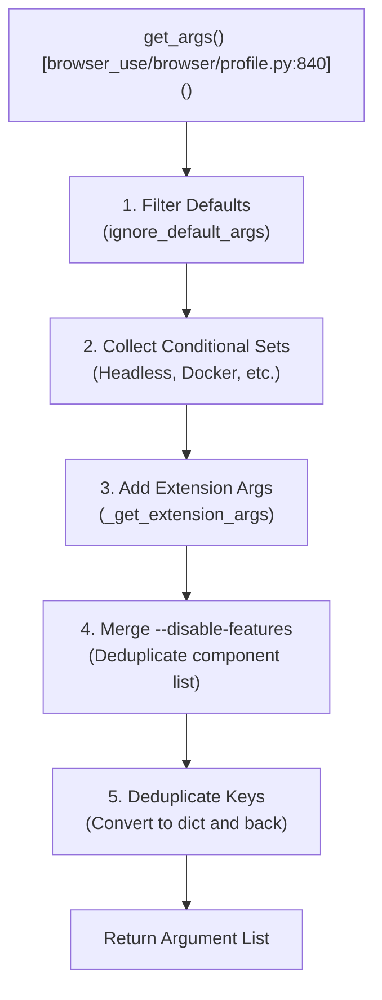

<!-- source: DeepWiki mcp.deepwiki.com · repo browser-use/browser-use · page 7.1 Chrome Launch Arguments · fetched 2026-10-30 -->

# Chrome Launch Arguments

<details>
<summary>Relevant source files</summary>

The following files were used as context for generating this wiki page:

- [browser_use/browser/chrome.py](browser_use/browser/chrome.py)
- [browser_use/browser/events.py](browser_use/browser/events.py)
- [browser_use/browser/profile.py](browser_use/browser/profile.py)
- [browser_use/browser/session.py](browser_use/browser/session.py)
- [browser_use/browser/watchdog_base.py](browser_use/browser/watchdog_base.py)
- [examples/custom-functions/advanced_search.py](examples/custom-functions/advanced_search.py)
- [examples/custom-functions/save_to_file_hugging_face.py](examples/custom-functions/save_to_file_hugging_face.py)
- [examples/features/custom_output.py](examples/features/custom_output.py)
- [examples/use-cases/find_influencer_profiles.py](examples/use-cases/find_influencer_profiles.py)

</details>


## Purpose and Scope

This page documents the Chrome/Chromium command-line arguments used by `browser-use` to launch and configure browser instances. It covers default argument sets, conditional arguments for specific environments (headless, Docker, security-disabled), and the internal assembly logic within the `BrowserProfile` class. For high-level session management, see [BrowserSession Lifecycle](3.1).

## Overview

Browser-use launches Chrome with a curated set of command-line arguments to optimize performance, stability, and stealth for AI agents. The central logic for this assembly resides in `BrowserProfile.get_args()`, which merges base defaults with specialized configurations based on the environment and user settings.

### Argument Assembly Flow



**Sources:** [browser_use/browser/profile.py:66](), [browser_use/browser/profile.py:116-186](), [browser_use/browser/profile.py:387](), [browser_use/browser/profile.py:840-918]()

## Default Chrome Arguments

The `CHROME_DEFAULT_ARGS` constant defines the baseline configuration. These arguments are designed to suppress distracting browser UI, optimize network activity, and ensure the agent can interact with the DOM efficiently.

### Argument Categories

| Category | Purpose | Key Arguments |
|----------|---------|---------------|
| **Field Trials** | Disable A/B testing | `--disable-field-trial-config` |
| **Background Activity** | Keep tabs responsive | `--disable-background-timer-throttling`, `--disable-backgrounding-occluded-windows`, `--disable-renderer-backgrounding` |
| **Network** | Minimize traffic | `--disable-background-networking`, `--disable-component-update`, `--metrics-recording-only` |
| **IPC** | High-speed CDP | `--disable-ipc-flooding-protection`, `--allow-pre-commit-input` |
| **UI/UX** | Suppress dialogs | `--disable-popup-blocking`, `--no-first-run`, `--disable-prompt-on-repost` |
| **Automation** | Stealth | `--disable-blink-features=AutomationControlled` |

### Automation-Critical Arguments

- **`--disable-blink-features=AutomationControlled`**: Removes the `navigator.webdriver` flag used for bot detection [browser_use/browser/profile.py:193]().
- **`--disable-ipc-flooding-protection`**: Essential for making rapid CDP calls in a tight loop during DOM extraction [browser_use/browser/profile.py:172]().
- **`--disable-background-timer-throttling`**: Ensures agents can continue processing even if the window is backgrounded [browser_use/browser/profile.py:158]().
- **`--disable-dev-shm-usage`**: Crucial for Docker support to avoid crashes due to small `/dev/shm` [browser_use/browser/profile.py:167]().

**Sources:** [browser_use/browser/profile.py:154-225]()

## Disabled Components

The `CHROME_DISABLED_COMPONENTS` list specifies features disabled via the `--disable-features=` flag. This combines Playwright's defaults with `browser-use` specific overrides.

### Component Logic



### Key Disabled Components
- **`AutomationControlled`**: Redundant stealth layer [browser_use/browser/profile.py:79]().
- **`CalculateNativeWinOcclusion`**: Prevents Chrome from stopping rendering when the window is covered by another app [browser_use/browser/profile.py:84]().
- **`BackForwardCache`**: Disabled to avoid surprises where the main request isn't intercepted during history navigation [browser_use/browser/profile.py:80]().
- **`OptimizationHints`**: Reduces unnecessary background network traffic [browser_use/browser/profile.py:81]().

**Sources:** [browser_use/browser/profile.py:37-86]()

## Conditional Argument Sets

### Headless Mode
Applied when `headless=True`. It uses the "new" headless mode which behaves more like a standard browser.
- `--headless=new` [browser_use/browser/profile.py:125]().

### Docker Environment
Applied when `IN_DOCKER=True` (detected via environment variables) or `chromium_sandbox=False`. These are critical for running in containerized environments where the standard sandbox is unavailable.
- `--no-sandbox` [browser_use/browser/profile.py:130]().
- `--disable-gpu-sandbox` [browser_use/browser/profile.py:131]().
- `--disable-dev-shm-usage` [browser_use/browser/profile.py:133]().
- `--disable-site-isolation-trials` [browser_use/browser/profile.py:137]() (lowers RAM use by ~10-16% in docker).

### Security Disable
Applied when `disable_security=True`. Useful for testing cross-origin scenarios or bypassing SSL issues.
- `--disable-web-security` [browser_use/browser/profile.py:143]().
- `--ignore-certificate-errors` [browser_use/browser/profile.py:146]().
- `--disable-features=IsolateOrigins,site-per-process` [browser_use/browser/profile.py:144]().

### Deterministic Rendering
Applied when `deterministic_rendering=True`. Forces consistent visual output across platforms, which is useful for vision-based agents.
- `--deterministic-mode` [browser_use/browser/profile.py:152]().
- `--js-flags=--random-seed=1157259159` [browser_use/browser/profile.py:153]().
- `--force-device-scale-factor=2` [browser_use/browser/profile.py:154]().
- `--force-color-profile=srgb` [browser_use/browser/profile.py:159]().

**Sources:** [browser_use/browser/profile.py:116-160]()

## Argument Assembly Process

The `BrowserProfile.get_args()` method follows a strict pipeline to ensure arguments are correctly merged and deduplicated.



### Feature Merging Logic
To prevent multiple `--disable-features` flags from overriding each other, `browser-use` parses all occurrences, splits the comma-separated values, deduplicates the unique feature names, and re-joins them into a single flag [browser_use/browser/profile.py:888-913]().

**Sources:** [browser_use/browser/profile.py:840-918]()

## Extension Loading

If `enable_default_extensions=True`, `browser-use` injects arguments to load a suite of automation-friendly extensions.

- **`--load-extension=`**: A comma-separated list of absolute paths to extension directories.
- **`_get_extension_args()`**: Orchestrates the collection of paths for default and user-provided extensions [browser_use/browser/profile.py:920-934]().

**Sources:** [browser_use/browser/profile.py:920-934]()

## User Customization

Users can provide their own arguments via the `args` parameter in `BrowserProfile`. These are appended last and can override defaults.

```python
profile = BrowserProfile(
    args=["--window-size=1280,720", "--mute-audio"],
    ignore_default_args=["--disable-extensions"] # Example of removing a default
)
```

Validation ensures every user-provided argument starts with `--`.

**Sources:** [browser_use/browser/profile.py:387-398]()

---

