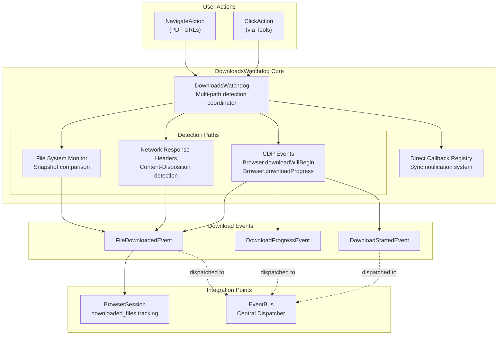
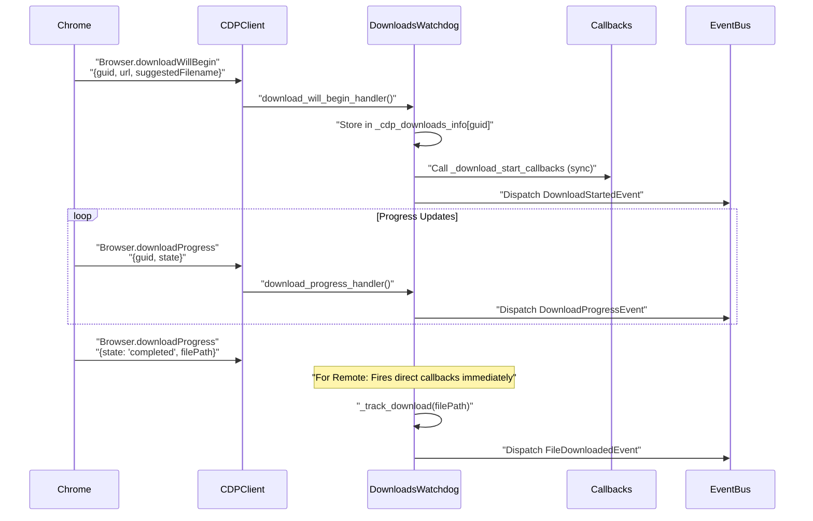
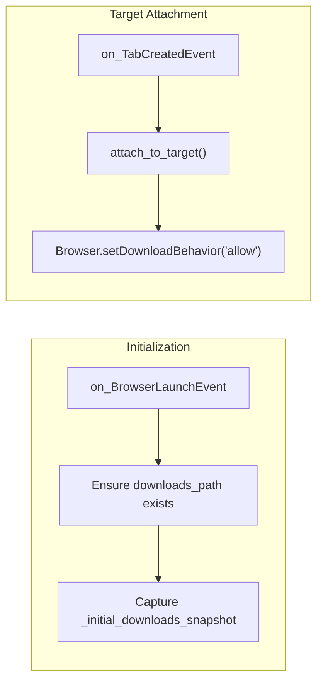

<!-- source: DeepWiki mcp.deepwiki.com · repo browser-use/browser-use · page 7.2 Download Detection and Handling · fetched 2026-10-30 -->

# Download Detection and Handling

Relevant source files

The following files were used as context for generating this wiki page:

- [browser_use/browser/demo_mode.py](browser_use/browser/demo_mode.py)
- [browser_use/browser/session_manager.py](browser_use/browser/session_manager.py)
- [browser_use/browser/watchdogs/crash_watchdog.py](browser_use/browser/watchdogs/crash_watchdog.py)
- [browser_use/browser/watchdogs/downloads_watchdog.py](browser_use/browser/watchdogs/downloads_watchdog.py)
- [browser_use/browser/watchdogs/popups_watchdog.py](browser_use/browser/watchdogs/popups_watchdog.py)
- [browser_use/browser/watchdogs/security_watchdog.py](browser_use/browser/watchdogs/security_watchdog.py)
- [examples/features/large_blocklist.py](examples/features/large_blocklist.py)
- [tests/ci/security/test_ip_blocking.py](tests/ci/security/test_ip_blocking.py)
- [tests/ci/test_downloads_watchdog.py](tests/ci/test_downloads_watchdog.py)
- [tests/ci/test_remote_download_complete_callback.py](tests/ci/test_remote_download_complete_callback.py)

## Purpose and Scope

This document covers the download detection and handling system in `browser-use`, which automatically monitors file downloads triggered by browser automation and provides download metadata to agents. The system uses multiple detection paths—CDP events, network headers, and file system monitoring—to reliably capture downloads across different scenarios, including direct downloads, PDF auto-downloads, and downloads triggered by clicks.

The core logic resides in the `DownloadsWatchdog` class [browser_use/browser/watchdogs/downloads_watchdog.py:107-108](), which coordinates with the `EventBus` and `BrowserSession` to ensure that downloaded files are tracked and made available for subsequent agent actions.

Sources: [browser_use/browser/watchdogs/downloads_watchdog.py:107-108]()

---

## System Architecture

The download detection system operates through the `DownloadsWatchdog` [browser_use/browser/watchdogs/downloads_watchdog.py:107-108](), which monitors multiple data sources to detect downloads with high reliability.

### Component Interaction Diagram

Sources: [browser_use/browser/watchdogs/downloads_watchdog.py:107-125](), [browser_use/browser/watchdogs/downloads_watchdog.py:146-168]()

---

## Multi-Path Detection Strategy

The system employs three complementary detection paths to ensure reliable download capture:

| Detection Path | Trigger | Implementation Detail |
|---------------|---------|-----------------------|
| **CDP Events** | `Browser.downloadWillBegin` | Primary method for Chromium-based downloads. [browser_use/browser/watchdogs/downloads_watchdog.py:240-386]() |
| **Network Headers** | `Content-Disposition: attachment` | Monitors network responses for download headers. [browser_use/browser/watchdogs/downloads_watchdog.py:440-642]() |
| **File System Monitor** | New files in directory | Fallback using directory snapshots. [browser_use/browser/watchdogs/downloads_watchdog.py:340-363]() |

### CDP Event Path

The primary detection method uses Chrome DevTools Protocol events. When a download begins, Chrome emits `Browser.downloadWillBegin` [browser_use/browser/watchdogs/downloads_watchdog.py:15-15](). Progress updates arrive via `Browser.downloadProgress` [browser_use/browser/watchdogs/downloads_watchdog.py:14-14]().

For **remote browsers**, the `downloadProgress` event with `state == 'completed'` is the critical signal used to trigger completion callbacks, as standard file system monitoring may not be available [tests/ci/test_remote_download_complete_callback.py:1-16]().

**Sequence: CDP Download Handling**

Sources: [browser_use/browser/watchdogs/downloads_watchdog.py:14-15](), [browser_use/browser/watchdogs/downloads_watchdog.py:240-386](), [tests/ci/test_remote_download_complete_callback.py:77-110]()

### Network Header Detection

For scenarios where standard CDP download events might be bypassed, the `DownloadsWatchdog` monitors network responses for `Content-Disposition: attachment` or `application/pdf` content types [browser_use/browser/watchdogs/downloads_watchdog.py:440-642]().

1. **Setup**: `_setup_network_monitoring` enables the `Network` domain for a target [browser_use/browser/watchdogs/downloads_watchdog.py:440-460]().
2. **Callback**: `on_response_received` inspects headers for every response [browser_use/browser/watchdogs/downloads_watchdog.py:488-642]().
3. **Trigger**: If a download is detected, `download_file_from_url` is called to fetch the content [browser_use/browser/watchdogs/downloads_watchdog.py:644-810]().

Sources: [browser_use/browser/watchdogs/downloads_watchdog.py:440-810]()

---

## DownloadsWatchdog Component

The `DownloadsWatchdog` is a specialized watchdog class inheriting from `BaseWatchdog` [browser_use/browser/watchdogs/downloads_watchdog.py:31-31](), [browser_use/browser/watchdogs/downloads_watchdog.py:107-108]().

### State Management

The class maintains several private attributes to track active and completed downloads:

*   `_active_downloads`: Maps GUIDs to active download trackers [browser_use/browser/watchdogs/downloads_watchdog.py:129-129]().
*   `_initial_downloads_snapshot`: A set of filenames present in the downloads directory at startup to distinguish new files [browser_use/browser/watchdogs/downloads_watchdog.py:136-136]().
*   `_cdp_downloads_info`: Maps GUIDs to metadata like URLs and suggested filenames [browser_use/browser/watchdogs/downloads_watchdog.py:134-134]().
*   `_detected_downloads`: Set of URLs already handled to prevent duplicates [browser_use/browser/watchdogs/downloads_watchdog.py:138-138]().

### Direct Callback System

The watchdog supports direct callbacks that bypass the asynchronous `EventBus` for low-latency synchronization during actions like clicks [browser_use/browser/watchdogs/downloads_watchdog.py:141-144](). This is vital for `DefaultActionWatchdog` which waits on an `asyncio.Event` triggered by these callbacks [tests/ci/test_remote_download_complete_callback.py:10-16]().

*   `register_download_callbacks`: Registers functions to be called on start, progress, or completion [browser_use/browser/watchdogs/downloads_watchdog.py:146-169]().
*   `unregister_download_callbacks`: Removes registered callbacks [browser_use/browser/watchdogs/downloads_watchdog.py:170-182]().

Sources: [browser_use/browser/watchdogs/downloads_watchdog.py:31-31](), [browser_use/browser/watchdogs/downloads_watchdog.py:107-138](), [browser_use/browser/watchdogs/downloads_watchdog.py:141-182](), [tests/ci/test_remote_download_complete_callback.py:10-16]()

---

## PDF Auto-Download

If `auto_download_pdfs` is enabled in the `BrowserProfile`, the watchdog intercepts PDF views and triggers a download via the CDP `Page.printToPDF` command [browser_use/browser/watchdogs/downloads_watchdog.py:812-923]().

### PDF Handling Logic

1. **Detection**: `check_for_pdf_viewer` checks if the current page is a PDF [browser_use/browser/watchdogs/downloads_watchdog.py:812-840]().
2. **Trigger**: `trigger_pdf_download` generates a PDF file from the current browser state [browser_use/browser/watchdogs/downloads_watchdog.py:842-923]().
3. **Storage**: The generated PDF is saved to the configured `downloads_path` [browser_use/browser/watchdogs/downloads_watchdog.py:898-905]().

Sources: [browser_use/browser/watchdogs/downloads_watchdog.py:812-923]()

---

## Attachment Detection Heuristics

The system includes specific logic to avoid downloading generic API responses that might be marked as attachments by servers (e.g., Google Search autocomplete).

*   `_is_generic_text_attachment`: Checks if a file is a generic text/json response with names like "f", "download", or "callback" [browser_use/browser/watchdogs/downloads_watchdog.py:77-89]().
*   `_should_auto_download_network_response`: Determines if a network response should trigger an automatic download based on MIME type and content disposition [browser_use/browser/watchdogs/downloads_watchdog.py:91-104]().

Sources: [browser_use/browser/watchdogs/downloads_watchdog.py:77-104](), [tests/ci/test_downloads_watchdog.py:4-51]()

---

## Browser Configuration and Initialization

Download behavior is influenced by `BrowserProfile` settings and initial browser launch parameters.

### Setup Sequence

During `on_BrowserLaunchEvent`, the watchdog ensures the downloads directory exists and takes a snapshot of existing files [browser_use/browser/watchdogs/downloads_watchdog.py:184-199]().

Sources: [browser_use/browser/watchdogs/downloads_watchdog.py:184-199](), [browser_use/browser/watchdogs/downloads_watchdog.py:388-428]()

---

## Download Events Reference

The following events are emitted by the `DownloadsWatchdog` and managed via the `EventBus`:

| Event Type | Purpose | Key Data Fields |
|------------|---------|-----------------|
| `DownloadStartedEvent` | Indicates a download has been initiated. | `guid`, `url`, `suggested_filename` [browser_use/browser/watchdogs/downloads_watchdog.py:25-25] |
| `DownloadProgressEvent` | Provides real-time progress updates. | `guid`, `received_bytes`, `total_bytes`, `state` [browser_use/browser/watchdogs/downloads_watchdog.py:24-24] |
| `FileDownloadedEvent` | Final event indicating file is ready on disk. | `path`, `file_name`, `file_size`, `mime_type` [browser_use/browser/watchdogs/downloads_watchdog.py:26-26] |

Sources: [browser_use/browser/watchdogs/downloads_watchdog.py:20-30](), [browser_use/browser/watchdogs/downloads_watchdog.py:121-125]()

---

