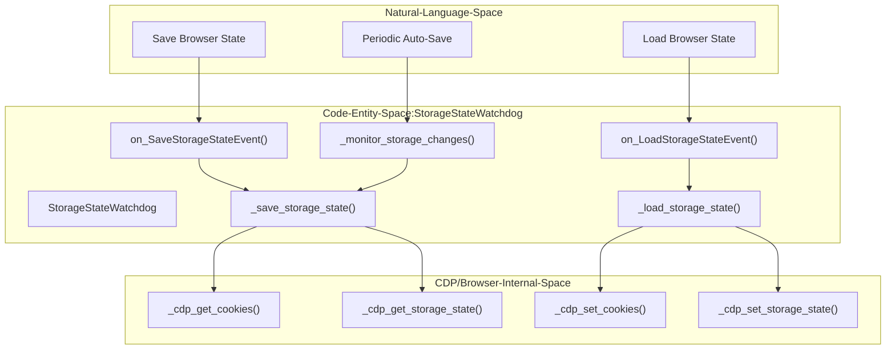
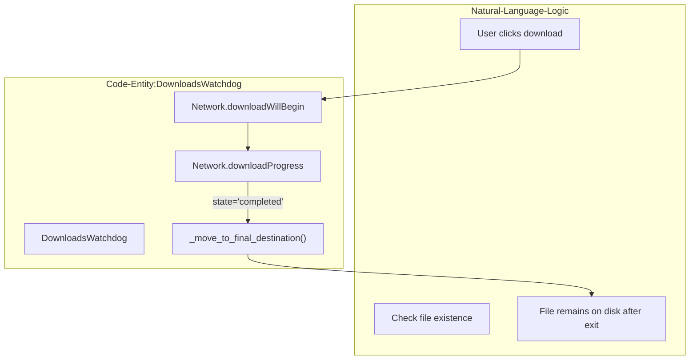

<!-- source: DeepWiki mcp.deepwiki.com · repo browser-use/browser-use · page 7.3 Storage State and Persistence · fetched 2026-10-30 -->

# Storage State and Persistence

<details>
<summary>Relevant source files</summary>

The following files were used as context for generating this wiki page:

- [browser_use/browser/watchdogs/har_recording_watchdog.py](browser_use/browser/watchdogs/har_recording_watchdog.py)
- [browser_use/browser/watchdogs/storage_state_watchdog.py](browser_use/browser/watchdogs/storage_state_watchdog.py)
- [examples/browser/real_browser.py](examples/browser/real_browser.py)
- [examples/browser/save_cookies.py](examples/browser/save_cookies.py)
- [examples/browser/using_cdp.py](examples/browser/using_cdp.py)
- [examples/features/download_file.py](examples/features/download_file.py)
- [examples/features/parallel_agents.py](examples/features/parallel_agents.py)
- [examples/features/restrict_urls.py](examples/features/restrict_urls.py)
- [tests/ci/test_action_LoadStorageStateEvent.py](tests/ci/test_action_LoadStorageStateEvent.py)
- [tests/ci/test_storage_state_watchdog.py](tests/ci/test_storage_state_watchdog.py)

</details>


## Purpose and Scope

This document covers the browser storage state persistence system in `browser-use`, which enables saving and restoring browser data (cookies, `localStorage`, `sessionStorage`) across browser sessions. This is essential for maintaining authenticated sessions, user preferences, and application state between agent runs.

The system is primarily managed by the `StorageStateWatchdog`, which interfaces with the `BrowserSession` and the underlying CDP protocol to capture and inject state data. It also covers HAR recording and download persistence as part of the broader session data management.

Sources: [browser_use/browser/watchdogs/storage_state_watchdog.py:1-26](), [browser_use/browser/watchdogs/har_recording_watchdog.py:1-6]()

---

## Storage State Overview

Storage state represents a snapshot of browser-side data that can be persisted to disk and restored in future sessions. This includes:

- **Cookies**: HTTP cookies with domain, path, expiration, and security flags.
- **localStorage**: Key-value pairs scoped to origins.
- **sessionStorage**: Session-specific key-value pairs.

The storage state system provides:
- **Automatic persistence**: State saved on browser stop or at regular intervals via `_monitor_storage_changes` [browser_use/browser/watchdogs/storage_state_watchdog.py:119-134]().
- **Manual save/load**: Explicit control via `SaveStorageStateEvent` and `LoadStorageStateEvent` [browser_use/browser/watchdogs/storage_state_watchdog.py:64-71]().
- **Session continuity**: Maintain login sessions across runs.
- **Profile isolation**: Separate storage per `BrowserProfile`.

Sources: [browser_use/browser/watchdogs/storage_state_watchdog.py:25-48](), [browser_use/browser/watchdogs/storage_state_watchdog.py:13-20]()

---

## Storage State Format and Structure

### Storage State Representation

Storage state can be provided in three forms during `BrowserSession` initialization via the `BrowserProfile`:

| Format | Type | Description | Use Case |
|--------|------|-------------|----------|
| **File path** | `str` or `Path` | Path to JSON file containing state | Standard persistence to disk |
| **Dictionary** | `dict[str, Any]` | In-memory state object | Programmatic state manipulation [tests/ci/test_action_LoadStorageStateEvent.py:23-32]() |
| **None** | `None` | No initial state | Fresh browser session |

Sources: [browser_use/browser/watchdogs/storage_state_watchdog.py:72-78](), [tests/ci/test_action_LoadStorageStateEvent.py:1-7]()

### JSON Storage State Format

The persisted JSON follows the Playwright-compatible storage state format. When `_save_storage_state` is called, it fetches data using the internal `_cdp_get_storage_state` helper [browser_use/browser/watchdogs/storage_state_watchdog.py:175-177]().

```json
{
  "cookies": [
    {
      "name": "session_id",
      "value": "xyz123",
      "domain": "example.com",
      "path": "/",
      "expires": 1735689600,
      "httpOnly": true,
      "secure": true,
      "sameSite": "Lax"
    }
  ],
  "origins": [
    {
      "origin": "https://example.com",
      "localStorage": [
        {"name": "theme", "value": "dark"}
      ]
    }
  ]
}
```

Sources: [browser_use/browser/watchdogs/storage_state_watchdog.py:175-180]()

---

## Storage State Watchdog Implementation

The `StorageStateWatchdog` is the central entity managing persistence. It listens for lifecycle events and handles the actual CDP communication to extract or inject data.

### Diagram: Storage State Data Flow

This diagram maps the natural language requirements of "saving state" to the specific code entities involved in the process.



Sources: [browser_use/browser/watchdogs/storage_state_watchdog.py:25-88](), [browser_use/browser/watchdogs/storage_state_watchdog.py:158-180]()

### Key Functions and Classes

- **`StorageStateWatchdog`**: Inherits from `BaseWatchdog`. It manages the `_monitoring_task` for periodic saves [browser_use/browser/watchdogs/storage_state_watchdog.py:25-48]().
- **`_monitor_storage_changes`**: A loop that runs every `auto_save_interval` (default 30s) and checks if cookies have changed using `_have_cookies_changed()` [browser_use/browser/watchdogs/storage_state_watchdog.py:119-128]().
- **`_save_storage_state`**: Orchestrates state extraction. It skips file saving if the path is a `dict`, ensuring in-memory states are handled correctly [browser_use/browser/watchdogs/storage_state_watchdog.py:158-173]().
- **`_load_storage_state`**: Injects cookies into the browser. It handles session cookies (where `expires` is `0` or `-1`) by normalizing them to avoid premature expiration [tests/ci/test_action_LoadStorageStateEvent.py:48-64]().

Sources: [browser_use/browser/watchdogs/storage_state_watchdog.py:119-200](), [tests/ci/test_action_LoadStorageStateEvent.py:1-64]()

---

## Session Persistence Patterns

### Manual Cookie Export
Users can export authenticated sessions from a real Chrome instance to a `storage_state.json` file. This allows subsequent headless runs to use pre-authenticated cookies without manual login steps.

```python
# From examples/browser/save_cookies.py
browser = Browser.from_system_chrome(profile_directory=profile)
await browser.start()
await browser.export_storage_state('storage_state.json')
await browser.stop()
```

Sources: [examples/browser/save_cookies.py:39-45]()

### Persistent User Data Directory
For full browser profile persistence (extensions, history, cache), `browser-use` supports the `user_data_dir` argument in `BrowserProfile`. This bypasses the JSON storage state mechanism in favor of native Chrome profile management.

```python
# From examples/features/parallel_agents.py
BrowserProfile(
    user_data_dir='~/.config/browseruse/profiles/default',
)
```

Sources: [examples/features/parallel_agents.py:16-23]()

---

## HAR Recording and Network State

The `HarRecordingWatchdog` provides network-level persistence by capturing all HTTPS activity into a HAR 1.2 file.

- **Storage**: Triggered on `BrowserStopEvent` [browser_use/browser/watchdogs/har_recording_watchdog.py:200-208]().
- **Content Modes**: Supports `omit`, `embed` (base64), or `attach` (separate files) for response bodies [browser_use/browser/watchdogs/har_recording_watchdog.py:160-165]().
- **Filename Generation**: Uses SHA-1 hashing of content for attached files to avoid duplicates [browser_use/browser/watchdogs/har_recording_watchdog.py:137-142]().

Sources: [browser_use/browser/watchdogs/har_recording_watchdog.py:1-199]()

---

## Download Management and Persistence

File downloads are managed via the `downloads_path` setting in `BrowserProfile` [examples/features/download_file.py:21-22](). The system monitors download lifecycle via CDP events.

### Diagram: Download Persistence Logic



Sources: [browser_use/browser/watchdogs/har_recording_watchdog.py:186-193](), [examples/features/download_file.py:21-30]()

---

## Storage State Events

| Event | Direction | Purpose |
|-------|-----------|---------|
| `SaveStorageStateEvent` | Request | Triggers `_save_storage_state()` [browser_use/browser/watchdogs/storage_state_watchdog.py:64-66](). |
| `LoadStorageStateEvent` | Request | Triggers `_load_storage_state()` [browser_use/browser/watchdogs/storage_state_watchdog.py:68-70](). |
| `StorageStateSavedEvent` | Notification | Emitted after state is written to disk/memory [browser_use/browser/watchdogs/storage_state_watchdog.py:35-38](). |
| `StorageStateLoadedEvent` | Notification | Emitted after state is injected into browser [browser_use/browser/watchdogs/storage_state_watchdog.py:35-38](). |

Sources: [browser_use/browser/watchdogs/storage_state_watchdog.py:29-38]()

---

## Implementation Details

### Cookie Change Detection
The watchdog performs a "shallow" comparison of cookies to decide if an auto-save is necessary. It compares the `name`, `domain`, and `path` as a composite key against the `value` [browser_use/browser/watchdogs/storage_state_watchdog.py:145-153]().

### Storage State Merging
When saving to an existing file, the system merges the new `cookies` and `origins` (localStorage) with the old data using `_merge_storage_states`. This prevents wiping state for domains not visited in the current session [browser_use/browser/watchdogs/storage_state_watchdog.py:185-191]().

Sources: [browser_use/browser/watchdogs/storage_state_watchdog.py:141-191]()

---

