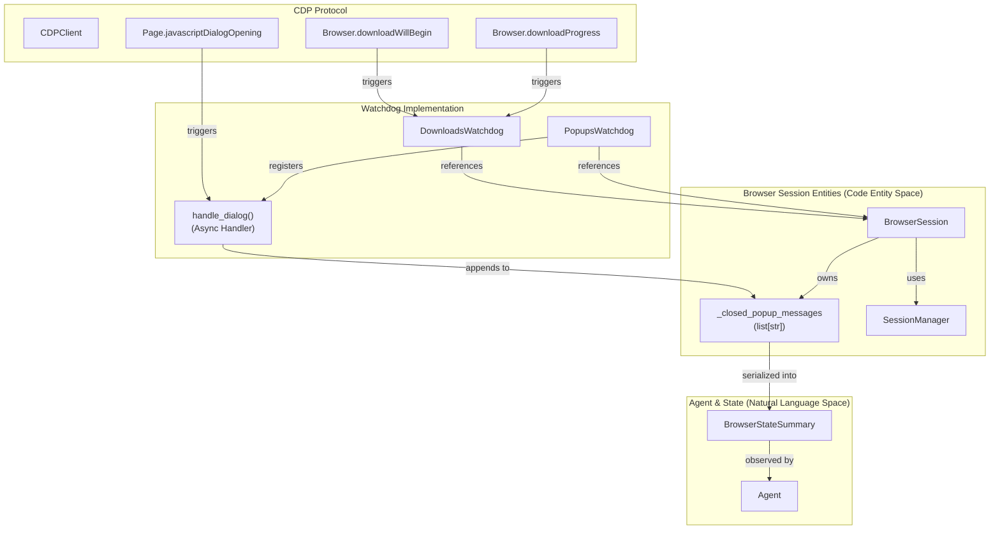
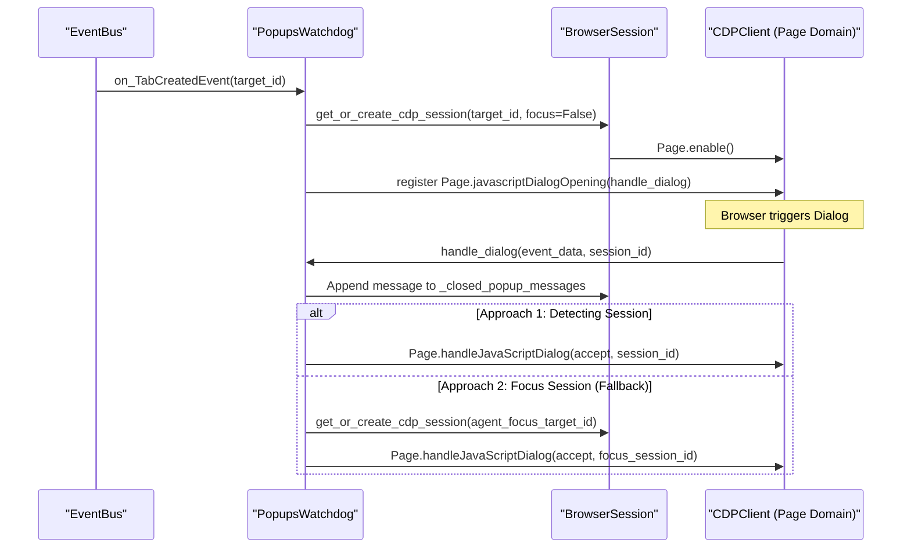
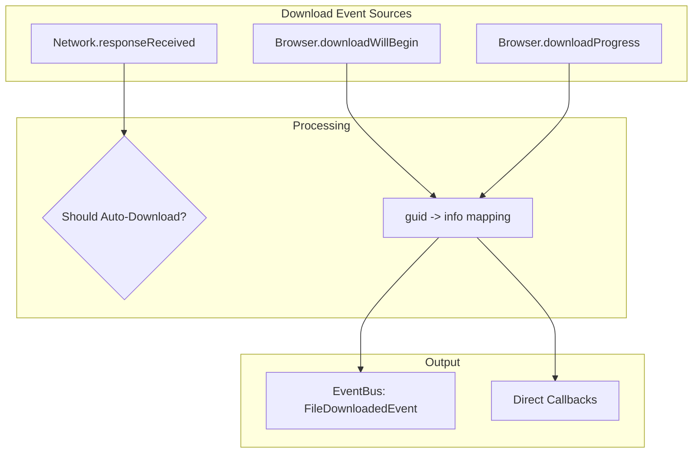

<!-- source: DeepWiki mcp.deepwiki.com · repo browser-use/browser-use · page 7.4 Popup and Dialog Handling · fetched 2026-10-30 -->

# Popup and Dialog Handling

Relevant source files

The following files were used as context for generating this wiki page:

- [browser_use/browser/demo_mode.py](browser_use/browser/demo_mode.py)
- [browser_use/browser/session_manager.py](browser_use/browser/session_manager.py)
- [browser_use/browser/watchdogs/crash_watchdog.py](browser_use/browser/watchdogs/crash_watchdog.py)
- [browser_use/browser/watchdogs/downloads_watchdog.py](browser_use/browser/watchdogs/downloads_watchdog.py)
- [browser_use/browser/watchdogs/popups_watchdog.py](browser_use/browser/watchdogs/popups_watchdog.py)
- [browser_use/browser/watchdogs/security_watchdog.py](browser_use/browser/watchdogs/security_watchdog.py)
- [examples/features/large_blocklist.py](examples/features/large_blocklist.py)
- [tests/ci/security/test_ip_blocking.py](tests/ci/security/test_ip_blocking.py)
- [tests/ci/test_downloads_watchdog.py](tests/ci/test_downloads_watchdog.py)
- [tests/ci/test_remote_download_complete_callback.py](tests/ci/test_remote_download_complete_callback.py)

## Purpose and Scope

This document covers the automatic handling of JavaScript dialogs (`alert`, `confirm`, `prompt`, `beforeunload`) and file downloads within the `browser-use` framework. The system, primarily managed by `PopupsWatchdog` and `DownloadsWatchdog`, ensures that automation workflows are not blocked by browser-level modal dialogs or long-running file transfers. It automatically detects and dismisses dialogs while recording popup messages for the LLM context, and monitors network/CDP traffic to manage file downloads.

**Sources:** [browser_use/browser/watchdogs/popups_watchdog.py:1-145](), [browser_use/browser/watchdogs/downloads_watchdog.py:1-126]()

---

## System Architecture

The popup and dialog subsystem relies on event-driven CDP (Chrome DevTools Protocol) monitoring via specialized watchdogs. `PopupsWatchdog` handles immediate dismissal of modal dialogs, while `DownloadsWatchdog` manages download behaviors and completion callbacks.

### Code Entity Space Mapping: Dialog & Download Subsystem

**Diagram: Mapping of Dialog and Download Handling to Code Entities**

**Sources:** [browser_use/browser/watchdogs/popups_watchdog.py:13-145](), [browser_use/browser/watchdogs/downloads_watchdog.py:107-145](), [browser_use/browser/session_manager.py:19-31]()

---

## PopupsWatchdog: Dialog Handling

The `PopupsWatchdog` class initializes and manages JavaScript dialog interception. It listens for `TabCreatedEvent` to attach handlers across tabs and frames [browser_use/browser/watchdogs/popups_watchdog.py:17-29]().

### Dialog Detection and Handling Flow

When a page fires a dialog event, `PopupsWatchdog` intercepts it and executes an immediate dismissal flow.

**Diagram: JavaScript Dialog Interception and Dismissal Sequence**

**Sources:** [browser_use/browser/watchdogs/popups_watchdog.py:27-124]()

### Dialog Type Handling Rules

`PopupsWatchdog` determines whether to accept or dismiss a dialog based on its type to prevent agent hangs during automated execution [browser_use/browser/watchdogs/popups_watchdog.py:74-79]().

| Dialog Type | `accept` Value | Action | Rationale |
|-------------|----------------|--------|-----------|
| `alert` | `True` | OK | Dismisses informational popups [browser_use/browser/watchdogs/popups_watchdog.py:79]() |
| `confirm` | `True` | OK | Proceeds with actions (safer for automation) [browser_use/browser/watchdogs/popups_watchdog.py:79]() |
| `beforeunload` | `True` | OK | Allows navigation to proceed without blocking [browser_use/browser/watchdogs/popups_watchdog.py:79]() |
| `prompt` | `False` | Cancel | Avoids blocking on unexpected text input requirements [browser_use/browser/watchdogs/popups_watchdog.py:77-79]() |

Closed popup messages are formatted as `[{dialog_type}] {message}` and stored in `browser_session._closed_popup_messages` so they appear in the subsequent `BrowserStateSummary` observation loop [browser_use/browser/watchdogs/popups_watchdog.py:69-72]().

**Sources:** [browser_use/browser/watchdogs/popups_watchdog.py:62-124]()

---

## DownloadsWatchdog: File Handling

The `DownloadsWatchdog` class monitors download events, handling both explicit download behaviors via `Browser.setDownloadBehavior` and network responses via `Network.responseReceived` [browser_use/browser/watchdogs/downloads_watchdog.py:107-145]().

### Download Monitoring Logic and Callbacks

| Feature | Description |
|---------|-------------|
| **Auto-Download Extensions** | Automatically downloads common file types (`pdf`, `docx`, `xlsx`, `csv`, `zip`, etc.) [browser_use/browser/watchdogs/downloads_watchdog.py:38-59]() |
| **Direct Callbacks** | Supports `on_start`, `on_progress`, and `on_complete` callback registrations to bypass event bus latency during click actions [browser_use/browser/watchdogs/downloads_watchdog.py:146-169]() |
| **Generic Text Attachment Filtering** | Distinguishes real files from generic text API responses (`f.txt`, `download.json`) to prevent unwanted file clutter [browser_use/browser/watchdogs/downloads_watchdog.py:77-89]() |

### Data Flow for DownloadsWatchdog

**Diagram: DownloadsWatchdog Data Flow**

**Sources:** [browser_use/browser/watchdogs/downloads_watchdog.py:38-145](), [tests/ci/test_remote_download_complete_callback.py:77-110]()

---

## Implementation Details

### Multi-Level Registration
To ensure maximum reliability across complex page structures, `PopupsWatchdog` registers its dialog handler on both the target-specific session and the root CDP client:
- **Tab Session Level:** Registers via `cdp_session.cdp_client.register.Page.javascriptDialogOpening` [browser_use/browser/watchdogs/popups_watchdog.py:126-129]()
- **Root Client Level:** Registers via `self.browser_session._cdp_client_root.register.Page.javascriptDialogOpening` to catch dialogs across all embedded frames [browser_use/browser/watchdogs/popups_watchdog.py:131-137]()

### Crash and Recovery Integration
If a tab crashes while handling dialogs or downloads, `CrashWatchdog` (listening for `Target.targetCrashed`) interacts with `SessionManager` to clear stale focus states and trigger recovery routines [browser_use/browser/watchdogs/crash_watchdog.py:161-179](), [browser_use/browser/session_manager.py:162-179]().

**Sources:** [browser_use/browser/watchdogs/popups_watchdog.py:125-145](), [browser_use/browser/watchdogs/crash_watchdog.py:161-179](), [browser_use/browser/session_manager.py:162-179]()

---

