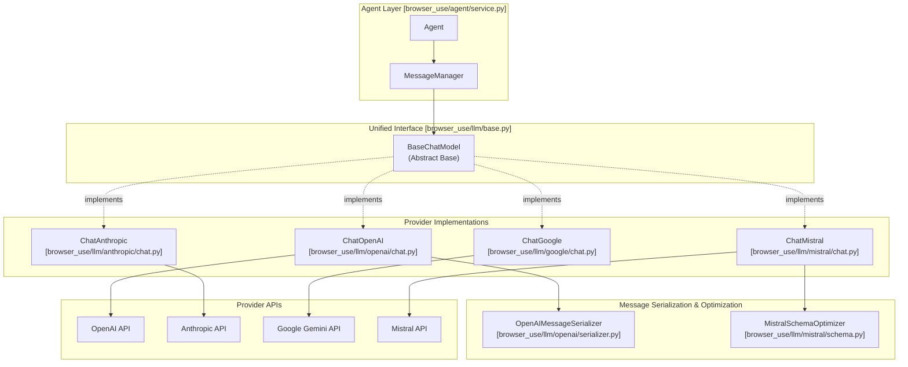

<!-- source: DeepWiki mcp.deepwiki.com · repo browser-use/browser-use · page 8 LLM Integration · fetched 2026-10-30 -->

# LLM Integration

<details>
<summary>Relevant source files</summary>

The following files were used as context for generating this wiki page:

- [browser_use/__init__.py](browser_use/__init__.py)
- [browser_use/llm/README.md](browser_use/llm/README.md)
- [browser_use/llm/__init__.py](browser_use/llm/__init__.py)
- [browser_use/llm/mistral/__init__.py](browser_use/llm/mistral/__init__.py)
- [browser_use/llm/mistral/chat.py](browser_use/llm/mistral/chat.py)
- [browser_use/llm/mistral/schema.py](browser_use/llm/mistral/schema.py)
- [browser_use/llm/models.py](browser_use/llm/models.py)
- [browser_use/llm/tests/test_mistral_schema.py](browser_use/llm/tests/test_mistral_schema.py)
- [examples/models/mistral.py](examples/models/mistral.py)
- [tests/ci/models/test_llm_model_factory.py](tests/ci/models/test_llm_model_factory.py)

</details>


The LLM Integration layer provides a unified interface for interacting with multiple language model providers while maintaining provider-specific optimizations. This system enables the `Agent` to execute tasks using any supported LLM provider through a consistent `BaseChatModel` interface, abstracting away differences in API protocols, message formats, and structured output mechanisms.

**Purpose and Scope**: This page outlines the high-level architecture of LLM provider abstraction, multi-provider support, structured output generation, message serialization, and error handling within `browser-use`. For detailed technical implementations, refer to the child pages linked throughout this document.

---

## Architecture Overview

The LLM integration layer follows a provider-agnostic pattern where all providers implement the same `BaseChatModel` interface but maintain provider-specific serializers and structured output strategies. To optimize performance, the system uses a lazy import mechanism in `browser_use/__init__.py` and `browser_use/llm/__init__.py` to load heavy LLM dependencies only when they are accessed [browser_use/__init__.py:76-115](), [browser_use/llm/__init__.py:81-99]().

**System Architecture: LLM Provider Layer**



**Key Design Decisions**:
- **Unified Interface**: All providers implement `BaseChatModel.ainvoke()` with consistent signatures [browser_use/llm/mistral/chat.py:161-171]().
- **Provider-Specific Serialization**: Dedicated serializers transform internal `BaseMessage` objects into provider-specific payloads.
- **Structured Output Strategies**: Providers use native JSON modes, tool calling, or custom schema optimizers (such as `MistralSchemaOptimizer` stripping unsupported keywords like `minLength`, `maxLength`, `pattern`, and `format`) [browser_use/llm/mistral/schema.py:12-34]().
- **Error Normalization**: Provider-specific exceptions are mapped to unified types like `ModelRateLimitError` and `ModelProviderError` [browser_use/llm/mistral/chat.py:14-16]().

Sources: [browser_use/__init__.py:76-115](), [browser_use/llm/__init__.py:81-99](), [browser_use/llm/mistral/chat.py:12-45](), [browser_use/llm/mistral/schema.py:12-34]()

---

## Model Factory and Convenience Access

The `browser_use/llm/models.py` module provides factory utilities like `get_llm_by_name()` to instantiate models from string identifiers using environment variables [browser_use/llm/models.py:89-117](). Additionally, users can import pre-configured model instances directly from the `llm` module via dynamic attribute resolution [browser_use/llm/__init__.py:105-134]().

```python
from browser_use import llm

# Simple model access via convenience properties
model = llm.openai_gpt_4o  
mistral_model = llm.mistral_large
```

Sources: [browser_use/llm/models.py:89-117](), [browser_use/llm/__init__.py:105-134]()

---

## Child Pages & Detailed Topics

For deeper technical details on specific providers, serialization, schema optimization, and error handling, consult the following child pages:

- **[LLM Provider Architecture](#8.1)** — BaseChatModel interface, ChatInvokeCompletion, provider polymorphism, model factory, and lazy import system [browser_use/__init__.py:46-115](), [browser_use/llm/models.py:89-117]().
- **[OpenAI Integration](#8.2)** — ChatOpenAI client, native JSON schema support, reasoning models (o-series), Azure/responses API, and API configuration.
- **[Google Gemini Integration](#8.3)** — ChatGoogle client, thinking_budget/thinking_level, native JSON mode, image handling, and Vertex AI support.
- **[Anthropic Claude Integration](#8.4)** — ChatAnthropic client, tool calling for structured output, Bedrock variants, and prompt caching.
- **[Browser-Use Cloud LLM](#8.5)** — ChatBrowserUse optimized models, API key setup, bu-latest and bu-2-0 models, and cloud API configuration.
- **[Local and Alternative LLM Support](#8.6)** — Ollama, AWS Bedrock, Groq, DeepSeek, OpenRouter, Cerebras (`ChatCerebras`), Mistral (`ChatMistral`), OCI, OrcaRouter, LiteLLM, Vercel AI Gateway and other provider configurations [browser_use/llm/mistral/chat.py:25-45](), [tests/ci/models/test_llm_model_factory.py:18-26]().
- **[Structured Output and Schema Optimization](#8.7)** — Native JSON schema vs. tool calling strategies, SchemaOptimizer, Pydantic model validation, and schema optimization flags (including Mistral-specific schema sanitization) [browser_use/llm/mistral/schema.py:12-34]().
- **[Message Serialization](#8.8)** — Provider-specific message serializers, multi-modal content handling, and system/user message splitting.
- **[LLM Error Handling and Retry Logic](#8.9)** — Exponential backoff, retryable status codes, ModelProviderError/ModelRateLimitError, truncation errors, and fallback_llm mechanism [browser_use/llm/mistral/chat.py:14-16]().
- **[Token Accounting and Cost Tracking](#8.10)** — TokenCost service, pricing mappings, custom and OpenRouter pricing sources, and usage summaries.

Sources: [browser_use/__init__.py:46-115](), [browser_use/llm/models.py:89-117](), [browser_use/llm/mistral/chat.py:14-45](), [browser_use/llm/mistral/schema.py:12-34](), [tests/ci/models/test_llm_model_factory.py:18-26]()

---

