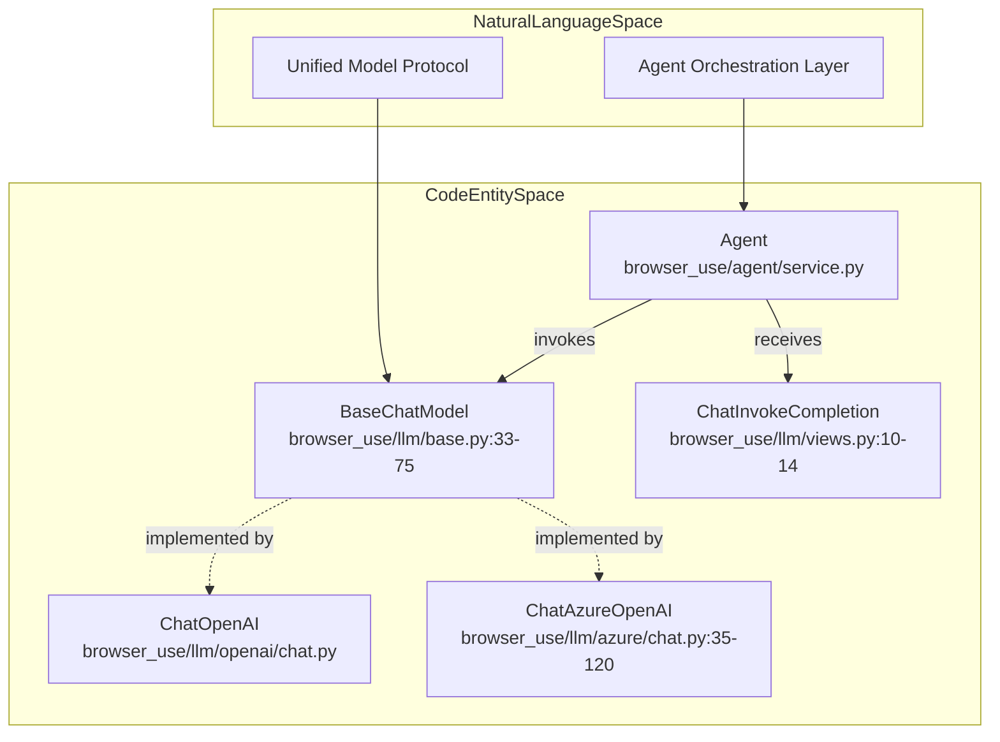
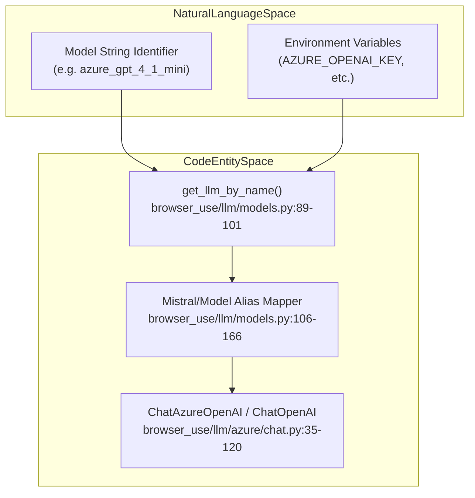
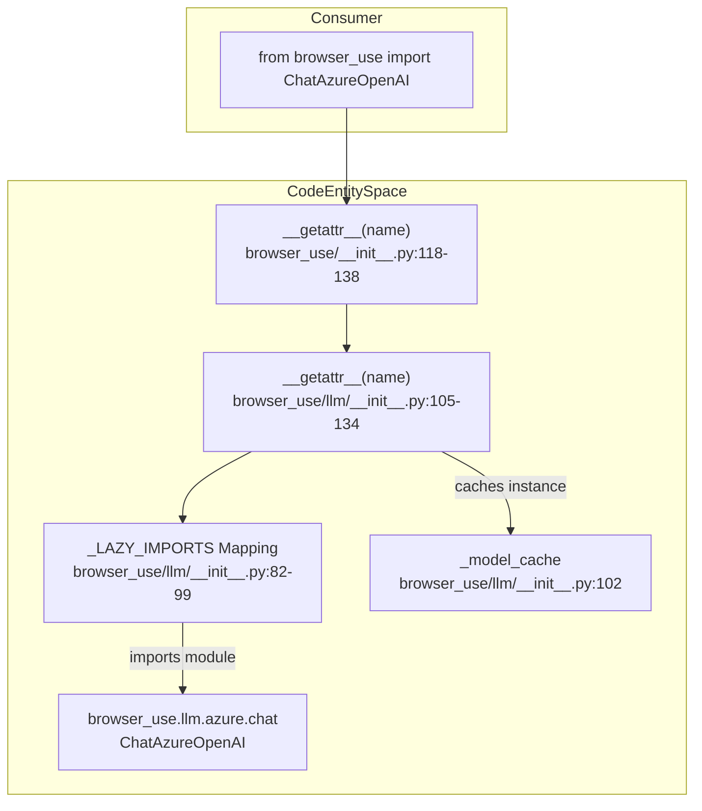

<!-- source: DeepWiki mcp.deepwiki.com · repo browser-use/browser-use · page 8.1 LLM Provider Architecture · fetched 2026-10-30 -->

# LLM Provider Architecture

Relevant source files

The following files were used as context for generating this wiki page:

- [browser_use/__init__.py](browser_use/__init__.py)
- [browser_use/llm/__init__.py](browser_use/llm/__init__.py)
- [browser_use/llm/azure/chat.py](browser_use/llm/azure/chat.py)
- [browser_use/llm/base.py](browser_use/llm/base.py)
- [browser_use/llm/models.py](browser_use/llm/models.py)
- [browser_use/llm/openai/responses_serializer.py](browser_use/llm/openai/responses_serializer.py)
- [examples/custom-functions/action_filters.py](examples/custom-functions/action_filters.py)
- [examples/custom-functions/file_upload.py](examples/custom-functions/file_upload.py)
- [examples/models/azure_openai.py](examples/models/azure_openai.py)
- [tests/ci/models/test_azure_responses_api.py](tests/ci/models/test_azure_responses_api.py)
- [tests/ci/models/test_llm_model_factory.py](tests/ci/models/test_llm_model_factory.py)

The purpose of this page is to document the LLM provider abstraction layer within `browser-use`. This architecture enables multi-provider support through a unified protocol interface (`BaseChatModel`), a dynamic model factory (`get_llm_by_name`), an on-demand lazy import system, and specialized provider implementations such as Azure OpenAI with Responses API support [browser_use/llm/base.py:33-74](), [browser_use/llm/models.py:89-101](), [browser_use/__init__.py:76-138](), [browser_use/llm/azure/chat.py:35-120]().

---

## 1. Overview and Core Abstractions

The `browser-use` library decouples browser automation orchestration from underlying LLM inference by enforcing a strict protocol-based interface. The Agent relies on `BaseChatModel` to execute inference steps, receiving structured or unstructured outputs packaged in `ChatInvokeCompletion` [browser_use/llm/base.py:33-59](), [browser_use/llm/views.py:10-14]().

Sources: [browser_use/llm/base.py:33-74](), [browser_use/llm/views.py:10-14](), [browser_use/llm/azure/chat.py:35-120]()

---

## 2. BaseChatModel Protocol

The `BaseChatModel` protocol establishes the structural typing contract for all language model integrations in `browser-use` [browser_use/llm/base.py:33-74](). By leveraging `@runtime_checkable` and `typing.Protocol`, any class providing the required attributes and methods acts as a valid chat model without explicit inheritance. Furthermore, `BaseChatModel` implements `__get_pydantic_core_schema__` to permit its usage directly within Pydantic configuration models [browser_use/llm/base.py:32-74]().

### Method Overloads and Signatures

The core execution method `ainvoke()` uses Python overloads to guarantee type safety depending on whether a structured Pydantic `output_format` is requested [browser_use/llm/base.py:49-59]():

*   **Unstructured Output:** `async def ainvoke(self, messages: list[BaseMessage], output_format: None = None, **kwargs: Any) -> ChatInvokeCompletion[str]` [browser_use/llm/base.py:49-52]()
*   **Structured Output:** `async def ainvoke(self, messages: list[BaseMessage], output_format: type[T], **kwargs: Any) -> ChatInvokeCompletion[T]` [browser_use/llm/base.py:54-55]()

Sources: [browser_use/llm/base.py:32-74]()

---

## 3. Model Factory and Resolution

The `get_llm_by_name()` function acts as the central factory for instantiating concrete LLM clients from string identifiers [browser_use/llm/models.py:89-101](). It normalizes provider prefixes, handles legacy and model-specific alias mappings (such as Mistral endpoints and Cerebras version formats), and binds environment-based API credentials [browser_use/llm/models.py:105-193]().

Sources: [browser_use/llm/models.py:89-193](), [browser_use/llm/azure/chat.py:35-120]()

---

## 4. Lazy Import System

To eliminate heavy initialization overhead during package import, `browser-use` implements a two-tier lazy import architecture in the root module and the `llm` subpackage [browser_use/__init__.py:76-138](), [browser_use/llm/__init__.py:81-134]().

Sources: [browser_use/__init__.py:76-138](), [browser_use/llm/__init__.py:81-134]()

---

## 5. Advanced Provider Patterns: Azure OpenAI and Responses API

The `ChatAzureOpenAI` implementation subclasses `ChatOpenAILike` to support Azure-specific endpoints, Active Directory tokens, and model versioning [browser_use/llm/azure/chat.py:35-65](). It includes automatic detection for models restricted to OpenAI's new Responses API [browser_use/llm/azure/chat.py:121-131]().

### Responses API Integration

Models listed in `RESPONSES_API_ONLY_MODELS` (such as `gpt-5.1-codex-mini` or `computer-use-preview`) require the Responses API when using newer API versions (`>= 2025-03-01-preview`) [browser_use/llm/azure/chat.py:24-31](), [browser_use/llm/azure/chat.py:42-45](). 

*   **Auto-Detection:** `_should_use_responses_api()` evaluates whether the model matches the response-only registry or if `use_responses_api` is forced [browser_use/llm/azure/chat.py:121-131]().
*   **Message Serialization:** `ResponsesAPIMessageSerializer` translates internal `BaseMessage` structures into OpenAI Easy Input message parameters [browser_use/llm/openai/responses_serializer.py:23-138](). Text content parts become `input_text`, image parameters become `input_image`, and assistant tool calls are serialized into descriptive text contexts when required [browser_use/llm/openai/responses_serializer.py:27-134]().

Sources: [browser_use/llm/azure/chat.py:24-131](), [browser_use/llm/openai/responses_serializer.py:23-138]()

---

