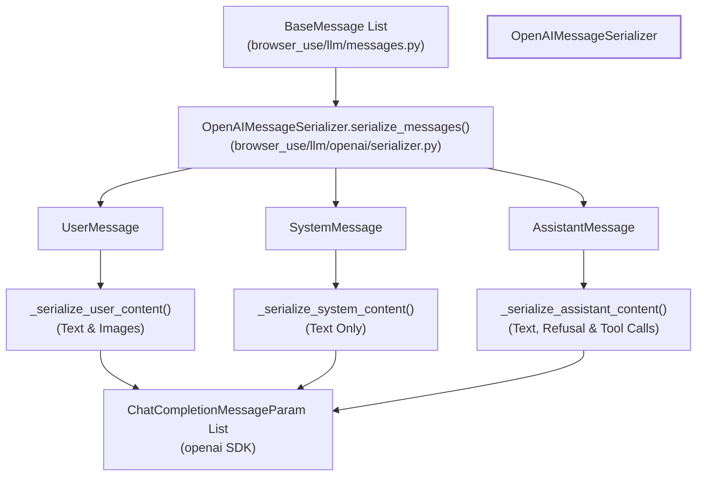
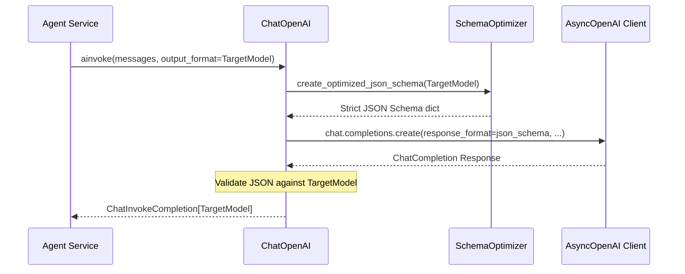

<!-- source: DeepWiki mcp.deepwiki.com · repo browser-use/browser-use · page 8.2 OpenAI Integration · fetched 2026-10-30 -->

# OpenAI Integration

<details>
<summary>Relevant source files</summary>

The following files were used as context for generating this wiki page:

- [browser_use/llm/exceptions.py](browser_use/llm/exceptions.py)
- [browser_use/llm/google/chat.py](browser_use/llm/google/chat.py)
- [browser_use/llm/groq/serializer.py](browser_use/llm/groq/serializer.py)
- [browser_use/llm/openai/chat.py](browser_use/llm/openai/chat.py)
- [browser_use/llm/openai/serializer.py](browser_use/llm/openai/serializer.py)
- [examples/simple.py](examples/simple.py)
- [tests/ci/models/test_llm_google.py](tests/ci/models/test_llm_google.py)
- [tests/ci/test_llm_output_truncation.py](tests/ci/test_llm_output_truncation.py)

</details>


This wiki page documents the OpenAI LLM provider integration within the `browser-use` framework. It covers the `ChatOpenAI` client wrapper (`[browser_use/llm/openai/chat.py:25-323]()`), message serialization (`[browser_use/llm/openai/serializer.py:28-165]()`), native JSON schema support, reasoning model handling (o-series), output truncation detection, usage tracking, and error handling. For information on other providers, see [LLM Provider Architecture](#8.1). For details on schema optimization, see [Structured Output and Schema Optimization](#8.7).

Sources: [browser_use/llm/openai/chat.py:25-323](), [browser_use/llm/openai/serializer.py:28-165]()

---

## Architecture Overview

The OpenAI integration implements the `BaseChatModel` interface, bridging the agent orchestration layer with OpenAI's asynchronous API client (`AsyncOpenAI`). 

### System to Code Mapping

Title: OpenAI Integration Code Architecture

```mermaid
graph TB
    AgentLayer["Agent Orchestration Layer<br/>(browser_use/agent/service.py)"]
    BaseChatModelInterface["BaseChatModel Protocol<br/>(browser_use/llm/base.py)"]
    ChatOpenAIClient["ChatOpenAI Class<br/>(browser_use/llm/openai/chat.py)"]
    OpenAIMessageSerializer["OpenAIMessageSerializer<br/>(browser_use/llm/openai/serializer.py)"]
    SchemaOptimizerEngine["SchemaOptimizer<br/>(browser_use/llm/schema.py)"]
    AsyncOpenAIClient["AsyncOpenAI Client SDK<br/>(openai package)"]
    OpenAIAPIEndpoint["OpenAI API Endpoint<br/>/v1/chat/completions"]

    AgentLayer -->|"ainvoke(messages, output_format)"| BaseChatModelInterface
    BaseChatModelInterface <|.."implements"| ChatOpenAIClient
    ChatOpenAIClient -->|"get_client()"| AsyncOpenAIClient
    ChatOpenAIClient -->|"serialize_messages(messages)"| OpenAIMessageSerializer
    ChatOpenAIClient -->|"create_optimized_json_schema(output_format)"| SchemaOptimizerEngine
    AsyncOpenAIClient -->|"chat.completions.create()"| OpenAIAPIEndpoint

    style ChatOpenAIClient stroke-width:2px
    style OpenAIMessageSerializer stroke-width:2px
```

**Key Integration Components**:

| Component | Role / Responsibility | File Reference |
|-----------|----------------------|----------------|
| `ChatOpenAI` | Main model wrapper implementing `BaseChatModel` | `[browser_use/llm/openai/chat.py:25-323]()` |
| `OpenAIMessageSerializer` | Serializes browser-use internal messages to OpenAI parameters | `[browser_use/llm/openai/serializer.py:28-165]()` |
| `ModelOutputTruncatedError` | Custom exception for `finish_reason='length'` | `[browser_use/llm/exceptions.py:32-43]()` |

Sources: [browser_use/llm/openai/chat.py:25-323](), [browser_use/llm/openai/serializer.py:28-165](), [browser_use/llm/exceptions.py:32-43]()

---

## ChatOpenAI Class Configuration

The `ChatOpenAI` dataclass accepts all `AsyncOpenAI` client parameters alongside browser-specific tuning parameters (`[browser_use/llm/openai/chat.py:25-78]()`).

### Initialization Parameters

| Parameter | Type | Default | Description |
|-----------|------|---------|-------------|
| `model` | `ChatModel \| str` | Required | Target OpenAI model name (e.g., `gpt-4o`, `o3-mini`) |
| `temperature` | `float \| None` | `0.2` | Sampling temperature for completion generation |
| `frequency_penalty` | `float \| None` | `0.3` | Frequency penalty to avoid infinite token generation loops (e.g., repeating tabs) |
| `reasoning_effort` | `ReasoningEffort` | `'low'` | Effort level for reasoning models (`o1`, `o3`, `o3-mini`, etc.) |
| `max_completion_tokens` | `int \| None` | `4096` | Maximum token limit allocated for model completions |
| `api_key` | `str \| None` | `None` | OpenAI API key credential |
| `max_retries` | `int` | `5` | Retry count for robust browser automation runs |

Sources: [browser_use/llm/openai/chat.py:34-78]()

### Reasoning Models Support

The integration automatically detects reasoning models (o-series) using `is_reasoning_model()` (`[browser_use/llm/base.py]()`) by cross-referencing `ChatOpenAI.reasoning_models` (`[browser_use/llm/openai/chat.py:65-78]()`). When a reasoning model is detected, parameters such as `temperature` and `frequency_penalty` are omitted from the API request payload (`[browser_use/llm/openai/chat.py:189-193]()`).

Sources: [browser_use/llm/openai/chat.py:65-78](), [browser_use/llm/openai/chat.py:189-193]()

---

## Message Serialization Architecture

The `OpenAIMessageSerializer` class handles the translation of internal framework message types (`UserMessage`, `SystemMessage`, `AssistantMessage`) into OpenAI API message parameter structures (`[browser_use/llm/openai/serializer.py:28-165]()`).

### Message Conversion Flow

Title: Message Serialization Data Flow



Sources: [browser_use/llm/openai/serializer.py:28-165]()

---

## Structured Output Generation

Structured outputs enforce Pydantic model validation on model responses using OpenAI's native JSON schema `response_format` parameter (`[browser_use/llm/openai/chat.py:152-323]()`).



Sources: [browser_use/llm/openai/chat.py:152-323](), [browser_use/llm/schema.py:10-213]()

---

## Output Truncation and Error Handling

When completions exceed token limits (`finish_reason='length'`), `ChatOpenAI` raises a `ModelOutputTruncatedError` (`[browser_use/llm/exceptions.py:32-43]()`). This ensures the agent handles capacity limits as recoverable issues rather than standard JSON parsing failures (`[tests/ci/test_llm_output_truncation.py:16-43]()`).

Error mappings from OpenAI SDK exceptions to internal exceptions are implemented in `ChatOpenAI`:
- `RateLimitError` $\rightarrow$ `ModelRateLimitError` (Status 429) (`[browser_use/llm/exceptions.py:20-30]()`)
- `APIConnectionError` / `APIStatusError` $\rightarrow$ `ModelProviderError` (`[browser_use/llm/exceptions.py:5-18]()`)
- `finish_reason='length'` $\rightarrow$ `ModelOutputTruncatedError` (Status 400) (`[browser_use/llm/exceptions.py:32-43]()`)

Sources: [browser_use/llm/openai/chat.py:270-306](), [browser_use/llm/exceptions.py:1-43](), [tests/ci/test_llm_output_truncation.py:16-43]()

---

## Usage Tracking

Token accounting is extracted directly from the OpenAI `ChatCompletion` response object and mapped to `ChatInvokeUsage` (`[browser_use/llm/openai/chat.py:123-142]()`):
- `prompt_tokens`: Prompt token count.
- `prompt_cached_tokens`: Cached tokens via prompt caching details.
- `completion_tokens`: Total generated tokens (note that for OpenAI models, reasoning tokens are included within `completion_tokens`).

Sources: [browser_use/llm/openai/chat.py:123-142]()

---

