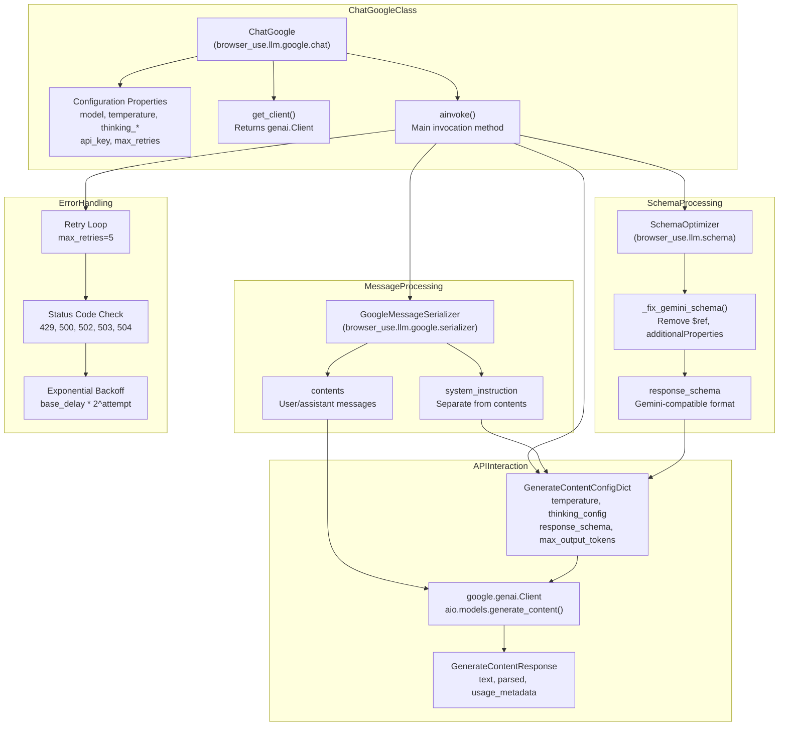
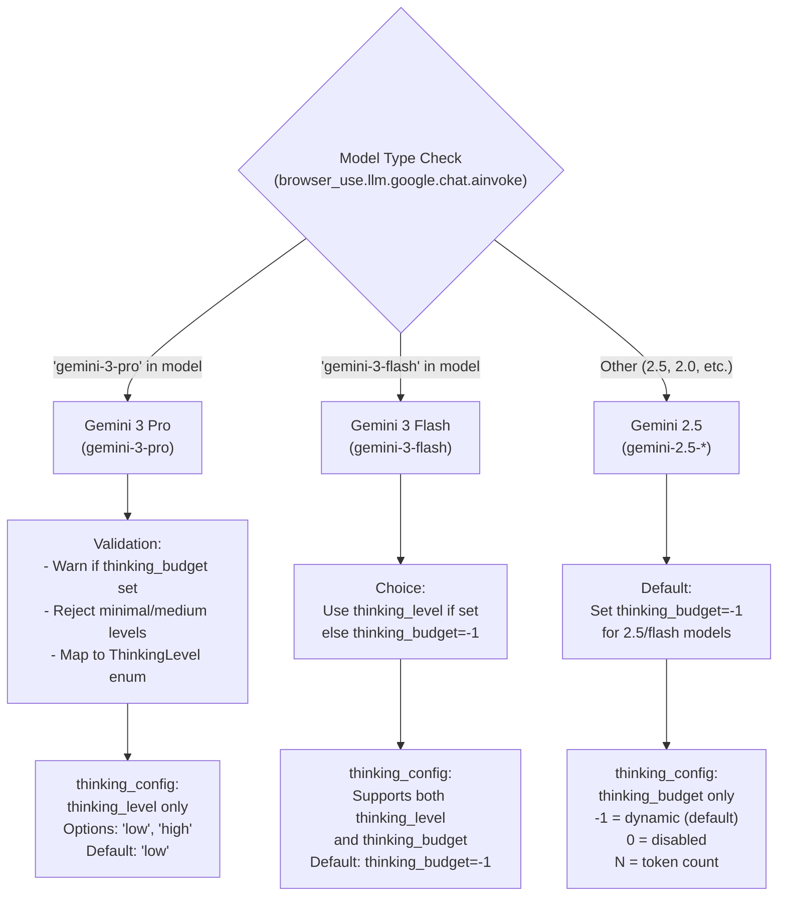
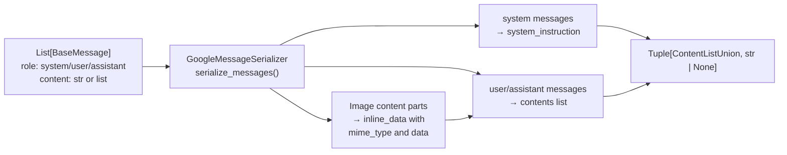
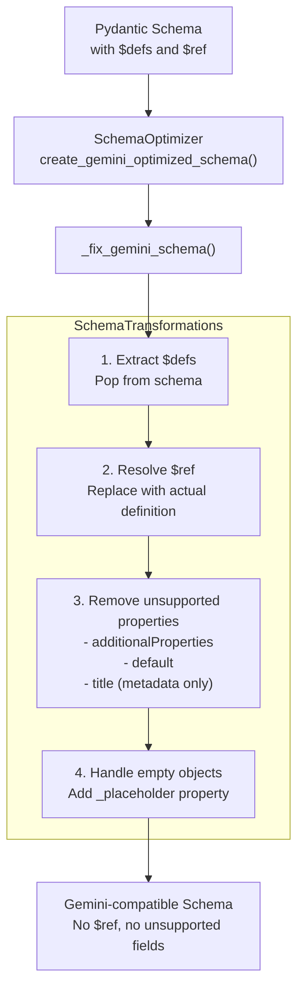
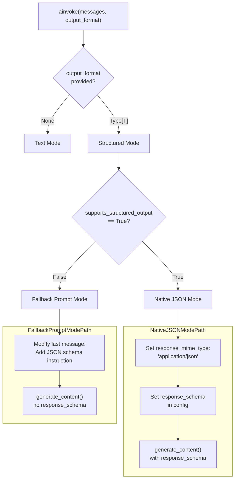
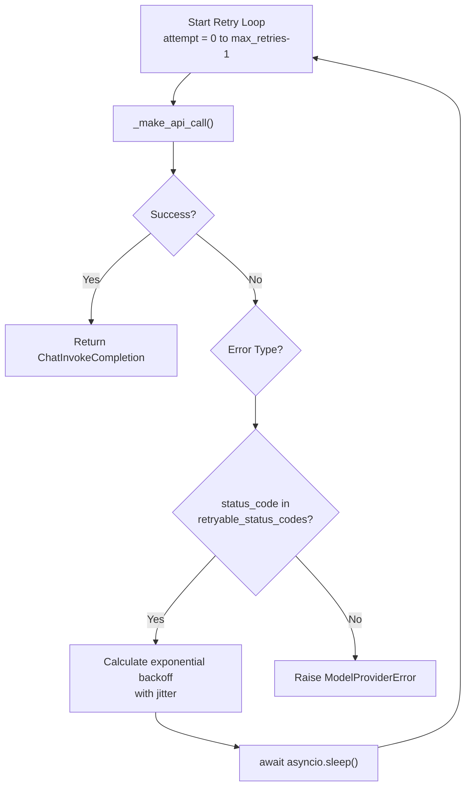

<!-- source: DeepWiki mcp.deepwiki.com · repo browser-use/browser-use · page 8.3 Google Gemini Integration · fetched 2026-10-30 -->

# Google Gemini Integration

<details>
<summary>Relevant source files</summary>

The following files were used as context for generating this wiki page:

- [browser_use/llm/exceptions.py](browser_use/llm/exceptions.py)
- [browser_use/llm/google/chat.py](browser_use/llm/google/chat.py)
- [browser_use/llm/google/serializer.py](browser_use/llm/google/serializer.py)
- [browser_use/llm/ollama/serializer.py](browser_use/llm/ollama/serializer.py)
- [browser_use/llm/openai/chat.py](browser_use/llm/openai/chat.py)
- [browser_use/llm/tests/test_gemini_image.py](browser_use/llm/tests/test_gemini_image.py)
- [examples/features/add_image_context.py](examples/features/add_image_context.py)
- [examples/simple.py](examples/simple.py)
- [tests/ci/models/test_google_serializer.py](tests/ci/models/test_google_serializer.py)
- [tests/ci/models/test_llm_google.py](tests/ci/models/test_llm_google.py)
- [tests/ci/test_llm_output_truncation.py](tests/ci/test_llm_output_truncation.py)

</details>


This document covers the integration with Google's Gemini API through the `ChatGoogle` class, which implements the `BaseChatModel` interface. For information about the LLM provider architecture and base interfaces, see [LLM Provider Architecture](#8.1). For OpenAI integration, see [OpenAI Integration](#8.2). For schema optimization details, see [Structured Output and Schema Optimization](#8.7).

## Purpose and Scope

The Google Gemini integration provides:
- Native support for Gemini 2.0, 2.5, and 3.0 model families [browser_use/llm/google/chat.py:26-45]().
- Thinking/reasoning configuration with model-specific parameters (`thinking_budget`, `thinking_level`) [browser_use/llm/google/chat.py:94-97]().
- Gemini-compatible schema transformation for structured output [browser_use/llm/google/chat.py:529-603]().
- Retry logic with exponential backoff for transient errors [browser_use/llm/google/chat.py:470-527]().
- Both native JSON mode and prompt-based fallback for structured output [browser_use/llm/google/chat.py:325-463]().
- Vertex AI support via the `vertexai` flag and Google Cloud credentials [browser_use/llm/google/chat.py:109-112]().

Sources: [browser_use/llm/google/chat.py:26-112]()

## ChatGoogle Class Architecture

The `ChatGoogle` class wraps the Google `genai.Client` and provides configuration management, message serialization, schema optimization, and error handling.

Title: ChatGoogle Data Flow and Architecture

Sources: [browser_use/llm/google/chat.py:49-604](), [browser_use/llm/google/serializer.py:13-123]()

## Configuration Parameters

The `ChatGoogle` class accepts comprehensive configuration through its dataclass fields:

| Parameter | Type | Default | Description |
|-----------|------|---------|-------------|
| `model` | `VerifiedGeminiModels \| str` | Required | Model name (e.g., 'gemini-2.0-flash', 'gemini-2.5-pro') [browser_use/llm/google/chat.py:90]() |
| `temperature` | `float \| None` | None | Response generation temperature [browser_use/llm/google/chat.py:91]() |
| `top_p` | `float \| None` | None | Nucleus sampling parameter [browser_use/llm/google/chat.py:92]() |
| `seed` | `int \| None` | None | Random seed for reproducibility [browser_use/llm/google/chat.py:93]() |
| `thinking_budget` | `int \| None` | None | Token count for thinking (Gemini 2.5/3 Flash): -1=dynamic, 0=disabled [browser_use/llm/google/chat.py:94]() |
| `thinking_level` | `Literal['minimal', 'low', 'medium', 'high'] \| None` | None | Thinking intensity (Gemini 3 Pro: low/high, Flash: all levels) [browser_use/llm/google/chat.py:95]() |
| `max_output_tokens` | `int \| None` | 8096 | Maximum output token count [browser_use/llm/google/chat.py:98]() |
| `config` | `types.GenerateContentConfigDict \| None` | None | Additional generation config [browser_use/llm/google/chat.py:99]() |
| `include_system_in_user` | `bool` | False | Merge system messages into first user message [browser_use/llm/google/chat.py:100]() |
| `supports_structured_output` | `bool` | True | Use native JSON mode vs prompt-based fallback [browser_use/llm/google/chat.py:101]() |
| `max_retries` | `int` | 5 | Number of retries for transient errors [browser_use/llm/google/chat.py:102]() |
| `retryable_status_codes` | `list[int]` | [429, 500, 502, 503, 504] | HTTP codes to retry [browser_use/llm/google/chat.py:103]() |
| `api_key` | `str \| None` | None | Google API key [browser_use/llm/google/chat.py:108]() |
| `vertexai` | `bool \| None` | None | Use Vertex AI endpoint [browser_use/llm/google/chat.py:109]() |

Sources: [browser_use/llm/google/chat.py:49-113]()

## Thinking Configuration by Model Version

Gemini models have different thinking/reasoning capabilities. The `ChatGoogle` class automatically configures thinking based on the model name in `ainvoke`:

Title: Gemini Thinking Logic Implementation


**Key implementation details:**

1. **Gemini 3 Pro** [browser_use/llm/google/chat.py:240-265]():
   - Uses `thinking_level` only ('low' or 'high').
   - Warns if `thinking_budget` is set.
   - Rejects 'minimal' and 'medium' levels.
   - Defaults to 'low' if not specified.

2. **Gemini 3 Flash** [browser_use/llm/google/chat.py:266-275]():
   - Supports both `thinking_level` and `thinking_budget`.
   - Prefers `thinking_level` if set, otherwise defaults to `thinking_budget=-1`.

3. **Gemini 2.5 and earlier** [browser_use/llm/google/chat.py:276-287]():
   - Uses `thinking_budget` only.
   - Defaults to `-1` (dynamic/auto) for 2.5 models.

Sources: [browser_use/llm/google/chat.py:236-287]()

## Message Serialization

The `GoogleMessageSerializer` converts browser-use `BaseMessage` objects to Gemini's expected format, separating system instructions from conversation contents:

Title: GoogleMessageSerializer Data Flow


The serializer handles:
- System messages are extracted as a string for `system_instruction` [browser_use/llm/google/serializer.py:47-65]().
- User and assistant messages become `Content` objects with `role` and `parts` [browser_use/llm/google/serializer.py:68-75]().
- Image parts are converted to `inline_data` format with MIME types using `base64` decoding [browser_use/llm/google/serializer.py:100-116]().
- Optional `include_system_in_user` flag merges system into first user message [browser_use/llm/google/serializer.py:79-87]().

Sources: [browser_use/llm/google/serializer.py:13-123]()

## Schema Optimization for Gemini Compatibility

Gemini has specific schema requirements. The `_fix_gemini_schema` method transforms Pydantic schemas to be Gemini-compatible:

Title: Gemini Schema Transformation Pipeline


**Key transformations:**

1. **$ref resolution** [browser_use/llm/google/chat.py:538-562]():
   - Recursively replaces `$ref` pointers with actual definitions from `$defs`.

2. **Property cleaning** [browser_use/llm/google/chat.py:565-603]():
   - Removes `additionalProperties` and `default` values.
   - Strips metadata `title` fields.

3. **Empty object handling** [browser_use/llm/google/chat.py:576-596]():
   - Adds `_placeholder: {type: 'string'}` to empty objects to satisfy Gemini's requirements.

Sources: [browser_use/llm/google/chat.py:529-603]()

## Structured Output Handling

The `ainvoke` method supports both string and structured output:

Title: Structured Output Logic


**Native JSON Mode** [browser_use/llm/google/chat.py:325-397]():
- Sets `response_mime_type` to `application/json`.
- Uses `response_schema` in the generation config.

**Fallback Mode** [browser_use/llm/google/chat.py:398-463]():
- Manually adds the JSON schema to the prompt if `supports_structured_output` is False.

Sources: [browser_use/llm/google/chat.py:198-463]()

## Retry Logic and Error Handling

The implementation includes retry logic with exponential backoff:

Title: ChatGoogle Retry and Error Logic


**Retryable Status Codes** [browser_use/llm/google/chat.py:103]():
- 429 (Rate Limit), 500, 502, 503, 504.

**Output Truncation** [browser_use/llm/google/chat.py:196-214]():
- The class raises `ModelOutputTruncatedError` if `finish_reason` contains `MAX_TOKENS`. This error is caught by the Agent system to trigger a switch to a `fallback_llm` [tests/ci/test_llm_output_truncation.py:96-113]().

Sources: [browser_use/llm/google/chat.py:196-214](), [browser_use/llm/google/chat.py:470-527](), [browser_use/llm/exceptions.py:32-43]()

## Usage Tracking

The `_get_usage` method extracts token usage from Gemini's response metadata:

| Field | Source |
|-------|--------|
| `prompt_tokens` | `usage_metadata.prompt_token_count` [browser_use/llm/google/chat.py:179]() |
| `completion_tokens` | `candidates_token_count` + `thoughts_token_count` [browser_use/llm/google/chat.py:180-181]() |
| `prompt_cached_tokens` | `usage_metadata.cached_content_token_count` [browser_use/llm/google/chat.py:183]() |
| `prompt_image_tokens` | Sum of tokens with `MediaModality.IMAGE` [browser_use/llm/google/chat.py:171-176]() |

Sources: [browser_use/llm/google/chat.py:166-188]()

## Usage Example

```python
from browser_use import Agent, ChatGoogle
import os

api_key = os.getenv('GOOGLE_API_KEY')
llm = ChatGoogle(
    model='gemini-2.0-flash', 
    api_key=api_key,
    thinking_budget=-1 # Enable dynamic thinking for 2.0 models
)

agent = Agent(
    llm=llm,
    task='How many stars does the browser-use repo have?',
)
```

Sources: [browser_use/llm/google/chat.py:77-86]()

---

