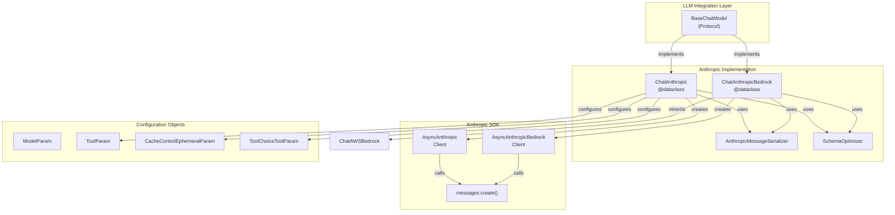
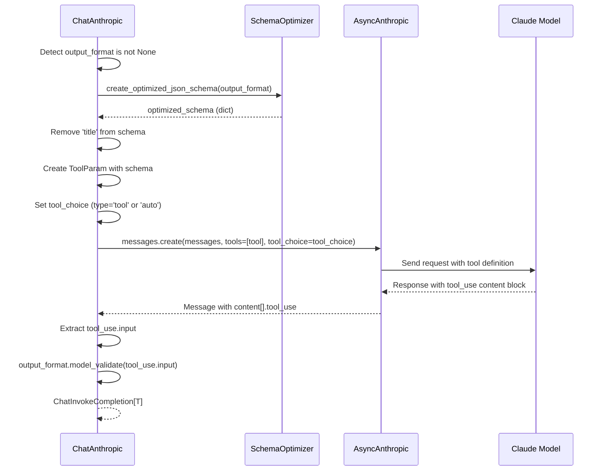

<!-- source: DeepWiki mcp.deepwiki.com · repo browser-use/browser-use · page 8.4 Anthropic Claude Integration · fetched 2026-10-30 -->

# Anthropic Claude Integration

<details>
<summary>Relevant source files</summary>

The following files were used as context for generating this wiki page:

- [browser_use/llm/anthropic/chat.py](browser_use/llm/anthropic/chat.py)
- [browser_use/llm/anthropic/serializer.py](browser_use/llm/anthropic/serializer.py)
- [browser_use/llm/aws/chat_anthropic.py](browser_use/llm/aws/chat_anthropic.py)
- [browser_use/llm/aws/chat_bedrock.py](browser_use/llm/aws/chat_bedrock.py)
- [browser_use/llm/messages.py](browser_use/llm/messages.py)
- [browser_use/llm/tests/test_anthropic_cache.py](browser_use/llm/tests/test_anthropic_cache.py)
- [tests/ci/models/test_anthropic_data_url_case.py](tests/ci/models/test_anthropic_data_url_case.py)
- [tests/ci/models/test_chat_anthropic_bedrock_client_config.py](tests/ci/models/test_chat_anthropic_bedrock_client_config.py)
- [tests/ci/models/test_chat_anthropic_bedrock_empty_content.py](tests/ci/models/test_chat_anthropic_bedrock_empty_content.py)
- [tests/ci/test_anthropic_serialized_tool_input.py](tests/ci/test_anthropic_serialized_tool_input.py)

</details>


This document describes the integration of Anthropic's Claude models into browser-use through the `ChatAnthropic` client wrapper and the `ChatAnthropicBedrock` AWS Bedrock variant. It covers client architecture, message serialization, structured output via tool calling, prompt caching, specialized model configurations for extended thinking capabilities, and AWS Bedrock variants.

For general LLM provider architecture and the `BaseChatModel` interface, see [LLM Provider Architecture](). For structured output schema optimization shared across providers, see [Structured Output and Schema Optimization](). For message serialization patterns, see [Message Serialization]().

## ChatAnthropic Client Architecture

The `ChatAnthropic` class implements the `BaseChatModel` interface and wraps the `AsyncAnthropic` client from the `anthropic` Python SDK [browser_use/llm/anthropic/chat.py:24-38](), [browser_use/llm/anthropic/chat.py:171-179](). Unlike OpenAI and Google Gemini which support native JSON schema modes, Anthropic uses **tool calling** to achieve structured output.

**Class Structure**



**Sources:** [browser_use/llm/anthropic/chat.py:38-63](), [browser_use/llm/anthropic/chat.py:171-179](), [browser_use/llm/aws/chat_anthropic.py:31-65](), [browser_use/llm/base.py:16-20]()

### Key Configuration Parameters

The `ChatAnthropic` class exposes the following configuration options:

| Parameter | Type | Default | Description |
|-----------|------|---------|-------------|
| `model` | `str \| ModelParam` | Required | Claude model identifier (e.g., "claude-3-5-sonnet-latest") |
| `max_tokens` | `int` | 8192 | Maximum tokens in response |
| `temperature` | `float \| None` | None | Sampling temperature (0.0-1.0) |
| `thinking` | `dict[str, Any] \| None` | None | Configuration for extended thinking (budget, type) |
| `inference_geo` | `str \| None` | None | Geographical routing for inference (e.g., 'us') |
| `api_key` | `str \| None` | None | Anthropic API key |
| `max_retries` | `int` | 10 | Number of retry attempts for failed requests |

**Sources:** [browser_use/llm/anthropic/chat.py:43-63]()

### Extended Thinking Support

Recent Claude models (e.g., Claude 3.7 Sonnet) support extended thinking. `ChatAnthropic` includes logic to handle these specialized configurations:

*   **Adaptive Thinking Models**: Models like `claude-fable-5` or `claude-mythos-5` are identified via `_is_adaptive_thinking_only_model()` [browser_use/llm/anthropic/chat.py:92-94]().
*   **Auto Tool Choice**: If thinking is enabled, the model typically requires `tool_choice: "auto"` rather than a forced tool choice, managed by `_requires_auto_tool_choice()` [browser_use/llm/anthropic/chat.py:96-102]().
*   **Validation**: The `_validate_thinking_config()` method ensures that parameters like `budget_tokens` are not passed to models that only support adaptive thinking [browser_use/llm/anthropic/chat.py:104-113]().

**Sources:** [browser_use/llm/anthropic/chat.py:92-113]()

## AWS Bedrock Variants: ChatAnthropicBedrock

For deployments running on AWS, browser-use provides `ChatAnthropicBedrock` in `browser_use/llm/aws/chat_anthropic.py` [browser_use/llm/aws/chat_anthropic.py:31-39](). This class inherits from `ChatAWSBedrock` and uses `AsyncAnthropicBedrock` from the Anthropic SDK to interface with Anthropic models hosted on AWS Bedrock [browser_use/llm/aws/chat_anthropic.py:9](), [browser_use/llm/aws/chat_anthropic.py:32-38](), [browser_use/llm/aws/chat_anthropic.py:119-127]().

### Authentication and Client Setup

`ChatAnthropicBedrock` supports explicit credential parameters (`aws_access_key`, `aws_secret_key`, `aws_region`, `aws_session_token`) or a pre-configured `boto3.session.Session` object [browser_use/llm/aws/chat_anthropic.py:50-56](), [browser_use/llm/aws/chat_anthropic.py:70-79]().

```python
# Example initialization via boto3 session or explicit keys
from browser_use.llm.aws.chat_anthropic import ChatAnthropicBedrock

llm = ChatAnthropicBedrock(
    model='anthropic.claude-3-5-sonnet-20240620-v1:0',
    aws_region='us-east-1',
    max_retries=10,
)
```

**Sources:** [browser_use/llm/aws/chat_anthropic.py:31-97](), [browser_use/llm/aws/chat_anthropic.py:119-128]()

## Message Serialization and Prompt Caching

Anthropic's API separates **system messages** from the conversation history. The `AnthropicMessageSerializer.serialize_messages()` method returns a tuple of `(anthropic_messages, system_prompt)` where:

- `anthropic_messages`: User and assistant messages in Anthropic's format [browser_use/llm/anthropic/serializer.py:239-261]().
- `system_prompt`: Extracted system message content or a list of `TextBlockParam` if caching is enabled [browser_use/llm/anthropic/serializer.py:231-235]().

### Prompt Caching Logic
Browser-use leverages Anthropic's prompt caching by setting `CacheControlEphemeralParam(type='ephemeral')` on specific content blocks [browser_use/llm/anthropic/serializer.py:64-68]().

1. **System Prompt Caching**: If a `SystemMessage` has `cache=True`, it is serialized as a list containing a `TextBlockParam` with cache control [browser_use/llm/anthropic/serializer.py:117-118]().
2. **Message History Caching**: User and Assistant messages can also be cached by setting the `cache` attribute [browser_use/llm/messages.py:130-132]().
3. **Automatic Cache Cleanup**: The serializer includes cleanup logic to ensure only the most relevant messages retain cache markers, preventing API errors [browser_use/llm/anthropic/serializer.py:224]().

**Sources:** [browser_use/llm/anthropic/serializer.py:54-68](), [browser_use/llm/anthropic/serializer.py:111-132](), [browser_use/llm/messages.py:130-132]()

## Structured Output via Tool Calling

Unlike OpenAI which supports native JSON schema response formats, Anthropic achieves structured output by defining a **tool** that represents the desired output schema, then forcing the model to use that tool.

### Tool Calling Flow



**Sources:** [browser_use/llm/anthropic/chat.py:273-343]()

### Tool Parameter Construction

When `output_format` is provided to `ainvoke()`, the following steps occur:

1. **Extract tool name** from the Pydantic model class name [browser_use/llm/anthropic/chat.py:276]().
2. **Generate JSON schema** using `SchemaOptimizer.create_optimized_json_schema()` [browser_use/llm/anthropic/chat.py:277]().
3. **Remove 'title' field** from schema (Anthropic doesn't accept it in `input_schema`) [browser_use/llm/anthropic/chat.py:280-281]().
4. **Create ToolParam** with `cache_control` enabled for the tool definition itself [browser_use/llm/anthropic/chat.py:283-288]().
5. **Set tool_choice**: Defaults to `ToolChoiceToolParam(type='tool', name=tool_name)` to force tool usage, unless the model requires `auto` due to thinking mode [browser_use/llm/anthropic/chat.py:291-295]().

**Sources:** [browser_use/llm/anthropic/chat.py:273-303]()

### Recovery of Malformed Tool Input
Anthropic models occasionally wrap tool parameters in XML-like tags inside a string field (e.g., `thinking`). `ChatAnthropic` includes a regex-based recovery mechanism `_TEXT_TOOL_CALL_PARAMETER` to extract these parameters and repair the structured output before validation [browser_use/llm/anthropic/chat.py:34](), [browser_use/llm/anthropic/chat.py:326-335]().

**Sources:** [browser_use/llm/anthropic/chat.py:32-34](), [browser_use/llm/anthropic/chat.py:326-343]()

## Usage Tracking and Costs

The `_get_usage()` method extracts cache-related metrics and handles geographical pricing multipliers [browser_use/llm/anthropic/chat.py:209-227](), [browser_use/llm/aws/chat_anthropic.py:142-158]():

```python
usage = ChatInvokeUsage(
    prompt_tokens=response.usage.input_tokens + (response.usage.cache_read_input_tokens or 0),
    completion_tokens=response.usage.output_tokens,
    total_tokens=response.usage.input_tokens + response.usage.output_tokens,
    prompt_cached_tokens=response.usage.cache_read_input_tokens,
    prompt_cache_creation_tokens=response.usage.cache_creation_input_tokens,
    prompt_cache_creation_5m_tokens=cache_creation_5m_tokens,
    prompt_cache_creation_1h_tokens=cache_creation_1h_tokens,
    pricing_multiplier=1.1 if self.inference_geo == 'us' else None,
)
```

**Sources:** [browser_use/llm/anthropic/chat.py:195-227](), [browser_use/llm/aws/chat_anthropic.py:142-158]()

## Error Handling

The `ChatAnthropic` client wraps Anthropic SDK exceptions into browser-use's exception hierarchy to ensure uniform handling across providers:

| Anthropic Exception | browser-use Exception | Description |
|---------------------|----------------------|-------------|
| `APIConnectionError` | `ModelProviderError` | Network connectivity issues [browser_use/llm/anthropic/chat.py:345-346]() |
| `RateLimitError` | `ModelRateLimitError` | Rate limit exceeded (429) [browser_use/llm/anthropic/chat.py:347-348]() |
| `APIStatusError` | `ModelProviderError` | HTTP error responses (4xx, 5xx) [browser_use/llm/anthropic/chat.py:349-350]() |

If the model response indicates the output was cut off due to token limits (`stop_reason == 'max_tokens'`), a `ModelOutputTruncatedError` is raised [browser_use/llm/anthropic/chat.py:320-323]().

**Sources:** [browser_use/llm/anthropic/chat.py:318-323](), [browser_use/llm/anthropic/chat.py:345-351](), [browser_use/llm/exceptions.py:32-43]()

---

