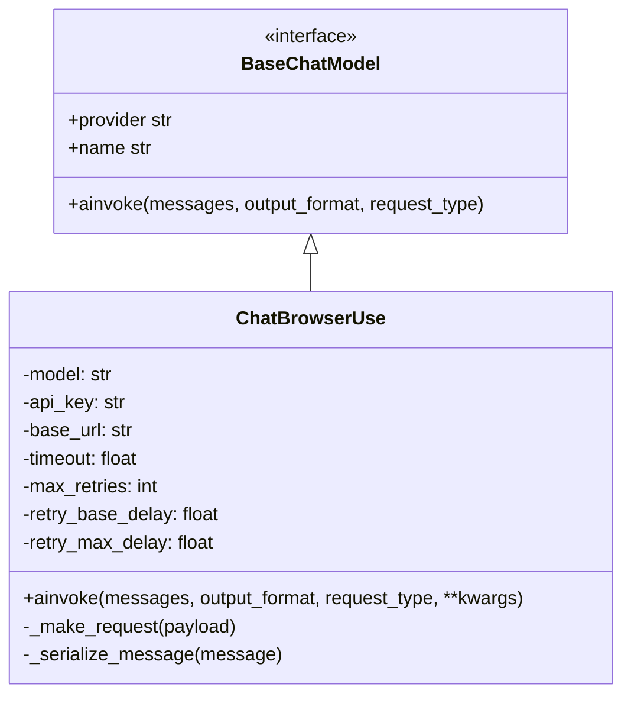
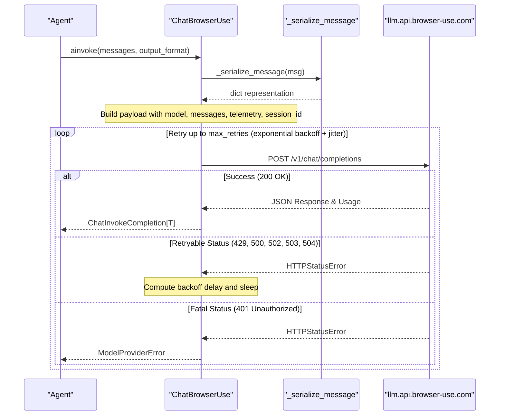

<!-- source: DeepWiki mcp.deepwiki.com · repo browser-use/browser-use · page 8.5 Browser-Use Cloud LLM · fetched 2026-10-30 -->

# Browser-Use Cloud LLM

<details>
<summary>Relevant source files</summary>

The following files were used as context for generating this wiki page:

- [browser_use/llm/browser_use/chat.py](browser_use/llm/browser_use/chat.py)
- [browser_use/tokens/custom_pricing.py](browser_use/tokens/custom_pricing.py)
- [browser_use/tokens/openrouter_pricing.py](browser_use/tokens/openrouter_pricing.py)
- [examples/beta_agent/basic.py](examples/beta_agent/basic.py)
- [examples/models/bu_oss.py](examples/models/bu_oss.py)
- [skills/open-source/references/models.md](skills/open-source/references/models.md)
- [tests/ci/models/test_llm_browseruse.py](tests/ci/models/test_llm_browseruse.py)
- [tests/ci/test_llm_retries.py](tests/ci/test_llm_retries.py)
- [tests/ci/test_openrouter_token_cost.py](tests/ci/test_openrouter_token_cost.py)

</details>


This page documents the Browser-Use Cloud LLM integration (`ChatBrowserUse`), which provides optimized language models specifically tuned for browser automation tasks. For general LLM integration architecture, see [browser_use/llm/base.py](). For other LLM providers, see [browser_use/llm/openai/chat.py](), [browser_use/llm/google/chat.py](), [browser_use/llm/anthropic/chat.py](), and [browser_use/llm/ollama/chat.py]().

Sources: [browser_use/llm/browser_use/chat.py:1-29]()

## Purpose and Scope

The `ChatBrowserUse` client connects to the Browser-Use Cloud API at `https://llm.api.browser-use.com` (or configurable via `BROWSER_USE_LLM_URL`), serving models optimized for web navigation and agentic browser control. These models are designed around browser-use prompts and action schemas, delivering higher accuracy and lower cost than general-purpose frontier models. The client implements the `BaseChatModel` interface with production features including exponential backoff retry loops, sticky container routing via session IDs, and structured Pydantic output parsing.

Sources: [browser_use/llm/browser_use/chat.py:31-43](), [browser_use/llm/browser_use/chat.py:95-97]()

## Quick Start and API Key Setup

### Obtaining an API Key

Authentication requires a Browser-Use Cloud API key supplied via the `api_key` constructor parameter or the `BROWSER_USE_API_KEY` environment variable. If omitted, initialization raises a `ValueError` with a registration link.

```python
# Set the environment variable before initializing the client
export BROWSER_USE_API_KEY="your-key-here"
```

Sources: [browser_use/llm/browser_use/chat.py:96-107]()

### Basic Usage

```python
from browser_use.agent.service import Agent
from browser_use.llm.browser_use.chat import ChatBrowserUse

# Initialize with default model (bu-latest / bu-2-0)
llm = ChatBrowserUse()

agent = Agent(
    task='Find the number of stars of browser-use repo',
    llm=llm,
)
await agent.run()
```

Sources: [browser_use/llm/browser_use/chat.py:31-43](), [tests/ci/models/test_llm_browseruse.py:28-32]()

## Available Models and Pricing

`ChatBrowserUse` supports specific managed model aliases, preview variants, open weights, and gateway-resolved third-party provider strings.

### Model Reference Table

| Model Name | Internal Aliases / Behavior | Description |
|------------|----------------------------|-------------|
| `bu-latest` | Normalizes to `bu-2-0` | Tracks the current stable premium model. |
| `bu-2-0` | Default stable model | Current generation premium model optimized for high-accuracy browser navigation. |
| `bu-2-0-mini-preview` | Opt-in preview model | Cheaper and faster per token while in preview. |
| `bu-1-0` | Redirects to `bu-2-0` at gateway | Legacy model version routed through the gateway. |
| `bu-qa-1` | Website QA model | Evaluates a website and scores its functionality and aesthetics. |
| `browser-use/bu-30b-a3b-preview` | Self-hosted open weights | 30B total, 3B active parameter model. Hosted via vLLM using `ChatOpenAI`. |
| Provider-prefixed IDs | e.g., `anthropic/claude-sonnet-4-6`, `openai/gpt-5.5` | Gateway-resolved model IDs routed through the cloud API. |

Sources: [browser_use/llm/browser_use/chat.py:45-93](), [skills/open-source/references/models.md:55-95]()

### Pricing and Token Cost Configuration

Pricing rules are registered under `CUSTOM_MODEL_PRICING` in the token accounting system.

| Model | Input Cost (per 1M) | Output Cost (per 1M) | Cache Read Cost (per 1M) |
|-------|---------------------|----------------------|--------------------------|
| `bu-2-0` | $0.60 | $3.50 | $0.06 |
| `bu-2-0-mini-preview` | $0.15 | $1.50 | $0.15 (No cache discount) |
| `bu-1-0` | $0.60 | $3.50 | $0.06 |

Sources: [browser_use/tokens/custom_pricing.py:11-30](), [tests/ci/models/test_llm_browseruse.py:52-64]()

## ChatBrowserUse Architecture

The class hierarchy bridges the high-level `Agent` execution framework to HTTP REST requests against the cloud gateway.

### Code Entity Relationship Diagram



Sources: [browser_use/llm/base.py](), [browser_use/llm/browser_use/chat.py:31-134]()

## Request Flow and API Protocol

### Execution Flow Sequence Diagram



Sources: [browser_use/llm/browser_use/chat.py:128-200](), [tests/ci/test_llm_retries.py:21-179]()

### Payload Structure

The payload sent to the API contains model parameters, serialized conversation messages, telemetry preferences, and optional session identifiers for sticky container routing:

```python
payload: dict[str, Any] = {
    'model': self.model,
    'messages': [self._serialize_message(msg) for msg in messages],
    'fast': self.fast,
    'request_type': request_type,
    'anonymized_telemetry': anonymized_telemetry,
}
```

Sources: [browser_use/llm/browser_use/chat.py:156-168]()

## Retry Logic, Error Handling, and Resilience

`ChatBrowserUse` manages transient infrastructure failures with built-in retry logic. Status codes `429`, `500`, `502`, `503`, and `504` trigger exponential backoff with randomized jitter (`10%` of delay). Non-retryable errors like `401 Unauthorized` fail immediately without retries.

Sources: [browser_use/llm/browser_use/chat.py:27-28](), [browser_use/llm/browser_use/chat.py:175-195](), [tests/ci/test_llm_retries.py:85-115]()

## Observability and Telemetry

Invocations are decorated with `@observe(name='chat_browser_use_ainvoke')` for telemetry integration. The global configuration parameter `CONFIG.ANONYMIZED_TELEMETRY` is included directly in the request payload to report anonymized usage metrics to the cloud gateway.

Sources: [browser_use/llm/browser_use/chat.py:21](), [browser_use/llm/browser_use/chat.py:127-163]()

---

