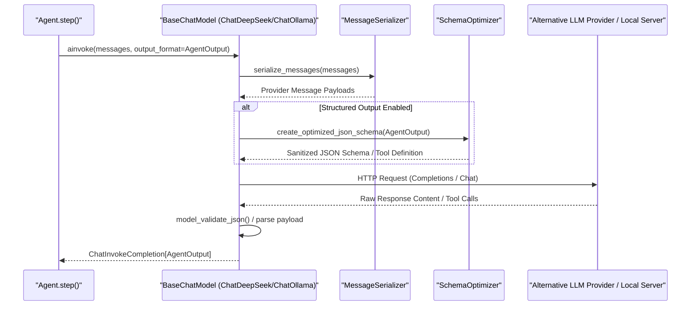

<!-- source: DeepWiki mcp.deepwiki.com · repo browser-use/browser-use · page 8.6 Local and Alternative LLM Support · fetched 2026-10-30 -->

# Local and Alternative LLM Support

<details>
<summary>Relevant source files</summary>

The following files were used as context for generating this wiki page:

- [browser_use/llm/cerebras/chat.py](browser_use/llm/cerebras/chat.py)
- [browser_use/llm/cerebras/serializer.py](browser_use/llm/cerebras/serializer.py)
- [browser_use/llm/deepseek/chat.py](browser_use/llm/deepseek/chat.py)
- [browser_use/llm/deepseek/serializer.py](browser_use/llm/deepseek/serializer.py)
- [browser_use/llm/groq/chat.py](browser_use/llm/groq/chat.py)
- [browser_use/llm/oci_raw/README.md](browser_use/llm/oci_raw/README.md)
- [browser_use/llm/oci_raw/__init__.py](browser_use/llm/oci_raw/__init__.py)
- [browser_use/llm/oci_raw/chat.py](browser_use/llm/oci_raw/chat.py)
- [browser_use/llm/oci_raw/serializer.py](browser_use/llm/oci_raw/serializer.py)
- [browser_use/llm/ollama/chat.py](browser_use/llm/ollama/chat.py)
- [browser_use/llm/openrouter/chat.py](browser_use/llm/openrouter/chat.py)
- [browser_use/llm/openrouter/serializer.py](browser_use/llm/openrouter/serializer.py)
- [browser_use/llm/orcarouter/chat.py](browser_use/llm/orcarouter/chat.py)
- [browser_use/llm/orcarouter/serializer.py](browser_use/llm/orcarouter/serializer.py)
- [browser_use/llm/tests/test_chat_models.py](browser_use/llm/tests/test_chat_models.py)
- [browser_use/llm/tests/test_single_step.py](browser_use/llm/tests/test_single_step.py)
- [browser_use/llm/vercel/__init__.py](browser_use/llm/vercel/__init__.py)
- [browser_use/llm/vercel/chat.py](browser_use/llm/vercel/chat.py)
- [browser_use/llm/vercel/serializer.py](browser_use/llm/vercel/serializer.py)
- [browser_use/tokens/tests/test_cost.py](browser_use/tokens/tests/test_cost.py)
- [examples/models/cerebras_example.py](examples/models/cerebras_example.py)
- [examples/models/deepseek-chat.py](examples/models/deepseek-chat.py)
- [examples/models/oci_models.py](examples/models/oci_models.py)
- [examples/models/orcarouter.py](examples/models/orcarouter.py)
- [examples/models/vercel_ai_gateway.py](examples/models/vercel_ai_gateway.py)
- [tests/ci/models/test_llm_groq.py](tests/ci/models/test_llm_groq.py)
- [tests/ci/models/test_llm_ollama.py](tests/ci/models/test_llm_ollama.py)
- [tests/ci/models/test_llm_openrouter.py](tests/ci/models/test_llm_openrouter.py)
- [tests/ci/models/test_llm_vercel.py](tests/ci/models/test_llm_vercel.py)
- [tests/ci/test_orcarouter.py](tests/ci/test_orcarouter.py)

</details>


This page provides full technical documentation for configuring and running local LLM servers, AWS Bedrock, Groq, DeepSeek, OpenRouter, Cerebras, Mistral, Vercel AI Gateway, and other alternative providers with `browser-use`. It covers provider initialization, client parameters, request serialization, tool/schema execution paths, and specialized error handling.

For base LLM abstractions, see [LLM Provider Architecture (8.1)](). For structured output strategies, see [Structured Output and Schema Optimization (8.7)]().

---

## 1. Overview of Multi-Provider Support

`browser-use` abstracts diverse backend APIs through specialized wrapper classes that implement the `BaseChatModel` interface [browser_use/llm/base.py:22-22](). Each provider handles its own message serialization, authentication, and endpoint protocols while exposing a unified `ainvoke()` method to the `Agent` orchestration layer.

```mermaid
graph TD
    subgraph "NaturalLanguageSpace"
        Task["User Browser Automation Task"]
    end

    subgraph "CodeEntitySpace"
        Agent["Agent Class (browser_use/agent/service.py)"]
        BaseChatModel["BaseChatModel (browser_use/llm/base.py)"]
        ChatDeepSeek["ChatDeepSeek (browser_use/llm/deepseek/chat.py)"]
        ChatOpenRouter["ChatOpenRouter (browser_use/llm/openrouter/chat.py)"]
        ChatGroq["ChatGroq (browser_use/llm/groq/chat.py)"]
        ChatCerebras["ChatCerebras (browser_use/llm/cerebras/chat.py)"]
        ChatOllama["ChatOllama (browser_use/llm/ollama/chat.py)"]
        ChatVercel["ChatVercel (browser_use/llm/vercel/chat.py)"]
    end

    subgraph "ProviderAPIEndpointSpace"
        DeepSeekAPI["DeepSeek /chat/completions"]
        OpenRouterAPI["OpenRouter /api/v1"]
        GroqAPI["Groq Cloud API"]
        CerebrasAPI["Cerebras /v1"]
        OllamaServer["OllamaAsyncClient Host"]
        VercelGateway["Vercel AI Gateway"]
    end

    Task --> Agent
    Agent --> BaseChatModel
    BaseChatModel <|-- ChatDeepSeek
    BaseChatModel <|-- ChatOpenRouter
    BaseChatModel <|-- ChatGroq
    BaseChatModel <|-- ChatCerebras
    BaseChatModel <|-- ChatOllama
    BaseChatModel <|-- ChatVercel

    ChatDeepSeek --> DeepSeekAPI
    ChatOpenRouter --> OpenRouterAPI
    ChatGroq --> GroqAPI
    ChatCerebras --> CerebrasAPI
    ChatOllama --> OllamaServer
    ChatVercel --> VercelGateway
```
**Diagram: Multi-Provider Abstraction Layer**

Sources: [browser_use/llm/base.py:22-22](), [browser_use/llm/deepseek/chat.py:30-48](), [browser_use/llm/openrouter/chat.py:25-53](), [browser_use/llm/groq/chat.py:56-75](), [browser_use/llm/cerebras/chat.py:29-45](), [browser_use/llm/ollama/chat.py:37-53](), [browser_use/llm/vercel/chat.py:25-25]()

---

## 2. DeepSeek Integration

The `ChatDeepSeek` class wraps DeepSeek's OpenAI-compatible chat completion endpoints [browser_use/llm/deepseek/chat.py:30-31]().

### Implementation & Execution Paths
`ChatDeepSeek` validates API keys from `DEEPSEEK_API_KEY` via `_client()` [browser_use/llm/deepseek/chat.py:53-67]() and supports reasoning models (`deepseek-v4`) by injecting extra body parameters [browser_use/llm/deepseek/chat.py:73-92](). Its `ainvoke()` method handles three distinct paths:
1. **Regular Text / Multi-turn Conversation**: Standard text generation without tools or schemas [browser_use/llm/deepseek/chat.py:141-158]().
2. **Function Calling Path**: Uses optimized JSON schemas from `SchemaOptimizer` to enforce tool execution or direct Pydantic model validation [browser_use/llm/deepseek/chat.py:160-212]().
3. **Beta Conversation Prefix Continuation**: Detects `/beta` base URLs and appends `prefix=True` to the final assistant message when specified [browser_use/llm/deepseek/chat.py:134-140]().

```python
from browser_use import Agent
from browser_use.llm import ChatDeepSeek

llm = ChatDeepSeek(
    model='deepseek-v4-flash',
    base_url='https://api.deepseek.com/v1',
    api_key='your_deepseek_key'
)
agent = Agent(task='Search for tariffs', llm=llm)
```

Sources: [browser_use/llm/deepseek/chat.py:30-93](), [browser_use/llm/deepseek/chat.py:121-215](), [examples/models/deepseek-chat.py:21-32]()

---

## 3. OpenRouter Integration

`ChatOpenRouter` interfaces with OpenRouter's API router using the `AsyncOpenAI` SDK wrapper [browser_use/llm/openrouter/chat.py:25-32]().

### Key Features
- **Client Configuration**: Manages `OPENROUTER_API_KEY`, custom timeouts, retry counts, and HTTP referers [browser_use/llm/openrouter/chat.py:59-87]().
- **Structured Output**: Automatically creates optimized JSON schemas using `SchemaOptimizer.create_optimized_json_schema()` and applies strict response formats (`ResponseFormatJSONSchema`) [browser_use/llm/openrouter/chat.py:181-203]().
- **Extra Body Support**: Forwards provider routing preferences and transforms via `extra_body` [tests/ci/models/test_llm_openrouter.py:23-49]().

```python
from browser_use.llm import ChatOpenRouter

llm = ChatOpenRouter(
    model='openai/gpt-4o',
    api_key='your_openrouter_key',
    http_referer='https://github.com/browser-use/browser-use'
)
```

Sources: [browser_use/llm/openrouter/chat.py:25-112](), [browser_use/llm/openrouter/chat.py:140-213](), [tests/ci/models/test_llm_openrouter.py:23-49]()

---

## 4. Groq Integration

`ChatGroq` provides high-speed low-latency inference for open-weight models via the `AsyncGroq` client [browser_use/llm/groq/chat.py:56-78]().

### Structured Output Strategies
Groq dynamically chooses between structured strategies based on the verified model name:
1. **Tool Calling Models**: (e.g., `moonshotai/kimi-k2-instruct`) uses tool-call payloads [browser_use/llm/groq/chat.py:46-48](), [browser_use/llm/groq/chat.py:175-177]().
2. **JSON Schema Models**: (e.g., `meta-llama/llama-4-maverick-17b-128e-instruct`, `openai/gpt-oss-20b`) uses `response_format` JSON schema constraints [browser_use/llm/groq/chat.py:39-44](), [browser_use/llm/groq/chat.py:178-189]().

If Groq generation fails with an API status error during structured parsing, `ChatGroq` falls back to manual error string parsing using `try_parse_groq_failed_generation()` [browser_use/llm/groq/chat.py:127-145]().

Sources: [browser_use/llm/groq/chat.py:30-86](), [browser_use/llm/groq/chat.py:110-196]()

---

## 5. Cerebras Integration

`ChatCerebras` offers ultra-fast inference via Cerebras's OpenAI-compatible endpoint [browser_use/llm/cerebras/chat.py:29-32]().

### Implementation Details
- **Client & Config**: Initializes `AsyncOpenAI` pointing to `https://api.cerebras.ai/v1` with `CEREBRAS_API_KEY` [browser_use/llm/cerebras/chat.py:41-64]().
- **JSON Prompt Injection**: When an `output_format` Pydantic model is supplied, `ChatCerebras` converts the model JSON schema into a strict prompt directive, injects it into the final user message, and extracts/validates the resulting JSON string [browser_use/llm/cerebras/chat.py:144-197]().

```python
from browser_use.llm import ChatCerebras

llm = ChatCerebras(model='gpt-oss-120b', temperature=0.2)
```

Sources: [browser_use/llm/cerebras/chat.py:29-68](), [browser_use/llm/cerebras/chat.py:100-205]()

---

## 6. Ollama & Local LLM Integration

`ChatOllama` integrates local models via the official `ollama` Python library [browser_use/llm/ollama/chat.py:37-53]().

### Request Management & JSON Unwrapping
- **Option Splitting**: Separates chat-level parameters (`think`, `logprobs`, `keep_alive`) from Ollama `Options` while ignoring incompatible fields like `stream` or `format` [browser_use/llm/ollama/chat.py:77-98]().
- **Structured Output**: Passes `output_format.model_json_schema()` directly into Ollama's native `format` argument [browser_use/llm/ollama/chat.py:125-132]().
- **Markdown Fence Stripping**: Uses `_unwrap_json_content()` with `_JSON_FENCE_RE` to strip markdown code blocks (` ```json ... ``` `) frequently returned by vision or local models before Pydantic validation [browser_use/llm/ollama/chat.py:24-33](), [browser_use/llm/ollama/chat.py:134-142]().

```python
from browser_use.llm import ChatOllama

llm = ChatOllama(model='llama3.1:8b', host='http://localhost:11434')
```

Sources: [browser_use/llm/ollama/chat.py:20-53](), [browser_use/llm/ollama/chat.py:77-148]()

---

## 7. Vercel AI Gateway

`ChatVercel` routes requests through Vercel's unified gateway, supporting a wide array of models across Anthropic, OpenAI, Google, DeepSeek, and Mistral [browser_use/llm/vercel/chat.py:25-219](). It manages reasoning budgets (such as Anthropic "thinking") and model fallback sequences [browser_use/llm/vercel/chat.py:25-235]().

Sources: [browser_use/llm/vercel/chat.py:25-235]()

---

## 8. Data Flow: Alternative Provider Invocation

The following sequence details how `Agent` calls an alternative provider (e.g., `ChatDeepSeek` or `ChatOllama`) to obtain validated structured output (`AgentOutput`).


**Diagram: Alternative Provider Invocation and Validation Flow**

Sources: [browser_use/llm/deepseek/chat.py:130-199](), [browser_use/llm/ollama/chat.py:111-143](), [browser_use/llm/openrouter/chat.py:153-212]()

---

## 9. Provider Comparison Table

| Provider | Wrapper Class | Primary Protocol | Structured Output Strategy | Key Configuration File |
| :--- | :--- | :--- | :--- | :--- |
| **DeepSeek** | `ChatDeepSeek` | OpenAI-compatible | Function Calling / JSON Schema | `browser_use/llm/deepseek/chat.py` |
| **OpenRouter** | `ChatOpenRouter` | OpenAI-compatible | Strict JSON Schema (`response_format`) | `browser_use/llm/openrouter/chat.py` |
| **Groq** | `ChatGroq` | Groq API SDK | Tool Calling / JSON Mode | `browser_use/llm/groq/chat.py` |
| **Cerebras** | `ChatCerebras` | OpenAI-compatible | Prompt-injected JSON Parsing | `browser_use/llm/cerebras/chat.py` |
| **Ollama** | `ChatOllama` | Ollama Async API | Native `format` Schema | `browser_use/llm/ollama/chat.py` |
| **Vercel AI** | `ChatVercel` | Gateway OpenAI-compat | JSON Schema / Fallbacks | `browser_use/llm/vercel/chat.py` |

Sources: [browser_use/llm/deepseek/chat.py:30-48](), [browser_use/llm/openrouter/chat.py:25-53](), [browser_use/llm/groq/chat.py:56-78](), [browser_use/llm/cerebras/chat.py:29-45](), [browser_use/llm/ollama/chat.py:37-53](), [browser_use/llm/vercel/chat.py:25-235]()

---

## 10. Error Handling and Exceptions

Alternative LLM integrations map native SDK exceptions to standardized browser-use error classes:
- **Rate Limits**: `RateLimitError` from underlying SDKs is caught and re-raised as `ModelRateLimitError` [browser_use/llm/deepseek/chat.py:153-154](), [browser_use/llm/groq/chat.py:121-122]().
- **API Status / Connection Errors**: Wrapped into `ModelProviderError` carrying status codes and model names [browser_use/llm/deepseek/chat.py:155-158](), [browser_use/llm/cerebras/chat.py:139-142](), [browser_use/llm/ollama/chat.py:138-142]().

Sources: [browser_use/llm/deepseek/chat.py:153-158](), [browser_use/llm/groq/chat.py:121-153](), [browser_use/llm/cerebras/chat.py:198-203](), [browser_use/llm/ollama/chat.py:138-148]()

---

