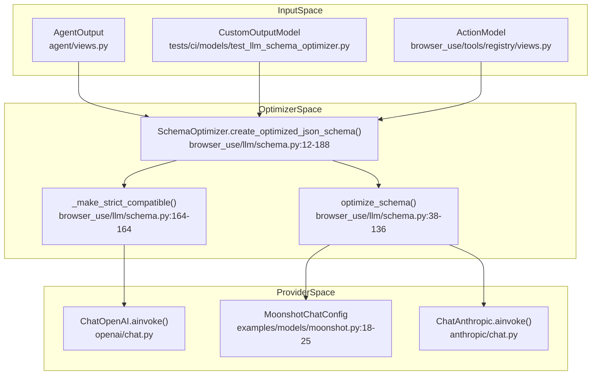
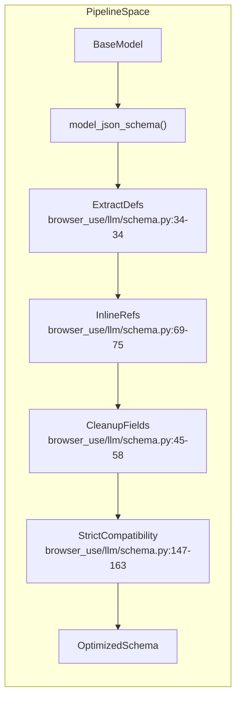

<!-- source: DeepWiki mcp.deepwiki.com · repo browser-use/browser-use · page 8.7 Structured Output and Schema Optimization · fetched 2026-10-30 -->

# Structured Output and Schema Optimization

<details>
<summary>Relevant source files</summary>

The following files were used as context for generating this wiki page:

- [browser_use/llm/schema.py](browser_use/llm/schema.py)
- [examples/models/moonshot.py](examples/models/moonshot.py)
- [tests/ci/models/test_llm_schema_optimizer.py](tests/ci/models/test_llm_schema_optimizer.py)

</details>


## Purpose and Scope

This document covers the schema optimization system that transforms Pydantic models into LLM-compatible JSON schemas. The `SchemaOptimizer` handles provider-specific requirements, flattens complex schema references, and ensures compatibility with structured output modes across different LLM providers like OpenAI, Google Gemini, Anthropic, and Moonshot. It also details how the system handles output truncation, dynamic model generation for action execution, and runtime JSON-Schema to Pydantic conversion for extraction tasks.

---

## System Architecture

The schema optimization system bridges Pydantic models and LLM provider requirements through a centralized `SchemaOptimizer` class in [browser_use/llm/schema.py:10-188](). This class applies transformations based on provider capabilities, handling native JSON schema modes versus tool calling approaches.

### High-Level Schema Flow



**Sources:** [browser_use/llm/schema.py:10-188](), [tests/ci/models/test_llm_schema_optimizer.py:1-97](), [examples/models/moonshot.py:18-25]()

---

## SchemaOptimizer Core Class

The `SchemaOptimizer` class in [browser_use/llm/schema.py:10-188]() provides static methods for schema transformation. It handles the complexity of converting Pydantic models into optimized, provider-compatible schemas by resolving references and applying strict validation rules.

### Key Methods and Signatures

| Method | Signature | Purpose | Returns |
|--------|-----------|---------|---------|
| `create_optimized_json_schema()` | `(model: type[BaseModel], remove_min_items: bool = False, remove_defaults: bool = False) -> dict[str, Any]` | Main optimization entry point with flattening logic | Optimized JSON schema dict |
| `_make_strict_compatible()` | `(schema: dict[str, Any] \| list[Any]) -> None` | OpenAI strict mode compliance (required fields) | Modifies schema in-place |

**Sources:** [browser_use/llm/schema.py:10-188]()

---

## Schema Optimization Pipeline

The optimization process transforms schemas through multiple stages to maximize LLM compatibility while preserving semantic information.



**Sources:** [browser_use/llm/schema.py:31-188]()

### Stage Details

#### Stage 1-2: Reference Flattening
The optimizer resolves all `$ref` references by inlining definitions from `$defs`. This is critical for providers that do not support complex schema references or external definitions in their JSON mode.

**Implementation:** [browser_use/llm/schema.py:38-136]()

#### Stage 3-4: Field Cleanup
Unnecessary metadata fields are removed while preserving essential validation constraints:
- **Removed:** `title` (when not in properties), `additionalProperties`, `$defs` [browser_use/llm/schema.py:45-58]().
- **Preserved:** `required`, `minimum`, `maximum`, `pattern`, `type`, `description`, `anyOf` [browser_use/llm/schema.py:84-107]().

#### Stage 5: OpenAI Strict Mode Compatibility
OpenAI's strict mode requires all objects to have `additionalProperties: false` and all properties to be listed in the `required` array. The optimizer recursively enforces this.

**Implementation:** [browser_use/llm/schema.py:147-163]()

#### Stage 6: Optional Transformations
Configurable flags enable compatibility with providers that have specific schema restrictions:
- `remove_min_items`: Removes `minItems` / `min_items` constraints (used for compatibility with providers like Moonshot) [browser_use/llm/schema.py:169-175]().
- `remove_defaults`: Removes `default` values (prevents rejection by providers that don't support defaults in structured output) [browser_use/llm/schema.py:176-177]().

**Sources:** [browser_use/llm/schema.py:167-187]()

---

## Runtime Schema Conversion

For structured extraction tasks where the user provides a JSON-Schema dict, the system converts it into a runtime Pydantic model using `schema_dict_to_pydantic_model` [browser_use/tools/extraction/schema_utils.py:145-168]().

### Conversion Logic
1. **Validation**: Checks for unsupported keywords like `$ref`, `allOf`, `anyOf`, etc. [browser_use/tools/extraction/schema_utils.py:42-47]().
2. **Type Resolution**: Maps JSON primitives (`string`, `number`, `integer`, `boolean`, `null`) to Python types [browser_use/tools/extraction/schema_utils.py:29-35]().
3. **Model Construction**: Dynamically creates a `BaseModel` subclass using `pydantic.create_model` [browser_use/tools/extraction/schema_utils.py:95-142]().

**Sources:** [browser_use/tools/extraction/schema_utils.py:1-168]()

---

## Dynamic Action Models

The action system uses `Registry._normalize_action_function_signature` to dynamically generate Pydantic models from Python function signatures [browser_use/tools/registry/service.py:75-167]().

### Special Parameter Handling
The registry identifies "special" parameters (like `browser_session`, `page_url`, `file_system`) that should be injected by the system rather than being part of the LLM's structured output schema [browser_use/tools/registry/service.py:57-73]().

**Sources:** [browser_use/tools/registry/service.py:57-167]()

---

## Provider-Specific Integration

### Moonshot and Alternative Providers
Alternative providers often require modifications to schemas to maintain compliance. For instance, Moonshot AI integrations drop `minItems` and default values via configuration flags [examples/models/moonshot.py:18-25]():

```python
llm = ChatOpenAI(
	model='kimi-k2-thinking',
	base_url='https://api.moonshot.ai/v1',
	api_key=api_key,
	add_schema_to_system_prompt=True,
	remove_min_items_from_schema=True,
	remove_defaults_from_schema=True,
)
```

**Sources:** [examples/models/moonshot.py:18-25]()

---

## Truncation and Error Handling

### ModelOutputTruncatedError
A specific exception, `ModelOutputTruncatedError`, is raised when an LLM hits its output token limit before finishing the structured JSON object.

**Sources:** [browser_use/llm/exceptions.py:32-43](), [tests/ci/models/test_llm_schema_optimizer.py:1-97]()

---

## Best Practices

1. **Descriptive Models:** Always use field descriptions in Pydantic models; the `SchemaOptimizer` preserves these to guide the LLM's understanding [browser_use/llm/schema.py:60-63]().
2. **OpenAI Strict Mode:** By default, the system ensures compatibility with OpenAI's strict mode by setting `additionalProperties: false` [browser_use/llm/schema.py:128-131]().
3. **Compatibility Flags**: Use `remove_min_items_from_schema` and `remove_defaults_from_schema` for providers like Moonshot that have stricter JSON schema validation [examples/models/moonshot.py:23-24]().

**Sources:** [browser_use/llm/schema.py:10-188](), [examples/models/moonshot.py:18-25]()

---

