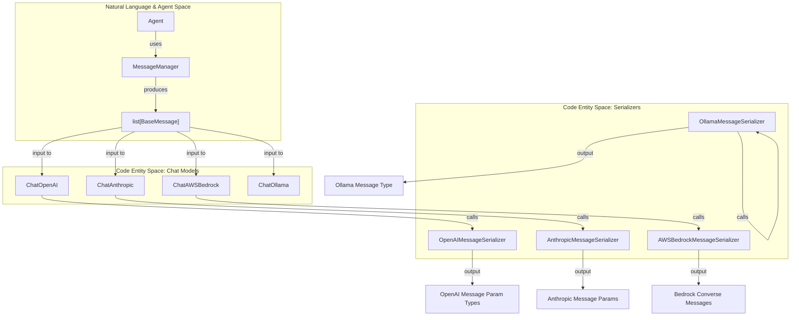
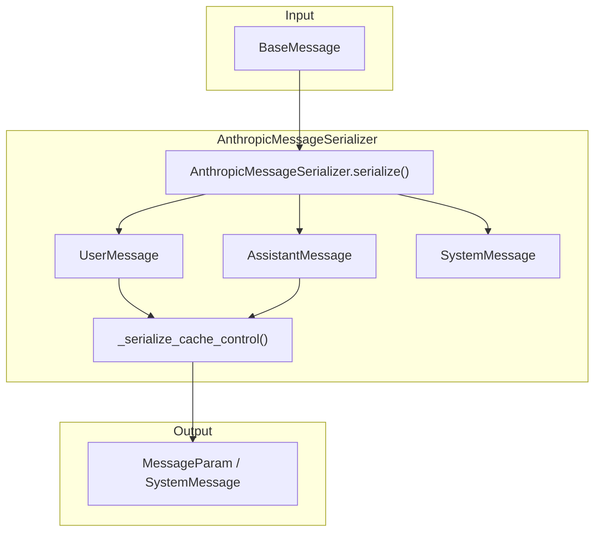

<!-- source: DeepWiki mcp.deepwiki.com · repo browser-use/browser-use · page 8.8 Message Serialization · fetched 2026-10-30 -->

# Message Serialization

<details>
<summary>Relevant source files</summary>

The following files were used as context for generating this wiki page:

- [browser_use/llm/anthropic/serializer.py](browser_use/llm/anthropic/serializer.py)
- [browser_use/llm/aws/serializer.py](browser_use/llm/aws/serializer.py)
- [browser_use/llm/messages.py](browser_use/llm/messages.py)
- [browser_use/llm/tests/test_anthropic_cache.py](browser_use/llm/tests/test_anthropic_cache.py)
- [examples/models/langchain/__init__.py](examples/models/langchain/__init__.py)
- [tests/ci/models/test_anthropic_data_url_case.py](tests/ci/models/test_anthropic_data_url_case.py)
- [tests/ci/models/test_aws_bedrock_serializer.py](tests/ci/models/test_aws_bedrock_serializer.py)

</details>


## Purpose and Scope

Message serialization converts `browser-use`'s internal message format (`BaseMessage` and its subclasses) into provider-specific formats required by different LLM APIs. Each LLM provider (OpenAI, Anthropic, AWS Bedrock, Google, Ollama, etc.) expects messages in a distinct structure, with varying support for multi-modal content (images), system message placement, tool call formatting, and prompt caching. This layer abstracts these differences, allowing the `Agent` and `MessageManager` to operate with a unified message interface.

For information about how LLMs are invoked and responses are parsed, see [LLM Provider Architecture (8.1)](). For structured output handling, see [Structured Output and Schema Optimization (8.7)]().

Sources: `[browser_use/llm/anthropic/serializer.py:27-28]`, `[browser_use/llm/aws/serializer.py:19-20]`, `[browser_use/llm/messages.py:125-134]()`

---

## Architecture Overview

Each LLM provider implementation includes a corresponding serializer class that converts `browser-use` messages to the provider's expected format. These serializers are typically stateless utility classes with static methods, invoked during completion calls in each provider's chat model implementation.

### Serialization Component Map

The following diagram bridges the natural language and agent space to specific code entities responsible for conversion.

Title: Message Serialization Data Flow


Sources: `[browser_use/llm/openai/serializer.py:28-30]`, `[browser_use/llm/anthropic/serializer.py:27-28]`, `[browser_use/llm/aws/serializer.py:19-20]`, `[browser_use/llm/ollama/serializer.py:16-17]()`

---

## Base Message Types

All serializers accept a `list[BaseMessage]` as input. `BaseMessage` is the base class for three concrete message types defined in `browser_use.llm.messages`:

| Message Type | Role String | Purpose |
|--------------|-------------|---------|
| `SystemMessage` | `"system"` | High-level instructions, task context, and system prompts `[browser_use/llm/messages.py:168-174]()`. |
| `UserMessage` | `"user"` | User queries and browser state observations (DOM, screenshots) `[browser_use/llm/messages.py:135-141]()`. |
| `AssistantMessage` | `"assistant"` | LLM-generated actions, reasoning, and tool calls `[browser_use/llm/messages.py:196-210]()`. |

Each message has a `content` field that can be a simple `str` or a list of parts: `ContentPartTextParam`, `ContentPartImageParam`, or `ContentPartRefusalParam` `[browser_use/llm/messages.py:139-200]()`.

Sources: `[browser_use/llm/messages.py:125-236]()`

---

## Anthropic Message Serialization and Caching

The `AnthropicMessageSerializer` handles conversion to Anthropic message parameters, supporting prompt caching (`cache_control`) and robust base64 image parsing `[browser_use/llm/anthropic/serializer.py:27-68]`.

Title: Anthropic Serialization Flow


### Ephemeral Caching and Overloads
*   `_serialize_cache_control(use_cache: bool)` injects `CacheControlEphemeralParam(type='ephemeral')` when caching is requested `[browser_use/llm/anthropic/serializer.py:64-68]`.
*   Overloads define strict typing for `UserMessage`, `SystemMessage`, and `AssistantMessage` serialization `[browser_use/llm/anthropic/serializer.py:170-188]`.
*   System messages are extracted separately because Anthropic API expects them at the top level rather than inside the messages array `[browser_use/llm/anthropic/serializer.py:183-197]`.

Sources: `[browser_use/llm/anthropic/serializer.py:27-198]`, `[browser_use/llm/tests/test_anthropic_cache.py:25-53]()`

---

## AWS Bedrock Message Serialization and URL Downloading

The `AWSBedrockMessageSerializer` handles formatting for AWS Bedrock models, which includes converting user, system, and assistant content blocks along with tool use payloads `[browser_use/llm/aws/serializer.py:19-218]`.

### URL Image Handling and Downloading
Unlike APIs that accept external image URLs directly, AWS Bedrock requires image source bytes. If an external HTTPS URL is provided, `AWSBedrockMessageSerializer._download_and_convert_image()` fetches the image via `httpx` and extracts its binary content and format `[browser_use/llm/aws/serializer.py:71-108]`.

*   `_is_url_image(url)` validates that URLs use `http` or `https` and contain supported image extensions (`.jpg`, `.jpeg`, `.png`, `.gif`, `.webp`) `[browser_use/llm/aws/serializer.py:28-42]`.
*   `_parse_base64_url(url)` decodes data URLs directly into raw bytes `[browser_use/llm/aws/serializer.py:44-68]`.

Sources: `[browser_use/llm/aws/serializer.py:19-218]`, `[tests/ci/models/test_aws_bedrock_serializer.py:9-62]()`

---

## Multi-modal Content Handling (Base64 Case-Insensitivity)

When serializing image content (such as screenshots), serializers must parse base64-encoded data URLs accurately.

*   **Case-Insensitive Parsing**: `AnthropicMessageSerializer._is_base64_image()` and `_parse_base64_url()` perform case-insensitive checks on URI schemes and MIME types (e.g., `DATA:image/PNG;base64,...`) `[browser_use/llm/anthropic/serializer.py:31-62]`.
*   Supported media types are normalized to canonical lowercase forms (`image/jpeg`, `image/png`, `image/gif`, `image/webp`) `[browser_use/llm/anthropic/serializer.py:55-61]`.

Sources: `[browser_use/llm/anthropic/serializer.py:31-62]`, `[tests/ci/models/test_anthropic_data_url_case.py:26-60]()`

---

## Tool Call Serialization

When the Agent performs an action, the resulting `AssistantMessage` contains `tool_calls` `[browser_use/llm/messages.py:208-209]()`. Serializers convert these into provider-specific tool invocation objects (e.g., Anthropic's `ToolUseBlockParam` or Bedrock's `toolUse` dictionary) `[browser_use/llm/anthropic/serializer.py:145-167]`, `[browser_use/llm/aws/serializer.py:188-202]`.

### Argument JSON Parsing
Because `browser-use` stores tool arguments as JSON strings, serializers parse these into dictionaries via `json.loads`:

```python
try:
    input_obj = json.loads(tool_call.function.arguments)
except json.JSONDecodeError:
    input_obj = {'arguments': tool_call.function.arguments}
```

Sources: `[browser_use/llm/anthropic/serializer.py:145-167]`, `[browser_use/llm/aws/serializer.py:188-202]()`

---

