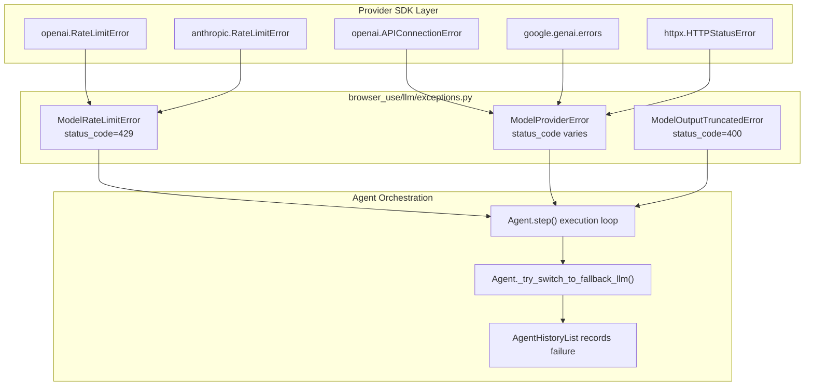
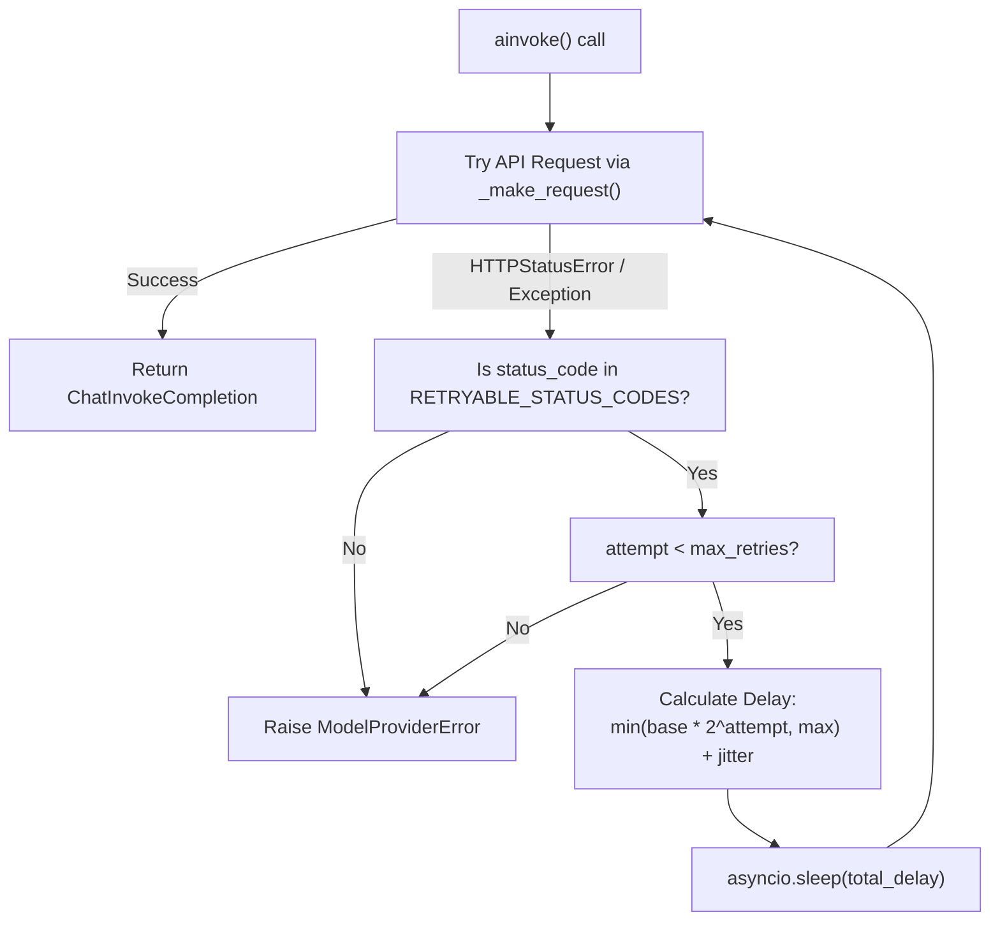
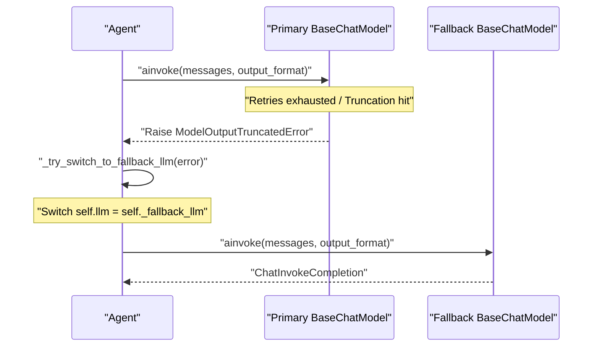

<!-- source: DeepWiki mcp.deepwiki.com · repo browser-use/browser-use · page 8.9 LLM Error Handling and Retry Logic · fetched 2026-10-30 -->

# LLM Error Handling and Retry Logic

Relevant source files

The following files were used as context for generating this wiki page:

- [browser_use/llm/browser_use/chat.py](browser_use/llm/browser_use/chat.py)
- [browser_use/llm/exceptions.py](browser_use/llm/exceptions.py)
- [browser_use/llm/google/chat.py](browser_use/llm/google/chat.py)
- [browser_use/llm/openai/chat.py](browser_use/llm/openai/chat.py)
- [browser_use/tokens/custom_pricing.py](browser_use/tokens/custom_pricing.py)
- [browser_use/tokens/openrouter_pricing.py](browser_use/tokens/openrouter_pricing.py)
- [examples/beta_agent/basic.py](examples/beta_agent/basic.py)
- [examples/models/bu_oss.py](examples/models/bu_oss.py)
- [examples/simple.py](examples/simple.py)
- [skills/open-source/references/models.md](skills/open-source/references/models.md)
- [tests/ci/models/test_llm_browseruse.py](tests/ci/models/test_llm_browseruse.py)
- [tests/ci/models/test_llm_google.py](tests/ci/models/test_llm_google.py)
- [tests/ci/test_llm_output_truncation.py](tests/ci/test_llm_output_truncation.py)
- [tests/ci/test_llm_retries.py](tests/ci/test_llm_retries.py)
- [tests/ci/test_openrouter_token_cost.py](tests/ci/test_openrouter_token_cost.py)

This page documents the error handling, exception mapping, retry logic, truncation detection, and fallback mechanisms implemented across all Large Language Model (LLM) providers in the `browser-use` framework. The architecture ensures resilient execution during browser automation tasks by handling transient network failures, rate limits, server errors, and output token limits.

---

## Error Handling Architecture

### Exception Hierarchy

The codebase defines a custom exception hierarchy in `browser_use/llm/exceptions.py` to abstract SDK-specific errors (such as those from OpenAI, Anthropic, or Google GenAI) into uniform, provider-agnostic exceptions.

| Exception Type | Purpose | Underlying Trigger / Status Code |
|---------------|---------|----------------------------------|
| `ModelError` | Base class for all model-related exceptions | N/A [browser_use/llm/exceptions.py:1-43]() |
| `ModelProviderError` | Raised when a model provider returns a non-retryable error or exhausts retries | Variable status code (Default 502) [browser_use/llm/exceptions.py:1-43]() |
| `ModelRateLimitError` | Specific handling for rate limit rejections | HTTP 429 [browser_use/llm/exceptions.py:1-43]() |
| `ModelOutputTruncatedError` | Raised when structured output is cut off at the completion token limit | HTTP 400 / Finish Reason length limit [browser_use/llm/exceptions.py:1-43]() |

**Sources:** [browser_use/llm/exceptions.py:1-43]()

### Exception Mapping and Flow

Title: "LLM Error Translation and Agent Response"

**Sources:** [browser_use/llm/openai/chat.py:292-306](), [browser_use/llm/google/chat.py:470-527](), [browser_use/llm/exceptions.py:32-43]()

---

## Provider-Specific Implementations

### OpenAI and Anthropic Integration
Clients like `ChatOpenAI` [browser_use/llm/openai/chat.py:25-31]() and `ChatAnthropic` leverage their underlying SDK retry handlers while wrapping provider exceptions into `browser-use` custom exceptions.

- **OpenAI Retries**: Configured with a default of `5` retries to ensure high reliability during automated browsing tasks [browser_use/llm/openai/chat.py:59]().
- **Anthropic Retries**: Configured with a default of `10` retries.
- **Error Mapping**:
  - `RateLimitError` is caught and translated to `ModelRateLimitError` [browser_use/llm/openai/chat.py:296-297]().
  - `APIStatusError` and `APIConnectionError` are caught and mapped to `ModelProviderError` [browser_use/llm/openai/chat.py:300-306]().

**Sources:** [browser_use/llm/openai/chat.py:59](), [browser_use/llm/openai/chat.py:292-306]()

### Google Gemini and Browser-Use Cloud
Clients like `ChatGoogle` [browser_use/llm/google/chat.py:48-87]() and `ChatBrowserUse` [browser_use/llm/browser_use/chat.py:31-43]() implement custom asynchronous retry loops using exponential backoff with jitter.

**Retry Configuration:**
- `max_retries`: `5` [browser_use/llm/google/chat.py:102](), [browser_use/llm/browser_use/chat.py:51]()
- `retryable_status_codes`: `[429, 500, 502, 503, 504]` [browser_use/llm/google/chat.py:103](), [browser_use/llm/browser_use/chat.py:28]()
- `retry_base_delay`: `1.0s` [browser_use/llm/google/chat.py:104](), [browser_use/llm/browser_use/chat.py:52]()
- `retry_max_delay`: `60.0s` [browser_use/llm/google/chat.py:105](), [browser_use/llm/browser_use/chat.py:53]()

**Backoff Algorithm:**
The delay is calculated as `min(retry_base_delay * (2^attempt), retry_max_delay)` plus a randomized jitter factor (up to 10% of the delay) before executing `asyncio.sleep()` [browser_use/llm/browser_use/chat.py:186-192]().

Title: "Exponential Backoff Logic for ChatGoogle and ChatBrowserUse"

**Sources:** [browser_use/llm/browser_use/chat.py:175-195](), [tests/ci/test_llm_retries.py:21-83]()

---

## Model Output Truncation Handling

A frequent failure mode in structured extraction tasks is when model completions get cut off mid-JSON due to token limits. Instead of surfacing an ambiguous JSON decoding error, `browser-use` inspects the finish reason (e.g., `finish_reason='length'` or `MAX_TOKENS`) to raise a explicit `ModelOutputTruncatedError` [tests/ci/test_llm_output_truncation.py:16-42]().

- **Detection**: The client checks response metadata. If the generation was halted due to length constraints, it throws `ModelOutputTruncatedError` [browser_use/llm/openai/chat.py:248-261](), [browser_use/llm/google/chat.py:196-211]().
- **Recovery**: The truncation signal is flagged as recoverable by the `Agent`, which can trigger a switch to a secondary LLM [tests/ci/test_llm_output_truncation.py:96-113]().

**Sources:** [tests/ci/test_llm_output_truncation.py:16-42](), [tests/ci/test_llm_output_truncation.py:96-113]()

---

## Fallback LLM Mechanism

The `Agent` supports a `fallback_llm` parameter. When a primary LLM encounters a recoverable error (such as a rate limit `429`, server error `5xx`, or output truncation), the agent invokes `_try_switch_to_fallback_llm()` to seamlessly continue execution with the secondary model [tests/ci/test_llm_output_truncation.py:96-113]().

Title: "Agent Fallback Sequence"

**Sources:** [tests/ci/test_llm_output_truncation.py:96-113](), [browser_use/llm/exceptions.py:32-43]()

---

## Technical Reference: Retry Parameters

| Provider Class | Default Max Retries | Base Delay | Max Delay | Retryable Status Codes |
|----------------|---------------------|------------|-----------|------------------------|
| `ChatOpenAI` | 5 [browser_use/llm/openai/chat.py:59]() | SDK Default | SDK Default | SDK Default |
| `ChatGoogle` | 5 [browser_use/llm/google/chat.py:102]() | 1.0s [browser_use/llm/google/chat.py:104]() | 60.0s [browser_use/llm/google/chat.py:105]() | 429, 500, 502, 503, 504 [browser_use/llm/google/chat.py:103]() |
| `ChatAnthropic` | 10 [browser_use/llm/anthropic/chat.py:60]() | SDK Default | SDK Default | SDK Default |
| `ChatBrowserUse` | 5 [browser_use/llm/browser_use/chat.py:51]() | 1.0s [browser_use/llm/browser_use/chat.py:52]() | 60.0s [browser_use/llm/browser_use/chat.py:53]() | 429, 500, 502, 503, 504 [browser_use/llm/browser_use/chat.py:28]() |

**Sources:** [browser_use/llm/openai/chat.py:59](), [browser_use/llm/google/chat.py:102-105](), [browser_use/llm/browser_use/chat.py:28-53](), [tests/ci/test_llm_retries.py:66]()

---

