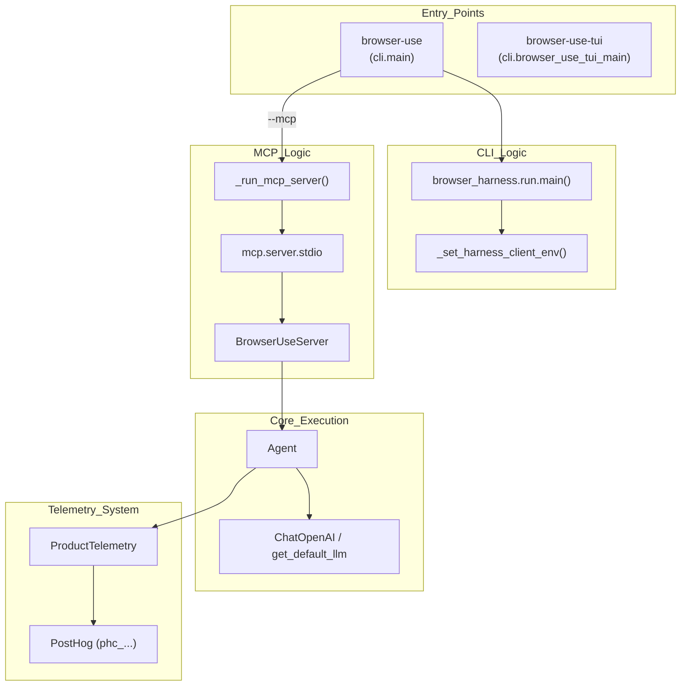
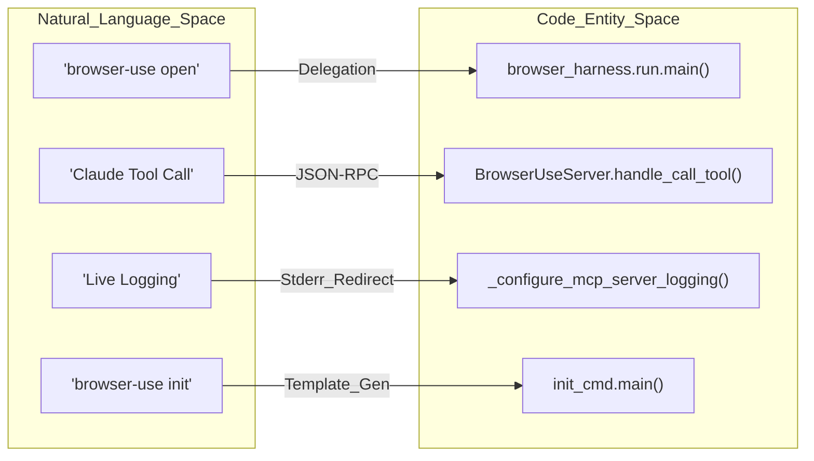

<!-- source: DeepWiki mcp.deepwiki.com · repo browser-use/browser-use · page 9 User Interfaces and Deployment · fetched 2026-10-30 -->

# User Interfaces and Deployment

Relevant source files

The following files were used as context for generating this wiki page:

- [browser_use/cli.py](browser_use/cli.py)
- [browser_use/telemetry/__init__.py](browser_use/telemetry/__init__.py)
- [browser_use/telemetry/service.py](browser_use/telemetry/service.py)
- [browser_use/telemetry/views.py](browser_use/telemetry/views.py)

This page provides an overview of the different ways to interact with `browser-use` and deploy it in various environments. The framework offers multiple interfaces to suit different use cases, from programmatic Python API control to a high-performance CLI, a standardized MCP server for AI assistants, and cloud scaling capabilities.

## Interface Overview

Browser-use provides several primary interfaces for interaction:

| Interface | Entry Point | Use Case | Implementation Details |
|-----------|-------------|----------|-------------------|
| **Python API** | `Agent` class | Programmatic control, custom integrations | Uses `Agent.run()` loop [browser_use/mcp/server.py:93]() |
| **Command Line (CLI)** | `browser-use` command | Direct terminal control, script piping | Backed by `browser-harness` [browser_use/cli.py:1-6]() |
| **MCP Server** | `browser-use --mcp` | Claude Desktop, Cursor, IDE integration | JSON-RPC via `mcp` SDK [browser_use/mcp/server.py:10-24]() |
| **Textual TUI** | `browser-use-tui` | Visual terminal dashboard | Interactive `Textual` app [browser_use/cli.py:221]() |
| **Actor API** | `MCPClient` / `Registry` | Low-level tool exposure | Direct tool-to-action mapping [browser_use/mcp/client.py:1-23]() |

Sources: [browser_use/cli.py:1-6](), [browser_use/mcp/server.py:1-24](), [browser_use/mcp/client.py:1-23]()

## System Architecture

### Entry Points and Execution Flow

Sources: [browser_use/cli.py:60-82](), [browser_use/cli.py:185-202](), [browser_use/mcp/server.py:187-210](), [browser_use/telemetry/service.py:21-34]()

### Interface to Code Entity Mapping

This diagram maps natural language interface concepts to the specific code entities that implement them.

Sources: [browser_use/cli.py:111-128](), [browser_use/cli.py:185-202](), [browser_use/mcp/server.py:61-85](), [browser_use/mcp/server.py:212-217]()

## Python API Usage

The Python API is the foundational way to use `browser-use`. It revolves around the `Agent` class which orchestrates the LLM and the `Browser`.

- **Agent Integration**: Programmatic control via the `Agent` class which is imported directly into interface layers [browser_use/mcp/server.py:93]().
- **Model Selection**: Supports `ChatOpenAI`, `ChatAWSBedrock`, and other providers through the `llm` module [browser_use/mcp/server.py:40, 97]().
- **Initialization**: Users can generate boilerplate via `browser-use init` to set up project structures [browser_use/cli.py:111-112]().

For details, see [Python API Usage](#9.1).

Sources: [browser_use/cli.py:111-128](), [browser_use/mcp/server.py:93-97]()

## Command Line Interface

The `browser-use` CLI is powered by `browser-harness` and provides a direct surface for acting in the browser via Python snippets or direct commands [browser_use/cli.py:1-6]().

- **Direct Execution**: The CLI delegates to `browser_harness` for core execution [browser_use/cli.py:185-202]().
- **Subcommand Mapping**: Maps legacy commands to modern Python hints for the user [browser_use/cli.py:206-215]().
- **Environment Control**: Sets specific environment variables like `BH_CLIENT` to identify the CLI version during telemetry [browser_use/cli.py:27-32]().
- **System Setup**: Includes an `install` command to provision Chromium and system dependencies via `uvx playwright` [browser_use/cli.py:83-108]().

For details, see [Command Line Interface](#9.2).

Sources: [browser_use/cli.py:27-32](), [browser_use/cli.py:83-108](), [browser_use/cli.py:185-220]()

## Textual TUI and Example UIs

The TUI provides an interactive terminal dashboard for monitoring agent tasks.

- **Interactive Subcommand**: The CLI recognizes flags to switch between interface modes and launch text dashboards [browser_use/cli.py:221]().
- **Output Management**: CLI output is normalized and captured to ensure clean terminal display [browser_use/cli.py:134-157]().

For details, see [Textual TUI and Example UIs](#9.3).

Sources: [browser_use/cli.py:134-157](), [browser_use/cli.py:221]()

## MCP Server Integration

The Model Context Protocol (MCP) server allows `browser-use` to be used as a toolset within MCP-compliant clients like Claude Desktop.

- **BrowserUseServer**: Implements the MCP server to expose tools for autonomous tasks, navigation, and extraction [browser_use/mcp/server.py:187-210]().
- **Logging Isolation**: Redirects all logs to `stderr` to prevent interference with JSON-RPC communication on `stdout` [browser_use/cli.py:60-73]().
- **Client Wrapper**: `MCPClient` allows `browser-use` to connect *to* other MCP servers and register their tools as agent actions [browser_use/mcp/client.py:1-23]().

For details, see [MCP Server Integration](#9.4).

Sources: [browser_use/cli.py:60-73](), [browser_use/mcp/server.py:187-216](), [browser_use/mcp/client.py:1-23]()

## Cloud Deployment and Scaling

`browser-use` supports deployment in cloud environments with specific features for monitoring and scale.

- **Telemetry**: Anonymized usage tracking via `ProductTelemetry` and PostHog integration [browser_use/telemetry/service.py:66-93]().
- **Device Identification**: Generates unique anonymous device IDs for telemetry persistence [browser_use/telemetry/service.py:28-34]().
- **Event Views**: Structured telemetry events for Agents, MCP Clients, and MCP Servers [browser_use/telemetry/views.py:25-88]().

For details, see [Cloud Deployment and Scaling](#9.5).

Sources: [browser_use/telemetry/service.py:28-34](), [browser_use/telemetry/service.py:66-93](), [browser_use/telemetry/views.py:25-88]()

## Actor API — Low-Level Browser Control

The Actor API provides primitives for direct browser control or tool wrapping without the full Agent orchestration.

- **Tool Registry**: Integrates tools into the registry system for direct action dispatch.
- **Action Wrapper**: Converts schema definitions into structured models for execution.

For details, see [Actor API — Low-Level Browser Control](#9.6).

Sources: [browser_use/mcp/client.py:1-23]()

## Third-Party Integrations

The library integrates with external ecosystems, SDKs, and messaging tools.

- **Toolsets**: Supports integration with external LLM toolsets and runners.
- **External Notifications**: Examples include connecting agent triggers with platforms like Slack, Discord, and Gmail 2FA helpers.

For details, see [Third-Party Integrations](#9.7).

Sources: [browser_use/cli.py:1-6]()

## Skills Catalog and Distribution

The skills architecture provides modular extensibility for the agent across tasks.

- **Skills Directory**: Contains markdown skill definitions (`SKILL.md`) for various automation domains.
- **Distribution**: Skill installation helpers integrate these routines into assistant configuration directories.

For details, see [Skills Catalog and Distribution](#9.8).

Sources: [browser_use/cli.py:1-6]()

---

