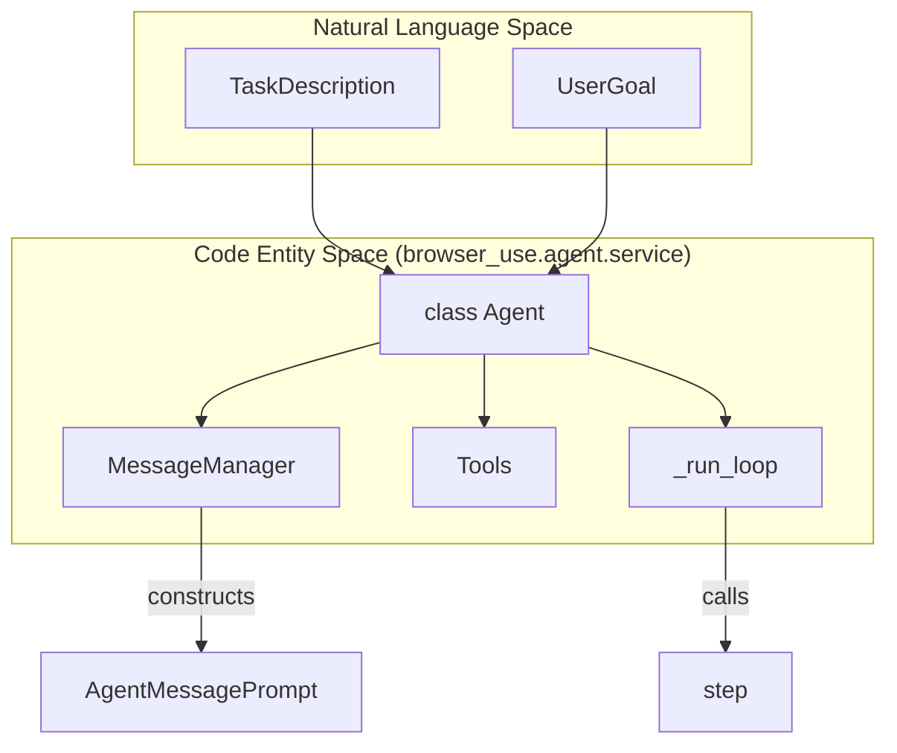
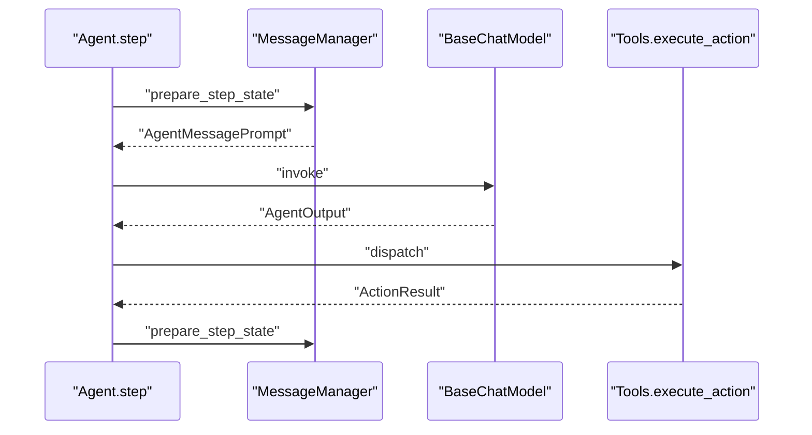

<!-- source: DeepWiki mcp.deepwiki.com · repo browser-use/browser-use · page 9.1 Python API Usage · fetched 2026-10-30 -->

# Python API Usage

<details>
<summary>Relevant source files</summary>

The following files were used as context for generating this wiki page:

- [browser_use/agent/message_manager/service.py](browser_use/agent/message_manager/service.py)
- [browser_use/agent/message_manager/views.py](browser_use/agent/message_manager/views.py)
- [browser_use/agent/prompts.py](browser_use/agent/prompts.py)
- [browser_use/agent/service.py](browser_use/agent/service.py)
- [browser_use/agent/views.py](browser_use/agent/views.py)
- [browser_use/browser/views.py](browser_use/browser/views.py)
- [examples/browser/cloud_browser.py](examples/browser/cloud_browser.py)
- [examples/demo_mode_example.py](examples/demo_mode_example.py)
- [examples/getting_started/01_basic_search.py](examples/getting_started/01_basic_search.py)
- [examples/getting_started/02_form_filling.py](examples/getting_started/02_form_filling.py)
- [examples/getting_started/03_data_extraction.py](examples/getting_started/03_data_extraction.py)
- [examples/getting_started/04_multi_step_task.py](examples/getting_started/04_multi_step_task.py)
- [examples/models/browser_use_llm.py](examples/models/browser_use_llm.py)
- [examples/sandbox/example.py](examples/sandbox/example.py)

</details>


This page documents the Python API for creating and running **browser-use** agents programmatically. It covers `Agent` instantiation, browser configuration, async/sync execution, follow-up tasks, and integration patterns for developers.

---

## Agent Instantiation

The `Agent` class is the primary orchestration layer. It coordinates LLM inference, browser actions, and task execution loops. At minimum, it requires a task description and an LLM provider.

```python
from browser_use import Agent, ChatBrowserUse
import asyncio

async def main():
    # Initialize the model (using Browser Use Cloud LLM as an example)
    llm = ChatBrowserUse(model='bu-2-0-mini-preview')
    
    # Create the agent
    agent = Agent(
        task="Search Google for 'browser-use' and tell me the star count",
        llm=llm
    )
    
    # Run the agent
    result = await agent.run()
    print(f"Final Result: {result.final_result()}")

if __name__ == '__main__':
    asyncio.run(main())
```

### Initialization Parameters

The `Agent` constructor in `browser_use/agent/service.py` accepts numerous configuration parameters to fine-tune behavior:

| Parameter Category | Key Parameters | Purpose |
|-------------------|----------------|---------|
| **Core** | `task`, `llm` | Required: Natural language task and the Chat Model [browser_use/agent/service.py:137-138](). |
| **Browser** | `browser`, `browser_session`, `browser_profile` | Configuration for the browser instance or session [browser_use/agent/service.py:140-142](). |
| **Tools/Skills** | `tools`, `skill_ids`, `skills` | Custom action registries and skill integrations [browser_use/agent/service.py:143-147](). |
| **Execution** | `max_failures`, `step_timeout`, `max_actions_per_step` | Loop limits and timeouts for individual steps [browser_use/agent/service.py:171-197](). |
| **Vision** | `use_vision`, `vision_detail_level` | Controls if/how screenshots are sent to the LLM [browser_use/agent/service.py:168-195](). |
| **Planning** | `enable_planning`, `use_thinking`, `flash_mode` | Toggles for internal planning and "thinking" steps [browser_use/agent/service.py:178-202](). |
| **Persistence** | `file_system_path`, `save_conversation_path` | Paths for persistent storage and conversation logs [browser_use/agent/service.py:169-189](). |

**Diagram: Agent Component Association**


Sources: [browser_use/agent/service.py:133-206](), [browser_use/agent/message_manager/service.py:104-148](), [browser_use/agent/prompts.py:104-128]()

---

## Browser Session Management

The `Agent` can either manage its own browser lifecycle or attach to an existing one.

### Automatic Management
If no browser is provided during initialization, the Agent creates a `BrowserSession` using default settings [browser_use/agent/service.py:65]().

### Programmatic Integration
For more control, pass a `Browser` instance. This is useful for persistent sessions or using cloud browsers. Setting `use_cloud=True` in the `Browser` constructor routes execution through the Browser Use cloud infrastructure [examples/browser/cloud_browser.py:20]().

```python
from browser_use import Browser, Agent

# Configure a cloud browser
browser = Browser(use_cloud=True)

agent = Agent(
    task="Check my IP on checkip.amazonaws.com",
    llm=llm,
    browser=browser
)
```
Sources: [examples/browser/cloud_browser.py:18-30](), [browser_use/agent/service.py:141-142]()

---

## Execution Modes

### Async Execution Loop
The `run()` method initiates the execution loop, which iteratively calls `step()` until the task is complete, `max_steps` is reached, or a terminal error occurs [browser_use/agent/service.py:1-4163]().

### Synchronous Execution
For scripts where `asyncio` boilerplate is not desired, synchronous wrappers or patterns can invoke the loop via standard `asyncio.run()`.

### Multi-turn Interactions and Follow-up Tasks
You can programmatically add new tasks to an existing agent session using `add_new_task()`. This allows for follow-up questions without losing the browser state or conversation history.

```python
# Initial task
await agent.run()

# Follow-up task in the same session
agent.add_new_task("Now click on the first result and summarize the page")
await agent.run()
```
The `add_new_task` method updates the running sequence and appends user directives into the message history [browser_use/agent/message_manager/service.py:1-600]().

Sources: [browser_use/agent/service.py:1-4163](), [browser_use/agent/message_manager/service.py:1-600]()

---

## Agent History and Results

The `run()` method returns an `AgentHistoryList`, which provides a complete trace of the execution.

### Accessing Results
- `history.final_result()`: Returns the content of the last `done` action [browser_use/agent/views.py:50]().
- `history.errors()`: Returns a list of all errors encountered during the run [browser_use/agent/views.py:51]().
- `history.model_actions()`: Returns all actions attempted by the LLM.

### Serialization
History items are represented by the `HistoryItem` class [browser_use/agent/message_manager/views.py:15-24](). The `AgentHistoryList` manages the collection of these items and can be serialized to disk.

Sources: [browser_use/agent/views.py:50-51](), [browser_use/agent/message_manager/views.py:33-64]()

---

## Programmatic Integration Patterns

### Structured Data Extraction
To force the agent to return data in a specific format, use `output_model_schema`. This forces the LLM to provide structured data matching your Pydantic model [browser_use/agent/service.py:166]().

```python
from pydantic import BaseModel

class ArticleSummary(BaseModel):
    title: str
    summary: str
    author: str

agent = Agent(
    task="Summarize the latest post on the browser-use blog",
    llm=llm,
    output_model_schema=ArticleSummary
)

history = await agent.run()
```
Sources: [browser_use/agent/service.py:166](), [browser_use/agent/views.py:56-57]()

### Monitoring and Callbacks
You can hook into the agent's execution via callbacks defined in the constructor:
- `register_new_step_callback`: Called after every step [browser_use/agent/service.py:153-157]().
- `register_done_callback`: Called when the agent finishes its task [browser_use/agent/service.py:158-162]().

**Diagram: Data Flow for Action Execution**


Sources: [browser_use/agent/service.py:1-4163](), [browser_use/agent/message_manager/service.py:1-600]()

### Sandbox Execution
Tasks can be executed via sandbox wrappers or decorators allowing isolated environment setup and live URL handling [examples/sandbox/example.py:1-44]().

```python
@sandbox(
    on_browser_created=on_browser_ready
)
async def my_task(browser: Browser):
    agent = Agent(task="...", browser=browser, llm=llm)
    return await agent.run()
```
Sources: [examples/sandbox/example.py:28-44]()

### Sensitive Data Masking
When integrating with tasks requiring credentials, use the `sensitive_data` parameter. The system redacts these values from logs and history using `redact_sensitive_string` [browser_use/utils.py:76-80]().

```python
agent = Agent(
    task="Login to my dashboard",
    llm=llm,
    sensitive_data={"password": "my-real-password-123"}
)
```
Sources: [browser_use/agent/service.py:150](), [browser_use/utils.py:59-74](), [browser_use/agent/message_manager/service.py:115]()

### Signal Handling
The `SignalHandler` class provides a modular way to manage `SIGINT` (Ctrl+C) and `SIGTERM`. It supports a two-stage shutdown where the first Ctrl+C pauses or cancels the current step, and the second Ctrl+C exits the application [browser_use/utils.py:118-163]().

Sources: [browser_use/utils.py:118-163]()

---

