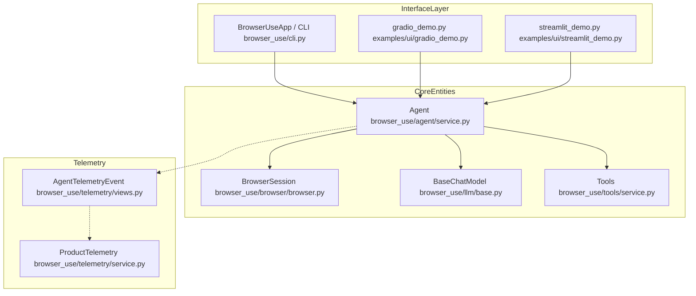
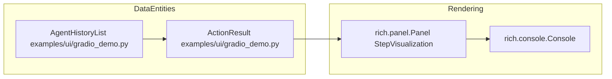

<!-- source: DeepWiki mcp.deepwiki.com · repo browser-use/browser-use · page 9.3 Textual TUI and Example UIs · fetched 2026-10-30 -->

# Textual TUI and Example UIs

<details>
<summary>Relevant source files</summary>

The following files were used as context for generating this wiki page:

- [browser_use/cli.py](browser_use/cli.py)
- [browser_use/telemetry/__init__.py](browser_use/telemetry/__init__.py)
- [browser_use/telemetry/service.py](browser_use/telemetry/service.py)
- [browser_use/telemetry/views.py](browser_use/telemetry/views.py)
- [examples/models/langchain/chat.py](examples/models/langchain/chat.py)
- [examples/ui/command_line.py](examples/ui/command_line.py)
- [examples/ui/gradio_demo.py](examples/ui/gradio_demo.py)
- [examples/ui/streamlit_demo.py](examples/ui/streamlit_demo.py)
- [examples/use-cases/captcha.py](examples/use-cases/captcha.py)
- [examples/use-cases/check_appointment.py](examples/use-cases/check_appointment.py)
- [examples/use-cases/shopping.py](examples/use-cases/shopping.py)

</details>


This page documents the **Textual TUI** (Terminal User Interface) and interactive UI implementations for `browser-use`. These interfaces provide real-time visualization of agent execution, logging, and browser events using frameworks like `textual`, `rich`, `gradio`, and `streamlit`.

For non-interactive command-line usage, see [Command Line Interface](9.2). For programmatic Python usage, see [Python API Usage](9.1). For the MCP server interface, see [MCP Server Integration](9.4).

---

## Installation and Entry Point

The interactive interfaces are optional wrappers around the core `Agent` and `BrowserSession`. They rely on `rich` and `textual` for terminal rendering [examples/ui/gradio_demo.py:15-17](). 

The main CLI entry point `browser-use` (backed by `browser_harness`) manages telemetry and environment setup before delegating to specific run commands [browser_use/cli.py:185-202](). It also supports an MCP mode via the `--mcp` flag [browser_use/cli.py:221]().

Sources: [browser_use/cli.py:185-202](), [examples/ui/gradio_demo.py:15-17]()

---

## Architecture Overview

The following diagram shows how the TUI and UI examples integrate with core components, focusing on the relationship between the interface layer, the `Agent`, and the `BrowserSession`.

### TUI System Integration


Sources: [browser_use/cli.py:1-33](), [browser_use/telemetry/service.py:66-78](), [examples/ui/command_line.py:70-83](), [examples/ui/streamlit_demo.py:55-67]()

---

## UI Component Structure

Interactive implementations serve as coordinators that manage the lifecycle of the browser session and the agent while providing real-time updates to UI widgets.

### Key Components

| Component | Implementation | Purpose |
|-----------|----------------|---------|
| `browser_session` | `BrowserSession` | Persistent browser instance across tasks [examples/ui/command_line.py:74]() |
| `agent` | `Agent` | The active agent executing the current task [examples/ui/command_line.py:76-83]() |
| `llm` | `BaseChatModel` | The LLM provider instance (e.g., `ChatOpenAI`, `ChatAnthropic`) [examples/ui/command_line.py:32-49]() |
| `tools` | `Tools` | Action registry for the agent [examples/ui/command_line.py:73]() |
| `telemetry` | `ProductTelemetry` | Captures anonymized execution data [browser_use/telemetry/service.py:66-71]() |

### Core Initialization Flow

The initialization of the interface environment typically follows a pattern of setting up the LLM provider, initializing tools, and then creating the `Agent` with a reference to a `BrowserSession`.

```python
# From examples/ui/command_line.py:70-83
def initialize_agent(query: str, provider: str):
    llm = get_llm(provider)
    tools = Tools()
    browser_session = BrowserSession()

    return Agent(
        task=query,
        llm=llm,
        tools=tools,
        browser_session=browser_session,
        use_vision=True,
        max_actions_per_step=1,
    ), browser_session
```

Sources: [browser_use/telemetry/service.py:103-108](), [examples/ui/command_line.py:32-49](), [examples/ui/command_line.py:70-83](), [examples/ui/streamlit_demo.py:29-52]()

---

## UI Layout and Behavior

The interfaces use dynamic layouts to display agent progress and results.

### Logging and Visualization

The interfaces utilize `rich` for formatted terminal output, particularly when parsing agent history. The `ActionResult` and `AgentHistoryList` structures are parsed to display step-by-step progress in the UI [examples/ui/gradio_demo.py:23-55]().

### Data Flow to Widgets


Sources: [examples/ui/gradio_demo.py:23-55](), [examples/ui/gradio_demo.py:15-17]()

---

## Task Execution and Telemetry

When a user submits a task, the UI manages the agent lifecycle and reports events:

1.  **Initialization**: An `Agent` instance is created with the provided task and LLM configuration [examples/ui/command_line.py:89]().
2.  **Execution**: The UI calls `agent.run()` [examples/ui/command_line.py:91]().
3.  **Telemetry**: During and after execution, `AgentTelemetryEvent` data (steps, tokens, duration, success) is captured via `ProductTelemetry.capture()` [browser_use/telemetry/views.py:25-58](), [browser_use/telemetry/service.py:103-108]().
4.  **Cleanup**: After execution, the browser session is terminated via `browser_session.kill()` [examples/ui/command_line.py:94]().

### LLM Provider Selection

The UI allows users to toggle between different providers. The `get_llm` helper function handles the conditional configuration of these models based on environment variables like `OPENAI_API_KEY` or `ANTHROPIC_API_KEY` [examples/ui/command_line.py:32-49](), [examples/ui/streamlit_demo.py:29-52]().

Sources: [browser_use/telemetry/service.py:103-108](), [browser_use/telemetry/views.py:25-58](), [examples/ui/command_line.py:32-49](), [examples/ui/command_line.py:86-95](), [examples/ui/streamlit_demo.py:29-52]()

---

## Multi-UI Implementations

The codebase provides several reference implementations for interactive browser automation:

*   **Command Line (Rich)**: A terminal-based interface using `argparse` and `rich` for visualization [examples/ui/command_line.py]() [examples/ui/command_line.py:15-67]().
*   **Gradio Demo**: A web-based GUI for task automation with model selection and headless toggles [examples/ui/gradio_demo.py]() [examples/ui/gradio_demo.py:81-106]().
*   **Streamlit Demo**: A reactive web interface for running browser agents with real-time status updates [examples/ui/streamlit_demo.py]() [examples/ui/streamlit_demo.py:70-87]().
*   **CLI Telemetry**: The `browser-use` CLI captures CLI-specific events via `capture_cli_event` [browser_use/cli.py:34-57]().

Sources: [browser_use/cli.py:34-57](), [examples/ui/command_line.py:1-13](), [examples/ui/gradio_demo.py:81-106](), [examples/ui/streamlit_demo.py:70-87]()

---

