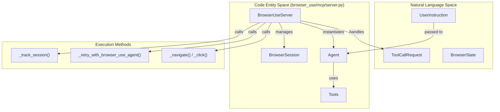
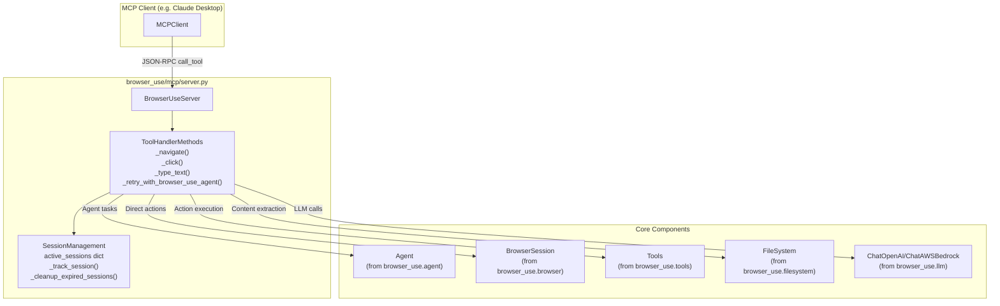
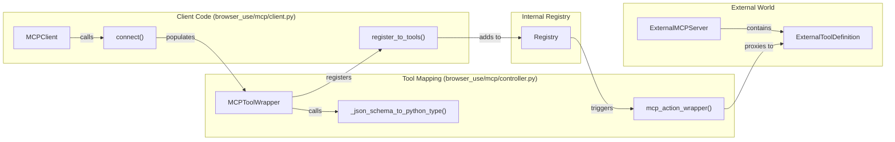

<!-- source: DeepWiki mcp.deepwiki.com · repo browser-use/browser-use · page 9.4 MCP Server Integration · fetched 2026-10-30 -->

# MCP Server Integration

<details>
<summary>Relevant source files</summary>

The following files were used as context for generating this wiki page:

- [browser_use/mcp/__init__.py](browser_use/mcp/__init__.py)
- [browser_use/mcp/cli_mcp.py](browser_use/mcp/cli_mcp.py)
- [browser_use/mcp/client.py](browser_use/mcp/client.py)
- [browser_use/mcp/controller.py](browser_use/mcp/controller.py)
- [browser_use/mcp/server.py](browser_use/mcp/server.py)
- [tests/ci/test_mcp_client_error_result.py](tests/ci/test_mcp_client_error_result.py)
- [tests/ci/test_mcp_tool_annotations.py](tests/ci/test_mcp_tool_annotations.py)

</details>


## Purpose and Scope

The MCP (Model Context Protocol) Server Integration exposes `browser-use` capabilities to AI assistants and tools that support the Model Context Protocol standard. This enables AI agents like Claude Desktop, Cursor, and other MCP clients to perform browser automation tasks through a standardized JSON-RPC interface over stdio.

This page covers the MCP server implementation (`BrowserUseServer`), tool definitions, read-only annotations, CLI MCP (`CLIMCPServer`), session management, and the client-side integration (`MCPClient` and `MCPToolWrapper`) for consuming external MCP tools.

Sources: [browser_use/mcp/server.py:1-24](), [browser_use/mcp/client.py:1-23](), [browser_use/mcp/cli_mcp.py:1-4](), [tests/ci/test_mcp_tool_annotations.py:1-11]()

## Server Architecture

The `BrowserUseServer` class orchestrates all MCP functionality, managing browser sessions, tool execution, and lifecycle. It implements the MCP specification using the `mcp` Python SDK.

### System Mapping: MCP to Code Entities
This diagram maps the Natural Language concepts of the MCP protocol to the specific Python classes and methods in the codebase.


Sources: [browser_use/mcp/server.py:186-211](), [browser_use/mcp/server.py:574-676](), [browser_use/mcp/server.py:944-1071]()

### Data Flow Architecture


Sources: [browser_use/mcp/server.py:1-204]()

### Server Initialization

The server initializes by loading the standard configuration, setting up environment defaults to prevent stdout pollution, and initializing session structures.

```python
# browser_use/mcp/server.py:186-211
class BrowserUseServer:
	def __init__(self, session_timeout_minutes: int = 10):
		self.server = Server('browser-use', version=get_browser_use_version())
		self.config = load_browser_use_config()
		self.active_sessions: dict[str, dict[str, Any]] = {}
		self.session_timeout_minutes = session_timeout_minutes
		self._setup_handlers()
```
Sources: [browser_use/mcp/server.py:186-211](), [browser_use/mcp/server.py:1073-1091]()

## Tool Categories, Definitions, and Annotations

The MCP server exposes tools through `@self.server.list_tools()` and `@self.server.call_tool()` handlers [tests/ci/test_mcp_tool_annotations.py:41-47]().

### Tool Annotations and Read-Only Hints
Per MCP specification extensions and client requirements (e.g., Codex CLI or Claude Desktop policy checks), read-only tools must explicitly advertise `readOnlyHint=True` so that clients do not auto-cancel safe inspection calls [tests/ci/test_mcp_tool_annotations.py:1-11]().

| Tool Name | Purpose | Read-Only Hint (`readOnlyHint=True`) |
|-----------|---------|-------------------------------------|
| `browser_get_state` | Get DOM state summary | Yes (`EXPECTED_READ_ONLY_TOOLS`) |
| `browser_get_html` | Get page HTML content | Yes |
| `browser_screenshot` | Capture viewport image | Yes |
| `browser_list_tabs` | List open tabs | Yes |
| `browser_list_sessions` | List active browser sessions | Yes |
| `browser_navigate` / `browser_click` / etc. | Mutating browser actions | No (State-changing) |

Sources: [tests/ci/test_mcp_tool_annotations.py:21-30]()

### Autonomous Agent Tool
The `retry_with_browser_use_agent` tool delegates complex multi-step instructions to the core `Agent` orchestration loop [browser_use/mcp/server.py:574-590]().

Sources: [browser_use/mcp/server.py:347-381](), [browser_use/mcp/server.py:574-676]()

## CLI MCP Server (`CLIMCPServer`)

In addition to `BrowserUseServer`, `browser-use` provides `CLIMCPServer` in `browser_use/mcp/cli_mcp.py` [browser_use/mcp/cli_mcp.py:32-44](). This server wraps the browser-harness execution model, allowing LLMs to run arbitrary Python snippets inside a persistent namespace.

| Tool Name | Purpose |
|-----------|---------|
| `browser_exec` | Executes Python code in a stateful namespace pre-populated with harness helpers (`new_tab`, `goto_url`, `click_at_xy`, `type_text`, `js`, `cdp`, etc.) [browser_use/mcp/cli_mcp.py:48-63](). |
| `browser_screenshot` | Captures the current page as a base64 PNG, supporting viewport or full-page mode and downscaling (`max_dim`) [browser_use/mcp/cli_mcp.py:64-78](). |

Sources: [browser_use/mcp/cli_mcp.py:32-116]()

## Client-Side Integration

`browser-use` can also act as an MCP client via `MCPClient` and `MCPToolWrapper`, mapping external MCP tools into the internal `Tools` and `Registry` system [browser_use/mcp/client.py:47-80](), [browser_use/mcp/controller.py:29-50]().

### Client Integration Mapping


Sources: [browser_use/mcp/client.py:47-80](), [browser_use/mcp/controller.py:29-50](), [browser_use/mcp/controller.py:91-130]()

### Error Handling in `MCPClient`
When executing MCP tool calls, application-level errors (where the RPC call succeeds but `isError=True` is returned in `CallToolResult`) are explicitly caught and converted into failed `ActionResult` objects rather than successful extractions [tests/ci/test_mcp_client_error_result.py:1-46]().

Sources: [tests/ci/test_mcp_client_error_result.py:1-46]()

## Logging and Protocol Interference

Because MCP relies on `stdio` transport for JSON-RPC messages, any uncontrolled `stdout` output corrupts the protocol stream.

1. **Early Environment Suppression:** Environment variables such as `BROWSER_USE_LOGGING_LEVEL` and `BROWSER_USE_SETUP_LOGGING` are set prior to module imports [browser_use/mcp/server.py:29-32]().
2. **Stderr Redirect:** `_configure_mcp_server_logging()` redirects all handlers to `sys.stderr` and forces log levels to `CRITICAL` or `WARNING` [browser_use/mcp/server.py:61-85]().

Sources: [browser_use/mcp/server.py:26-90]()

## Session Lifecycle and Cleanup

The server maintains an in-memory session registry (`active_sessions`) to preserve browser state across sequential RPC tool invocations [browser_use/mcp/server.py:189-204]().

- **Tracking:** `_track_session()` updates session timestamps upon activity [browser_use/mcp/server.py:944-964]().
- **Expiration:** Periodic background cleanup loops purge sessions exceeding `session_timeout_minutes` [browser_use/mcp/server.py:1083-1091]().

Sources: [browser_use/mcp/server.py:186-208](), [browser_use/mcp/server.py:944-1071]()

## Telemetry

Both server and client modules report operational telemetry using `ProductTelemetry` and specialized event classes.

- **MCPServerTelemetryEvent:** Captures tool execution metrics and errors [browser_use/mcp/server.py:151-154]().
- **MCPClientTelemetryEvent:** Tracks connection health and discovery counts [browser_use/mcp/client.py:33-33]().
- **Parent Process Inspection:** `get_parent_process_cmdline()` inspects process chains via `psutil` to identify parent MCP hosts like Claude Desktop [browser_use/mcp/server.py:155-185]().

Sources: [browser_use/mcp/server.py:151-185](), [browser_use/mcp/client.py:33-33]()

---

