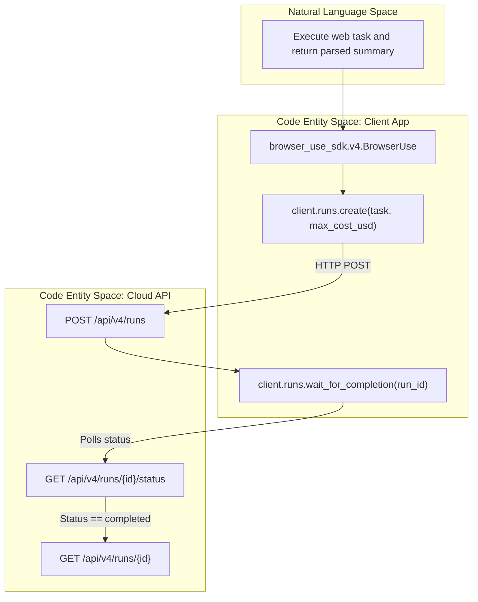
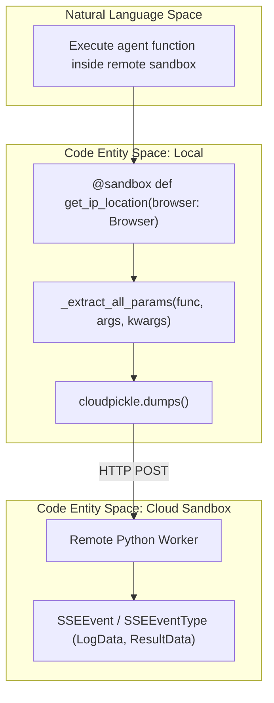

<!-- source: DeepWiki mcp.deepwiki.com · repo browser-use/browser-use · page 9.5 Cloud Deployment and Scaling · fetched 2026-10-30 -->

# Cloud Deployment and Scaling

<details>
<summary>Relevant source files</summary>

The following files were used as context for generating this wiki page:

- [browser_use/sandbox/__init__.py](browser_use/sandbox/__init__.py)
- [browser_use/sandbox/sandbox.py](browser_use/sandbox/sandbox.py)
- [browser_use/sandbox/views.py](browser_use/sandbox/views.py)
- [examples/cloud/01_basic_task.py](examples/cloud/01_basic_task.py)
- [examples/cloud/README.md](examples/cloud/README.md)
- [examples/cloud/env.example](examples/cloud/env.example)
- [examples/sandbox/structured_output.py](examples/sandbox/structured_output.py)
- [skills/cloud/SKILL.md](skills/cloud/SKILL.md)
- [skills/cloud/references/api-v3.md](skills/cloud/references/api-v3.md)
- [skills/cloud/references/api-v4.md](skills/cloud/references/api-v4.md)
- [skills/cloud/references/browser-api.md](skills/cloud/references/browser-api.md)
- [skills/cloud/references/features.md](skills/cloud/references/features.md)
- [skills/cloud/references/guides/chat-ui.md](skills/cloud/references/guides/chat-ui.md)
- [skills/cloud/references/guides/subagent.md](skills/cloud/references/guides/subagent.md)
- [skills/cloud/references/guides/tools-integration.md](skills/cloud/references/guides/tools-integration.md)
- [skills/cloud/references/patterns.md](skills/cloud/references/patterns.md)
- [skills/cloud/references/quickstart.md](skills/cloud/references/quickstart.md)
- [skills/open-source/references/agent.md](skills/open-source/references/agent.md)
- [tests/ci/test_sandbox_structured_output.py](tests/ci/test_sandbox_structured_output.py)

</details>


## Purpose and Scope

This page covers the production deployment, scaling, and cloud-hosted operations of browser-use applications using Browser Use Cloud infrastructure (`use_cloud=True`) and containerized/sandbox environments [skills/cloud/SKILL.md:1-10](). Browser Use Cloud provides managed browser clusters with built-in stealth, proxy rotation, and persistence via REST APIs and the `browser-use-sdk` (`v4` interface), while the open-source library provides sandbox wrappers and remote daemon controls [skills/cloud/references/api-v4.md:1-10](), [browser_use/sandbox/sandbox.py:215-270]().

**Key Capabilities Covered:**
- **Hosted Agent Runs (API v4)**: Managing asynchronous agent runs, sessions, and workspaces through `browser_use_sdk.v4` [skills/cloud/references/api-v4.md:1-15]().
- **Sandbox Execution**: Using the `@sandbox` decorator to execute agents securely in managed environments [examples/sandbox/structured_output.py:26-36]().
- **Direct Browser Control**: Connecting external frameworks (Playwright, Puppeteer, Selenium) to stealth cloud browsers via CDP WebSockets [skills/cloud/references/browser-api.md:1-117]().
- **Enterprise Features**: Residential proxy rotation across 195+ countries, webhook event verification, and secure workspaces [skills/cloud/references/features.md:13-131]().

**Sources:** [skills/cloud/SKILL.md:1-70](), [skills/cloud/references/api-v4.md:1-151](), [browser_use/sandbox/sandbox.py:1-216]()

---

## Cloud Architecture & SDK v4 Flow

The Browser Use Cloud architecture decouples heavy browser rendering and LLM execution from client applications. The current standard is **API v4**, which manages operations through **runs**, **sessions**, and **workspaces** [skills/cloud/references/api-v4.md:1-6]().

### Diagram: API v4 Run Lifecycle
The following diagram maps the natural language intent of creating and polling hosted tasks to the underlying code entities in `browser_use_sdk.v4` and the cloud REST API (`/api/v4/runs`) [skills/cloud/references/api-v4.md:7-33](), [examples/cloud/01_basic_task.py:28-55]().



**Sources:** [skills/cloud/references/api-v4.md:7-68](), [examples/cloud/01_basic_task.py:28-56]()

---

## API v4 Hosted Agent Runs and Sessions

API v4 introduces a streamlined resource hierarchy for hosted agent interactions [skills/cloud/references/api-v4.md:1-11]().

1. **Run**: A single agent turn or task execution. Created via `client.runs.create()` [skills/cloud/references/api-v4.md:25-28]() or `POST /api/v4/runs` [skills/cloud/references/api-v4.md:58-61](). Runs progress through terminal states: `completed`, `failed`, or `cancelled` [skills/cloud/references/api-v4.md:54-55]().
2. **Session**: The conversation state shared across follow-up runs [skills/cloud/references/api-v4.md:3-5](). Passing a `session_id` to `client.runs.create()` continues the conversation [skills/cloud/references/api-v4.md:87-90]().
3. **Workspace**: A persistent filesystem that stores files independently across sessions [skills/cloud/references/api-v4.md:100-103](). Files are uploaded via `client.workspaces.upload()` and attached to runs via `attached_file_ids` [skills/cloud/references/api-v4.md:110-116]().

### Python Implementation Example
Using `browser_use_sdk.v4` to execute a task and handle results [skills/cloud/references/api-v4.md:22-33]():

```python
from browser_use_sdk.v4 import BrowserUse

with BrowserUse() as client:
	created = client.runs.create(
		"Open https://example.com and return its title", max_cost_usd=1.00
	)
	run = client.runs.wait_for_completion(created.id)
	if run.status.value != "completed":
		raise RuntimeError(f"Run {run.id}: {run.status}")
	print(run.result)
```

**Sources:** [skills/cloud/references/api-v4.md:1-147](), [examples/cloud/01_basic_task.py:28-71]()

---

## Sandbox Execution & Local Decorators

The open-source library provides sandbox integration decorators (`@sandbox`) that serialize local agent functions and execute them against managed cloud browser instances [browser_use/sandbox/sandbox.py:215-270](), [examples/sandbox/structured_output.py:26-36]().

### Diagram: Sandbox Execution Pipeline
The diagram below illustrates how functions annotated with `@sandbox` capture closure state, serialize via `cloudpickle`, and stream logs and results back via Server-Sent Events (SSE) [browser_use/sandbox/sandbox.py:15-26]().



**Sources:** [browser_use/sandbox/sandbox.py:1-216](), [examples/sandbox/structured_output.py:26-36]()

---

## Direct Browser Control & CDP WebSocket

For use cases requiring direct browser automation (such as custom Playwright or Puppeteer scripts) rather than the high-level `Agent` loop, Browser Use Cloud provides WebSocket endpoints over the Chrome DevTools Protocol (CDP) [skills/cloud/references/browser-api.md:1-16]().

### Connection Mechanics
A single WebSocket URL encapsulates authentication, regional proxy selection, and screen dimensions. The browser automatically starts upon connection and stops upon disconnection [skills/cloud/references/browser-api.md:14-17]():

```
wss://connect.browser-use.com?apiKey=YOUR_KEY&proxyCountryCode=us&timeout=30
```

### Framework Integrations
- **Playwright**: Connect using `chromium.connect_over_cdp()` [skills/cloud/references/browser-api.md:67-70]().
- **Puppeteer**: Connect using `puppeteer.connect({ browserWSEndpoint })` [skills/cloud/references/browser-api.md:88-90]().
- **Selenium**: Set the debugger address option to point to the CDP session [skills/cloud/references/browser-api.md:107-109]().

*Note:* Explicitly stop cloud browsers when using the SDK (`client.browsers.stop(browser.id)`) because closing a CDP client does not terminate cloud billing [skills/cloud/references/api-v4.md:134-137]().

**Sources:** [skills/cloud/references/api-v4.md:124-137](), [skills/cloud/references/browser-api.md:1-122]()

---

## Production Considerations

### Proxies & Stealth
Stealth capabilities (anti-fingerprinting, automated CAPTCHA solving, ad/cookie blocking, and Cloudflare bypass) are enabled by default [skills/cloud/references/features.md:13-15](). Residential proxies span 195+ countries and can be configured per session [skills/cloud/references/features.md:17-24]():
- **Residential**: `proxy_country_code="us"` (or `gb`, `de`, `jp`, etc.) [skills/cloud/references/features.md:17-24]().
- **Custom Proxy**: Provide custom HTTP/SOCKS5 parameters using `CustomProxy` [skills/cloud/references/features.md:26-38]().

### Webhooks & Security
Real-time task completion events are dispatched via webhooks (`agent.task.status_update`) [skills/cloud/references/features.md:48-58](). Security is enforced using HMAC-SHA256 signature verification over `{timestamp}.{body}` headers (`X-Browser-Use-Signature`, `X-Browser-Use-Timestamp`), rejecting requests older than 5 minutes to prevent replay attacks [skills/cloud/references/features.md:74-98]().

### Performance Optimization (Fast Mode)
To reduce latency and cost in production workflows:
- Use lightweight models (e.g., `bu-2-0-mini-preview`) [examples/sandbox/structured_output.py:29-34]().
- Disable unnecessary features like visual bounding box highlights or proxies if latency is critical.

**Sources:** [skills/cloud/references/features.md:1-231](), [examples/sandbox/structured_output.py:26-36]()

---

