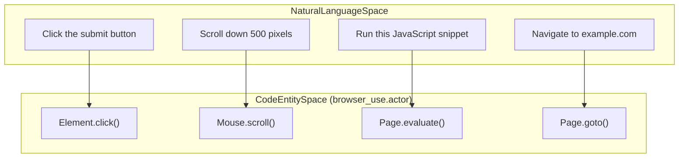
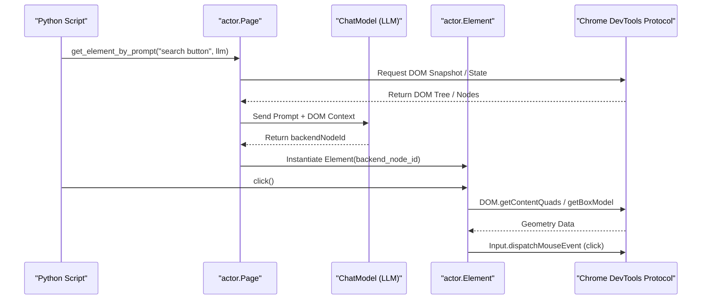

<!-- source: DeepWiki mcp.deepwiki.com · repo browser-use/browser-use · page 9.6 Actor API — Low-Level Browser Control · fetched 2026-10-30 -->

# Actor API — Low-Level Browser Control

<details>
<summary>Relevant source files</summary>

The following files were used as context for generating this wiki page:

- [browser_use/actor/README.md](browser_use/actor/README.md)
- [browser_use/actor/__init__.py](browser_use/actor/__init__.py)
- [browser_use/actor/element.py](browser_use/actor/element.py)
- [browser_use/actor/mouse.py](browser_use/actor/mouse.py)
- [browser_use/actor/page.py](browser_use/actor/page.py)
- [browser_use/actor/playground/flights.py](browser_use/actor/playground/flights.py)
- [browser_use/actor/playground/mixed_automation.py](browser_use/actor/playground/mixed_automation.py)
- [browser_use/actor/playground/playground.py](browser_use/actor/playground/playground.py)
- [browser_use/actor/utils.py](browser_use/actor/utils.py)
- [examples/custom-functions/actor_use.py](examples/custom-functions/actor_use.py)
- [tests/ci/test_actor_mouse_scroll_anchor.py](tests/ci/test_actor_mouse_scroll_anchor.py)
- [tests/ci/test_element_click_error.py](tests/ci/test_element_click_error.py)

</details>


The **Actor API** is a low-level browser automation module within `browser-use` that provides a Playwright-like interface directly on top of the Chrome DevTools Protocol (CDP). While the `Agent` system focuses on high-level task orchestration and autonomous decision-making, the Actor API allows developers to perform precise, programmatic browser control—such as finding elements by CSS selectors, performing coordinate-based mouse movements, and executing JavaScript—without the overhead of the full Agent stack [browser_use/actor/README.md:1-4]().

### System Architecture and Code Entities

The Actor API bridges the gap between high-level intent (e.g., "click the login button") and raw CDP commands. It is organized into three primary entities: `Page`, `Element`, and `Mouse` [browser_use/actor/__init__.py:6-11]().

#### Actor Entity Mapping
The following diagram illustrates how Natural Language concepts map to specific code entities within the `browser_use.actor` module.

**Title: Natural Language to Actor Entity Mapping**

Sources: [browser_use/actor/element.py:92-97](), [browser_use/actor/mouse.py:126-128](), [browser_use/actor/page.py:106-116]()

---

### Core Classes

#### 1. Page
The `Page` class represents a single browser tab or iframe [browser_use/actor/page.py:42-43](). It serves as the entry point for page-level automation tasks.

*   **Session Management:** Ensures a valid CDP session exists via `_ensure_session`, enabling required domains like `Page`, `DOM`, `Runtime`, and `Network` [browser_use/actor/page.py:56-73]().
*   **Element Discovery:** Provides `get_element` by backend node ID [browser_use/actor/page.py:98-104]().
*   **Execution:** `evaluate` allows running JavaScript functions within the page context. It strictly enforces an arrow function format `(...args) => ...` and fixes common string formatting artifacts before forwarding to `Runtime.evaluate` [browser_use/actor/page.py:106-144]().

#### 2. Element
The `Element` class encapsulates a DOM node, identified by its `backend_node_id` [browser_use/actor/element.py:61-72]().

*   **Robust Interactions:** The `click()` method implements multi-stage fallback logic to handle various rendering and layout scenarios:
    1.  Scrolls the element into view [browser_use/actor/element.py:102-106]().
    2.  Attempts `DOM.getContentQuads` for precise geometry [browser_use/actor/element.py:117-124]().
    3.  Falls back to `DOM.getBoxModel` [browser_use/actor/element.py:126-149]().
    4.  Falls back to `getBoundingClientRect` via JavaScript `Runtime.callFunctionOn` [browser_use/actor/element.py:151-197]().
    5.  Final fallback to a direct JavaScript `.click()` call on the remote object [browser_use/actor/element.py:199-215]().
*   **Error Handling:** A regression test verifies that when both CDP and JS clicks fail, exception messaging correctly references inner failures [tests/ci/test_element_click_error.py:18-66]().

#### 3. Mouse
The `Mouse` class provides coordinate-based input control for interactions that don't target a specific DOM element [browser_use/actor/mouse.py:23-30]().

*   **Precision Events:** Uses `Input.dispatchMouseEvent` for `click`, `move`, `down`, and `up` operations while tracking button states [browser_use/actor/mouse.py:44-124]().
*   **Scrolling:** Implements multiple methods including `mouseWheel` events, `synthesizeScrollGesture`, and a JavaScript `window.scrollBy` fallback [browser_use/actor/mouse.py:126-182]().
*   **Anchor Resolution:** The `_resolve_scroll_anchor` utility ensures explicit `0` coordinates are honored as edges, while `None` coordinates fall back to viewport center [browser_use/actor/mouse.py:12-20](), [tests/ci/test_actor_mouse_scroll_anchor.py:6-27]().

Sources: [browser_use/actor/page.py:42-163](), [browser_use/actor/element.py:61-215](), [browser_use/actor/mouse.py:23-182]()

---

### Data Flow: AI-Powered Element Interaction

The Actor API integrates with LLMs to allow semantic element selection. This flow combines DOM snapshots with low-level execution.

**Title: AI-Powered Element Interaction Flow**

Sources: [browser_use/actor/page.py:42-105](), [browser_use/actor/element.py:92-124](), [browser_use/actor/mouse.py:44-61]()

---

### Implementation Details

#### Coordinate and Key Utilities
The `Utils` class provides a mapping of human-readable key names (e.g., "Enter", "Control+A") to Windows Virtual Key Codes required by CDP's `Input.dispatchKeyEvent` [browser_use/actor/utils.py:4-160]().

| Feature | Implementation | File Reference |
| :--- | :--- | :--- |
| **Key Mapping** | `Utils.get_key_info` | [browser_use/actor/utils.py:4-160]() |
| **JavaScript Bridge** | `Page.evaluate` | [browser_use/actor/page.py:106-163]() |
| **Screenshotting** | `Page.screenshot` | [browser_use/actor/page.py:195-211]() |

#### Mixed Automation Patterns
The Actor API is frequently used alongside the `Agent` for mixed automation workflows, handling precise setup before handing over control to an `Agent` for complex multi-step reasoning [browser_use/actor/playground/flights.py:8-35]().

```python
# Example of mixed automation from browser_use/actor/playground/flights.py
browser = Browser(keep_alive=True)
await browser.start()
page = await browser.get_current_page() or await browser.new_page()
await page.goto('https://www.google.com/travel/flights')

# Actor API for precise setup
round_trip_button = await page.must_get_element_by_prompt('round trip button', llm)
await round_trip_button.click()

# Hand over to Agent for complex task
agent = Agent(task='Find the cheapest flight...', llm=llm, browser_session=browser)
await agent.run()
```
Sources: [browser_use/actor/playground/flights.py:8-35](), [browser_use/actor/playground/mixed_automation.py:25-50]()

### API Reference Summary

| Class | Key Methods | Description |
| :--- | :--- | :--- |
| `Page` | `goto()`, `evaluate()`, `get_element()` | High-level tab operations, JavaScript evaluation, and node resolution [browser_use/actor/page.py:42-105]() |
| `Element` | `click()`, `_get_node_id()`, `_get_remote_object_id()` | Interaction with specific DOM nodes via backend node IDs [browser_use/actor/element.py:61-90]() |
| `Mouse` | `move()`, `scroll()`, `click()`, `down()`, `up()` | Coordinate-based input events [browser_use/actor/mouse.py:23-182]() |

Sources: [browser_use/actor/README.md:140-185](), [browser_use/actor/__init__.py:6-11]()

---

