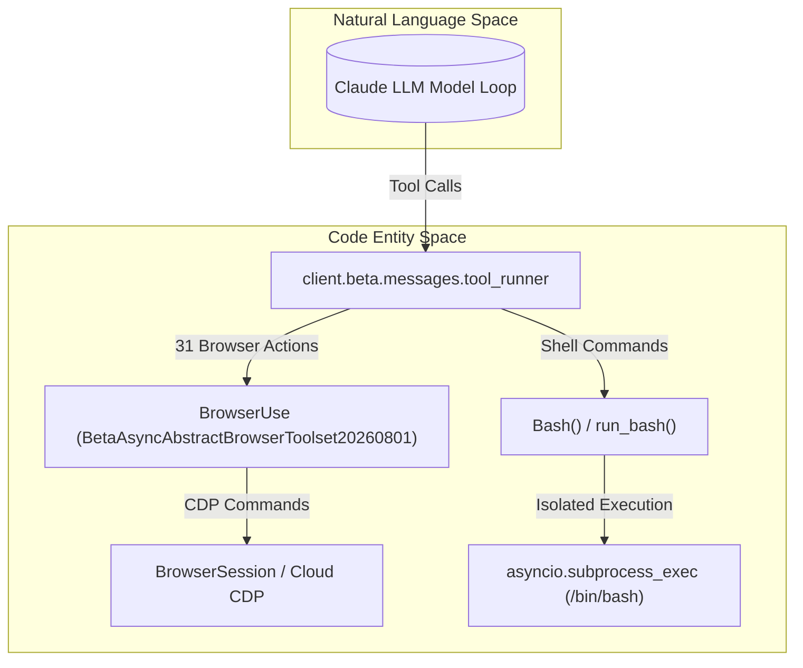
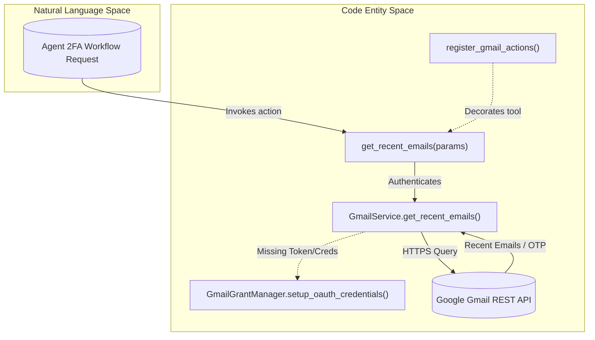

<!-- source: DeepWiki mcp.deepwiki.com · repo browser-use/browser-use · page 9.7 Third-Party Integrations · fetched 2026-10-30 -->

# Third-Party Integrations

<details>
<summary>Relevant source files</summary>

The following files were used as context for generating this wiki page:

- [browser_use/browser/cloud/cloud.py](browser_use/browser/cloud/cloud.py)
- [browser_use/browser/cloud/views.py](browser_use/browser/cloud/views.py)
- [browser_use/integrations/anthropic/__init__.py](browser_use/integrations/anthropic/__init__.py)
- [browser_use/integrations/anthropic/bash.py](browser_use/integrations/anthropic/bash.py)
- [browser_use/integrations/anthropic/browser_use.py](browser_use/integrations/anthropic/browser_use.py)
- [browser_use/integrations/gmail/__init__.py](browser_use/integrations/gmail/__init__.py)
- [browser_use/integrations/gmail/actions.py](browser_use/integrations/gmail/actions.py)
- [browser_use/integrations/gmail/service.py](browser_use/integrations/gmail/service.py)
- [browser_use/integrations/toolsets_for_claude/__init__.py](browser_use/integrations/toolsets_for_claude/__init__.py)
- [examples/integrations/anthropic/README.md](examples/integrations/anthropic/README.md)
- [examples/integrations/discord/discord_api.py](examples/integrations/discord/discord_api.py)
- [examples/integrations/discord/discord_example.py](examples/integrations/discord/discord_example.py)
- [examples/integrations/gmail_2fa_integration.py](examples/integrations/gmail_2fa_integration.py)
- [examples/integrations/slack/slack_api.py](examples/integrations/slack/slack_api.py)
- [examples/integrations/slack/slack_example.py](examples/integrations/slack/slack_example.py)
- [examples/integrations/toolsets-for-claude/README.md](examples/integrations/toolsets-for-claude/README.md)
- [examples/integrations/toolsets-for-claude/approval-gate.excalidraw](examples/integrations/toolsets-for-claude/approval-gate.excalidraw)
- [examples/integrations/toolsets-for-claude/approval-gate.svg](examples/integrations/toolsets-for-claude/approval-gate.svg)
- [skills/open-source/SKILL.md](skills/open-source/SKILL.md)
- [skills/open-source/references/integrations.md](skills/open-source/references/integrations.md)
- [tests/ci/browser/test_cloud_browser.py](tests/ci/browser/test_cloud_browser.py)
- [tests/ci/integrations/test_anthropic_browser_use.py](tests/ci/integrations/test_anthropic_browser_use.py)

</details>


## Purpose and Scope

This page documents third-party SDK adapters, external service integrations, and cross-platform extensions supported by the `browser-use` codebase. It details the architecture and implementation of Anthropic SDK toolsets (`BrowserUse` and `Bash`), the Gmail 2FA and OAuth authentication pipeline, and communication platform examples (Discord and Slack).

---

## 1. Anthropic SDK Toolsets and Claude Integration

The Anthropic integration connects `browser-use` execution capabilities to Anthropic's beta tool runner architecture via `client.beta.messages.tool_runner` [skills/open-source/references/integrations.md:12-64](). The core modules reside in `browser_use/integrations/anthropic/`, implementing a 31-member browser toolset and a bounded execution environment for local shell operations.

### Core Components and Data Flow

- **`BrowserUse` Class**: Extends Anthropic's abstract browser toolset interface (`BetaAsyncAbstractBrowserToolset20260801`) to expose 31 native browser actions (`navigate`, `screenshot`, `left_click`, `type`, `read_page`, `new_tab`, etc.) [browser_use/integrations/anthropic/browser_use.py:25-60](). It can manage an owned local Chromium browser, spin up a Browser Use Cloud session via `use_cloud=True`, or attach to an existing `BrowserSession` over CDP [browser_use/integrations/anthropic/browser_use.py:52-82]().
- **`Bash` Tool & `run_bash()`**: Provides bounded shell execution on the SDK host for local data manipulation, file writing, and script generation [browser_use/integrations/anthropic/bash.py:49-140](). It runs in a strict POSIX `/bin/bash` environment with stripped credentials, a hard timeout, and byte-bounded output collection [browser_use/integrations/anthropic/bash.py:49-113]().


**Sources:** `browser_use/integrations/anthropic/browser_use.py:25-124`, `browser_use/integrations/anthropic/bash.py:49-140`, `skills/open-source/references/integrations.md:12-64`

### Toolset Configuration and Security

The `BrowserUse` adapter allows fine-grained capability configuration via `configs`, keeping sensitive actions (`javascript_exec`, `file_upload`, `read_console`, `read_network`) disabled by default [skills/open-source/references/integrations.md:85-105]().

```python
# Configuration structure for Anthropic integration tools
# Source: browser_use/integrations/anthropic/browser_use.py:62-78
```

**Sources:** `browser_use/integrations/anthropic/browser_use.py:62-78`, `skills/open-source/references/integrations.md:85-105`

---

## 2. Gmail 2FA and Authentication Integration

To automate workflows requiring multi-factor authentication (2FA) or One-Time Passwords (OTPs), `browser-use` supplies a Gmail integration package located in `browser_use/integrations/gmail/`.

### Core Services and Actions

- **`GmailService`**: Manages OAuth2 authentication, token storage, and Gmail API queries for email retrieval [browser_use/integrations/gmail/actions.py:29-65]().
- **`register_gmail_actions()`**: Registers the `get_recent_emails` action into the agent's action registry, permitting LLM-driven verification code extraction [browser_use/integrations/gmail/actions.py:29-115]().
- **`GmailGrantManager`**: Validates credentials format, manages `gmail_credentials.json` and `gmail_token.json` files within `CONFIG.BROWSER_USE_CONFIG_DIR`, and drives interactive OAuth authorization flows [examples/integrations/gmail_2fa_integration.py:36-112]().


**Sources:** `browser_use/integrations/gmail/actions.py:29-115`, `examples/integrations/gmail_2fa_integration.py:36-112`

### Parameter Models and Data Retrieval

The `GetRecentEmailsParams` Pydantic model constrains email searches to single-keyword queries and configurable limits [browser_use/integrations/gmail/actions.py:22-28]().

```python
# Parameters schema for email search
# Source: browser_use/integrations/gmail/actions.py:22-28
```

**Sources:** `browser_use/integrations/gmail/actions.py:22-115`

---

## 3. Communication Platform Integrations (Discord & Slack)

`browser-use` provides integration examples for messaging platforms such as Discord and Slack (`examples/integrations/discord/`, `examples/integrations/slack/`). These examples demonstrate agent-driven notifications, webhook dispatching, and incoming message polling to trigger automated browser tasks.

### Architecture Patterns

- **Webhook Dispatch**: Agents execute actions that post task summaries, status updates, or captured screenshots directly to Slack channels or Discord webhooks.
- **Event Polling**: External event listeners receive commands from chat interfaces and instantiate `Agent` execution loops programmatically.

**Sources:** `examples/integrations/discord/discord_example.py:1-50`, `examples/integrations/slack/slack_example.py:1-50`

---

