# Page: Overview

# Overview

<details>
<summary>Relevant source files</summary>

The following files were used as context for generating this wiki page:

- [README.md](README.md)
- [browser_use/__init__.py](browser_use/__init__.py)
- [browser_use/llm/__init__.py](browser_use/llm/__init__.py)
- [browser_use/llm/models.py](browser_use/llm/models.py)
- [static/readme/README.md](static/readme/README.md)
- [static/readme/which-product-dark.svg](static/readme/which-product-dark.svg)
- [static/readme/which-product-light.svg](static/readme/which-product-light.svg)
- [tests/ci/models/test_llm_model_factory.py](tests/ci/models/test_llm_model_factory.py)

</details>


Browser-use is an open-source Python framework that enables Large Language Models (LLMs) to autonomously control and interact with web browsers. The framework provides a complete system for building AI agents that can navigate websites, extract information, fill forms, and perform complex multi-step browser automation tasks by mimicking human interaction—clicking, typing, and scrolling.

**Sources:** [README.md:42-50](), [browser_use/__init__.py:75-113]()

## Core Purpose

Browser-use bridges the gap between LLMs and web browsers by:

1.  **Translating web pages into LLM-readable format**: The DOM processing pipeline converts raw HTML/CSS/JavaScript into structured text with interactive element indices, significantly reducing token usage compared to raw HTML.
2.  **Executing LLM decisions as browser actions**: Actions like `click`, `type`, `navigate`, and `extract` are translated to Chrome DevTools Protocol (CDP) commands.
3.  **Managing execution state**: The `Agent` system tracks conversation history, detects loops, and maintains context across multi-step tasks.
4.  **Supporting multiple deployment modes**: Local development, cloud-based browsers via `use_cloud=True`, and production-ready infrastructure via the CLI and Model Context Protocol (MCP) integrations.

**Sources:** [README.md:41-98](), [browser_use/__init__.py:75-113]()

## Child Pages and Detailed Guides

This overview introduces the high-level architecture and concepts of browser-use. For detailed technical information, consult the following child pages:
- **System Architecture**: High-level overview of the layered architecture (Agent orchestration, Browser control, DOM processing, and LLM integration) — see [System Architecture](#1.1)
- **Installation and Setup**: Guide for installing browser-use via `pip`/`uv`, setting up API keys, and initial configuration — see [Installation and Setup](#1.2)
- **Quick Start Examples**: Simple code examples showing basic `Agent` usage, browser automation tasks, and common patterns — see [Quick Start Examples](#1.3)

**Sources:** [README.md:73-151](), [browser_use/__init__.py:75-113]()

## System Architecture Overview

Browser-use is built on a modular, layered architecture that separates orchestration, browser control, DOM processing, and LLM communication.

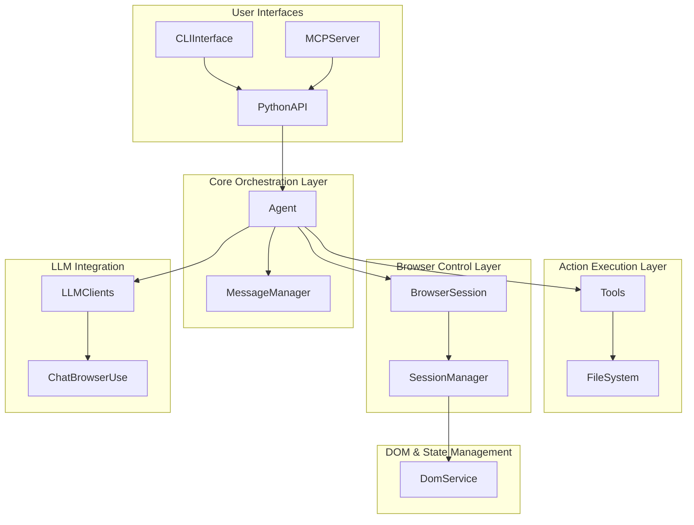

**Sources:** [browser_use/__init__.py:75-135](), [browser_use/llm/models.py:17-23]()

## Code Entity Space Mapping

### Agent Execution Flow

The following diagram bridges the natural language task instruction to the concrete code entities involved in execution:

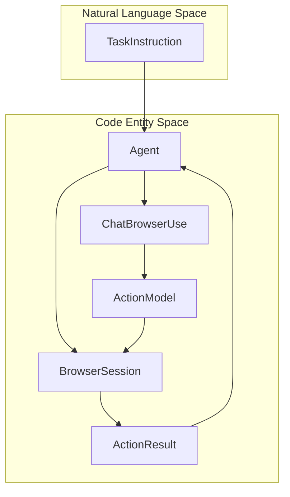

**Sources:** [browser_use/__init__.py:78-86](), [browser_use/llm/models.py:83-86]()

### CLI and Interface Mapping

The following diagram maps CLI invocation to the underlying internal server and agent orchestration classes:

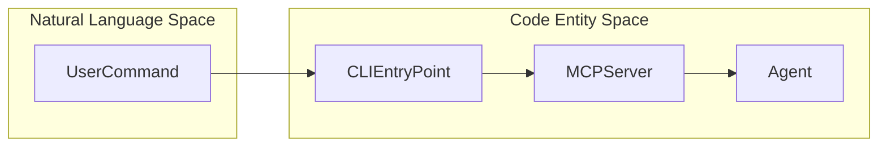

**Sources:** [browser_use/__init__.py:78](), [README.md:85-92]()

## Project Interfaces

Browser-use offers several ways to interact with the system:

1.  **Python API**: The primary integration vector using the `Agent` and `BrowserSession` classes.
2.  **CLI**: Terminal interface for direct browser control and task execution.
3.  **MCP Server**: Exposes tools to MCP-compatible clients like Claude Desktop.
4.  **TUI**: A terminal-based user interface for interactive task input and live logging.

**Sources:** [README.md:140-151](), [browser_use/__init__.py:75-113]()

---

# Page: System Architecture

# System Architecture

<details>
<summary>Relevant source files</summary>

The following files were used as context for generating this wiki page:

- [browser_use/agent/message_manager/service.py](browser_use/agent/message_manager/service.py)
- [browser_use/agent/message_manager/views.py](browser_use/agent/message_manager/views.py)
- [browser_use/agent/prompts.py](browser_use/agent/prompts.py)
- [browser_use/agent/service.py](browser_use/agent/service.py)
- [browser_use/agent/views.py](browser_use/agent/views.py)
- [browser_use/browser/events.py](browser_use/browser/events.py)
- [browser_use/browser/profile.py](browser_use/browser/profile.py)
- [browser_use/browser/session.py](browser_use/browser/session.py)
- [browser_use/browser/views.py](browser_use/browser/views.py)
- [browser_use/browser/watchdog_base.py](browser_use/browser/watchdog_base.py)

</details>


## Purpose and Scope

This page provides a comprehensive overview of the `browser-use` system architecture, detailing the interaction between high-level AI orchestration and low-level browser control. The library is designed as a layered framework that transforms natural language instructions into precise browser actions using an iterative sense-think-act loop.

Key architectural pillars include:
- **Agent Orchestration**: Managing the execution loop, message history, and LLM context via the `Agent` class (`browser_use/agent/service.py`) [browser_use/agent/service.py:133-206]().
- **Browser Control**: Event-driven session management and CDP integration through `BrowserSession` (`browser_use/browser/session.py`) [browser_use/browser/session.py:134-185]().
- **DOM Processing**: Multi-stage pipeline for converting complex web pages into LLM-consumable state (`BrowserStateSummary`).
- **LLM Integration**: Provider-agnostic interface with structured output enforcement supporting OpenAI, Anthropic, Google, and others.

Sources: [browser_use/agent/service.py:133-206](), [browser_use/browser/session.py:134-185]()

---

## High-Level Architecture

The system is organized into specialized layers that decouple reasoning from execution.

### System Architecture Overview

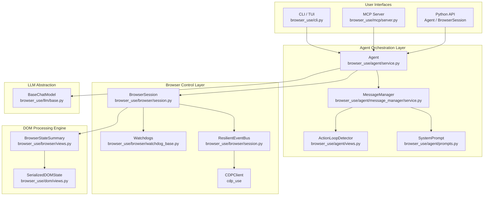

Sources: [browser_use/agent/service.py:133-206](), [browser_use/agent/message_manager/service.py:104-148](), [browser_use/browser/session.py:134-185]()

---

## Component Responsibilities

| Component | Class | Primary Responsibility |
|-----------|-------|----------------------|
| **Agent** | `Agent` | Coordinates the `step()` loop, LLM inference, and action dispatch. |
| **Message Manager** | `MessageManager` | Manages conversation history, state pruning, and prompt assembly. |
| **Browser Session** | `BrowserSession` | Orchestrates browser lifecycle, profile config, and event-driven control. |
| **Watchdog Base** | `BaseWatchdog` | Monitors browser state changes and dispatches event handlers via `ResilientEventBus`. |
| **Action Loop Detector** | `ActionLoopDetector` | Tracks repetition and page stagnation to nudge the LLM. |
| **Message History** | `MessageHistory` | Stores system, state, and context messages in order. |

Sources: [browser_use/agent/service.py:133-206](), [browser_use/agent/message_manager/service.py:104-148](), [browser_use/browser/watchdog_base.py:15-39]()

---

## Core Data Flows: The Sense-Think-Act Loop

The `Agent.step()` method is the heart of the system, executing an iterative loop until completion.

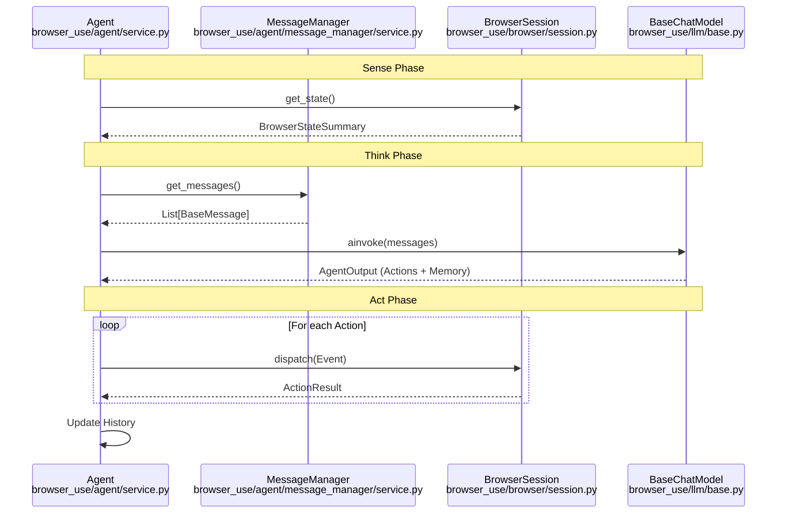

Sources: [browser_use/agent/service.py:133-206](), [browser_use/agent/message_manager/service.py:104-148](), [browser_use/browser/session.py:134-185]()

---

## Bridge: Natural Language Space to Code Entity Space (Agent Execution)

This diagram maps high-level user intents and natural language instructions to concrete Python classes, functions, and files within the agent orchestration pipeline.

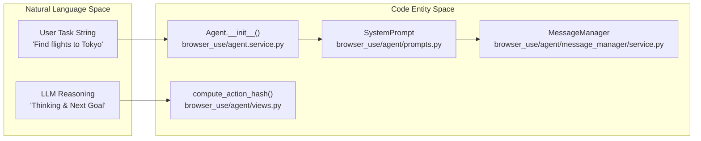

Sources: [browser_use/agent/service.py:133-206](), [browser_use/agent/prompts.py:28-60](), [browser_use/agent/views.py:151-155]()

---

## Bridge: Natural Language Space to Code Entity Space (Browser Control & Lifecycle)

This diagram maps browser automation requirements to underlying browser configuration classes and CDP event dispatch entities.

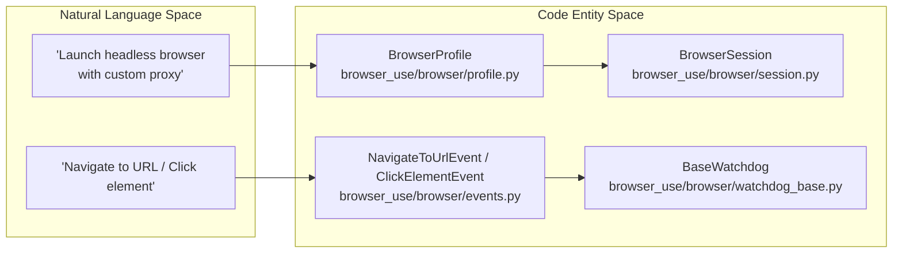

Sources: [browser_use/browser/profile.py:124-165](), [browser_use/browser/session.py:134-185](), [browser_use/browser/events.py:110-146](), [browser_use/browser/watchdog_base.py:15-39]()

---

## DOM Processing and Browser State

The system transforms raw browser data into a compact, semantic representation suitable for LLMs. 
- **BrowserStateSummary**: Aggregates DOM state, URL, title, tabs, viewport metrics, and screenshots (`browser_use/browser/views.py`) [browser_use/browser/views.py:91-114]().
- **PageInfo**: Computes viewport dimensions, total page dimensions, scroll positions, and directional offsets [browser_use/browser/views.py:44-67]().

Sources: [browser_use/browser/views.py:44-114]()

---

## Message and Context Management

The `MessageManager` ensures the LLM stays within token limits while retaining critical task context.

### Context Compaction
- **MessageCompactionSettings**: Configures automatic summarization of older history into a `compacted_memory` block based on character or token counts (`browser_use/agent/views.py`) [browser_use/agent/views.py:35-56]().

### Loop Detection
- **ActionLoopDetector**: Tracks action repetition and page stagnation using `compute_action_hash` to normalize action parameters (`browser_use/agent/views.py`) [browser_use/agent/views.py:110-165]().

Sources: [browser_use/agent/views.py:35-56](), [browser_use/agent/views.py:110-165]()

---

## Configuration and Resilience

The system is designed for production stability through robust event handling and configuration options.

### Key Configurations
- **AgentSettings**: Configures `use_vision`, `max_failures`, `use_judge`, `enable_planning`, and timeouts (`browser_use/agent/views.py`) [browser_use/agent/views.py:59-94]().
- **Browser Profile**: Manages Chrome arguments (`CHROME_DEFAULT_ARGS`, `CHROME_HEADLESS_ARGS`, `CHROME_DOCKER_ARGS`), extensions, and proxy settings (`browser_use/browser/profile.py`) [browser_use/browser/profile.py:124-165]().

### Resilience Mechanisms
- **ResilientEventBus**: Inherits from `EventBus` to provide robust step execution and prevent assertions during warm-Lambda resumes or torn-down buses (`browser_use/browser/session.py`) [browser_use/browser/session.py:106-133]().
- **Circuit Breakers**: Watchdog event handlers verify CDP connectivity before execution to avoid hanging on broken WebSocket connections (`browser_use/browser/watchdog_base.py`) [browser_use/browser/watchdog_base.py:93-123]().

Sources: [browser_use/agent/views.py:59-94](), [browser_use/browser/profile.py:124-165](), [browser_use/browser/session.py:106-133](), [browser_use/browser/watchdog_base.py:93-123]()

---

# Page: Installation and Setup

# Installation and Setup

<details>
<summary>Relevant source files</summary>

The following files were used as context for generating this wiki page:

- [browser_use/init_cmd.py](browser_use/init_cmd.py)
- [browser_use/skills/browser-use/SKILL.md](browser_use/skills/browser-use/SKILL.md)
- [browser_use/skills/browser_use.py](browser_use/skills/browser_use.py)
- [browser_use/skills/install.py](browser_use/skills/install.py)
- [pyproject.toml](pyproject.toml)
- [skills/browser-use/SKILL.md](skills/browser-use/SKILL.md)
- [skills/remote-browser/SKILL.md](skills/remote-browser/SKILL.md)
- [tests/ci/test_browser_use_skill_install_docs.py](tests/ci/test_browser_use_skill_install_docs.py)

</details>


This page provides a comprehensive guide for installing `browser-use`, configuring system dependencies, setting up API keys, managing assistant skills, and initializing projects using the CLI and environment configuration system.

---

## Package Installation and Dependency Management

The `browser-use` package requires Python ≥3.11 (`requires-python = ">=3.11,<4.0"` [pyproject.toml:7]()). The standard and recommended installation method leverages `uv` for fast dependency resolution and isolated environment execution.

### Standard Installation with uv

```bash
# Initialize a new project and add browser-use
uv init && uv add browser-use && uv sync

# Install core CLI tool and dependencies
uv tool install browser-use
```

### Installation with pip

For standard Python environments:

```bash
pip install browser-use
```

### Optional Dependencies

The package defines multiple optional dependency groups in `pyproject.toml` to support specialized integrations [pyproject.toml:61-89]():

| Dependency Group | Command | Purpose |
|-----------------|---------|---------|
| `cli` | `pip install "browser-use[cli]"` | Terminal UI and CLI support [pyproject.toml:61]() |
| `core` | `pip install "browser-use[core]"` | Platform-specific core binaries [pyproject.toml:63-69]() |
| `aws` | `pip install "browser-use[aws]"` | AWS Bedrock support via `boto3` [pyproject.toml:70]() |
| `oci` | `pip install "browser-use[oci]"` | Oracle Cloud Infrastructure support [pyproject.toml:71]() |
| `video` | `pip install "browser-use[video]"` | Video recording via `imageio` and `numpy` [pyproject.toml:72]() |
| `eval` | `pip install "browser-use[eval]"` | Evaluation tools and `lmnr` integration [pyproject.toml:82-87]() |
| `all` | `pip install "browser-use[all]"` | Combines cli, examples, aws, and oci optional groups [pyproject.toml:89]() |

**Sources:** [pyproject.toml:1-89]()

---

## Skill Installation and Assistant Integration

The package supports registering its agent skill definition into various assistant configurations (such as Claude, Cursor, Codex, OpenClaw, etc.) via the `browser-use skill install` command [browser_use/skills/install.py:25-34]().

### Assistant Targets
The CLI command resolves target directories dynamically through `TARGET_DIR_BUILDERS` [browser_use/skills/install.py:25-34]():
- `agents`, `claude`, `codex`, `copilot`, `cursor`, `gemini`, `openclaw`: mapped to `~/.<assistant>/skills/browser-use/SKILL.md` [browser_use/skills/install.py:21-32]().
- `opencode`: mapped to XDG config paths (`~/.config/opencode/skills/browser-use/SKILL.md`) [browser_use/skills/install.py:33]().

The installation handler checks for `uv` availability, executes `uv tool install --python 3.12 --upgrade --force browser-use` [browser_use/skills/install.py:66-74](), loads the skill text from the package or harness (`_load_skill_text_from_browser_harness_cli`) [browser_use/skills/install.py:76-89](), and writes out `SKILL.md` files [browser_use/skills/install.py:177-180]().

Title: Skill Installation Pipeline (Natural Language to Code Entity Space)
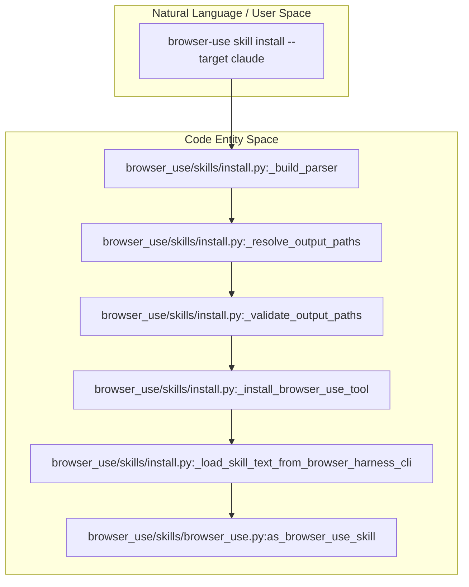

**Sources:** [browser_use/skills/install.py:25-182](), [browser_use/skills/browser_use.py:32-75]()

---

## Template Generation and Initialization

To quickly bootstrap automation projects, `browser-use` provides a standalone initialization command (`browser-use-init`) implemented in `browser_use/init_cmd.py` [browser_use/init_cmd.py:191-222]().

The tool fetches template metadata and files from the remote template repository (`TEMPLATE_REPO_URL`) [browser_use/init_cmd.py:28-48](), presents an interactive template selector using `InquirerPy` styled with browser-use orange themes (`inquirer_style`) [browser_use/init_cmd.py:105-113](), and writes out the configured file locally with safety overwrite prompts (`_write_init_file`) [browser_use/init_cmd.py:170-188]().

**Sources:** [browser_use/init_cmd.py:28-222]()

---

## API Key and Environment Configuration

### Provider Keys
Browser-use relies on environment variables for authenticating with LLM providers:
- OpenAI: `OPENAI_API_KEY`
- Anthropic: `ANTHROPIC_API_KEY`
- Google Gemini: `GOOGLE_API_KEY`
- Browser Use Cloud: `BROWSER_USE_API_KEY`

These are typically loaded via `.env` files using `python-dotenv` at runtime.

---

## CLI Entry Points and Verification

The package defines several standard script entry points in `pyproject.toml` [pyproject.toml:104-108]():
- `browser-use = "browser_use.cli:main"` [pyproject.toml:105]()
- `browseruse = "browser_use.cli:main"` [pyproject.toml:106]()
- `bu = "browser_use.cli:main"` [pyproject.toml:107]()
- `browser = "browser_use.cli:main"` [pyproject.toml:108]()

Title: CLI and Initialization Architecture (Natural Language to Code Entity Space)
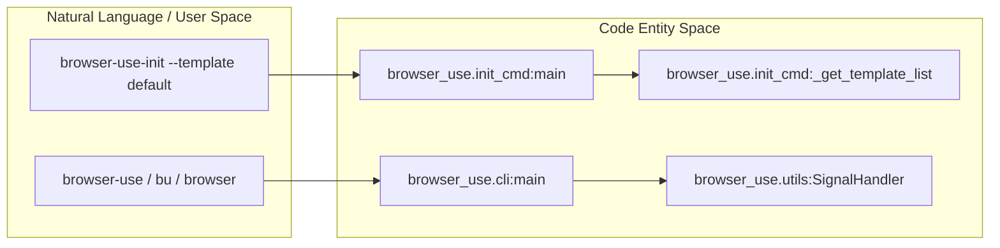

**Sources:** [pyproject.toml:104-108](), [browser_use/cli.py:1](), [browser_use/init_cmd.py:191-222](), [browser_use/utils.py:127-198]()

---

# Page: Quick Start Examples

# Quick Start Examples

<details>
<summary>Relevant source files</summary>

The following files were used as context for generating this wiki page:

- [examples/browser/cloud_browser.py](examples/browser/cloud_browser.py)
- [examples/demo_mode_example.py](examples/demo_mode_example.py)
- [examples/features/custom_system_prompt.py](examples/features/custom_system_prompt.py)
- [examples/features/initial_actions.py](examples/features/initial_actions.py)
- [examples/features/small_model_for_extraction.py](examples/features/small_model_for_extraction.py)
- [examples/file_system/alphabet_earnings.py](examples/file_system/alphabet_earnings.py)
- [examples/file_system/file_system.py](examples/file_system/file_system.py)
- [examples/getting_started/01_basic_search.py](examples/getting_started/01_basic_search.py)
- [examples/getting_started/02_form_filling.py](examples/getting_started/02_form_filling.py)
- [examples/getting_started/03_data_extraction.py](examples/getting_started/03_data_extraction.py)
- [examples/getting_started/04_multi_step_task.py](examples/getting_started/04_multi_step_task.py)
- [examples/models/browser_use_llm.py](examples/models/browser_use_llm.py)
- [examples/sandbox/example.py](examples/sandbox/example.py)

</details>


This page provides practical code examples showing basic `Agent` usage, task-specific browser automation patterns, file system integration, advanced configurations (such as initial actions and split-model extraction), and cloud or sandbox execution options.

Sources: [examples/getting_started/01_basic_search.py:1-29](), [examples/file_system/file_system.py:1-50]()

---

## Basic Agent Pattern

The simplest agent requires a task string, an LLM instance, and an execution invocation. The recommended default chat model class is `ChatBrowserUse` configured with models like `bu-2-0` or `bu-2-0-mini-preview` [examples/getting_started/01_basic_search.py:21-25](), [examples/models/browser_use_llm.py:22-31]().

### Asynchronous Execution (Recommended)
For modern Python applications, run the agent within an asynchronous event loop via `await agent.run()` [examples/getting_started/01_basic_search.py:21-29]().

```python
import asyncio
from browser_use import Agent, ChatBrowserUse

async def main():
	llm = ChatBrowserUse(model='bu-2-0-mini-preview')
	task = "Search Google for 'what is browser automation' and tell me the top 3 results"
	agent = Agent(task=task, llm=llm)
	await agent.run()

if __name__ == '__main__':
	asyncio.run(main())
```
[examples/getting_started/01_basic_search.py:21-29]()

Sources: [examples/getting_started/01_basic_search.py:21-29](), [examples/models/browser_use_llm.py:22-32]()

---

## Agent Initialization Architecture

The following diagram bridges natural language task specifications to the underlying Python code entities instantiated during setup.

Title: Agent Initialization Flow
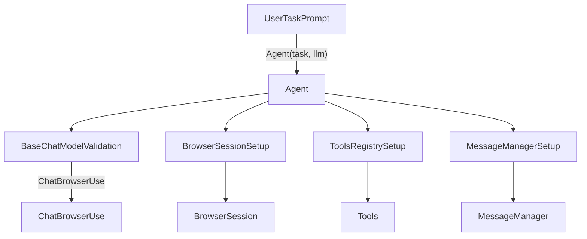

Sources: [examples/getting_started/01_basic_search.py:21-25](), [examples/models/browser_use_llm.py:22-32](), [examples/file_system/file_system.py:32-37]()

---

## Task-Specific Automation Patterns

### Form Filling
Navigates to a target URL, fills out multiple form fields using semantic element matching, and submits the form [examples/getting_started/02_form_filling.py:36-47]().

```python
task = """
Go to https://httpbin.org/forms/post and fill out the contact form with:
- Customer name: John Doe
- Telephone: 555-123-4567
- Email: john.doe@example.com
- Size: Medium
- Topping: cheese
- Delivery time: now
- Comments: This is a test form submission

Then submit the form and tell me what response you get.
"""
agent = Agent(task=task, llm=ChatBrowserUse(model='bu-2-0-mini-preview'))
await agent.run()
```
[examples/getting_started/02_form_filling.py:36-51]()

### Data Extraction
Extracts structured information from a web page and returns it in a designated format [examples/getting_started/03_data_extraction.py:36-46]().

```python
task = """
Go to https://quotes.toscrape.com/ and extract the following information:
- The first 5 quotes on the page
- The author of each quote
- The tags associated with each quote

Present the information in a clear, structured format.
"""
agent = Agent(task=task, llm=ChatBrowserUse(model='bu-2-0-mini-preview'))
await agent.run()
```
[examples/getting_started/03_data_extraction.py:36-50]()

### Multi-Step Research Tasks
Chains search queries, cross-domain navigation, and data synthesis [examples/getting_started/04_multi_step_task.py:36-50]().

```python
task = """
1. Search Google for "best Python web scraping libraries 2024"
2. Find a reputable article and extract the top 3 libraries
3. Visit official GitHub pages for each and extract star counts
4. Present a summary comparison.
"""
agent = Agent(task=task, llm=ChatBrowserUse(model='bu-2-0-mini-preview'))
await agent.run()
```
[examples/getting_started/04_multi_step_task.py:36-54]()

### File System Integration & Persistence
Configures local file system storage for the agent to save, append, and read intermediate artifacts like markdown or PDF documents [examples/file_system/file_system.py:20-37]().

```python
task = """
Go to https://mertunsall.github.io/posts/post1.html
Save the title of the article in "data.md"
Then, use append_file to add the first sentence of the article to "data.md"
Then, read the file to see its content and make sure it's correct.
"""
agent = Agent(
	task=task,
	llm=ChatOpenAI(model='gpt-4.1-mini'),
	save_conversation_path='./conversations',
	file_system_path='./fs',
)
await agent.run()
```
[examples/file_system/file_system.py:20-41]()

Sources: [examples/getting_started/02_form_filling.py:36-51](), [examples/getting_started/03_data_extraction.py:36-50](), [examples/getting_started/04_multi_step_task.py:36-54](), [examples/file_system/file_system.py:20-41]()

---

## Advanced Configuration Patterns

### Initial Actions
Seeds the browser session with predefined navigation steps before the LLM takes over control loop execution [examples/features/initial_actions.py:15-23]().

```python
initial_actions = [
	{'navigate': {'url': 'https://www.google.com', 'new_tab': True}},
	{'navigate': {'url': 'https://en.wikipedia.org/wiki/Randomness', 'new_tab': True}},
]
agent = Agent(
	task='What theories are displayed on the page?',
	initial_actions=initial_actions,
	llm=llm,
)
```
[examples/features/initial_actions.py:15-23]()

### Split-Model Execution (`page_extraction_llm`)
Uses a high-capability model for strategic planning and a faster, cost-effective model dedicated solely to page content extraction [examples/features/small_model_for_extraction.py:16-19]().

```python
llm = ChatOpenAI(model='gpt-4.1')
small_llm = ChatOpenAI(model='gpt-4.1-mini')

agent = Agent(
	task='Find founders and extract links',
	llm=llm,
	page_extraction_llm=small_llm,
)
```
[examples/features/small_model_for_extraction.py:16-19]()

### Custom System Prompts
Extends or overrides the default system instruction set provided to the agent [examples/features/custom_system_prompt.py:15-25]().

```python
extend_message = 'REMEMBER: ALWAYS open first a new tab and go to wikipedia.com!'
agent = Agent(
	task='Search for Elon Musk',
	llm=model,
	extend_system_message=extend_message,
)
```
[examples/features/custom_system_prompt.py:15-25]()

Sources: [examples/features/initial_actions.py:15-23](), [examples/features/small_model_for_extraction.py:16-19](), [examples/features/custom_system_prompt.py:15-25]()

---

## Cloud and Sandbox Execution

### Browser Use Cloud
Leverages cloud-hosted browser infrastructure optimized for stealth and scale by setting `use_cloud=True` on the `Browser` configuration [examples/browser/cloud_browser.py:18-26]().

```python
from browser_use import Agent, Browser, ChatBrowserUse

browser = Browser(use_cloud=True)
agent = Agent(
	task='Go to github.com/browser-use/browser-use and tell me the star count',
	llm=ChatBrowserUse(model='bu-2-0-mini-preview'),
	browser=browser,
)
await agent.run()
```
[examples/browser/cloud_browser.py:18-26]()

### Sandbox Decorator Pattern
Executes agent workflows within an isolated sandbox environment using the `@sandbox` decorator [examples/sandbox/example.py:28-44]().

```python
@sandbox(log_level='INFO')
async def run_in_sandbox(browser: Browser):
	agent = Agent(
		task='Check my IP address and location in JSON format',
		browser=browser,
		llm=ChatBrowserUse(model='bu-2-0-mini-preview'),
	)
	res = await agent.run()
	return res.final_result()
```
[examples/sandbox/example.py:28-44]()

Sources: [examples/browser/cloud_browser.py:18-26](), [examples/sandbox/example.py:28-44]()

---

## Agent Execution Lifecycle

The following sequence diagram maps the iterative execution loop to internal code components.

Title: Agent Execution Lifecycle
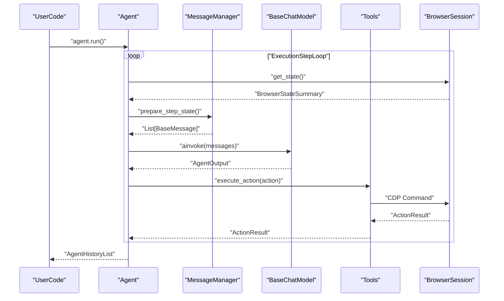

Sources: [examples/getting_started/01_basic_search.py:25](), [examples/file_system/file_system.py:41]()

---

# Page: Agent System

# Agent System

<details>
<summary>Relevant source files</summary>

The following files were used as context for generating this wiki page:

- [browser_use/agent/message_manager/service.py](browser_use/agent/message_manager/service.py)
- [browser_use/agent/message_manager/views.py](browser_use/agent/message_manager/views.py)
- [browser_use/agent/prompts.py](browser_use/agent/prompts.py)
- [browser_use/agent/service.py](browser_use/agent/service.py)
- [browser_use/agent/views.py](browser_use/agent/views.py)
- [browser_use/browser/views.py](browser_use/browser/views.py)

</details>


## Purpose and Scope

The Agent System is the central orchestration layer in `browser-use`, responsible for coordinating task execution through a sense-think-act loop. The `Agent` class [browser_use/agent/service.py:133-134]() manages the interaction between LLMs, browser state, and action execution to accomplish user-defined tasks.

This page provides a high-level overview of the Agent System architecture and its key subsystems. For detailed documentation of specific components, see:

- [Agent Core and Execution Loop](#2.1) — Detailed explanation of `Agent.__init__`, the step() method, and the iterative decision-action-observe loop
- [Message Manager and Prompt Construction](#2.2) — How `MessageManager` builds LLM prompts by combining system prompts, browser state, task context, and history
- [Agent State and History Management](#2.3) — `AgentState` persistence, `AgentHistoryList` serialization, and history save/load/rerun mechanisms
- [System Prompts and Output Formats](#2.4) — `SystemPrompt` generation, prompt markdown variants, `AgentOutput` structure, and structured output schema customization
- [Skills Integration](#2.5) — How skills are registered as Agent actions, skill execution flow, skill service/views, and cookie requirements
- [Agent Configuration and Settings](#2.6) — `AgentSettings` parameters: `use_vision`, `max_failures`, `enable_planning`, `use_judge`, and other configuration options
- [Loop Detection and Behavioral Nudges](#2.7) — `ActionLoopDetector` implementation, action hash normalization, and nudge message injection
- [Message Compaction System](#2.8) — Automatic prompt compression via `maybe_compact_messages` when token limits are approached
- [Memory and Follow-up Tasks](#2.9) — Long-term memory management, conversation persistence, and `add_new_task()` for multi-turn interactions
- [Judge System and Trace Evaluation](#2.10) — Agent judge for evaluating execution traces, `construct_judge_messages`, `use_judge` configuration, and GIF history generation
- [Beta Agent](#2.11) — The experimental `browser_use/beta` service: what it changes relative to the main Agent, its API surface, and example usage

**Sources:** [browser_use/agent/service.py:133-134]()

---

## Agent Class Architecture

The `Agent` class [browser_use/agent/service.py:133-134]() serves as the main orchestrator. It is generic over two type parameters: `Context` (for custom tool context) and `AgentStructuredOutput` (for typed output schemas).

### Core Components Diagram

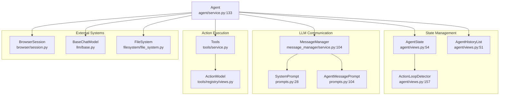

**Sources:** [browser_use/agent/service.py:133-209](), [browser_use/agent/views.py:54](), [browser_use/agent/views.py:51](), [browser_use/agent/message_manager/service.py:104-148]()

### Agent Initialization

The `Agent.__init__` method [browser_use/agent/service.py:135-197]() accepts extensive configuration including:

- **Task definition**: Natural language task string.
- **LLM configuration**: `llm`, `fallback_llm`, `page_extraction_llm`, `judge_llm`.
- **Browser setup**: `browser_session` (alias: `browser`), `browser_profile`.
- **Tools**: `tools` (alias: `controller`) for action registry.
- **Skills**: `skill_ids` (alias: `skills`) for actions.
- **Output schema**: `output_model_schema` for structured extraction.
- **Settings**: Configuration via parameters that populate `AgentSettings` [browser_use/agent/views.py:59-94]().
- **Callbacks**: `register_new_step_callback`, `register_done_callback`, `register_should_stop_callback`.

#### Key Initialization Steps

1. **LLM Setup**: Auto-detects default LLM from config, handles provider-specific timeouts [browser_use/agent/views.py:85](), and configures screenshot size.
2. **Browser Profile**: Creates or updates `BrowserProfile` with settings like `include_attributes`.
3. **Tools Registry**: Configures available actions based on vision settings and model capabilities.
4. **Message Manager**: Initializes with system prompt, task, and compaction settings [browser_use/agent/message_manager/service.py:104-148]().
5. **Loop Detector**: Configures repetition window size from settings [browser_use/agent/views.py:90]().

**Sources:** [browser_use/agent/service.py:135-197](), [browser_use/agent/views.py:59-94]()

---

## Execution Loop Overview

The agent operates through an iterative sense-think-act loop. The loop continues until the task is complete, max steps is reached, or an error occurs.

### High-Level Execution Flow

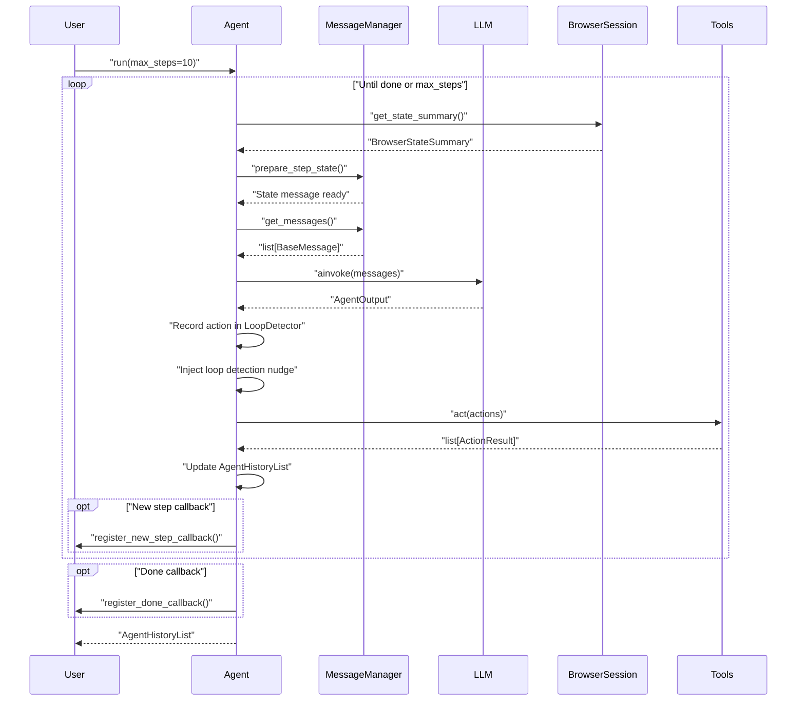

The execution loop integrates several subsystems:

- **State Capture**: `BrowserSession` provides `BrowserStateSummary` containing DOM, tabs, and screenshots [browser_use/browser/views.py:91]().
- **Prompt Construction**: `MessageManager` builds LLM context from browser state and history [browser_use/agent/message_manager/service.py:104]().
- **Loop Detection**: `ActionLoopDetector` tracks action repetition and page stagnation [browser_use/agent/views.py:157]().
- **Action Execution**: `Tools` dispatches actions to the browser.
- **History Tracking**: `AgentHistoryList` records each step for serialization [browser_use/agent/views.py:51]().

**Sources:** [browser_use/agent/service.py:133-209](), [browser_use/agent/message_manager/service.py:196-200]()

---

## State Management Overview

The agent maintains multiple state layers for execution continuity and serialization. State is split between runtime control flags and persistent execution history.

### State Hierarchy

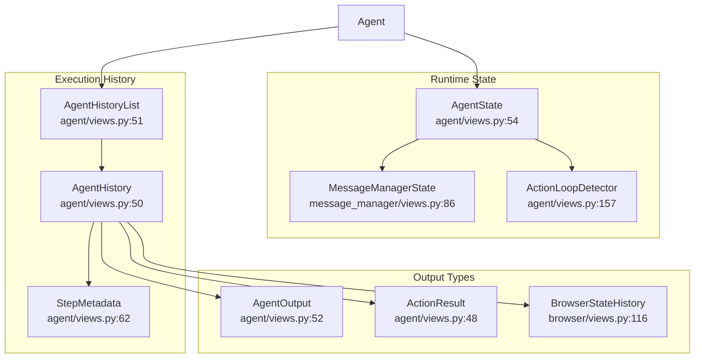

### Key State Components

- **AgentState** [browser_use/agent/views.py:54](): Runtime control state including step count, failure tracking, and nested state objects.
- **AgentHistoryList** [browser_use/agent/views.py:51](): Execution trace container with serialization support.
- **ActionLoopDetector** [browser_use/agent/views.py:157-165](): Tracks action repetition and page stagnation for behavioral nudges.
- **MessageManagerState** [browser_use/agent/message_manager/views.py:86-101](): Message history and compaction state.

**Sources:** [browser_use/agent/views.py:35-65](), [browser_use/agent/message_manager/views.py:86-101]()

---

## Message Construction Overview

The `MessageManager` [browser_use/agent/message_manager/service.py:104]() builds LLM prompts by assembling browser state, agent history, and task instructions.

### Message Components

The message construction pipeline assembles several components:

- **System Prompt**: Instructions and action schemas via `SystemPrompt` [browser_use/agent/prompts.py:28](). It selects templates based on model type (e.g., `is_browser_use_model`, `is_anthropic_4_5`) [browser_use/agent/prompts.py:65-82]().
- **Agent History**: Previous steps and results from `MessageManagerState.agent_history_items` [browser_use/agent/message_manager/views.py:91]().
- **Browser State**: Current DOM, tabs, and page statistics via `BrowserStateSummary` [browser_use/browser/views.py:91]().
- **Compacted Memory**: Summarized history via `MessageCompactionSettings` [browser_use/agent/views.py:35-56]().

The `MessageManager.prepare_step_state()` method orchestrates assembly by updating history, handling screenshots based on `vision_detail_level` [browser_use/agent/message_manager/service.py:117](), filtering sensitive data, and managing token-based message compaction.

**Sources:** [browser_use/agent/message_manager/service.py:104-148](), [browser_use/agent/prompts.py:28-100](), [browser_use/agent/views.py:35-56]()

---

## Loop Detection and Behavioral Nudges

The agent includes a loop detection system to identify and nudge the agent away from repetitive behavior. This is implemented through the `ActionLoopDetector` class [browser_use/agent/views.py:157-165]().

### Detection Mechanisms

1. **Action Repetition**: Tracks normalized action hashes. Actions are normalized to detect semantic similarity (e.g., stripping minor keyword variations in search) via `_normalize_action_for_hash` [browser_use/agent/views.py:110-148]().
2. **Page Stagnation**: Tracks page content via `PageFingerprint` (URL + element count + text hash) [browser_use/agent/views.py:95-108]().

Nudges are awareness messages injected into the prompt. The agent remains free to continue if it believes repetition is productive.

**Sources:** [browser_use/agent/views.py:95-165]()

---

## Code Entity Reference

### Primary Classes

| Class | Path | Purpose |
|-------|------|---------|
| `Agent` | [browser_use/agent/service.py:134]() | Main orchestrator coordinating LLM, Browser, and Tools. |
| `MessageManager` | [browser_use/agent/message_manager/service.py:104]() | Prompt construction and history management. |
| `AgentState` | [browser_use/agent/views.py:54]() | Runtime state (steps, failures, flags). |
| `AgentHistoryList` | [browser_use/agent/views.py:51]() | Execution trace container. |
| `ActionLoopDetector` | [browser_use/agent/views.py:157]() | Repetition and stagnation detection. |
| `AgentSettings` | [browser_use/agent/views.py:59]() | Configuration model for Agent behavior. |
| `SystemPrompt` | [browser_use/agent/prompts.py:28]() | System message builder from markdown templates. |
| `MessageCompactionSettings` | [browser_use/agent/views.py:35]() | Configuration for history summarization. |

### Key Methods

| Method | Path | Purpose |
|--------|------|---------|
| `Agent.__init__` | [browser_use/agent/service.py:136]() | Initializes agent with task, LLM, and browser. |
| `compute_action_hash()` | [browser_use/agent/views.py:151]() | Generates a stable hash for action repetition tracking. |
| `log_response()` | [browser_use/agent/service.py:90]() | Utility to log LLM thinking, memory, and goals. |

**Sources:** [browser_use/agent/service.py:90-136](), [browser_use/agent/views.py:35-151](), [browser_use/agent/message_manager/service.py:104]()

---

# Page: Agent Core and Execution Loop

# Agent Core and Execution Loop

<details>
<summary>Relevant source files</summary>

The following files were used as context for generating this wiki page:

- [browser_use/agent/message_manager/service.py](browser_use/agent/message_manager/service.py)
- [browser_use/agent/message_manager/views.py](browser_use/agent/message_manager/views.py)
- [browser_use/agent/prompts.py](browser_use/agent/prompts.py)
- [browser_use/agent/service.py](browser_use/agent/service.py)
- [browser_use/agent/views.py](browser_use/agent/views.py)
- [browser_use/browser/views.py](browser_use/browser/views.py)

</details>


## Purpose and Scope

This page documents the `Agent` class and its core execution loop, which orchestrates browser automation tasks through LLM-driven decision making. It covers Agent initialization in `Agent.__init__`, the main execution orchestrator `run()`, single-step execution via `step()`, and how the Agent coordinates with subsystems like `BrowserSession`, `MessageManager`, and `Tools`.

For information about how prompts are constructed and history is managed, see [2.2 Message Manager and Prompt Construction](). For state persistence and history serialization, see [2.3 Agent State and History Management](). For loop detection mechanisms, see [2.7 Loop Detection and Behavioral Nudges]().

Sources: [browser_use/agent/service.py:1-197]()

## Agent Class Structure

The `Agent` class (`browser_use/agent/service.py`) acts as the central orchestrator linking language model inference, browser session control, action execution, and state persistence. It implements an iterative, step-based execution model where each step observes the live browser state, prompts the LLM for decisions, executes designated actions via the action registry, and records metrics.

### Key Components

| Component | Class/Type | Role & File Source |
|-----------|------------|--------------------|
| `llm` | `BaseChatModel` | Language model provider for inference [browser_use/agent/service.py:138]() |
| `browser_session` | `BrowserSession` | Browser lifecycle and DOM/screenshot capture [browser_use/agent/service.py:141]() |
| `tools` | `Tools` | Action registry and execution router [browser_use/agent/service.py:143]() |
| `_message_manager` | `MessageManager` | Conversation history and prompt compilation [browser_use/agent/message_manager/service.py:104-147]() |
| `state` | `AgentState` | Mutable execution counters, failures, and planning status [browser_use/agent/views.py:249-274]() |
| `history` | `AgentHistoryList` | Serialized record of all execution steps [browser_use/agent/views.py:616-856]() |
| `settings` | `AgentSettings` | Configuration options and timeouts [browser_use/agent/views.py:59-91]() |

Sources: [browser_use/agent/service.py:134-197](), [browser_use/agent/views.py:59-91]()

## Agent Initialization Flow

The `Agent.__init__` method performs setup across all sub-systems, establishing configurations, output schemas, and initial states.

### Natural Language to Code: Initialization Flow
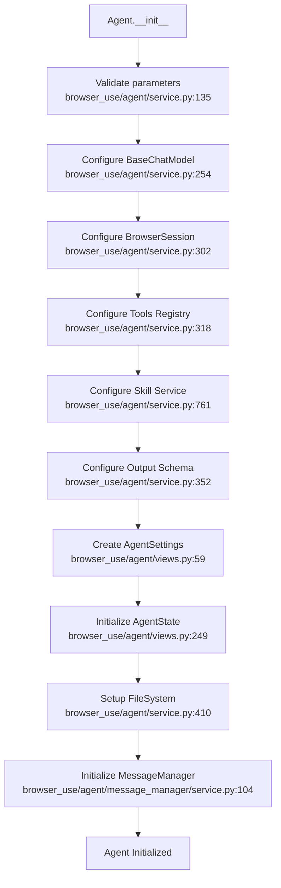

**Key Initialization Steps:**
1. **Parameter Resolution & Aliases**: Resolves aliases such as `browser` for `browser_session` and `controller` for `tools` [browser_use/agent/service.py:141-145]().
2. **LLM Configuration**: Sets up the chat model and checks for model-specific capabilities (e.g., auto-enabling flash mode or coordinate clicking) [browser_use/agent/service.py:254-271]().
3. **Tools & Output Schema**: Generates Pydantic action models dynamically via `tools.get_output_model()` [browser_use/agent/service.py:352-364]().
4. **Message Manager**: Instantiates `MessageManager` with the system prompt, task string, and file system references [browser_use/agent/message_manager/service.py:104-147]().

Sources: [browser_use/agent/service.py:135-455](), [browser_use/agent/views.py:59-91]()

## The Main Execution Loop (`run`)

The `run()` method executes the iterative loop over steps until completion criteria or limits are reached [browser_use/agent/service.py:1095-1396]().

### Code Entity Space: Execution Orchestration Flow
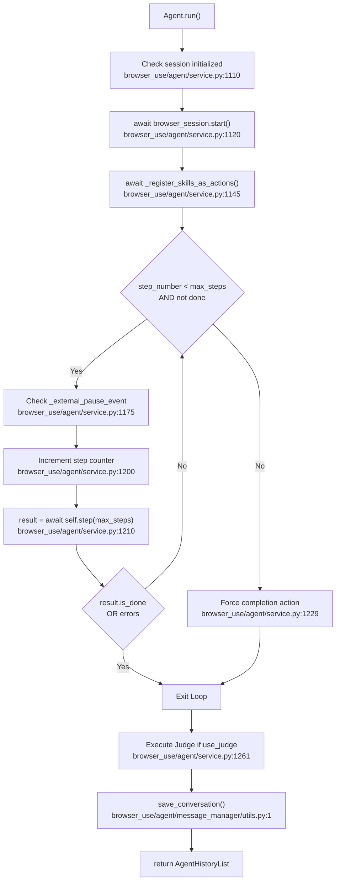

**Key Loop Mechanics:**
- **Pause/Resume**: Inspects `_external_pause_event` prior to each iteration to support interactive pausing [browser_use/agent/service.py:1175-1181]().
- **Stop Callbacks**: Evaluates `register_should_stop_callback()` to allow external interruption [browser_use/agent/service.py:1183-1185]().
- **Forced Completion**: If `max_steps` is exhausted without a `done` action, a final recovery call forces termination [browser_use/agent/service.py:1229-1234]().

Sources: [browser_use/agent/service.py:1095-1396]()

## Single Step Execution (`step`)

The `step()` method executes a single decision-action-observe iteration.

### Step Execution Phases

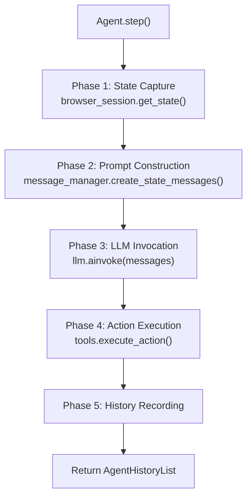

**Detailed Phase Breakdown:**
1. **State Capture**: Captures the current DOM state, viewport dimensions, open tabs, and screenshot via `browser_session.get_state()` [browser_use/agent/service.py:1469-1499]().
2. **Prompt Construction**: Compiles messages via `message_manager` incorporating system prompts, browser summary, and history [browser_use/agent/message_manager/service.py:183-419]().
3. **LLM Invocation**: Invokes the chat model with structured output enforcement (`AgentOutput`) [browser_use/agent/service.py:1607-1694]().
4. **Action Execution**: Executes actions returned in `AgentOutput` sequentially through `tools.execute_action()`, handling sensitive data replacement and loop detection logging [browser_use/agent/service.py:1696-1786]().
5. **History Recording**: Records step metadata, token consumption, and saves state snapshots to `AgentHistory` [browser_use/agent/service.py:1788-1841]().

Sources: [browser_use/agent/service.py:1398-1848]()

## Error Handling, Loop Detection, and Recovery

- **Consecutive Failure Tracking**: `state.consecutive_failures` increments on execution exceptions and resets upon successful step completion [browser_use/agent/service.py:1788-1841]().
- **Action Loop Detection**: `ActionLoopDetector` monitors action repetition and page stagnation using normalized hashes (`compute_action_hash`), injecting soft nudge instructions into prompt construction without blocking actions [browser_use/agent/views.py:110-154]().
- **Timeouts**: `settings.llm_timeout` and `settings.step_timeout` govern invocation limits across calls [browser_use/agent/views.py:85-86]().

Sources: [browser_use/agent/service.py:135-1848](), [browser_use/agent/views.py:59-154]()

---

# Page: Message Manager and Prompt Construction

# Message Manager and Prompt Construction

<details>
<summary>Relevant source files</summary>

The following files were used as context for generating this wiki page:

- [browser_use/agent/message_manager/service.py](browser_use/agent/message_manager/service.py)
- [browser_use/agent/message_manager/utils.py](browser_use/agent/message_manager/utils.py)
- [browser_use/agent/message_manager/views.py](browser_use/agent/message_manager/views.py)
- [browser_use/agent/prompts.py](browser_use/agent/prompts.py)
- [browser_use/agent/service.py](browser_use/agent/service.py)
- [browser_use/agent/views.py](browser_use/agent/views.py)
- [browser_use/browser/views.py](browser_use/browser/views.py)

</details>


## Purpose and Scope

The `MessageManager` class (`browser_use/agent/message_manager/service.py:104()`) translates raw agent state, browser state, and execution history into structured LLM prompts. It acts as the prompt engineering layer bridging the agent's internal state representation and the text/multimodal context consumed by language models.

This page covers:
- The three-slot message architecture (`MessageHistory`)
- Prompt construction via `prepare_step_state()` and `AgentMessagePrompt`
- Browser state serialization and statistics extraction
- History management and compaction via `MessageCompactionSettings`
- Sensitive data filtering and redaction
- Multi-modal vision support and screenshot handling

Sources: `[browser_use/agent/service.py:43-45]`, `[browser_use/agent/message_manager/service.py:104-148]`

---

## Architecture Overview

The `MessageManager` coordinates between the `Agent` execution loop and the LLM client by managing persistent system prompts, dynamic state messages, and ephemeral context messages.

### Prompt Construction Flow (Natural Language to Code Entities)

```mermaid
agentExecutionLoop["Agent.step()"]
prepareStep["MessageManager.prepare_step_state()"]
browserSummary["BrowserStateSummary"]
domSerializer["SerializedDOMState.llm_representation()"]
msgManager["MessageManager"]
historySlot["MessageHistory"]
llmInvoke["BaseChatModel.ainvoke()"]

agentExecutionLoop -->|"browser_state, model_output, result"| prepareStep
browserSummary -->|"dom_state, screenshot, tabs"| prepareStep
prepareStep --> domSerializer
prepareStep --> msgManager
msgManager -->|"MessageManagerState"| historySlot
historySlot -->|"list[BaseMessage]"| llmInvoke
```
Sources: `[browser_use/agent/service.py:1-4164]`, `[browser_use/agent/message_manager/service.py:104-201]`

### Three-Slot Message Architecture

The `MessageHistory` class (`browser_use/agent/message_manager/views.py:66()`) organizes prompts into three distinct slots:

```mermaid
msgHistory["MessageHistory"]
sysMsg["system_message<br/>(BaseMessage)<br/>cached"]
stateMsg["state_message<br/>(BaseMessage)<br/>cached"]
contextMsgs["context_messages<br/>(list[BaseMessage])<br/>ephemeral"]
finalPrompt["LLM Prompt Input"]

msgHistory --> sysMsg
msgHistory --> stateMsg
msgHistory --> contextMsgs
sysMsg -->|"1. Static tool definitions & system prompt"| finalPrompt
stateMsg -->|"2. Current browser state, DOM & history"| finalPrompt
contextMsgs -->|"3. Ephemeral errors, nudges & instructions"| finalPrompt
```
Sources: `[browser_use/agent/message_manager/views.py:66-84]`, `[browser_use/agent/message_manager/service.py:149-151]`

---

## MessageManager Class and State

The `MessageManager` is initialized with configuration options, a task description, and a static `SystemMessage`.

```mermaid
agentInit["Agent.__init__()"]
sysPromptGen["SystemPrompt.get_system_message()"]
mmInit["MessageManager.__init__()"]
mmState["MessageManagerState"]

agentInit -->|"task, system_message, file_system"| mmInit
sysPromptGen -->|"SystemMessage (cached=True)"| mmInit
mmInit --> mmState
```
Sources: `[browser_use/agent/service.py:135-205]`, `[browser_use/agent/message_manager/service.py:107-151]`, `[browser_use/agent/message_prompts:28-59]`

### Key Properties

- `task` (`str`): The primary task instructions for the agent `[browser_use/agent/message_manager/service.py:124()]`.
- `state` (`MessageManagerState`): Tracks `history`, `agent_history_items`, `read_state_images`, and `compacted_memory` `[browser_use/agent/message_manager/views.py:86-101]`.
- `system_prompt` (`SystemMessage`): Static system instructions initialized once `[browser_use/agent/message_manager/service.py:129()]`.
- `file_system` (`FileSystem`): File system context manager for exposing available files `[browser_use/agent/message_manager/service.py:130()]`.
- `max_history_items` (`int | None`): Threshold controlling how many past steps are included in prompt history `[browser_use/agent/message_manager/service.py:133()]`.

Sources: `[browser_use/agent/message_manager/service.py:107-148]`, `[browser_use/agent/message_manager/views.py:86-101]`

---

## Prompt Construction Pipeline

### Step State Preparation

During each execution step, `MessageManager` invokes `prepare_step_state()` to construct the `state_message` (`[browser_use/agent/message_manager/service.py:196-201]()`). 

1. **History Updates**: `_update_agent_history_description()` processes recent model outputs, action results, and execution errors `[browser_use/agent/message_manager/service.py:405-430]()`.
2. **Browser Description**: `_get_browser_state_description()` compiles the current DOM tree representation, active tabs, and page metrics `[browser_use/agent/message_manager/service.py:431-460]()`.
3. **Prompt Composition**: `AgentMessagePrompt` (`[browser_use/agent/prompts.py:104()]`) builds the `UserMessage` containing text parts and multimodal screenshot attachments.
4. **Sensitive Data Filtering**: `_filter_sensitive_data()` redacts secure strings before updating the state message via `_set_message_with_type()` `[browser_use/agent/message_manager/service.py:539-600]()`.

Sources: `[browser_use/agent/message_manager/service.py:196-201]`, `[browser_use/agent/prompts.py:104-148]`

---

## Browser State Formatting and DOM Serialization

The `_get_browser_state_description()` method transforms a `BrowserStateSummary` (`[browser_use/browser/views.py:91()]`) into LLM-consumable XML tags.

### Page Statistics Extraction

`_extract_page_statistics()` recursively visits the simplified DOM tree (`SimplifiedNode`) to aggregate node counts (`[browser_use/agent/prompts.py:150-216]()`):
- `links`: Count of `<a>` elements (`[browser_use/agent/prompts.py:179-180]()`).
- `interactive_elements`: Elements categorized as interactive (`[browser_use/agent/prompts.py:159()]`).
- `iframes`, `shadow_open`, `shadow_closed`, `scroll_containers`, `images`, `total_elements`, `text_chars`.

Sources: `[browser_use/agent/prompts.py:150-216]`, `[browser_use/browser/views.py:91-114]`

---

## History Management and Compaction

### HistoryItem Structure

Each execution step records a `HistoryItem` (`[browser_use/agent/message_manager/views.py:15()]`):
- `step_number`: Execution step index (`[browser_use/agent/message_manager/views.py:18()]`).
- `evaluation_previous_goal`: Agent's evaluation of success/failure (`[browser_use/agent/message_manager/views.py:19()]`).
- `memory`: Persistent reasoning notes (`[browser_use/agent/message_manager/views.py:20()]`).
- `next_goal`: Planned next objective (`[browser_use/agent/message_manager/views.py:21()]`).
- `action_results`: Formatted outputs from executed tool calls (`[browser_use/agent/message_manager/views.py:22()]`).

Sources: `[browser_use/agent/message_manager/views.py:15-64]`

### Compaction Settings

`MessageCompactionSettings` (`[browser_use/agent/views.py:35()]`) controls automatic summarization of long histories:
- `enabled`: Toggles compaction (`[browser_use/agent/views.py:38()]`).
- `compact_every_n_steps`: Frequency of compaction runs (`[browser_use/agent/views.py:39()]`).
- `trigger_char_count` / `trigger_token_count`: Thresholds for character/token length (`[browser_use/agent/views.py:40-41()]`).
- `keep_last_items`: Recent items preserved uncompressed (`[browser_use/agent/views.py:43()]`).

Sources: `[browser_use/agent/views.py:35-56]`, `[browser_use/agent/message_manager/service.py:202-285]`

---

## Sensitive Data Filtering

The `_filter_sensitive_data()` method ensures credentials and sensitive variables are redacted before prompts are saved or dispatched to the LLM (`[browser_use/agent/message_manager/service.py:559-600]()`).

```mermaid
filterMethod["_filter_sensitive_data()"]
checkData["self.sensitive_data configured?"]
collectVals["collect_sensitive_data_values()"]
redactStr["redact_sensitive_string()"]
returnMsg["Return Filtered Message"]

filterMethod --> checkData
checkData -->|"Yes"| collectVals
checkData -->|"No"| returnMsg
collectVals --> redactStr
redactStr --> returnMsg
```
Sources: `[browser_use/agent/message_manager/service.py:559-600]`, `[browser_use/utils.py:59-81]`

---

## Vision Support and Screenshots

Multimodal prompts attach base64-encoded screenshots via `AgentMessagePrompt` (`[browser_use/agent/prompts.py:353-379]()`):
- **Detail Level**: Configured via `vision_detail_level` (`'auto'`, `'low'`, `'high'`) (`[browser_use/agent/prompts.py:121()]`).
- **Resolution Control**: Optional resizing via `llm_screenshot_size` (`[browser_use/agent/prompts.py:125()]`).
- **Read State Images**: Dynamic images from file reads or intermediate rendering are attached via `state.read_state_images` and cleared per step (`[browser_use/agent/message_manager/service.py:308-316]`, `[browser_use/agent/message_manager/views.py:96]`).

Sources: `[browser_use/agent/prompts.py:104-148, 353-383]`, `[browser_use/agent/message_manager/service.py:308-316]`

---

# Page: Agent State and History Management

# Agent State and History Management

<details>
<summary>Relevant source files</summary>

The following files were used as context for generating this wiki page:

- [browser_use/agent/message_manager/service.py](browser_use/agent/message_manager/service.py)
- [browser_use/agent/message_manager/views.py](browser_use/agent/message_manager/views.py)
- [browser_use/agent/prompts.py](browser_use/agent/prompts.py)
- [browser_use/agent/service.py](browser_use/agent/service.py)
- [browser_use/agent/views.py](browser_use/agent/views.py)
- [browser_use/browser/views.py](browser_use/browser/views.py)
- [examples/features/rerun_history.py](examples/features/rerun_history.py)
- [tests/ci/test_ai_step.py](tests/ci/test_ai_step.py)
- [tests/ci/test_ax_name_matching.py](tests/ci/test_ax_name_matching.py)
- [tests/ci/test_history_wait_time.py](tests/ci/test_history_wait_time.py)
- [tests/ci/test_variable_substitution.py](tests/ci/test_variable_substitution.py)

</details>


This page documents the state management and history tracking systems in `browser-use`. The agent maintains several complementary state representations: `AgentState` for tracking current execution status and control flow, `AgentHistoryList` for persisting the complete execution trace with results and metadata, and `MessageManagerState` for LLM conversation context. These systems enable checkpointing, error recovery, execution analysis, variable substitution, and history-based reruns.

## State Management Architecture

The agent's state is split across three primary models, each serving a distinct purpose in the orchestration loop:

| State Model | Location | Purpose | Serializable |
|-------------|----------|---------|--------------|
| `AgentState` | [browser_use/agent/views.py:228-278]() | Runtime execution state (step count, failures, pause/stop flags) | ✓ |
| `AgentHistoryList` | [browser_use/agent/views.py:417-738]() | Persistent execution trace with results and metadata | ✓ |
| `MessageManagerState` | [browser_use/agent/message_manager/views.py:86-101]() | LLM conversation context and prompt history | ✓ |

### State Entity Relationships

The following diagram bridges the natural language concepts of "State" and "History" to the specific code entities that implement them within the `Agent` class.

```mermaid
graph TB
    Agent["Agent" browser_use/agent/service.py]
    
    subgraph "State Management (Code Entities)"
        AgentState["AgentState" browser_use/agent/views.py]
        AgentHistoryList["AgentHistoryList" browser_use/agent/views.py]
        AgentHistory["AgentHistory" browser_use/agent/views.py]
        MessageManagerState["MessageManagerState" browser_use/agent/message_manager/views.py]
    end
    
    Agent --> AgentState
    Agent --> AgentHistoryList
    Agent --> MessageManagerState
    
    AgentHistoryList --> AgentHistory
    AgentState --> MessageManagerState
```

**Sources**: [browser_use/agent/views.py:228-278](), [browser_use/agent/views.py:283-397](), [browser_use/agent/views.py:417-738](), [browser_use/agent/message_manager/views.py:86-101](), [browser_use/agent/service.py:133-206]()

## AgentState: Runtime Execution State

`AgentState` tracks the agent's current execution status and control flow. It is updated continuously during the `Agent.step()` loop [browser_use/agent/service.py:133-206]().

### Key State Properties

| Field | Type | Purpose |
|-------|------|---------|
| `n_steps` | `int` | Current step number, incremented after each successful step |
| `consecutive_failures` | `int` | Count of consecutive failures, reset to 0 on success |
| `last_result` | `list[ActionResult]` | Results from the most recent action execution |
| `last_model_output` | `AgentOutput` | Most recent LLM response containing thinking and actions |
| `paused` | `bool` | Whether agent execution is paused (controlled by `SignalHandler`) |
| `stopped` | `bool` | Whether agent execution should terminate |

**Sources**: [browser_use/agent/views.py:228-278](), [browser_use/agent/service.py:133-206]()

### Loop Detection and Behavioral Nudges
The `ActionLoopDetector` within `AgentState` tracks action repetition and page stagnation to detect behavioral loops [browser_use/agent/views.py:157-162](). It uses `compute_action_hash` to normalize action parameters—for example, sorting search tokens or stripping minor keyword variations—to identify repeated behaviors even if parameters change slightly [browser_use/agent/views.py:110-155]().

**Sources**: [browser_use/agent/views.py:110-155](), [browser_use/agent/views.py:157-174]()

## AgentHistory and Serialization

The `AgentHistoryList` provides a complete execution trace. Each `AgentHistory` item contains the LLM's `AgentOutput`, the resulting `ActionResult`, and a `BrowserStateHistory` snapshot [browser_use/agent/views.py:283-294]().

### History Structure and Metadata

```mermaid
classDiagram
    class AgentHistory {
        +AgentOutput model_output
        +list[ActionResult] result
        +BrowserStateHistory state
        +StepMetadata metadata
    }
    
    class StepMetadata {
        +int step_number
        +float step_start_time
        +float step_end_time
        +float step_interval
        +duration_seconds() float
    }
    
    AgentHistory --> StepMetadata
```

The `step_interval` in `StepMetadata` tracks the time elapsed since the previous step, which is critical for accurate replaying of history during a `load_and_rerun` operation [browser_use/agent/views.py:343-348](), [tests/ci/test_history_wait_time.py:23-36]().

**Sources**: [browser_use/agent/views.py:283-397](), [tests/ci/test_history_wait_time.py:4-22]()

### Serialization and Sensitive Data
`AgentHistoryList` supports saving to and loading from JSON. During serialization, the `redact_sensitive_string` utility is used to replace sensitive values (defined in `Agent.sensitive_data`) with placeholders to prevent credential leaks in logs or saved files [browser_use/utils.py:30-31](), [browser_use/agent/views.py:306-333]().

**Sources**: [browser_use/agent/views.py:449-458](), [browser_use/utils.py:30-31](), [browser_use/agent/views.py:306-333]()

## History Rerun and Variable Substitution

`browser-use` allows rerunning saved history with different data inputs via variable substitution, which is useful for replaying successful workflows with different data or debugging [examples/features/rerun_history.py:3-15]().

### Rerun Mechanism
1. **Variable Detection**: `Agent.detect_variables()` scans history for patterns like emails, names, and dates in input actions [examples/features/rerun_history.py:80-82]().
2. **Substitution**: `Agent._substitute_variables_in_history()` replaces detected values with new values provided by the user [tests/ci/test_variable_substitution.py:51-54]().
3. **Execution**: The agent replays the modified actions. For `extract` actions, the rerun system uses an AI step to re-evaluate the page content since the new data might have changed the expected output [examples/features/rerun_history.py:23-27]().

**Sources**: [examples/features/rerun_history.py:73-135](), [tests/ci/test_variable_substitution.py:38-60](), [browser_use/agent/service.py:1158-1200]()

### Element Matching Fallbacks
During history reruns, elements are matched across sessions using a multi-level strategy. If a direct `element_hash` match fails (common in dynamic SPAs where DOM structure changes), the system falls back to `ax_name` (accessible name) matching [tests/ci/test_ax_name_matching.py:21-26](). This ensures that a "Submit" button can still be found if its accessible name remains stable even if internal IDs change [tests/ci/test_ax_name_matching.py:78-80]().

**Sources**: [tests/ci/test_ax_name_matching.py:21-80](), [browser_use/agent/views.py:17-18]()

## Message Compaction and Context Management

To prevent LLM context overflow, `MessageManager` implements a compaction system governed by `MessageCompactionSettings` [browser_use/agent/views.py:35-46]().

- **Compaction**: When history exceeds `trigger_char_count` or `compact_every_n_steps`, older history items are summarized into a `compacted_memory` block to reduce prompt size [browser_use/agent/views.py:35-46]().
- **Truncation**: The `agent_history_description` property respects `max_history_items`, keeping the initial task context and the most recent items while omitting middle steps [browser_use/agent/message_manager/service.py:152-189]().

**Sources**: [browser_use/agent/views.py:35-56](), [browser_use/agent/message_manager/service.py:152-189](), [browser_use/agent/message_manager/views.py:97-99]()

---

# Page: System Prompts and Output Formats

# System Prompts and Output Formats

<details>
<summary>Relevant source files</summary>

The following files were used as context for generating this wiki page:

- [browser_use/agent/message_manager/service.py](browser_use/agent/message_manager/service.py)
- [browser_use/agent/message_manager/views.py](browser_use/agent/message_manager/views.py)
- [browser_use/agent/prompts.py](browser_use/agent/prompts.py)
- [browser_use/agent/service.py](browser_use/agent/service.py)
- [browser_use/agent/system_prompts/system_prompt.md](browser_use/agent/system_prompts/system_prompt.md)
- [browser_use/agent/system_prompts/system_prompt_anthropic_flash.md](browser_use/agent/system_prompts/system_prompt_anthropic_flash.md)
- [browser_use/agent/system_prompts/system_prompt_browser_use.md](browser_use/agent/system_prompts/system_prompt_browser_use.md)
- [browser_use/agent/system_prompts/system_prompt_browser_use_flash.md](browser_use/agent/system_prompts/system_prompt_browser_use_flash.md)
- [browser_use/agent/system_prompts/system_prompt_browser_use_no_thinking.md](browser_use/agent/system_prompts/system_prompt_browser_use_no_thinking.md)
- [browser_use/agent/system_prompts/system_prompt_flash.md](browser_use/agent/system_prompts/system_prompt_flash.md)
- [browser_use/agent/system_prompts/system_prompt_flash_anthropic.md](browser_use/agent/system_prompts/system_prompt_flash_anthropic.md)
- [browser_use/agent/system_prompts/system_prompt_no_thinking.md](browser_use/agent/system_prompts/system_prompt_no_thinking.md)
- [browser_use/agent/views.py](browser_use/agent/views.py)
- [browser_use/browser/views.py](browser_use/browser/views.py)

</details>


This page documents how `browser-use` configures LLM behavior through system prompts and structured output formats. The system uses the `SystemPrompt` class to select appropriate prompt templates, and the `AgentOutput` model to define output format variants: standard (with thinking), no-thinking, and flash mode. It also supports custom structured output via `output_model_schema`.

For information about how prompts are constructed with browser state and history, see **2.2. Message Manager and Prompt Construction**. For information about the agent execution loop that uses these outputs, see **2.1. Agent Core and Execution Loop**.

---

## System Prompt Template System

The `SystemPrompt` class manages the loading and formatting of system prompt templates from markdown files located in `browser_use/agent/system_prompts/`. The system maintains multiple distinct prompt templates that are selected based on model type, reasoning mode, and performance settings.

### System Prompt Selection Logic

The following diagram illustrates how the `Agent` and `SystemPrompt` classes collaborate to select the correct template file based on the provided configuration.

Title: System Prompt Template Selection Flow
```mermaid
graph TB
    Agent["Agent.__init__"]
    SystemPrompt["SystemPrompt Class<br/>(prompts.py)"]
    
    subgraph "Configuration Inputs"
        use_thinking["use_thinking: bool"]
        flash_mode["flash_mode: bool"]
        is_anthropic["is_anthropic: bool"]
        is_browser_use["is_browser_use_model: bool"]
        is_anthropic_4_5["is_anthropic_4_5: bool"]
    end
    
    subgraph "Template Selection Logic"
        CheckOverride{"override_system_message<br/>provided?"}
        CheckBrowserUse{"is_browser_use_model?"}
        CheckAnthropic45{"is_anthropic_4_5?"}
        CheckFlashMode{"flash_mode?"}
        CheckThinking{"use_thinking?"}
    end
    
    subgraph "Template Files"
        T1["system_prompt_browser_use_flash.md"]
        T2["system_prompt_browser_use.md"]
        T3["system_prompt_browser_use_no_thinking.md"]
        T4["system_prompt_anthropic_flash.md"]
        T5["system_prompt_flash_anthropic.md"]
        T6["system_prompt_flash.md"]
        T7["system_prompt.md"]
        T8["system_prompt_no_thinking.md"]
    end
    
    Output["SystemMessage<br/>(cache=True)"]
    
    Agent --> SystemPrompt
    SystemPrompt --> CheckOverride
    CheckOverride -->|Yes| Output
    CheckOverride -->|No| CheckBrowserUse
    
    CheckBrowserUse -->|Yes| CheckFlashMode
    CheckFlashMode -->|Yes| T1
    CheckFlashMode -->|No| CheckThinking
    CheckThinking -->|Yes| T2
    CheckThinking -->|No| T3
    
    CheckBrowserUse -->|No| CheckAnthropic45
    CheckAnthropic45 -->|Yes| T4
    CheckAnthropic45 -->|No| CheckFlashMode
    
    CheckFlashMode -->|Yes| CheckAnthropic{"is_anthropic?"}
    CheckAnthropic -->|Yes| T5
    CheckAnthropic -->|No| T6
    
    CheckFlashMode -->|No| CheckThinking
    CheckThinking -->|Yes| T7
    CheckThinking -->|No| T8
    
    T1 --> Output
    T2 --> Output
    T3 --> Output
    T4 --> Output
    T5 --> Output
    T6 --> Output
    T7 --> Output
    T8 --> Output
```
Sources: [browser_use/agent/prompts.py:28-91](), [browser_use/agent/service.py:133-210]()

### Template Selection Matrix

The `_load_prompt_template` method in `SystemPrompt` selects the markdown file based on the state of the `Agent`.

| Template File | Condition | Purpose |
|--------------|-----------|---------|
| `system_prompt_browser_use_flash.md` | `is_browser_use_model=True` AND `flash_mode=True` | Minimal prompt for fine-tuned browser-use models. |
| `system_prompt_browser_use.md` | `is_browser_use_model=True` AND `use_thinking=True` | Simplified prompt for fine-tuned models with reasoning. |
| `system_prompt_browser_use_no_thinking.md` | `is_browser_use_model=True` AND `use_thinking=False` | Simplified prompt for fine-tuned models without reasoning. |
| `system_prompt_anthropic_flash.md` | `is_anthropic_4_5=True` AND `flash_mode=True` | Long prompt (4096+ tokens) required for caching on Claude 4.5. |
| `system_prompt_flash_anthropic.md` | `flash_mode=True` AND `is_anthropic=True` | Optimized flash mode for standard Anthropic models. |
| `system_prompt_flash.md` | `flash_mode=True` AND `is_anthropic=False` | General flash mode for other providers (OpenAI, Gemini). |
| `system_prompt.md` | `use_thinking=True` | Standard prompt with full reasoning chain. |
| `system_prompt_no_thinking.md` | `use_thinking=False` | Standard prompt without the thinking field. |

Sources: [browser_use/agent/prompts.py:64-81](), [browser_use/agent/prompts.py:16-24]()

---

## AgentOutput Format Variants

The `AgentOutput` class defines the structured response schema for the LLM. Depending on `AgentSettings` [browser_use/agent/views.py:59-94](), the agent dynamically constructs a Pydantic model to enforce the desired output format.

### Output Schema Construction

Title: Agent Output Schema Generation
```mermaid
graph LR
    Agent["Agent._setup_action_models"]
    Registry["Tools.registry.create_action_model"]
    
    subgraph "Variant Generation"
        Flash["AgentOutput.type_with_custom_actions_flash_mode"]
        Thinking["AgentOutput.type_with_custom_actions"]
        NoThinking["AgentOutput.type_with_custom_actions_no_thinking"]
    end
    
    ActionModel["ActionModel<br/>(Dynamic Pydantic Model)"]
    FinalSchema["AgentOutput Schema<br/>(Pydantic)"]
    
    Agent --> Registry
    Registry --> ActionModel
    ActionModel --> Flash
    ActionModel --> Thinking
    ActionModel --> NoThinking
    
    Flash --> FinalSchema
    Thinking --> FinalSchema
    NoThinking --> FinalSchema
```
Sources: [browser_use/agent/service.py:726-746](), [browser_use/agent/views.py:186-279]()

### Standard Format (with thinking)
Used when `use_thinking=True` and `flash_mode=False`. It includes the full reasoning process.
*   `thinking`: Internal reasoning (logged to debug via `log_response`).
*   `evaluation_previous_goal`: Assessment of the last step.
*   `memory`: Knowledge to persist across steps.
*   `next_goal`: The immediate next objective.
*   `action`: List of actions to execute.

Sources: [browser_use/agent/views.py:214-227](), [browser_use/agent/service.py:87-123](), [browser_use/agent/system_prompts/system_prompt_browser_use.md:7-18]()

### No-Thinking Format
Used when `use_thinking=False` and `flash_mode=False`. It removes the internal reasoning field but keeps the planning structure.
*   `evaluation_previous_goal`, `memory`, `next_goal`, `action`.

Sources: [browser_use/agent/views.py:229-251](), [browser_use/agent/system_prompts/system_prompt_no_thinking.md:40-56]()

### Flash Mode Format
Used when `flash_mode=True`. This is the most minimal format, designed for high-speed inference. It removes evaluation and next-goal fields to reduce latency and token usage.
*   `memory`: Key context.
*   `action`: List of actions.

Sources: [browser_use/agent/views.py:253-279](), [browser_use/agent/system_prompts/system_prompt_flash.md:9-16]()

---

## Output Schema Customization

The library allows for advanced customization of the output schema through `Agent` initialization parameters.

### Custom Structured Output
Users can provide a custom Pydantic model via `output_model_schema`. If provided, the LLM is instructed to return data matching this schema in the `done` action.

Sources: [browser_use/agent/service.py:164](), [browser_use/agent/views.py:11-13]()

### Dynamic Action Models
The `action` field in `AgentOutput` is not static. It is dynamically generated by the `Tools` registry to include only the actions available to the agent (built-in or custom).

```python
# From browser_use/agent/service.py:726-728
def _setup_action_models(self) -> None:
    self.ActionModel = self.tools.registry.create_action_model()
```

Sources: [browser_use/agent/service.py:726-728](), [browser_use/tools/service.py:74]()

---

## Prompt Construction Details

The `AgentMessagePrompt` class in `browser_use/agent/prompts.py` is responsible for building the actual `UserMessage` content sent to the LLM at each step.

### Data Grounding and Context
The prompt includes several XML-tagged sections to ground the LLM's decisions:
1.  `<agent_history>`: Chronological stream of previous steps and results. Managed by `MessageManager.agent_history_description` which respects `max_history_items`.
2.  `<browser_state>`: Current URL, open tabs, and the interactive element tree. Interactive elements are provided in a tree-style XML format.
3.  `<browser_vision>`: Information about the screenshot and bounding boxes.
4.  `<file_system>`: Summary of available files and the `todo.md` checklist for long tasks (>10 steps).

Sources: [browser_use/agent/prompts.py:103-147](), [browser_use/agent/message_manager/service.py:150-186](), [browser_use/agent/system_prompts/system_prompt.md:23-67](), [browser_use/agent/system_prompts/system_prompt_anthropic_flash.md:14-22]()

### Redaction and Security
Before being added to the prompt, sensitive data is redacted using `redact_sensitive_string`. This replaces sensitive values with `<secret>key</secret>` placeholders to prevent leakage to the LLM provider.

Sources: [browser_use/utils.py:76-80](), [browser_use/agent/message_manager/service.py:31]()

### System Message Caching
The `SystemPrompt` class sets `cache=True` on the `SystemMessage` [browser_use/agent/prompts.py:58](). This tells supported LLM providers (like Anthropic) to cache the system prompt, significantly reducing the cost and latency of subsequent steps in the same task.

Sources: [browser_use/agent/prompts.py:58]()

---

# Page: Skills Integration

# Skills Integration

<details>
<summary>Relevant source files</summary>

The following files were used as context for generating this wiki page:

- [browser_use/skills/README.md](browser_use/skills/README.md)
- [browser_use/skills/__init__.py](browser_use/skills/__init__.py)
- [browser_use/skills/browser-use/SKILL.md](browser_use/skills/browser-use/SKILL.md)
- [browser_use/skills/browser_use.py](browser_use/skills/browser_use.py)
- [browser_use/skills/install.py](browser_use/skills/install.py)
- [browser_use/skills/service.py](browser_use/skills/service.py)
- [browser_use/skills/utils.py](browser_use/skills/utils.py)
- [browser_use/skills/views.py](browser_use/skills/views.py)
- [pyproject.toml](pyproject.toml)
- [skills/browser-use/SKILL.md](skills/browser-use/SKILL.md)
- [skills/remote-browser/SKILL.md](skills/remote-browser/SKILL.md)
- [tests/ci/test_browser_use_skill_install_docs.py](tests/ci/test_browser_use_skill_install_docs.py)

</details>


## Purpose and Scope

This document explains how external skills are dynamically registered as actions within the Agent system. Skills extend the agent's capabilities beyond built-in browser actions by allowing execution of cloud-hosted or custom functions. This integration covers dynamic action registration, parameter validation, and session-aware execution involving browser cookies.

## Overview

Skills are external capabilities that can be registered with an `Agent` instance to extend its functionality. Each skill becomes a separate action in the agent's action model, allowing the LLM to invoke it like any built-in browser action. Skills are managed by a `SkillService` that handles fetching skill metadata, validating parameters, and executing skill code via API calls [browser_use/skills/service.py:19-38]().

**Key Characteristics:**
- **Dynamic Registration**: Skills are registered at `Agent` initialization time and converted into action schemas during execution.
- **Parameter Validation**: Each skill defines typed parameters via Pydantic models generated from the skill's schema [browser_use/skills/views.py:49-61]().
- **Cookie Requirements**: Skills can require browser cookies for authentication (e.g., session tokens), which are automatically extracted from the active browser session during execution [browser_use/skills/service.py:194-206]().
- **Cloud Execution**: Skills execute remotely via the `AsyncBrowserUse` client [browser_use/skills/service.py:165-182]().
- **Unavailability Handling**: Skills missing required cookies are reported to the agent as unavailable in the prompt.

Sources: [browser_use/skills/service.py:19-38](), [browser_use/skills/views.py:23-36](), [browser_use/skills/browser_use.py:32-74]()

## Skill Registration Flow

The following diagram bridges the Natural Language request for skills to the internal Code Entity Space of the `Agent` and `SkillService`.

**Title: Skill Action Registration Sequence**
```mermaid
sequenceDiagram
    participant User as "UserCode"
    participant AgentInst as "Agent"
    participant SkillSvc as "SkillService [browser_use/skills/service.py]"
    participant ToolReg as "Tools.registry [browser_use/tools/service.py]"
    participant ActionMod as "ActionModel [browser_use/tools/registry/views.py]"

    User->>AgentInst: "Agent(task, skills=['*'])"
    AgentInst->>AgentInst: "Store skill_ids"
    AgentInst->>AgentInst: "Create SkillService if needed"
    Note over AgentInst: "Registration happens lazily on first run() call"
    
    User->>AgentInst: "agent.run()"
    AgentInst->>AgentInst: "_register_skills_as_actions()"
    AgentInst->>SkillSvc: "get_all_skills()"
    SkillSvc-->>AgentInst: "List[Skill]"
    
    loop "For each skill"
        AgentInst->>AgentInst: "_get_skill_slug(skill)"
        AgentInst->>AgentInst: "Create param_model from skill.parameters_pydantic()"
        AgentInst->>AgentInst: "Create async handler (closure)"
        AgentInst->>ToolReg: "registry.action(description, param_model)(handler)"
        Note over ToolReg: "Skill registered as action"
    end
    
    AgentInst->>AgentInst: "_setup_action_models()"
    AgentInst->>ActionMod: "Create dynamic AgentOutput with skills"
    Note over AgentInst: "Skills now available to LLM"
```

**Registration Steps:**

1. **Initialization**: User passes `skills` or `skill_ids` to `Agent.__init__`.
2. **SkillService Creation**: Agent creates a `SkillService` instance with the provided skill IDs [browser_use/skills/service.py:22-38]().
3. **Lazy Registration**: Skills are registered during the first run or step call via internal registration helpers.
4. **Skill Fetching**: `SkillService.get_all_skills()` fetches and caches skill metadata from the Browser Use API [browser_use/skills/service.py:154-163]().
5. **Slug Generation**: Each skill gets a clean action name via internal slug generation.
6. **Handler Creation**: A closure-based handler is created for each skill that handles cookie retrieval and execution.
7. **Action Registration**: Skills are registered with the `Tools` registry.
8. **Action Model Rebuild**: Dynamic action models are rebuilt to include the newly registered skill actions.

Sources: [browser_use/skills/service.py:39-138](), [browser_use/skills/views.py:38-47](), [browser_use/skills/utils.py:10-22]()

## Skill Slug Generation

Skills are identified by human-readable slugs derived from their titles. The normalization logic ensures that skill titles are converted into valid Python identifier names.

**Title: Slug Normalization Logic**
```mermaid
graph TD
    TitleNode["SkillTitle:'[Cloned] Github Stars Tracker'"] --> Norm1["RemoveSpecialChars:'Cloned Github Stars Tracker'"]
    Norm1 --> Norm2["Lowercase:'cloned github stars tracker'"]
    Norm2 --> Norm3["ReplaceSpacesWithUnderscore:'cloned_github_stars_tracker'"]
    Norm3 --> DupCheck{"DuplicateSlug?"}
    DupCheck -->|No| FinalSlug["FinalSlug:'cloned_github_stars_tracker'"]
    DupCheck -->|Yes| Suffix["AddUuidSuffix:'cloned_github_stars_tracker_a1b2'"]
    Suffix --> FinalSlug
```

**Slug Rules:**
- Special characters are removed using regex.
- Whitespace and hyphens are replaced with underscores.
- Leading/trailing underscores are stripped.
- If multiple skills result in the same slug, a short UUID suffix is appended to ensure uniqueness.

Sources: [browser_use/skills/browser_use.py:32-74]()

## Skill Parameters and Metadata

Each skill defines its interface through a parameter schema that becomes the action's parameter model. The `Skill` view class provides helpers to convert these schemas into Pydantic models [browser_use/skills/views.py:49-61]().

**Parameter Conversion Logic:**
- **Type Mapping**: `string` -> `str`, `number` -> `float`, `boolean` -> `bool`, `object` -> `dict`, `array` -> `list`, `cookie` -> `str` [browser_use/skills/utils.py:32-44]().
- **Cookie Exclusion**: When registering for the LLM, `exclude_cookies=True` is used so the LLM doesn't try to provide session tokens manually [browser_use/skills/views.py:58-59]().
- **Required Fields**: Fields are marked as required or optional based on the `ParameterSchema.required` property [browser_use/skills/utils.py:46-60]().

Sources: [browser_use/skills/views.py:23-36](), [browser_use/skills/utils.py:10-63]()

## Skill Execution Flow

The following diagram maps the execution flow from the LLM's decision down to the remote API call, bridging Natural Language actions to internal code components.

**Title: Skill Execution Data Flow**
```mermaid
sequenceDiagram
    participant LLMNode as "LLM"
    participant AgentNode as "Agent"
    participant ToolSvc as "Tools [browser_use/tools/service.py]"
    participant SkillHandler as "SkillHandler (Closure)"
    participant SkillSvc as "SkillService [browser_use/skills/service.py]"
    participant BrowserSess as "BrowserSession [browser_use/browser/session.py]"
    participant RemoteAPI as "Browser Use API"

    LLMNode->>AgentNode: "AgentOutput with skill action"
    AgentNode->>ToolSvc: "execute_action(skill_action)"
    ToolSvc->>SkillHandler: "skill_handler(params)"
    SkillHandler->>BrowserSess: "await cookies()"
    BrowserSess-->>SkillHandler: "List[Cookie]"
    SkillHandler->>SkillSvc: "execute_skill(skill_id, params, cookies)"
    SkillSvc->>RemoteAPI: "POST /skills/execute"
    RemoteAPI-->>SkillSvc: "ExecuteSkillResponse"
    SkillSvc-->>SkillHandler: "ExecuteSkillResponse"
    
    alt "Success"
        SkillHandler-->>ToolSvc: "ActionResult(extracted_content=result)"
    else "Failure"
        SkillHandler-->>ToolSvc: "ActionResult(error=error_msg)"
    end
    
    ToolSvc-->>AgentNode: "ActionResult"
```

**Execution Steps:**
1. **Handler Call**: The agent invokes the skill handler closure created during registration.
2. **Cookie Collection**: The handler retrieves current browser cookies from the active session to satisfy any authentication requirements of the skill.
3. **Service Execution**: `SkillService.execute_skill` validates parameters and checks for required cookies [browser_use/skills/service.py:165-206]().
4. **API Call**: The `AsyncBrowserUse` SDK client transmits the request to the cloud execution environment [browser_use/skills/service.py:214-218]().
5. **Result Processing**: The output is returned as an `ActionResult`, making it available for the agent's next step.

Sources: [browser_use/skills/service.py:165-225](), [browser_use/skills/views.py:9-21]()

## Cookie Dependencies and Authentication

Skills can declare cookie dependencies for authentication. The agent tracks which skills are unavailable due to missing cookies and informs the LLM via the prompt.

**Missing Cookie Handling:**
- **MissingCookieException**: Raised by the `SkillService` if a required cookie is not found in the provided list [browser_use/skills/views.py:9-21]().
- **Validation**: `SkillService.execute_skill` iterates through `cookie_params` and raises an exception if `is_required` is True but the cookie is missing from the cookie dictionary [browser_use/skills/service.py:201-212]().

Sources: [browser_use/skills/service.py:194-212](), [browser_use/skills/views.py:9-21]()

## Skill Service Interface

The `SkillService` manages the lifecycle of remote skills, including pagination and wildcard fetching.

| Method | Purpose | Source |
|--------|---------|--------|
| `async_init()` | Fetches skills from API and filters by requested IDs | [browser_use/skills/service.py:39-138]() |
| `get_skill(id)` | Retrieves a cached skill by UUID | [browser_use/skills/service.py:140-152]() |
| `execute_skill()` | Validates and executes a skill via SDK | [browser_use/skills/service.py:165-225]() |

**Skill ID Resolution:**
- **Wildcard**: `['*']` fetches the first page (max 100 skills) to avoid LLM tool overload [browser_use/skills/service.py:59-74]().
- **Explicit**: Paginated search until all requested IDs are found, with a safety limit of 5 pages [browser_use/skills/service.py:76-103]().

Sources: [browser_use/skills/service.py:19-225]()

## Local and Domain Skills

The library supports local "skills" defined as Markdown files (`SKILL.md`) that provide instructions to LLM-based coding assistants [browser_use/skills/browser-use/SKILL.md:1-22]().

- **Installation**: The CLI can install these instruction files into common assistant directories (e.g., `.cursor/skills/browser-use/SKILL.md`) using `browser_use/skills/install.py` [browser_use/skills/install.py:25-34]().
- **Domain Skills**: When `BH_DOMAIN_SKILLS=1` is enabled, the system searches for site-specific instructions in `$BH_AGENT_WORKSPACE/domain-skills/<site>/` [browser_use/skills/browser-use/SKILL.md:32-35]().
- **Remote Browser Skill**: A specialized skill for agents running in sandboxes (no GUI) to control browsers via a CLI daemon [skills/remote-browser/SKILL.md:1-26]().

Sources: [browser_use/skills/browser-use/SKILL.md:1-35](), [browser_use/skills/install.py:25-34](), [browser_use/skills/browser_use.py:32-74](), [skills/remote-browser/SKILL.md:1-26]()

---

# Page: Agent Configuration and Settings

# Agent Configuration and Settings

<details>
<summary>Relevant source files</summary>

The following files were used as context for generating this wiki page:

- [browser_use/agent/message_manager/service.py](browser_use/agent/message_manager/service.py)
- [browser_use/agent/message_manager/views.py](browser_use/agent/message_manager/views.py)
- [browser_use/agent/prompts.py](browser_use/agent/prompts.py)
- [browser_use/agent/service.py](browser_use/agent/service.py)
- [browser_use/agent/views.py](browser_use/agent/views.py)
- [browser_use/browser/views.py](browser_use/browser/views.py)

</details>


This page documents the configuration parameters available when initializing an `Agent` instance (`[browser_use/agent/service.py:134-197]()`). These settings control execution behavior, LLM interaction modes, planning strategies, security constraints, and debugging capabilities through the underlying `AgentSettings` view (`[browser_use/agent/views.py:59-93]()`).

For information about the core Agent execution loop and state management, see [Agent Core and Execution Loop](2.1). For details on how configuration affects prompt construction, see [Message Manager and Prompt Construction](2.2). For browser-specific configuration, see [Browser Profile Configuration](3.2).

---

## Configuration Architecture

Agent configuration flows through three primary layers: initialization parameters passed to `Agent.__init__` (`[browser_use/agent/service.py:135-197]()`), the `AgentSettings` model that stores validated settings (`[browser_use/agent/views.py:59-93]()`), and runtime state managed by `MessageManager` (`[browser_use/agent/message_manager/service.py:104-140]()`) and `ActionLoopDetector` (`[browser_use/agent/views.py:157]()`).

### Configuration Data Flow
Title: Agent Configuration Data Flow
```mermaid
graph TB
    subgraph "Initialization_Layer"
        InitParams["Agent.__init__ Parameters"]
    end
    
    subgraph "Settings_Model"
        AgentSettings["AgentSettings views.py:59-93"]
        MessageCompaction["MessageCompactionSettings views.py:35-56"]
    end
    
    subgraph "Runtime_Components"
        MessageManager["MessageManager message_manager/service.py:104"]
        LoopDetector["ActionLoopDetector views.py:157"]
    end
    
    subgraph "Execution_Context"
        StepLoop["Step Loop service.py"]
        LLMCall["LLM ainvoke()"]
        ActionExec["Action Execution"]
    end
    
    InitParams --> AgentSettings
    InitParams --> MessageCompaction
    
    AgentSettings --> MessageManager
    AgentSettings --> LoopDetector
    
    AgentSettings --> StepLoop
    MessageManager --> LLMCall
    LoopDetector --> StepLoop
    
    StepLoop --> LLMCall
    StepLoop --> ActionExec
```
Sources: [browser_use/agent/service.py:133-209](), [browser_use/agent/views.py:59-93](), [browser_use/agent/views.py:35-56]()

### Natural Language to Code Entity Space: Settings Mapping
Title: Natural Language Space to Code Entity Space - Settings Mapping
```mermaid
graph TB
    subgraph "Natural_Language_Space"
        NL_Vision["'Use vision model for screenshots'"]
        NL_Flash["'Run in ultra-fast low-latency mode'"]
        NL_Planning["'Break task into sequential sub-plans'"]
    end
    
    subgraph "Code_Entity_Space"
        ParamVision["AgentSettings.use_vision views.py:62"]
        ParamFlash["AgentSettings.flash_mode views.py:73"]
        ParamPlanning["AgentSettings.enable_planning views.py:78"]
        
        SysPrompt["SystemPrompt prompts.py:28"]
        MsgManager["MessageManager message_manager/service.py:104"]
    end
    
    NL_Vision --> ParamVision
    NL_Flash --> ParamFlash
    NL_Planning --> ParamPlanning
    
    ParamVision --> MsgManager
    ParamFlash --> SysPrompt
    ParamPlanning --> SysPrompt
```
Sources: [browser_use/agent/views.py:59-93](), [browser_use/agent/prompts.py:28-101](), [browser_use/agent/message_manager/service.py:104-140]()

---

## Core Execution Parameters

These settings control the fundamental execution behavior of the agent, including step limits, failure handling, and timeouts.

| Parameter | Type | Default | Description |
|-----------|------|---------|-------------|
| `max_failures` | `int` | `5` | Consecutive action failures before stopping (`[browser_use/agent/views.py:66]()`). |
| `step_timeout` | `int` | `180` | Timeout in seconds for each complete step (`[browser_use/agent/views.py:86]()`). |
| `llm_timeout` | `int` | `60` | Timeout in seconds for LLM calls (auto-detected: 30s for gemini, 90s for o3) (`[browser_use/agent/views.py:85]()`). |
| `final_response_after_failure` | `bool` | `True` | If True, attempt one final recovery call after `max_failures` reached (`[browser_use/agent/views.py:87]()`). |

### Step Execution Timeline
Title: Agent Step Timeline and Timeouts
```mermaid
graph LR
    subgraph "Step_Execution_Timeline"
        StepStart["Step N Begins"]
        GetState["get_browser_state_summary()"]
        CreateMessages["create_state_messages()"]
        LLMInvoke["llm.ainvoke()"]
        ExecuteActions["execute_actions()"]
        StepEnd["Step N Complete"]
    end
    
    StepStart --> GetState
    GetState --> CreateMessages
    CreateMessages --> LLMInvoke
    LLMInvoke --> ExecuteActions
    ExecuteActions --> StepEnd
    
    StepTimeout["step_timeout: 180s"]
    StepTimeout -.enforces.-> StepStart
    StepTimeout -.enforces.-> StepEnd
    
    LLMTimeout["llm_timeout: 60s"]
    LLMTimeout -.enforces.-> LLMInvoke
```
Sources: [browser_use/agent/service.py:133-209](), [browser_use/agent/views.py:59-93]()

---

## LLM Behavior Configuration

These settings control how the agent interacts with the language model, including vision capabilities and reasoning modes.

| Parameter | Type | Default | Description |
|-----------|------|---------|-------------|
| `use_vision` | `bool \| Literal['auto']` | `True` | Vision mode: `True` (always), `False` (never), `'auto'` (conditional) (`[browser_use/agent/views.py:62]()`). |
| `vision_detail_level` | `Literal['auto', 'low', 'high']` | `'auto'` | OpenAI-style detail level for image processing (`[browser_use/agent/views.py:63]()`). |
| `use_thinking` | `bool` | `True` | Enable explicit thinking field in LLM output schema (`[browser_use/agent/views.py:72]()`). |
| `flash_mode` | `bool` | `False` | Disables evaluation/planning and sets `use_thinking=False` (`[browser_use/agent/views.py:73]()`). |
| `max_actions_per_step` | `int` | `5` | Maximum actions the LLM can output in a single step (`[browser_use/agent/views.py:71]()`). |

### Prompt and Schema Selection
Title: Configuration to Code Entity Mapping
```mermaid
graph TB
    subgraph "Configuration_Parameters"
        VisionParam["AgentSettings.use_vision"]
        FlashParam["AgentSettings.flash_mode"]
        ThinkingParam["AgentSettings.use_thinking"]
    end
    
    subgraph "Code_Entities"
        SystemPrompt["SystemPrompt prompts.py:28"]
        AgentMessagePrompt["AgentMessagePrompt prompts.py:104"]
        
        TemplateFlash["system_prompt_flash.md"]
        TemplateThinking["system_prompt.md"]
        TemplateNoThinking["system_prompt_no_thinking.md"]
    end
    
    VisionParam --> AgentMessagePrompt
    FlashParam --> SystemPrompt
    ThinkingParam --> SystemPrompt
    
    SystemPrompt -->|flash_mode=True| TemplateFlash
    SystemPrompt -->|use_thinking=True| TemplateThinking
    SystemPrompt -->|use_thinking=False| TemplateNoThinking
```
Sources: [browser_use/agent/prompts.py:28-101](), [browser_use/agent/views.py:62-73]()

---

## Planning and Strategy Settings

Agent planning enables multi-step task decomposition and progress tracking.

| Parameter | Type | Default | Description |
|-----------|------|---------|-------------|
| `enable_planning` | `bool` | `True` | Enable plan generation and tracking (`[browser_use/agent/views.py:78]()`). |
| `planning_replan_on_stall` | `int` | `3` | Consecutive failures before replan nudge (`[browser_use/agent/views.py:79]()`). |
| `planning_exploration_limit` | `int` | `5` | Steps without a plan before nudge (`[browser_use/agent/views.py:80]()`). |

### Planning Flow
Title: Agent Planning State Machine
```mermaid
stateDiagram-v2
    [*] --> NoPlan: Agent starts
    NoPlan --> HasPlan: LLM outputs PlanItem
    HasPlan --> HasPlan: Execute current_plan_item
    
    HasPlan --> StallDetected: failures >= planning_replan_on_stall
    StallDetected --> ReplanNudge: Inject nudge message
    
    NoPlan --> ExplorationLimitReached: steps >= planning_exploration_limit
    ExplorationLimitReached --> PlanNudge: Inject planning nudge
```
Sources: [browser_use/agent/views.py:78-81](), [browser_use/agent/service.py:133-209]()

---

## Loop Detection Configuration

Loop detection identifies repetitive behaviors and injects awareness nudges. The `ActionLoopDetector` (`[browser_use/agent/views.py:157]()`) tracks both action hashes and page fingerprints to detect stagnation (`[browser_use/agent/views.py:95-154]()`).

| Parameter | Type | Default | Description |
|-----------|------|---------|-------------|
| `loop_detection_enabled` | `bool` | `True` | Enable action repetition tracking (`[browser_use/agent/views.py:91]()`). |
| `loop_detection_window` | `int` | `20` | Rolling window size for action similarity tracking (`[browser_use/agent/views.py:90]()`). |

### Natural Language to Code Entity Space: Loop Detection Mapping
Title: Natural Language Space to Code Entity Space - Loop Detection Mapping
```mermaid
graph TB
    subgraph "Natural_Language_Space"
        NL_LoopDetect["'Detect when agent is repeating actions'"]
        NL_Normalize["'Normalize search/click parameters for comparison'"]
    end
    
    subgraph "Code_Entity_Space"
        ParamLoop["AgentSettings.loop_detection_enabled views.py:91"]
        FuncNormalize["_normalize_action_for_hash views.py:110"]
        FuncHash["compute_action_hash views.py:151"]
        ClassDetector["ActionLoopDetector views.py:157"]
    end
    
    NL_LoopDetect --> ParamLoop
    NL_Normalize --> FuncNormalize
    
    ParamLoop --> ClassDetector
    FuncNormalize --> FuncHash
    FuncHash --> ClassDetector
```
Sources: [browser_use/agent/views.py:90-174]()

---

## Message Compaction Settings

Message compaction summarizes older history into a compact memory block (`MessageCompactionSettings`, `[browser_use/agent/views.py:35-56]()`) to reduce prompt size when thresholds are approached.

| Parameter | Type | Default | Description |
|-----------|------|---------|-------------|
| `enabled` | `bool` | `True` | Master switch for compaction (`[browser_use/agent/views.py:38]()`). |
| `compact_every_n_steps` | `int` | `25` | Step interval between compaction attempts (`[browser_use/agent/views.py:39]()`). |
| `trigger_char_count` | `int` | `40000` | Min char floor (~10k tokens) (`[browser_use/agent/views.py:55]()`). |
| `keep_last_items` | `int` | `6` | Number of recent history items to retain (`[browser_use/agent/views.py:43]()`). |

Sources: [browser_use/agent/views.py:35-56](), [browser_use/agent/message_manager/service.py:152-190]()

---

## Security and Sensitive Data

The sensitive data system allows agents to handle credentials without exposing them in logs. The `redact_sensitive_string` function replaces raw secrets with placeholders (`[browser_use/utils.py:76-89]()`).

| Parameter | Type | Default | Description |
|-----------|------|---------|-------------|
| `sensitive_data` | `dict` | `None` | Flattened or domain-scoped sensitive data (`[browser_use/agent/service.py:151]()`). |

### Redaction Pipeline
Title: Sensitive Data Redaction Pipeline
```mermaid
graph LR
    Input["Raw Secret Value"] --> Redact["redact_sensitive_string()"]
    Redact --> Log["&lt;secret&gt;KEY&lt;/secret&gt; in logs"]
    
    LLMPlaceholder["&lt;secret&gt;KEY&lt;/secret&gt; in prompt"] --> Tool["Tools.execute_action()"]
    Tool --> Replace["Replace with Raw Value"]
    Replace --> Browser["Type into Browser"]
```
Sources: [browser_use/utils.py:76-89](), [browser_use/agent/message_manager/service.py:115-145]()

---

## Advanced Configuration

| Parameter | Type | Default | Description |
|-----------|------|---------|-------------|
| `max_history_items` | `int \| None` | `None` | Limit history items in prompt (must be > 5) (`[browser_use/agent/message_manager/service.py:141]()`). |
| `include_attributes` | `list[str]` | `DEFAULT` | Attributes to include in DOM serialization (`[browser_use/agent/views.py:70]()`). |
| `max_clickable_elements_length` | `int` | `40000` | Max characters for clickable elements in prompt (`[browser_use/agent/views.py:92]()`). |
| `calculate_cost` | `bool` | `False` | Track token usage and costs (`[browser_use/agent/views.py:83]()`). |
| `use_judge` | `bool` | `True` | Use a separate LLM judge to evaluate task completion (`[browser_use/agent/views.py:74]()`). |

Sources: [browser_use/agent/service.py:166-208](), [browser_use/agent/views.py:59-93](), [browser_use/agent/message_manager/service.py:124-148]()

---

# Page: Loop Detection and Behavioral Nudges

# Loop Detection and Behavioral Nudges

<details>
<summary>Relevant source files</summary>

The following files were used as context for generating this wiki page:

- [browser_use/agent/message_manager/service.py](browser_use/agent/message_manager/service.py)
- [browser_use/agent/message_manager/views.py](browser_use/agent/message_manager/views.py)
- [browser_use/agent/prompts.py](browser_use/agent/prompts.py)
- [browser_use/agent/service.py](browser_use/agent/service.py)
- [browser_use/agent/views.py](browser_use/agent/views.py)
- [browser_use/browser/views.py](browser_use/browser/views.py)
- [tests/ci/test_action_loop_detection.py](tests/ci/test_action_loop_detection.py)

</details>


Loop detection is a soft intervention system that identifies when the agent is stuck in repetitive behavior patterns without making progress. Rather than blocking actions, it injects contextual warning messages into the LLM's prompt to encourage strategy changes. This system operates through two parallel detection mechanisms: action repetition tracking and page stagnation monitoring.

For information about the core agent execution loop, see [browser_use/agent/service.py:131-205](). For details on how messages are constructed and delivered to the LLM, see [browser_use/agent/message_manager/service.py:104-148]().

---

## Architecture Overview

The loop detection system integrates into the agent execution layer through `ActionLoopDetector` (managed via `AgentState`) and triggers nudge injection during the execution flow before LLM inference.

### Component Architecture

```mermaid
graph TB
    subgraph "AgentOrchestrationLayer"
        Agent["Agent"]
        AgentStep["Agent._step()"]
        InjectNudge["Agent._inject_loop_detection_nudge()"]
    end
    
    subgraph "AgentViewsAndDetector"
        AgentState["AgentState"]
        ActionLoopDetector["ActionLoopDetector"]
        RecordAction["ActionLoopDetector.record_action()"]
        RecordPage["ActionLoopDetector.record_page_state()"]
        GetNudge["ActionLoopDetector.get_nudge_message()"]
        ComputeHash["compute_action_hash()"]
        NormalizeAction["_normalize_action_for_hash()"]
        PageFingerprint["PageFingerprint"]
    end
    
    subgraph "MessageManagementLayer"
        MessageManager["MessageManager"]
        ContextMessages["MessageHistory.context_messages"]
    end
    
    AgentState --> ActionLoopDetector
    AgentStep --> RecordAction
    RecordAction --> ComputeHash
    ComputeHash --> NormalizeAction
    
    AgentStep --> RecordPage
    RecordPage --> PageFingerprint
    
    AgentStep --> InjectNudge
    InjectNudge --> GetNudge
    GetNudge --> MessageManager
    MessageManager --> ContextMessages
    
    Agent --> AgentState
    Agent --> MessageManager
```

Sources: [browser_use/agent/views.py:95-175](), [browser_use/agent/service.py:131-205](), [browser_use/agent/message_manager/service.py:104-148]()

---

## Core Data Structures

### ActionLoopDetector

The `ActionLoopDetector` class maintains the state for loop detection and implements the analysis logic. It is a Pydantic model that tracks action history within a rolling window to identify high-frequency repetitions [browser_use/agent/views.py:157-165]().

| Field | Type | Description |
|-------|------|-------------|
| `window_size` | `int` | Rolling window size for action tracking (default 20) [browser_use/agent/views.py:167]() |
| `recent_action_hashes` | `list[str]` | Hash strings of recent actions, trimmed to `window_size` [browser_use/agent/views.py:168]() |
| `recent_page_fingerprints` | `list[PageFingerprint]` | Recent page states (max 5 kept) [browser_use/agent/views.py:171]() |
| `max_repetition_count` | `int` | Highest count of any single action hash in current window [browser_use/agent/views.py:174]() |
| `consecutive_stagnant_pages` | `int` | How many consecutive steps had identical page state [browser_use/agent/views.py:175]() |

Sources: [browser_use/agent/views.py:157-175]()

### PageFingerprint

A lightweight fingerprint of the browser page state used for stagnation detection. It allows the system to determine if actions are actually changing the DOM [browser_use/agent/views.py:95-108]().

| Field | Type | Description |
|-------|------|-------------|
| `url` | `str` | Current page URL [browser_use/agent/views.py:100]() |
| `element_count` | `int` | Total number of DOM elements [browser_use/agent/views.py:101]() |
| `text_hash` | `str` | First 16 characters of SHA-256 hash of DOM text representation [browser_use/agent/views.py:102]() |

Sources: [browser_use/agent/views.py:95-108]()

---

## Action Hash Normalization

Action hashes are computed by normalizing action parameters to detect semantic similarity rather than exact string matches. This prevents the agent from bypassing detection with trivial changes (like whitespace).

```mermaid
graph LR
    ActionParams["ActionAndParameters"]
    
    subgraph "NormalizationFunction"
        SearchNorm["_normalize_action_for_hash:search"]
        ClickNorm["_normalize_action_for_hash:click_input"]
        NavNorm["_normalize_action_for_hash:navigate"]
        ScrollNorm["_normalize_action_for_hash:scroll"]
        DefaultNorm["_normalize_action_for_hash:default"]
    end
    
    NormalizedString["NormalizedString"]
    SHA256["hashlib.sha256"]
    Hash12["compute_action_hash"]
    
    ActionParams --> SearchNorm
    ActionParams --> ClickNorm
    ActionParams --> NavNorm
    ActionParams --> ScrollNorm
    ActionParams --> DefaultNorm
    
    SearchNorm --> NormalizedString
    ClickNorm --> NormalizedString
    NavNorm --> NormalizedString
    ScrollNorm --> NormalizedString
    DefaultNorm --> NormalizedString
    
    NormalizedString --> SHA256
    SHA256 --> Hash12
```

### Normalization Logic

- **Search Actions**: Normalizes the query by lowercasing, sorting tokens alphabetically, and removing punctuation via `re.sub(r'[^\w\s]', ' ', query.lower())` to catch rephrased searches [browser_use/agent/views.py:118-123]().
- **Click/Input Actions**: Focuses on the element identity (`index`). For inputs, it also includes the lowercase, stripped text content [browser_use/agent/views.py:125-133]().
- **Navigate Actions**: Uses the full URL string. Navigating to the exact same URL repeatedly is a loop signal [browser_use/agent/views.py:135-139]().
- **Scroll Actions**: Combines the direction string and the target element index [browser_use/agent/views.py:141-144]().
- **Default**: Sorts all parameters and excludes `None` values to ensure a stable representation [browser_use/agent/views.py:146-148]().

Sources: [browser_use/agent/views.py:110-154](), [tests/ci/test_action_loop_detection.py:22-133]()

---

## Detection and Nudging

### Detection Logic

1. **Action Recording**: Every time the agent executes an action, `record_action()` computes the normalized hash via `compute_action_hash()` and updates the rolling window `recent_action_hashes` [browser_use/agent/views.py:151-155]().
2. **Page Recording**: `record_page_state()` creates a `PageFingerprint` from `BrowserStateSummary`. If the fingerprint matches the previous one, `consecutive_stagnant_pages` increments [browser_use/agent/views.py:95-108]().
3. **Evaluation**: The system checks if the repetition count or stagnant page counter exceeds thresholds during `get_nudge_message()` [browser_use/agent/views.py:157-165]().

### Escalation Thresholds

The `get_nudge_message()` method returns escalating warning messages based on repetition frequency and stagnation:

| Severity | Repetition Threshold | Message Content Example |
|----------|----------------------|-------------------------|
| **Mild** | ≥ 5 times | "You have repeated a similar action 5 times..." [browser_use/agent/views.py:215-220]() |
| **Strong** | ≥ 8 times | "STRONG LOOP WARNING: You are still making progress..." [browser_use/agent/views.py:222-227]() |
| **Critical** | ≥ 12 times | "CRITICAL LOOP DETECTED: You have repeated this action 12 times..." [browser_use/agent/views.py:229-234]() |
| **Stagnation** | ≥ 5 stagnant steps | "PAGE STAGNATION: Your last 5 actions have not changed the page..." [browser_use/agent/views.py:241-246]() |

Sources: [browser_use/agent/views.py:157-165](), [tests/ci/test_action_loop_detection.py:138-178]()

---

## Agent Integration

### Configuration

Loop detection is enabled by default and configured via `AgentSettings` [browser_use/agent/views.py:59-94]().

| Parameter | Default | Description |
|-----------|---------|-------------|
| `loop_detection_window` | 20 | Rolling window size for tracking action similarity [browser_use/agent/views.py:90]() |
| `loop_detection_enabled` | True | Global toggle for loop detection nudges [browser_use/agent/views.py:91]() |

Sources: [browser_use/agent/views.py:59-94]()

### Nudge Injection Process

Nudges are injected as ephemeral messages before the LLM makes its next decision.

1. **Detection**: At the start of a step, the `Agent` evaluates the current `ActionLoopDetector` state [browser_use/agent/service.py:131-205]().
2. **Injection**: If `get_nudge_message()` returns a string, it is added to the `MessageManager`'s context messages.
3. **Prompt Construction**: The `MessageManager` includes these messages in the history description or context messages sent to the LLM [browser_use/agent/message_manager/service.py:104-148]().
4. **Cleanup**: Context messages are managed by `MessageHistory` to ensure they reflect current state [browser_use/agent/message_manager/views.py:66-83]().

Sources: [browser_use/agent/service.py:131-205](), [browser_use/agent/message_manager/service.py:104-148](), [browser_use/agent/message_manager/views.py:66-83]()

---

## Design Philosophy

- **Soft Intervention**: The system provides awareness, not hard constraints. The agent can choose to ignore a nudge if it believes the repetition is necessary, such as paginating through many results [browser_use/agent/views.py:157-165]().
- **Two-Dimensional Detection**: By tracking both specific actions and the resulting page state via `PageFingerprint`, the system distinguishes between "busy-waiting" (repeated actions) and "stalling" (actions that result in no visual change) [browser_use/agent/views.py:95-175]().
- **Normalization**: Hashing raw parameters would be too sensitive to minor noise. Normalization in `_normalize_action_for_hash()` ensures that semantic loops, like searching for the same thing with different wording, are caught [browser_use/agent/views.py:110-154]().

Sources: [browser_use/agent/views.py:95-175]()

---

# Page: Message Compaction System

# Message Compaction System

<details>
<summary>Relevant source files</summary>

The following files were used as context for generating this wiki page:

- [browser_use/agent/message_manager/service.py](browser_use/agent/message_manager/service.py)
- [browser_use/agent/message_manager/views.py](browser_use/agent/message_manager/views.py)
- [browser_use/agent/prompts.py](browser_use/agent/prompts.py)
- [browser_use/agent/service.py](browser_use/agent/service.py)
- [browser_use/agent/views.py](browser_use/agent/views.py)
- [browser_use/browser/views.py](browser_use/browser/views.py)

</details>


The Message Compaction System manages prompt token budgets by automatically summarizing older agent execution history into compact memory blocks. This prevents context window overflow during long-running automation tasks while preserving critical historical state and progress for the LLM.

For information about the overall message construction pipeline, see [Message Manager and Prompt Construction (2.2)](). For general history tracking without compaction, see [Agent State and History Management (2.3)]().

---

## Purpose and Mechanism

As the agent executes multiple steps, the `agent_history_items` list within `MessageManagerState` expands with each action, evaluation, and result (`[browser_use/agent/message_manager/views.py:86-101]()`). Without compaction, this history can exceed model token limits (typically 128K–200K tokens). The compaction system addresses this by:

1. **Periodic Summarization**: Triggered every $N$ steps when history exceeds a character threshold, using an LLM to condense older history items into a summary block (`[browser_use/agent/message_manager/service.py:153-160]()`).
2. **Selective Retention**: Preserving the initial setup item (index 0) and the most recent $N$ history items in full detail (`[browser_use/agent/message_manager/service.py:179-184]()`).
3. **Transparent Prompt Injection**: Injecting the compacted memory block enclosed within `<compacted_memory>` XML tags at the top of the history description (`[browser_use/agent/message_manager/service.py:153-160]()`).

Sources: [browser_use/agent/message_manager/service.py:150-186](), [browser_use/agent/message_manager/views.py:86-101]()

---

## Configuration Settings

The `MessageCompactionSettings` class defines the configuration options for the compaction engine (`[browser_use/agent/views.py:35-58]()`):

| Field | Type | Default | Description |
| :--- | :--- | :--- | :--- |
| `enabled` | `bool` | `True` | Master switch for compaction (`[browser_use/agent/views.py:38]()`). |
| `compact_every_n_steps` | `int` | `25` | Step interval between compaction attempts (`[browser_use/agent/views.py:39]()`). |
| `trigger_char_count` | `int \| None` | `40000` | Minimum history character floor (~10k tokens) to trigger compaction (`[browser_use/agent/views.py:55]()`). |
| `trigger_token_count` | `int \| None` | `None` | Alternative token-based threshold (`[browser_use/agent/views.py:41]()`). |
| `chars_per_token` | `float` | `4.0` | Conversion ratio for token-to-character calculations (`[browser_use/agent/views.py:42]()`). |
| `keep_last_items` | `int` | `6` | Number of recent history items to preserve uncompacted (`[browser_use/agent/views.py:43]()`). |
| `summary_max_chars` | `int` | `6000` | Maximum character limit of the generated summary block (`[browser_use/agent/views.py:44]()`). |
| `include_read_state` | `bool` | `False` | Whether to include `read_state` in the compaction LLM input (`[browser_use/agent/views.py:45]()`). |
| `compaction_llm` | `BaseChatModel \| None` | `None` | Custom LLM for summarization, defaulting to the agent's main LLM (`[browser_use/agent/views.py:46]()`). |

The model validator `_resolve_trigger_threshold` validates that either `trigger_char_count` or `trigger_token_count` is set, automatically computing the character count from token counts when provided (`[browser_use/agent/views.py:48-56]()`).

Sources: [browser_use/agent/views.py:35-58]()

---

## Compaction Trigger Logic

The compaction engine evaluates execution state after each agent step to determine whether summarization should be executed (`[browser_use/agent/service.py:134-197]()`, `[browser_use/agent/views.py:35-58]()`).

Title: "Compaction Decision Flow"
```mermaid
graph TD
    StepN["Agent.step()"] --> CheckEnabled["MessageManager.maybe_compact_messages()"]
    CheckEnabled --> EnabledCheck{"settings.enabled"}
    EnabledCheck -->|No| Skip["Skip Compaction"]
    EnabledCheck -->|Yes| LLMCheck{"compaction_llm"}
    LLMCheck -->|No| Skip
    LLMCheck -->|Yes| StepCheck{"StepInterval Check"}
    StepCheck -->|No| Skip
    StepCheck -->|Yes| CharCheck{"CharCount Threshold"}
    CharCheck -->|No| Skip
    CharCheck -->|Yes| DoCompaction["Execute LLM Summarization"]
```

Sources: [browser_use/agent/views.py:35-58](), [browser_use/agent/message_manager/views.py:86-101]()

---

## Compaction Process and State Update

When compaction thresholds are reached, the process follows three primary phases managed by `MessageManager` (`[browser_use/agent/message_manager/service.py:104-188]()`, `[browser_use/agent/message_manager/views.py:86-101]()`):

1. **Input Assembly**: Combines existing `compacted_memory`, history string representations (`HistoryItem.to_string()`), and optional `read_state_description` into a text payload (`[browser_use/agent/message_manager/views.py:33-64](), [browser_use/agent/message_manager/views.py:86-101]()`). Sensitive values are sanitized via `redact_sensitive_string` (`[browser_use/agent/message_manager/service.py:29-31]()`).
2. **LLM Summarization**: Invokes the `compaction_llm` to generate a condensed summary preserving key milestones, URLs, and state (`[browser_use/agent/views.py:46]()`).
3. **State Mutation**: Updates `MessageManagerState` by setting `compacted_memory`, incrementing `compaction_count`, updating `last_compaction_step`, and truncating `agent_history_items` to retain only index 0 and the last `keep_last_items` (`[browser_use/agent/message_manager/views.py:86-101]()`).

Title: "History Pruning Flow"
```mermaid
graph TD
    Before["MessageManagerState.agent_history_items"] --> Extract["Retain Index 0 and Last N Items"]
    Extract --> FirstItem["HistoryItem Step 0"]
    Extract --> RecentItems["HistoryItem Last N Items"]
    FirstItem --> NewState["Updated MessageManagerState"]
    RecentItems --> NewState
    Summary["LLM Summary Output"] --> NewState
```

Sources: [browser_use/agent/message_manager/service.py:150-186](), [browser_use/agent/message_manager/views.py:33-64](), [browser_use/agent/message_manager/views.py:86-101]()

---

## Integration with Message Construction

The `MessageManager.agent_history_description` property dynamically constructs the history block for LLM prompt injection (`[browser_use/agent/message_manager/service.py:150-186]`). If `state.compacted_memory` is present, it formats the summary inside `<compacted_memory>` tags with an unverified context instruction header (`[browser_use/agent/message_manager/service.py:153-160]()`).

Sources: [browser_use/agent/message_manager/service.py:150-186]()

---

## Architecture Bridge: Natural Language Space to Code Entity Space

The following diagram associates natural language concepts with their corresponding code entities in the message compaction subsystem.

Title: "Compaction Architecture Bridge"
```mermaid
graph TB
    subgraph "NaturalLanguageSpace"
        NLTask["User Automation Task"]
        NLSemanticSummary["Compacted Memory Summary"]
        NLHistory["Execution History Items"]
    end

    subgraph "CodeEntitySpace"
        AgentClass["Agent (browser_use/agent/service.py)"]
        MMClass["MessageManager (browser_use/agent/message_manager/service.py)"]
        MMStateClass["MessageManagerState (browser_use/agent/message_manager/views.py)"]
        SettingsClass["MessageCompactionSettings (browser_use/agent/views.py)"]
        HistItemClass["HistoryItem (browser_use/agent/message_manager/views.py)"]

        AgentClass -->|instantiates| MMClass
        AgentClass -->|configures| SettingsClass
        MMClass -->|manages| MMStateClass
        MMStateClass -->|stores| NLSemanticSummary
        MMStateClass -->|contains| HistItemClass
    end

    NLTask -.-> AgentClass
    NLSemanticSummary -.-> MMStateClass
    NLHistory -.-> HistItemClass
```

Sources: [browser_use/agent/service.py:134-197](), [browser_use/agent/message_manager/service.py:104-140](), [browser_use/agent/views.py:35-58](), [browser_use/agent/message_manager/views.py:86-101]()

---

## Sensitive Data Redaction

Prior to submitting history items to the compaction LLM, the payload passes through sensitive data filtering (`[browser_use/agent/message_manager/service.py:29-31]()`). Secrets and credentials are replaced with standardized placeholder tokens (`[browser_use/agent/message_manager/service.py:29-31]()`).

Sources: [browser_use/agent/message_manager/service.py:29-31]()

---

# Page: Memory and Follow-up Tasks

# Memory and Follow-up Tasks

<details>
<summary>Relevant source files</summary>

The following files were used as context for generating this wiki page:

- [browser_use/agent/message_manager/service.py](browser_use/agent/message_manager/service.py)
- [browser_use/agent/message_manager/views.py](browser_use/agent/message_manager/views.py)
- [browser_use/agent/prompts.py](browser_use/agent/prompts.py)
- [browser_use/agent/service.py](browser_use/agent/service.py)
- [browser_use/agent/views.py](browser_use/agent/views.py)
- [browser_use/browser/views.py](browser_use/browser/views.py)
- [examples/features/follow_up_tasks.py](examples/features/follow_up_tasks.py)

</details>


This document covers how `browser-use` maintains conversational context across multiple agent steps and enables multi-turn task interactions. It explains long-term memory management, the `add_new_task()` method for follow-up interactions, and the message compaction system that prevents token limit overflows.

## Purpose and Scope

The memory and follow-up task subsystem is responsible for maintaining agent state across execution steps and turns. Its scope includes:
1. Tracking step-by-step agent actions, thoughts, evaluations, and errors via `HistoryItem` [browser_use/agent/message_manager/views.py:15-26]().
2. Managing multi-turn sessions where users supply subsequent instructions using `add_new_task()`.
3. Summarizing older interactions through `MessageCompactionSettings` to fit within model token limits [browser_use/agent/views.py:35-56]().
4. Serializing state and conversation logs to disk.

Sources: [browser_use/agent/service.py:135-197](), [browser_use/agent/message_manager/views.py:15-26](), [browser_use/agent/views.py:35-56]()

## Overview

The memory system in `browser-use` is managed primarily by the `MessageManager` [browser_use/agent/message_manager/service.py:104-123]() and the `Agent` execution loop [browser_use/agent/service.py:135-197](). It facilitates short-term tracking, multi-turn task injection, and long-term context reduction.

Sources: [browser_use/agent/service.py:135-197](), [browser_use/agent/message_manager/service.py:104-123]()

## Memory Architecture and Data Flow

Memory flows from the `BrowserStateSummary` [browser_use/browser/views.py:91-113]() and `AgentOutput` into a persistent history stored in the `MessageManagerState` [browser_use/agent/message_manager/views.py:86-101](). This history is then used to construct prompts for subsequent execution steps.

### Natural Language to Code Entity Mapping

The following diagram bridges the conceptual memory space to the specific classes and methods that implement it.

```mermaid
graph TD
    subgraph "Natural Language Space"
        Task["User Task"]
        History["Step History"]
        MemoryBlock["Long-term Memory"]
        FollowUp["Follow-up Request"]
    end

    subgraph "Code Entity Space (browser_use)"
        AgentClass["Agent (browser_use/agent/service.py)"]
        MsgMgr["MessageManager (browser_use/agent/message_manager/service.py)"]
        HistoryItem["HistoryItem (browser_use/agent/message_manager/views.py)"]
        MMState["MessageManagerState (browser_use/agent/message_manager/views.py)"]
        CompactSet["MessageCompactionSettings (browser_use/agent/views.py)"]
    end

    Task -- "initialized in" --> AgentClass
    History -- "stored as list of" --> HistoryItem
    HistoryItem -- "managed by" --> MMState
    MemoryBlock -- "generated via" --> CompactSet
    FollowUp -- "added via" --> MsgMgr
    MsgMgr -- "updates" --> MMState
```

Sources: [browser_use/agent/service.py:135-197](), [browser_use/agent/message_manager/service.py:104-123](), [browser_use/agent/message_manager/views.py:15-26](), [browser_use/agent/views.py:35-56]()

## Follow-up Tasks with add_new_task()

The `add_new_task()` method in `MessageManager` allows the agent to handle sequential requests within the same browser session. It wraps the new request in tags and appends it to the history.

### Implementation Details
When a follow-up task is injected:
1. The original task is wrapped in `<initial_user_request>` tags if not already tagged [browser_use/agent/message_manager/service.py:193-194]().
2. The new task is appended inside `<follow_up_user_request>` tags [browser_use/agent/message_manager/service.py:192-195]().
3. A new `HistoryItem` is created with the task update and added to `self.state.agent_history_items` [browser_use/agent/message_manager/service.py:196-197]().

### Natural Language to Code Entity Mapping: Follow-up Orchestration

```mermaid
graph TD
    subgraph "Natural Language Space"
        UserNextGoal["Subsequent User Command"]
        WrappedPrompt["Task Context Injection"]
    end

    subgraph "Code Entity Space (browser_use)"
        AddNewTask["MessageManager.add_new_task()"]
        HistoryUpdate["HistoryItem (browser_use/agent/message_manager/views.py)"]
        StateStore["MessageManagerState.agent_history_items"]
    end

    UserNextGoal -- "passed to" --> AddNewTask
    AddNewTask -- "wraps text & appends" --> HistoryUpdate
    HistoryUpdate -- "stored in" --> StateStore
```

### Multi-turn Execution Loop Example
The `Agent.run()` method can be called repeatedly using a persistent `BrowserProfile` to preserve browser session state [examples/features/follow_up_tasks.py:15-28]().

```python
from browser_use import Agent, BrowserProfile

profile = BrowserProfile(keep_alive=True)
agent = Agent(task="Go to reddit.com", browser_profile=profile)
await agent.run(max_steps=1)

# Add a follow-up task to the existing agent session
agent.add_new_task("Search for 'browser-use'")
await agent.run()
```

Sources: [examples/features/follow_up_tasks.py:15-28](), [browser_use/agent/message_manager/service.py:191-197]()

## Message Compaction and Long-term Memory

To prevent the LLM context from exceeding token ceilings, `browser-use` incorporates an automated compaction mechanism.

### Compaction Parameters
The `MessageCompactionSettings` class configures how and when history is summarized [browser_use/agent/views.py:35-56]().

| Parameter | Default | Description |
| :--- | :--- | :--- |
| `enabled` | `True` | Whether to enable message compaction [browser_use/agent/views.py:38](). |
| `compact_every_n_steps` | `25` | Step frequency triggering compaction [browser_use/agent/views.py:39](). |
| `trigger_char_count` | `40000` | Character threshold (~10k tokens) triggering compaction [browser_use/agent/views.py:55](). |
| `keep_last_items` | `6` | Number of recent history items retained uncompressed [browser_use/agent/views.py:43](). |
| `summary_max_chars` | `6000` | Maximum character length for generated summaries [browser_use/agent/views.py:44](). |

Sources: [browser_use/agent/views.py:35-56]()

### Data Flow: History to Prompt Construction

```mermaid
graph LR
    MMState["MessageManagerState (browser_use/agent/message_manager/views.py)"]
    Compacted["compacted_memory"]
    HistoryItems["agent_history_items"]
    
    subgraph "Prompt Construction (browser_use/agent/message_manager/service.py)"
        Prefix["<compacted_memory>"]
        Omitted["[... steps omitted ...]"]
        Recent["Recent Steps"]
    end

    MMState --> Compacted
    MMState --> HistoryItems
    Compacted --> Prefix
    HistoryItems -- "if > max_history_items" --> Omitted
    HistoryItems -- "last N items" --> Recent
```

Sources: [browser_use/agent/message_manager/service.py:153-189](), [browser_use/agent/message_manager/views.py:86-101]()

## Persistence and Serialization

### Conversation Persistence
The `save_conversation` utility writes message histories and final model responses to disk [browser_use/agent/message_manager/utils.py:26]().
* **File Path**: Configured via `save_conversation_path` in `AgentSettings` [browser_use/agent/views.py:64]().
* **Encoding**: Defaults to `utf-8` [browser_use/agent/views.py:65]().

Sources: [browser_use/agent/service.py:26](), [browser_use/agent/views.py:64-65]()

### Agent History State Schema
The `HistoryItem` class represents agent state snapshots per step [browser_use/agent/message_manager/views.py:15-26]().

| Field | Description |
| :--- | :--- |
| `step_number` | Execution step index [browser_use/agent/message_manager/views.py:18](). |
| `memory` | Persistent agent memory string [browser_use/agent/message_manager/views.py:20](). |
| `evaluation_previous_goal` | Assessment of the prior objective [browser_use/agent/message_manager/views.py:19](). |
| `next_goal` | Planned subsequent objective [browser_use/agent/message_manager/views.py:21](). |
| `action_results` | Results of executed tool actions [browser_use/agent/message_manager/views.py:22](). |

Sources: [browser_use/agent/message_manager/views.py:15-24](), [browser_use/agent/message_manager/views.py:33-63]()

## Loop Detection and Behavioral Memory

The `ActionLoopDetector` class maintains a rolling window of recent action hashes to identify agent stagnation [browser_use/agent/views.py:157-174]().
* **Normalization**: Actions are normalized via `_normalize_action_for_hash` (e.g., sorting search terms, stripping URL paths) to detect semantic loops [browser_use/agent/views.py:110-149]().
* **Page Fingerprints**: `PageFingerprint` tracks URL, element count, and DOM hashes to detect scenarios where actions are repeatedly dispatched without changing page content [browser_use/agent/views.py:95-108]().

Sources: [browser_use/agent/views.py:95-154](), [browser_use/agent/views.py:157-174]()

---

# Page: Judge System and Trace Evaluation

# Judge System and Trace Evaluation

<details>
<summary>Relevant source files</summary>

The following files were used as context for generating this wiki page:

- [browser_use/agent/gif.py](browser_use/agent/gif.py)
- [browser_use/agent/judge.py](browser_use/agent/judge.py)
- [examples/features/judge_trace.py](examples/features/judge_trace.py)

</details>


The Judge System is a specialized evaluation layer in `browser-use` designed to verify the success of an agent's execution. It processes the complete execution trace—including step descriptions, final results, and screenshots—to provide a binary verdict and qualitative feedback on the agent's performance [browser_use/agent/judge.py:1-18]().

## Overview of the Judge System

The judge operates after an agent completes its task loop. It uses a separate LLM call (or the same one) to act as an "expert judge" that reviews the history. This is particularly useful for automated testing, benchmarks (like GAIA), and ensuring high-reliability browser automation [browser_use/agent/judge.py:1-18]().

### Key Components

| Component | Description | Code Reference |
|---|---|---|
| `use_judge` | A configuration flag in `Agent` that enables post-execution evaluation. | `browser_use/agent/views.py` |
| `construct_judge_messages` | The core function that assembles the prompt, screenshots, and ground truth for the LLM. | `[browser_use/agent/judge.py:44-52]()` |
| `AgentHistoryList` | The data structure containing the execution trace evaluated by the judge. | `browser_use/agent/views.py:10-20` |
| `create_history_gif` | A utility to visualize the trace, often used alongside the judge for manual audit. | `[browser_use/agent/gif.py:35-49]()` |

Sources: `[browser_use/agent/judge.py:1-155]`, `[browser_use/agent/gif.py:35-49]()`

---

## Judge Evaluation Flow and Message Construction

The judge system bridges the gap between raw execution data (`CodeEntitySpace`) and a human-readable evaluation verdict (`NaturalLanguageSpace`).

### Data Transformation: Trace to Verdict
The following diagram illustrates how `Agent` state and execution traces are transformed into judge prompt messages via `construct_judge_messages()`.

```mermaid
graph TD
    subgraph "CodeEntitySpace"
        A["Agent.run()"] --> B["AgentHistoryList"]
        B --> C["agent_steps (List[str])"]
        B --> D["screenshot_paths (List[str])"]
    end

    subgraph "NaturalLanguageSpace"
        E["construct_judge_messages()"]
        F["SystemMessage (Expert Judge Prompt)"]
        G["Ground Truth (Criteria Validation)"]
    end

    B --> E
    C --> E
    D --> E
    F --> E
    G --> E

    E --> H["judge_llm.ainvoke()"]
    H --> I["AgentJudgement (Verdict/Reason)"]
```

### Message Construction Details
The `construct_judge_messages` function gathers context to ensure the judge has a comprehensive view of the agent's actions and visual states [browser_use/agent/judge.py:44-66]():

1. **Text Truncation**: To avoid context window overflows, the task, results, and steps are truncated to 40,000 characters using `_truncate_text` [browser_use/agent/judge.py:34-42]() and `_encode_image` for images [browser_use/agent/judge.py:21-31]().
2. **Vision Integration**: If `use_vision` is enabled (or `'auto'`), the last $N$ screenshots (default `max_images=10`) are encoded into base64 and attached as `ContentPartImageParam` [browser_use/agent/judge.py:72-89]().
3. **Ground Truth Priority**: If a `ground_truth` string is provided, the system prompt is modified to give it absolute precedence over other evaluation criteria [browser_use/agent/judge.py:95-104]().

Sources: `[browser_use/agent/judge.py:21-104]`, `[examples/features/judge_trace.py:29-43]()`

---

## Evaluation Framework and Verdict Guidelines

The judge follows a strict internal framework defined within the system prompt inside `construct_judge_messages()` [browser_use/agent/judge.py:106-154]():

- **Task Satisfaction**: Evaluates whether the agent accomplished what the user asked for by breaking down task criteria [browser_use/agent/judge.py:110-111]().
- **Verdict Guidelines**: Returns `true` only if task completion is human-like and meets all user criteria without hallucinations; otherwise returns `false` [browser_use/agent/judge.py:117-119]().
- **Failure Conditions**: Automatically triggers a `false` verdict if blocked by captchas, missing authentication, infinite loops, browser crashes, or calling `done` prematurely [browser_use/agent/judge.py:135-146]().
- **Impossible Task Detection**: Sets `impossible_task` to true when instructions are fundamentally ambiguous or target sites are broken/inaccessible [browser_use/agent/judge.py:147-154]().

Sources: `[browser_use/agent/judge.py:106-154]()`

---

## GIF History Generation

To facilitate human evaluation and debugging of agent traces, `browser-use` includes a utility to generate animated GIFs (`create_history_gif`) from the agent's history and screenshots [browser_use/agent/gif.py:35-49]().

### GIF Creation Pipeline
The GIF generator handles screenshot filtering, unicode text overlays, and task frame construction.

```mermaid
graph LR
    subgraph "CodeEntitySpace"
        S["AgentHistoryList.screenshots()"]
        M["AgentHistoryItem.model_output"]
    end

    subgraph "NaturalLanguageSpace"
        P1["_create_task_frame()"]
        P2["_add_overlay_to_image()"]
        P3["PIL.Image.save(duration=3000)"]
    end

    S --> P1
    M --> P2
    P1 --> P3
    P2 --> P3
    P3 --> O["agent_history.gif"]
```

### Key Implementation Steps in `gif.py`
1. **Screenshot Filtering**: Ignores placeholder screenshots (such as 4px white squares for `about:blank` defined by `PLACEHOLDER_4PX_SCREENSHOT`) and new tab pages [browser_use/agent/gif.py:160-175]().
2. **Text Overlay**: Overlays step numbers and `next_goal` text onto each frame using `PIL.ImageDraw` [browser_use/agent/gif.py:181-190]().
3. **Unicode Support**: Uses `decode_unicode_escapes_to_utf8` to ensure non-ASCII characters (e.g., Chinese or Arabic) render properly in overlay texts [browser_use/agent/gif.py:20-33]().

Sources: `[browser_use/agent/gif.py:20-226]`, `[browser_use/agent/views.py:10-20]()`

---

## Configuration and Usage

The judge system is configured during `Agent` initialization by setting `use_judge=True` and specifying a `judge_llm` along with optional `ground_truth` parameters [examples/features/judge_trace.py:29-37]().

```python
from browser_use import Agent
from browser_use.llm.browser_use.chat import ChatBrowserUse

agent = Agent(
    task=task,
    llm=llm,
    use_judge=True,
    judge_llm=llm,
    ground_truth='16', # Optional criteria or expected answer
)
history = await agent.run()

if history.is_judged():
    judgement = history.judgement()
    print(f'Agent history judgement: {judgement}')
```

Sources: `[examples/features/judge_trace.py:29-43]()`

---

# Page: Beta Agent

# Beta Agent

<details>
<summary>Relevant source files</summary>

The following files were used as context for generating this wiki page:

- [browser_use/beta/service.py](browser_use/beta/service.py)
- [browser_use/llm/browser_use/chat.py](browser_use/llm/browser_use/chat.py)
- [browser_use/tokens/custom_pricing.py](browser_use/tokens/custom_pricing.py)
- [browser_use/tokens/openrouter_pricing.py](browser_use/tokens/openrouter_pricing.py)
- [browser_use/utils.py](browser_use/utils.py)
- [examples/beta_agent/basic.py](examples/beta_agent/basic.py)
- [examples/models/browser_use_provider_models.py](examples/models/browser_use_provider_models.py)
- [examples/models/bu_oss.py](examples/models/bu_oss.py)
- [skills/open-source/references/models.md](skills/open-source/references/models.md)
- [tests/ci/models/test_llm_browseruse.py](tests/ci/models/test_llm_browseruse.py)
- [tests/ci/test_beta_agent.py](tests/ci/test_beta_agent.py)
- [tests/ci/test_llm_retries.py](tests/ci/test_llm_retries.py)
- [tests/ci/test_openrouter_token_cost.py](tests/ci/test_openrouter_token_cost.py)

</details>


## Purpose and Scope

The Beta Agent service (`browser_use/beta`) provides an experimental orchestration layer for browser automation within the `browser-use` framework. It bridges high-level browser tasks with advanced execution backends—including the Rust-backed `browser-use-terminal` binary and optimized cloud LLM routing via `ChatBrowserUse`. This page details the architectural differences between the main Python agent and the beta service, its API surface, terminal binary resolution, telemetry/observability hooks, and example usage patterns.

Sources:
- `browser_use/beta/service.py` [browser_use/beta/service.py:1-103]()
- `tests/ci/test_beta_agent.py` [tests/ci/test_beta_agent.py:1-52]()

---

## 1. Architecture and Differences from the Main Agent

The primary distinction between the standard Python agent (`browser_use.agent.service.Agent`) and the Beta Agent (`browser_use.beta.Agent`) lies in their execution plumbing and backend targets. While the classic agent executes loops natively in Python using DOM serialization and direct CDP commands, the Beta Agent service can delegate or wrap execution through alternative runtime environments, integrate tightly with the Browser Use Cloud gateway, and leverage advanced telemetry systems like Laminar (`lmnr`).

```mermaid
graph TD
    sub5["Natural Language Space"]
    NL1["Define Browser Task"] --> NL2["Configure Chat Model"]
    
    sub6["Code Entity Space"]
    NL2 --> CE1["ChatBrowserUse"]
    NL1 --> CE2["Agent"]
    CE2 --> CE3["find_browser_use_terminal_binary"]
    CE3 --> CE4["BrowserSession"]

    CE1 --> CE5["Browser Use Cloud Gateway"]
    CE4 --> CE6["CDP Connection"]

    classDef default stroke:#000,fill:#fff,color:#000;
```
*Diagram 1: Bridging Natural Language Task Configuration to Code Entities in the Beta Service.*

Sources:
- `browser_use/beta/service.py` [browser_use/beta/service.py:187-207]()
- `browser_use/llm/browser_use/chat.py` [browser_use/llm/browser_use/chat.py:31-76]()

---

## 2. API Surface and Module Re-exports

The `browser_use.beta` package mirrors and extends the core `browser-use` namespace, exposing drop-in replacements for core classes while preserving exact constructor signatures and typing structures.

| Beta Export Symbol | Underlying Code Entity | Role & Description |
| :--- | :--- | :--- |
| `Agent` | `browser_use.beta.Agent` (or wrapped service) | Orchestrates task execution loops and state |
| `BrowserSession` | `browser_use.browser.BrowserSession` | Manages local, remote, or cloud CDP sessions |
| `BrowserProfile` | `browser_use.browser.BrowserProfile` | Configures Chrome launch flags and extensions |
| `ChatBrowserUse` | `browser_use.llm.browser_use.chat.ChatBrowserUse` | Client for the Browser Use Cloud LLM gateway |

Compatibility is enforced via automated test suites that check signature parity, generic subscriptions, and type hints between the standard agent and the beta interface.

Sources:
- `tests/ci/test_beta_agent.py` [tests/ci/test_beta_agent.py:53-186]()
- `browser_use/beta/service.py` [browser_use/beta/service.py:56-62]()

---

## 3. Terminal Binary Integration and Rust Backend

When operating in environments requiring the high-performance Rust execution core, the Beta Agent searches for the `browser-use-terminal` executable. The resolution mechanism checks environment overrides, packaged binaries, and local installation directories.

```mermaid
graph TD
    sub7["Natural Language Space"]
    T1["Locate Execution Binary"] --> T2["Check Environment Flags"]

    sub8["Code Entity Space"]
    T2 --> C1["os.environ.get('BROWSER_USE_TERMINAL_BINARY')"]
    C1 --> C2["_find_packaged_browser_use_terminal_binary"]
    C2 --> C3["Path('~/.browser-use-terminal')"]
    C3 --> C4["shutil.which('browser-use-terminal')"]
    C4 -->|NotFound| C5["BetaAgentError"]

    classDef default stroke:#000,fill:#fff,color:#000;
```
*Diagram 2: Binary Resolution Flow for the Rust-backed Terminal Engine.*

### Key Resolution Functions
- `find_browser_use_terminal_binary()`: Scans environment variables (`BROWSER_USE_TERMINAL_BINARY`, `BUT_HOME`, `BUT_INSTALL_DIR`) and system `PATH` for a compatible binary [browser_use/beta/service.py:187-207]().
- `BetaAgentError`: Custom exception raised when the required terminal binary is missing or incompatible [browser_use/beta/service.py:100-102]().

Sources:
- `browser_use/beta/service.py` [browser_use/beta/service.py:100-102](), [browser_use/beta/service.py:187-207]()

---

## 4. Observability and Cloud Integration

The beta service integrates deeply with **Laminar** (`lmnr`) for distributed tracing and span management, as well as the **Browser Use Cloud** LLM API (`ChatBrowserUse`).

### Observability Helpers
- `_laminar_ready()`: Verifies if the Laminar tracking client is initialized [browser_use/beta/service.py:104-110]().
- `_laminar_start_span()`: Wraps execution blocks in tracing spans [browser_use/beta/service.py:153-160]().
- `_laminar_force_flush()`: Flushes pending telemetry spans on shutdown [browser_use/beta/service.py:163-175]().

### ChatBrowserUse Cloud Client
The `ChatBrowserUse` class handles authentication against `BROWSER_USE_API_KEY`, manages exponential backoff retries on HTTP errors (`429`, `500`, `502`, `503`, `504`), and supports sticky routing via `session_id` parameters.

Sources:
- `browser_use/beta/service.py` [browser_use/beta/service.py:104-185]()
- `browser_use/llm/browser_use/chat.py` [browser_use/llm/browser_use/chat.py:31-115]()

---

## 5. Example Usage

The following script illustrates setting up a Beta Agent task with a remote CDP session and a cloud-hosted LLM model:

```python
import asyncio
import os
from browser_use.beta import Agent, BrowserSession, ChatBrowserUse

async def main() -> None:
    cdp_url = os.environ.get('BU_CDP_URL') or os.environ.get('BROWSER_USE_CDP_URL')
    browser_session = BrowserSession(cdp_url=cdp_url) if cdp_url else None
    
    agent = Agent(
        task='Open https://example.com and report the page title.',
        llm=ChatBrowserUse(model='openai/gpt-5.5'),
        browser_session=browser_session,
    )
    history = await agent.run(max_steps=20)
    print(history.final_result() or '(no final result)')

if __name__ == '__main__':
    asyncio.run(main())
```

Sources:
- `examples/beta_agent/basic.py` [examples/beta_agent/basic.py:1-37]()

---

# Page: Browser Session Management

# Browser Session Management

<details>
<summary>Relevant source files</summary>

The following files were used as context for generating this wiki page:

- [browser_use/browser/events.py](browser_use/browser/events.py)
- [browser_use/browser/profile.py](browser_use/browser/profile.py)
- [browser_use/browser/session.py](browser_use/browser/session.py)
- [browser_use/browser/watchdog_base.py](browser_use/browser/watchdog_base.py)

</details>


## Purpose and Scope

`BrowserSession` is the central coordinator for browser lifecycle, CDP (Chrome DevTools Protocol) connections, and event coordination. It bridges high-level Agent operations with low-level browser control through an event-driven architecture.

**Key Responsibilities:**
- Browser lifecycle management (start, stop, kill, reset) `[browser_use/browser/session.py:628-669]()`
- CDP WebSocket connection management and circuit breaking `[browser_use/browser/session.py:442-482]()`
- Target and session pool ownership via `SessionManager` `[browser_use/browser/session.py:1371-1457]()`
- Event coordination through `ResilientEventBus` `[browser_use/browser/session.py:106-131]()`
- State caching for DOM, screenshots, and downloads `[browser_use/browser/session.py:1485-1522]()`

**Child Pages:**
- [BrowserSession Lifecycle](#3.1) — BrowserSession initialization modes (local, cloud, remote CDP), start/stop/kill methods, and reconnection logic
- [Browser Profile Configuration](#3.2) — BrowserProfile class, Chrome arguments assembly, extension management, and browser mode selection
- [SessionManager and CDP Session Pool](#3.3) — SessionManager as single source of truth for targets/sessions, attach/detach event handling, CDP timeouts, and session pooling
- [Target and Frame Management](#3.4) — Target lifecycle, iframe handling, agent focus management, and automatic focus recovery
- [Navigation and Tab Control](#3.5) — Navigation flow, tab creation/switching/closing, and multi-tab coordination

Sources: `[browser_use/browser/session.py:1-131]()`, `[browser_use/browser/session.py:628-669]()`, `[browser_use/browser/session.py:1371-1457]()`

---

## Core Architecture

`BrowserSession` implements a two-layer architecture combining event-driven coordination with direct CDP access. It acts as the primary consumer of the `EventBus` for high-level actions.

Title: BrowserSession Code Entity Map
```mermaid
graph TB
    Agent["Agent"]
    Tools["Tools"]
    
    subgraph "Core Controller"
        BrowserSession["BrowserSession<br/>(session.py:134)"]
        EventBus["ResilientEventBus<br/>(session.py:106)"]
    end
    
    subgraph "Mutable State Fields"
        AgentFocus["agent_focus_target_id<br/>(TargetID)"]
        CachedState["_cached_browser_state_summary"]
        CachedSelector["_cached_selector_map"]
        DownloadedFiles["_downloaded_files"]
    end
    
    subgraph "CDP Infrastructure"
        CDPClientRoot["_cdp_client_root<br/>(TimeoutWrappedCDPClient)"]
        SessionMgr["session_manager<br/>(SessionManager)"]
        ConnectionLock["_connection_lock<br/>(asyncio.Lock)"]
    end
    
    subgraph "Watchdog Extensions"
        DOMWatch["_dom_watchdog<br/>(DOMWatchdog)"]
        DownloadWatch["_downloads_watchdog<br/>(DownloadsWatchdog)"]
        SecurityWatch["_security_watchdog<br/>(SecurityWatchdog)"]
        LocalWatch["_local_browser_watchdog<br/>(LocalBrowserWatchdog)"]
        DefaultAction["_default_action_watchdog<br/>(DefaultActionWatchdog)"]
    end
    
    Agent --> Tools
    Tools --> EventBus
    EventBus --> BrowserSession
    
    BrowserSession --> AgentFocus
    BrowserSession --> CachedState
    BrowserSession --> CDPClientRoot
    BrowserSession --> SessionMgr
    
    BrowserSession --> DOMWatch
    BrowserSession --> DownloadWatch
    BrowserSession --> LocalWatch
    
    DOMWatch -.listens.-> EventBus
    DownloadWatch -.listens.-> EventBus
    LocalWatch -.listens.-> EventBus
```

**Architecture Layers:**
1. **Event Coordination**: `ResilientEventBus` mediates between high-level actions (Agent/Tools) and low-level handlers (Watchdogs), handling graceful no-ops on torn-down buses `[browser_use/browser/session.py:106-131]()`.
2. **State Management**: Mutable session state tracks agent focus, cached browser state, and downloaded files `[browser_use/browser/session.py:400-430]()`.
3. **CDP Communication**: `TimeoutWrappedCDPClient` manages the root WebSocket connection with custom timeouts `[browser_use/browser/session.py:23-23]()`; `SessionManager` owns the target/session pool `[browser_use/browser/session.py:388-390]()`.
4. **Monitoring**: Specialized watchdogs extend functionality by subscribing to specific events `[browser_use/browser/watchdog_base.py:15-22]()`.

Sources: `[browser_use/browser/session.py:101-543]()`, `[browser_use/browser/watchdog_base.py:1-22]()`

---

## 3.1. BrowserSession Lifecycle

`BrowserSession` supports multiple initialization modes including local browser launch, remote CDP connection, and cloud-managed browser instances `[browser_use/browser/session.py:134-200]()`. The lifecycle methods (`start()`, `stop()`, `kill()`) control the underlying browser process or connection state, supported by robust reconnection logic when WebSocket connections drop `[browser_use/browser/session.py:628-828]()`.

For full details on initialization parameters, state transitions, and connection recovery, see [BrowserSession Lifecycle](#3.1).

Sources: `[browser_use/browser/session.py:134-200]()`, `[browser_use/browser/session.py:628-828]()`

---

## 3.2. Browser Profile Configuration

The `BrowserProfile` class handles the compilation of Chrome command-line arguments, environment-based defaults, headless/headed mode selection, user data directory management, and extension loading `[browser_use/browser/profile.py:1-184]()`. It ensures deterministic rendering, security isolation options, and proper handling of transient profile files.

For details on profile options, argument assemblies, and custom extensions, see [Browser Profile Configuration](#3.2).

Sources: `[browser_use/browser/profile.py:1-184]()`

---

## 3.3. SessionManager and CDP Session Pool

`SessionManager` serves as the single source of truth for tracking browser targets and CDP sessions `[browser_use/browser/session.py:1371-1457]`. It manages target attachment and detachment events, handles CDP command timeouts via `TimeoutWrappedCDPClient` `[browser_use/browser/session.py:23-23]()`, and maintains a session pool for efficient multi-context interaction.

For comprehensive documentation on target tracking, attachment lifecycles, and session pooling, see [SessionManager and CDP Session Pool](#3.3).

Sources: `[browser_use/browser/session.py:23-23]`, `[browser_use/browser/session.py:1371-1457]()`

---

## 3.4. Target and Frame Management

Browser targets (such as pages, iframes, and workers) have distinct lifecycles governed by CDP target discovery `[browser_use/browser/session.py:73-87]()`. `BrowserSession` coordinates agent focus management (`agent_focus_target_id`) to ensure actions are dispatched to the correct context, implementing automatic focus recovery when targets close or navigate unexpectedly.

For details on iframe handling, target tracking, and focus recovery mechanisms, see [Target and Frame Management](#3.4).

Sources: `[browser_use/browser/session.py:73-87]()`, `[browser_use/browser/session.py:401]()`

---

## 3.5. Navigation and Tab Control

Navigation flow and tab operations are driven by high-level events like `NavigateToUrlEvent`, `SwitchTabEvent`, and `CloseTabEvent` `[browser_use/browser/events.py:110-184]()`. These events coordinate multi-tab environments, tab creation, foreground switching, and lifecycle cleanup across the session.

For complete coverage of navigation flows, tab management, and multi-tab coordination, see [Navigation and Tab Control](#3.5).

Sources: `[browser_use/browser/events.py:110-184]()`

---

# Page: BrowserSession Lifecycle

# BrowserSession Lifecycle

<details>
<summary>Relevant source files</summary>

The following files were used as context for generating this wiki page:

- [browser_use/browser/events.py](browser_use/browser/events.py)
- [browser_use/browser/profile.py](browser_use/browser/profile.py)
- [browser_use/browser/session.py](browser_use/browser/session.py)
- [browser_use/browser/watchdog_base.py](browser_use/browser/watchdog_base.py)
- [tests/ci/test_browser_session.py](tests/ci/test_browser_session.py)

</details>


This page documents the lifecycle management of `BrowserSession` instances, including initialization modes (local, cloud, remote CDP), startup/shutdown sequences, and WebSocket reconnection logic.

## Overview

`BrowserSession` is the core class responsible for managing the browser instance lifecycle. It provides a two-layer architecture: high-level event handling for agents/tools and direct CDP calls for browser operations [browser_use/browser/session.py:137-140](). It supports multiple initialization modes and uses a `ResilientEventBus` [browser_use/browser/session.py:106-132]() to coordinate transitions between states such as starting, connected, and stopped [browser_use/browser/session.py:34-54]().

The `ResilientEventBus` ensures that when a session is torn down or kept alive, calling `step()` or `wait_until_idle()` on a closed event bus safely no-ops rather than asserting, which supports worker resume scenarios [browser_use/browser/session.py:106-132]().

Sources: [browser_use/browser/session.py:34-54](), [browser_use/browser/session.py:106-140]()

## Initialization Modes

`BrowserSession` supports three distinct modes, determined by the parameters passed to `__init__` [browser_use/browser/session.py:164-245]():

| Mode | Use Case | CDP URL Source | Browser Launch |
|------|----------|----------------|----------------|
| **Local** | Development, testing | Launched process | Yes (via `BrowserLaunchEvent`) |
| **Cloud** | Production, scaling | Browser Use Cloud API | Managed remotely via `CloudBrowserClient` |
| **Remote CDP** | Existing browser | User-provided URL | No (already running) |

### Local Browser Mode
Launches a Chrome/Chromium process on the local machine. This mode is active when `cdp_url` is `None` and `use_cloud` is `False`. The session configures a `BrowserProfile` [browser_use/browser/profile.py:66]() and delegates launching by dispatching a `BrowserStartEvent` [browser_use/browser/session.py:42]() and `BrowserLaunchEvent` [browser_use/browser/session.py:38](). The `BrowserProfile` class handles the assembly of Chrome arguments, including default flags [browser_use/browser/profile.py:162-180](), Docker-specific settings [browser_use/browser/profile.py:128-138](), and security-disabling arguments [browser_use/browser/profile.py:141-149]().

Sources: [browser_use/browser/profile.py:66](), [browser_use/browser/profile.py:128-180](), [browser_use/browser/session.py:38-42](), [browser_use/browser/session.py:164-245]()

### Cloud Browser Mode
Connects to Browser Use Cloud for managed, stealth-enabled browsers. This is triggered by setting `use_cloud=True` or providing `cloud_browser_params` [browser_use/browser/session.py:176-178](). It uses `CloudBrowserClient` [browser_use/browser/session.py:24]() to request a browser session and receives a remote CDP URL [browser_use/browser/session.py:741-755]().

Sources: [browser_use/browser/session.py:24](), [browser_use/browser/session.py:176-178](), [browser_use/browser/session.py:741-755]()

### Remote CDP Mode
Connects to an existing browser via a provided `cdp_url` [browser_use/browser/session.py:241](). The session skips the launch phase and connects directly to the WebSocket endpoint using a `TimeoutWrappedCDPClient` [browser_use/browser/session.py:23](), [browser_use/browser/session.py:767-802]().

Sources: [browser_use/browser/session.py:23](), [browser_use/browser/session.py:241](), [browser_use/browser/session.py:767-802]()

## Code Entity Association: Initialization

The following diagram maps natural language initialization concepts to the specific code entities in `browser_use`.

```mermaid
graph TD
    subgraph "NaturalLanguageSpace"
        Local["LocalLaunch"]
        Cloud["CloudManaged"]
        Remote["RemoteConnect"]
    end

    subgraph "CodeEntitySpace"
        BS["BrowserSession"]
        BP["BrowserProfile"]
        CBC["CloudBrowserClient"]
        BLE["BrowserLaunchEvent"]
        BSE["BrowserStartEvent"]
    end

    Local -.->|"is_local=True"| BP
    Local -.->|"dispatches"| BSE
    BSE -.->|"triggers"| BLE
    
    Cloud -.->|"use_cloud=True"| BS
    Cloud -.->|"calls create_browser()"| CBC
    
    Remote -.->|"cdp_url=ws://..."| BS
    BS -.->|"contains"| BP
```
Sources: [browser_use/browser/profile.py:66](), [browser_use/browser/events.py:34-54](), [browser_use/browser/session.py:164-245]()

## Lifecycle State Transitions

The session transitions through states triggered by methods or external events (like WebSocket disconnects).

```mermaid
stateDiagram-v2
    [*] --> Initialized: "init"
    
    Initialized --> Starting: "start"
    Starting --> ConnectingCDP: "connect"
    
    ConnectingCDP --> Started: "BrowserConnectedEvent"
    
    Started --> Reconnecting: "WebSocketDisconnect"
    Reconnecting --> Started: "Success"
    Reconnecting --> Stopped: "TimeoutOrFailure"
    
    Started --> Stopping: "stop"
    Started --> Killing: "kill"
    
    Stopping --> Stopped: "BrowserStoppedEvent"
    Killing --> Stopped: "BrowserStoppedEvent"
    
    Stopped --> [*]
```
Sources: [browser_use/browser/events.py:34-54](), [browser_use/browser/session.py:670-721](), [browser_use/browser/session.py:1187-1227]()

## Core Lifecycle Methods

### `start()`
The `start()` method is the primary entry point. It is idempotent; if a connection already exists, it returns immediately [browser_use/browser/session.py:723-731]().

1. **Watchdog Attachment**: Calls `attach_all_watchdogs()` so listeners are ready for launch and browser events [browser_use/browser/session.py:733]().
2. **URL Resolution**: 
    - In **Cloud Mode**, it calls `CloudBrowserClient.create_browser` [browser_use/browser/session.py:744-747]().
    - In **Local Mode**, it dispatches `BrowserStartEvent` and `BrowserLaunchEvent`, then waits for a `BrowserLaunchResult` containing the `cdp_url` [browser_use/browser/session.py:757-766]().
3. **Connection**: Uses a `_connection_lock` to prevent race conditions and calls `connect(cdp_url)` [browser_use/browser/session.py:772-780]().
4. **Session Management**: Initializes the `SessionManager` to discover existing targets and enable `setAutoAttach` [browser_use/browser/session.py:821-823]().

Sources: [browser_use/browser/session.py:723-823]()

### `stop()` and `kill()`
- **`stop()`**: A graceful shutdown. It dispatches a `BrowserStopEvent(force=False)` [browser_use/browser/session.py:698-721](). It keeps the local browser process alive if `keep_alive=True` is configured [browser_use/browser/session.py:1192-1194]().
- **`kill()`**: A forceful termination. It dispatches `BrowserStopEvent(force=True)` [browser_use/browser/session.py:44](), which triggers the destruction of the browser process [browser_use/browser/session.py:678-696]().

Sources: [browser_use/browser/session.py:44](), [browser_use/browser/session.py:678-721](), [browser_use/browser/session.py:1192-1194]()

### `reset()`
An internal cleanup method that clears all session-specific data structures, including the `SessionManager` target pool, cached selector maps, and the root `CDPClient` [browser_use/browser/session.py:579-638]().

Sources: [browser_use/browser/session.py:579-638]()

## Reconnection Logic

`BrowserSession` implements automatic reconnection to handle transient network issues and WebSocket drops, as validated in session recovery tests [tests/ci/test_browser_session.py:12-43]().

1. **Detection**: Disconnection is detected via the `is_cdp_connected` property, which checks if the root CDP client is active [browser_use/browser/session.py:453-467]().
2. **Circuit Breaker**: The `BaseWatchdog` [browser_use/browser/watchdog_base.py:15]() implementation includes a circuit breaker in `make_unique_handler` that checks `is_cdp_connected` before executing handlers [browser_use/browser/watchdog_base.py:95-98]().
3. **Wait Loop**: If a reconnection is in progress (`is_reconnecting`), watchdogs wait for `RECONNECT_WAIT_TIMEOUT` while the session attempts to re-establish the WebSocket via `_reconnect_event.wait()` [browser_use/browser/watchdog_base.py:100-106]().
4. **Restoration**: Upon successful reconnection, the session dispatches a `BrowserReconnectedEvent` [browser_use/browser/events.py:40]().

Sources: [browser_use/browser/events.py:40](), [browser_use/browser/session.py:453-467](), [browser_use/browser/watchdog_base.py:15-123](), [tests/ci/test_browser_session.py:12-43]()

## Code Entity Association: Session Control

This diagram associates session control actions with the classes and methods that implement them.

```mermaid
graph LR
    subgraph "CodeEntitySpace"
        SM["SessionManager"]
        BS["BrowserSession"]
        EB["ResilientEventBus"]
        BW["BaseWatchdog"]
    end

    subgraph "ActionSpace"
        ACT_START["start"]
        ACT_RESET["reset"]
        ACT_ATTACH["attach_handler_to_session"]
        ACT_RECONNECT["reconnect_wait"]
    end

    BS --> ACT_START
    BS --> ACT_RESET
    ACT_RESET -->|"clears"| SM
    ACT_START -->|"dispatches via"| EB
    BW --> ACT_ATTACH
    ACT_ATTACH -->|"registers with"| EB
    ACT_RECONNECT -->|"used by"| BW
```
Sources: [browser_use/browser/session.py:106-132](), [browser_use/browser/session.py:579-838](), [browser_use/browser/watchdog_base.py:56-112]()

## Session Identity and Logging
Each session is assigned a unique `id` using `uuid7str()` [browser_use/browser/session.py:21](), [browser_use/browser/session.py:373](). For logging clarity, `BrowserSession` maintains an internal `_id_for_logs`, which often uses the CDP port or a shortened version of the UUID to distinguish multiple sessions in console output [browser_use/browser/session.py:556-577](). Unique session IDs are tracked in `_LOGGED_UNIQUE_SESSION_IDS` to avoid ambiguity in logs [browser_use/browser/session.py:68]().

Sources: [browser_use/browser/session.py:21-68](), [browser_use/browser/session.py:373-577]()

---

# Page: Browser Profile Configuration

# Browser Profile Configuration

<details>
<summary>Relevant source files</summary>

The following files were used as context for generating this wiki page:

- [browser_use/browser/chrome.py](browser_use/browser/chrome.py)
- [browser_use/browser/events.py](browser_use/browser/events.py)
- [browser_use/browser/profile.py](browser_use/browser/profile.py)
- [browser_use/browser/session.py](browser_use/browser/session.py)
- [browser_use/browser/watchdog_base.py](browser_use/browser/watchdog_base.py)
- [examples/custom-functions/advanced_search.py](examples/custom-functions/advanced_search.py)
- [examples/custom-functions/save_to_file_hugging_face.py](examples/custom-functions/save_to_file_hugging_face.py)
- [examples/features/custom_output.py](examples/features/custom_output.py)
- [examples/use-cases/find_influencer_profiles.py](examples/use-cases/find_influencer_profiles.py)

</details>


## Purpose and Scope

This page documents the `BrowserProfile` class and its configuration system, which provides a centralized way to configure browser launch parameters, runtime behavior, viewport settings, extensions, and other browser-related options. The `BrowserProfile` serves as a reusable configuration template that can be passed to `BrowserSession` to control browser behavior.

For information about browser session lifecycle and connection management, see [browser_use/browser/session.py:134-154](). For detailed Chrome launch arguments and security settings, see [browser_use/browser/profile.py:154-186]() and [browser_use/browser/profile.py:37-86]().

**Sources:** [browser_use/browser/profile.py:538-697](), [browser_use/browser/session.py:134-154]()

---

## BrowserProfile Architecture

The `BrowserProfile` class consolidates multiple Pydantic models into a single configuration object that supports all browser initialization patterns:

**Diagram: BrowserProfile Class Hierarchy**
```mermaid
graph TB
    subgraph "Configuration Base Models"
        BrowserConnectArgs["BrowserConnectArgs<br/>headers"]
        BrowserLaunchArgs["BrowserLaunchArgs<br/>executable_path, headless, args, env"]
        BrowserContextArgs["BrowserContextArgs<br/>viewport, permissions, user_agent"]
        BrowserNewContextArgs["BrowserNewContextArgs<br/>storage_state"]
        BrowserLaunchPersistentContextArgs["BrowserLaunchPersistentContextArgs<br/>user_data_dir"]
    end
    
    subgraph "Unified Configuration"
        BrowserProfile["BrowserProfile<br/>All configuration options"]
    end
    
    subgraph "Session Usage"
        BrowserSession["BrowserSession<br/>Browser orchestrator"]
        DefaultProfile["DEFAULT_BROWSER_PROFILE<br/>Global default instance"]
    end
    
    BrowserConnectArgs --> BrowserProfile
    BrowserLaunchArgs --> BrowserProfile
    BrowserContextArgs --> BrowserProfile
    BrowserNewContextArgs --> BrowserProfile
    BrowserLaunchPersistentContextArgs --> BrowserProfile
    
    BrowserProfile --> BrowserSession
    DefaultProfile -.->|"default_factory"| BrowserSession
```

The `BrowserProfile` inherits from base models that correspond to different browser initialization APIs. This design allows a single profile object to work with multiple browser connection patterns while maintaining type safety and validation.

**Sources:** [browser_use/browser/profile.py:304-520](), [browser_use/browser/session.py:66-66](), [browser_use/browser/session.py:134-154]()

---

## Configuration Categories

### Launch Configuration

Launch configuration controls how the browser process starts:

| Field | Type | Default | Description |
|-------|------|---------|-------------|
| `executable_path` | `str \| Path \| None` | `None` | Path to Chrome/Chromium binary |
| `headless` | `bool \| None` | Auto-detected | Headless vs windowed mode |
| `args` | `list[str]` | `[]` | Extra CLI arguments |
| `ignore_default_args` | `list[str] \| True` | See code | Args to exclude from defaults |
| `channel` | `BrowserChannel \| None` | `None` | Chrome channel (chromium, chrome, chrome-beta, etc.) |
| `chromium_sandbox` | `bool` | `not IN_DOCKER` | Enable Chromium sandbox |
| `devtools` | `bool` | `False` | Auto-open DevTools (headful only) |
| `downloads_path` | `str \| Path \| None` | Auto-generated | Download directory |
| `traces_dir` | `str \| Path \| None` | `None` | Playwright trace output |
| `env` | `dict \| None` | `None` | Environment variables |

**Sources:** [browser_use/browser/profile.py:359-425]()

### Context Configuration

Context configuration controls browser capabilities and permissions:

| Field | Type | Default | Description |
|-------|------|---------|-------------|
| `accept_downloads` | `bool` | `True` | Allow file downloads |
| `permissions` | `list[str]` | `['clipboardReadWrite', 'notifications']` | Granted permissions |
| `user_agent` | `str \| None` | `None` | Custom user agent string |
| `viewport` | `ViewportSize \| None` | Auto-detected | Content viewport size |
| `screen` | `ViewportSize \| None` | Auto-detected | Screen dimensions |
| `no_viewport` | `bool \| None` | `None` | Disable viewport (content fits window) |
| `device_scale_factor` | `float \| None` | `None` | Device pixel ratio |
| `record_har_path` | `str \| Path \| None` | `None` | HAR file output path |
| `record_video_dir` | `str \| Path \| None` | `None` | Video recording directory |

**Sources:** [browser_use/browser/profile.py:304-343]()

### Session Configuration

Session configuration controls persistence and identity:

| Field | Type | Default | Description |
|-------|------|---------|-------------|
| `cdp_url` | `str \| None` | `None` | CDP URL for remote browser |
| `is_local` | `bool` | `False` | Local browser instance flag |
| `user_data_dir` | `str \| Path \| None` | Temp directory | Chrome profile directory |
| `profile_directory` | `str` | `'Default'` | Profile folder name |
| `storage_state` | `str \| Path \| dict \| None` | `None` | Initial cookies/localStorage |
| `keep_alive` | `bool \| None` | `None` | Keep browser alive after stop |

**Sources:** [browser_use/browser/profile.py:498-520](), [browser_use/browser/profile.py:561-577]()

### Browser-Specific Configuration

Browser-specific settings control rendering and behavior:

| Field | Type | Default | Description |
|-------|------|---------|-------------|
| `disable_security` | `bool` | `False` | Disable web security features |
| `deterministic_rendering` | `bool` | `False` | Enable deterministic rendering flags |
| `allowed_domains` | `list[str] \| set[str] \| None` | `None` | Whitelist for navigation |
| `prohibited_domains` | `list[str] \| set[str] \| None` | `None` | Blacklist for navigation |
| `block_ip_addresses` | `bool` | `False` | Block IP-based URLs |
| `proxy` | `ProxySettings \| None` | `None` | Proxy configuration |
| `enable_default_extensions` | `bool` | `True` | Load automation extensions |
| `demo_mode` | `bool` | `False` | Show agent logs in browser |
| `window_size` | `ViewportSize \| None` | Auto-detected | Window dimensions (headful) |
| `window_position` | `ViewportSize \| None` | `(0, 0)` | Window position (headful) |

**Sources:** [browser_use/browser/profile.py:579-623]()

### DOM Processing Configuration

DOM processing settings control element extraction and highlighting:

| Field | Type | Default | Description |
|-------|------|---------|-------------|
| `cross_origin_iframes` | `bool` | `True` | Process cross-origin iframes |
| `max_iframes` | `int` | `100` | Max iframes to process |
| `max_iframe_depth` | `int` | `5` | Max iframe nesting depth |
| `highlight_elements` | `bool` | `True` | Show element highlights |
| `dom_highlight_elements` | `bool` | `False` | DOM-based highlighting |
| `filter_highlight_ids` | `bool` | `True` | Filter highlight IDs by length |
| `paint_order_filtering` | `bool` | `True` | Use paint order filtering |
| `interaction_highlight_color` | `str` | `'rgb(255, 127, 39)'` | Highlight color |
| `interaction_highlight_duration` | `float` | `1.0` | Highlight duration (seconds) |

**Sources:** [browser_use/browser/profile.py:624-658]()

### Timing Configuration

Timing settings control page load and action delays:

| Field | Type | Default | Description |
|-------|------|---------|-------------|
| `minimum_wait_page_load_time` | `float` | `0.25` | Min wait before state capture |
| `wait_for_network_idle_page_load_time` | `float` | `0.5` | Network idle timeout |
| `wait_between_actions` | `float` | `0.1` | Delay between actions |

**Sources:** [browser_use/browser/profile.py:640-643]()

### Cloud Browser Configuration

Cloud browser settings enable browser-use cloud service. These parameters can be provided via `CloudBrowserParams` (defined in [browser_use/browser/cloud/views.py:28-70]()).

| Field | Type | Default | Description |
|-------|------|---------|-------------|
| `use_cloud` | `bool` | `False` | Use cloud browser service |
| `cloud_browser_params` | `CloudBrowserParams \| None` | `None` | Cloud browser configuration |

The `CloudBrowserParams` object supports:
- `profile_id`: UUID of cloud profile
- `proxy_country_code`: Proxy country selection (e.g., US, DE)
- `timeout`: Session timeout in minutes

**Sources:** [browser_use/browser/profile.py:564-576](), [browser_use/browser/cloud/views.py:28-70]()

---

## Configuration Patterns

### Pattern 1: Direct Parameter Passing

The most common pattern is to pass configuration parameters directly to `BrowserSession`. The constructor maps these to an internal `BrowserProfile` instance:

```python
session = BrowserSession(
    headless=True,
    user_data_dir='./my-profile',
    viewport={'width': 1920, 'height': 1080},
    enable_default_extensions=True,
)
```

**Sources:** [browser_use/browser/session.py:163-210]()

### Pattern 2: Explicit Profile Object

For reusable configurations, create a `BrowserProfile` explicitly:

```python
profile = BrowserProfile(
    headless=False,
    disable_security=True,
    window_size=ViewportSize(width=1920, height=1080),
)

session = BrowserSession(browser_profile=profile)
```

**Sources:** [browser_use/browser/session.py:148-153]()

---

## Configuration Flow Diagram

**Diagram: Configuration Initialization and Validation Flow**
```mermaid
sequenceDiagram
    participant User
    participant BrowserSession
    participant BrowserProfile
    participant Validators
    participant ChromeArgs
    
    User->>BrowserSession: "BrowserSession(headless=True, ...)"
    BrowserSession->>BrowserProfile: "Collect kwargs from __init__"
    BrowserProfile->>BrowserProfile: "Merge with existing profile"
    BrowserProfile->>Validators: "Run field validators"
    
    Validators->>Validators: "optimize_large_domain_lists()"
    Validators->>Validators: "warn_storage_state_user_data_dir_conflict()"
    Validators->>Validators: "validate_proxy_settings()"
    Validators->>Validators: "validate_highlight_elements_conflict()"
    
    BrowserProfile->>BrowserProfile: "model_post_init()"
    BrowserProfile->>BrowserProfile: "detect_display_configuration()"
    
    BrowserProfile-->>BrowserSession: "Validated BrowserProfile"
    
    Note over BrowserSession: Later, during start()...
    
    BrowserSession->>BrowserProfile: "get_args()"
    BrowserProfile->>ChromeArgs: "Compile CHROME_DEFAULT_ARGS"
    ChromeArgs->>ChromeArgs: "Add CHROME_DOCKER_ARGS if needed"
    ChromeArgs->>ChromeArgs: "Add CHROME_HEADLESS_ARGS if needed"
    ChromeArgs->>ChromeArgs: "Add CHROME_DISABLE_SECURITY_ARGS if needed"
    ChromeArgs->>ChromeArgs: "Add extension args if enabled"
    ChromeArgs->>ChromeArgs: "Deduplicate and merge"
    ChromeArgs-->>BrowserProfile: "Final args list"
    BrowserProfile-->>BrowserSession: "Launch-ready args"
```

**Sources:** [browser_use/browser/session.py:163-210](), [browser_use/browser/profile.py:793-918]()

---

## Launch Arguments System

### Default Arguments

The system provides comprehensive default Chrome arguments via `CHROME_DEFAULT_ARGS` to optimize for automation stability and performance:

```python
CHROME_DEFAULT_ARGS = [
    '--disable-field-trial-config',
    '--disable-background-networking',
    '--disable-background-timer-throttling',
    '--disable-backgrounding-occluded-windows',
    '--disable-back-forward-cache',
    '--disable-breakpad',
    # ... optimized defaults
]
```

**Sources:** [browser_use/browser/profile.py:154-186]()

### Disabled Components

Chrome features are specifically disabled for automation via `CHROME_DISABLED_COMPONENTS` to reduce noise and prevent detection:

- `AutomationControlled`: Removes the `navigator.webdriver` flag.
- `CalculateNativeWinOcclusion`: Ensures background rendering (prevents tab freezing when not in focus).
- `Translate`: Disables auto-translation popups.

**Sources:** [browser_use/browser/profile.py:37-86]()

### Security Bypass Arguments

When `disable_security=True` is set in the profile, the system adds `CHROME_DISABLE_SECURITY_ARGS`:

```python
CHROME_DISABLE_SECURITY_ARGS = [
    '--disable-site-isolation-trials',
    '--disable-web-security',
    '--disable-features=IsolateOrigins,site-per-process',
    '--allow-running-insecure-content',
    '--ignore-certificate-errors',
]
```

**Sources:** [browser_use/browser/profile.py:133-141]()

---

## Extension System

### Default Extensions

When `enable_default_extensions=True` (default), the system loads a suite of extensions to facilitate automation. This is controlled globally via the `_get_enable_default_extensions_default()` helper which checks the `BROWSER_USE_DISABLE_EXTENSIONS` environment variable.

| Extension | Purpose |
|-----------|---------|
| uBlock Origin | Ad and tracker blocking |
| I still don't care about cookies | Automatic cookie banner dismissal |
| ClearURLs | Removes tracking parameters from URLs |
| Force Background Tab | Management of tab focus behavior |

**Sources:** [browser_use/browser/profile.py:19-25](), [browser_use/browser/profile.py:943-964]()

### Extension Management

The `_ensure_default_extensions_downloaded()` method handles the retrieval and local caching of these extensions. If `cookie_whitelist_domains` are provided in the `BrowserProfile`, the system applies patches to the cookie-dismissal extensions to respect these whitelists.

**Sources:** [browser_use/browser/profile.py:936-1030]()

---

## Chrome Executable and Profile Helpers

The library includes utility functions in `browser_use/browser/chrome.py` for locating browser binaries and managing existing user data directories.

### Path Resolution Logic
The `find_chrome_executable()` function iterates through common installation paths for Chrome, Chromium, and Chrome Canary across macOS, Linux, and Windows. Similarly, `get_chrome_profile_path()` resolves the platform-specific "User Data" directory.

**Sources:** [browser_use/browser/chrome.py:38-69](), [browser_use/browser/chrome.py:72-92]()

### Profile Listing
The `list_chrome_profiles()` function parses individual Chrome `Local State` JSON files to return a list of available user profiles (e.g., "Default", "Profile 1") along with their display names.

**Sources:** [browser_use/browser/chrome.py:95-126]()

---

## Validation and Performance

### Performance Optimizations
To maintain high performance during navigation checks, the `optimize_large_domain_lists` validator converts `allowed_domains` and `prohibited_domains` from lists to sets if they exceed the `DOMAIN_OPTIMIZATION_THRESHOLD` (set to 100).

**Sources:** [browser_use/browser/profile.py:29](), [browser_use/browser/profile.py:698-713]()

---

## Code Entity Mapping

| Concept | Primary Class/Function | File Location |
|---------|------------------------|---------------|
| Profile Configuration | `BrowserProfile` | [browser_use/browser/profile.py:538-697]() |
| Launch Arguments | `get_args()` | [browser_use/browser/profile.py:840-918]() |
| Default Arguments | `CHROME_DEFAULT_ARGS` | [browser_use/browser/profile.py:154-186]() |
| Extension Loading | `_ensure_default_extensions_downloaded()` | [browser_use/browser/profile.py:936-1030]() |
| Display Detection | `detect_display_configuration()` | [browser_use/browser/profile.py:1163-1211]() |
| Proxy Settings | `ProxySettings` | [browser_use/browser/profile.py:521-536]() |
| Executable Discovery | `find_chrome_executable()` | [browser_use/browser/chrome.py:38-69]() |
| Profile Listing | `list_chrome_profiles()` | [browser_use/browser/chrome.py:95-126]() |

**Sources:** [browser_use/browser/profile.py:1-1211](), [browser_use/browser/session.py:1-210](), [browser_use/browser/chrome.py:1-126]()

---

# Page: SessionManager and CDP Session Pool

# SessionManager and CDP Session Pool

<details>
<summary>Relevant source files</summary>

The following files were used as context for generating this wiki page:

- [browser_use/browser/_cdp_timeout.py](browser_use/browser/_cdp_timeout.py)
- [browser_use/browser/demo_mode.py](browser_use/browser/demo_mode.py)
- [browser_use/browser/session_manager.py](browser_use/browser/session_manager.py)
- [browser_use/browser/watchdogs/crash_watchdog.py](browser_use/browser/watchdogs/crash_watchdog.py)
- [browser_use/browser/watchdogs/downloads_watchdog.py](browser_use/browser/watchdogs/downloads_watchdog.py)
- [browser_use/browser/watchdogs/popups_watchdog.py](browser_use/browser/watchdogs/popups_watchdog.py)
- [browser_use/browser/watchdogs/security_watchdog.py](browser_use/browser/watchdogs/security_watchdog.py)
- [examples/features/large_blocklist.py](examples/features/large_blocklist.py)
- [tests/ci/security/test_ip_blocking.py](tests/ci/security/test_ip_blocking.py)
- [tests/ci/test_cdp_timeout.py](tests/ci/test_cdp_timeout.py)
- [tests/ci/test_downloads_watchdog.py](tests/ci/test_downloads_watchdog.py)
- [tests/ci/test_remote_download_complete_callback.py](tests/ci/test_remote_download_complete_callback.py)

</details>


## Purpose and Scope

The `SessionManager` class is the core component responsible for managing Chrome DevTools Protocol (CDP) sessions and target lifecycles in `browser-use`. It provides an event-driven session pool that automatically stays synchronized with browser state, eliminating stale sessions and ensuring reliable CDP communication across all browser targets (pages, iframes, workers). Additionally, CDP request timeouts are enforced via the `TimeoutWrappedCDPClient` wrapper to prevent agent hangs when downstream browser sockets become silent.

---

## 1. SessionManager as Single Source of Truth

The `SessionManager` acts as the **Single Source of Truth** for all targets and sessions within a `BrowserSession` [browser_use/browser/session_manager.py:19-31](). By utilizing native CDP target discovery and attachment events (`Target.attachedToTarget` and `Target.detachedFromTarget`), it ensures that the internal session pool precisely reflects the underlying browser's reality without relying on active polling.

```mermaid
graph TB
    subgraph "Browser Process"
        B1["Browser Target (Page)"]
        B2["Browser Target (IFrame)"]
    end
    
    subgraph "SessionManager [browser_use/browser/session_manager.py]"
        SM["SessionManager"]
        Targets["self._targets (dict[TargetID, Target])"]
        Sessions["self._sessions (dict[SessionID, CDPSession])"]
        TargetSessions["self._target_sessions (dict[TargetID, set[SessionID]])"]
    end
    
    B1 -->|"Target.attachedToTarget"| SM
    B2 -->|"Target.attachedToTarget"| SM
    SM --> Targets
    SM --> Sessions
    SM --> TargetSessions
```

Sources: [browser_use/browser/session_manager.py:19-31]()

---

## 2. Target and CDP Session Architecture

`SessionManager` manages four primary internal data structures to track relationships between targets and communication sessions [browser_use/browser/session_manager.py:33-48]():

| Data Structure | Type | Purpose |
|----------------|------|---------|
| `self._targets` | `dict[TargetID, Target]` | Maps unique `TargetID` to active `Target` entities (pages, iframes, workers). |
| `self._sessions` | `dict[SessionID, CDPSession]` | Maps unique `SessionID` to communication channels (`CDPSession`). |
| `self._target_sessions` | `dict[TargetID, set[SessionID]]` | Maps a target to all CDP sessions currently attached to it (supports 1:N mapping). |
| `self._session_to_target` | `dict[SessionID, TargetID]` | Reverse lookup mapping each session to its parent target. |

**Diagram: Data Structure Relationships**

```mermaid
graph LR
    subgraph "SessionManager Data Structures"
        T["self._targets"] -->|TargetID| TS["self._target_sessions"]
        TS -->|set[SessionID]| S["self._sessions"]
        S -->|SessionID| ST["self._session_to_target"]
    end
```

Sources: [browser_use/browser/session_manager.py:33-48]()

---

## 3. Attach/Detach Event Handling and Synchronization

Monitoring is initialized via `start_monitoring()`, which registers event listeners on the root CDP client and sets up target discovery [browser_use/browser/session_manager.py:63-79]().

```mermaid
sequenceDiagram
    participant Chrome
    participant CDPClient
    participant SessionManager as "SessionManager"
    
    Note over Chrome: Target created or attached
    Chrome->>CDPClient: "Target.attachedToTarget"
    CDPClient->>SessionManager: "on_attached(event)"
    SessionManager->>SessionManager: "create_task(_handle_target_attached)"
    
    Note over Chrome: Target closed or detached
    Chrome->>CDPClient: "Target.detachedFromTarget"
    CDPClient->>SessionManager: "on_detached(event)"
    SessionManager->>SessionManager: "create_task(_handle_target_detached)"
```

### Event Registration Pattern

CDP event handlers are registered synchronously during startup [browser_use/browser/session_manager.py:82-132]():

```python
def on_attached(event: AttachedToTargetEvent, session_id: SessionID | None = None):
    create_task_with_error_handling(
        self._handle_target_attached(event),
        name='handle_target_attached',
        logger_instance=self.logger,
        suppress_exceptions=True,
    )
```

Sources: [browser_use/browser/session_manager.py:63-134]()

---

## 4. CDP Timeouts and Reliability

To protect against silent WebSocket hangs (e.g., when a cloud-hosted browser container crashes or proxy connections stall while TCP keepalives remain active), `browser-use` wraps raw CDP requests using `TimeoutWrappedCDPClient` [browser_use/browser/_cdp_timeout.py:1-21]().

### Timeout Configuration

- Environment variable: `BROWSER_USE_CDP_TIMEOUT_S` (defaults to `60.0` seconds) [browser_use/browser/_cdp_timeout.py:35-68]().
- Constructor parameter: `cdp_request_timeout_s` [browser_use/browser/_cdp_timeout.py:99-107]().

```mermaid
graph TB
    subgraph "TimeoutWrappedCDPClient [browser_use/browser/_cdp_timeout.py]"
        SR["send_raw(method, params, session_id)"] --> WF["asyncio.wait_for"]
        WF -->|"Success within timeout"| Res["Return JSON response dict"]
        WF -->|"Exceeds timeout (_cdp_request_timeout_s)"| Err["Raise TimeoutError"]
    end
```

Sources: [browser_use/browser/_cdp_timeout.py:1-125](), [tests/ci/test_cdp_timeout.py:1-71]()

---

## 5. Focus Recovery and Stale Session Management

When a target detaches or crashes, `SessionManager` tracks stale references and coordinates recovery. If `_get_session_for_target()` is invoked for a target that has detached while holding agent focus, focus is cleared and recovery is triggered [browser_use/browser/session_manager.py:162-179]().

### Recovery State Tracking

| Attribute | Type | Purpose |
|-----------|------|---------|
| `self._recovery_in_progress` | `bool` | Flag preventing concurrent recovery loops [browser_use/browser/session_manager.py:59-59](). |
| `self._recovery_complete_event` | `asyncio.Event \| None` | Synchronization primitive signaling recovery completion [browser_use/browser/session_manager.py:60-60](). |
| `self._recovery_task` | `asyncio.Task \| None` | Reference to the active recovery coroutine [browser_use/browser/session_manager.py:61-61](). |

Sources: [browser_use/browser/session_manager.py:55-62](), [browser_use/browser/session_manager.py:162-179]()

---

# Page: Target and Frame Management

# Target and Frame Management

<details>
<summary>Relevant source files</summary>

The following files were used as context for generating this wiki page:

- [.github/workflows/eval-on-pr.yml](.github/workflows/eval-on-pr.yml)
- [browser_use/browser/events.py](browser_use/browser/events.py)
- [browser_use/browser/profile.py](browser_use/browser/profile.py)
- [browser_use/browser/session.py](browser_use/browser/session.py)
- [browser_use/browser/watchdog_base.py](browser_use/browser/watchdog_base.py)
- [browser_use/dom/serializer/clickable_elements.py](browser_use/dom/serializer/clickable_elements.py)
- [tests/ci/browser/iframe_template.html](tests/ci/browser/iframe_template.html)
- [tests/ci/browser/test_cross_origin_click.py](tests/ci/browser/test_cross_origin_click.py)
- [tests/ci/browser/test_dom_serializer.py](tests/ci/browser/test_dom_serializer.py)
- [tests/ci/browser/test_page_stacked_template.html](tests/ci/browser/test_page_stacked_template.html)
- [tests/ci/browser/test_page_template.html](tests/ci/browser/test_page_template.html)

</details>


**Purpose**: This page documents how browser-use manages browser targets (pages, iframes, workers), CDP sessions, frame hierarchies, and agent focus. It covers the event-driven session pool, automatic target lifecycle management, focus recovery, and cross-origin iframe handling.

For browser launch and connection details, see [3.1 BrowserSession Lifecycle](). For DOM extraction from frames, see [5.1 DOM Tree Construction](). For navigation and tab control, see [3.5 Navigation and Tab Control]().

---

## Overview: Targets, Sessions, and Frames

Browser-use manages browser contexts through three core entities:

*   **`Target`**: Represents a browsing context (page, iframe, worker). It is the actual entity being controlled, defined by its URL, title, and type [browser_use/browser/session.py:73-86]().
*   **`CDPSession`**: A communication channel to a specific target. Multiple sessions can attach to the same target for communication. It wraps the `CDPClient` and tracks `session_id` [browser_use/browser/session.py:88-103]().
*   **Frame Hierarchy**: Pages contain a root frame (where `frame_id` usually equals `target_id`) and optional child iframes. Same-origin iframes share the parent's CDP session. Cross-origin iframes (OOPIF) create separate `Target` instances with dedicated sessions [browser_use/browser/session.py:191-192]().
*   **Agent Focus**: `BrowserSession.agent_focus_target_id` stores the single target receiving agent operations. When this target detaches, `SessionManager` automatically recovers focus to another valid target [browser_use/browser/session_manager.py:58-62]().

Sources: [browser_use/browser/session.py:73-103](), [browser_use/browser/session.py:191-192](), [browser_use/browser/session_manager.py:58-62]()

---

## Target and Session Data Model

```mermaid
classDiagram
    class Target {
        +TargetID target_id
        +str target_type
        +str url
        +str title
    }
    
    class CDPSession {
        +CDPClient cdp_client
        +TargetID target_id
        +SessionID session_id
        +Any _lifecycle_events
    }
    
    class SessionManager {
        -dict[TargetID,Target] _targets
        -dict[SessionID,CDPSession] _sessions
        -dict[TargetID,set[SessionID]] _target_sessions
        -dict[SessionID,TargetID] _session_to_target
        +get_target(target_id)
        +_get_session_for_target(target_id)
        +get_all_page_targets()
        +start_monitoring()
        +_handle_target_attached(event)
        +_handle_target_detached(event)
        +_recover_agent_focus()
    }
    
    class BrowserSession {
        +TargetID agent_focus_target_id
        +SessionManager session_manager
        +get_or_create_cdp_session(target_id,focus)
        +get_focused_target()
        +get_page_targets()
    }
    
    BrowserSession --> SessionManager : "owns"
    SessionManager --> Target : "manages pool"
    SessionManager --> CDPSession : "manages pool"
    CDPSession --> Target : "attached to"
```

**Target and Session Data Model Classes**

Sources: [browser_use/browser/session.py:73-103](), [browser_use/browser/session_manager.py:19-54](), [browser_use/browser/session_manager.py:139-181](), [browser_use/browser/session.py:134-161]()

---

## Event-Driven Target Lifecycle

`SessionManager` maintains the session pool by handling CDP events: `Target.attachedToTarget`, `Target.detachedFromTarget`, and `Target.targetInfoChanged`. This system uses event handlers rather than polling to ensure real-time synchronization [browser_use/browser/session_manager.py:63-132]().

```mermaid
sequenceDiagram
    participant Chrome
    participant CDPClient
    participant SessionManager
    participant BrowserSession
    
    Note over SessionManager: "start_monitoring() registers handlers"
    
    Chrome->>CDPClient: "Target.attachedToTarget"
    CDPClient->>SessionManager: "_handle_target_attached(event)"
    SessionManager->>SessionManager: "Target(target_id, target_type, url, title)"
    SessionManager->>SessionManager: "CDPSession(cdp_client, target_id, session_id)"
    SessionManager->>SessionManager: "_targets[target_id] = target"
    SessionManager->>SessionManager: "_sessions[session_id] = session"
    SessionManager->>SessionManager: "_target_sessions[target_id].add(session_id)"
    Note over SessionManager: "Target now in pool"
    
    Chrome->>CDPClient: "Target.detachedFromTarget"
    CDPClient->>SessionManager: "_handle_target_detached(event)"
    SessionManager->>SessionManager: "del _sessions[session_id]"
    SessionManager->>SessionManager: "_target_sessions[target_id].remove(session_id)"
    alt "Last session for target"
        SessionManager->>SessionManager: "del _targets[target_id]"
        alt "target_id == agent_focus_target_id"
            SessionManager->>SessionManager: "_recover_agent_focus()"
        end
    end
    
    Chrome->>CDPClient: "Target.targetInfoChanged"
    CDPClient->>SessionManager: "_handle_target_info_changed(event)"
    SessionManager->>SessionManager: "_targets[target_id].url = new_url"
    SessionManager->>SessionManager: "_targets[target_id].title = new_title"
```

**Event-Driven Target Lifecycle Sequence**

Key `SessionManager` methods:
- `start_monitoring()`: Registers `cdp_client.register.Target.attachedToTarget` and other listeners [browser_use/browser/session_manager.py:63-134]().
- `_handle_target_attached(event)`: Handles `setAutoAttach` for children and creates `CDPSession` [browser_use/browser/session_manager.py:82-93]().
- `_handle_target_detached(event)`: Removes session/target and triggers recovery if focus is lost [browser_use/browser/session_manager.py:95-101]().
- `_handle_target_info_changed(event)`: Updates `Target` state from `targetInfoChanged` events without polling [browser_use/browser/session_manager.py:103-110]().

Sources: [browser_use/browser/session_manager.py:63-134](), [browser_use/browser/session.py:73-103]()

---

## Session Pool and Target Mappings

`SessionManager` maintains four private dictionaries as the single source of truth for the browser's state [browser_use/browser/session_manager.py:38-47]().

| Field | Type | Purpose |
|---|---|---|
| `_targets` | `dict[TargetID, Target]` | All targets (pages, iframes, workers) |
| `_sessions` | `dict[SessionID, CDPSession]` | All active CDP communication channels |
| `_target_sessions` | `dict[TargetID, set[SessionID]]` | Mapping of Target ID to its attached sessions |
| `_session_to_target` | `dict[SessionID, TargetID]` | Reverse mapping from Session ID to Target ID |

Public accessor methods allow safe interaction with this pool [browser_use/browser/session_manager.py:147-185]().

```python
# SessionManager methods
_get_session_for_target(target_id: TargetID) -> CDPSession | None
get_all_page_targets() -> list[Target]
get_target_id_from_session_id(session_id: SessionID) -> TargetID | None
```

Sources: [browser_use/browser/session_manager.py:38-47](), [browser_use/browser/session_manager.py:147-185]()

---

## Agent Focus Management

`BrowserSession.agent_focus_target_id` tracks the specific target receiving agent operations. If this becomes stale (e.g., tab closed), `SessionManager` triggers recovery [browser_use/browser/session_manager.py:161-170]().

```mermaid
stateDiagram-v2
    [*] --> NoFocus: "Browser starts"
    NoFocus --> Focused: "First tab created"
    Focused --> Focused: "SwitchTabEvent"
    Focused --> NoFocus: "Tab closed/crashed"
    NoFocus --> Recovery: "_recover_agent_focus() called"
    Recovery --> Focused: "Recovery success"
    Recovery --> NoFocus: "Recovery failed"
    
    note right of Focused
        agent_focus_target_id = target_id
        All agent actions target this tab
    end note
    
    note right of NoFocus
        agent_focus_target_id = None
    end note
    
    note right of Recovery
        SessionManager._recover_agent_focus()
        Picks most recent page target
    end note
```

**Agent Focus State Transitions**

Focus changes occur through:
1. `on_SwitchTabEvent(event)`: Updates `agent_focus_target_id` and activates the target via CDP [browser_use/browser/events.py:169-175]().
2. `_recover_agent_focus()`: Triggered by `SessionManager` when a focused target is lost or stale [browser_use/browser/session_manager.py:171-179]().
3. `get_or_create_cdp_session()`: Validates focus and waits for recovery if needed [browser_use/browser/session.py:1710-1730]().

Sources: [browser_use/browser/session_manager.py:58-62](), [browser_use/browser/session_manager.py:161-179](), [browser_use/browser/events.py:169-175]()

---

## Focus Recovery Mechanism

When the focused target detaches, `SessionManager._recover_agent_focus()` automatically finds a replacement. It uses an `asyncio.Event` to coordinate multiple callers waiting for a valid session [browser_use/browser/session_manager.py:58-62]().

Recovery steps in `_recover_agent_focus()`:
1. Sets `_recovery_in_progress = True` [browser_use/browser/session_manager.py:59]().
2. Retrieves all available page targets via `get_all_page_targets()` [browser_use/browser/session_manager.py:183-189]().
3. Selects the most recent valid target and calls `Target.activateTarget`.
4. Signals completion via `_recovery_complete_event.set()` [browser_use/browser/session_manager.py:60]().

Sources: [browser_use/browser/session_manager.py:58-62](), [browser_use/browser/session_manager.py:183-189]()

---

## Frame Hierarchy and Iframe Handling

Browser-use supports both same-origin and cross-origin iframes. Cross-origin iframes (OOPIFs) are treated as separate `Target` entities with their own CDP sessions [browser_use/browser/session.py:191-192]().

**Iframe Configuration (`BrowserProfile`)** [browser_use/browser/profile.py:290-297]():

| Parameter | Type | Default | Purpose |
|---|---|---|---|
| `cross_origin_iframes` | `bool` | `True` | Whether to enable and track OOPIF targets. |
| `max_iframes` | `int` | `100` | Limit on the number of iframes processed. |
| `max_iframe_depth` | `int` | `5` | Maximum nesting depth for iframe traversal. |

Same-origin iframes are accessed via the parent's session, while OOPIFs require `SessionManager` to attach a new `CDPSession` to the iframe target [browser_use/browser/session_manager.py:77-79]().

The `DomService` also provides LLM hints for iframes by collecting hidden interactive elements, allowing the agent to know when it needs to scroll within a specific frame [browser_use/dom/service.py:70-75]().

Sources: [browser_use/browser/session.py:191-192](), [browser_use/browser/profile.py:290-297](), [browser_use/browser/session_manager.py:77-79](), [browser_use/dom/service.py:70-75]()

---

## Integration with Watchdogs

Watchdogs rely on `Target` and `CDPSession` management to perform their specific monitoring tasks. They use the `BaseWatchdog` pattern which includes a circuit breaker to skip handlers if CDP is disconnected, or wait if reconnection is in progress [browser_use/browser/watchdog_base.py:93-117]().

*   **PopupsWatchdog**: Registers `Page.javascriptDialogOpening` handlers on every new tab to automatically handle alerts and prompts [browser_use/browser/watchdogs/popups_watchdog.py:27-47]().
*   **DownloadsWatchdog**: Attaches to targets to register download behavior and monitor `DownloadWillBeginEvent` [browser_use/browser/watchdogs/downloads_watchdog.py:184-191]().
*   **CrashWatchdog**: Attaches to targets to monitor `TargetCrashedEvent` and emit `BrowserErrorEvent` [browser_use/browser/watchdogs/crash_watchdog.py:87-111]().
*   **StorageStateWatchdog**: Monitors cookie changes across sessions to persist auth state [browser_use/browser/watchdogs/storage_state_watchdog.py:128-143]().

Watchdogs generally use `focus=False` when calling `get_or_create_cdp_session` to ensure background monitoring doesn't interfere with the agent's active tab [browser_use/browser/watchdogs/popups_watchdog.py:40-42]().

Sources: [browser_use/browser/watchdog_base.py:93-117](), [browser_use/browser/watchdogs/popups_watchdog.py:27-47](), [browser_use/browser/watchdogs/downloads_watchdog.py:184-191](), [browser_use/browser/watchdogs/crash_watchdog.py:87-111](), [browser_use/browser/watchdogs/storage_state_watchdog.py:128-143]()

---

# Page: Navigation and Tab Control

# Navigation and Tab Control

<details>
<summary>Relevant source files</summary>

The following files were used as context for generating this wiki page:

- [browser_use/browser/events.py](browser_use/browser/events.py)
- [browser_use/browser/profile.py](browser_use/browser/profile.py)
- [browser_use/browser/session.py](browser_use/browser/session.py)
- [browser_use/browser/watchdog_base.py](browser_use/browser/watchdog_base.py)
- [tests/ci/browser/test_tabs.py](tests/ci/browser/test_tabs.py)

</details>


Navigation and tab control are core browser operations in `browser-use`. They are implemented as event-driven handlers within the `BrowserSession` class, which coordinates with the underlying Chrome DevTools Protocol (CDP) via the `SessionManager`. These mechanisms allow the agent to move between URLs, manage multiple browsing contexts, and maintain state across tab transitions.

---

## Overview

The navigation system provides high-level abstractions over low-level CDP commands. It is responsible for:

- **Page Navigation**: Loading URLs in the current tab or spawning new ones while managing lifecycle readiness [browser_use/browser/session.py:840-947]().
- **Tab Management**: Creating, switching, and closing tabs via the CDP `Target` domain [browser_use/browser/session.py:1048-1105]().
- **Focus Tracking**: Synchronizing the Agent's internal "active tab" state with the browser's foreground tab [browser_use/browser/session.py:228]().
- **Resource Optimization**: Automatically reusing blank tabs (e.g., `about:blank`) to reduce overhead [browser_use/browser/session.py:850-884]().

Sources: [browser_use/browser/session.py:1-54](), [browser_use/browser/session.py:134-154]()

---

## Navigation System

### NavigateToUrlEvent Flow

Navigation is triggered by dispatching a `NavigateToUrlEvent` [browser_use/browser/events.py:110-124](). The `BrowserSession` processes this through its `on_NavigateToUrlEvent` handler [browser_use/browser/session.py:840-947]().

**Navigation Logic and Code Entity Association**

```mermaid
sequenceDiagram
    participant Agent
    participant EventBus as "ResilientEventBus"
    participant Session as "BrowserSession"
    participant CDP_T as "CDP_Target_Domain"
    participant CDP_P as "CDP_Page_Domain"

    Agent->>EventBus: "dispatch(NavigateToUrlEvent)"
    EventBus->>Session: "on_NavigateToUrlEvent()"
    
    alt "new_tab=True"
        Session->>Session: "find_existing_blank_tab()"
        alt "No blank tab found"
            Session->>CDP_T: "createTarget(url='about:blank')"
            CDP_T-->>Session: "target_id"
            Session->>EventBus: "dispatch(TabCreatedEvent)"
        end
        Session->>EventBus: "dispatch(SwitchTabEvent)"
        EventBus->>Session: "on_SwitchTabEvent()"
        Session->>CDP_T: "activateTarget(target_id)"
    end
    
    Session->>EventBus: "dispatch(NavigationStartedEvent)"
    Session->>Session: "_navigate_and_wait(url)"
    Session->>CDP_P: "navigate(url)"
    
    loop "Polling SessionManager._lifecycle_events"
        Session->>Session: "Check for 'networkIdle' or 'load'"
    end
    
    Session->>EventBus: "dispatch(NavigationCompleteEvent)"
    Session->>EventBus: "dispatch(AgentFocusChangedEvent)"
```

Sources: [browser_use/browser/session.py:840-947](), [browser_use/browser/events.py:110-123](), [browser_use/browser/session.py:106-132]()

---

### Tab Reuse and Creation Logic

The system minimizes tab bloat by checking the state of existing tabs before opening new ones. This logic is primarily contained within the `on_NavigateToUrlEvent` handler [browser_use/browser/session.py:850-884]().

| Condition | Implementation Detail |
|-----------|-----------------------|
| **Current tab is blank** | If `new_tab=True` but the current tab is `about:blank`, it reuses the current tab instead of creating a new one [browser_use/browser/session.py:851-855](). |
| **Existing blank tab** | The session searches all open targets for an existing blank tab to recycle [browser_use/browser/session.py:863-875](). |
| **Target Creation** | Uses `CreateTargetParameters` via CDP to spawn a new browsing context [browser_use/browser/session.py:19](), [browser_use/browser/session.py:877-884](). |

Sources: [browser_use/browser/session.py:850-884](), [browser_use/utils.py:59]()

---

### Navigation Lifecycle Waiting

The `_navigate_and_wait` method ensures the Agent does not attempt to interact with a page that hasn't finished loading. It uses a centralized lifecycle monitoring system implemented via CDP events [browser_use/browser/session.py:949-1047]().

1. **Global Lifecycle Handler**: A single lifecycle event handler is registered on the root CDP client to route events for all targets into per-target deques [browser_use/browser/session.py:112-132]().
2. **Loader ID Matching**: It captures the `loaderId` from the initial navigation response to ensure events belong to the current navigation [browser_use/browser/session.py:965-970]().
3. **Readiness Checks**: Returns success as soon as the `networkIdle` or `load` event fires for the current loader [browser_use/browser/session.py:982-1000]().
4. **Same-Document Optimization**: If navigation returns no `loaderId`, the system assumes a fragment or History API navigation and completes immediately [tests/ci/browser/test_tabs.py:1-227]().

**Navigation Readiness State Machine**

```mermaid
flowchart TD
    Start["CDP_Page_navigate"] --> GetLoader["Capture loaderId"]
    GetLoader --> Poll["Poll SessionManager lifecycle events"]
    
    Poll --> CheckIdle{"Is 'networkIdle' in events<br/>for current loaderId?"}
    CheckIdle -- "Yes" --> Complete["NavigationCompleteEvent"]
    
    CheckIdle -- "No" --> CheckLoad{"Is 'load' in events<br/>for current loaderId?"}
    CheckLoad -- "Yes" --> Complete
    
    CheckLoad -- "No" --> Timeout{"Wait limit exceeded?"}
    Timeout -- "No" --> Poll
    Timeout -- "Yes" --> Warn["Log Warning and Continue"]
    Warn --> Complete
```

Sources: [browser_use/browser/session.py:949-1047](), [tests/ci/browser/test_tabs.py:1-227]()

---

## Tab Control and Management

### Tab Switching and Activation

Tab switching is handled by `SwitchTabEvent` [browser_use/browser/events.py:169-175](). If no `target_id` is provided, the system defaults to the most recently opened tab [browser_use/browser/session.py:1053-1065]().

The `on_SwitchTabEvent` handler performs two critical tasks:
1. **CDP Activation**: Calls `Target.activateTarget` to bring the tab to the foreground in the browser [browser_use/browser/session.py:1083-1085]().
2. **State Update**: Updates `agent_focus_target_id` and dispatches an `AgentFocusChangedEvent` [browser_use/browser/session.py:1087-1089]().

Sources: [browser_use/browser/session.py:1048-1090](), [browser_use/browser/events.py:169-175]()

---

### Tab Closing and Focus Recovery

Closing a tab is managed via `CloseTabEvent` [browser_use/browser/events.py:177-183](). The `on_CloseTabEvent` handler dispatches a `TabClosedEvent` [browser_use/browser/session.py:1100]() and then executes the CDP `Target.closeTarget` command [browser_use/browser/session.py:1101-1103]().

**Focus Recovery Logic**:
If the closed tab was the one the Agent was focused on, the `on_TabClosedEvent` handler [browser_use/browser/session.py:1129-1139]() automatically triggers a `SwitchTabEvent(target_id=None)` to move the Agent's focus to the next available tab. Additionally, session management implements an event-driven focus recovery mechanism to handle cases where the focused target becomes stale or crashes [browser_use/browser/watchdog_base.py:1-164]().

Sources: [browser_use/browser/session.py:1092-1139](), [browser_use/browser/events.py:177-183](), [browser_use/browser/watchdog_base.py:1-164]()

---

## Agent Focus Tracking

The Agent's focus is the single source of truth for which tab is currently being observed and controlled. This is tracked via `BrowserSession.agent_focus_target_id` [browser_use/browser/session.py:228]().

**Focus Synchronization Flow**

```mermaid
flowchart TD
    Event["AgentFocusChangedEvent"] --> Handler["on_AgentFocusChangedEvent"]
    Handler --> ClearCache["Clear cached browser state summary"]
    Handler --> UpdateID["Update agent_focus_target_id"]
    UpdateID --> SetViewport["Execute viewport configuration for target"]
```

The method `get_or_create_cdp_session` enforces this focus by ensuring that all commands (click, type, navigate) are routed to the `CDPSession` associated with the current focus target [browser_use/browser/session.py:1371-1457](). If a session is requested for a target that has detached, the session manager clears stale focus and triggers recovery [browser_use/browser/session.py:1-185]().

Sources: [browser_use/browser/session.py:1141-1173](), [browser_use/browser/session.py:1371-1457](), [browser_use/browser/session.py:228]()

---

# Page: Event-Driven Architecture

# Event-Driven Architecture

<details>
<summary>Relevant source files</summary>

The following files were used as context for generating this wiki page:

- [browser_use/browser/events.py](browser_use/browser/events.py)
- [browser_use/browser/profile.py](browser_use/browser/profile.py)
- [browser_use/browser/session.py](browser_use/browser/session.py)
- [browser_use/browser/watchdog_base.py](browser_use/browser/watchdog_base.py)

</details>


**Purpose**: This document describes the event-driven architecture that powers browser-use's browser control system. The EventBus-based pub/sub pattern enables loose coupling between components, allowing watchdogs to monitor and react to browser events without direct dependencies. This architecture replaces traditional imperative browser control with a reactive, event-driven model.

**Scope**: Covers the EventBus system, event definitions, handler registration, the watchdog pattern, and event lifecycle management. For browser session lifecycle and CDP connection management, see [Browser Session Management](#3). For specific watchdog implementations, see [Core Watchdog Implementations](#4.4).

---

## Architecture Overview

The event-driven architecture consists of three core components working together:

1.  **EventBus**: Central message routing system using `ResilientEventBus` (a specialized subclass of `bubus.EventBus`) [browser_use/browser/session.py:106-132]().
2.  **Events**: Strongly-typed messages representing browser actions and state changes [browser_use/browser/events.py:51-203]().
3.  **Watchdogs**: Independent monitoring components that listen to and emit events [browser_use/browser/watchdog_base.py:15-38]().

This architecture provides several key benefits:
*   **Loose coupling**: Components communicate through events, not direct method calls.
*   **Extensibility**: New watchdogs can be added without modifying core code.
*   **Observability**: All interactions flow through the event bus and can be logged/traced [browser_use/browser/watchdog_base.py:148-150]().
*   **Resilience**: A "Circuit Breaker" pattern in `BaseWatchdog` prevents handlers from hanging if the CDP connection is lost or while reconnection is in progress [browser_use/browser/watchdog_base.py:95-124]().
*   **Warm Resume Support**: `ResilientEventBus` prevents crashes during warm-Lambda resumes (e.g., in AWS environments) by gracefully handling `step()` calls on torn-down buses [browser_use/browser/session.py:118-131]().

**Code Entity Mapping: Architecture**

```mermaid
graph LR
    Agent["Agent<br/>(browser_use.agent.agent.Agent)"]
    Tools["Tools<br/>(browser_use.browser.session.BrowserSession)"]
    EventBus["ResilientEventBus<br/>(browser_use.browser.session.ResilientEventBus)"]
    
    subgraph "Watchdogs"
        DOM["DOMWatchdog"]
        Downloads["DownloadsWatchdog"]
        Popups["PopupsWatchdog"]
        Security["SecurityWatchdog"]
        Storage["StorageStateWatchdog"]
    end
    
    BrowserSession["BrowserSession<br/>(Coordinator)"]
    CDPClient["CDPClient<br/>(cdp_use.CDPClient)"]
    
    Agent -->|"NavigateToUrlEvent"| EventBus
    EventBus -->|"on_NavigateToUrlEvent()"| BrowserSession
    BrowserSession -->|"Page.navigate()"| CDPClient
    
    EventBus -->|"on_TabCreatedEvent()"| DOM
    EventBus -->|"on_TabCreatedEvent()"| Downloads
    EventBus -->|"on_TabCreatedEvent()"| Popups
    
    DOM -->|"dispatch(BrowserErrorEvent)"| EventBus
    Downloads -->|"dispatch(FileDownloadedEvent)"| EventBus
    Security -->|"dispatch(BrowserErrorEvent)"| EventBus
    
    EventBus -->|"event_result()"| Agent
```
Sources: [browser_use/browser/session.py:106-132](), [browser_use/browser/events.py:110](), [browser_use/browser/watchdog_base.py:15-38]()

---

## EventBus Fundamentals

The `ResilientEventBus` provides asynchronous pub/sub messaging with specialized handling for session persistence. For details on event flow and subscribers, see [Event System Overview](#4.1).

**Core Capabilities**:
*   **Type-safe dispatch**: Events inherit from `BaseEvent[T]` with return type specified via Pydantic models [browser_use/browser/events.py:51](), [browser_use/browser/events.py:110]().
*   **Multiple handlers**: Any number of watchdogs can listen to the same event.
*   **Result aggregation**: Handlers can return values that the dispatcher waits for [browser_use/browser/watchdog_base.py:153-168]().
*   **Event history**: The system tracks event history for debugging and state reconstruction [browser_use/browser/watchdog_base.py:126-147]().
*   **Timeout enforcement**: Each event type has configurable timeout limits via environment variables (e.g., `TIMEOUT_NavigateToUrlEvent`) [browser_use/browser/events.py:16-43]().
*   **Resilience**: Inherits from `EventBus` but modifies `step()` and `wait_until_idle()` to no-op on torn-down buses (where `event_queue` or `_on_idle` are `None`) instead of asserting [browser_use/browser/session.py:118-131]().

**Handler Registration Pattern**

Handlers follow a strict naming convention: `on_EventTypeName`. The `BaseWatchdog.attach_handler_to_session` method automates this registration by scanning for these methods and attaching them to the `EventBus` [browser_use/browser/watchdog_base.py:56-71]().

**Code Entity Mapping: Event Handling**

```mermaid
sequenceDiagram
    participant EB as "ResilientEventBus"
    participant BS as "BrowserSession"
    participant WD as "BaseWatchdog Subclass"
    
    Note over EB, WD: Registration via attach_handler_to_session
    BS->>EB: on(NavigateToUrlEvent, on_NavigateToUrlEvent)
    WD->>EB: on(TabCreatedEvent, on_TabCreatedEvent)
    
    Note over EB, WD: Dispatch Phase
    BS->>EB: dispatch(TabCreatedEvent)
    par Parallel Handlers
        EB->>WD: on_TabCreatedEvent(event)
        EB->>BS: (Other listeners...)
    end
    WD-->>EB: Return Result
```
Sources: [browser_use/browser/session.py:106-132](), [browser_use/browser/watchdog_base.py:56-153](), [browser_use/browser/events.py:51-203]()

---

## Event Categories and Types

Events are organized into functional categories based on their purpose in the system. For a comprehensive list of all events and payloads, see [Event Types Reference](#4.2).

**Event Type Hierarchy**

```mermaid
graph TB
    BaseEvent["BaseEvent[T]<br/>(bubus.BaseEvent)"]
    
    subgraph "Action_Events"
        Navigate["NavigateToUrlEvent"]
        Click["ClickElementEvent"]
        Type["TypeTextEvent"]
        SwitchTab["SwitchTabEvent"]
    end
    
    subgraph "Lifecycle_Events"
        Start["BrowserStartEvent"]
        Stop["BrowserStopEvent"]
        Launch["BrowserLaunchEvent"]
        Connected["BrowserConnectedEvent"]
        Reconnect["BrowserReconnectingEvent"]
    end
    
    subgraph "Security_&_State"
        SecurityError["BrowserErrorEvent"]
        StateRequest["BrowserStateRequestEvent"]
    end
    
    subgraph "Download_Events"
        FileDownloaded["FileDownloadedEvent"]
    end
    
    BaseEvent --> Action_Events
    BaseEvent --> Lifecycle_Events
    BaseEvent --> Security_&_State
    BaseEvent --> Download_Events
```

**Event Categories Reference**

| Category | Key Events | Purpose |
|----------|------------|---------|
| **Action** | `NavigateToUrlEvent`, `ClickElementEvent`, `TypeTextEvent` | High-level browser actions requested by Agent/Tools [browser_use/browser/events.py:110-157](). |
| **Lifecycle** | `BrowserLaunchEvent`, `BrowserConnectedEvent`, `BrowserStopEvent`, `BrowserReconnectingEvent` | Browser process, connection, and recovery management [browser_use/browser/session.py:34-54](). |
| **State** | `BrowserStateRequestEvent` | State capture (DOM, screenshots) [browser_use/browser/events.py:194-201](). |
| **Download** | `FileDownloadedEvent` | File download tracking via `DownloadsWatchdog` [browser_use/browser/session.py:47](). |

Sources: [browser_use/browser/events.py:28-203](), [browser_use/browser/session.py:34-54]()

---

## Watchdog Pattern

Watchdogs are self-contained monitoring components that observe browser state and react to changes. They communicate exclusively through events, creating a loosely-coupled architecture. For details on base architecture and the circuit breaker pattern, see [Watchdog Pattern and Base Classes](#4.3).

**BaseWatchdog Class Structure**

The `BaseWatchdog` provides the foundation for all specialized monitors. It defines `LISTENS_TO` and `EMITS` class variables to declare its event contract [browser_use/browser/watchdog_base.py:33-34]().

| Feature | Description |
|----------|----------------|
| **Circuit Breaker** | Automatically skips or waits for reconnection if the CDP WebSocket is disconnected [browser_use/browser/watchdog_base.py:95-117](). |
| **Lifecycle Exemption** | Critical events (e.g. `BrowserStartEvent`, `BrowserReconnectingEvent`) bypass connection checks via `LIFECYCLE_EVENT_NAMES` to ensure recovery [browser_use/browser/watchdog_base.py:78-89](). |
| **Auto-Registration** | `attach_handler_to_session` validates and registers methods matching `on_EventTypeName` [browser_use/browser/watchdog_base.py:56-71](). |

Sources: [browser_use/browser/watchdog_base.py:15-153]()

---

## Child Pages

For deeper technical details on specific parts of the event system, refer to the following sub-pages:

- **[Event System Overview](#4.1)**: Detailed architecture of the `EventBus` and internal message flow.
- **[Event Types Reference](#4.2)**: Comprehensive list of all event classes and their parameters.
- **[Watchdog Pattern and Base Classes](#4.3)**: Implementation details of `BaseWatchdog` and automatic handler registration.
- **[Core Watchdog Implementations](#4.4)**: Deep dives into `DOMWatchdog`, `DownloadsWatchdog`, `PopupsWatchdog`, and others.
- **[Recording and HAR Watchdogs](#4.5)**: Video recording via `video_recorder.py`, HAR recording, and demo mode visualization.

---

# Page: Event System Overview

# Event System Overview

<details>
<summary>Relevant source files</summary>

The following files were used as context for generating this wiki page:

- [browser_use/browser/events.py](browser_use/browser/events.py)
- [browser_use/browser/profile.py](browser_use/browser/profile.py)
- [browser_use/browser/session.py](browser_use/browser/session.py)
- [browser_use/browser/watchdog_base.py](browser_use/browser/watchdog_base.py)

</details>


## Purpose and Scope

The `browser-use` framework utilizes a sophisticated event-driven architecture to decouple browser control logic from agent orchestration. This system enables high extensibility, allowing specialized components (Watchdogs) to monitor and react to browser state changes without modifying the core execution loop. 

This page details the `EventBus` architecture, the flow from event producers to consumers, and the mechanisms ensuring robust, asynchronous communication.

**Sources:** [browser_use/browser/session.py:1-54](), [browser_use/browser/watchdog_base.py:1-22]()

---

## EventBus Architecture

The `BrowserSession` class serves as the owner of a central `EventBus` instance. In `browser-use`, this is specifically implemented as a `ResilientEventBus`, a subclass of the `bubus.EventBus` [browser_use/browser/session.py:106-132]().

### ResilientEventBus
The `ResilientEventBus` is designed to handle "warm-Lambda" resume scenarios or keep-alive sessions where an `Agent` might have closed, nulling async primitives to release the event loop [browser_use/browser/session.py:107-112](). It overrides `step()` and `wait_until_idle()` to no-op if the bus is torn down (i.e., `event_queue` or `_on_idle` are `None`), preventing assertion errors that occur in the base `bubus` implementation [browser_use/browser/session.py:118-131]().

### Lifecycle and Re-initialization
The `EventBus` persists for the duration of a `BrowserSession`. However, during critical resets (such as `stop()` or `kill()`), the bus is stopped to prevent stale events or pending tasks from affecting subsequent runs [browser_use/browser/session.py:500-510](). The `ResilientEventBus` ensures that if a new `dispatch()` is called after a teardown, the bus restarts correctly by recreating the internal queue [tests/ci/test_event_bus_resilience.py:52-70]().

**Sources:** [browser_use/browser/session.py:106-132](), [tests/ci/test_event_bus_resilience.py:1-6](), [tests/ci/test_event_bus_resilience.py:39-70]()

---

## Event Flow Architecture

The following diagram bridges the high-level system concepts to the specific code entities involved in event processing.

### System Flow: Natural Language to Code Entities

```mermaid
graph TB
    subgraph "Event Producers (Code Space)"
        Agent["Agent.step()<br/>(High-level orchestration)"]
        BrowserCore["BrowserSession.navigate_to_url()<br/>(Navigation logic)"]
        WatchdogEmit["DownloadsWatchdog._on_download_will_begin_cdp()<br/>(Internal CDP triggers)"]
    end
    
    subgraph "Message Broker (bubus.EventBus)"
        Dispatch["ResilientEventBus.dispatch(event)<br/>Returns EventResult"]
        Registry["EventBus.handlers<br/>(Map: EventType -> Handlers)"]
    end
    
    subgraph "Event Consumers (Handler Space)"
        SessionHandler["BrowserSession.on_NavigateToUrlEvent()<br/>(Core Implementation)"]
        DOMHandler["DOMWatchdog.on_BrowserStateRequestEvent()<br/>(State Extraction)"]
        PopupHandler["PopupsWatchdog.on_TabCreatedEvent()<br/>(Dialog Handling)"]
    end
    
    subgraph "Execution & Result"
        Execute["Async Concurrent Execution"]
        ResultAgg["EventResult.event_result(raise_if_any=True)"]
    end
    
    Agent -->|"dispatch(NavigateToUrlEvent)"| Dispatch
    BrowserCore -->|"dispatch(TabCreatedEvent)"| Dispatch
    WatchdogEmit -->|"dispatch(DownloadStartedEvent)"| Dispatch
    
    Dispatch --> Registry
    Registry --> Execute
    
    Execute --> SessionHandler
    Execute --> DOMHandler
    Execute --> PopupHandler
    
    SessionHandler --> ResultAgg
    DOMHandler --> ResultAgg
    PopupHandler --> ResultAgg
```

**Sources:** [browser_use/browser/events.py:110-201](), [browser_use/browser/watchdog_base.py:151-168](), [browser_use/browser/session.py:106-132]()

---

## Event Producers

Events are triggered by three primary layers within the architecture. The `BaseEvent` class provides the foundation for all events, including specialized fields like `event_timeout` which are often parsed from environment variables via `_get_timeout` [browser_use/browser/events.py:7-43]().

| Producer Layer | Primary Code Entities | Key Events Dispatched |
|:---|:---|:---|
| **Agent / Tools** | `Agent`, `Tools` registry | `NavigateToUrlEvent`, `ClickElementEvent`, `ScreenshotEvent` |
| **Browser Core** | `BrowserSession` | `BrowserStartEvent`, `TabCreatedEvent`, `AgentFocusChangedEvent` |
| **Watchdogs** | `DownloadsWatchdog`, `SecurityWatchdog` | `FileDownloadedEvent`, `BrowserErrorEvent`, `NavigationStartedEvent` |

### Sequence: Navigation and State Extraction
When an Agent requests a new URL, a chain of events ensures all components synchronize.

```mermaid
sequenceDiagram
    participant A as Agent / Tool
    participant EB as ResilientEventBus
    participant BS as BrowserSession
    participant DW as DOMWatchdog
    
    A->>EB: dispatch(NavigateToUrlEvent)
    EB->>BS: on_NavigateToUrlEvent(event)
    BS->>BS: CDP: Page.navigate
    BS->>EB: dispatch(NavigationStartedEvent)
    BS->>EB: dispatch(NavigationCompleteEvent)
    EB->>DW: on_NavigationCompleteEvent()
    Note over DW: Invalidates DOM Cache
    EB-->>A: EventResult (Navigation Finished)
```

**Sources:** [browser_use/browser/events.py:110-123](), [browser_use/browser/session.py:34-54](), [browser_use/browser/watchdog_base.py:93-123]()

---

## Handler Registration and Safety

### Automatic Registration
Watchdogs inherit from `BaseWatchdog`, which uses a convention-based registration system. Any method prefixed with `on_` followed by an event class name is automatically attached to the `EventBus` via the `attach_handler_to_session` static method [browser_use/browser/watchdog_base.py:15-22](), [browser_use/browser/watchdog_base.py:56-72]().

### The Circuit Breaker Pattern
To prevent "zombie" handlers from trying to execute commands on a dead browser connection, the system wraps every handler in a circuit breaker within `make_unique_handler` [browser_use/browser/watchdog_base.py:93-123]().

1. **Lifecycle Exemption:** Events like `BrowserStartEvent`, `BrowserStopEvent`, `BrowserLaunchEvent`, and `BrowserReconnectedEvent` bypass the check as they manage the connection itself [browser_use/browser/watchdog_base.py:78-89]().
2. **Reconnection Wait:** If the CDP connection is lost but a reconnection is in progress (`browser_session.is_reconnecting`), the handler waits for `browser_session._reconnect_event.wait()` for a period defined by `RECONNECT_WAIT_TIMEOUT` [browser_use/browser/watchdog_base.py:100-111]().
3. **Silent Skip:** If CDP is disconnected and no reconnection is active, the handler execution is skipped to prevent hanging [browser_use/browser/watchdog_base.py:118-123]().

**Sources:** [browser_use/browser/watchdog_base.py:56-123](), [browser_use/browser/watchdog_base.py:15-38]()

---

## Core Watchdog Integration

Watchdogs are the primary consumers of the event system. They maintain specialized state by listening to the stream of browser events. Each watchdog defines `LISTENS_TO` and `EMITS` class variables to statically document its event interface [browser_use/browser/watchdog_base.py:31-34]().

| Watchdog | Key Listened Events | Role |
|:---|:---|:---|
| `DOMWatchdog` | `TabCreatedEvent`, `BrowserStateRequestEvent` | Manages DOM extraction and caches `SerializedDOMState`. |
| `DownloadsWatchdog` | `BrowserLaunchEvent`, `TabCreatedEvent` | Monitors CDP `Fetch` events and emits `FileDownloadedEvent`. |
| `PopupsWatchdog` | `TabCreatedEvent` | Monitors CDP `Page.javascriptDialogOpening` to handle alerts. |
| `SecurityWatchdog` | `NavigateToUrlEvent`, `TabCreatedEvent` | Enforces domain allowlists and blocks unauthorized navigation. |

### Code Entity Mapping: Watchdogs and Events

```mermaid
graph LR
    subgraph "Events (Code Entities)"
        TCE["TabCreatedEvent"]
        BSRE["BrowserStateRequestEvent"]
        BLE["BrowserLaunchEvent"]
        NTUE["NavigateToUrlEvent"]
    end

    subgraph "Watchdogs (Code Entities)"
        DW["DOMWatchdog"]
        DLW["DownloadsWatchdog"]
        PW["PopupsWatchdog"]
        SW["SecurityWatchdog"]
    end

    TCE --> DW
    TCE --> DLW
    TCE --> PW
    BSRE --> DW
    BLE --> DLW
    NTUE --> SW
```

**Sources:** [browser_use/browser/events.py:110-201](), [browser_use/browser/watchdog_base.py:31-34]()

---

## Error Handling and Recovery

When an event handler fails, the system provides structured error management:

1. **Capture:** The `make_unique_handler` wrapper catches exceptions during the execution of the `actual_handler(event)` [browser_use/browser/watchdog_base.py:152-169]().
2. **Logging:** Detailed error info, including the parent event ID and the specific watchdog/handler name, is logged via `browser_session.logger` [browser_use/browser/watchdog_base.py:148-150](), [browser_use/browser/watchdog_base.py:173-180]().
3. **Re-raising:** The exception is re-raised (or the original error is preserved) to ensure the caller (e.g., the Agent or Tool) can handle the failure appropriately [browser_use/browser/watchdog_base.py:204]().

**Sources:** [browser_use/browser/watchdog_base.py:148-205]()

---

# Page: Event Types Reference

# Event Types Reference

<details>
<summary>Relevant source files</summary>

The following files were used as context for generating this wiki page:

- [browser_use/browser/events.py](browser_use/browser/events.py)
- [browser_use/browser/profile.py](browser_use/browser/profile.py)
- [browser_use/browser/session.py](browser_use/browser/session.py)
- [browser_use/browser/watchdog_base.py](browser_use/browser/watchdog_base.py)
- [browser_use/browser/watchdogs/default_action_watchdog.py](browser_use/browser/watchdogs/default_action_watchdog.py)
- [browser_use/tools/service.py](browser_use/tools/service.py)
- [browser_use/tools/views.py](browser_use/tools/views.py)
- [examples/features/save_as_pdf.py](examples/features/save_as_pdf.py)
- [tests/ci/browser/test_send_keys_literal_plus.py](tests/ci/browser/test_send_keys_literal_plus.py)
- [tests/ci/test_action_save_as_pdf.py](tests/ci/test_action_save_as_pdf.py)

</details>


## Purpose and Scope

This page provides a comprehensive reference of all event types defined in the `browser-use` event system. Events are the primary communication mechanism between components, enabling loose coupling between the `Agent`, `Tools`, `BaseWatchdog`, and `BrowserSession` layers. The system uses `bubus.BaseEvent` as the foundation for all event definitions, providing built-in support for timeouts, parent-child event tracking, and asynchronous result retrieval [browser_use/browser/events.py:7-10]().

For an introduction to the event-driven architecture and `EventBus`, see [Event System Overview](). For information about how watchdogs handle events, see [Watchdog Pattern and Base Classes](). For specific watchdog implementations, see [Core Watchdog Implementations]().

Sources: [browser_use/browser/events.py:1-10](), [browser_use/browser/watchdog_base.py:1-22]()

---

## Event Categories and Architecture Mapping

Events in `browser-use` are organized into primary categories based on their purpose and flow direction. This structure bridges the gap between high-level AI decisions and low-level browser execution.

### Natural Language Space to Code Entity Space

The following diagrams illustrate how natural language intents translate into specific event classes, watchdog handlers, and CDP operations across the system architecture.

**Natural Language to Event Mapping**
```mermaid
graph TB
    subgraph "NaturalLanguageSpace"
        IntentNavigate[""Navigate to url""]
        IntentClick[""Click element index 5""]
        IntentExtract[""Extract text / PDF""]
    end

    subgraph "CodeEntitySpace"
        ToolsAct["Tools.act()"] --> NavEvt["NavigateToUrlEvent"]
        ToolsAct --> ClickEvt["ClickElementEvent"]
        ToolsAct --> PdfEvt["SaveAsPdfAction"]
        
        NavEvt --> DAW["DefaultActionWatchdog.on_NavigateToUrlEvent"]
        ClickEvt --> DAW2["DefaultActionWatchdog.on_ClickElementEvent"]
        PdfEvt --> SavePdf["Tools.save_as_pdf()"]
    end

    IntentNavigate --> ToolsAct
    IntentClick --> ToolsAct
    IntentExtract --> ToolsAct
```

**Event Dispatch and Execution Flow**
```mermaid
graph TB
    subgraph "EventBusSpace"
        Bus["ResilientEventBus.step()"] --> Attach["BaseWatchdog.attach_handler_to_session"]
    end

    subgraph "HandlerSpace"
        Attach --> CheckConn{{"browser_session.is_cdp_connected"}}
        CheckConn -- "True" --> Exec["await actual_handler(event)"]
        CheckConn -- "False" --> Reconn{{"browser_session.is_reconnecting"}}
        Reconn -- "True" --> WaitReconn["asyncio.wait_for(_reconnect_event)"]
        Reconn -- "False" --> Skip["Skip Handler / Raise ConnectionError"]
    end

    Exec --> CDP["CDPClient Commands"]
```

Sources: [browser_use/browser/events.py:46-209](), [browser_use/browser/watchdog_base.py:56-123](), [browser_use/tools/service.py:18-61]()

---

## Control Events (Agent Actions)

Control events are dispatched by the `Agent` or `Tools` layer to request browser actions. These flow from high-level code to the browser layer through the `EventBus`.

### Navigation and Page Control

| Event Class | Purpose | Key Fields | Result Type | Default Timeout |
|-------------|---------|------------|-------------|-----------------|
| `NavigateToUrlEvent` | Navigate to a URL | `url: str`<br/>`wait_until: Literal['load', 'domcontentloaded', 'networkidle', 'commit']`<br/>`new_tab: bool` | `None` | 30s |
| `GoBackEvent` | Navigate back in history | None | `None` | 15s |
| `GoForwardEvent` | Navigate forward in history | None | `None` | 15s |
| `RefreshEvent` | Reload current page | None | `None` | 15s |
| `SwitchTabEvent` | Switch to different tab | `target_id: TargetID \| None` (None = most recent) | `TargetID` | 10s |
| `CloseTabEvent` | Close a tab | `target_id: TargetID` | `None` | 10s |

Sources: [browser_use/browser/events.py:110-123](), [browser_use/browser/events.py:169-183](), [browser_use/browser/watchdogs/default_action_watchdog.py:10-24]()

### Element Interaction

All element-related events inherit from `ElementSelectedEvent` [browser_use/browser/events.py:51](), which includes a Pydantic validator `serialize_node` [browser_use/browser/events.py:56-83]() to strip circular references (like `parent_node` or `children_nodes`) from `EnhancedDOMTreeNode` before dispatching.

| Event Class | Purpose | Key Fields | Result Type | Default Timeout |
|-------------|---------|------------|-------------|-----------------|
| `ClickElementEvent` | Click an element | `node: EnhancedDOMTreeNode`<br/>`button: Literal['left', 'right', 'middle']` | `dict[str, Any] \| None` | 15s |
| `ClickCoordinateEvent` | Click at coordinates | `coordinate_x: int`<br/>`coordinate_y: int`<br/>`button: Literal['left', 'right', 'middle']`<br/>`force: bool` | `dict` | 15s |
| `TypeTextEvent` | Type text into element | `node: EnhancedDOMTreeNode`<br/>`text: str`<br/>`clear: bool`<br/>`is_sensitive: bool` | `dict \| None` | 60s |
| `SendKeysEvent` | Send keyboard shortcuts | `keys: str` (e.g., "Escape", "Enter") | `None` | 60s |
| `UploadFileEvent` | Upload file to element | `node: EnhancedDOMTreeNode`<br/>`file_path: str` | `None` | 30s |

Sources: [browser_use/browser/events.py:51-83](), [browser_use/browser/events.py:125-157](), [browser_use/browser/watchdogs/default_action_watchdog.py:30-38]()

### Scrolling and Viewport

| Event Class | Purpose | Key Fields | Result Type | Default Timeout |
|-------------|---------|------------|-------------|-----------------|
| `ScrollEvent` | Scroll page or element | `direction: Literal['up', 'down', 'left', 'right']`<br/>`amount: int` (pixels)<br/>`node: EnhancedDOMTreeNode \| None` | `None` | 8s |
| `ScrollToTextEvent` | Scroll to specific text | `text: str`<br/>`direction: Literal['up', 'down']` | `None` | 15s |

Sources: [browser_use/browser/events.py:159-167](), [browser_use/browser/watchdogs/default_action_watchdog.py:17-18]()

### State Capture

| Event Class | Purpose | Key Fields | Result Type | Default Timeout |
|-------------|---------|------------|-------------|-----------------|
| `BrowserStateRequestEvent` | Request current browser state | `include_dom: bool`<br/>`include_screenshot: bool`<br/>`include_recent_events: bool` | `BrowserStateSummary` | 30s |
| `ScreenshotEvent` | Take a screenshot | `full_page: bool`<br/>`clip: dict[str, float] \| None` | `str` (base64) | 15s |
| `WaitEvent` | Wait for specified seconds | `seconds: float`<br/>`max_seconds: float` | `None` | 60s |

Sources: [browser_use/browser/events.py:185-209](), [browser_use/browser/session.py:43]()

---

## Lifecycle Events

Lifecycle events manage browser process lifecycle, connection state, and tab management. These are typically dispatched by `BrowserSession` or internal session managers.

### Browser Process Management

| Event Class | Purpose | Key Fields | Result Type | Default Timeout |
|-------------|---------|------------|-------------|-----------------|
| `BrowserLaunchEvent` | Launch local browser process | None | `BrowserLaunchResult` | 30s |
| `BrowserStartEvent` | Start/connect to browser | None | `None` | 30s |
| `BrowserStopEvent` | Stop/disconnect from browser | None | `None` | 45s |
| `BrowserStoppedEvent` | Browser has fully stopped | None | `None` | 30s |

Sources: [browser_use/browser/session.py:38-45](), [browser_use/browser/watchdog_base.py:78-89]()

### Connection and Tab Status

| Event Class | Purpose | Key Fields | Result Type | Default Timeout |
|-------------|---------|------------|-------------|-----------------|
| `BrowserConnectedEvent` | Browser has connected | None | `None` | 30s |
| `TabCreatedEvent` | New tab was created | None | `None` | 30s |
| `TabClosedEvent` | Tab was closed | `target_id: TargetID` | `None` | 10s |
| `AgentFocusChangedEvent` | Agent focus changed tab | `target_id: TargetID`<br/>`url: str` | `None` | 10s |

Sources: [browser_use/browser/session.py:35-53]()

---

## Notification and Error Events

These events inform components about browser state changes, navigation progress, and errors.

| Event Class | Purpose | Key Fields | Result Type | Default Timeout |
|-------------|---------|------------|-------------|-----------------|
| `NavigationStartedEvent` | Navigation has started | `target_id: TargetID`<br/>`url: str` | `None` | 30s |
| `NavigationCompleteEvent` | Navigation completed | `target_id: TargetID` | `None` | 30s |
| `BrowserErrorEvent` | General browser error | None | `None` | 30s |

Sources: [browser_use/browser/session.py:37-50]()

---

## Storage and File System Events

These events handle persistence and file I/O operations, typically managed by specialized watchdogs like `DownloadsWatchdog` [browser_use/browser/watchdogs/default_action_watchdog.py:108]().

### File Download Flow

The `DefaultActionWatchdog` implements `_execute_click_with_download_detection` to bridge the gap between a click action and the asynchronous file download it might trigger [browser_use/browser/watchdogs/default_action_watchdog.py:44-60]().

**Download Sequence**
```mermaid
sequenceDiagram
    participant "CDPClient" as CDP
    participant "DownloadsWatchdog" as DW
    participant "ResilientEventBus" as EB
    participant "DefaultActionWatchdog" as DAW

    CDP->>DW: "Browser.downloadWillBegin"
    DW->>DAW: "on_download_start callback"
    DW->>EB: "dispatch(DownloadStartedEvent)"
    
    CDP->>DW: "Browser.downloadProgress(state='completed')"
    DW->>DAW: "on_download_complete callback"
    DW->>EB: "dispatch(FileDownloadedEvent)"
    DAW->>DAW: "_execute_click_with_download_detection resolves"
```

| Event Class | Purpose | Key Fields | Result Type | Default Timeout |
|-------------|---------|------------|-------------|-----------------|
| `FileDownloadedEvent` | Download completed | None | `None` | 30s |

Sources: [browser_use/browser/session.py:47](), [browser_use/browser/watchdogs/default_action_watchdog.py:44-115]()

---

## Event Timeout Configuration

All events have configurable timeouts enforced by the `EventBus`. Timeouts prevent handlers from blocking the system indefinitely.

### Timeout Mechanism
The `_get_timeout` function [browser_use/browser/events.py:16-43]() looks for environment variables prefixed with `TIMEOUT_` (e.g., `TIMEOUT_NavigateToUrlEvent`). If not found, it uses the hardcoded default in the event's `Field` definition.

### Global Action Hang Guard
A separate global timeout `_DEFAULT_ACTION_TIMEOUT_S` (default 180s) is enforced at the `Tools` service level [browser_use/tools/service.py:142](). This acts as a last-resort guard against hung event handlers or dead CDP WebSocket connections [browser_use/tools/service.py:99-110]().

Sources: [browser_use/browser/events.py:16-43](), [browser_use/tools/service.py:99-142]()

---

# Page: Watchdog Pattern and Base Classes

# Watchdog Pattern and Base Classes

<details>
<summary>Relevant source files</summary>

The following files were used as context for generating this wiki page:

- [browser_use/browser/events.py](browser_use/browser/events.py)
- [browser_use/browser/profile.py](browser_use/browser/profile.py)
- [browser_use/browser/session.py](browser_use/browser/session.py)
- [browser_use/browser/watchdog_base.py](browser_use/browser/watchdog_base.py)

</details>


This page documents the watchdog pattern used throughout `browser-use` for event-driven browser monitoring and control. Watchdogs are autonomous components that listen for specific events, perform actions, and emit new events. This page covers the `BaseWatchdog` architecture, automatic handler registration via `on_*` methods, and the circuit breaker pattern.

## Watchdog Architecture Overview

The watchdog pattern provides a decoupled, event-driven architecture where each watchdog monitors specific aspects of browser behavior without direct dependencies on other components. Watchdogs automatically register event handlers based on method naming conventions and coordinate through the `EventBus`.

### Watchdog Pattern Architecture

```mermaid
graph TB
    subgraph "WatchdogPattern"
        BW["BaseWatchdog<br/>browser_use/browser/watchdog_base.py"]
        H1["HandlerMethod<br/>on_EventName()"]
        H2["HandlerMethod<br/>on_AnotherEvent()"]
        
        BW --> H1
        BW --> H2
        
        BW -.inherits.-> DW["DOMWatchdog"]
        BW -.inherits.-> DLW["DownloadsWatchdog"]
        BW -.inherits.-> SW["ScreenshotWatchdog"]
        BW -.inherits.-> LBW["LocalBrowserWatchdog"]
        BW -.inherits.-> ABW["AboutBlankWatchdog"]
        BW -.inherits.-> PW["PermissionsWatchdog"]
    end
    
    subgraph "EventSystem"
        EB["EventBus<br/>bubus.EventBus"]
        E1["NavigateToUrlEvent"]
        E2["BrowserStateRequestEvent"]
        E3["ScreenshotEvent"]
    end
    
    subgraph "BrowserSession"
        BS["BrowserSession<br/>browser_use/browser/session.py"]
        CDP["CDPClient<br/>cdp_use.CDPClient"]
    end
    
    DW -->|listens to| EB
    DLW -->|listens to| EB
    SW -->|listens to| EB
    LBW -->|listens to| EB
    ABW -->|listens to| EB
    
    EB -->|dispatches| E1
    EB -->|dispatches| E2
    EB -->|dispatches| E3
    
    DW -->|emits events| EB
    DLW -->|emits events| EB
    ABW -->|emits events| EB
    
    BS -->|owns| EB
    BS -->|initializes| DW
    BS -->|initializes| DLW
    
    SW -->|uses| CDP
    PW -->|uses| CDP
```

Sources: [browser_use/browser/watchdog_base.py:15-22](), [browser_use/browser/session.py:134-154](), [browser_use/browser/watchdogs/screenshot_watchdog.py:17-21](), [browser_use/browser/watchdogs/local_browser_watchdog.py:29-37]()

### Key Watchdog Properties

| Property | Type | Description |
|----------|------|-------------|
| `event_bus` | `EventBus` | Shared event bus for all watchdogs. |
| `browser_session` | `BrowserSession` | Browser session providing CDP access and state. |
| `LISTENS_TO` | `ClassVar[list[type[BaseEvent]]]` | Static definition of events this watchdog handles. |
| `EMITS` | `ClassVar[list[type[BaseEvent]]]` | Static definition of events this watchdog dispatches. |

Sources: [browser_use/browser/watchdog_base.py:33-38]()

## BaseWatchdog Class

`BaseWatchdog` is the base class for all browser monitoring components. It leverages Pydantic for configuration and `bubus` for event handling.

### Class Hierarchy and Entity Mapping

```mermaid
classDiagram
    class BaseWatchdog {
        +EventBus event_bus
        +BrowserSession browser_session
        +ClassVar LISTENS_TO
        +ClassVar EMITS
        +logger property
        +attach_to_session() void
        +attach_handler_to_session() static
    }
    
    class LocalBrowserWatchdog {
        -_subprocess psutil.Process
        +on_BrowserLaunchEvent(event)
        +on_BrowserKillEvent(event)
        +on_BrowserStopEvent(event)
    }
    
    class ScreenshotWatchdog {
        +on_ScreenshotEvent(event)
    }
    
    class DOMWatchdog {
        +on_BrowserStateRequestEvent(event)
    }
    
    class DownloadsWatchdog {
        +on_BrowserLaunchEvent(event)
        +on_FileDownloadedEvent(event)
    }
    
    BaseWatchdog <|-- LocalBrowserWatchdog
    BaseWatchdog <|-- ScreenshotWatchdog
    BaseWatchdog <|-- DOMWatchdog
    BaseWatchdog <|-- DownloadsWatchdog
```

Sources: [browser_use/browser/watchdog_base.py:15-40](), [browser_use/browser/watchdogs/local_browser_watchdog.py:29-46](), [browser_use/browser/watchdogs/screenshot_watchdog.py:17-24]()

### Pydantic Configuration
`BaseWatchdog` uses strict Pydantic configuration to prevent implicit state and ensure instance stability during event loops.

```python
model_config = ConfigDict(
    arbitrary_types_allowed=True,  # allow EventBus/BrowserSession
    extra='forbid',                # dont allow implicit class/instance state
    validate_assignment=False,     # avoid re-triggering validators on every assignment
    revalidate_instances='never',  # avoid erasing private attrs
)
```

Sources: [browser_use/browser/watchdog_base.py:24-29]()

## Automatic Handler Registration

Watchdogs use a naming convention to automatically discover and register event handlers. Any method named `on_EventTypeName` is automatically registered as a handler for that event type.

### Registration Process
When `attach_to_session()` is called, the class inspects its own methods:

1.  **Discovery**: It looks for methods starting with `on_`. [browser_use/browser/watchdog_base.py:205-208]()
2.  **Event Mapping**: It maps the method name (e.g., `on_ScreenshotEvent`) to the corresponding event class. [browser_use/browser/watchdog_base.py:221-224]()
3.  **Validation**: If `LISTENS_TO` is defined, it verifies the event is declared. [browser_use/browser/watchdog_base.py:226-230]()
4.  **Wrapping**: It creates a unique handler wrapper that includes the **Circuit Breaker** logic and logging. [browser_use/browser/watchdog_base.py:93-168]()
5.  **Bus Registration**: It registers the wrapped handler with the `EventBus`. [browser_use/browser/watchdog_base.py:245-247]()

Sources: [browser_use/browser/watchdog_base.py:198-247]()

## Circuit Breaker Pattern

To prevent event handlers from hanging or failing cryptically when the browser connection is lost, `BaseWatchdog` implements a circuit breaker within the handler wrapper.

### Execution Flow
Every event handled by a watchdog passes through this logic:

1.  **Lifecycle Exemption**: Events like `BrowserStopEvent`, `BrowserStartEvent`, or `BrowserErrorEvent` always run to allow the system to clean up or report the crash. [browser_use/browser/watchdog_base.py:78-89]()
2.  **Connection Check**: If the event is not a lifecycle event, it checks `browser_session.is_cdp_connected`. [browser_use/browser/watchdog_base.py:98-98]()
3.  **Reconnection Wait**: If disconnected but `is_reconnecting` is True, the handler waits for up to `RECONNECT_WAIT_TIMEOUT`. [browser_use/browser/watchdog_base.py:100-112]()
4.  **Silent Skip**: If disconnected and not reconnecting, the handler is skipped with a debug log to prevent blocking the agent. [browser_use/browser/watchdog_base.py:118-123]()

Sources: [browser_use/browser/watchdog_base.py:93-124]()

### Handler Wrapper Logic
The wrapper provides detailed debug logging, showing the ancestry of events to help developers trace complex interactions.

```mermaid
sequenceDiagram
    participant EB as EventBus
    participant W as unique_handler
    participant H as actual_handler
    participant BS as BrowserSession

    EB->>W: unique_handler(event)
    W->>BS: Check is_cdp_connected
    alt Disconnected & Reconnecting
        W->>BS: Wait for _reconnect_event
        BS-->>W: Reconnected
    end
    
    W->>H: await actual_handler(event)
    activate H
    H-->>W: Result
    deactivate H
    W-->>EB: Result
```

Sources: [browser_use/browser/watchdog_base.py:147-168]()

## Core Watchdog Implementations

| Watchdog | Purpose | Key Events |
|----------|---------|------------|
| `LocalBrowserWatchdog` | Manages local browser subprocess lifecycle (launch, kill, cleanup). | `BrowserLaunchEvent`, `BrowserKillEvent`, `BrowserStopEvent` |
| `ScreenshotWatchdog` | Handles screenshot requests using CDP `Page.captureScreenshot`. | `ScreenshotEvent` |
| `DOMWatchdog` | Manages DOM tree building, serialization, and interactive element detection. | `BrowserStateRequestEvent`, `TabCreatedEvent` |
| `DownloadsWatchdog` | Monitors CDP for file downloads and emits completion events. | `BrowserLaunchEvent`, `FileDownloadedEvent` |
| `PopupsWatchdog` | Automatically handles/dismisses JavaScript alerts, confirms, and prompts. | `TabCreatedEvent` |
| `SecurityWatchdog` | Enforces URL allowlist/blocklist policies and blocks disallowed domains. | `NavigateToUrlEvent`, `NavigationCompleteEvent` |

Sources: [browser_use/browser/watchdogs/local_browser_watchdog.py:29-37](), [browser_use/browser/watchdogs/screenshot_watchdog.py:17-21](), [browser_use/browser/watchdog_base.py:78-89]()

### Specialized Behavior: LocalBrowserWatchdog
The `LocalBrowserWatchdog` handles the low-level orchestration of the browser process. It finds installed browser binaries [browser_use/browser/watchdogs/local_browser_watchdog.py:130-137](), launches them with specific `BrowserProfile` arguments [browser_use/browser/watchdogs/local_browser_watchdog.py:108-117](), and manages temporary user data directories to avoid singleton lock conflicts [browser_use/browser/watchdogs/local_browser_watchdog.py:183-185]().

Sources: [browser_use/browser/watchdogs/local_browser_watchdog.py:93-185]()

---

# Page: Core Watchdog Implementations

# Core Watchoid Implementations

<details>
<summary>Relevant source files</summary>

The following files were used as context for generating this wiki page:

- [.gitignore](.gitignore)
- [.python-version](.python-version)
- [browser_use/browser/demo_mode.py](browser_use/browser/demo_mode.py)
- [browser_use/browser/python_highlights.py](browser_use/browser/python_highlights.py)
- [browser_use/browser/session_manager.py](browser_use/browser/session_manager.py)
- [browser_use/browser/watchdogs/crash_watchdog.py](browser_use/browser/watchdogs/crash_watchdog.py)
- [browser_use/browser/watchdogs/dom_watchdog.py](browser_use/browser/watchdogs/dom_watchdog.py)
- [browser_use/browser/watchdogs/downloads_watchdog.py](browser_use/browser/watchdogs/downloads_watchdog.py)
- [browser_use/browser/watchdogs/local_browser_watchdog.py](browser_use/browser/watchdogs/local_browser_watchdog.py)
- [browser_use/browser/watchdogs/popups_watchdog.py](browser_use/browser/watchdogs/popups_watchdog.py)
- [browser_use/browser/watchdogs/screenshot_watchdog.py](browser_use/browser/watchdogs/screenshot_watchdog.py)
- [browser_use/browser/watchdogs/security_watchdog.py](browser_use/browser/watchdogs/security_watchdog.py)
- [browser_use/dom/serializer/eval_serializer.py](browser_use/dom/serializer/eval_serializer.py)
- [examples/features/large_blocklist.py](examples/features/large_blocklist.py)
- [tests/ci/security/test_ip_blocking.py](tests/ci/security/test_ip_blocking.py)
- [tests/ci/test_downloads_watchdog.py](tests/ci/test_downloads_watchdog.py)
- [tests/ci/test_remote_download_complete_callback.py](tests/ci/test_remote_download_complete_callback.py)

</details>


This page documents the concrete watchdog implementations that extend `BaseWatchdog` to provide browser monitoring, DOM processing, download handling, popup management, crash detection, local browser subprocess management, and security enforcement. These watchdogs coordinate via the event bus to implement browser-use's event-driven architecture.

---

## Watchdog Overview

Browser-use includes several specialized watchdog implementations that handle different aspects of browser control and monitoring:

| Watchdog | Primary Responsibility | Key Events Listened | Key Events Emitted |
|----------|----------------------|-------------------|-------------------|
| `DOMWatchdog` | DOM tree building and serialization | `BrowserStateRequestEvent`, `TabCreatedEvent` | `BrowserErrorEvent` |
| `DownloadsWatchdog` | File download monitoring and handling | `NavigationCompleteEvent`, `TabCreatedEvent`, `BrowserLaunchEvent` | `FileDownloadedEvent`, `DownloadStartedEvent`, `DownloadProgressEvent` |
| `LocalBrowserWatchdog` | Managing browser subprocess lifecycle | `BrowserLaunchEvent`, `BrowserKillEvent`, `BrowserStopEvent` | None |
| `PopupsWatchdog` | JavaScript dialog auto-dismissal | `TabCreatedEvent` | None (handles silently) |
| `ScreenshotWatchdog` | Handling screenshot requests using CDP | `ScreenshotEvent` | None |
| `CrashWatchdog` | Browser health and crash detection | `BrowserConnectedEvent`, `TabCreatedEvent`, `TabClosedEvent` | `BrowserErrorEvent` |
| `SecurityWatchdog` | URL access policy enforcement | `NavigateToUrlEvent`, `NavigationCompleteEvent`, `TabCreatedEvent` | `BrowserErrorEvent` |

Sources: [browser_use/browser/watchdogs/dom_watchdog.py:36-37](), [browser_use/browser/watchdogs/downloads_watchdog.py:111-125](), [browser_use/browser/watchdogs/local_browser_watchdog.py:33-40](), [browser_use/browser/watchdogs/screenshot_watchdog.py:21-24](), [browser_use/browser/watchdogs/security_watchdog.py:26-33]()

---

## Core Implementation Details

### DOMWatchdog

`DOMWatchdog` acts as the bridge between the event-driven browser session and the `DomService`. It maintains the `selector_map` used by the agent to interact with elements.

*   **State Cache**: Maintains public properties `selector_map`, `current_dom_state`, and `enhanced_dom_tree` for access by the Agent and other watchdogs [browser_use/browser/watchdogs/dom_watchdog.py:40-42]().
*   **Network Tracking**: Uses a sophisticated JavaScript injection via `Runtime.evaluate` to detect pending network requests. It filters out ads, tracking (e.g., `doubleclick.net`, `googlesyndication.com`), and non-critical resources like fonts/images if they exceed a specific loading duration [browser_use/browser/watchdogs/dom_watchdog.py:107-195]().
*   **Event Context**: Implements `_get_recent_events_str` to extract the last N events from the `EventBus` history, providing serialized JSON containing `event_type`, `timestamp`, and relevant metadata like `url` or `error_message` [browser_use/browser/watchdogs/dom_watchdog.py:54-91]().

Sources: [browser_use/browser/watchdogs/dom_watchdog.py:28-48](), [browser_use/browser/watchdogs/dom_watchdog.py:107-195]()

### DownloadsWatchdog

`DownloadsWatchdog` monitors both explicit CDP download events and implicit downloads triggered by network responses with specific MIME types or headers.

*   **Attachment Detection**: Uses `_filename_from_content_disposition` and MIME type checking to identify downloads that Chromium might otherwise render inline (e.g., PDFs) [browser_use/browser/watchdogs/downloads_watchdog.py:64-105]().
*   **Direct Callbacks**: To ensure synchronized execution during tool calls, it supports `register_download_callbacks`. This allows the `Agent` or `ClickAction` to receive immediate notification of `on_start`, `on_progress`, and `on_complete` without waiting for the asynchronous `EventBus` queue [browser_use/browser/watchdogs/downloads_watchdog.py:146-169]().
*   **Extension Filtering**: Maintains a list of recognized extensions (`pdf`, `docx`, `csv`, `zip`, etc.) in `_NETWORK_DOWNLOAD_FILE_EXTENSIONS` to filter network monitoring noise [browser_use/browser/watchdogs/downloads_watchdog.py:38-59]().

Sources: [browser_use/browser/watchdogs/downloads_watchdog.py:107-144](), [browser_use/browser/watchdogs/downloads_watchdog.py:146-169]()

### LocalBrowserWatchdog

`LocalBrowserWatchdog` is responsible for launching, controlling, and terminating local browser subprocesses using `psutil`.

*   **Lifecycle Handling**: Listens to `BrowserLaunchEvent`, `BrowserKillEvent`, and `BrowserStopEvent` to manage the browser process and associated temporary user data directories [browser_use/browser/watchdogs/local_browser_watchdog.py:33-40]().
*   **Subprocess Launch**: Executes the browser binary with assigned debugging ports and user data directories, falling back to Playwright installations if no local binary is located [browser_use/browser/watchdogs/local_browser_watchdog.py:93-161]().

Sources: [browser_use/browser/watchdogs/local_browser_watchdog.py:29-91]()

### ScreenshotWatchdog

`ScreenshotWatchdog` handles capturing screenshots of the active browser session via CDP.

*   **Event Handling**: Listens to `ScreenshotEvent` to trigger image captures [browser_use/browser/watchdogs/screenshot_watchdog.py:20-22]().
*   **Highlight Removal**: Automatically removes visual bounding box highlights before taking screenshots to ensure clean outputs, utilizing a robust internal timeout [browser_use/browser/watchdogs/screenshot_watchdog.py:55-62]().
*   **Parameter Assembly**: Constructs `CaptureScreenshotParameters` supporting full-page captures and custom clip rectangles [browser_use/browser/watchdogs/screenshot_watchdog.py:64-75]().

Sources: [browser_use/browser/watchdogs/screenshot_watchdog.py:17-88]()

### SecurityWatchdog

`SecurityWatchdog` enforces URL safety policies defined in the `BrowserProfile`.

*   **Interception**: On `NavigateToUrlEvent`, it validates the destination URL against `allowed_domains`. If disallowed, it raises a `ValueError`, which halts the event propagation and prevents the browser from initiating the request [browser_use/browser/watchdogs/security_watchdog.py:35-48]().
*   **Redirect Mitigation**: Since server-side redirects can bypass pre-navigation checks, `on_NavigationCompleteEvent` performs a second check. If a blocked domain is reached, it forces the session to `about:blank` via `Page.navigate` [browser_use/browser/watchdogs/security_watchdog.py:50-71]().
*   **Robust IP Blocking**: The `_is_ip_address` method handles non-standard IPv4 encodings (hex, octal) and Unicode normalization to prevent bypasses of the `block_ip_addresses` policy [browser_use/browser/watchdogs/security_watchdog.py:138-175]().

Sources: [browser_use/browser/watchdogs/security_watchdog.py:22-212](), [tests/ci/security/test_ip_blocking.py:14-144]()

### CrashWatchdog

`CrashWatchdog` monitors the health of the browser process and individual tab targets.

*   **Process Monitoring**: Listens to `Target.targetCrashed` CDP events. If the crashed target is the current `agent_focus_target_id`, it logs a critical error and relies on `SessionManager` for recovery [browser_use/browser/watchdogs/crash_watchdog.py:161-175]().
*   **Tab Lifecycle**: Tracks active listeners in `_targets_with_listeners` to prevent memory leaks, removing targets when `TabClosedEvent` is received [browser_use/browser/watchdogs/crash_watchdog.py:80-86]().

Sources: [browser_use/browser/watchdogs/crash_watchdog.py:38-121]()

---

## Code Entity Mapping

### DOM State Extraction Flow

This diagram bridges the natural language concept of "page observation" to the specific code entities in `DOMWatchdog` and its dependencies.

Title: DOM State Extraction Flow
```mermaid
sequenceDiagram
    participant Agent as "Agent"
    participant DW as "DOMWatchdog"
    participant DS as "DomService"
    participant CDP as "CDP Runtime"

    Agent->>DW: "dispatch(BrowserStateRequestEvent)"
    Note over DW: "on_BrowserStateRequestEvent()"
    DW->>CDP: "Runtime.evaluate(js_code)"
    CDP-->>DW: "pending_requests/readyState"
    DW->>DS: "get_dom_state()"
    DS-->>DW: "SerializedDOMState"
    DW-->>Agent: "Provides current_dom_state"
```

Sources: [browser_use/browser/watchdogs/dom_watchdog.py:28-48](), [browser_use/browser/watchdogs/dom_watchdog.py:107-195]()

### Session and Target Management

This diagram bridges the "Session Manager" logic to the underlying CDP event entities it consumes, mapping system abstractions to concrete codebase identifiers.

Title: Session Manager Entity Mapping
```mermaid
graph TD
    subgraph NaturalLanguageSpace
        NL1["New Tab"]
        NL2["Close Tab"]
        NL3["Page Navigation"]
    end

    subgraph CodeEntitySpace
        SM["SessionManager"]
        ATT["AttachedToTargetEvent"]
        DTT["DetachedFromTargetEvent"]
        LE["Page.lifecycleEvent"]
        TID["TargetID"]
    end

    NL1 --> ATT
    NL2 --> DTT
    NL3 --> LE

    ATT -->|Triggers _handle_target_attached| SM
    DTT -->|Triggers _handle_target_detached| SM
    LE -->|Routes via session_id| SM
    SM -->|Maintains _targets| TID
```

Sources: [browser_use/browser/session_manager.py:19-132]()

---

## Specialized Systems

### PopupsWatchdog
Automatically dismisses JavaScript dialogs (`alert`, `confirm`, `prompt`) to prevent the automation from hanging.
*   **Mechanism**: Registers a global `Page.javascriptDialogOpening` handler. It attempts to dismiss the dialog using the detecting session first, then falls back to the focused agent session [browser_use/browser/watchdogs/popups_watchdog.py:62-121]().
*   **Policy**: It accepts `alert`, `confirm`, and `beforeunload` dialogs, but cancels `prompt` dialogs as the agent cannot provide immediate textual input through this native UI [browser_use/browser/watchdogs/popups_watchdog.py:74-79]().

Sources: [browser_use/browser/watchdogs/popups_watchdog.py:13-145]()

### Python Highlighting System
`python_highlights.py` provides high-performance image processing to annotate screenshots with element indices.
*   **Implementation**: Uses `PIL` (`ImageDraw`) to render dashed bounding boxes and index overlays directly on the screenshot bytes [browser_use/browser/python_highlights.py:108-145]().
*   **Color Scheme**: Differentiates element types visually, e.g., `#FF6B6B` for buttons and `#4ECDC4` for inputs [browser_use/browser/python_highlights.py:73-80]().
*   **Optimization**: Implements `get_cross_platform_font` with a `_FONT_CACHE` to avoid repeated IO and memory leaks [browser_use/browser/python_highlights.py:36-63]().

Sources: [browser_use/browser/python_highlights.py:1-108]()

### Demo Mode Injection
The `demo_mode.py` helper manages the in-browser log panel visible during execution.
*   **Injection**: Injects `_DEMO_PANEL_SCRIPT` which creates a shadow DOM-like panel to isolate the logger UI from the page's actual CSS [browser_use/browser/demo_mode.py:14-118]().
*   **Communication**: Logs are transmitted to the browser and appended to the panel with level-specific icons [browser_use/browser/demo_mode.py:26-41]().

Sources: [browser_use/browser/demo_mode.py:1-41]()

---

# Page: Recording and HAR Watchdogs

# Recording and HAR Watchdogs

<details>
<summary>Relevant source files</summary>

The following files were used as context for generating this wiki page:

- [browser_use/browser/video_recorder.py](browser_use/browser/video_recorder.py)
- [browser_use/browser/watchdogs/har_recording_watchdog.py](browser_use/browser/watchdogs/har_recording_watchdog.py)
- [browser_use/browser/watchdogs/recording_watchdog.py](browser_use/browser/watchdogs/recording_watchdog.py)
- [browser_use/browser/watchdogs/storage_state_watchdog.py](browser_use/browser/watchdogs/storage_state_watchdog.py)
- [examples/features/video_recording.py](examples/features/video_recording.py)
- [tests/ci/test_action_LoadStorageStateEvent.py](tests/ci/test_action_LoadStorageStateEvent.py)
- [tests/ci/test_action_record.py](tests/ci/test_action_record.py)
- [tests/ci/test_storage_state_watchdog.py](tests/ci/test_storage_state_watchdog.py)

</details>


This section details the implementation of session capture subsystems in `browser-use`, focusing on video recording via `RecordingWatchdog` and `VideoRecorderService`, network traffic capture via `HarRecordingWatchdog`, and storage state persistence via `StorageStateWatchdog`. These components operate as event-driven watchdogs that tap into Chrome DevTools Protocol (CDP) events to record agent execution metrics, artifacts, and network payloads.

Sources: `browser_use/browser/watchdogs/recording_watchdog.py:1-24` [()](browser_use/browser/watchdogs/recording_watchdog.py:1-24), `browser_use/browser/watchdogs/har_recording_watchdog.py:1-7` [()](browser_use/browser/watchdogs/har_recording_watchdog.py:1-7), `browser_use/browser/watchdogs/storage_state_watchdog.py:1-26` [()](browser_use/browser/watchdogs/storage_state_watchdog.py:1-26)

---

## 1. Video Recording Architecture (`RecordingWatchdog` & `VideoRecorderService`)

The video recording subsystem converts real-time visual output from the browser into compressed MP4 files. It bridges asynchronous CDP screencast frame events with a synchronous `imageio`-backed FFmpeg video encoder.

### Core Classes and Responsibilities

- **`RecordingWatchdog`**: A watchdog subclass of `BaseWatchdog` that listens to lifecycle events (`BrowserConnectedEvent`, `BrowserStopEvent`, `AgentFocusChangedEvent`) [browser_use/browser/watchdogs/recording_watchdog.py:19-24](). It coordinates CDP `Page.startScreencast` and `Page.stopScreencast` commands [browser_use/browser/watchdogs/recording_watchdog.py:83-111]().
- **`VideoRecorderService`**: Manages the `imageio.v2` writer instance [browser_use/browser/video_recorder.py:32-56](). It handles viewport resizing, macro-block dimension padding (`_get_padded_size`), base64 decoding of PNG frames, and writing frames via an FFmpeg backend (`libx264`, `yuv420p`) [browser_use/browser/video_recorder.py:25-124]().

### Execution Flow and Tab Switching

When a browser session starts with `record_video_dir` set in the `BrowserProfile`, `RecordingWatchdog.on_BrowserConnectedEvent()` initializes the output path and starts the recording loop [browser_use/browser/watchdogs/recording_watchdog.py:31-47](). If the agent shifts focus across tabs (`AgentFocusChangedEvent`), `RecordingWatchdog` stops the screencast on the old CDP session and restarts screencasting on the newly focused target session to maintain a continuous, unified recording [browser_use/browser/watchdogs/recording_watchdog.py:125-167]().

```mermaid
graph TD
    subgraph "Event Bus Layer"
        A["BrowserConnectedEvent"] --> B["RecordingWatchdog.on_BrowserConnectedEvent"]
        C["AgentFocusChangedEvent"] --> D["RecordingWatchdog.on_AgentFocusChangedEvent"]
        E["BrowserStopEvent"] --> F["RecordingWatchdog.stop_recording"]
    end

    subgraph "Watchdog & CDP Control"
        B --> G["RecordingWatchdog.start_recording"]
        D --> H["RecordingWatchdog._start_screencast"]
        G --> I["VideoRecorderService.start"]
        H --> J["cdp_client.send.Page.startScreencast"]
    end

    subgraph "Frame Ingestion & Encoding"
        J --> K["Page.screencastFrame"]
        K --> L["RecordingWatchdog.on_screencastFrame"]
        L --> M["VideoRecorderService.add_frame"]
        M --> N["Image.open & Resize & Padding"]
        N --> O["VideoRecorderService._writer.append_data"]
    end

    Sources: "browser_use/browser/watchdogs/recording_watchdog.py:31-167", "browser_use/browser/video_recorder.py:32-142"
```

Sources: `browser_use/browser/watchdogs/recording_watchdog.py:31-167` [()](browser_use/browser/watchdogs/recording_watchdog.py:31-167), `browser_use/browser/video_recorder.py:32-142` [()](browser_use/browser/video_recorder.py:32-142)

---

## 2. HAR Recording Architecture (`HarRecordingWatchdog`)

The `HarRecordingWatchdog` captures HTTPS network traffic via the CDP `Network` and `Page` domains and serializes the recorded traffic into a compliant HTTP Archive (HAR 1.2) file upon browser shutdown [browser_use/browser/watchdogs/har_recording_watchdog.py:1-149]().

### Configuration Modes

`HarRecordingWatchdog` respects two primary profile settings defined on `BrowserProfile`:
1. **`record_har_content`**: Controls response body handling (`'embed'` base64-encodes bodies directly into the JSON, `'attach'` writes individual files to disk with hash-based filenames, or `'omit'` drops bodies) [browser_use/browser/watchdogs/har_recording_watchdog.py:4-5, 137-141]().
2. **`record_har_mode`**: Selects between `'full'` capturing all metadata/content and `'minimal'` filtering non-essential tracking traffic [browser_use/browser/watchdogs/har_recording_watchdog.py:4-5, 165]().

### Event Hook Pipeline

Upon receiving `BrowserConnectedEvent`, the watchdog enables the CDP Network and Page domains and registers event listeners for request lifecycles [browser_use/browser/watchdogs/har_recording_watchdog.py:158-193]().

```mermaid
graph TD
    subgraph "CDP Network Events"
        A["Network.requestWillBeSent"] -->|Creates| B["_HarEntryBuilder"]
        C["Network.responseReceived"] -->|Populates Status/Headers| B
        D["Network.dataReceived"] -->|Buffers Encoded Data| B
        E["Network.loadingFinished"] -->|Finalizes Entry| B
        F["Network.loadingFailed"] -->|Marks Failure| B
    end

    subgraph "Watchdog Lifecycle"
        G["BrowserConnectedEvent"] --> H["HarRecordingWatchdog.on_BrowserConnectedEvent"]
        H --> I["cdp_client.send.Network.enable"]
        I --> J["Register CDP Handlers"]
        K["BrowserStopEvent"] --> L["HarRecordingWatchdog._write_har"]
        B --> L
    end

    Sources: "browser_use/browser/watchdogs/har_recording_watchdog.py:144-204"
```

Sources: `browser_use/browser/watchdogs/har_recording_watchdog.py:144-204` [()](browser_use/browser/watchdogs/har_recording_watchdog.py:144-204)

---

## 3. Storage State Watchdog (`StorageStateWatchdog`)

The `StorageStateWatchdog` coordinates browser cookie and local storage persistence. It ensures that sessions can load pre-existing authentication states and automatically persist modifications back to disk or memory structures.

### Key Operations

- **Initialization**: Automatically dispatches a `LoadStorageStateEvent` upon browser connection (`BrowserConnectedEvent`) to seed cookies and `localStorage` [browser_use/browser/watchdogs/storage_state_watchdog.py:49-58]().
- **Periodic Monitoring**: Runs an asynchronous monitoring task (`_monitor_storage_changes`) at configured intervals (`auto_save_interval`) to check if cookies have mutated via `_have_cookies_changed()` [browser_use/browser/watchdogs/storage_state_watchdog.py:119-134]().
- **Dict vs File Handling**: Preserves in-memory dictionary storage states without stringifying them or forcing unnecessary file writes if `storage_state` is provided as a `dict` [browser_use/browser/watchdogs/storage_state_watchdog.py:72-78, 168-173]().

```mermaid
graph TD
    subgraph "Event Dispatch"
        A["BrowserConnectedEvent"] --> B["StorageStateWatchdog.on_BrowserConnectedEvent"]
        B --> C["_start_monitoring"]
        B --> D["LoadStorageStateEvent"]
    end

    subgraph "Persistence Loop"
        C --> E["_monitor_storage_changes loop"]
        E -->|Sleep interval| F["_have_cookies_changed via CDP"]
        F -->|Changes detected| G["_save_storage_state"]
        G --> H["_cdp_get_storage_state"]
    end

    Sources: "browser_use/browser/watchdogs/storage_state_watchdog.py:49-182"
```

Sources: `browser_use/browser/watchdogs/storage_state_watchdog.py:49-182` [()](browser_use/browser/watchdogs/storage_state_watchdog.py:49-182)

---

# Page: DOM Processing Engine

# DOM Processing Engine

<details>
<summary>Relevant source files</summary>

The following files were used as context for generating this wiki page:

- [browser_use/dom/enhanced_snapshot.py](browser_use/dom/enhanced_snapshot.py)
- [browser_use/dom/playground/extraction.py](browser_use/dom/playground/extraction.py)
- [browser_use/dom/serializer/serializer.py](browser_use/dom/serializer/serializer.py)
- [browser_use/dom/service.py](browser_use/dom/service.py)
- [browser_use/dom/views.py](browser_use/dom/views.py)
- [tests/ci/test_dom_live_input_value.py](tests/ci/test_dom_live_input_value.py)
- [tests/ci/test_image_only_dom_representation.py](tests/ci/test_image_only_dom_representation.py)

</details>


## Purpose and Scope

The DOM Processing Engine extracts web page structure from Chrome via CDP (Chrome DevTools Protocol), enhances it with accessibility and layout data, filters it to interactive elements, and serializes it into an LLM-consumable text representation. This system reduces raw DOM trees with 10,000+ nodes to ~200 interactive elements, typically resulting in ~5-10KB of text output, making browser automation feasible within LLM token limits.

For details, see:
- [DOM Tree Construction](#5.1) — `EnhancedDOMTreeNode` structure, parallel CDP requests, and multi-source data fusion.
- [DOM Serialization Pipeline](#5.2) — `DOMTreeSerializer` five-stage pipeline: simplification, paint order filtering, bounding box filtering, and index assignment.
- [Interactive Element Detection](#5.3) — `ClickableElementDetector` logic, native HTML elements, ARIA roles, cursor styles, and JS event listeners.
- [Visibility Calculation and Coordinate Transformation](#5.4) — CSS visibility checks, viewport intersection, iframe coordinate transformation, and scroll offset handling.
- [Screenshot Highlighting System](#5.5) — `python_highlights.py` annotation pipeline, element bounding boxes, color coding, and font rendering.
- [Browser State Summary](#5.6) — `BrowserStateSummary` structure, `TabInfo`, `PageInfo`, pagination detection, and network request tracking.
- [Markdown Extraction and HTML Serialization](#5.7) — `markdown_extractor.py` for converting DOM to markdown, `html_serializer` for structured page content, and chunking for LLM context limits.

**Sources:** [browser_use/dom/service.py:45-52](), [browser_use/dom/serializer/serializer.py:41-42]()

---

## Architecture Overview

The DOM processing engine transforms raw Chrome DevTools Protocol data through a multi-stage pipeline, merging DOM structure with Accessibility (AX) trees and Layout snapshots.

Title: DOM Extraction and Serialization Pipeline
```mermaid
graph TB
    subgraph "Stage_1_Data_Collection"
        CDP_DOM["cdp_client.send.DOM.getDocument()<br/>depth=-1, pierce=true"]
        CDP_AX["cdp_client.send.Accessibility.getFullAXTree()"]
        CDP_Snap["cdp_client.send.DOMSnapshot.captureSnapshot()<br/>computedStyles, includePaintOrder"]
        CDP_VP["cdp_client.send.Page.getLayoutMetrics()"]
        CDP_JS["cdp_client.send.Runtime.evaluate()<br/>getEventListeners()"]
    end
    
    subgraph "Stage_2_Data_Fusion"
        BSL["build_snapshot_lookup()<br/>backend_node_id → EnhancedSnapshotNode"]
        CEN["_construct_enhanced_node()<br/>Recursive tree merge"]
        Enhanced["EnhancedDOMTreeNode tree<br/>Unified: DOM + AX + Snapshot"]
    end
    
    subgraph "Stage_3_Serialization_Init"
        Serializer["DOMTreeSerializer.__init__()"]
        Method["serialize_accessible_elements()"]
    end
    
    subgraph "Stage_4_Five_Stage_Pipeline"
        S1["_create_simplified_tree()<br/>Filter visible/scrollable"]
        S2["PaintOrderRemover.calculate_paint_order()<br/>Mark occluded elements"]
        S3["_optimize_tree()<br/>Remove wrappers"]
        S4["_apply_bounding_box_filtering()<br/>Exclude contained children"]
        S5["_assign_interactive_indices_and_mark_new_nodes()<br/>Build selector_map"]
    end
    
    subgraph "Stage_5_Output"
        Tree["SimplifiedNode tree"]
        Map["selector_map: dict[int, EnhancedDOMTreeNode]"]
        Text["serialize_tree() → str"]
        State["SerializedDOMState"]
    end
    
    CDP_DOM --> CEN
    CDP_AX --> CEN
    CDP_Snap --> BSL
    CDP_VP --> CEN
    CDP_JS --> CEN
    BSL --> CEN
    
    CEN --> Enhanced
    Enhanced --> Serializer
    
    Serializer --> Method
    Method --> S1
    S1 --> S2
    S2 --> S3
    S3 --> S4
    S4 --> S5
    
    S5 --> Tree
    S5 --> Map
    Tree --> Text
    Map --> State
    Text --> State
```

**Key Code Symbols:**

| Component | File | Line Range |
|-----------|------|------------|
| `DomService.get_dom_tree()` | [browser_use/dom/service.py:643-1020]() | Main tree construction |
| `build_snapshot_lookup()` | [browser_use/dom/enhanced_snapshot.py:46-176]() | Snapshot data parsing |
| `DOMTreeSerializer.serialize_accessible_elements()` | [browser_use/dom/serializer/serializer.py:110-161]() | Pipeline entry point |
| `EnhancedDOMTreeNode` | [browser_use/dom/views.py:373-911]() | Unified node structure |
| `SimplifiedNode` | [browser_use/dom/views.py:218-259]() | Pipeline intermediate node |
| `SerializedDOMState` | [browser_use/dom/views.py:929-973]() | Final output container |

**Sources:** [browser_use/dom/service.py:45-1020](), [browser_use/dom/serializer/serializer.py:110-161](), [browser_use/dom/enhanced_snapshot.py:46-176]()

---

## Core Data Structures

### EnhancedDOMTreeNode

The unified node structure that combines DOM, accessibility, and layout data. It is the primary unit of data throughout the engine.

Title: EnhancedDOMTreeNode Entity Mapping
```mermaid
classDiagram
    class EnhancedDOMTreeNode {
        +int node_id
        +int backend_node_id
        +NodeType node_type
        +str node_name
        +dict attributes
        +bool is_visible
        +DOMRect absolute_position
        +EnhancedAXNode ax_node
        +EnhancedSnapshotNode snapshot_node
        +bool has_js_click_listener
        +list children_nodes
    }
    
    class EnhancedAXNode {
        +str ax_node_id
        +str role
        +str name
        +list properties
    }
    
    class EnhancedSnapshotNode {
        +bool is_clickable
        +DOMRect bounds
        +dict computed_styles
        +int paint_order
    }
    
    EnhancedDOMTreeNode *-- EnhancedAXNode
    EnhancedDOMTreeNode *-- EnhancedSnapshotNode
```

**Key Properties:**
- `ax_node`: Semantic information from the accessibility tree, including `role` and `name` [browser_use/dom/views.py:323-354]().
- `snapshot_node`: Layout and style data including `bounds` (coordinates) and `computed_styles` [browser_use/dom/views.py:302-315]().
- `absolute_position`: Document coordinates accounting for iframe nesting and scroll offsets [browser_use/dom/views.py:440-442]().

**Sources:** [browser_use/dom/views.py:373-911](), [browser_use/dom/service.py:184-210]()

### SimplifiedNode

An intermediate structure used by `DOMTreeSerializer` during the optimization stages. It wraps an `EnhancedDOMTreeNode` and tracks visibility, interactivity, and exclusion flags [browser_use/dom/views.py:218-259]().

**Sources:** [browser_use/dom/views.py:218-259]()

---

## DomService: Main Entry Point

The `DomService` class orchestrates DOM extraction and is the primary interface for the `Agent` via `BrowserSession` [browser_use/dom/service.py:45-52]().

### Initialization
The service is configured with parameters that control the depth and thoroughness of the extraction.

| Parameter | Default | Purpose |
|-----------|---------|---------|
| `cross_origin_iframes` | `False` | Process iframes from different origins [browser_use/dom/service.py:68]() |
| `paint_order_filtering` | `True` | Remove occluded elements [browser_use/dom/service.py:69]() |
| `viewport_threshold` | `1000` | Pixels beyond viewport to consider "visible" [browser_use/dom/service.py:72]() |

### Primary Methods
- `get_dom_tree()`: Fetches raw CDP data and constructs the `EnhancedDOMTreeNode` tree [browser_use/dom/service.py:643-1020]().
- `get_serialized_dom_tree()`: High-level wrapper that constructs the tree and then runs the serialization pipeline [browser_use/dom/service.py:1022-1050]().

**Sources:** [browser_use/dom/service.py:45-72](), [browser_use/dom/service.py:1022-1050]()

---

## Five-Stage Serialization Pipeline

The `DOMTreeSerializer` processes the tree to ensure it fits within LLM context limits while retaining all interactive context [browser_use/dom/serializer/serializer.py:42-161]().

1.  **Simplification**: Filters nodes based on visibility, scrollability, or shadow host status [browser_use/dom/serializer/serializer.py:435-540]().
2.  **Paint Order Filtering**: Uses `PaintOrderRemover` to identify elements hidden behind other elements [browser_use/dom/serializer/serializer.py:129-134]().
3.  **Optimization**: Removes unnecessary wrapper elements (e.g., empty divs) [browser_use/dom/serializer/serializer.py:542-576]().
4.  **Bounding Box Filtering**: Excludes children fully contained within parent interactive elements (like icons inside buttons) [browser_use/dom/serializer/serializer.py:729-880]().
5.  **Index Assignment**: Assigns interactive indices and builds the `selector_map` for action execution [browser_use/dom/serializer/serializer.py:617-727]().

For details, see [DOM Serialization Pipeline](#5.2).

**Sources:** [browser_use/dom/serializer/serializer.py:110-161]()

---

## Interactive Element Detection

The `ClickableElementDetector` uses a combination of HTML tags, ARIA roles, cursor styles, and JavaScript event listeners to determine if an element can be interacted with [browser_use/dom/serializer/clickable_elements.py:1-205]().

**Signals include:**
- **Tags**: `a`, `button`, `input`, `select`, `textarea` [browser_use/dom/serializer/clickable_elements.py:139-149]().
- **Roles**: `button`, `link`, `checkbox`, `menuitem`, `combobox`, etc. [browser_use/dom/serializer/clickable_elements.py:183-202]().
- **Heuristics**: `cursor: pointer` style or `isClickable` flag from CDP [browser_use/dom/serializer/clickable_elements.py:41-42]().
- **JS Listeners**: Detected via `getEventListeners()` in the browser context [browser_use/dom/service.py:429-517]().

For details, see [Interactive Element Detection](#5.3).

**Sources:** [browser_use/dom/serializer/clickable_elements.py:1-205](), [browser_use/dom/service.py:429-517]()

---

## Screenshot Highlighting System

The engine includes a Python-based highlighting system (`python_highlights.py`) that draws bounding boxes and index overlays directly on screenshots using PIL, replacing slower JavaScript-based highlighting [browser_use/browser/python_highlights.py:1-214]().

**Key Features:**
- **Color Coding**: Different colors for buttons, inputs, and links [browser_use/browser/python_highlights.py:72-80]().
- **Dashed Borders**: Visual indicators for element boundaries [browser_use/browser/python_highlights.py:121-145]().
- **Font Caching**: Cross-platform font loading with caching to prevent memory leaks [browser_use/browser/python_highlights.py:21-63]().

For details, see [Screenshot Highlighting System](#5.5).

**Sources:** [browser_use/browser/python_highlights.py:1-214]()

---

## Alternative Output: Markdown and HTML Serialization

In addition to the interactive-only serialization, the engine provides specialized serializers for content extraction:

- **DOMEvalSerializer**: Ultra-concise DOM serializer optimized for quick LLM query writing [browser_use/dom/serializer/eval_serializer.py:112-233]().
- **Markdown Extractor**: Converts the enhanced DOM to clean Markdown, handling tables and images [browser_use/dom/markdown_extractor.py:22-113]().
- **HTML Serialization**: Reconstructs structured page content for structured extraction [browser_use/dom/serializer/html_serializer.py:6-17]().

For details, see [Markdown Extraction and HTML Serialization](#5.7).

**Sources:** [browser_use/dom/serializer/eval_serializer.py:1-233](), [browser_use/dom/markdown_extractor.py:1-200]()

---

## Output: SerializedDOMState

The final output is a `SerializedDOMState` containing:
- **`selector_map`**: A dictionary mapping the indices the LLM sees (e.g., `[12]`) back to `EnhancedDOMTreeNode` objects [browser_use/dom/views.py:931]().
- **`llm_representation`**: The stringified tree format optimized for token efficiency [browser_use/dom/views.py:946-973]().

**Sources:** [browser_use/dom/views.py:929-973]()

---

# Page: DOM Tree Construction

# DOM Tree Construction

<details>
<summary>Relevant source files</summary>

The following files were used as context for generating this wiki page:

- [browser_use/dom/enhanced_snapshot.py](browser_use/dom/enhanced_snapshot.py)
- [browser_use/dom/playground/extraction.py](browser_use/dom/playground/extraction.py)
- [browser_use/dom/serializer/serializer.py](browser_use/dom/serializer/serializer.py)
- [browser_use/dom/service.py](browser_use/dom/service.py)
- [browser_use/dom/views.py](browser_use/dom/views.py)
- [tests/ci/test_dom_live_input_value.py](tests/ci/test_dom_live_input_value.py)
- [tests/ci/test_image_only_dom_representation.py](tests/ci/test_image_only_dom_representation.py)

</details>


## Purpose and Scope

This page documents how `browser-use` constructs the enhanced DOM tree from Chrome DevTools Protocol (CDP) data sources. DOM Tree Construction is the first phase of the DOM Processing Engine, responsible for fetching raw CDP data and assembling it into unified `EnhancedDOMTreeNode` objects. [browser_use/dom/service.py:45-52]()

For information about:
- How the constructed tree is serialized for LLM consumption, see [DOM Serialization Pipeline](5.2)
- How interactive elements are detected within the tree, see [Interactive Element Detection](5.3)
- How visibility is calculated using CSS and viewport intersection, see [Visibility Calculation and Coordinate Transformation](5.4)
- How the final state is packaged for the agent, see [Browser State Summary](5.6)

## Overview: Three Trees to One

DOM Tree Construction merges independent CDP data sources into a unified, enhanced representation. The `DomService` class [browser_use/dom/service.py:45-72]() orchestrates parallel fetches from Chrome DevTools Protocol and recursively constructs `EnhancedDOMTreeNode` objects that contain structural, accessibility, and layout information.

### Data Fusion Architecture

The following diagram shows how `DomService` bridges the gap between raw CDP data and the `EnhancedDOMTreeNode` structure.

| System Component | Code Entity |
| :--- | :--- |
| **Orchestrator** | `DomService` [browser_use/dom/service.py:45]() |
| **Data Fetcher** | `_get_all_trees()` [browser_use/dom/service.py:537]() |
| **Snapshot Processor** | `build_snapshot_lookup()` [browser_use/dom/enhanced_snapshot.py:70]() |
| **Node Constructor** | `_construct_enhanced_node()` [browser_use/dom/service.py:695]() |

Title: DOM Construction Data Flow
```mermaid
graph TD
    subgraph "Input: CDP Data Sources"
        DOMTree["DOM Tree<br/>(DOM.getDocument)"]
        AXTree["Accessibility Tree<br/>(Accessibility.getFullAXTree)"]
        Snapshot["DOM Snapshot<br/>(DOMSnapshot.captureSnapshot)"]
        Viewport["Viewport Metrics<br/>(Page.getLayoutMetrics)"]
    end
    
    subgraph "DomService Processing"
        GetAllTrees["_get_all_trees()"]
        BuildSnapLookup["build_snapshot_lookup()"]
        ConstructNode["_construct_enhanced_node()"]
    end
    
    subgraph "Output: Unified Structure"
        Enhanced["EnhancedDOMTreeNode"]
        SnapshotNode["EnhancedSnapshotNode<br/>(layout data)"]
        AXNode["EnhancedAXNode<br/>(accessibility)"]
    end
    
    DOMTree --> GetAllTrees
    AXTree --> GetAllTrees
    Snapshot --> GetAllTrees
    Viewport --> GetAllTrees
    
    GetAllTrees --> BuildSnapLookup
    GetAllTrees --> ConstructNode
    BuildSnapLookup --> ConstructNode
    
    ConstructNode --> Enhanced
    Enhanced --> SnapshotNode
    Enhanced --> AXNode
```
Sources: [browser_use/dom/service.py:45-69](), [browser_use/dom/service.py:537-641](), [browser_use/dom/views.py:372-463]()

## Data Sources: CDP Trees

The DOM tree construction process fetches four independent data sources from Chrome DevTools Protocol in parallel [browser_use/dom/service.py:537-602]():

| CDP Domain | Command | Purpose | Key Data Extracted |
|------------|---------|---------|-------------------|
| **DOM** | `getDocument` | Hierarchical structure | Node relationships, attributes, frame IDs, shadow roots |
| **Accessibility** | `getFullAXTree` | Semantic information | Roles, names, descriptions, accessible properties |
| **DOMSnapshot** | `captureSnapshot` | Layout and visibility | Bounding boxes, computed styles, scroll rects, paint order |
| **Page** | `getLayoutMetrics` | Display metrics | Device pixel ratio, viewport dimensions |

### DOM Tree Structure
The DOM tree from `DOM.getDocument` provides the core hierarchical structure. Each node includes `nodeId`, `backendNodeId`, and `nodeType` [browser_use/dom/views.py:372-463]().

### Accessibility Tree
The accessibility tree from `Accessibility.getFullAXTree` provides semantic annotations like `role`, `name`, and `description` [browser_use/dom/views.py:298-321](). The AX tree is fetched for all frames by calling `getFullAXTree` for each frame ID and merging results [browser_use/dom/service.py:339-374]().

### DOM Snapshot & Live Input Values
The DOM snapshot from `DOMSnapshot.captureSnapshot` provides layout information. `build_snapshot_lookup()` processes this into a dictionary mapping backend node IDs to `EnhancedSnapshotNode` instances [browser_use/dom/enhanced_snapshot.py:70-175](). It specifically extracts essential computed styles defined in `REQUIRED_COMPUTED_STYLES` [browser_use/dom/enhanced_snapshot.py:17-29]().

Additionally, live form field values (`inputValue`, `textValue`, `inputChecked`) are captured directly from the snapshot layer to ensure agents see values populated by JavaScript frameworks or browser autofill [browser_use/dom/enhanced_snapshot.py:118-128](). To protect user privacy, sensitive input types (such as `password`, `file`, `hidden`) and sensitive autocomplete fields (like credit cards or one-time codes) are automatically filtered out via `_is_sensitive_input()` [browser_use/dom/enhanced_snapshot.py:46-67]().

Sources: [browser_use/dom/service.py:537-602](), [browser_use/dom/views.py:372-463](), [browser_use/dom/enhanced_snapshot.py:17-175]()

## Tree Construction Pipeline

### Phase 1: Parallel CDP Fetching
The `_get_all_trees()` method dispatches CDP requests in parallel using `asyncio.gather()` [browser_use/dom/service.py:537-602](). If any request times out, it is retried once with a 2-second timeout [browser_use/dom/service.py:587-595]().

### Phase 2: Snapshot Preprocessing
`build_snapshot_lookup()` processes raw snapshot data. It maps `backendNodeId` to snapshot indices and extracts bounds, computed styles, live input values, and paint order flags [browser_use/dom/enhanced_snapshot.py:70-175]().

**Key Optimization:** It pre-builds a `layout_index_map` to eliminate O(n²) double lookups [browser_use/dom/enhanced_snapshot.py:103-110](). It also converts raw list-based indices (such as `isClickable`) to Python `set` instances for O(1) membership checking [browser_use/dom/enhanced_snapshot.py:111-117]().

### Phase 3: Recursive Node Construction
`_construct_enhanced_node()` recursively builds the tree, tracking parent chains and coordinate offsets [browser_use/dom/service.py:695-877]().

Title: Recursive Node Construction Logic
```mermaid
graph TD
    Start["_construct_enhanced_node()"]
    
    GetAX["Look up AXNode<br/>by backendNodeId"]
    GetSnapshot["Look up EnhancedSnapshotNode<br/>by backendNodeId"]
    
    CreateEnhanced["Create EnhancedDOMTreeNode"]
    
    ProcessChildren["Recursively process<br/>children_nodes"]
    ProcessShadow["Recursively process<br/>shadow_roots"]
    ProcessIframe["Recursively process<br/>content_document"]
    
    CalcVisibility["Calculate is_visible<br/>via parent chain"]
    
    Start --> GetAX
    Start --> GetSnapshot
    
    GetAX --> CreateEnhanced
    GetSnapshot --> CreateEnhanced
    
    CreateEnhanced --> ProcessChildren
    CreateEnhanced --> ProcessShadow
    CreateEnhanced --> ProcessIframe
    
    ProcessChildren --> CalcVisibility
    ProcessShadow --> CalcVisibility
    ProcessIframe --> CalcVisibility
```
Sources: [browser_use/dom/service.py:695-877](), [browser_use/dom/enhanced_snapshot.py:70-175]()

## EnhancedDOMTreeNode Structure

The `EnhancedDOMTreeNode` class unifies data from all three CDP trees [browser_use/dom/views.py:372-463]().

### Field Categories
- **DOM Tree Fields**: `node_id`, `backend_node_id`, `node_type`, `attributes`, `frame_id` [browser_use/dom/views.py:374-386]().
- **Accessibility Fields**: `ax_node` containing role, name, and properties [browser_use/dom/views.py:446]().
- **Layout Fields**: `snapshot_node` with `bounds`, `computed_styles`, and `paint_order` [browser_use/dom/views.py:447]().
- **Derived Fields**: `is_visible`, `is_scrollable`, and `absolute_position` [browser_use/dom/views.py:448-450]().

Sources: [browser_use/dom/views.py:372-463](), [browser_use/dom/views.py:298-321](), [browser_use/dom/views.py:323-354]()

## Coordinate Transformation for Nested Iframes

Maintaining accurate element positions through nested iframes is handled by accumulating a `total_frame_offset` [browser_use/dom/service.py:815-838]().

### Transformation Logic
1. **Iframe Entry**: When entering an iframe, the iframe's bounding box is added to the running offset [browser_use/dom/service.py:821-822]().
2. **HTML Scroll**: When encountering a scrollable HTML element, the scroll offset is subtracted [browser_use/dom/service.py:768-775]().
3. **Absolute Calculation**: The final `absolute_position` is the node's local bounds plus the accumulated `total_frame_offset` [browser_use/dom/service.py:844-849]().

Sources: [browser_use/dom/service.py:815-838](), [browser_use/dom/service.py:768-775](), [browser_use/dom/service.py:844-849]()

## JavaScript Click Listener Detection

`DomService` detects elements with JS event listeners by evaluating a script in the page context [browser_use/dom/service.py:429-516](). It uses the DevTools `getEventListeners()` API to identify elements with `click`, `mousedown`, or `mouseup` handlers [browser_use/dom/service.py:443-448](). These are resolved to `backendNodeId`s and stored in `js_click_listener_backend_ids` [browser_use/dom/service.py:494-516]().

Sources: [browser_use/dom/service.py:429-516]()

## Hidden Elements Analysis for Iframes

The `_count_hidden_elements_in_iframes()` method collects information about interactive elements hidden beyond the viewport threshold [browser_use/dom/service.py:80-192](). This supplies the agent with hints regarding off-screen content available via scrolling. Collection is capped at the top 10 elements per iframe to prevent context bloat [browser_use/dom/service.py:177]().

Sources: [browser_use/dom/service.py:80-192]()

## Performance Optimization

- **Parallel Fetching**: Uses `asyncio.gather()` for simultaneous CDP execution [browser_use/dom/service.py:537-602]().
- **Snapshot Map**: O(1) lookups for layout data and clickability. Converting `isClickable` lists to sets yielded massive performance gains for large DOM structures [browser_use/dom/enhanced_snapshot.py:80-117]().
- **Iframe Limits**: Configurable `max_iframes` and `max_iframe_depth` parameters on `DomService` initialization [browser_use/dom/service.py:62-63]().
- **Batch Processing**: CDP `DOM.describeNode` requests are batched to minimize protocol overhead [browser_use/dom/service.py:35]().
- **Timing Instrumentation**: Detailed phase-by-phase performance metrics are tracked and returned [browser_use/dom/service.py:634-640]().

Sources: [browser_use/dom/service.py:537-602](), [browser_use/dom/enhanced_snapshot.py:80-117](), [browser_use/dom/service.py:62-63](), [browser_use/dom/service.py:35](), [browser_use/dom/service.py:634-640]()

---

# Page: DOM Serialization Pipeline

# DOM Serialization Pipeline

<details>
<summary>Relevant source files</summary>

The following files were used as context for generating this wiki page:

- [browser_use/dom/enhanced_snapshot.py](browser_use/dom/enhanced_snapshot.py)
- [browser_use/dom/playground/extraction.py](browser_use/dom/playground/extraction.py)
- [browser_use/dom/serializer/paint_order.py](browser_use/dom/serializer/paint_order.py)
- [browser_use/dom/serializer/serializer.py](browser_use/dom/serializer/serializer.py)
- [browser_use/dom/service.py](browser_use/dom/service.py)
- [browser_use/dom/views.py](browser_use/dom/views.py)
- [tests/ci/browser/test_dom_serializer_session_identity.py](tests/ci/browser/test_dom_serializer_session_identity.py)
- [tests/ci/test_dom_live_input_value.py](tests/ci/test_dom_live_input_value.py)
- [tests/ci/test_image_only_dom_representation.py](tests/ci/test_image_only_dom_representation.py)

</details>


## Purpose and Scope

The DOM Serialization Pipeline transforms the `EnhancedDOMTreeNode` tree (constructed from raw CDP data) into an LLM-consumable text representation. This pipeline applies multiple filtering and optimization stages to reduce noise, remove occluded elements, and assign interactive indices. For information about how the `EnhancedDOMTreeNode` is initially constructed from CDP data, see [DOM Tree Construction (5.1)](). For details on how interactive elements are detected, see [Interactive Element Detection (5.3)]().

**Sources**: [browser_use/dom/serializer/serializer.py:1-40](), [browser_use/dom/service.py:35-62]()

---

## Pipeline Architecture

The serialization pipeline consists of five sequential stages within the `DOMTreeSerializer` class, each transforming the DOM tree representation:

"Natural Language Space to Code Entity Space: Serialization Pipeline"
```mermaid
graph LR
    Input["EnhancedDOMTreeNode<br/>(Full DOM Tree)"]
    
    Stage1["Stage 1:<br/>Create Simplified Tree<br/>_create_simplified_tree()"]
    Stage2["Stage 2:<br/>Paint Order Filtering<br/>PaintOrderRemover"]
    Stage3["Stage 3:<br/>Optimize Tree<br/>_optimize_tree()"]
    Stage4["Stage 4:<br/>Bounding Box Filtering<br/>_apply_bounding_box_filtering()"]
    Stage5["Stage 5:<br/>Assign Interactive Indices<br/>_assign_interactive_indices_and_mark_new_nodes()"]
    
    Output["SerializedDOMState<br/>(_root + selector_map)"]
    LLMText["LLM Text Representation<br/>llm_representation()"]
    
    Input --> Stage1
    Stage1 --> Stage2
    Stage2 --> Stage3
    Stage3 --> Stage4
    Stage4 --> Stage5
    Stage5 --> Output
    Output --> LLMText
```

The pipeline progressively reduces DOM complexity while preserving all interactive elements and their context. Each stage produces or modifies a `SimplifiedNode` tree that wraps the original `EnhancedDOMTreeNode` with additional metadata.

**Sources**: [browser_use/dom/serializer/serializer.py:110-161]()

---

## Data Structures

### SimplifiedNode Structure

The `SimplifiedNode` class wraps each `EnhancedDOMTreeNode` with serialization-specific metadata used to determine visibility in the final output:

| Field | Type | Purpose |
|-------|------|---------|
| `original_node` | `EnhancedDOMTreeNode` | Reference to the source DOM node [browser_use/dom/views.py:221]() |
| `children` | `list[SimplifiedNode]` | Filtered child nodes [browser_use/dom/views.py:222]() |
| `should_display` | `bool` | Whether to render this node in the LLM output [browser_use/dom/views.py:223]() |
| `is_interactive` | `bool` | True if the element is added to the `selector_map` [browser_use/dom/views.py:224]() |
| `is_new` | `bool` | Whether the node is new compared to the previous state [browser_use/dom/views.py:227]() |
| `ignored_by_paint_order` | `bool` | Occluded by a higher z-index element [browser_use/dom/views.py:229]() |
| `excluded_by_parent` | `bool` | Contained within a parent clickable element's bounds [browser_use/dom/views.py:230]() |
| `is_shadow_host` | `bool` | Indicates the node hosts a shadow DOM [browser_use/dom/views.py:231]() |
| `is_compound_component` | `bool` | Virtual component for complex controls (e.g., range sliders) [browser_use/dom/views.py:232]() |

**Sources**: [browser_use/dom/views.py:218-246]()

### SerializedDOMState Structure

The final output of the pipeline is a `SerializedDOMState` object containing the optimized tree and the interaction map:

"Natural Language Space to Code Entity Space: Serialized State Mapping"
```mermaid
graph TB
    SerializedDOMState["SerializedDOMState"]
    
    Root["_root: SimplifiedNode | None<br/>(Tree structure for LLM)"]
    SelectorMap["selector_map: DOMSelectorMap<br/>(index → EnhancedDOMTreeNode)"]
    
    LLMRep["llm_representation()<br/>Returns text string"]
    
    SerializedDOMState --> Root
    SerializedDOMState --> SelectorMap
    Root --> LLMRep
```

- `_root`: The filtered `SimplifiedNode` tree used to generate the LLM text representation [browser_use/dom/views.py:931]().
- `selector_map`: Maps numeric indices (shown to the LLM) back to the actual `EnhancedDOMTreeNode` for action execution [browser_use/dom/views.py:932]().

**Sources**: [browser_use/dom/views.py:929-973]()

---

## Stage 1: Simplified Tree Creation

### Overview

The `_create_simplified_tree()` method performs the initial filtering pass, creating a `SimplifiedNode` tree. It excludes non-content elements and preserves visible, scrollable, or shadow DOM content. It also performs initial interactive element detection using `ClickableElementDetector`.

**Sources**: [browser_use/dom/serializer/serializer.py:435-540](), [browser_use/dom/serializer/clickable_elements.py:4-7]()

### Filtering Rules

Elements are included in the simplified tree if they satisfy **any** of these conditions:

```mermaid
graph TD
    Element["Element Node"]
    
    Check1{"is_visible?"}
    Check2{"is_actually_scrollable?"}
    Check3{"has children/shadow roots?"}
    Check4{"is shadow host?"}
    Check5{"is file input?"}
    
    Include["Include in SimplifiedNode tree"]
    Exclude["Exclude from tree"]
    
    Element --> Check1
    Check1 -->|Yes| Include
    Check1 -->|No| Check2
    Check2 -->|Yes| Include
    Check2 -->|No| Check3
    Check3 -->|Yes| Include
    Check3 -->|No| Check4
    Check4 -->|Yes| Include
    Check4 -->|No| Check5
    Check5 -->|Yes| Include
    Check5 -->|No| Exclude
```

**Sources**: [browser_use/dom/serializer/serializer.py:492-532]()

### Element Exclusions

Certain elements and their children are **always** excluded to save tokens:

| Category | Elements | Reason |
|----------|----------|--------|
| Non-content | `style`, `script`, `head`, `meta`, `link`, `title` | No visual or interactive value [browser_use/dom/serializer/serializer.py:18]() |
| SVG children | `path`, `rect`, `g`, `circle`, etc. | Decorative; parent `<svg>` is usually sufficient [browser_use/dom/serializer/serializer.py:21-38]() |
| Excluded by attribute | Elements with `data-browser-use-exclude` | Explicit manual exclusion [browser_use/dom/serializer/serializer.py:461-481]() |

**Sources**: [browser_use/dom/serializer/serializer.py:18-38](), [browser_use/dom/serializer/serializer.py:461-481]()

### Compound Component Detection

For complex HTML5 elements, the pipeline synthesizes virtual child components via `_add_compound_components` to help the LLM understand internal state:

| Element Type | Virtual Components | Purpose |
|--------------|-------------------|---------|
| `input type="range"` | Slider with min/max/current | Show range constraints [browser_use/dom/serializer/serializer.py:187-197]() |
| `input type="file"` | Browse button, Selection state | Show file upload status [browser_use/dom/serializer/serializer.py:218-228]() |
| `select` | Dropdown Toggle, Options preview | Show available choices [browser_use/dom/serializer/serializer.py:230-240]() |
| `audio` / `video` | Play/Pause, Progress, Mute | Show media controls [browser_use/dom/serializer/serializer.py:255-265]() |

**Sources**: [browser_use/dom/serializer/serializer.py:163-333]()

---

## Stage 2: Paint Order Filtering

### Purpose

The `PaintOrderRemover` identifies elements that are visually occluded by higher z-index elements and marks them as `ignored_by_paint_order=True`. This prevents the Agent from interacting with elements hidden behind overlays or modals.

**Sources**: [browser_use/dom/serializer/serializer.py:129-134](), [browser_use/dom/serializer/paint_order.py:146-154]()

### Paint Order Calculation

Paint order is determined by CDP's `paintOrders` attribute in the layout snapshot [browser_use/dom/enhanced_snapshot.py:136-138](). The `PaintOrderRemover` uses a `RectUnionPure` to maintain a disjoint set of rectangles representing opaque screen areas.

1. Elements are sorted by paint order (highest to lowest) [browser_use/dom/serializer/paint_order.py:181]().
2. For each element, if its bounding box is fully contained within the union of previously processed (higher) opaque rectangles, it is marked as ignored [browser_use/dom/serializer/paint_order.py:192-196]().
3. Elements with `opacity < 0.8` or transparent backgrounds do not contribute to the occlusion union [browser_use/dom/serializer/paint_order.py:186-190]().

**Sources**: [browser_use/dom/serializer/paint_order.py:176-210]()

---

## Stage 3: Tree Optimization

### Overview

The `_optimize_tree()` method removes unnecessary parent wrapper elements that don't add semantic value. This reduces token count while preserving the tree structure needed for context.

**Sources**: [browser_use/dom/serializer/serializer.py:542-576]()

### Optimization Rules

A node is **kept** if it is visible, scrollable, is a text node with content, or has children that survived optimization. Otherwise, the node is removed and its children are promoted to its parent's child list.

**Sources**: [browser_use/dom/serializer/serializer.py:557-575]()

---

## Stage 4: Bounding Box Filtering

### Purpose

Bounding box filtering (`_apply_bounding_box_filtering`) detects when child elements are **fully contained** within a parent clickable element's bounds. For example, a button containing an icon and text should show only the button index.

**Sources**: [browser_use/dom/serializer/serializer.py:142-150](), [browser_use/dom/serializer/serializer.py:729-735]()

### Propagating Elements

Certain elements defined in `PROPAGATING_ELEMENTS` propagate their bounds to descendants to filter redundant contained children:

| Tag | Role | Example |
|-----|------|---------|
| `a` | any | Link wrapping multiple elements [browser_use/dom/serializer/serializer.py:46]() |
| `button` | any | Button with icon + text [browser_use/dom/serializer/serializer.py:47]() |
| `div` | `button` / `combobox` | Custom UI components [browser_use/dom/serializer/serializer.py:48-49]() |

**Sources**: [browser_use/dom/serializer/serializer.py:45-56](), [browser_use/dom/serializer/serializer.py:868-880]()

---

## Stage 5: Interactive Index Assignment

### Overview

The final stage assigns numeric indices to interactive elements and builds the `DOMSelectorMap`. This occurs in `_assign_interactive_indices_and_mark_new_nodes`.

**Sources**: [browser_use/dom/serializer/serializer.py:151-156](), [browser_use/dom/serializer/serializer.py:617-625]()

### Selection Criteria

An element is indexed if it is not ignored by paint order or parent containment, and satisfies one of:
- Is interactive and visible (via `ClickableElementDetector.is_interactive`).
- Is scrollable with no interactive descendants.
- Is a dropdown container or file input.

**Sources**: [browser_use/dom/serializer/serializer.py:672-714](), [browser_use/dom/serializer/clickable_elements.py:6-7]()

---

## LLM Text Serialization

### Output Format

The `llm_representation()` method converts the `SimplifiedNode` tree into an indented text format [browser_use/dom/views.py:954]():

```
[123]<button id="submit" type="submit" /> "Submit Form"
|scroll element|<div class="content" /> (0.0 pages above, 2.3 pages below)
|SHADOW(open)|<custom-element />
	[456]<input type="text" />
```

**Sources**: [browser_use/dom/serializer/serializer.py:882-1088]()

### Attribute Filtering

The `DEFAULT_INCLUDE_ATTRIBUTES` list restricts which attributes are shown to the LLM, focusing on identity (`id`, `name`), state (`checked`, `disabled`), and accessibility (`aria-label`, `role`).

**Sources**: [browser_use/dom/views.py:18-82]()

---

## Performance and Integration

The pipeline is integrated into the `BrowserSession` state summary flow [browser_use/dom/playground/extraction.py:134](). It uses `build_snapshot_lookup` to pre-calculate layout data, achieving significant speedups (up to 3,000x) by converting list-based CDP lookups into set-based O(1) lookups for fields like `isClickable`.

**Sources**: [browser_use/dom/enhanced_snapshot.py:46-93](), [browser_use/dom/service.py:101-148]()

---

# Page: Interactive Element Detection

# Interactive Element Detection

<details>
<summary>Relevant source files</summary>

The following files were used as context for generating this wiki page:

- [.github/workflows/eval-on-pr.yml](.github/workflows/eval-on-pr.yml)
- [browser_use/dom/serializer/clickable_elements.py](browser_use/dom/serializer/clickable_elements.py)
- [tests/ci/browser/iframe_template.html](tests/ci/browser/iframe_template.html)
- [tests/ci/browser/test_cross_origin_click.py](tests/ci/browser/test_cross_origin_click.py)
- [tests/ci/browser/test_dom_listener_detection.py](tests/ci/browser/test_dom_listener_detection.py)
- [tests/ci/browser/test_dom_serializer.py](tests/ci/browser/test_dom_serializer.py)
- [tests/ci/browser/test_page_stacked_template.html](tests/ci/browser/test_page_stacked_template.html)
- [tests/ci/browser/test_page_template.html](tests/ci/browser/test_page_template.html)
- [tests/ci/test_prompt_step_meta_suffix.py](tests/ci/test_prompt_step_meta_suffix.py)

</details>


## Purpose and Scope

This page documents the interactive element detection system within the DOM Processing Engine (`browser_use/dom/`). It details the logic implemented in `ClickableElementDetector` [browser_use/dom/serializer/clickable_elements.py:4-188]() that identifies elements users can interact with, how these elements are catalogued in the `selector_map`, and how this information flows through the serialization pipeline to enable agent actions.

For information about how the DOM tree is initially constructed, see [5.1 DOM Tree Construction](). For details on the complete serialization pipeline that uses these interactive elements, see [5.2 DOM Serialization Pipeline]().

Sources: [browser_use/dom/serializer/clickable_elements.py:4-188](), [browser_use/dom/views.py:17-82]()

---

## Overview

Interactive element detection is the process of identifying which DOM elements are meaningful for agent interaction. The detection logic filters the raw DOM tree into a prioritized list of actionable nodes. This includes:

- **Native interactive elements**: `<button>`, `<a>`, `<input>`, `<select>`, `<textarea>`, `<details>`, `<summary>`, `<option>`, `<optgroup>` [browser_use/dom/serializer/clickable_elements.py:139-152]().
- **Custom interactive elements**: Elements with JavaScript click handlers, specific ARIA roles, or cursor styles [browser_use/dom/serializer/clickable_elements.py:39-42](), [browser_use/dom/serializer/clickable_elements.py:105-135](), [browser_use/dom/serializer/clickable_elements.py:182-188]().
- **Scrollable containers**: `<iframe>` or `<frame>` elements larger than 100x100 pixels [browser_use/dom/serializer/clickable_elements.py:44-52]().
- **Shadow DOM elements**: Interactive elements nested inside open or closed shadow roots [tests/ci/browser/test_dom_serializer.py:168-170]().

The detection produces a selector map (`selector_map`) that maps stable integer indices to `EnhancedDOMTreeNode` objects, enabling the Agent to reference and interact with specific elements [browser_use/dom/views.py:218-232](), [browser_use/dom/serializer/serializer.py:709-714]().

Sources: [browser_use/dom/serializer/clickable_elements.py:4-188](), [browser_use/dom/views.py:218-232](), [browser_use/dom/serializer/serializer.py:709-714](), [tests/ci/browser/test_dom_serializer.py:168-170]()

---

## System Architecture

The following diagram illustrates the flow from a raw `EnhancedDOMTreeNode` to its inclusion in the `selector_map` based on interactivity heuristics.

### Interactivity Detection Flow
```mermaid
graph TB
    subgraph "Input"
        EDT["EnhancedDOMTreeNode"]
    end
    
    subgraph "DetectionLogic"
        Native["NativeTagsCheck"]
        JSClick["JSEventListeners"]
        ARIA["ARIARolesAndProps"]
        Form["FormControls"]
    end
    
    subgraph "Validation"
        Visible["VisibilityCheck"]
        BBox["BoundingBoxFilter"]
    end
    
    subgraph "OutputState"
        SMap["selector_map"]
    end
    
    EDT --> Native
    EDT --> JSClick
    EDT --> ARIA
    EDT --> Form
    
    Native --> Visible
    JSClick --> Visible
    ARIA --> Visible
    Form --> Visible
    
    Visible --> BBox
    BBox --> SMap
```
Sources: [browser_use/dom/serializer/clickable_elements.py:4-188](), [browser_use/dom/serializer/serializer.py:100-148](), [browser_use/dom/views.py:218-224]()

---

## ClickableElementDetector Logic

The `ClickableElementDetector` class in `browser_use/dom/serializer/clickable_elements.py` provides the static method `is_interactive(node)` which evaluates nodes against several tiers of heuristics [browser_use/dom/serializer/clickable_elements.py:4-6]().

### 1. Native HTML Elements
The detector maintains a set of `interactive_tags` that are inherently clickable:
- `button`, `input`, `select`, `textarea`, `a`, `details`, `summary`, `option`, `optgroup` [browser_use/dom/serializer/clickable_elements.py:139-152]().
- **Note**: `label` elements are intentionally excluded from the direct tag check to prevent double-activating associated inputs via the `for` attribute [browser_use/dom/serializer/clickable_elements.py:59-62](). Labels are instead evaluated by checking for nested form controls [browser_use/dom/serializer/clickable_elements.py:64-66]().

Sources: [browser_use/dom/serializer/clickable_elements.py:59-62](), [browser_use/dom/serializer/clickable_elements.py:139-152]()

### 2. JavaScript Event Listeners
The system handles modern frameworks (React, Vue, Angular) by checking the `has_js_click_listener` property [browser_use/dom/serializer/clickable_elements.py:39-42](). This property is populated during `DomService` processing using CDP's `DOM.describeNode` to detect elements with event listeners [tests/ci/browser/test_dom_listener_detection.py:68]() . To prevent performance degradation on listener-heavy pages, detection is capped at `_MAX_JS_CLICK_LISTENER_ELEMENTS` (default 50) [browser_use/dom/service.py:14](), [tests/ci/browser/test_dom_listener_detection.py:25-76]().

Sources: [browser_use/dom/serializer/clickable_elements.py:39-42](), [browser_use/dom/service.py:14](), [tests/ci/browser/test_dom_listener_detection.py:25-76]()

### 3. ARIA Roles and Properties
Elements are considered interactive if they possess specific ARIA roles or state properties:
- **Roles**: `button`, `link`, `menuitem`, `option`, `radio`, `checkbox`, `tab`, `textbox`, `combobox`, `slider`, `spinbutton`, `search`, `searchbox`, `row`, `cell`, `gridcell` [browser_use/dom/serializer/clickable_elements.py:182-188]().
- **Properties**: `checked`, `expanded`, `pressed`, `selected`, `focusable`, `editable`, `settable`, `required`, `autocomplete`, `keyshortcuts` [browser_use/dom/serializer/clickable_elements.py:118-132]().
- **Validation**: Elements with `disabled` or `hidden` accessibility properties set to true are explicitly excluded [browser_use/dom/serializer/clickable_elements.py:109-115]().

Sources: [browser_use/dom/serializer/clickable_elements.py:105-135](), [browser_use/dom/serializer/clickable_elements.py:182-188]()

### 4. Form Control Descendants
A specialized helper function `has_form_control_descendant` detects nested inputs within wrappers (like `label` or `span`). It searches up to a depth of 2 levels to identify patterns like `label > span > input` [browser_use/dom/serializer/clickable_elements.py:9-25]().

Sources: [browser_use/dom/serializer/clickable_elements.py:9-25](), [browser_use/dom/serializer/clickable_elements.py:58-72]()

---

## Performance and Caching

The `DOMTreeSerializer` maintains a `_clickable_cache` to avoid redundant calls to the detector during its multi-pass serialization process (simplification, optimization, and indexing) [browser_use/dom/serializer/serializer.py:74-75](), [browser_use/dom/serializer/serializer.py:417-433]().

Sources: [browser_use/dom/serializer/serializer.py:74-75](), [browser_use/dom/serializer/serializer.py:417-433]()

---

## Data Flow: From Detection to Action

The following diagram maps the code entities involved in converting a detected interactive element into an LLM-addressable index and subsequently back into a browser action.

### Mapping Space: Code Entities to Interaction
```mermaid
graph LR
    subgraph "DOMProcessingSpace"
        DS["DomService"]
        DTS["DOMTreeSerializer"]
        CED["ClickableElementDetector"]
    end

    subgraph "StateSpace"
        EDTN["EnhancedDOMTreeNode"]
        SMap["selector_map"]
        SDS["SerializedDOMState"]
    end

    subgraph "ActionSpace"
        Agent["Agent"]
        Tools["Tools"]
    end

    DS --> DTS
    DTS --> CED
    CED --> EDTN
    EDTN --> SMap
    SMap --> SDS
    SDS --> Agent
    Agent --> Tools
    Tools --> SMap
```
Sources: [browser_use/dom/service.py:35-62](), [browser_use/dom/serializer/serializer.py:41-82](), [browser_use/dom/views.py:913-914](), [browser_use/agent/service.py:17-20]()

---

## Special Detection Cases

### Iframe Interactivity
Iframes are marked as interactive if they are larger than 100x100 pixels [browser_use/dom/serializer/clickable_elements.py:44-52](). This allows the Agent to target the iframe itself for scrolling or focus management. Small iframes are treated as decorative. The system supports extracting interactive elements from cross-origin iframes via CDP target switching when `cross_origin_iframes=True` is configured in `BrowserProfile` [tests/ci/browser/test_dom_serializer.py:65-66]().

Sources: [browser_use/dom/serializer/clickable_elements.py:44-52](), [tests/ci/browser/test_dom_serializer.py:65-66](), [tests/ci/browser/test_cross_origin_click.py:32-138]()

### Search Element Heuristics
The detector performs a keyword search on attributes (`class`, `id`, `data-*`) for indicators like `search`, `magnify`, `glass`, `query`, or `lookup` [browser_use/dom/serializer/clickable_elements.py:75-103](). This ensures search icons that are technically `div` or `span` elements are correctly captured as interactive.

Sources: [browser_use/dom/serializer/clickable_elements.py:75-103]()

---

## Implementation Details: Index Assignment

During the final stage of serialization, the `_assign_interactive_indices_and_mark_new_nodes` method iterates through the filtered tree. If a node is interactive and meets visibility requirements, it is assigned a sequential integer index and added to the `selector_map` [browser_use/dom/serializer/serializer.py:617-727]().

If a browser state capture fails or times out, the `selector_map` is cleared to prevent the model from using stale or unsafe element indices [tests/ci/browser/test_dom_listener_detection.py:118-149]().

Sources: [browser_use/dom/serializer/serializer.py:617-727](), [browser_use/tools/service.py:91-125](), [tests/ci/browser/test_dom_listener_detection.py:118-149]()

---

# Page: Visibility Calculation and Coordinate Transformation

# Visibility Calculation and Coordinate Transformation

<details>
<summary>Relevant source files</summary>

The following files were used as context for generating this wiki page:

- [browser_use/dom/enhanced_snapshot.py](browser_use/dom/enhanced_snapshot.py)
- [browser_use/dom/playground/extraction.py](browser_use/dom/playground/extraction.py)
- [browser_use/dom/serializer/serializer.py](browser_use/dom/serializer/serializer.py)
- [browser_use/dom/service.py](browser_use/dom/service.py)
- [browser_use/dom/views.py](browser_use/dom/views.py)
- [tests/ci/test_dom_live_input_value.py](tests/ci/test_dom_live_input_value.py)
- [tests/ci/test_dom_visibility.py](tests/ci/test_dom_visibility.py)
- [tests/ci/test_image_only_dom_representation.py](tests/ci/test_image_only_dom_representation.py)

</details>


## Purpose and Scope

This document explains how `browser-use` determines element visibility and transforms coordinates across different reference frames. The system must reconcile multiple coordinate systems, handle nested iframes with independent scroll positions, and apply CSS-based visibility rules to ensure the LLM receives accurate spatial data.

The core logic resides in `DomService` [browser_use/dom/service.py:45](), which processes raw Chrome DevTools Protocol (CDP) data into an `EnhancedDOMTreeNode` structure [browser_use/dom/views.py:21]().

Sources: [browser_use/dom/service.py:45](), [browser_use/dom/views.py:17-25]()

## Coordinate Systems Overview

Browser-use operates across four distinct coordinate systems that must be reconciled to allow an Agent to interact with elements accurately.

Title: "Coordinate Transformation Flow"
```mermaid
graph TB
    subgraph "Chrome DevTools Protocol (CDP)"
        DevicePixels["DevicePixels"] -->|"÷ device_pixel_ratio"| CSSPixels["CSSPixels"]
        ClientRects["ClientRects"]
        ScrollRects["ScrollRects"]
    end
    
    subgraph "Browser-Use Internal Space"
        CSSPixels -->|"+ iframe offsets<br/>- scroll positions"| AbsolutePos["AbsolutePos"]
    end
    
    ClientRects -.->|"viewport-relative"| ViewportCheck["ViewportCheck"]
    ScrollRects -.->|"scroll offset data"| AbsolutePos

    style DevicePixels stroke-dasharray: 5 5
    style CSSPixels stroke-dasharray: 5 5
```

Sources: [browser_use/dom/enhanced_snapshot.py:70-161](), [browser_use/dom/service.py:692-776]()

### Device Pixels vs CSS Pixels

Chrome's CDP returns coordinates in **device pixels**, which differ from **CSS pixels** on high-DPI displays. The conversion formula used in `build_snapshot_lookup` [browser_use/dom/enhanced_snapshot.py:70]() ensures that coordinates are consistent with web standard CSS layouts:

`css_pixels = device_pixels / device_pixel_ratio` [browser_use/dom/enhanced_snapshot.py:153-161]()

The `device_pixel_ratio` is extracted via layout metrics during snapshot capture [browser_use/dom/views.py:197-202]().

Sources: [browser_use/dom/enhanced_snapshot.py:70-161](), [browser_use/dom/views.py:197-202]()

## Coordinate Transformation During Tree Construction

The DOM tree construction process recursively builds nodes while tracking coordinate offsets from parent iframes. This ensures every element's absolute position represents its true location relative to the top-level document's origin, without mutating shared snapshot bounding box structures [tests/ci/test_dom_visibility.py:65-104]().

### Frame Offset Accumulation

Title: "Nested Iframe Coordinate Mapping"
```mermaid
graph TD
    TopLevel["TopLevel"] --> Iframe1["Iframe1"]
    Iframe1 --> IframeHTML1["IframeHTML1"]
    IframeHTML1 --> Iframe2["Iframe2"]
    Iframe2 --> Button["Button"]

    TopLevel ["Top-Level Document<br/>offset = (0, 0)"]
    Iframe1 ["IFRAME at (100, 50)<br/>offset = (100, 50)"]
    IframeHTML1 ["HTML (scrolled 30px down)<br/>offset = (100, 20)"]
    Iframe2 ["Nested IFRAME at (50, 80)<br/>offset = (150, 100)"]
    Button ["Button at (20, 30)<br/>absolute_position = (170, 130)"]
```

Sources: [browser_use/dom/service.py:692-776](), [tests/ci/test_dom_visibility.py:65-104]()

### Cross-Origin Iframe Size Eligibility

When processing cross-origin iframes, the system applies a size filter via `_is_cross_origin_iframe_size_eligible` to include valid interactive frames (such as secure card input fields or native checkboxes) while dropping tiny tracking pixels [browser_use/dom/service.py:40-43](), [tests/ci/test_dom_visibility.py:106-129]().

Sources: [browser_use/dom/service.py:40-43](), [tests/ci/test_dom_visibility.py:106-129]()

## Visibility Calculation Algorithm

Visibility checks evaluate CSS properties, viewport intersection, and parent iframe constraints. Crucially, visibility checks are pure and idempotent, ensuring they never modify shared node snapshot bounds in place [tests/ci/test_dom_visibility.py:65-104]().

Title: "Visibility Logic Flow"
```mermaid
flowchart TD
    Start["Start"] --> CheckSnapshot["CheckSnapshot"]
    CheckSnapshot -->|No| CSSFail["CSSFail"]
    CheckSnapshot -->|Yes| CheckCSS["CheckCSS"]
    CheckCSS -->|CSS hidden| CSSFail
    CheckCSS -->|CSS visible| ThresholdCheck["ThresholdCheck"]
    
    ThresholdCheck -->|Yes| ReturnTrue["ReturnTrue"]
    ThresholdCheck -->|No| GetBounds["GetBounds"]
    
    GetBounds --> IterateFrames["IterateFrames"]
    IterateFrames --> CheckFrameType["CheckFrameType"]
    
    CheckFrameType -->|IFRAME| IframeTransform["IframeTransform"]
    CheckFrameType -->|HTML| HTMLIntersect["HTMLIntersect"]
    
    HTMLIntersect --> IntersectCheck["IntersectCheck"]
    IntersectCheck -->|No| CSSFail
    IntersectCheck -->|Yes| AdjustScroll["AdjustScroll"]
    
    AdjustScroll --> AllFramesDone["AllFramesDone"]
    AllFramesDone -->|Yes| FinalTrue["FinalTrue"]

    Start ["is_element_visible_according_to_all_parents()"]
    CheckSnapshot {"snapshot_node<br/>exists?"}
    CheckCSS ["Check CSS Properties:<br/>- display != none<br/>- visibility != hidden<br/>- opacity > 0"]
    CSSFail ["Return False"]
    ThresholdCheck {"viewport_threshold<br/>is None?"}
    ReturnTrue ["Return True<br/>(skip viewport checks)"]
    GetBounds ["current_bounds = element.bounds"]
    IterateFrames ["For each parent frame<br/>(reverse order)"]
    CheckFrameType {"Frame type?"}
    IframeTransform ["IFRAME/FRAME:<br/>Add iframe offset to bounds"]
    HTMLIntersect ["HTML frame:<br/>Check viewport intersection"]
    IntersectCheck {"Bounds intersect<br/>frame viewport?"}
    AdjustScroll ["Adjust bounds by scroll offset"]
    AllFramesDone {"All frames<br/>processed?"}
    FinalTrue ["Return True<br/>(visible in all frames)"]
```

Sources: [browser_use/dom/service.py:45-337](), [tests/ci/test_dom_visibility.py:65-104]()

### CSS Visibility Rules

The method checks computed styles extracted during snapshotting [browser_use/dom/enhanced_snapshot.py:17-29]():

| Property | Hidden Condition | Source |
|----------|------------------|--------|
| `display` | `none` | [browser_use/dom/service.py:93-97]() |
| `visibility` | `hidden` | [browser_use/dom/service.py:94-97]() |
| `opacity` | `<= 0` | [browser_use/dom/service.py:95-100]() |

Sources: [browser_use/dom/enhanced_snapshot.py:17-29](), [browser_use/dom/service.py:80-104]()

## Viewport Threshold Filtering

The `viewport_threshold` parameter (default 1000px) [browser_use/dom/service.py:64]() controls filtering of off-screen content. This reduces token usage for the LLM by excluding elements that reside too far outside the current viewport view.

Sources: [browser_use/dom/service.py:56-73]()

## Hidden Elements Detection in Iframes

The `_count_hidden_elements_in_iframes` method [browser_use/dom/service.py:80]() collects hidden interactive elements inside iframes to provide LLM hints about scrollable content. This prevents the Agent from getting stuck when target elements are scrolled out of view. It calculates distance in viewport heights ("pages") to guide scrolling behavior [browser_use/dom/service.py:124-128]().

Title: "Iframe Hidden Content Detection"
```mermaid
graph TD
    Node["Node"] -->|If Iframe| Interactive["Interactive"]
    Interactive -->|True| HiddenCheck["HiddenCheck"]
    HiddenCheck -->|True| CalcPages["CalcPages"]
    CalcPages -->|Result| Info["Info"]

    Node ["EnhancedDOMTreeNode"]
    Interactive ["ClickableElementDetector.is_interactive"]
    HiddenCheck ["is_hidden_by_threshold"]
    CalcPages ["y_pos / viewport_height"]
    Info ["hidden_elements_info"]
```

Sources: [browser_use/dom/service.py:80-192]()

## Data Structures

- **`DOMRect`**: Represents a rectangular bounding box in 2D space [browser_use/dom/views.py:18-18]().
- **`EnhancedSnapshotNode`**: Contains layout information extracted from CDP's `DOMSnapshot`, including document coordinates (`bounds`), viewport coordinates (`clientRects`), scrollable area information (`scrollRects`), and paint order [browser_use/dom/enhanced_snapshot.py:137-156]().
- **`EnhancedDOMTreeNode` Visibility Fields**: Tracks `is_visible`, `absolute_position` (`DOMRect`), and `hidden_elements_info` metadata for scrolled elements [browser_use/dom/service.py:177](), [tests/ci/test_dom_visibility.py:30-51]().

Sources: [browser_use/dom/views.py:17-25](), [browser_use/dom/enhanced_snapshot.py:137-156](), [browser_use/dom/service.py:177](), [tests/ci/test_dom_visibility.py:30-51]()

---

# Page: Screenshot Highlighting System

# Screenshot Highlighting System

<details>
<summary>Relevant source files</summary>

The following files were used as context for generating this wiki page:

- [.gitignore](.gitignore)
- [.python-version](.python-version)
- [browser_use/browser/python_highlights.py](browser_use/browser/python_highlights.py)
- [browser_use/browser/watchdogs/dom_watchdog.py](browser_use/browser/watchdogs/dom_watchdog.py)
- [browser_use/dom/serializer/eval_serializer.py](browser_use/dom/serializer/eval_serializer.py)

</details>


## Purpose and Scope

The Screenshot Highlighting System is a Python-based image processing subsystem implemented in `browser_use/browser/python_highlights.py` [browser_use/browser/python_highlights.py:1-5()]() that draws bounding boxes and indices on screenshots to help Large Language Models (LLMs) identify and reference interactive elements visually. It replaces older JavaScript-based highlighting approaches with fast PIL/Pillow image manipulation for better performance and reliability.

This page covers the image processing pipeline that occurs after DOM extraction and before screenshots are sent to the LLM. For information about DOM tree extraction, see [5.1 DOM Tree Construction]().

---

## System Overview

The highlighting system operates on base64-encoded screenshots and selector maps (`DOMSelectorMap`), which map element IDs to DOM nodes. It:

1. Decodes the screenshot from base64 [browser_use/browser/python_highlights.py:417-421]().
2. Iterates through interactive elements in the selector map [browser_use/browser/python_highlights.py:431-435]().
3. Transforms CSS pixel coordinates to device pixel coordinates using the `device_pixel_ratio` [browser_use/browser/python_highlights.py:357-362]().
4. Draws dashed bounding boxes around each element with type-specific colors via `draw_enhanced_bounding_box_with_text()` [browser_use/browser/python_highlights.py:108-146]().
5. Overlays index numbers for elements based on text length filtering [browser_use/browser/python_highlights.py:148-180]().
6. Re-encodes the result as base64 [browser_use/browser/python_highlights.py:504-509]().

The system is designed to be stateless and purely functional—it takes a screenshot and selector map as input and returns a highlighted screenshot as output.

Sources: `browser_use/browser/python_highlights.py:1-90` [browser_use/browser/python_highlights.py:1-90]()

---

## Architecture and Data Flow

### Screenshot Annotation Pipeline

Title: "Screenshot Highlighting Data Flow"
```mermaid
graph TB
    subgraph "DOM Processing Layer"
        DOMWatchdog["DOMWatchdog"]
        DomService["DomService"]
        Serializer["DOMTreeSerializer"]
    end
    
    subgraph "Screenshot Capture"
        ScreenshotWatchdog["ScreenshotWatchdog"]
        CDP_Screenshot["Page.captureScreenshot"]
        Base64Input["Base64 PNG Data"]
    end
    
    subgraph "Highlighting Pipeline"
        Decoder["base64.b64decode and Image.open"]
        Draw["ImageDraw.Draw"]
        
        subgraph "Element Processing Loop"
            ProcessElement["process_element_highlight"]
            Transform["Coordinate Scaling"]
            BBoxDraw["draw_enhanced_bounding_box_with_text"]
            FontLoad["get_cross_platform_font"]
        end
        
        Encoder["base64.b64encode"]
    end
    
    subgraph "Output"
        HighlightedScreenshot["Annotated Screenshot"]
        BrowserState["BrowserStateSummary"]
    end
    
    DOMWatchdog --> DomService
    DomService --> Serializer
    Serializer --> SelectorMap["DOMSelectorMap"]
    
    ScreenshotWatchdog --> CDP_Screenshot
    CDP_Screenshot --> Base64Input
    
    Base64Input --> Decoder
    Decoder --> Draw
    SelectorMap --> ProcessElement
    
    ProcessElement --> Transform
    Transform --> BBoxDraw
    BBoxDraw --> FontLoad
    FontLoad --> BBoxDraw
    
    Draw --> Encoder
    Encoder --> HighlightedScreenshot
    HighlightedScreenshot --> BrowserState
```

**Integration Flow:** The system is called via `create_highlighted_screenshot()` [browser_use/browser/python_highlights.py:407-415](). It utilizes the `DOMSelectorMap` [browser_use/dom/views.py:15-15]() which contains the interactive elements discovered during the DOM serialization phase. The `DOMWatchdog` maintains the `selector_map` and `current_dom_state` [browser_use/browser/watchdogs/dom_watchdog.py:38-40]() which are used by the agent to understand the page structure. Before capturing the screenshot, `ScreenshotWatchdog` explicitly calls `remove_highlights()` via the browser session to ensure the browser's native visual state is clean before applying the Python-based overlays. [browser_use/browser/watchdogs/screenshot_watchdog.py:55-62]()

Sources: `browser_use/browser/python_highlights.py:407-509` [browser_use/browser/python_highlights.py:407-509](), `browser_use/browser/watchdogs/dom_watchdog.py:26-46` [browser_use/browser/watchdogs/dom_watchdog.py:26-46](), `browser_use/browser/watchdogs/screenshot_watchdog.py:53-62` [browser_use/browser/watchdogs/screenshot_watchdog.py:53-62]()

---

## Core Highlighting Function

The main entry point is `create_highlighted_screenshot()` which processes the entire highlighting pipeline. [browser_use/browser/python_highlights.py:407-415]()

### Annotation Sequence

Title: "Highlighting Execution Sequence"
```mermaid
sequenceDiagram
    participant Caller as DOMWatchdog
    participant Main as create_highlighted_screenshot
    participant Decoder as PILDecoder
    participant Processor as process_element_highlight
    participant Drawer as draw_enhanced_bounding_box_with_text
    participant Font as get_cross_platform_font
    
    Caller->>Main: screenshot_b64, selector_map, device_pixel_ratio
    Main->>Decoder: Decode and Open Image
    Decoder-->>Main: Image Object
    
    loop For each element in selector_map
        Main->>Processor: element_id, element, draw, device_pixel_ratio
        
        Processor->>Processor: Extract bounds from absolute_position
        Processor->>Processor: Scale coords by device_pixel_ratio
        
        alt filter_highlight_ids=True
            Processor->>Processor: Check meaningful text length
        end
        
        Processor->>Drawer: bbox, color, index_text
        Drawer->>Font: Request font (size)
        Font-->>Drawer: Cached Font
        Drawer->>Drawer: Draw dashed box and index
    end
    
    Main->>Main: Encode Image to Base64
    Main-->>Caller: Highlighted Screenshot
```

**Key Parameters:**
- `screenshot_b64`: Base64-encoded PNG screenshot from CDP.
- `selector_map`: `DOMSelectorMap` mapping element IDs to `EnhancedDOMTreeNode` objects [browser_use/dom/views.py:15-15]().
- `device_pixel_ratio`: Scaling factor from CSS pixels to device pixels.
- `filter_highlight_ids`: If `True`, only shows index overlays for elements with <3 characters of meaningful text [browser_use/browser/python_highlights.py:385-396]().

Sources: `browser_use/browser/python_highlights.py:407-509` [browser_use/browser/python_highlights.py:407-509]()

---

## Coordinate Transformation System

The highlighting system must handle coordinate space transformations because different parts of the system use different coordinate systems.

### Device Pixel Ratio Calculation

The device pixel ratio ensures that bounding boxes drawn on the image (device pixels) align with element positions defined in the DOM (CSS pixels).

| Coordinate System | Source | Usage |
|-------------------|--------|-------|
| **CSS Pixels** | `EnhancedDOMTreeNode.viewport_coordinates` | Element positions relative to the viewport. |
| **Device Pixels** | `Page.captureScreenshot` | Actual resolution of the PNG file. |

**Transformation Logic:**
```python
# Scaling CSS coordinates to image pixels
x1 = rect.x * device_pixel_ratio
y1 = rect.y * device_pixel_ratio
x2 = (rect.x + rect.width) * device_pixel_ratio
y2 = (rect.y + rect.height) * device_pixel_ratio
```
[browser_use/browser/python_highlights.py:357-362]()

Sources: `browser_use/browser/python_highlights.py:340-365` [browser_use/browser/python_highlights.py:340-365]()

---

## Font Management and Caching

The system uses a cross-platform font loading strategy via `get_cross_platform_font()` with aggressive caching in `_FONT_CACHE` to prevent memory leaks and redundant I/O [browser_use/browser/python_highlights.py:22-33]().

### Font Loading Logic

Title: "Cross-Platform Font Resolution"
```mermaid
graph TB
    GetFont["get_cross_platform_font"]
    CheckCache{"Size in _FONT_CACHE"}
    ReturnCache["Return cached font"]
    
    SearchPaths["Iterate _FONT_PATHS"]
    Linux["Linux Font Path"]
    MacOS["macOS Font Path"]
    Windows["Windows Font Path"]
    
    Load["ImageFont.truetype"]
    UpdateCache["Update _FONT_CACHE"]
    
    GetFont --> CheckCache
    CheckCache -->|Yes| ReturnCache
    CheckCache -->|No| SearchPaths
    SearchPaths --> Linux
    SearchPaths --> MacOS
    SearchPaths --> Windows
    Linux --> Load
    MacOS --> Load
    Windows --> Load
    Load --> UpdateCache
    UpdateCache --> ReturnCache
```

Sources: `browser_use/browser/python_highlights.py:36-70` [browser_use/browser/python_highlights.py:36-70]()

---

## Color Coding System

Interactive elements are color-coded by tag type to help LLMs distinguish different element categories visually [browser_use/browser/python_highlights.py:72-80]().

| Element Type | Color Code | Hex Color | Logic |
|--------------|-----------|-----------|-------|
| `button` | Red | `#FF6B6B` | Buttons and `input[type="submit"]` [browser_use/browser/python_highlights.py:96-97](). |
| `input` | Teal | `#4ECDC4` | Standard text inputs [browser_use/browser/python_highlights.py:75](). |
| `select` | Blue | `#45B7D1` | Dropdown selects [browser_use/browser/python_highlights.py:76](). |
| `a` | Green | `#96CEB4` | Links/Anchors [browser_use/browser/python_highlights.py:77](). |
| `textarea` | Orange | `#FF8C42` | Multi-line text areas [browser_use/browser/python_highlights.py:78](). |
| `default` | Light Purple | `#DDA0DD` | Other interactive elements [browser_use/browser/python_highlights.py:79](). |

Sources: `browser_use/browser/python_highlights.py:72-101` [browser_use/browser/python_highlights.py:72-101]()

---

## Index Overlay Positioning

The system uses intelligent positioning logic in `draw_enhanced_bounding_box_with_text()` to place index numbers without obscuring element content [browser_use/browser/python_highlights.py:108-117]().

### Position Selection Algorithm

1. **Small Elements:** If width < 60px or height < 30px, the index is placed **above** the element to avoid blocking icons [browser_use/browser/python_highlights.py:186-188]().
2. **Regular Elements:** The index is placed **inside** the top-left corner with a small offset [browser_use/browser/python_highlights.py:190-191]().
3. **Clamping:** The index container is always clamped to remain within the image boundaries [browser_use/browser/python_highlights.py:201-212]().

Sources: `browser_use/browser/python_highlights.py:148-231` [browser_use/browser/python_highlights.py:148-231]()

---

## Index Filtering System

To reduce visual noise, the system can filter which elements receive index overlays based on their meaningful text content.

```python
# Logic in process_element_highlight
if filter_highlight_ids:
    meaningful_text = element.get_meaningful_text_for_llm()
    if len(meaningful_text) > 3:
        index_text = None  # Hide index if text is descriptive enough
```
[browser_use/browser/python_highlights.py:385-396]()

The `get_meaningful_text_for_llm()` method (implemented in the DOM node views) prioritizes attributes like `aria-label`, `title`, and `placeholder` over raw text.

Sources: `browser_use/browser/python_highlights.py:385-396` [browser_use/browser/python_highlights.py:385-396]()

---

## Cleanup and Memory Management

For long-running applications, the system provides `cleanup_font_cache()` to clear the font cache and prevent memory growth from multiple font sizes [browser_use/browser/python_highlights.py:66-69]().

```python
def cleanup_font_cache() -> None:
    """Clean up the font cache to prevent memory leaks."""
    global _FONT_CACHE
    _FONT_CACHE.clear()
```
[browser_use/browser/python_highlights.py:66-69]()

Sources: `browser_use/browser/python_highlights.py:66-70` [browser_use/browser/python_highlights.py:66-70]()

---

# Page: Browser State Summary

# Browser State Summary

<details>
<summary>Relevant source files</summary>

The following files were used as context for generating this wiki page:

- [.gitignore](.gitignore)
- [.python-version](.python-version)
- [browser_use/browser/python_highlights.py](browser_use/browser/python_highlights.py)
- [browser_use/browser/watchdogs/dom_watchdog.py](browser_use/browser/watchdogs/dom_watchdog.py)
- [browser_use/dom/enhanced_snapshot.py](browser_use/dom/enhanced_snapshot.py)
- [browser_use/dom/playground/extraction.py](browser_use/dom/playground/extraction.py)
- [browser_use/dom/serializer/eval_serializer.py](browser_use/dom/serializer/eval_serializer.py)
- [browser_use/dom/serializer/serializer.py](browser_use/dom/serializer/serializer.py)
- [browser_use/dom/service.py](browser_use/dom/service.py)
- [browser_use/dom/views.py](browser_use/dom/views.py)
- [tests/ci/test_dom_live_input_value.py](tests/ci/test_dom_live_input_value.py)
- [tests/ci/test_image_only_dom_representation.py](tests/ci/test_image_only_dom_representation.py)

</details>


## Purpose and Scope

This document describes the `BrowserStateSummary` data structure and its component models, which represent the browser's current state in a format optimized for LLM consumption. This structure is the primary interface between the browser control layer and the Agent's decision-making system.

The `BrowserStateSummary` consolidates browser state from multiple sources: the serialized DOM tree, viewport and scroll information, active tabs, network activity, pagination controls, and browser errors. It is generated during the agent's observation step and consumed by `MessageManager` when constructing LLM prompts.

**Sources:** [browser_use/dom/views.py:1-276](), [browser_use/browser/watchdogs/dom_watchdog.py:7-24]()

---

## BrowserStateSummary Structure

The `BrowserStateSummary` dataclass is the root container for all browser state information passed to the LLM. It aggregates data from multiple watchdogs and services into a single coherent snapshot.

### Core Fields

| Field | Type | Description |
|-------|------|-------------|
| `dom_state` | `SerializedDOMState` | LLM-formatted DOM tree with interactive element indices [browser_use/dom/views.py:263]() |
| `url` | `str` | Current page URL [browser_use/dom/views.py:265]() |
| `title` | `str` | Current page title [browser_use/dom/views.py:266]() |
| `tabs` | `list[TabInfo]` | All open browser tabs [browser_use/dom/views.py:267]() |
| `screenshot` | `str \| None` | Base64-encoded screenshot [browser_use/dom/views.py:268]() |
| `page_info` | `PageInfo \| None` | Viewport dimensions and scroll position [browser_use/dom/views.py:269]() |
| `browser_errors` | `list[str]` | Accumulated error messages from browser operations [browser_use/dom/views.py:274]() |
| `is_pdf_viewer` | `bool` | Whether current page is displaying a PDF [browser_use/dom/views.py:275]() |
| `recent_events` | `str \| None` | Text summary of recent browser events [browser_use/dom/views.py:276]() |
| `pending_network_requests` | `list[NetworkRequest]` | Currently loading network resources [browser_use/dom/views.py:277]() |
| `pagination_buttons` | `list[PaginationButton]` | Detected pagination controls on the page [browser_use/dom/views.py:278]() |
| `closed_popup_messages` | `list[str]` | Messages from auto-dismissed JavaScript dialogs [browser_use/dom/views.py:279]() |

### Data Flow Diagram

Title: "Browser State Summary Assembly and Data Flow"
```mermaid
flowchart TB
    subgraph "State_Collection_Sources"
        DOMWatchdog["DOMWatchdog"]
        DomService["DomService"]
        PopupsWatchdog["PopupsWatchdog"]
        SessionManager["SessionManager"]
    end
    
    subgraph "BrowserStateSummary_Assembly"
        SerializedDOM["SerializedDOMState<br/>(from DomService)"]
        TabsList["tabs: list[TabInfo]<br/>(from SessionManager)"]
        PageInfoData["page_info: PageInfo<br/>(from DomService)"]
        Screenshot["screenshot: str<br/>(from DOMWatchdog)"]
        PopupMsgs["closed_popup_messages<br/>(from PopupsWatchdog)"]
        
        BrowserStateSummary["BrowserStateSummary"]
    end
    
    subgraph "Consumer"
        MessageManager["MessageManager.get_messages()"]
        AgentStep["Agent.step()"]
    end
    
    DomService --> SerializedDOM
    DomService --> PageInfoData
    SessionManager --> TabsList
    DOMWatchdog --> Screenshot
    PopupsWatchdog --> PopupMsgs
    
    SerializedDOM --> BrowserStateSummary
    TabsList --> BrowserStateSummary
    PageInfoData --> BrowserStateSummary
    Screenshot --> BrowserStateSummary
    PopupMsgs --> BrowserStateSummary
    
    BrowserStateSummary --> MessageManager
    MessageManager --> AgentStep
```

**Sources:** [browser_use/dom/views.py:259-280](), [browser_use/browser/watchdogs/dom_watchdog.py:28-48](), [browser_use/dom/service.py:45-72]()

---

## TabInfo Model

The `TabInfo` Pydantic model represents metadata about a single browser tab or target. It uses aliases and custom serializers to minimize token usage in LLM prompts.

### Fields and Serialization

| Field | Type | Serialization Alias | Description |
|-------|------|---------------------|-------------|
| `url` | `str` | - | Full URL of the tab [browser_use/dom/views.py:197]() |
| `title` | `str` | - | Page title [browser_use/dom/views.py:198]() |
| `target_id` | `TargetID` | `tab_id` | CDP target identifier [browser_use/dom/views.py:199]() |
| `parent_target_id` | `TargetID \| None` | `parent_tab_id` | Parent target for popups/iframes [browser_use/dom/views.py:200]() |

### ID Truncation
The `target_id` and `parent_target_id` fields use custom serializers to truncate CDP target IDs to their last 4 characters to save tokens [browser_use/dom/views.py:204-210]().

**Sources:** [browser_use/dom/views.py:186-212]()

---

## PageInfo Model

The `PageInfo` Pydantic model provides comprehensive page size and scroll information.

| Category | Field | Type | Description |
|----------|-------|------|-------------|
| **Viewport** | `viewport_width` | `int` | Viewport width in pixels [browser_use/dom/views.py:217]() |
| | `viewport_height` | `int` | Viewport height in pixels [browser_use/dom/views.py:218]() |
| **Page Dimensions** | `page_width` | `int` | Total page width [browser_use/dom/views.py:221]() |
| | `page_height` | `int` | Total page height [browser_use/dom/views.py:222]() |
| **Scroll Position** | `scroll_x` | `int` | Horizontal scroll offset [browser_use/dom/views.py:225]() |
| | `scroll_y` | `int` | Vertical scroll offset [browser_use/dom/views.py:226]() |
| **Scroll Distances** | `pixels_above` | `int` | Pixels hidden above viewport [browser_use/dom/views.py:229]() |
| | `pixels_below` | `int` | Pixels hidden below viewport [browser_use/dom/views.py:230]() |

**Sources:** [browser_use/dom/views.py:213-236]()

---

## Network Request Tracking

The `DOMWatchdog` implements a network monitoring mechanism using the browser's performance API to detect pending requests.

### JS-Based Detection
The system executes an asynchronous JS block to check `document.readyState` and `performance.getEntriesByType('resource')` [browser_use/browser/watchdogs/dom_watchdog.py:109-113](). It filters out:
- **Ads/Tracking**: Domains like `doubleclick.net` or `googlesyndication.com` [browser_use/browser/watchdogs/dom_watchdog.py:119-134]().
- **Stale Requests**: Requests loading for more than 10 seconds [browser_use/browser/watchdogs/dom_watchdog.py:164]().
- **Non-critical Resources**: Images or fonts loading for more than 3 seconds [browser_use/browser/watchdogs/dom_watchdog.py:169-174]().

### NetworkRequest Structure
| Field | Type | Description |
|-------|------|-------------|
| `url` | `str` | Request URL [browser_use/dom/views.py:241]() |
| `method` | `str` | HTTP method [browser_use/dom/views.py:242]() |
| `loading_duration_ms` | `float` | Time elapsed since request start [browser_use/dom/views.py:243]() |
| `resource_type` | `str \| None` | Type of resource (e.g., 'xhr', 'fetch') [browser_use/dom/views.py:244]() |

**Sources:** [browser_use/browser/watchdogs/dom_watchdog.py:93-208](), [browser_use/dom/views.py:237-246]()

---

## Pagination Detection

The `PaginationButton` dataclass represents controls detected on the page to facilitate multi-page navigation.

| Field | Type | Description |
|-------|------|-------------|
| `button_type` | `str` | Category: `'next'`, `'prev'`, `'page_number'`, etc. [browser_use/dom/views.py:251]() |
| `backend_node_id` | `int` | CDP backend node ID for interaction [browser_use/dom/views.py:252]() |
| `text` | `str` | Visible text or page number [browser_use/dom/views.py:253]() |
| `selector` | `str` | Selector for the element [browser_use/dom/views.py:254]() |
| `is_disabled` | `bool` | Whether the button is non-functional [browser_use/dom/views.py:255]() |

**Sources:** [browser_use/dom/views.py:247-257]()

---

## Implementation Entity Mapping

This diagram maps high-level browser state concepts to their implementation classes and event handlers.

Title: "System Entity Mapping for Browser State"
```mermaid
classDiagram
    class BrowserStateSummary {
        +SerializedDOMState dom_state
        +list[TabInfo] tabs
        +PageInfo page_info
        +list[str] closed_popup_messages
    }

    class DOMWatchdog {
        +on_BrowserStateRequestEvent(event)
        +_get_pending_network_requests()
        +_get_recent_events_str()
    }

    class DomService {
        +serialize_accessible_elements()
        +_count_hidden_elements_in_iframes()
    }

    class BrowserSession {
        +get_browser_state_summary()
        +event_bus
    }

    BrowserStateSummary ..> DOMWatchdog : "Assembled via"
    BrowserStateSummary ..> DomService : "Populated by"
    BrowserSession ..> BrowserStateSummary : "Returns"
```

**Sources:** [browser_use/dom/views.py:259-280](), [browser_use/browser/watchdogs/dom_watchdog.py:28-48](), [browser_use/dom/service.py:45-192]()

---

# Page: Markdown Extraction and HTML Serialization

# Markdown Extraction and HTML Serialization

<details>
<summary>Relevant source files</summary>

The following files were used as context for generating this wiki page:

- [browser_use/dom/markdown_extractor.py](browser_use/dom/markdown_extractor.py)
- [browser_use/dom/serializer/html_serializer.py](browser_use/dom/serializer/html_serializer.py)
- [tests/ci/test_extract_images.py](tests/ci/test_extract_images.py)
- [tests/ci/test_html_serializer_style.py](tests/ci/test_html_serializer_style.py)
- [tests/ci/test_markdown_chunking.py](tests/ci/test_markdown_chunking.py)
- [tests/ci/test_markdown_extractor.py](tests/ci/test_markdown_extractor.py)
- [tests/ci/test_search_find.py](tests/ci/test_search_find.py)

</details>


## Purpose and Scope

This page documents the DOM extraction and serialization pipeline in `browser-use`, focusing on `browser_use/dom/markdown_extractor.py` and `browser_use/dom/serializer/html_serializer.py`. The module is responsible for transforming raw, complex browser Document Object Models (DOMs)—including Shadow DOM components and iframes—into clean, LLM-friendly Markdown representations while managing context window constraints through structure-aware chunking.

---

## System Architecture and Data Flow

The markdown extraction pipeline bridges the gap between structured browser DOM objects (CDP / Enhanced DOM) and the text-based reasoning space required by Large Language Models.

### DOM to Markdown Pipeline

```mermaid
graph TD
    subgraph "Code Entity Space"
        A["EnhancedDOMTreeNode"] --> B["HTMLSerializer.serialize()"]
        B --> C["markdownify.markdownify()"]
        C --> D["_preprocess_markdown_content()"]
        D --> E["chunk_markdown_by_structure()"]
        E --> F["MarkdownChunk"]
    end

    subgraph "Natural Language Space"
        F --> G["LLM Context Window"]
        G --> H["Reasoning / Extraction"]
    end

    style A stroke-width:2px
    style F stroke-width:2px
```
Sources: [browser_use/dom/markdown_extractor.py:23-88](), [browser_use/dom/serializer/html_serializer.py:27-156](), [browser_use/dom/views.py:1-18]()

---

## HTML Serialization

The `HTMLSerializer` class in `browser_use/dom/serializer/html_serializer.py` serializes enhanced DOM trees back into valid HTML strings, capturing hidden structural details vital for modern Single Page Applications (SPAs).

### Key Serialization Mechanisms
- **Shadow DOM Support**: Detects `NodeType.DOCUMENT_FRAGMENT_NODE` elements and wraps them in `<template shadowroot="...">` tags to expose encapsulated web components [browser_use/dom/serializer/html_serializer.py:46-63]().
- **Iframe Integration**: Recursively serializes `content_document` nodes within `<iframe>` and `<frame>` tags [browser_use/dom/serializer/html_serializer.py:133-138]().
- **Noise Filtering**: Automatically drops non-content structural tags (`<style>`, `<script>`, `<head>`, `<meta>`, `<link>`, `<title>`) [browser_use/dom/serializer/html_serializer.py:70-71]().
- **Table Normalization**: `_serialize_table_children` normalizes table structures by ensuring `<thead>` and `<tbody>` tags are present for accurate downstream Markdown conversion [browser_use/dom/serializer/html_serializer.py:172-218]().

| Feature | Code Implementation | Purpose |
| :--- | :--- | :--- |
| **Shadow Roots** | `serialize()` handling `NodeType.DOCUMENT_FRAGMENT_NODE` | Capture encapsulated component data |
| **Void Elements** | `void_elements` set | Proper self-closing tag syntax (e.g., `<br />`) |
| **Data Masking** | Style & ID attribute checks | Skip large JSON blobs hidden in `display:none` code tags |
| **Image Filtering** | Base64 URL checks | Skip inline tracking pixels or heavy placeholders |

Sources: [browser_use/dom/serializer/html_serializer.py:6-170](), [browser_use/dom/serializer/html_serializer.py:172-218]()

---

## Markdown Extraction and Preprocessing

The `extract_clean_markdown` function provides a unified entry point to extract clean markdown using either a `BrowserSession` (for agent tools) or a `DomService` with a `target_id` (for page actors) [browser_use/dom/markdown_extractor.py:23-63]().

### Preprocessing and Noise Reduction
The `_preprocess_markdown_content` function applies lightweight text cleansing:
- Removes large embedded JSON blobs (common in SPAs like LinkedIn and Facebook) by matching patterns like `{"$type":...}` or long code blocks [browser_use/dom/markdown_extractor.py:160-166]().
- Compresses excessive consecutive newlines [browser_use/dom/markdown_extractor.py:168]().
- Strips whitespace-only lines while preserving short content elements, list items, and state codes [browser_use/dom/markdown_extractor.py:170-171](), [tests/ci/test_markdown_extractor.py:9-50]().

### Image and Link Handling
The `extract_images` parameter controls whether inline image source URLs are retained inside table cells (`<td>`, `<th>`) or headings (`<h1>`–`<h6>`) [browser_use/dom/markdown_extractor.py:123-135](), [tests/ci/test_extract_images.py:1-9]().

Sources: [browser_use/dom/markdown_extractor.py:23-88](), [browser_use/dom/markdown_extractor.py:113-143](), [browser_use/dom/markdown_extractor.py:146-181]()

---

## Structure-Aware Chunking and Token Management

When extracted markdown exceeds LLM context windows, `chunk_markdown_by_structure` splits content into semantic segments (`MarkdownChunk` objects) [tests/ci/test_markdown_chunking.py:16-44]().

### Chunking Rules
1. **Header Boundaries**: Prefers splitting at ATX header boundaries (`#`, `##`) and avoids splitting code fences or table rows mid-row [tests/ci/test_markdown_chunking.py:64-76](), [tests/ci/test_markdown_chunking.py:114-122](), [tests/ci/test_markdown_chunking.py:135-152]().
2. **Table Continuity**: Carries table headers into subsequent chunks to maintain context [tests/ci/test_markdown_chunking.py:153-170]().

### Extraction Routing and Chunking Flow

```mermaid
graph TD
    subgraph "Code Entity Space"
        A["BrowserSession"] --> B["extract_clean_markdown()"]
        C["DomService + target_id"] --> B
        B --> D["HTMLSerializer"]
        D --> E["convert_html_to_markdown()"]
        E --> F["chunk_markdown_by_structure()"]
    end

    subgraph "Natural Language Space"
        F --> G["MarkdownChunk List"]
        G --> H["LLM Sequential Consumption"]
    end

    style A stroke-width:2px
    style G stroke-width:2px
```
Sources: [browser_use/dom/markdown_extractor.py:23-63](), [tests/ci/test_markdown_chunking.py:16-44](), [browser_use/dom/views.py:15-18]()

---

# Page: Tools and Action System

# Tools and Action System

<details>
<summary>Relevant source files</summary>

The following files were used as context for generating this wiki page:

- [browser_use/browser/watchdogs/default_action_watchdog.py](browser_use/browser/watchdogs/default_action_watchdog.py)
- [browser_use/tools/service.py](browser_use/tools/service.py)
- [browser_use/tools/views.py](browser_use/tools/views.py)
- [examples/features/save_as_pdf.py](examples/features/save_as_pdf.py)
- [tests/ci/browser/test_send_keys_literal_plus.py](tests/ci/browser/test_send_keys_literal_plus.py)
- [tests/ci/test_action_save_as_pdf.py](tests/ci/test_action_save_as_pdf.py)

</details>


The Tools and Action System provides the translation layer between the Agent's high-level decisions and concrete browser operations. It defines a registry of available actions (navigate, click, input, extract, etc.), validates parameters using Pydantic models, and executes actions by dispatching events to the `BrowserSession` and underlying CDP (Chrome DevTools Protocol) interfaces [browser_use/tools/service.py:1-40]().

As a parent page, this section introduces the high-level architecture of the tools system. For complete technical details, consult the child pages linked below.

---

## 6.1 Tools Registry and Action Models

The `Tools` class serves as the central manager and dispatcher for all agent-accessible actions. It maintains an internal `Registry` that dynamically constructs JSON schemas for LLM consumption and routes action requests to their respective handlers [browser_use/tools/service.py:345-356](). Actions are defined using Pydantic models that specify required and optional parameters, ensuring strict type safety and structured input validation [browser_use/tools/views.py:8-102]().

**Diagram: Tools Class and Registry Architecture**
```mermaid
graph TB
    subgraph "Natural Language / LLM Space"
        LLM["LLM Decision Output"] -->|"JSON Parameters"| ActionModel["ActionModel<br/>(browser_use/tools/views.py)"]
    end

    subgraph "Code Entity Space"
        ActionModel --> Tools["Tools<br/>(browser_use/tools/service.py)"]
        Tools --> Registry["Registry<br/>(browser_use/tools/registry/service.py)"]
        Registry -->|"routes to"| Handler["Action Handler Function"]
    end

    Handler -->|"dispatches"| BrowserSession["BrowserSession<br/>(browser_use/browser/service.py)"]
```
Sources: [browser_use/tools/service.py:345-356](), [browser_use/tools/registry/service.py:32-54]()

For details on action registration, decorator patterns (`@registry.action`), domain filters, and parameter models, see [Tools Registry and Action Models](#6.1).

---

## 6.2 Built-in Actions Reference

Browser-use provides a robust suite of built-in actions covering navigation, interactive element manipulation, tab controls, data extraction, filesystem interactions, and utilities. Certain control-flow actions (such as `navigate`, `search`, and `go_back`) set flags like `terminates_sequence=True` to immediately halt remaining queued actions in a multi-act step when the DOM changes [browser_use/tools/service.py:362-479]().

For a complete reference of all built-in actions, their parameters, and behavioral flags, see [Built-in Actions Reference](#6.2).

Sources: [browser_use/tools/service.py:362-1214](), [browser_use/tools/registry/views.py:22-24]()

---

## 6.3 Action Execution Pipeline

When an action is invoked, it passes through an event-driven pipeline. `Tools` dispatches strongly typed events (e.g., `ClickElementEvent`, `TypeTextEvent`) to the event bus, where specialized watchdog classes—principally `DefaultActionWatchdog`—intercept them to execute CDP commands [browser_use/browser/watchdogs/default_action_watchdog.py:42-45](). The pipeline enforces global timeouts (`_DEFAULT_ACTION_TIMEOUT_S`) and aggregates results into an `ActionResult` [browser_use/tools/service.py:89-142]().

**Diagram: Action Execution Pipeline**
```mermaid
sequenceDiagram
    participant Tools as Tools.execute_action()
    participant Bus as EventBus
    participant Watchdog as DefaultActionWatchdog
    participant CDP as CDPSession

    Tools->>Bus: dispatch(ClickElementEvent)
    Bus->>Watchdog: on_ClickElementEvent()
    Watchdog->>CDP: send.DOM.scrollIntoViewIfNeeded / Input commands
    CDP-->>Watchdog: Execution Response
    Watchdog-->>Bus: Event Result Metadata
    Bus-->>Tools: ActionResult
```
Sources: [browser_use/tools/service.py:89-142](), [browser_use/browser/watchdogs/default_action_watchdog.py:42-45]()

For details on event dispatching, watchdog wiring, CDP command aggregation, timeout safeguards, and error handling, see [Action Execution Pipeline](#6.3).

---

## 6.4 Custom Tools and Extensions

Developers can extend the framework by registering custom actions using decorators (`@tools.action` or `@registry.action`). The registry supports dependency injection for parameters such as `browser_session`, `cdp_client`, and custom context objects, enabling seamless integration of external APIs, custom 2FA handlers, or specialized automation steps [browser_use/tools/registry/service.py:56-120]().

For implementation patterns, context parameter usage, and extension examples, see [Custom Tools and Extensions](#6.4).

Sources: [browser_use/tools/registry/service.py:56-120](), [browser_use/tools/registry/views.py:120-175]()

---

## 6.5 Click Action Deep Dive

The click action supports both index-based element selection and viewport coordinate clicking. It includes robust logic for occlusion detection, print button interception (`_handle_print_button_click`), and automated download tracking via `_execute_click_with_download_detection` [browser_use/browser/watchdogs/default_action_watchdog.py:45-61]().

For details on click mechanics, download detection callbacks, and coordinate normalization, see [Click Action Deep Dive](#6.5).

Sources: [browser_use/tools/service.py:565-626](), [browser_use/browser/watchdogs/default_action_watchdog.py:45-118]()

---

## 6.6 Input Action and Autocomplete Detection

Text input operations handle focus acquisition, field clearing, and character-by-character key dispatch via CDP [browser_use/browser/watchdogs/default_action_watchdog.py:451-511](). The system includes detection for autocomplete dropdowns, value verification, and sensitive data masking through `_detect_sensitive_key_name` to prevent confidential information from leaking into logs [browser_use/tools/service.py:166-182]().

For text entry flows, autocomplete verification, and masking handling, see [Input Action and Autocomplete Detection](#6.6).

Sources: [browser_use/tools/service.py:166-182](), [browser_use/tools/service.py:638-719](), [browser_use/browser/watchdogs/default_action_watchdog.py:451-511]()

---

## 6.7 FileSystem Integration

The `FileSystem` manager handles file read/write operations within designated agent directories, supporting formats like Markdown, JSON, CSV, PDF, and DOCX [browser_use/filesystem/file_system.py:295-327](). It incorporates automatic CSV normalization and attachment tracking for generated outputs like PDFs.

For the class hierarchy, file type handlers, and persistence mechanisms, see [FileSystem Integration](#6.7).

Sources: [browser_use/filesystem/file_system.py:295-327](), [browser_use/tools/service.py:1037-1214]()

---

## 6.8 Structured Content Extraction

The `browser_use/tools/extraction` package provides specialized tools for extracting structured content from web pages. It utilizes schema utilities, structured extraction views, `page_extraction_llm` integrations, and DOM search helpers to parse LLM-ready data from raw HTML or markdown representations.

For extraction schemas, utilities, and search helper functions, see [Structured Content Extraction](#6.8).

Sources: [browser_use/tools/views.py:8-48]()

---

# Page: Tools Registry and Action Models

# Tools Registry and Action Models

<details>
<summary>Relevant source files</summary>

The following files were used as context for generating this wiki page:

- [browser_use/browser/watchdogs/default_action_watchdog.py](browser_use/browser/watchdogs/default_action_watchdog.py)
- [browser_use/tools/registry/service.py](browser_use/tools/registry/service.py)
- [browser_use/tools/registry/views.py](browser_use/tools/registry/views.py)
- [browser_use/tools/service.py](browser_use/tools/service.py)
- [browser_use/tools/views.py](browser_use/tools/views.py)
- [examples/features/save_as_pdf.py](examples/features/save_as_pdf.py)
- [tests/ci/browser/test_send_keys_literal_plus.py](tests/ci/browser/test_send_keys_literal_plus.py)
- [tests/ci/security/test_sensitive_data.py](tests/ci/security/test_sensitive_data.py)
- [tests/ci/test_action_save_as_pdf.py](tests/ci/test_action_save_as_pdf.py)
- [tests/ci/test_browser_error_passthrough.py](tests/ci/test_browser_error_passthrough.py)
- [tests/ci/test_multi_act_guards.py](tests/ci/test_multi_act_guards.py)
- [tests/ci/test_registry_empty_url_domain_filter.py](tests/ci/test_registry_empty_url_domain_filter.py)
- [tests/ci/test_screenshot_exclusion.py](tests/ci/test_screenshot_exclusion.py)

</details>


## Purpose and Scope

This document details the **Tools** and **Registry** architecture (`browser_use/tools/service.py:1-63` [browser_use/tools/service.py:1-63](), `browser_use/tools/registry/service.py:33-40` [browser_use/tools/registry/service.py:33-40]()), which serves as the core action dispatch and parameter modeling layer for browser automation. The `Tools` class bridges natural language action requests from the LLM agent to concrete browser control operations via `BrowserSession` events and Pydantic models (`browser_use/tools/views.py:8-182` [browser_use/tools/views.py:8-182]()).

Sources: [browser_use/tools/service.py:1-63](), [browser_use/tools/registry/service.py:33-40](), [browser_use/tools/views.py:8-182]()

## Tools Class Architecture

The `Tools` class initializes a `Registry` instance, manages built-in actions, and handles action execution routing.

**Tools and Registry Natural Language to Code Entity Mapping:**
This diagram maps abstract agent tasks to the concrete code entities (`Tools`, `Registry`, `RegisteredAction`) responsible for managing them.

```mermaid
graph TB
    NaturalLanguageSpace["Natural Language Task Space:<br/>'Search for X', 'Navigate to URL', 'Click element 5'"]
    AgentOutput["AgentOutput / ActionModel<br/>(browser_use/agent/views.py)"]
    ToolsClass["Tools<br/>(browser_use/tools/service.py)"]
    RegistryClass["Registry[Context]<br/>(browser_use/tools/registry/service.py)"]
    ActionRegistryMap["ActionRegistry.actions<br/>(dict[str, RegisteredAction])"]
    
    NaturalLanguageSpace --> AgentOutput
    AgentOutput --> ToolsClass
    ToolsClass --> RegistryClass
    RegistryClass --> ActionRegistryMap
```
Sources: [browser_use/tools/service.py:345-360](), [browser_use/tools/registry/service.py:33-41](), [browser_use/tools/registry/views.py:91-94]()

**Key initialization parameters:**
* `exclude_actions`: `list[str] | None` — Action names to exclude from the registry.
* `output_model`: `type[T] | None` — When provided, replaces `DoneAction` with `StructuredOutputAction[T]`.

Sources: [browser_use/tools/service.py:346-356](), [browser_use/tools/service.py:378-390]()

## Action Parameter Models

All action payloads are defined as Pydantic `BaseModel` subclasses in `browser_use/tools/views.py` [browser_use/tools/views.py:8-182](). These models enforce schema constraints (e.g., `ge=1` on element indices) and supply JSON schemas to the LLM.

**Core Action Models Hierarchy:**

```mermaid
graph LR
    subgraph "Navigation Models"
        SearchAction["SearchAction<br/>(browser_use/tools/views.py)"]
        NavigateAction["NavigateAction<br/>(browser_use/tools/views.py)"]
        NoParamsAction["NoParamsAction<br/>(browser_use/tools/views.py)"]
    end
    
    subgraph "Interaction Models"
        ClickElementAction["ClickElementAction<br/>(browser_use/tools/views.py)"]
        InputTextAction["InputTextAction<br/>(browser_use/tools/views.py)"]
        UploadFileAction["UploadFileAction<br/>(browser_use/tools/views.py)"]
        SendKeysAction["SendKeysAction<br/>(browser_use/tools/views.py)"]
    end
    
    subgraph "Extraction Models"
        ExtractAction["ExtractAction<br/>(browser_use/tools/views.py)"]
        SearchPageAction["SearchPageAction<br/>(browser_use/tools/views.py)"]
        FindElementsAction["FindElementsAction<br/>(browser_use/tools/views.py)"]
    end
```
Sources: [browser_use/tools/views.py:8-182]()

Sources: [browser_use/tools/views.py:8-182]()

## Built-in Actions Registry

The `Tools` class registers built-in actions mapping directly to browser event handlers (`browser_use/tools/service.py:362-479` [browser_use/tools/service.py:362-479]()).

| Action Name | Parameter Model | Event Dispatched | Description |
|-------------|----------------|------------------|-------------|
| `search` | `SearchAction` | `NavigateToUrlEvent` | Search via web search engine |
| `navigate` | `NavigateAction` | `NavigateToUrlEvent` | Navigate to URL |
| `click` | `ClickElementAction` | `ClickElementEvent` | Click element by index or coordinates |
| `input` | `InputTextAction` | `TypeTextEvent` | Type text into element |
| `extract` | `ExtractAction` | N/A | Extract content from page markdown |
| `done` | `DoneAction` | N/A | Signal task completion |

Sources: [browser_use/tools/service.py:362-479](), [browser_use/tools/views.py:8-103]()

## Action Registration Pattern

Actions are registered via the `@registry.action` decorator (`browser_use/tools/registry/service.py:75-165` [browser_use/tools/registry/service.py:75-165]()). The decorator normalizes signatures, separating action parameters from injected special parameters like `BrowserSession` or `FileSystem`.

Sources: [browser_use/tools/registry/service.py:75-165]()

## Action Execution Pipeline

Execution flows from the `Agent` through `Tools.act()` to `Registry.execute_action()`, which dispatches events to `DefaultActionWatchdog` (`browser_use/browser/watchdogs/default_action_watchdog.py:42-125` [browser_use/browser/watchdogs/default_action_watchdog.py:42-125]()).

**Execution Pipeline Code Entity Mapping:**

```mermaid
sequenceDiagram
    participant Agent as "Agent<br/>(browser_use/agent/service.py)"
    participant Tools as "Tools<br/>(browser_use/tools/service.py)"
    participant Registry as "Registry<br/>(browser_use/tools/registry/service.py)"
    participant Watchdog as "DefaultActionWatchdog<br/>(browser_use/browser/watchdogs/default_action_watchdog.py)"
    
    Agent->>Tools: act(ActionModel)
    Tools->>Registry: execute_action(name, params)
    Registry->>Watchdog: dispatch(ClickElementEvent)
    Watchdog-->>Registry: ActionResult
    Registry-->>Tools: ActionResult
    Tools-->>Agent: ActionResult
```
Sources: [browser_use/tools/service.py:304-338](), [browser_use/tools/registry/service.py:168-230](), [browser_use/browser/watchdogs/default_action_watchdog.py:42-125]()

### Global Action Timeout
A global timeout safeguard (`_ACTION_TIMEOUT_FALLBACK_S = 180.0`) ensures hung event handlers return an `ActionResult` with an error rather than blocking indefinitely (`browser_use/tools/service.py:99-143` [browser_use/tools/service.py:99-143]()).

Sources: [browser_use/tools/service.py:99-143]()

## Multi-Action Guards

Actions that modify page state (e.g., `navigate`, `search`, `go_back`, `switch`, `evaluate`) set `terminates_sequence=True` (`browser_use/tools/registry/views.py:22-24` [browser_use/tools/registry/views.py:22-24]()). When executed in `multi_act()`, remaining queued actions are aborted (`tests/ci/test_multi_act_guards.py:106-156` [tests/ci/test_multi_act_guards.py:106-156]()).

Sources: [browser_use/tools/registry/views.py:22-24](), [tests/ci/test_multi_act_guards.py:106-156]()

## Sensitive Data Handling

The system detects and masks sensitive placeholders in parameters using `_detect_sensitive_key_name()` (`browser_use/tools/service.py:166-182` [browser_use/tools/service.py:166-182](), `tests/ci/security/test_sensitive_data.py:54-85` [tests/ci/security/test_sensitive_data.py:54-85]()).

Sources: [browser_use/tools/service.py:166-182](), [tests/ci/security/test_sensitive_data.py:54-85]()

## Action Exclusion System

Actions can be excluded dynamically via `Tools.exclude_action(action_name)` (`browser_use/tools/registry/service.py:42-55` [browser_use/tools/registry/service.py:42-55]()), preventing their registration or prompt exposition (e.g., omitting `screenshot` when `use_vision` is disabled; `tests/ci/test_screenshot_exclusion.py:143-173` [tests/ci/test_screenshot_exclusion.py:143-173]()).

Sources: [browser_use/tools/registry/service.py:42-55](), [tests/ci/test_screenshot_exclusion.py:143-173]()

## Structured Output and Completion Models

`StructuredOutputAction` and `DoneAction` handle task conclusion (`browser_use/tools/views.py:89-120` [browser_use/tools/views.py:89-120]()). Schemas are optimized for LLM compatibility.

Sources: [browser_use/tools/views.py:89-120]()

## Special Parameters Injection

`SpecialActionParameters` defines injectable attributes (`browser_session`, `page_url`, `file_system`, `page_extraction_llm`, etc.) passed to registered actions (`browser_use/tools/registry/views.py:157-183` [browser_use/tools/registry/views.py:157-183]()).

Sources: [browser_use/tools/registry/views.py:157-183]()

## Error Handling and Recovery

Errors raised inside actions, such as `BrowserError`, are captured and converted into recoverable `ActionResult` objects containing `long_term_memory` or `extracted_content` (`tests/ci/test_browser_error_passthrough.py:9-30` [tests/ci/test_browser_error_passthrough.py:9-30]()).

Sources: [tests/ci/test_browser_error_passthrough.py:9-30]()

---

# Page: Built-in Actions Reference

# Built-in Actions Reference

<details>
<summary>Relevant source files</summary>

The following files were used as context for generating this wiki page:

- [browser_use/browser/watchdogs/default_action_watchdog.py](browser_use/browser/watchdogs/default_action_watchdog.py)
- [browser_use/tools/service.py](browser_use/tools/service.py)
- [browser_use/tools/views.py](browser_use/tools/views.py)
- [examples/features/save_as_pdf.py](examples/features/save_as_pdf.py)
- [tests/ci/browser/test_send_keys_literal_plus.py](tests/ci/browser/test_send_keys_literal_plus.py)
- [tests/ci/test_action_save_as_pdf.py](tests/ci/test_action_save_as_pdf.py)
- [tests/ci/test_tools.py](tests/ci/test_tools.py)

</details>


This page provides a technical reference for the built-in actions available to the agent. These actions are the primary interface through which the LLM interacts with the browser and the local file system. Each action is defined as a method in the `Tools` service, registered via the `Registry`, and mapped to Pydantic models for structured LLM interaction.

## Action Architecture and Data Flow

Actions follow a structured pipeline from LLM decision to browser execution. The `Registry` acts as the intermediary, ensuring that parameters are validated and system-level context (like the `BrowserSession` or `FileSystem`) is injected into the tool calls.

### Action to Event Mapping

The following diagram associates natural language action names with their corresponding code entities, specifically the Pydantic input models and the events they dispatch to the `DefaultActionWatchdog`.

**Diagram: Action Entity Mapping**

```mermaid
graph TD
    subgraph "Natural Language Space"
        NL_Click["'Click the login button'"]
        NL_Type["'Type my password'"]
        NL_Scroll["'Scroll down 2 pages'"]
    end

    subgraph "Code Entity Space (Tools & Models)"
        ClickFunc["browser_use/tools/service.py: click()"]
        TypeFunc["browser_use/tools/service.py: input()"]
        ScrollFunc["browser_use/tools/service.py: scroll()"]
        
        ClickModel["browser_use/tools/views.py: ClickElementAction"]
        TypeModel["browser_use/tools/views.py: InputTextAction"]
        ScrollModel["browser_use/tools/views.py: ScrollAction"]
    end

    subgraph "Code Entity Space (Events & Execution)"
        ClickEvent["browser_use/browser/events.py: ClickElementEvent"]
        TypeEvent["browser_use/browser/events.py: TypeTextEvent"]
        ScrollEvent["browser_use/browser/events.py: ScrollEvent"]
        
        Watchdog["browser_use/browser/watchdogs/default_action_watchdog.py: DefaultActionWatchdog"]
    end

    NL_Click --> ClickFunc
    NL_Type --> TypeFunc
    NL_Scroll --> ScrollFunc

    ClickFunc -.-> ClickModel
    TypeFunc -.-> TypeModel
    ScrollFunc -.-> ScrollModel

    ClickFunc ==> ClickEvent
    TypeFunc ==> TypeEvent
    ScrollFunc ==> ScrollEvent

    ClickEvent --> Watchdog
    TypeEvent --> Watchdog
    ScrollEvent --> Watchdog
```

**Sources:** [browser_use/tools/service.py:16-60](), [browser_use/tools/views.py:69-135](), [browser_use/browser/watchdogs/default_action_watchdog.py:41-43]()

---

## Navigation & Browser Control

### search
Performs a web search using `duckduckgo` (default), `google`, or `bing`.
- **Model:** `SearchAction` [browser_use/tools/views.py:49-54]()
- **Behavior:** Constructs a search URL and dispatches a `NavigateToUrlEvent`. For Google, it appends `&udm=14` to bypass AI overviews and provide a cleaner result list.

### navigate
Navigates to a specific URL.
- **Model:** `NavigateAction` [browser_use/tools/views.py:60-63]()
- **Behavior:** Validates the URL and dispatches `NavigateToUrlEvent`. It handles common network errors and returns them as `ActionResult` errors rather than crashing the agent.

---

## Element Interaction

### click
Clicks an element by index or coordinates.
- **Model:** `ClickElementAction` [browser_use/tools/views.py:69-75]()
- **Key Logic:**
    - **Index-based:** Uses the element index from `browser_state`.
    - **Coordinate-based:** Translates LLM-space coordinates to viewport-space.
    - **Download Detection:** If a click triggers a download, `DefaultActionWatchdog._execute_click_with_download_detection` monitors the `DownloadsWatchdog` for start and completion events [browser_use/browser/watchdogs/default_action_watchdog.py:44-118]().

### input
Types text into an input field.
- **Model:** `InputTextAction` [browser_use/tools/views.py:83-87]()
- **Sensitive Data Handling:** The system uses `_detect_sensitive_key_name` [browser_use/tools/service.py:166-182]() to check if the input text matches any values in the `sensitive_data` dictionary. If matched, the action logs the key name (e.g., `<password>`) instead of the raw value.

---

## Content & Extraction

### extract
Extracts structured or unstructured data from the page markdown.
- **Model:** `ExtractAction` [browser_use/tools/views.py:8-27]()
- **Data Flow:**
    1. Converts DOM to markdown.
    2. Slices content if `start_from_char` is provided.
    3. Passes content to an extraction LLM.
    4. If the result is large, it is saved via the file system and a reference is returned.

### scroll
Scrolls the page or a specific element.
- **Model:** `ScrollAction` [browser_use/tools/views.py:130-134]()
- **Logic:** It calculates pixels based on viewport height. If `pages > 1.0`, it executes a loop of scrolls with short delays to allow for lazy-loading.

### save_as_pdf
Saves the current page as a PDF file using CDP commands.
- **Model:** `SaveAsPdfAction` [browser_use/tools/views.py:161-167]()
- **Features:** Supports custom filenames, paper sizes, and landscape orientation [browser_use/tools/views.py:161-167]().
- **Templates:** Uses default header and footer templates mirroring Chrome's print metadata, injecting magic classes like `date`, `url`, and `pageNumber` [browser_use/tools/service.py:84-96]().

---

## File System Integration

The `FileSystem` class manages a persistent directory where the agent can store results and maintain state across steps.

**Diagram: File System Data Flow**

```mermaid
graph LR
    subgraph "Action Layer"
        Write["write_file"]
        Read["read_file"]
    end

    subgraph "FileSystem Service [browser_use/filesystem/file_system.py]"
        FS["browser_use/filesystem/file_system.py: FileSystem"]
        CSV["browser_use/filesystem/file_system.py: CsvFile"]
        MD["browser_use/filesystem/file_system.py: MarkdownFile"]
    end

    subgraph "Disk Storage"
        DIR["browseruse_agent_data/"]
    end

    Write --> FS
    Read --> FS
    FS --> CSV
    FS --> MD
    CSV -- "sync_to_disk()" --> DIR
    MD -- "sync_to_disk()" --> DIR
```

**Sources:** [browser_use/filesystem/file_system.py:1-100]()

### File Type Handlers
- **CsvFile:** Automatically normalizes content using Python's `csv` module to fix common LLM mistakes like missing quotes around fields with commas [browser_use/filesystem/file_system.py:1-100]().
- **PdfFile:** Generates PDF documents from text content [browser_use/filesystem/file_system.py:1-100]().

---

## Form Controls

### dropdown_options
Retrieves all options from a dropdown element.
- **Model:** `GetDropdownOptionsAction` [browser_use/tools/views.py:1-120]()
- **Behavior:** Dispatches a `GetDropdownOptionsEvent`. The `DefaultActionWatchdog` handles native `<select>` and ARIA listboxes.

### select_dropdown
Selects a specific option by text.
- **Model:** `SelectDropdownOptionAction` [browser_use/tools/views.py:1-120]()
- **Behavior:** Dispatches a `SelectDropdownOptionEvent`.

---

## Task Completion

### done
Signals task completion and provides the final result.
- **Model:** `DoneAction` [browser_use/tools/views.py:89-101]()
- **Behavior:** This action is terminal. If `files_to_display` is provided, the agent will include those files in the final output [browser_use/tools/views.py:101]().

### structured_output
Provides data matching a specific Pydantic schema.
- **Model:** `StructuredOutputAction` [browser_use/tools/views.py:114-119]()
- **Behavior:** Returns validated JSON data matching the requested user schema.

---

## Action Safety and Timeouts

The system implements a global per-action timeout to prevent the agent from hanging indefinitely.

**Diagram: Action Timeout Guard**

```mermaid
graph TD
    subgraph "Tools Execution Pipeline [browser_use/tools/service.py]"
        Start["act() start"]
        Timer["asyncio.wait_for(timeout=action_timeout)"]
        Exec["registry.execute_action()"]
        Result["Return ActionResult"]
        Err["Return ActionResult(error='Action timed out')"]
    end

    Start --> Timer
    Timer --> Exec
    Exec -- "Success" --> Result
    Timer -- "Timeout Triggered" --> Err
```

- **Default Timeout:** 180 seconds, controlled by `_DEFAULT_ACTION_TIMEOUT_S` [browser_use/tools/service.py:142]().
- **Configuration:** Can be overridden via `BROWSER_USE_ACTION_TIMEOUT_S` environment variable [browser_use/tools/service.py:113-142]().
- **Graceful Fallback:** Invalid timeout values (NaN, Inf, <=0) fall back to the 180s default [browser_use/tools/service.py:121-138]().

**Sources:**
- `browser_use/tools/service.py`: [84-96](), [113-142](), [166-182]()
- `browser_use/tools/views.py`: [8-27](), [49-54](), [60-63](), [69-75](), [83-87](), [89-119](), [130-134](), [161-167]()
- `browser_use/browser/watchdogs/default_action_watchdog.py`: [44-118]()
- `browser_use/filesystem/file_system.py`: [1-100]()

---

# Page: Action Execution Pipeline

# Action Execution Pipeline

<details>
<summary>Relevant source files</summary>

The following files were used as context for generating this wiki page:

- [browser_use/browser/watchdogs/default_action_watchdog.py](browser_use/browser/watchdogs/default_action_watchdog.py)
- [browser_use/tools/service.py](browser_use/tools/service.py)
- [browser_use/tools/views.py](browser_use/tools/views.py)
- [examples/features/save_as_pdf.py](examples/features/save_as_pdf.py)
- [tests/ci/browser/test_send_keys_literal_plus.py](tests/ci/browser/test_send_keys_literal_plus.py)
- [tests/ci/test_action_save_as_pdf.py](tests/ci/test_action_save_as_pdf.py)
- [tests/ci/test_action_timeout.py](tests/ci/test_action_timeout.py)

</details>


This page documents the action execution pipeline in `browser-use`, detailing how high-level agent intents are transformed into low-level CDP commands through `Tools` [browser_use/tools/service.py:16](), `ResilientEventBus` [browser_use/browser/session.py:106](), and `DefaultActionWatchdog` [browser_use/browser/watchdogs/default_action_watchdog.py:42](). It covers event dispatching, watchdog handling, timeout guards, result aggregation, and error recovery.

## 1. Overview

The action execution pipeline bridges the gap between LLM-generated JSON action objects and concrete browser modifications. When an agent decides to act, the execution transitions through validation, event routing, asynchronous execution via CDP, and result packaging into an `ActionResult` [browser_use/tools/service.py:16]().

Sources: `[browser_use/tools/service.py:16]()`, `[browser_use/browser/session.py:106-112]()`

## 2. Action Flow Architecture

The pipeline processes actions by mapping high-level instructions to concrete Python classes and CDP commands.

### Natural Language Space to Code Entity Space: Execution Mapping
Title: Action Pipeline Mapping
```mermaid
graph TD
    subgraph NaturalLanguageSpace["NaturalLanguageSpace"]
        A1["LLMActionJSON"]
    end

    subgraph CodeEntitySpace["CodeEntitySpace"]
        B1["ActionModel"]
        B2["Tools.act"]
        B3["ResilientEventBus"]
        B4["DefaultActionWatchdog"]
        B5["CDPSession"]
    end

    A1 --> B1
    B1 --> B2
    B2 --> B3
    B3 --> B4
    B4 --> B5
```
Sources: `[browser_use/tools/service.py:16]()`, `[browser_use/browser/watchdogs/default_action_watchdog.py:42-43]()`

### Action Execution Sequence
Title: Action Execution Sequence
```mermaid
sequenceDiagram
    participant Agent["Agent"]
    participant Tools["Tools.act"]
    participant Bus["ResilientEventBus"]
    participant Watchdog["DefaultActionWatchdog"]
    participant CDP["CDPSession"]

    Agent->>Tools: "ActionModel"
    Tools->>Bus: "dispatch(Event)"
    Bus->>Watchdog: "on_Event"
    Watchdog->>CDP: "CDP Command"
    CDP-->>Watchdog: "Result Data"
    Watchdog-->>Bus: "Event Result"
    Bus-->>Tools: "ActionResult"
    Tools-->>Agent: "ActionResult"
```
Sources: `[browser_use/tools/service.py:16]`, `[browser_use/browser/watchdogs/default_action_watchdog.py:42-43]()`

## 3. Global Action Hang Guard and Timeouts

To prevent deadlocks from unresponsive CDP WebSockets or hanging event handlers, the pipeline enforces a global per-action timeout [browser_use/tools/service.py:99-104]().

*   **Default Timeout**: `_ACTION_TIMEOUT_FALLBACK_S` is set to `180.0` seconds [browser_use/tools/service.py:110]().
*   **Environment Configuration**: Parsed defensively via `_parse_env_action_timeout` to ensure positive finite values [browser_use/tools/service.py:113-142]().
*   **Normalization**: Caller overrides are validated using `_coerce_valid_action_timeout` [browser_use/tools/service.py:145-164]().
*   **Testing**: Validated against hanging handlers in `tests/ci/test_action_timeout.py` [tests/ci/test_action_timeout.py:36-73]().

Sources: `[browser_use/tools/service.py:99-164]()`, `[tests/ci/test_action_timeout.py:36-73]()`

## 4. Action Registration and Dispatch

Actions are registered in the `Tools` registry using parameter models defined in `browser_use/tools/views.py` [browser_use/tools/views.py:8-167](). Each action model (such as `ClickElementAction`, `NavigateAction`, or `InputTextAction`) defines strict Pydantic validation boundaries before events are dispatched to the event bus [browser_use/tools/views.py:60-87]().

Sources: `[browser_use/tools/views.py:8-167]()`, `[browser_use/tools/service.py:38]()`

## 5. Watchdog Event Handlers and Circuit Breakers

`DefaultActionWatchdog` implements handlers for browser events using CDP [browser_use/browser/watchdogs/default_action_watchdog.py:42-43](). It inherits from `BaseWatchdog`, providing automatic connection checks and session recovery [browser_use/browser/watchdog_base.py:15-175]().

### Natural Language Space to Code Entity Space: Watchdog Dispatch
Title: Watchdog Event Dispatch Mapping
```mermaid
graph TD
    subgraph NaturalLanguageSpace["NaturalLanguageSpace"]
        NL1["BrowserInteractionEvent"]
    end

    subgraph CodeEntitySpace["CodeEntitySpace"]
        CE1["BaseWatchdog"]
        CE2["DefaultActionWatchdog"]
        CE3["_execute_click_with_download_detection"]
        CE4["CDPSession.send"]
    end

    NL1 --> CE1
    CE1 --> CE2
    CE2 --> CE3
    CE3 --> CE4
```
Sources: `[browser_use/browser/watchdogs/default_action_watchdog.py:42-50]()`, `[browser_use/browser/watchdog_base.py:15-38]()`

Sources: `[browser_use/browser/watchdogs/default_action_watchdog.py:42-43]()`, `[browser_use/browser/watchdog_base.py:15-175]()`

## 6. Specialized Execution Logic

*   **Click with Download Detection**: `_execute_click_with_download_detection` listens for download signals via `_downloads_watchdog` [browser_use/browser/watchdogs/default_action_watchdog.py:45-115]().
*   **Input Action & Verification**: `TypeTextEvent` execution uses `DispatchKeyEventParameters` to send key inputs and verifies values post-execution [browser_use/browser/watchdogs/default_action_watchdog.py:7-22]().
*   **Sensitive Data Masking**: `_detect_sensitive_key_name` scans inputs against configured sensitive data dictionaries to prevent credential leakage [browser_use/tools/service.py:166-182]().
*   **PDF Generation**: `SaveAsPdfAction` utilizes Chrome print capabilities with configurable headers and footers [browser_use/tools/views.py:161-167](), [browser_use/tools/service.py:84-96](), tested in `tests/ci/test_action_save_as_pdf.py` [tests/ci/test_action_save_as_pdf.py:94-127]().

Sources: `[browser_use/browser/watchdogs/default_action_watchdog.py:45-115]()`, `[browser_use/tools/service.py:84-182]()`, `[tests/ci/test_action_save_as_pdf.py:94-127]()`, `[browser_use/tools/views.py:161-167]()`

## 7. Error Handling and Recovery

The execution pipeline handles failures across multiple tiers:
*   **Validation Errors**: Caught prior to event dispatch and transformed into descriptive failure results [browser_use/tools/service.py:597-610]().
*   **BrowserError**: Processed via `handle_browser_error` to attach short-term and long-term memory for LLM context [browser_use/tools/service.py:185-188]().
*   **CDP Connection Errors**: Managed by `BaseWatchdog` wrappers which attempt session repair before propagating exceptions [browser_use/browser/watchdog_base.py:123-175]().

Sources: `[browser_use/tools/service.py:185-188]`, `[browser_use/browser/watchdog_base.py:123-175]()`

---

# Page: Custom Tools and Extensions

# Custom Tools and Extensions

<details>
<summary>Relevant source files</summary>

The following files were used as context for generating this wiki page:

- [.pre-commit-config.yaml](.pre-commit-config.yaml)
- [browser_use/llm/azure/chat.py](browser_use/llm/azure/chat.py)
- [browser_use/llm/base.py](browser_use/llm/base.py)
- [browser_use/llm/openai/responses_serializer.py](browser_use/llm/openai/responses_serializer.py)
- [examples/custom-functions/2fa.py](examples/custom-functions/2fa.py)
- [examples/custom-functions/action_filters.py](examples/custom-functions/action_filters.py)
- [examples/custom-functions/file_upload.py](examples/custom-functions/file_upload.py)
- [examples/custom-functions/notification.py](examples/custom-functions/notification.py)
- [examples/custom-functions/onepassword_2fa.py](examples/custom-functions/onepassword_2fa.py)
- [examples/features/secure.py](examples/features/secure.py)
- [examples/features/sensitive_data.py](examples/features/sensitive_data.py)
- [examples/models/azure_openai.py](examples/models/azure_openai.py)
- [examples/use-cases/extract_pdf_content.py](examples/use-cases/extract_pdf_content.py)
- [tests/ci/browser/test_navigation_slow_pages.py](tests/ci/browser/test_navigation_slow_pages.py)
- [tests/ci/models/test_azure_responses_api.py](tests/ci/models/test_azure_responses_api.py)

</details>


## Purpose and Scope

This page describes how to extend the browser-use agent's capabilities by registering custom actions using the `@tools.action` or `@registry.action` decorators. Custom actions allow developers to inject domain-specific functionality, interface with local file systems, integrate external credential managers like 1Password, execute notification side-effects, and implement site-specific logic.

For built-in actions reference, see [6.2 Built-in Actions Reference](). For details on how actions are dispatched and executed via the event pipeline, see [6.3 Action Execution Pipeline]().

---

## Overview: The Action Registration Pattern

Custom actions in `browser-use` rely on a decorator-based registration system managed through a central `Tools` container and its underlying registry [examples/custom-functions/file_upload.py:28-33](). The registry maps Python async handler functions to Pydantic parameter schemas and tool descriptions consumable by the LLM.

```mermaid
graph TB
    subgraph "Code Entity Space"
        ToolsInstance["Tools()<br/>(browser_use.agent.service.Tools)"]
        ActionDecorator["@tools.action / @registry.action"]
        HandlerFunc["Async Handler Function<br/>(e.g., upload_file, get_1password_2fa)"]
        ActionResult["ActionResult<br/>(extracted_content, error, is_done)"]
    end

    subgraph "Natural Language Space"
        Description["'Upload file to interactive element'<br/>(LLM Tool Description)"]
        Domains["['*.google.com']<br/>(Domain Scoping Filter)"]
        AgentTask["'Go to site and execute 2FA...'"]
    end

    AgentTask --> Description
    ActionDecorator --> Description
    ActionDecorator --> Domains
    ToolsInstance --> ActionDecorator
    HandlerFunc --> ActionDecorator
    HandlerFunc --> ActionResult
    ToolsInstance --> Agent["Agent Class"]

    style ToolsInstance stroke-dasharray: 5 5
```

**Diagram 1: Code-to-Natural-Language Mapping for Custom Tools**

Sources: [examples/custom-functions/file_upload.py:28-33](), [examples/custom-functions/onepassword_2fa.py:24-28](), [browser_use/agent/views.py:22-22]()

---

## Creating Custom Actions and Decorators

The primary entry point for custom tools is the `Tools` class [examples/custom-functions/file_upload.py:28-29](). Decorating an async Python function with `@tools.action` or `@tools.registry.action` registers it into the action pool.

```python
from browser_use import ActionResult, Tools
from browser_use.browser import BrowserSession

tools = Tools()

@tools.action(description='Save specific data to a file', domains=['*'])
async def save_to_disk(content: str):
    with open('data.txt', 'a') as f:
        f.write(content)
    return ActionResult(extracted_content='Saved successfully')
```

### Key Decorator Parameters
- `description`: Textual explanation of what the action performs. This text is injected directly into the prompt context for the LLM [examples/custom-functions/action_filters.py:40-40]().
- `domains`: Restricts the availability of the tool to matching URL glob patterns (e.g., `['google.com', '*.google.com']`) [examples/custom-functions/action_filters.py:40-40]().
- `param_model`: Optional custom Pydantic model defining the action arguments [examples/custom-functions/action_filters.py:40-41]().

Sources: [examples/custom-functions/file_upload.py:28-33](), [examples/custom-functions/action_filters.py:40-41]()

---

## Action Filters and Domain Scoping

Action filters prevent decision fatigue and restrict the LLM from executing stateful or sensitive actions outside intended domains [examples/custom-functions/action_filters.py:8-10]().

- **Global Actions**: Using `domains=['*']` makes the action available on all pages [examples/custom-functions/action_filters.py:76-76]().
- **Restricted Domains**: Specifying domains like `['google.com', '*.google.com']` ensures the action metadata is only revealed to the LLM when browsing those origins [examples/custom-functions/action_filters.py:40-40]().

```python
@registry.action(description='Trigger disco mode', domains=['google.com', '*.google.com'])
async def disco_mode(browser_session: BrowserSession):
    cdp_session = await browser_session.get_or_create_cdp_session()
    # Execute custom JS
```

Sources: [examples/custom-functions/action_filters.py:2-18](), [examples/custom-functions/action_filters.py:40-56](), [examples/custom-functions/action_filters.py:76-76]()

---

## Dependency Injection and Context Parameters

Action handlers support automatic parameter injection based on type hints or parameter names.

- `browser_session`: Injects the active `BrowserSession`, giving direct access to CDP sessions, page targets, and DOM inspection methods [examples/custom-functions/file_upload.py:33-42]().
- `custom_context`: Arbitrary dictionary passed during `Agent` initialization (e.g., `custom_context={'available_file_paths': [...]}`) which action arguments can pull from [examples/custom-functions/file_upload.py:33-33](), [examples/custom-functions/file_upload.py:97-97]().

```python
@tools.action('Upload file')
async def upload_file(index: int, path: str, browser_session: BrowserSession, available_file_paths: list[str]):
    if path not in available_file_paths:
        return ActionResult(error=f'File path {path} is not available')
    # Execution logic...
```

Sources: [examples/custom-functions/file_upload.py:33-61](), [examples/custom-functions/file_upload.py:97-97]()

---

## Tool Integration Patterns

### 1. File Upload Integration
Custom tools can interact with the browser's event bus to perform complex tasks like file uploads. The action handler validates allowed paths, retrieves the target DOM node via the `BrowserSession`, and dispatches an `UploadFileEvent` [examples/custom-functions/file_upload.py:33-56]().

```mermaid
sequenceDiagram
    participant Agent
    participant Tool as "upload_file"
    participant Session as "BrowserSession"
    participant Bus as "EventBus"
    
    Agent->>Tool: Invoke Action(index, path)
    Tool->>Tool: Verify path in available_file_paths
    Tool->>Session: get_dom_element_by_index(index)
    Session-->>Tool: EnhancedDOMTreeNode
    Tool->>Bus: dispatch(UploadFileEvent)
    Bus-->>Tool: Event Complete
    Tool-->>Agent: ActionResult(extracted_content="Success")
```

**Diagram 2: File Upload Execution Sequence**

Sources: [examples/custom-functions/file_upload.py:33-61](), [browser_use/browser/events.py:24-24]()

### 2. 2FA and Credential Manager Integration
Multi-factor authentication (2FA) and credential retrieval can be implemented as domain-restricted custom actions [examples/custom-functions/onepassword_2fa.py:27-41](). By utilizing external SDKs (such as the 1Password service account client), an agent can programmatically resolve one-time passcodes securely at runtime.

```python
@tools.registry.action('Get 2FA code from 1Password', domains=['*.google.com'])
async def get_1password_2fa() -> ActionResult:
    client = await Client.authenticate(auth=OP_SERVICE_ACCOUNT_TOKEN)
    mfa_code = await client.secrets.resolve(f'op://Private/{OP_ITEM_ID}/One-time passcode')
    return ActionResult(extracted_content=mfa_code)
```

Alternatively, sensitive static secrets can be injected using `sensitive_data` mappings and referenced inside prompt tasks [examples/custom-functions/2fa.py:13-29]().

Sources: [examples/custom-functions/onepassword_2fa.py:27-41](), [examples/custom-functions/2fa.py:13-29]()

### 3. Notification and Side-Effect Integration
Custom actions can trigger external webhooks, email notifications, or alerting services upon task completion or failure [examples/custom-functions/notification.py:16-31]().

```python
@tools.registry.action('Done with task')
async def done(text: str):
    yag = yagmail.SMTP('your_email@gmail.com', 'your_app_password')
    yag.send(to='recipient@example.com', subject='Task Complete', contents=text)
    return ActionResult(is_done=True, extracted_content='Email sent!')
```

Sources: [examples/custom-functions/notification.py:16-31]()

---

## Structured Output Integration

Custom tools and agents can be configured with a structured `output_model` Pydantic schema [examples/custom-functions/advanced_search.py:36-36]() to parse final agent deliverables cleanly.

```python
class PersonList(BaseModel):
    people: list[str]

tools = Tools(output_model=PersonList)
agent = Agent(task="...", tools=tools, llm=llm)
history = await agent.run()
result = PersonList.model_validate_json(history.final_result())
```

Sources: [examples/custom-functions/advanced_search.py:36-36](), [examples/custom-functions/advanced_search.py:101-103]()

---

# Page: Click Action Deep Dive

# Click Action Deep Dive

<details>
<summary>Relevant source files</summary>

The following files were used as context for generating this wiki page:

- [browser_use/browser/watchdogs/default_action_watchdog.py](browser_use/browser/watchdogs/default_action_watchdog.py)
- [browser_use/tools/service.py](browser_use/tools/service.py)
- [browser_use/tools/views.py](browser_use/tools/views.py)
- [examples/features/save_as_pdf.py](examples/features/save_as_pdf.py)
- [tests/ci/browser/test_send_keys_literal_plus.py](tests/ci/browser/test_send_keys_literal_plus.py)
- [tests/ci/test_action_save_as_pdf.py](tests/ci/test_action_save_as_pdf.py)

</details>


## Purpose and Scope

The click action is one of the most sophisticated operations in `browser-use`, implementing advanced capabilities beyond basic mouse simulation. This page provides a technical deep dive into the click execution architecture, covering:

- **Dual-mode clicking**: Index-based (default) and coordinate-based (vision-enabled).
- **Coordinate conversion**: Translating LLM screenshot coordinates to actual viewport coordinates.
- **Occlusion detection**: Verifying elements are clickable before dispatching events.
- **Automatic download detection**: Monitoring and waiting for downloads triggered by click actions.
- **Print button handling**: Intercepting print interactions via CDP to generate PDFs.
- **Safety validations**: Preventing invalid interactions on elements like file inputs and select dropdowns.
- **Hang Guard**: Global per-action timeouts to prevent system locks.

Sources: [browser_use/tools/service.py:1-111](), [browser_use/browser/watchdogs/default_action_watchdog.py:42-120]()

---

## Click Action Architecture

The click action supports index-based and coordinate-based routing through the tools and event-bus layers.

### Click Action Execution Flow
Title: "Click Action Execution Flow"
```mermaid
graph TB
    subgraph "Input Layer"
        LLM["LLM"]
        IndexInput["Index-based Input<br/>{'index': 42}"]
        CoordInput["Coordinate-based Input<br/>{'coordinate_x': 512, 'coordinate_y': 288}"]
    end
    
    subgraph "Tools Layer [browser_use/tools/service.py]"
        ClickAction["Tools.act() -> Registry.call()"]
        ClickByIndex["Tools.click()"]
        HangGuard["_ACTION_TIMEOUT_FALLBACK_S"]
    end
    
    subgraph "Event Bus [browser_use/browser/events.py]"
        ClickElemEvent["ClickElementEvent<br/>node: EnhancedDOMTreeNode"]
        ClickCoordEvent["ClickCoordinateEvent<br/>coordinate_x, coordinate_y"]
    end
    
    subgraph "Watchdog Layer [browser_use/browser/watchdogs/default_action_watchdog.py]"
        OnClickElem["DefaultActionWatchdog.on_ClickElementEvent()"]
        OnClickCoord["DefaultActionWatchdog.on_ClickCoordinateEvent()"]
        SafetyChecks["Safety Checks:<br/>file input, select, print"]
        OcclusionCheck["DefaultActionWatchdog._check_element_occlusion()"]
        ClickImpl["DefaultActionWatchdog._click_element_node_impl()"]
        ClickCoordImpl["DefaultActionWatchdog._click_on_coordinate()"]
    end
    
    subgraph "Download Detection"
        ExecuteWithDownload["DefaultActionWatchdog._execute_click_with_download_detection()"]
        DownloadCallbacks["on_download_start<br/>on_download_progress<br/>on_download_complete"]
    end
    
    subgraph "CDP Execution"
        MouseEvents["Input.dispatchMouseEvent<br/>mousePressed -> mouseReleased"]
    end
    
    LLM --> IndexInput
    LLM --> CoordInput
    
    IndexInput --> ClickAction
    CoordInput --> ClickAction
    
    ClickAction --> ClickByIndex
    ClickAction -.-> HangGuard
    
    ClickByIndex --> ClickElemEvent
    ClickByIndex --> ClickCoordEvent
    
    ClickElemEvent --> OnClickElem
    ClickCoordEvent --> OnClickCoord
    
    OnClickElem --> SafetyChecks
    OnClickCoord --> SafetyChecks
    
    SafetyChecks --> ExecuteWithDownload
    
    ExecuteWithDownload --> DownloadCallbacks
    ExecuteWithDownload --> OcclusionCheck
    
    OcclusionCheck --> ClickImpl
    OnClickCoord --> ClickCoordImpl
    
    ClickImpl --> MouseEvents
    ClickCoordImpl --> MouseEvents
    
    MouseEvents --> DownloadCallbacks
```
Sources: [browser_use/tools/service.py:16-31](), [browser_use/browser/watchdogs/default_action_watchdog.py:11-25]()

---

## Coordinate Conversion Deep Dive

When vision features are active, screenshots supplied to LLMs may be scaled. The framework converts relative screenshot coordinates back into absolute viewport pixels.

### LLM to Viewport Coordinate Mapping
Title: "LLM to Viewport Coordinate Mapping"
```mermaid
graph LR
    subgraph "Screenshot Capture"
        Viewport["Browser Viewport<br/>1920x1080"]
        Capture["Screenshot captured"]
    end
    
    subgraph "LLM Preprocessing"
        Resize["Resize for vision LLM"]
        LLMImage["Resized screenshot"]
        Store["Store sizes:<br/>llm_screenshot_size<br/>_original_viewport_size"]
    end
    
    subgraph "LLM Response"
        Vision["Vision LLM"]
        Coords["Returns:<br/>coordinate_x, coordinate_y"]
    end
    
    subgraph "Conversion Function"
        Convert["Proportional Scaling"]
        Formula["actual_x = (llm_x / llm_w) * view_w"]
        Result["Viewport coordinates"]
    end
    
    subgraph "Execution"
        Click["ClickCoordinateEvent"]
    end
    
    Viewport --> Capture
    Capture --> Resize
    Resize --> LLMImage
    LLMImage --> Store
    Store --> Vision
    Vision --> Coords
    Coords --> Convert
    Convert --> Formula
    Formula --> Result
    Result --> Click
```
Sources: [browser_use/tools/service.py:1-62]()

---

## Occlusion Detection Deep Dive

Before executing an index-based click, the system evaluates whether the target element is unobstructed at its center coordinates via `_check_element_occlusion` within `DefaultActionWatchdog` [browser_use/browser/watchdogs/default_action_watchdog.py:42-50]().

### Occlusion Check Logic
The verification executes JavaScript via CDP `Runtime.callFunctionOn` to check the DOM node at the target coordinates [browser_use/browser/watchdogs/default_action_watchdog.py:42-120]().

| Condition | Description | Clickability |
|-----------|-------------|--------------|
| `this === elementAtPoint` | Target element is directly under the pointer | **Clickable** |
| `this.contains(elementAtPoint)` | Child element of the target is at the point | **Clickable** |
| `elementAtPoint.contains(this)` | Target resides inside a clickable parent container | **Clickable** |
| None of the above | Target is blocked by an overlay or banner | **Occluded** |

If an element is determined to be occluded, execution falls back to a direct DOM `element.click()` call via JavaScript rather than synthetic mouse events [browser_use/browser/watchdogs/default_action_watchdog.py:42-120]().

Sources: [browser_use/browser/watchdogs/default_action_watchdog.py:42-120]()

---

## Download Detection Deep Dive

Click actions capable of triggering file transfers are wrapped by `_execute_click_with_download_detection` inside `DefaultActionWatchdog` [browser_use/browser/watchdogs/default_action_watchdog.py:45-61]().

### Download Handling Sequence
1. **Callback Registration**: Binds `on_download_start`, `on_download_progress`, and `on_download_complete` handlers to the active `DownloadsWatchdog` [browser_use/browser/watchdogs/default_action_watchdog.py:107-116]().
2. **Click Execution**: Dispatches the underlying click coroutine [browser_use/browser/watchdogs/default_action_watchdog.py:121-122]().
3. **Start Timeout**: Waits up to 0.5 seconds for download initiation signals [browser_use/browser/watchdogs/default_action_watchdog.py:48]().
4. **Completion Timeout**: Waits up to 30.0 seconds for file transfer completion [browser_use/browser/watchdogs/default_action_watchdog.py:49]().
5. **Metadata Return**: Populates result dictionaries with file paths, sizes, and MIME types [browser_use/browser/watchdogs/default_action_watchdog.py:145-152]().

Sources: [browser_use/browser/watchdogs/default_action_watchdog.py:45-170]()

---

## Print Button Handling

Clicks targeting print buttons can trigger modal browser print dialogs. `browser-use` intercepts these by inspecting `onclick` expressions and element attributes [browser_use/browser/watchdogs/default_action_watchdog.py:42-120]().

### PDF Generation Pipeline
When a print trigger is identified:
- The system bypasses the interactive dialog and invokes CDP `Page.printToPDF` [browser_use/browser/watchdogs/default_action_watchdog.py:42-120]().
- Base64 binary outputs are decoded and persisted to the local file system using page titles [browser_use/browser/watchdogs/default_action_watchdog.py:42-120]().
- The `save_as_pdf` action configuration supports custom headers, footers, and page orientation properties [browser_use/tools/service.py:78-96](), [browser_use/tools/views.py:161-167]().

Sources: [browser_use/tools/service.py:78-96](), [browser_use/tools/views.py:161-167](), [browser_use/browser/watchdogs/default_action_watchdog.py:42-120]()

---

## Index vs. Coordinate Clicking Modes

Action schemas are dynamically registered based on user configuration settings.

### Action Models
- **`ClickElementActionIndexOnly`**: Accepts an element index from the current browser state representation [browser_use/tools/views.py:77-81]().
- **`ClickElementAction`**: Accepts either an `index` or `coordinate_x` / `coordinate_y` values [browser_use/tools/views.py:69-75]().

### Click Action Registry Management
Title: "Click Action Registry Management"
```mermaid
graph TB
    subgraph "Registry Logic"
        Reg["Tools.registry.action()"]
        CheckFlag{"coordinate_clicking_enabled?"}
        RegIndex["Register ClickElementActionIndexOnly"]
        RegCoord["Register ClickElementAction"]
    end
    
    subgraph "Execution Dispatch"
        Handler["Tools.click()"]
        IsCoord{"params.index is None?"}
        CallIndex["ClickElementEvent"]
        CallCoord["ClickCoordinateEvent"]
    end
    
    Reg --> CheckFlag
    CheckFlag -->|"False"| RegIndex
    CheckFlag -->|"True"| RegCoord
    
    RegIndex --> Handler
    RegCoord --> Handler
    
    Handler --> IsCoord
    IsCoord -->|"No"| CallIndex
    IsCoord -->|"Yes"| CallCoord
```
Sources: [browser_use/tools/views.py:69-81]()

---

## Safety Checks and Validation

`DefaultActionWatchdog` executes pre-click validation checks to catch malformed interactions [browser_use/browser/watchdogs/default_action_watchdog.py:42-120]().

| Check | Target | Action Response |
|-------|--------|-----------------|
| **File Input** | `input[type="file"]` | Rejects click and instructs agent to use `upload_file` [browser_use/browser/watchdogs/default_action_watchdog.py:42-120]() |
| **Select Dropdown** | `select` tag | Rejects click and instructs agent to use dropdown selection actions [browser_use/browser/watchdogs/default_action_watchdog.py:42-120]() |
| **Print Button** | Print triggers | Intercepted for automated background PDF rendering [browser_use/browser/watchdogs/default_action_watchdog.py:42-120]() |

Sources: [browser_use/browser/watchdogs/default_action_watchdog.py:42-120]()

---

## Hang Guard and Timeouts

To guard against stalled event loops or unresponsive CDP sessions, action executions are constrained by a global timeout mechanism [browser_use/tools/service.py:99-110]().

- **Default Timeout**: Configured to `180.0` seconds via `_ACTION_TIMEOUT_FALLBACK_S` [browser_use/tools/service.py:110]().
- **Environment Override**: Configurable using the `BROWSER_USE_ACTION_TIMEOUT_S` environment variable [browser_use/tools/service.py:109]().
- **Defensive Parsing**: Non-numeric, infinite, or negative values trigger warnings and fall back to safe defaults [browser_use/tools/service.py:113-139]().

Sources: [browser_use/tools/service.py:99-163]()

---

## CDP Mouse Event Execution

Low-level mouse simulation uses CDP `Input.dispatchMouseEvent` sequences [browser_use/browser/watchdogs/default_action_watchdog.py:1-25]().

1. **`mouseMoved`**: Positions the cursor over target coordinates [browser_use/browser/watchdogs/default_action_watchdog.py:1-25]().
2. **`mousePressed`**: Dispatches button-down events with execution timeouts [browser_use/browser/watchdogs/default_action_watchdog.py:1-25]().
3. **`mouseReleased`**: Dispatches button-up events to conclude the click lifecycle [browser_use/browser/watchdogs/default_action_watchdog.py:1-25]().

Sources: [browser_use/browser/watchdogs/default_action_watchdog.py:1-25]()

---

# Page: Input Action and Autocomplete Detection

# Input Action and Autocomplete Detection

<details>
<summary>Relevant source files</summary>

The following files were used as context for generating this wiki page:

- [browser_use/browser/watchdogs/default_action_watchdog.py](browser_use/browser/watchdogs/default_action_watchdog.py)
- [browser_use/tools/service.py](browser_use/tools/service.py)
- [browser_use/tools/views.py](browser_use/tools/views.py)
- [examples/features/save_as_pdf.py](examples/features/save_as_pdf.py)
- [tests/ci/browser/test_send_keys_literal_plus.py](tests/ci/browser/test_send_keys_literal_plus.py)
- [tests/ci/test_action_save_as_pdf.py](tests/ci/test_action_save_as_pdf.py)

</details>


## Purpose and Scope

This page documents the `input` action's implementation, focusing on its intelligent handling of autocomplete fields, value verification, and sensitive data protection. The input action types text into web page elements using element indices from the browser state. It automatically detects autocomplete/combobox fields, verifies that typed text matches the actual DOM value, and handles clearing pre-filled inputs.

For information about other browser actions, see [6.2. Built-in Actions Reference](). For custom action implementation, see [6.4. Custom Tools and Extensions](). For the overall action execution pipeline, see [6.3. Action Execution Pipeline]().

Sources: [browser_use/tools/service.py:1-188](), [browser_use/tools/views.py:83-87]()

---

## Input Action Model and Registration

The input action is registered in the `Tools` class [browser_use/tools/service.py:635-641]() and accepts three parameters through the `InputTextAction` model:

| Parameter | Type | Default | Description |
|-----------|------|---------|-------------|
| `index` | `int` | required | Element index from `browser_state` (>= 0) |
| `text` | `str` | required | Text to type into the element |
| `clear` | `bool` | `True` | Whether to clear existing content before typing |

The action model is defined by `InputTextAction`:

Sources: [browser_use/tools/views.py:83-87]()

The action is registered in the `Tools` service with logic to handle sensitive data and browser state interactions:

Sources: [browser_use/tools/service.py:635-641]()

---

## Input Action Execution Flow

The input action follows a multi-stage execution pipeline bridging the high-level tool invocation (`Tools.input`) down to the CDP command handler (`DefaultActionWatchdog.on_TypeTextEvent`).

### Sequence Diagram: Input Action Execution Flow

```mermaid
sequenceDiagram
    participant Tools as "Tools.input()"
    participant BrowserSession as "BrowserSession"
    participant EventBus as "EventBus"
    participant Watchdog as "DefaultActionWatchdog.on_TypeTextEvent()"
    participant CDP as "CDP Client"
    participant DOM as "Browser DOM"

    Tools->>BrowserSession: "get_element_by_index(params.index)"
    BrowserSession-->>Tools: "EnhancedDOMTreeNode or None"
    
    alt Element not found
        Tools-->>Tools: "Return ActionResult with error"
    end
    
    Tools->>Tools: "_detect_sensitive_key_name()"
    Tools->>BrowserSession: "highlight_interaction_element()"
    
    Tools->>EventBus: "dispatch(TypeTextEvent)"
    Note over EventBus: "Event includes node, text,<br/>clear, is_sensitive flags"
    
    EventBus->>Watchdog: "Execute handler"
    
    alt Index is 0 or falsy
        Watchdog->>DOM: "_type_to_page(text)"
    else Valid element
        Watchdog->>CDP: "_input_text_element_node_impl()"
        Note over CDP: "Focus element + type text"
        CDP->>DOM: "Input.dispatchKeyEvent()"
        CDP-->>Watchdog: "input_metadata with coordinates"
    end
    
    Watchdog-->>EventBus: "Return metadata"
    EventBus-->>Tools: "event.event_result()"
    
    Tools->>Tools: "Check for value mismatch"
    Tools->>Tools: "Check if autocomplete field via _is_autocomplete_field()"
    Tools->>Tools: "Build ActionResult with guidance"
    
    Tools-->>Tools: "Return ActionResult"
```

Sources: [browser_use/tools/service.py:636-719](), [browser_use/browser/watchdogs/default_action_watchdog.py:451-511]()

---

## Autocomplete Field Detection

The input action automatically detects autocomplete and combobox fields using the `_is_autocomplete_field()` helper function. This detection enables special handling for fields that may show dropdown suggestions.

### Detection Logic Flow

```mermaid
flowchart TD
    Start["_is_autocomplete_field(node)"] --> RoleCheck{"node.attributes.role<br/>== 'combobox'?"}
    RoleCheck -->|Yes| IsAutocomplete["Return True"]
    RoleCheck -->|No| AriaCheck{"aria-autocomplete<br/>exists and != 'none'?"}
    AriaCheck -->|Yes| IsAutocomplete
    AriaCheck -->|No| ListCheck{"Has 'list'<br/>attribute?"}
    ListCheck -->|Yes| IsAutocomplete
    ListCheck -->|No| PopupCheck{"aria-haspopup exists<br/>and != 'false'?"}
    PopupCheck -->|Yes| ControlsCheck{"Has aria-controls<br/>or aria-owns?"}
    ControlsCheck -->|Yes| IsAutocomplete
    ControlsCheck -->|No| NotAutocomplete["Return False"]
    PopupCheck -->|No| NotAutocomplete
```

The detection logic examines four ARIA/HTML attributes:

1. **`role="combobox"`** - Explicit ARIA combobox role. [browser_use/tools/service.py:330-331]()
2. **`aria-autocomplete`** - Set to "list", "inline", or "both" (not "none"). [browser_use/tools/service.py:333-334]()
3. **`list` attribute** - Points to a `<datalist>` element. [browser_use/tools/service.py:336-337]()
4. **`aria-haspopup` + `aria-controls`/`aria-owns`** - Combined presence indicates dropdown control. [browser_use/tools/service.py:339-340]()

Sources: [browser_use/tools/service.py:329-342]()

### Autocomplete Guidance

When an autocomplete field is detected, the action result includes specific guidance for the agent:

> "💡 This is an autocomplete field. Wait for suggestions to appear, then click the correct suggestion instead of pressing Enter."

Sources: [browser_use/tools/service.py:699-700]()

---

## Autocomplete Delay Mechanism

For JavaScript-driven autocomplete fields (detected via ARIA roles or attributes, excluding native `<datalist>`), the input action adds a 400ms mechanical delay after typing (`asyncio.sleep(0.4)`). This allows dropdown suggestions to populate before the agent takes its next observation or action.

### Delay Conditions

```mermaid
flowchart TD
    DetectField["_is_autocomplete_field(node)<br/>returns True"] --> CheckRole{"node.attributes.role<br/>== 'combobox'?"}
    CheckRole -->|Yes| AddDelay["await asyncio.sleep(0.4)"]
    CheckRole -->|No| CheckAria{"aria-autocomplete<br/>in ('list', 'inline', 'both')?"}
    CheckAria -->|Yes| AddDelay
    CheckAria -->|No| NoDelay["No delay"]
    
    AddDelay --> Done["Continue to next action"]
    NoDelay --> Done
```

The delay is **not applied** to native `<datalist>` fields because the browser handles their population instantly. This prevents unnecessary waiting while ensuring JS-driven dropdowns have time to render.

Sources: [browser_use/tools/service.py:703-705]()

---

## Value Mismatch Detection and Warning

After typing text, the input action reads back the element's actual DOM value via CDP (`Runtime.callFunctionOn`) and compares it to the typed text. If they differ, it warns the agent that the page may have reformatted or autocompleted the input.

### Value Verification Process

```mermaid
sequenceDiagram
    participant Action as "Tools.input()"
    participant Event as "TypeTextEvent"
    participant Watchdog as "DefaultActionWatchdog.on_TypeTextEvent()"
    participant CDP as "CDP Client"
    participant DOM as "Browser DOM"

    Action->>Event: "Dispatch event with text"
    Event->>Watchdog: "Execute typing"
    Watchdog->>CDP: "Type text via keyEvents"
    
    Watchdog->>CDP: "Runtime.callFunctionOn()"
    Note over Watchdog,CDP: "Read element.value property"
    CDP->>DOM: "Get actual value"
    DOM-->>CDP: "Actual value string"
    CDP-->>Watchdog: "Return in metadata"
    Watchdog-->>Event: "metadata with actual_value"
    Event-->>Action: "Return metadata"
    
    Action->>Action: "Extract actual_value from metadata"
    
    alt actual_value != params.text
        Action->>Action: "Append mismatch warning to message"
        Note over Action: "⚠️ Note: the field's actual value<br/>'X' differs from typed text 'Y'."
    end
```

Sources: [browser_use/tools/service.py:690-696](), [browser_use/browser/watchdogs/default_action_watchdog.py:479-485]()

---

## Sensitive Data Handling

The input action supports typing sensitive data (passwords, API keys) while preventing it from appearing in logs or history. When sensitive data is detected, value mismatch warnings are **skipped** to avoid exposing the sensitive text.

### Sensitive Key Detection

The `_detect_sensitive_key_name()` function matches the typed text against values in the `sensitive_data` dictionary to identify which credential is being used. This supports both flat format and domain-keyed format (e.g., `{domain: {key: value}}`).

Sources: [browser_use/tools/service.py:166-182]()

### Sensitive Logging

When sensitive data is typed, the system masks the value in logs:

| Condition | Log Output | Agent Message |
|-----------|-----------|---------------|
| Key name found | `⌨️ Typed <password> into element` | `Typed password` |
| Key name not found | `⌨️ Typed <sensitive> into element` | `Typed sensitive data` |
| Not sensitive | `⌨️ Typed "hello" into element` | `Typed 'hello'` |

Sources: [browser_use/tools/service.py:676-696]()

---

## Clear Mode Behavior

The `clear` parameter (default `True`) controls whether existing content is removed before typing. This is handled at the CDP level by `_input_text_element_node_impl()` inside `DefaultActionWatchdog`.

### Clear Implementation

1. **Focus the element**: Ensure element has keyboard focus.
2. **Select all (if clear=True)**: Dispatches `Control+A` (or `Command+A` on Mac) to select existing text.
3. **Type text**: Dispatch key events character-by-character.

Sources: [browser_use/browser/watchdogs/default_action_watchdog.py:474-478]()

---

## Action Result Structure

The input action returns an `ActionResult` containing the outcome and metadata. It includes specialized logic to handle `BrowserError` by propagating long-term memory to the LLM.

```python
ActionResult(
    extracted_content: str,      # Success message + warnings/guidance
    include_extracted_content_only_once: bool,
    error: str | None           # Error message if failed
)
```

Sources: [browser_use/tools/service.py:708-712](), [browser_use/tools/service.py:185-192]()

---

## Integration with Event System

The input action uses the event-driven architecture via `TypeTextEvent`.

```mermaid
graph LR
    Tools["Tools.input()"] --> CreateEvent["TypeTextEvent<br/>(node, text, clear,<br/>is_sensitive)"]
    CreateEvent --> Dispatch["EventBus.dispatch()"]
    Dispatch --> Watchdog["DefaultActionWatchdog<br/>.on_TypeTextEvent()"]
    Watchdog --> CDP["CDP Input.dispatchKeyEvent"]
    CDP --> Result["event.event_result()"]
    Result --> Tools
```

Sources: [browser_use/browser/events.py:27-31](), [browser_use/tools/service.py:664-671]()

---

## Error Handling and Timeouts

The input action handles several error conditions and enforces a per-action timeout to prevent hangs.

- **Element Not Found**: Returns an `ActionResult` stating the index is unavailable. [browser_use/tools/service.py:646-650]()
- **Browser Errors**: Uses `handle_browser_error()` to propagate long-term memory to the LLM. [browser_use/tools/service.py:713-719]()
- **Fallback Strategy**: If element-specific typing fails, the watchdog attempts to focus the element and type to the page globally. [browser_use/browser/watchdogs/default_action_watchdog.py:490-506]()
- **Per-Action Timeout**: Every action is wrapped in a timeout (default 180s) via `_ACTION_TIMEOUT_FALLBACK_S`. This ensures that if a CDP WebSocket goes silent, the agent does not hang indefinitely. [browser_use/tools/service.py:110-142]()

Sources: [browser_use/tools/service.py:110-142](), [browser_use/tools/service.py:185-196](), [browser_use/browser/watchdogs/default_action_watchdog.py:490-506]()

---

# Page: FileSystem Integration

# FileSystem Integration

<details>
<summary>Relevant source files</summary>

The following files were used as context for generating this wiki page:

- [browser_use/filesystem/file_system.py](browser_use/filesystem/file_system.py)
- [examples/browser/custom_headers.py](examples/browser/custom_headers.py)
- [examples/features/csv_file_generation.py](examples/features/csv_file_generation.py)
- [examples/features/custom_system_prompt.py](examples/features/custom_system_prompt.py)
- [examples/features/initial_actions.py](examples/features/initial_actions.py)
- [examples/features/small_model_for_extraction.py](examples/features/small_model_for_extraction.py)
- [examples/file_system/alphabet_earnings.py](examples/file_system/alphabet_earnings.py)
- [examples/file_system/file_system.py](examples/file_system/file_system.py)
- [tests/ci/infrastructure/test_filesystem.py](tests/ci/infrastructure/test_filesystem.py)
- [tests/ci/test_file_system_docx.py](tests/ci/test_file_system_docx.py)
- [tests/ci/test_file_system_images.py](tests/ci/test_file_system_images.py)
- [tests/ci/test_file_system_llm_integration.py](tests/ci/test_file_system_llm_integration.py)

</details>


## Purpose and Scope

The `FileSystem` component provides robust file management for the `browser-use` agent, bridging the gap between high-level LLM tasks and low-level OS operations. It handles in-memory file state, disk persistence, and specialized formatting for various file types. It is deeply integrated with the agent's action registry, enabling tasks like data extraction to CSV, report generation in PDF/DOCX, and handling file uploads/downloads.

Sources: [browser_use/filesystem/file_system.py:1-34]()

## Architecture Overview

The FileSystem architecture uses a class hierarchy to handle different file formats while maintaining a unified interface for the `Agent`.

**Natural Language to Code Entity Space: FileSystem Hierarchy**
```mermaid
graph TB
    subgraph "NaturalLanguageSpace"
        Task[""TaskExecution""]
        UserGoal[""SaveAndExtractData""]
    end

    subgraph "CodeEntitySpace"
        Agent[""Agent (agent.py)""]
        Tools[""Tools Registry (service.py)""]
        FS[""FileSystem Class (file_system.py)""]
        BaseFile[""BaseFile (file_system.py)""]
        
        subgraph "FileImplementations"
            CSV[""CsvFile""]
            PDF[""PdfFile""]
            DOCX[""DocxFile""]
            MD[""MarkdownFile""]
            JSON[""JsonFile""]
        end
    end
    
    Task --> Agent
    UserGoal --> Agent
    Agent --> Tools
    Tools --> FS
    FS --> BaseFile
    BaseFile --> CSV
    BaseFile --> PDF
    BaseFile --> DOCX
    BaseFile --> MD
    BaseFile --> JSON
```
Sources: [browser_use/filesystem/file_system.py:126-220](), [tests/ci/infrastructure/test_filesystem.py:10-23]()

## Core Components

### FileSystem Class
The `FileSystem` class manages a workspace directory (defaulting to `DEFAULT_FILE_SYSTEM_PATH` = `'browseruse_agent_data'`) and maintains a dictionary of `BaseFile` objects. It serves as the primary interface for all file-related agent actions.

- **Isolation:** All operations are confined to the workspace directory to prevent directory traversal.
- **State Persistence:** The `FileSystemState` Pydantic model allows the entire file system (including in-memory content) to be serialized and restored.
- **Async Disk I/O:** The class uses `ThreadPoolExecutor` and event loop executors to perform non-blocking disk writes via `sync_to_disk()`.

Sources: [browser_use/filesystem/file_system.py:117-184]()

### File Type Hierarchy
All file types inherit from `BaseFile`, which defines common operations like `sync_to_disk`, `write`, `append`, and `read`.

| Class | Extension | Implementation Detail |
| :--- | :--- | :--- |
| `TxtFile` | `.txt` | Plain text file implementation [browser_use/filesystem/file_system.py:193-199]() |
| `MarkdownFile` | `.md` | Markdown file implementation [browser_use/filesystem/file_system.py:185-191]() |
| `CsvFile` | `.csv` | Implements RFC 4180 normalization via `_normalize_csv` [browser_use/filesystem/file_system.py:209-222]() |
| `JsonFile` | `.json` | JSON file implementation [browser_use/filesystem/file_system.py:201-207]() |

Sources: [browser_use/filesystem/file_system.py:126-222](), [tests/ci/infrastructure/test_filesystem.py:49-137]()

## Specialized Features

### CSV Normalization
The `CsvFile` class includes logic to fix common LLM mistakes, such as unquoted fields containing commas or empty field inconsistencies. The `_normalize_csv` static method parses raw strings through Python's `csv` module to guarantee well-formed RFC 4180 output.

**Logic Flow: CSV Normalization Pipeline**
```mermaid
sequenceDiagram
    participant LLM as ""LLMActionOutput""
    participant CsvFile as ""CsvFile._normalize_csv()""
    participant CSVModule as ""csv.reader / csv.writer""
    
    LLM->>CsvFile: ""write_file(content=raw_string)""
    Note over CsvFile: ""Detect quoting/comma issues""
    CsvFile->>CSVModule: ""io.StringIO(raw) -> csv.reader""
    CSVModule-->>CsvFile: ""Parsed rows""
    CsvFile->>CSVModule: ""csv.writer(lineterminator='\n')""
    CSVModule-->>CsvFile: ""Normalized RFC 4180 string""
    CsvFile->>CsvFile: ""update_content()""
```
Sources: [browser_use/filesystem/file_system.py:209-225](), [examples/features/csv_file_generation.py:1-15]()

### PDF and DOCX Support
- **PDF Generation & Extraction:** The system supports reading and generating PDF outputs, interacting with external readers such as `PdfReader`.
- **DOCX Generation:** `DocxFile` translates structured content into document paragraphs using workspace buffers.

Sources: [tests/ci/test_file_system_docx.py:1-40](), [tests/ci/infrastructure/test_filesystem.py:25-48]()

## Integration with Tools and Browser

**Natural Language to Code Entity Space: File Read/Upload Pipeline**
```mermaid
graph LR
    subgraph "NaturalLanguageSpace"
        UserRequest[""AnalyzeExternalFileOrImage""]
    end

    subgraph "CodeEntitySpace"
        FS[""FileSystem.read_file_structured()""]
        ImageTest[""TestImageFiles (test_file_system_images.py)""]
        DocTest[""TestDocxFile (test_file_system_docx.py)""]
        CDP[""BrowserSession File Inputs""]
    end

    UserRequest --> FS
    FS --> ImageTest
    FS --> DocTest
    FS --> CDP
```
Sources: [tests/ci/test_file_system_images.py:25-47](), [tests/ci/test_file_system_docx.py:31-62]()

## Security and Validation

### Binary File Protection
The `FileSystem` explicitly blocks writing to binary formats via the `UNSUPPORTED_BINARY_EXTENSIONS` set to prevent file corruption or security risks.

```python
UNSUPPORTED_BINARY_EXTENSIONS = {
	'bmp', 'svg', 'ico', 'mp3', 'mp4', 'wav', 'avi', 'mov',
	'zip', 'tar', 'gz', 'rar', 'exe', 'bin', 'dll', 'so',
}
```

If an agent attempts to write to an unsupported or binary extension, `_build_filename_error_message` returns a descriptive error explaining that only text-based files are supported.

Sources: [browser_use/filesystem/file_system.py:16-70]()

---

# Page: Structured Content Extraction

# Structured Content Extraction

<details>
<summary>Relevant source files</summary>

The following files were used as context for generating this wiki page:

- [browser_use/dom/markdown_extractor.py](browser_use/dom/markdown_extractor.py)
- [browser_use/dom/serializer/html_serializer.py](browser_use/dom/serializer/html_serializer.py)
- [browser_use/tools/extraction/__init__.py](browser_use/tools/extraction/__init__.py)
- [browser_use/tools/extraction/schema_utils.py](browser_use/tools/extraction/schema_utils.py)
- [browser_use/tools/extraction/views.py](browser_use/tools/extraction/views.py)
- [tests/ci/test_extract_images.py](tests/ci/test_extract_images.py)
- [tests/ci/test_html_serializer_style.py](tests/ci/test_html_serializer_style.py)
- [tests/ci/test_markdown_chunking.py](tests/ci/test_markdown_chunking.py)
- [tests/ci/test_markdown_extractor.py](tests/ci/test_markdown_extractor.py)
- [tests/ci/test_search_find.py](tests/ci/test_search_find.py)
- [tests/ci/test_structured_extraction.py](tests/ci/test_structured_extraction.py)

</details>


## Purpose and Scope
This section covers the structured content extraction subsystem located in `browser-use/tools/extraction` and related DOM processing modules (`browser_use/dom/`). It details how the framework converts raw browser Document Object Models (DOM) into clean markdown, chunks large pages for LLM context windows, enforces runtime Pydantic validation schemas from raw JSON Schema definitions (`schema_utils.py`), records extraction metadata (`ExtractionResult`), and provides helper utilities for searching and finding page elements (`search_page` and `find_elements`).

---

## 1. Schema Utilities & Dynamic Pydantic Models (`schema_utils.py`)
To enable users to extract precisely typed data from webpages, the extraction subsystem includes a dynamic schema converter. This utility translates standard JSON Schema dictionaries into runtime Pydantic `BaseModel` classes, allowing strict validation of LLM extraction outputs.

The primary entry point is `schema_dict_to_pydantic_model()`, which verifies that top-level schemas represent objects and delegates nested parsing to helper functions [browser_use/tools/extraction/schema_utils.py:145-168]():
- `_check_unsupported()`: Rejects unsupported advanced schema composition keywords such as `$ref`, `allOf`, `anyOf`, `oneOf`, `$defs`, and conditional keywords [browser_use/tools/extraction/schema_utils.py:11-46]().
- `_resolve_type()`: Recursively maps JSON Schema types (`string`, `number`, `integer`, `boolean`, `null`, `object`, `array`, and `enum`) to corresponding Python types [browser_use/tools/extraction/schema_utils.py:49-85]().
- `_build_model()`: Constructs a dynamic Pydantic model using `create_model()` inheriting from `_StrictBase` (which enforces `extra='forbid'` and name/alias validation) [browser_use/tools/extraction/schema_utils.py:38-40, 95-142](). It assigns type-appropriate zero-defaults for optional primitive fields and `None` for optional nested objects or enums [browser_use/tools/extraction/schema_utils.py:108-132]().

```mermaid
title "Schema-to-Model Conversion Data Flow"

subgraph "Natural Language Space"
  A["User JSON Schema Definition"] --> B["schema_dict_to_pydantic_model()"]
end

subgraph "Code Entity Space"
  B --> C["_check_unsupported()"]
  C --> D["_resolve_type()"]
  D --> E["_build_model()"]
  E --> F["create_model(_StrictBase)"]
  F --> G["Runtime Pydantic BaseModel"]
end
```

Sources: [browser_use/tools/extraction/schema_utils.py:1-168]()

---

## 2. Extraction Views and Metadata (`views.py`)
Structured extractions are wrapped in a standardized container model that records telemetry, raw data payloads, and validation metadata.

The `ExtractionResult` class is defined with the following fields [browser_use/tools/extraction/views.py:8-17]():
- `data`: The validated Python dictionary containing the extracted payload.
- `schema_used`: The JSON Schema dictionary that was enforced during extraction.
- `is_partial`: A boolean flag indicating whether source content was truncated prior to extraction.
- `source_url`: An optional string recording the URL from which content was harvested.
- `content_stats`: A dictionary containing content processing statistics (such as character counts and processing method).

Sources: [browser_use/tools/extraction/views.py:1-17]()

---

## 3. Markdown Extraction Pipeline (`markdown_extractor.py` & `html_serializer.py`)
Before passing page content to extraction LLMs or tools, browser states are serialized and converted into clean markdown.

### Unified Extraction (`extract_clean_markdown`)
The core extraction function `extract_clean_markdown()` supports two execution pathways depending on whether it is invoked via tools services or page actors [browser_use/dom/markdown_extractor.py:23-47]():
1. **Browser Session Path**: Fetches an enhanced DOM tree from the `DOMWatchdog` associated with a `BrowserSession` [browser_use/dom/markdown_extractor.py:49-55, 91-107]().
2. **DOM Service Path**: Fetches the DOM tree directly using a `DomService` instance and `target_id` [browser_use/dom/markdown_extractor.py:56-61]().

### HTML Serialization (`HTMLSerializer`)
The `HTMLSerializer` class reconstructs complete HTML trees from enhanced DOM nodes, explicitly capturing shadow DOM content (both open and closed) and iframe content documents that standard `outerHTML` calls miss [browser_use/dom/serializer/html_serializer.py:6-17](). It filters out non-content elements (`style`, `script`, `head`, `meta`, `link`, `title`), hidden state payload code blocks (`display:none` or `bpr-guid` attributes), and base64 tracking pixels [browser_use/dom/serializer/html_serializer.py:69-89]().

### Conversion and Preprocessing
Serialized HTML is converted into markdown using `convert_html_to_markdown()`, which configures `markdownify` with ATX headings, unordered list markers (`-`), and optional image inline preservation rules (`extract_images`) [browser_use/dom/markdown_extractor.py:113-136](). The output passes through `_preprocess_markdown_content()`, which strips massive embedded Single Page Application (SPA) JSON blobs, compresses consecutive newlines, and removes whitespace-only lines while preserving short tokens, list markers, and percent-encoded URLs [browser_use/dom/markdown_extractor.py:146-171]() [tests/ci/test_markdown_extractor.py:106-146]().

```mermaid
title "DOM-to-Clean Markdown Extraction Pipeline"

subgraph "Code Entity Space"
  H["BrowserSession / DomService"] --> I["_get_enhanced_dom_tree_from_browser_session()"]
  I --> J["HTMLSerializer.serialize()"]
  J --> K["convert_html_to_markdown()"]
  K --> L["_preprocess_markdown_content()"]
  L --> M["Clean Markdown String + Content Stats"]
end
```

Sources: [browser_use/dom/markdown_extractor.py:1-171](), [browser_use/dom/serializer/html_serializer.py:1-172]()

---

## 4. Structure-Aware Markdown Chunking
When processing large documentation or data pages that exceed LLM context limits, the framework applies structure-aware chunking (`chunk_markdown_by_structure()`). Rather than performing naive character slicing, the chunking algorithm respects semantic boundaries:
- **Header Boundaries**: Splits occur cleanly before markdown header lines (`#`, `##`, etc.) when chunk limits are approached [tests/ci/test_markdown_chunking.py:61-95]().
- **Code Fences**: Code blocks (enclosed in triple backticks) are kept intact within single chunks and never split mid-block [tests/ci/test_markdown_chunking.py:111-130]().
- **Table Rows**: Markdown table rows (`| col |`) are preserved as complete units to prevent table corruption [tests/ci/test_markdown_chunking.py:132-161]().

Sources: [tests/ci/test_markdown_chunking.py:1-161]()

---

## 5. Search and Find Element Helpers (`search_page` / `find_elements`)
The tools service provides robust text search and element discovery capabilities to locate specific content within loaded pages:
- **`search_page()`**: Scans the page text or DOM structure for literal patterns or regular expressions. It supports case-insensitive searching by default and accepts a `css_scope` parameter to restrict the search bounds to specific DOM subtrees (e.g., `#footer` or `.products`) [tests/ci/test_search_find.py:166-218]().
- **`find_elements()`**: Locates interactive elements or content matching user queries, returning matching element identifiers, text snippets, and metadata for subsequent agent interactions.

Sources: [tests/ci/test_search_find.py:1-218]()

---

# Page: Browser Configuration

# Browser Configuration

<details>
<summary>Relevant source files</summary>

The following files were used as context for generating this wiki page:

- [browser_use/browser/chrome.py](browser_use/browser/chrome.py)
- [examples/custom-functions/advanced_search.py](examples/custom-functions/advanced_search.py)
- [examples/custom-functions/save_to_file_hugging_face.py](examples/custom-functions/save_to_file_hugging_face.py)
- [examples/features/custom_output.py](examples/features/custom_output.py)
- [examples/use-cases/find_influencer_profiles.py](examples/use-cases/find_influencer_profiles.py)

</details>


## Purpose and Scope

This page documents the browser configuration system in browser-use, explaining how to customize browser launch parameters, runtime behavior, and session management through the `BrowserProfile` and `BrowserSession` classes. It serves as a central hub for understanding how the library interfaces with Chrome/Chromium and how various watchdogs are orchestrated based on configuration.

**Related pages:**
- For Chrome-specific launch arguments and flags, see [Chrome Launch Arguments](#7.1)
- For download detection and file handling, see [Download Detection and Handling](#7.2)
- For cookie and storage state persistence, see [Storage State and Persistence](#7.3)
- For automatic popup and dialog handling, see [Popup and Dialog Handling](#7.4)
- For browser session lifecycle management, see [BrowserSession Lifecycle](#3.1)
- For browser target and frame management, see [Target and Frame Management](#3.4)

---

## Configuration Architecture Overview

Browser configuration in browser-use follows a two-layer architecture that separates static configuration templates from runtime session instances. The `BrowserProfile` acts as the configuration blueprint, while `BrowserSession` manages the live browser instance and its associated services.

Title: Configuration Layer to Runtime Entity Mapping
```mermaid
graph TB
    User["User Code"]
    
    subgraph "Configuration Layer (Pydantic Models)"
        BP["BrowserProfile<br/>(Static Template)"]
        CPS["CloudBrowserParams"]
        PS["ProxySettings"]
    end
    
    subgraph "Runtime Layer (Live Entities)"
        BS["BrowserSession<br/>(Runtime Instance)"]
        EB["ResilientEventBus"]
        SM["SessionManager"]
        CDP["CDPClient"]
    end
    
    subgraph "Browser Process"
        Chrome["Chrome/Chromium"]
    end
    
    User -->|"Creates/configures"| BP
    User -->|"Instantiates with"| BS
    
    BP -->|"Contains"| CPS
    BP -->|"Contains"| PS
    
    BS -->|"Contains"| BP
    BS -->|"Owns"| EB
    BS -->|"Owns"| SM
    SM -->|"Manages"| CDP
    CDP -->|"Controls"| Chrome
    
    BP -->|"Provides args for"| Chrome
```
Sources: [browser_use/browser/session.py:134-154](), [browser_use/browser/profile.py:304-520](), [browser_use/browser/session_manager.py:19-31]()

### Key Classes

| Class | Purpose | Mutability | Scope |
|-------|---------|------------|-------|
| `BrowserProfile` | Static configuration template containing all browser launch, connect, and context parameters. | Immutable after creation | Reusable across sessions |
| `BrowserSession` | Runtime browser session instance with event-driven orchestration. Supports local and cloud modes. | Mutable state | Single session lifecycle |
| `SessionManager` | The single source of truth for all active CDP targets and sessions. | Dynamic | Session-scoped |
| `ResilientEventBus` | Specialized `EventBus` that handles graceful teardown and warm-Lambda resume scenarios. | Dynamic | Session-scoped |

Sources: [browser_use/browser/profile.py:304-520](), [browser_use/browser/session.py:134-154](), [browser_use/browser/session_manager.py:19-31](), [browser_use/browser/session.py:106-132]()

---

## Configuration Data Flow

The following diagram shows how configuration flows from user code through the system to the actual browser process and how it is managed via the `EventBus`.

Title: Configuration Flow to Browser Execution
```mermaid
sequenceDiagram
    participant User
    participant BrowserSession
    participant BrowserProfile
    participant SessionManager
    participant Chrome
    
    User->>BrowserSession: BrowserSession(headless=True, ...)
    BrowserSession->>BrowserProfile: Create/merge profile_kwargs
    BrowserProfile->>BrowserProfile: Validate & set defaults
    BrowserProfile-->>BrowserSession: Resolved profile
    
    User->>BrowserSession: start()
    BrowserSession->>BrowserSession: Dispatch BrowserStartEvent
    BrowserSession->>BrowserProfile: Assembly of args (headless, docker, etc.)
    BrowserProfile-->>BrowserSession: CLI args list
    BrowserSession->>Chrome: Launch with args
    Chrome-->>BrowserSession: CDP Connection
    BrowserSession->>SessionManager: start_monitoring()
    SessionManager->>Chrome: Target.setDiscoverTargets
```
Sources: [browser_use/browser/session.py:165-200](), [browser_use/browser/session_manager.py:63-80](), [browser_use/browser/profile.py:304-520]()

---

## BrowserProfile Configuration

### Launch and Connection Configuration

`BrowserProfile` aggregates various configuration models to handle local launching, remote CDP connections, and persistent context settings.

| Field | Type | Default | Description |
|-------|------|---------|-------------|
| `cdp_url` | `str \| None` | `None` | CDP URL for connecting to an existing browser instance. |
| `headless` | `bool \| None` | `None` | Run in headless mode. Uses `CHROME_HEADLESS_ARGS`. |
| `executable_path` | `str \| Path \| None` | `None` | Path to the browser executable. |
| `args` | `list[str]` | `[]` | Extra CLI arguments to pass to the browser process. |
| `proxy` | `ProxySettings \| None` | `None` | Proxy configuration for the browser. |

Sources: [browser_use/browser/profile.py:359-426](), [browser_use/browser/profile.py:116-118](), [browser_use/browser/profile.py:120-130]()

### Security and Behavioral Settings

| Category | Field | Default | Description |
|----------|-------|---------|-------------|
| **Security** | `disable_security` | `False` | Adds flags like `--disable-web-security` and `--ignore-certificate-errors`. |
| **Persistence** | `storage_state` | `None` | Path to a JSON file for persisting cookies and localStorage. |
| **Automation** | `auto_download_pdfs` | `True` | Automatically triggers downloads for PDFs instead of viewing. |
| **UI** | `demo_mode` | `False` | Injects an in-browser log panel via `DemoMode`. |
| **Extensions** | `enable_default_extensions` | `True` | Whether to load default browser extensions (controlled by `BROWSER_USE_DISABLE_EXTENSIONS` env). |

Sources: [browser_use/browser/profile.py:133-141](), [browser_use/browser/profile.py:400-420](), [browser_use/browser/demo_mode.py:14-50](), [browser_use/browser/profile.py:19-25]()

---

## Configuration and Watchdogs

Configuration flags in the `BrowserProfile` directly control the initialization and behavior of various `BaseWatchdog` components. These watchdogs listen to events on the `EventBus` and react according to the session's configuration.

| Watchdog | Controlling Config | Purpose |
|----------|-------------------|---------|
| `DownloadsWatchdog` | `auto_download_pdfs` | Monitors `DownloadWillBeginEvent` and manages file saving. Supports direct callback registration via `register_download_callbacks`. For details, see [Download Detection and Handling](#7.2). |
| `PopupsWatchdog` | Always active | Automatically handles JS `alert`, `confirm`, and `prompt` dialogs by accepting/dismissing immediately. For details, see [Popup and Dialog Handling](#7.4). |
| `StorageStateWatchdog`| `storage_state` | Periodically saves/loads cookies via `SaveStorageStateEvent` and `LoadStorageStateEvent`. For details, see [Storage State and Persistence](#7.3). |
| `CrashWatchdog` | `check_interval_seconds` | Monitors browser health for target crashes using `Target.targetCrashed` CDP events. |
| `HarRecordingWatchdog`| `record_har_path` | Captures HTTPS network activity into a HAR 1.2 file on browser shutdown. |

Sources: [browser_use/browser/watchdogs/downloads_watchdog.py:107-168](), [browser_use/browser/watchdogs/popups_watchdog.py:13-61](), [browser_use/browser/watchdogs/crash_watchdog.py:38-49]()

---

## Related Documentation

**Detailed child pages:**
- [Chrome Launch Arguments](#7.1) — Detailed list of all CLI flags and component disabling.
- [Download Detection and Handling](#7.2) — Technical details on `DownloadsWatchdog` and network monitoring.
- [Storage State and Persistence](#7.3) — How to save and load browser state.
- [Popup and Dialog Handling](#7.4) — Details on the `PopupsWatchdog` implementation.

---

## Sources

Primary source files for this documentation:
- [browser_use/browser/session.py:106-200]()
- [browser_use/browser/profile.py:19-152](), [browser_use/browser/profile.py:304-520]()
- [browser_use/browser/session_manager.py:19-138]()
- [browser_use/browser/watchdogs/downloads_watchdog.py:107-168]()
- [browser_use/browser/watchdogs/popups_watchdog.py:13-145]()
- [browser_use/browser/watchdogs/crash_watchdog.py:38-122]()
- [browser_use/browser/demo_mode.py:1-50]()

---

# Page: Chrome Launch Arguments

# Chrome Launch Arguments

<details>
<summary>Relevant source files</summary>

The following files were used as context for generating this wiki page:

- [browser_use/browser/chrome.py](browser_use/browser/chrome.py)
- [browser_use/browser/events.py](browser_use/browser/events.py)
- [browser_use/browser/profile.py](browser_use/browser/profile.py)
- [browser_use/browser/session.py](browser_use/browser/session.py)
- [browser_use/browser/watchdog_base.py](browser_use/browser/watchdog_base.py)
- [examples/custom-functions/advanced_search.py](examples/custom-functions/advanced_search.py)
- [examples/custom-functions/save_to_file_hugging_face.py](examples/custom-functions/save_to_file_hugging_face.py)
- [examples/features/custom_output.py](examples/features/custom_output.py)
- [examples/use-cases/find_influencer_profiles.py](examples/use-cases/find_influencer_profiles.py)

</details>


## Purpose and Scope

This page documents the Chrome/Chromium command-line arguments used by `browser-use` to launch and configure browser instances. It covers default argument sets, conditional arguments for specific environments (headless, Docker, security-disabled), and the internal assembly logic within the `BrowserProfile` class. For high-level session management, see [BrowserSession Lifecycle](3.1).

## Overview

Browser-use launches Chrome with a curated set of command-line arguments to optimize performance, stability, and stealth for AI agents. The central logic for this assembly resides in `BrowserProfile.get_args()`, which merges base defaults with specialized configurations based on the environment and user settings.

### Argument Assembly Flow

```mermaid
graph TB
    subgraph "Natural Language Space"
        UserIntent["User wants specific<br/>browser behavior"]
    end

    subgraph "Code Entity Space"
        BrowserProfile["BrowserProfile [browser_use/browser/profile.py:66]()"]
        GetArgs["get_args() [browser_use/browser/profile.py:840]()"]
        
        DefaultArgs["CHROME_DEFAULT_ARGS [browser_use/browser/profile.py:162]()"]
        HeadlessArgs["CHROME_HEADLESS_ARGS [browser_use/browser/profile.py:124]()"]
        DockerArgs["CHROME_DOCKER_ARGS [browser_use/browser/profile.py:128]()"]
        SecurityArgs["CHROME_DISABLE_SECURITY_ARGS [browser_use/browser/profile.py:141]()"]
        DeterministicArgs["CHROME_DETERMINISTIC_RENDERING_ARGS [browser_use/browser/profile.py:151]()"]
        ExtensionArgs["_get_extension_args() [browser_use/browser/profile.py:920]()"]
        UserArgs["BrowserProfile.args [browser_use/browser/profile.py:387]()"]
        
        FinalArgs["Final Argument List"]
    end

    UserIntent --> BrowserProfile
    BrowserProfile -->|"calls"| GetArgs
    
    DefaultArgs -->|"always"| GetArgs
    HeadlessArgs -->|"if headless=True"| GetArgs
    DockerArgs -->|"if IN_DOCKER or not chromium_sandbox"| GetArgs
    SecurityArgs -->|"if disable_security=True"| GetArgs
    DeterministicArgs -->|"if deterministic_rendering=True"| GetArgs
    ExtensionArgs -->|"if enable_default_extensions=True"| GetArgs
    UserArgs -->|"always appended"| GetArgs
    
    GetArgs -->|"merges and deduplicates"| FinalArgs
```

**Sources:** [browser_use/browser/profile.py:66](), [browser_use/browser/profile.py:116-186](), [browser_use/browser/profile.py:387](), [browser_use/browser/profile.py:840-918]()

## Default Chrome Arguments

The `CHROME_DEFAULT_ARGS` constant defines the baseline configuration. These arguments are designed to suppress distracting browser UI, optimize network activity, and ensure the agent can interact with the DOM efficiently.

### Argument Categories

| Category | Purpose | Key Arguments |
|----------|---------|---------------|
| **Field Trials** | Disable A/B testing | `--disable-field-trial-config` |
| **Background Activity** | Keep tabs responsive | `--disable-background-timer-throttling`, `--disable-backgrounding-occluded-windows`, `--disable-renderer-backgrounding` |
| **Network** | Minimize traffic | `--disable-background-networking`, `--disable-component-update`, `--metrics-recording-only` |
| **IPC** | High-speed CDP | `--disable-ipc-flooding-protection`, `--allow-pre-commit-input` |
| **UI/UX** | Suppress dialogs | `--disable-popup-blocking`, `--no-first-run`, `--disable-prompt-on-repost` |
| **Automation** | Stealth | `--disable-blink-features=AutomationControlled` |

### Automation-Critical Arguments

- **`--disable-blink-features=AutomationControlled`**: Removes the `navigator.webdriver` flag used for bot detection [browser_use/browser/profile.py:193]().
- **`--disable-ipc-flooding-protection`**: Essential for making rapid CDP calls in a tight loop during DOM extraction [browser_use/browser/profile.py:172]().
- **`--disable-background-timer-throttling`**: Ensures agents can continue processing even if the window is backgrounded [browser_use/browser/profile.py:158]().
- **`--disable-dev-shm-usage`**: Crucial for Docker support to avoid crashes due to small `/dev/shm` [browser_use/browser/profile.py:167]().

**Sources:** [browser_use/browser/profile.py:154-225]()

## Disabled Components

The `CHROME_DISABLED_COMPONENTS` list specifies features disabled via the `--disable-features=` flag. This combines Playwright's defaults with `browser-use` specific overrides.

### Component Logic

```mermaid
graph TB
    subgraph "Component Definitions"
        PW["Playwright Defaults [browser_use/browser/profile.py:38-68]()"]
        BU["Browser-Use Additions [browser_use/browser/profile.py:71-86]()"]
    end
    
    CHROME_DISABLED_COMPONENTS["CHROME_DISABLED_COMPONENTS [browser_use/browser/profile.py:45]()"]
    
    PW --> CHROME_DISABLED_COMPONENTS
    BU --> CHROME_DISABLED_COMPONENTS
    
    CHROME_DISABLED_COMPONENTS --> GetArgs["get_args() Processing"]
    GetArgs --> Join["--disable-features=Component1,Component2,..."]
```

### Key Disabled Components
- **`AutomationControlled`**: Redundant stealth layer [browser_use/browser/profile.py:79]().
- **`CalculateNativeWinOcclusion`**: Prevents Chrome from stopping rendering when the window is covered by another app [browser_use/browser/profile.py:84]().
- **`BackForwardCache`**: Disabled to avoid surprises where the main request isn't intercepted during history navigation [browser_use/browser/profile.py:80]().
- **`OptimizationHints`**: Reduces unnecessary background network traffic [browser_use/browser/profile.py:81]().

**Sources:** [browser_use/browser/profile.py:37-86]()

## Conditional Argument Sets

### Headless Mode
Applied when `headless=True`. It uses the "new" headless mode which behaves more like a standard browser.
- `--headless=new` [browser_use/browser/profile.py:125]().

### Docker Environment
Applied when `IN_DOCKER=True` (detected via environment variables) or `chromium_sandbox=False`. These are critical for running in containerized environments where the standard sandbox is unavailable.
- `--no-sandbox` [browser_use/browser/profile.py:130]().
- `--disable-gpu-sandbox` [browser_use/browser/profile.py:131]().
- `--disable-dev-shm-usage` [browser_use/browser/profile.py:133]().
- `--disable-site-isolation-trials` [browser_use/browser/profile.py:137]() (lowers RAM use by ~10-16% in docker).

### Security Disable
Applied when `disable_security=True`. Useful for testing cross-origin scenarios or bypassing SSL issues.
- `--disable-web-security` [browser_use/browser/profile.py:143]().
- `--ignore-certificate-errors` [browser_use/browser/profile.py:146]().
- `--disable-features=IsolateOrigins,site-per-process` [browser_use/browser/profile.py:144]().

### Deterministic Rendering
Applied when `deterministic_rendering=True`. Forces consistent visual output across platforms, which is useful for vision-based agents.
- `--deterministic-mode` [browser_use/browser/profile.py:152]().
- `--js-flags=--random-seed=1157259159` [browser_use/browser/profile.py:153]().
- `--force-device-scale-factor=2` [browser_use/browser/profile.py:154]().
- `--force-color-profile=srgb` [browser_use/browser/profile.py:159]().

**Sources:** [browser_use/browser/profile.py:116-160]()

## Argument Assembly Process

The `BrowserProfile.get_args()` method follows a strict pipeline to ensure arguments are correctly merged and deduplicated.

```mermaid
graph TD
    Start["get_args() [browser_use/browser/profile.py:840]()"] --> Filter["1. Filter Defaults<br/>(ignore_default_args)"]
    Filter --> Collect["2. Collect Conditional Sets<br/>(Headless, Docker, etc.)"]
    Collect --> Ext["3. Add Extension Args<br/>(_get_extension_args)"]
    Ext --> MergeFeatures["4. Merge --disable-features<br/>(Deduplicate component list)"]
    MergeFeatures --> DictConv["5. Deduplicate Keys<br/>(Convert to dict and back)"]
    DictConv --> Final["Return Argument List"]
```

### Feature Merging Logic
To prevent multiple `--disable-features` flags from overriding each other, `browser-use` parses all occurrences, splits the comma-separated values, deduplicates the unique feature names, and re-joins them into a single flag [browser_use/browser/profile.py:888-913]().

**Sources:** [browser_use/browser/profile.py:840-918]()

## Extension Loading

If `enable_default_extensions=True`, `browser-use` injects arguments to load a suite of automation-friendly extensions.

- **`--load-extension=`**: A comma-separated list of absolute paths to extension directories.
- **`_get_extension_args()`**: Orchestrates the collection of paths for default and user-provided extensions [browser_use/browser/profile.py:920-934]().

**Sources:** [browser_use/browser/profile.py:920-934]()

## User Customization

Users can provide their own arguments via the `args` parameter in `BrowserProfile`. These are appended last and can override defaults.

```python
profile = BrowserProfile(
    args=["--window-size=1280,720", "--mute-audio"],
    ignore_default_args=["--disable-extensions"] # Example of removing a default
)
```

Validation ensures every user-provided argument starts with `--`.

**Sources:** [browser_use/browser/profile.py:387-398]()

---

# Page: Download Detection and Handling

# Download Detection and Handling

<details>
<summary>Relevant source files</summary>

The following files were used as context for generating this wiki page:

- [browser_use/browser/demo_mode.py](browser_use/browser/demo_mode.py)
- [browser_use/browser/session_manager.py](browser_use/browser/session_manager.py)
- [browser_use/browser/watchdogs/crash_watchdog.py](browser_use/browser/watchdogs/crash_watchdog.py)
- [browser_use/browser/watchdogs/downloads_watchdog.py](browser_use/browser/watchdogs/downloads_watchdog.py)
- [browser_use/browser/watchdogs/popups_watchdog.py](browser_use/browser/watchdogs/popups_watchdog.py)
- [browser_use/browser/watchdogs/security_watchdog.py](browser_use/browser/watchdogs/security_watchdog.py)
- [examples/features/large_blocklist.py](examples/features/large_blocklist.py)
- [tests/ci/security/test_ip_blocking.py](tests/ci/security/test_ip_blocking.py)
- [tests/ci/test_downloads_watchdog.py](tests/ci/test_downloads_watchdog.py)
- [tests/ci/test_remote_download_complete_callback.py](tests/ci/test_remote_download_complete_callback.py)

</details>


## Purpose and Scope

This document covers the download detection and handling system in `browser-use`, which automatically monitors file downloads triggered by browser automation and provides download metadata to agents. The system uses multiple detection paths—CDP events, network headers, and file system monitoring—to reliably capture downloads across different scenarios, including direct downloads, PDF auto-downloads, and downloads triggered by clicks.

The core logic resides in the `DownloadsWatchdog` class [browser_use/browser/watchdogs/downloads_watchdog.py:107-108](), which coordinates with the `EventBus` and `BrowserSession` to ensure that downloaded files are tracked and made available for subsequent agent actions.

Sources: [browser_use/browser/watchdogs/downloads_watchdog.py:107-108]()

---

## System Architecture

The download detection system operates through the `DownloadsWatchdog` [browser_use/browser/watchdogs/downloads_watchdog.py:107-108](), which monitors multiple data sources to detect downloads with high reliability.

### Component Interaction Diagram

```mermaid
graph TB
    subgraph "User Actions"
        ClickAction["ClickAction<br/>(via Tools)"]
        NavigateAction["NavigateAction<br/>(PDF URLs)"]
    end
    
    subgraph "DownloadsWatchdog Core"
        DownloadsWatchdog["DownloadsWatchdog<br/>Multi-path detection coordinator"]
        
        subgraph "Detection Paths"
        CDPEvents["CDP Events<br/>Browser.downloadWillBegin<br/>Browser.downloadProgress"]
        NetworkHeaders["Network Response Headers<br/>Content-Disposition detection"]
        FileSystem["File System Monitor<br/>Snapshot comparison"]
        end
        
        CallbackRegistry["Direct Callback Registry<br/>Sync notification system"]
    end
    
    subgraph "Download Events"
        DownloadStartedEvent["DownloadStartedEvent"]
        DownloadProgressEvent["DownloadProgressEvent"]
        FileDownloadedEvent["FileDownloadedEvent"]
    end
    
    subgraph "Integration Points"
        BrowserSession["BrowserSession<br/>downloaded_files tracking"]
        EventBus["EventBus<br/>Central Dispatcher"]
    end
    
    ClickAction --> DownloadsWatchdog
    NavigateAction --> DownloadsWatchdog
    
    DownloadsWatchdog --> CDPEvents
    DownloadsWatchdog --> NetworkHeaders
    DownloadsWatchdog --> FileSystem
    DownloadsWatchdog --> CallbackRegistry
    
    CDPEvents --> DownloadStartedEvent
    CDPEvents --> DownloadProgressEvent
    CDPEvents --> FileDownloadedEvent
    
    NetworkHeaders --> FileDownloadedEvent
    FileSystem --> FileDownloadedEvent
    
    FileDownloadedEvent --> BrowserSession
    
    DownloadStartedEvent -.->|"dispatched to"| EventBus
    DownloadProgressEvent -.->|"dispatched to"| EventBus
    FileDownloadedEvent -.->|"dispatched to"| EventBus
```

Sources: [browser_use/browser/watchdogs/downloads_watchdog.py:107-125](), [browser_use/browser/watchdogs/downloads_watchdog.py:146-168]()

---

## Multi-Path Detection Strategy

The system employs three complementary detection paths to ensure reliable download capture:

| Detection Path | Trigger | Implementation Detail |
|---------------|---------|-----------------------|
| **CDP Events** | `Browser.downloadWillBegin` | Primary method for Chromium-based downloads. [browser_use/browser/watchdogs/downloads_watchdog.py:240-386]() |
| **Network Headers** | `Content-Disposition: attachment` | Monitors network responses for download headers. [browser_use/browser/watchdogs/downloads_watchdog.py:440-642]() |
| **File System Monitor** | New files in directory | Fallback using directory snapshots. [browser_use/browser/watchdogs/downloads_watchdog.py:340-363]() |

### CDP Event Path

The primary detection method uses Chrome DevTools Protocol events. When a download begins, Chrome emits `Browser.downloadWillBegin` [browser_use/browser/watchdogs/downloads_watchdog.py:15-15](). Progress updates arrive via `Browser.downloadProgress` [browser_use/browser/watchdogs/downloads_watchdog.py:14-14]().

For **remote browsers**, the `downloadProgress` event with `state == 'completed'` is the critical signal used to trigger completion callbacks, as standard file system monitoring may not be available [tests/ci/test_remote_download_complete_callback.py:1-16]().

**Sequence: CDP Download Handling**

```mermaid
sequenceDiagram
    participant Chrome
    participant CDPClient
    participant DownloadsWatchdog
    participant Callbacks
    participant EventBus
    
    Chrome->>CDPClient: "Browser.downloadWillBegin"<br/>"{guid, url, suggestedFilename}"
    CDPClient->>DownloadsWatchdog: "download_will_begin_handler()"
    
    DownloadsWatchdog->>DownloadsWatchdog: "Store in _cdp_downloads_info[guid]"
    
    DownloadsWatchdog->>Callbacks: "Call _download_start_callbacks (sync)"
    
    DownloadsWatchdog->>EventBus: "Dispatch DownloadStartedEvent"
    
    loop Progress Updates
        Chrome->>CDPClient: "Browser.downloadProgress"<br/>"{guid, state}"
        CDPClient->>DownloadsWatchdog: "download_progress_handler()"
        DownloadsWatchdog->>EventBus: "Dispatch DownloadProgressEvent"
    end
    
    Chrome->>CDPClient: "Browser.downloadProgress"<br/>"{state: 'completed', filePath}"
    Note over DownloadsWatchdog: "For Remote: Fires direct callbacks immediately"
    DownloadsWatchdog->>DownloadsWatchdog: "_track_download(filePath)"
    DownloadsWatchdog->>EventBus: "Dispatch FileDownloadedEvent"
```

Sources: [browser_use/browser/watchdogs/downloads_watchdog.py:14-15](), [browser_use/browser/watchdogs/downloads_watchdog.py:240-386](), [tests/ci/test_remote_download_complete_callback.py:77-110]()

### Network Header Detection

For scenarios where standard CDP download events might be bypassed, the `DownloadsWatchdog` monitors network responses for `Content-Disposition: attachment` or `application/pdf` content types [browser_use/browser/watchdogs/downloads_watchdog.py:440-642]().

1. **Setup**: `_setup_network_monitoring` enables the `Network` domain for a target [browser_use/browser/watchdogs/downloads_watchdog.py:440-460]().
2. **Callback**: `on_response_received` inspects headers for every response [browser_use/browser/watchdogs/downloads_watchdog.py:488-642]().
3. **Trigger**: If a download is detected, `download_file_from_url` is called to fetch the content [browser_use/browser/watchdogs/downloads_watchdog.py:644-810]().

Sources: [browser_use/browser/watchdogs/downloads_watchdog.py:440-810]()

---

## DownloadsWatchdog Component

The `DownloadsWatchdog` is a specialized watchdog class inheriting from `BaseWatchdog` [browser_use/browser/watchdogs/downloads_watchdog.py:31-31](), [browser_use/browser/watchdogs/downloads_watchdog.py:107-108]().

### State Management

The class maintains several private attributes to track active and completed downloads:

*   `_active_downloads`: Maps GUIDs to active download trackers [browser_use/browser/watchdogs/downloads_watchdog.py:129-129]().
*   `_initial_downloads_snapshot`: A set of filenames present in the downloads directory at startup to distinguish new files [browser_use/browser/watchdogs/downloads_watchdog.py:136-136]().
*   `_cdp_downloads_info`: Maps GUIDs to metadata like URLs and suggested filenames [browser_use/browser/watchdogs/downloads_watchdog.py:134-134]().
*   `_detected_downloads`: Set of URLs already handled to prevent duplicates [browser_use/browser/watchdogs/downloads_watchdog.py:138-138]().

### Direct Callback System

The watchdog supports direct callbacks that bypass the asynchronous `EventBus` for low-latency synchronization during actions like clicks [browser_use/browser/watchdogs/downloads_watchdog.py:141-144](). This is vital for `DefaultActionWatchdog` which waits on an `asyncio.Event` triggered by these callbacks [tests/ci/test_remote_download_complete_callback.py:10-16]().

*   `register_download_callbacks`: Registers functions to be called on start, progress, or completion [browser_use/browser/watchdogs/downloads_watchdog.py:146-169]().
*   `unregister_download_callbacks`: Removes registered callbacks [browser_use/browser/watchdogs/downloads_watchdog.py:170-182]().

Sources: [browser_use/browser/watchdogs/downloads_watchdog.py:31-31](), [browser_use/browser/watchdogs/downloads_watchdog.py:107-138](), [browser_use/browser/watchdogs/downloads_watchdog.py:141-182](), [tests/ci/test_remote_download_complete_callback.py:10-16]()

---

## PDF Auto-Download

If `auto_download_pdfs` is enabled in the `BrowserProfile`, the watchdog intercepts PDF views and triggers a download via the CDP `Page.printToPDF` command [browser_use/browser/watchdogs/downloads_watchdog.py:812-923]().

### PDF Handling Logic

1. **Detection**: `check_for_pdf_viewer` checks if the current page is a PDF [browser_use/browser/watchdogs/downloads_watchdog.py:812-840]().
2. **Trigger**: `trigger_pdf_download` generates a PDF file from the current browser state [browser_use/browser/watchdogs/downloads_watchdog.py:842-923]().
3. **Storage**: The generated PDF is saved to the configured `downloads_path` [browser_use/browser/watchdogs/downloads_watchdog.py:898-905]().

Sources: [browser_use/browser/watchdogs/downloads_watchdog.py:812-923]()

---

## Attachment Detection Heuristics

The system includes specific logic to avoid downloading generic API responses that might be marked as attachments by servers (e.g., Google Search autocomplete).

*   `_is_generic_text_attachment`: Checks if a file is a generic text/json response with names like "f", "download", or "callback" [browser_use/browser/watchdogs/downloads_watchdog.py:77-89]().
*   `_should_auto_download_network_response`: Determines if a network response should trigger an automatic download based on MIME type and content disposition [browser_use/browser/watchdogs/downloads_watchdog.py:91-104]().

Sources: [browser_use/browser/watchdogs/downloads_watchdog.py:77-104](), [tests/ci/test_downloads_watchdog.py:4-51]()

---

## Browser Configuration and Initialization

Download behavior is influenced by `BrowserProfile` settings and initial browser launch parameters.

### Setup Sequence

During `on_BrowserLaunchEvent`, the watchdog ensures the downloads directory exists and takes a snapshot of existing files [browser_use/browser/watchdogs/downloads_watchdog.py:184-199]().

```mermaid
graph LR
    subgraph "Initialization"
        LaunchEvent["on_BrowserLaunchEvent"]
        PathCheck["Ensure downloads_path exists"]
        Snapshot["Capture _initial_downloads_snapshot"]
    end
    
    subgraph "Target Attachment"
        TabCreated["on_TabCreatedEvent"]
        AttachTarget["attach_to_target()"]
        CDPBehavior["Browser.setDownloadBehavior('allow')"]
    end
    
    LaunchEvent --> PathCheck
    PathCheck --> Snapshot
    TabCreated --> AttachTarget
    AttachTarget --> CDPBehavior
```

Sources: [browser_use/browser/watchdogs/downloads_watchdog.py:184-199](), [browser_use/browser/watchdogs/downloads_watchdog.py:388-428]()

---

## Download Events Reference

The following events are emitted by the `DownloadsWatchdog` and managed via the `EventBus`:

| Event Type | Purpose | Key Data Fields |
|------------|---------|-----------------|
| `DownloadStartedEvent` | Indicates a download has been initiated. | `guid`, `url`, `suggested_filename` [browser_use/browser/watchdogs/downloads_watchdog.py:25-25] |
| `DownloadProgressEvent` | Provides real-time progress updates. | `guid`, `received_bytes`, `total_bytes`, `state` [browser_use/browser/watchdogs/downloads_watchdog.py:24-24] |
| `FileDownloadedEvent` | Final event indicating file is ready on disk. | `path`, `file_name`, `file_size`, `mime_type` [browser_use/browser/watchdogs/downloads_watchdog.py:26-26] |

Sources: [browser_use/browser/watchdogs/downloads_watchdog.py:20-30](), [browser_use/browser/watchdogs/downloads_watchdog.py:121-125]()

---

# Page: Storage State and Persistence

# Storage State and Persistence

<details>
<summary>Relevant source files</summary>

The following files were used as context for generating this wiki page:

- [browser_use/browser/watchdogs/har_recording_watchdog.py](browser_use/browser/watchdogs/har_recording_watchdog.py)
- [browser_use/browser/watchdogs/storage_state_watchdog.py](browser_use/browser/watchdogs/storage_state_watchdog.py)
- [examples/browser/real_browser.py](examples/browser/real_browser.py)
- [examples/browser/save_cookies.py](examples/browser/save_cookies.py)
- [examples/browser/using_cdp.py](examples/browser/using_cdp.py)
- [examples/features/download_file.py](examples/features/download_file.py)
- [examples/features/parallel_agents.py](examples/features/parallel_agents.py)
- [examples/features/restrict_urls.py](examples/features/restrict_urls.py)
- [tests/ci/test_action_LoadStorageStateEvent.py](tests/ci/test_action_LoadStorageStateEvent.py)
- [tests/ci/test_storage_state_watchdog.py](tests/ci/test_storage_state_watchdog.py)

</details>


## Purpose and Scope

This document covers the browser storage state persistence system in `browser-use`, which enables saving and restoring browser data (cookies, `localStorage`, `sessionStorage`) across browser sessions. This is essential for maintaining authenticated sessions, user preferences, and application state between agent runs.

The system is primarily managed by the `StorageStateWatchdog`, which interfaces with the `BrowserSession` and the underlying CDP protocol to capture and inject state data. It also covers HAR recording and download persistence as part of the broader session data management.

Sources: [browser_use/browser/watchdogs/storage_state_watchdog.py:1-26](), [browser_use/browser/watchdogs/har_recording_watchdog.py:1-6]()

---

## Storage State Overview

Storage state represents a snapshot of browser-side data that can be persisted to disk and restored in future sessions. This includes:

- **Cookies**: HTTP cookies with domain, path, expiration, and security flags.
- **localStorage**: Key-value pairs scoped to origins.
- **sessionStorage**: Session-specific key-value pairs.

The storage state system provides:
- **Automatic persistence**: State saved on browser stop or at regular intervals via `_monitor_storage_changes` [browser_use/browser/watchdogs/storage_state_watchdog.py:119-134]().
- **Manual save/load**: Explicit control via `SaveStorageStateEvent` and `LoadStorageStateEvent` [browser_use/browser/watchdogs/storage_state_watchdog.py:64-71]().
- **Session continuity**: Maintain login sessions across runs.
- **Profile isolation**: Separate storage per `BrowserProfile`.

Sources: [browser_use/browser/watchdogs/storage_state_watchdog.py:25-48](), [browser_use/browser/watchdogs/storage_state_watchdog.py:13-20]()

---

## Storage State Format and Structure

### Storage State Representation

Storage state can be provided in three forms during `BrowserSession` initialization via the `BrowserProfile`:

| Format | Type | Description | Use Case |
|--------|------|-------------|----------|
| **File path** | `str` or `Path` | Path to JSON file containing state | Standard persistence to disk |
| **Dictionary** | `dict[str, Any]` | In-memory state object | Programmatic state manipulation [tests/ci/test_action_LoadStorageStateEvent.py:23-32]() |
| **None** | `None` | No initial state | Fresh browser session |

Sources: [browser_use/browser/watchdogs/storage_state_watchdog.py:72-78](), [tests/ci/test_action_LoadStorageStateEvent.py:1-7]()

### JSON Storage State Format

The persisted JSON follows the Playwright-compatible storage state format. When `_save_storage_state` is called, it fetches data using the internal `_cdp_get_storage_state` helper [browser_use/browser/watchdogs/storage_state_watchdog.py:175-177]().

```json
{
  "cookies": [
    {
      "name": "session_id",
      "value": "xyz123",
      "domain": "example.com",
      "path": "/",
      "expires": 1735689600,
      "httpOnly": true,
      "secure": true,
      "sameSite": "Lax"
    }
  ],
  "origins": [
    {
      "origin": "https://example.com",
      "localStorage": [
        {"name": "theme", "value": "dark"}
      ]
    }
  ]
}
```

Sources: [browser_use/browser/watchdogs/storage_state_watchdog.py:175-180]()

---

## Storage State Watchdog Implementation

The `StorageStateWatchdog` is the central entity managing persistence. It listens for lifecycle events and handles the actual CDP communication to extract or inject data.

### Diagram: Storage State Data Flow

This diagram maps the natural language requirements of "saving state" to the specific code entities involved in the process.

```mermaid
graph TD
    subgraph "Natural-Language-Space"
        SaveReq["Save Browser State"]
        LoadReq["Load Browser State"]
        AutoSave["Periodic Auto-Save"]
    end

    subgraph "Code-Entity-Space:StorageStateWatchdog"
        SSW["StorageStateWatchdog"]
        OnSave["on_SaveStorageStateEvent()"]
        OnLoad["on_LoadStorageStateEvent()"]
        Monitor["_monitor_storage_changes()"]
        SaveState["_save_storage_state()"]
        LoadState["_load_storage_state()"]
    end

    subgraph "CDP/Browser-Internal-Space"
        GetCookies["_cdp_get_cookies()"]
        GetStorage["_cdp_get_storage_state()"]
        SetCookies["_cdp_set_cookies()"]
        SetStorage["_cdp_set_storage_state()"]
    end

    SaveReq --> OnSave
    LoadReq --> OnLoad
    AutoSave --> Monitor
    
    OnSave --> SaveState
    Monitor --> SaveState
    OnLoad --> LoadState

    SaveState --> GetCookies
    SaveState --> GetStorage
    LoadState --> SetCookies
    LoadState --> SetStorage
```

Sources: [browser_use/browser/watchdogs/storage_state_watchdog.py:25-88](), [browser_use/browser/watchdogs/storage_state_watchdog.py:158-180]()

### Key Functions and Classes

- **`StorageStateWatchdog`**: Inherits from `BaseWatchdog`. It manages the `_monitoring_task` for periodic saves [browser_use/browser/watchdogs/storage_state_watchdog.py:25-48]().
- **`_monitor_storage_changes`**: A loop that runs every `auto_save_interval` (default 30s) and checks if cookies have changed using `_have_cookies_changed()` [browser_use/browser/watchdogs/storage_state_watchdog.py:119-128]().
- **`_save_storage_state`**: Orchestrates state extraction. It skips file saving if the path is a `dict`, ensuring in-memory states are handled correctly [browser_use/browser/watchdogs/storage_state_watchdog.py:158-173]().
- **`_load_storage_state`**: Injects cookies into the browser. It handles session cookies (where `expires` is `0` or `-1`) by normalizing them to avoid premature expiration [tests/ci/test_action_LoadStorageStateEvent.py:48-64]().

Sources: [browser_use/browser/watchdogs/storage_state_watchdog.py:119-200](), [tests/ci/test_action_LoadStorageStateEvent.py:1-64]()

---

## Session Persistence Patterns

### Manual Cookie Export
Users can export authenticated sessions from a real Chrome instance to a `storage_state.json` file. This allows subsequent headless runs to use pre-authenticated cookies without manual login steps.

```python
# From examples/browser/save_cookies.py
browser = Browser.from_system_chrome(profile_directory=profile)
await browser.start()
await browser.export_storage_state('storage_state.json')
await browser.stop()
```

Sources: [examples/browser/save_cookies.py:39-45]()

### Persistent User Data Directory
For full browser profile persistence (extensions, history, cache), `browser-use` supports the `user_data_dir` argument in `BrowserProfile`. This bypasses the JSON storage state mechanism in favor of native Chrome profile management.

```python
# From examples/features/parallel_agents.py
BrowserProfile(
    user_data_dir='~/.config/browseruse/profiles/default',
)
```

Sources: [examples/features/parallel_agents.py:16-23]()

---

## HAR Recording and Network State

The `HarRecordingWatchdog` provides network-level persistence by capturing all HTTPS activity into a HAR 1.2 file.

- **Storage**: Triggered on `BrowserStopEvent` [browser_use/browser/watchdogs/har_recording_watchdog.py:200-208]().
- **Content Modes**: Supports `omit`, `embed` (base64), or `attach` (separate files) for response bodies [browser_use/browser/watchdogs/har_recording_watchdog.py:160-165]().
- **Filename Generation**: Uses SHA-1 hashing of content for attached files to avoid duplicates [browser_use/browser/watchdogs/har_recording_watchdog.py:137-142]().

Sources: [browser_use/browser/watchdogs/har_recording_watchdog.py:1-199]()

---

## Download Management and Persistence

File downloads are managed via the `downloads_path` setting in `BrowserProfile` [examples/features/download_file.py:21-22](). The system monitors download lifecycle via CDP events.

### Diagram: Download Persistence Logic

```mermaid
graph TD
    subgraph "Natural-Language-Logic"
        Click["User clicks download"]
        Verify["Check file existence"]
        Persistence["File remains on disk after exit"]
    end

    subgraph "Code-Entity:DownloadsWatchdog"
        DW["DownloadsWatchdog"]
        CDP_Start["Network.downloadWillBegin"]
        CDP_Prog["Network.downloadProgress"]
        MoveFile["_move_to_final_destination()"]
    end

    Click --> CDP_Start
    CDP_Start --> CDP_Prog
    CDP_Prog -- "state='completed'" --> MoveFile
    MoveFile --> Persistence
```

Sources: [browser_use/browser/watchdogs/har_recording_watchdog.py:186-193](), [examples/features/download_file.py:21-30]()

---

## Storage State Events

| Event | Direction | Purpose |
|-------|-----------|---------|
| `SaveStorageStateEvent` | Request | Triggers `_save_storage_state()` [browser_use/browser/watchdogs/storage_state_watchdog.py:64-66](). |
| `LoadStorageStateEvent` | Request | Triggers `_load_storage_state()` [browser_use/browser/watchdogs/storage_state_watchdog.py:68-70](). |
| `StorageStateSavedEvent` | Notification | Emitted after state is written to disk/memory [browser_use/browser/watchdogs/storage_state_watchdog.py:35-38](). |
| `StorageStateLoadedEvent` | Notification | Emitted after state is injected into browser [browser_use/browser/watchdogs/storage_state_watchdog.py:35-38](). |

Sources: [browser_use/browser/watchdogs/storage_state_watchdog.py:29-38]()

---

## Implementation Details

### Cookie Change Detection
The watchdog performs a "shallow" comparison of cookies to decide if an auto-save is necessary. It compares the `name`, `domain`, and `path` as a composite key against the `value` [browser_use/browser/watchdogs/storage_state_watchdog.py:145-153]().

### Storage State Merging
When saving to an existing file, the system merges the new `cookies` and `origins` (localStorage) with the old data using `_merge_storage_states`. This prevents wiping state for domains not visited in the current session [browser_use/browser/watchdogs/storage_state_watchdog.py:185-191]().

Sources: [browser_use/browser/watchdogs/storage_state_watchdog.py:141-191]()

---

# Page: Popup and Dialog Handling

# Popup and Dialog Handling

<details>
<summary>Relevant source files</summary>

The following files were used as context for generating this wiki page:

- [browser_use/browser/demo_mode.py](browser_use/browser/demo_mode.py)
- [browser_use/browser/session_manager.py](browser_use/browser/session_manager.py)
- [browser_use/browser/watchdogs/crash_watchdog.py](browser_use/browser/watchdogs/crash_watchdog.py)
- [browser_use/browser/watchdogs/downloads_watchdog.py](browser_use/browser/watchdogs/downloads_watchdog.py)
- [browser_use/browser/watchdogs/popups_watchdog.py](browser_use/browser/watchdogs/popups_watchdog.py)
- [browser_use/browser/watchdogs/security_watchdog.py](browser_use/browser/watchdogs/security_watchdog.py)
- [examples/features/large_blocklist.py](examples/features/large_blocklist.py)
- [tests/ci/security/test_ip_blocking.py](tests/ci/security/test_ip_blocking.py)
- [tests/ci/test_downloads_watchdog.py](tests/ci/test_downloads_watchdog.py)
- [tests/ci/test_remote_download_complete_callback.py](tests/ci/test_remote_download_complete_callback.py)

</details>


## Purpose and Scope

This document covers the automatic handling of JavaScript dialogs (`alert`, `confirm`, `prompt`, `beforeunload`) and file downloads within the `browser-use` framework. The system, primarily managed by `PopupsWatchdog` and `DownloadsWatchdog`, ensures that automation workflows are not blocked by browser-level modal dialogs or long-running file transfers. It automatically detects and dismisses dialogs while recording popup messages for the LLM context, and monitors network/CDP traffic to manage file downloads.

**Sources:** [browser_use/browser/watchdogs/popups_watchdog.py:1-145](), [browser_use/browser/watchdogs/downloads_watchdog.py:1-126]()

---

## System Architecture

The popup and dialog subsystem relies on event-driven CDP (Chrome DevTools Protocol) monitoring via specialized watchdogs. `PopupsWatchdog` handles immediate dismissal of modal dialogs, while `DownloadsWatchdog` manages download behaviors and completion callbacks.

### Code Entity Space Mapping: Dialog & Download Subsystem

```mermaid
graph TB
    subgraph "Agent & State (Natural Language Space)"
        Agent["Agent"]
        BrowserState["BrowserStateSummary"]
    end
    
    subgraph "Browser Session Entities (Code Entity Space)"
        BS["BrowserSession"]
        CPM["_closed_popup_messages<br/>(list[str])"]
        SM["SessionManager"]
    end
    
    subgraph "Watchdog Implementation"
        PW["PopupsWatchdog"]
        DW["DownloadsWatchdog"]
        HD["handle_dialog()<br/>(Async Handler)"]
    end
    
    subgraph "CDP Protocol"
        CDPC["CDPClient"]
        PJD["Page.javascriptDialogOpening"]
        DP["Browser.downloadProgress"]
        DWB["Browser.downloadWillBegin"]
    end
    
    BS -->|owns| CPM
    BS -->|uses| SM
    PW -->|references| BS
    DW -->|references| BS
    PW -->|registers| HD
    HD -->|appends to| CPM
    PJD -->|triggers| HD
    DP -->|triggers| DW
    DWB -->|triggers| DW
    CPM -->|serialized into| BrowserState
    BrowserState -->|observed by| Agent
```

**Diagram: Mapping of Dialog and Download Handling to Code Entities**

**Sources:** [browser_use/browser/watchdogs/popups_watchdog.py:13-145](), [browser_use/browser/watchdogs/downloads_watchdog.py:107-145](), [browser_use/browser/session_manager.py:19-31]()

---

## PopupsWatchdog: Dialog Handling

The `PopupsWatchdog` class initializes and manages JavaScript dialog interception. It listens for `TabCreatedEvent` to attach handlers across tabs and frames [browser_use/browser/watchdogs/popups_watchdog.py:17-29]().

### Dialog Detection and Handling Flow

When a page fires a dialog event, `PopupsWatchdog` intercepts it and executes an immediate dismissal flow.

```mermaid
sequenceDiagram
    participant EB as "EventBus"
    participant PW as "PopupsWatchdog"
    participant BS as "BrowserSession"
    participant CDP as "CDPClient (Page Domain)"
    
    EB->>PW: on_TabCreatedEvent(target_id)
    PW->>BS: get_or_create_cdp_session(target_id, focus=False)
    BS->>CDP: Page.enable()
    PW->>CDP: register Page.javascriptDialogOpening(handle_dialog)
    
    Note over CDP: Browser triggers Dialog
    
    CDP->>PW: handle_dialog(event_data, session_id)
    PW->>BS: Append message to _closed_popup_messages
    
    alt Approach 1: Detecting Session
        PW->>CDP: Page.handleJavaScriptDialog(accept, session_id)
    else Approach 2: Focus Session (Fallback)
        PW->>BS: get_or_create_cdp_session(agent_focus_target_id)
        PW->>CDP: Page.handleJavaScriptDialog(accept, focus_session_id)
    end
```

**Diagram: JavaScript Dialog Interception and Dismissal Sequence**

**Sources:** [browser_use/browser/watchdogs/popups_watchdog.py:27-124]()

### Dialog Type Handling Rules

`PopupsWatchdog` determines whether to accept or dismiss a dialog based on its type to prevent agent hangs during automated execution [browser_use/browser/watchdogs/popups_watchdog.py:74-79]().

| Dialog Type | `accept` Value | Action | Rationale |
|-------------|----------------|--------|-----------|
| `alert` | `True` | OK | Dismisses informational popups [browser_use/browser/watchdogs/popups_watchdog.py:79]() |
| `confirm` | `True` | OK | Proceeds with actions (safer for automation) [browser_use/browser/watchdogs/popups_watchdog.py:79]() |
| `beforeunload` | `True` | OK | Allows navigation to proceed without blocking [browser_use/browser/watchdogs/popups_watchdog.py:79]() |
| `prompt` | `False` | Cancel | Avoids blocking on unexpected text input requirements [browser_use/browser/watchdogs/popups_watchdog.py:77-79]() |

Closed popup messages are formatted as `[{dialog_type}] {message}` and stored in `browser_session._closed_popup_messages` so they appear in the subsequent `BrowserStateSummary` observation loop [browser_use/browser/watchdogs/popups_watchdog.py:69-72]().

**Sources:** [browser_use/browser/watchdogs/popups_watchdog.py:62-124]()

---

## DownloadsWatchdog: File Handling

The `DownloadsWatchdog` class monitors download events, handling both explicit download behaviors via `Browser.setDownloadBehavior` and network responses via `Network.responseReceived` [browser_use/browser/watchdogs/downloads_watchdog.py:107-145]().

### Download Monitoring Logic and Callbacks

| Feature | Description |
|---------|-------------|
| **Auto-Download Extensions** | Automatically downloads common file types (`pdf`, `docx`, `xlsx`, `csv`, `zip`, etc.) [browser_use/browser/watchdogs/downloads_watchdog.py:38-59]() |
| **Direct Callbacks** | Supports `on_start`, `on_progress`, and `on_complete` callback registrations to bypass event bus latency during click actions [browser_use/browser/watchdogs/downloads_watchdog.py:146-169]() |
| **Generic Text Attachment Filtering** | Distinguishes real files from generic text API responses (`f.txt`, `download.json`) to prevent unwanted file clutter [browser_use/browser/watchdogs/downloads_watchdog.py:77-89]() |

### Data Flow for DownloadsWatchdog

```mermaid
graph TD
    subgraph "Download Event Sources"
        DWB["Browser.downloadWillBegin"]
        DP["Browser.downloadProgress"]
        RR["Network.responseReceived"]
    end

    subgraph "Processing"
        D_CHK{"Should Auto-Download?"}
        GUID_MAP["guid -> info mapping"]
    end

    subgraph "Output"
        EB_D["EventBus: FileDownloadedEvent"]
        SYNC_C["Direct Callbacks"]
    end

    RR --> D_CHK
    DWB --> GUID_MAP
    DP --> GUID_MAP
    GUID_MAP --> EB_D
    GUID_MAP --> SYNC_C
```

**Diagram: DownloadsWatchdog Data Flow**

**Sources:** [browser_use/browser/watchdogs/downloads_watchdog.py:38-145](), [tests/ci/test_remote_download_complete_callback.py:77-110]()

---

## Implementation Details

### Multi-Level Registration
To ensure maximum reliability across complex page structures, `PopupsWatchdog` registers its dialog handler on both the target-specific session and the root CDP client:
- **Tab Session Level:** Registers via `cdp_session.cdp_client.register.Page.javascriptDialogOpening` [browser_use/browser/watchdogs/popups_watchdog.py:126-129]()
- **Root Client Level:** Registers via `self.browser_session._cdp_client_root.register.Page.javascriptDialogOpening` to catch dialogs across all embedded frames [browser_use/browser/watchdogs/popups_watchdog.py:131-137]()

### Crash and Recovery Integration
If a tab crashes while handling dialogs or downloads, `CrashWatchdog` (listening for `Target.targetCrashed`) interacts with `SessionManager` to clear stale focus states and trigger recovery routines [browser_use/browser/watchdogs/crash_watchdog.py:161-179](), [browser_use/browser/session_manager.py:162-179]().

**Sources:** [browser_use/browser/watchdogs/popups_watchdog.py:125-145](), [browser_use/browser/watchdogs/crash_watchdog.py:161-179](), [browser_use/browser/session_manager.py:162-179]()

---

# Page: LLM Integration

# LLM Integration

<details>
<summary>Relevant source files</summary>

The following files were used as context for generating this wiki page:

- [browser_use/__init__.py](browser_use/__init__.py)
- [browser_use/llm/README.md](browser_use/llm/README.md)
- [browser_use/llm/__init__.py](browser_use/llm/__init__.py)
- [browser_use/llm/mistral/__init__.py](browser_use/llm/mistral/__init__.py)
- [browser_use/llm/mistral/chat.py](browser_use/llm/mistral/chat.py)
- [browser_use/llm/mistral/schema.py](browser_use/llm/mistral/schema.py)
- [browser_use/llm/models.py](browser_use/llm/models.py)
- [browser_use/llm/tests/test_mistral_schema.py](browser_use/llm/tests/test_mistral_schema.py)
- [examples/models/mistral.py](examples/models/mistral.py)
- [tests/ci/models/test_llm_model_factory.py](tests/ci/models/test_llm_model_factory.py)

</details>


The LLM Integration layer provides a unified interface for interacting with multiple language model providers while maintaining provider-specific optimizations. This system enables the `Agent` to execute tasks using any supported LLM provider through a consistent `BaseChatModel` interface, abstracting away differences in API protocols, message formats, and structured output mechanisms.

**Purpose and Scope**: This page outlines the high-level architecture of LLM provider abstraction, multi-provider support, structured output generation, message serialization, and error handling within `browser-use`. For detailed technical implementations, refer to the child pages linked throughout this document.

---

## Architecture Overview

The LLM integration layer follows a provider-agnostic pattern where all providers implement the same `BaseChatModel` interface but maintain provider-specific serializers and structured output strategies. To optimize performance, the system uses a lazy import mechanism in `browser_use/__init__.py` and `browser_use/llm/__init__.py` to load heavy LLM dependencies only when they are accessed [browser_use/__init__.py:76-115](), [browser_use/llm/__init__.py:81-99]().

**System Architecture: LLM Provider Layer**

```mermaid
graph TB
    subgraph "Agent Layer [browser_use/agent/service.py]"
        Agent["Agent"]
        MessageManager["MessageManager"]
    end
    
    subgraph "Unified Interface [browser_use/llm/base.py]"
        BaseChatModel["BaseChatModel<br/>(Abstract Base)"]
    end
    
    subgraph "Provider Implementations"
        ChatOpenAI["ChatOpenAI<br/>[browser_use/llm/openai/chat.py]"]
        ChatAnthropic["ChatAnthropic<br/>[browser_use/llm/anthropic/chat.py]"]
        ChatGoogle["ChatGoogle<br/>[browser_use/llm/google/chat.py]"]
        ChatMistral["ChatMistral<br/>[browser_use/llm/mistral/chat.py]"]
    end
    
    subgraph "Message Serialization & Optimization"
        OpenAISerializer["OpenAIMessageSerializer<br/>[browser_use/llm/openai/serializer.py]"]
        MistralSchema["MistralSchemaOptimizer<br/>[browser_use/llm/mistral/schema.py]"]
    end
    
    subgraph "Provider APIs"
        OpenAIAPI["OpenAI API"]
        AnthropicAPI["Anthropic API"]
        GoogleAPI["Google Gemini API"]
        MistralAPI["Mistral API"]
    end
    
    Agent --> MessageManager
    MessageManager --> BaseChatModel
    
    BaseChatModel -.implements.-> ChatOpenAI
    BaseChatModel -.implements.-> ChatAnthropic
    BaseChatModel -.implements.-> ChatGoogle
    BaseChatModel -.implements.-> ChatMistral
    
    ChatOpenAI --> OpenAISerializer
    ChatMistral --> MistralSchema
    
    ChatOpenAI --> OpenAIAPI
    ChatAnthropic --> AnthropicAPI
    ChatGoogle --> GoogleAPI
    ChatMistral --> MistralAPI
```

**Key Design Decisions**:
- **Unified Interface**: All providers implement `BaseChatModel.ainvoke()` with consistent signatures [browser_use/llm/mistral/chat.py:161-171]().
- **Provider-Specific Serialization**: Dedicated serializers transform internal `BaseMessage` objects into provider-specific payloads.
- **Structured Output Strategies**: Providers use native JSON modes, tool calling, or custom schema optimizers (such as `MistralSchemaOptimizer` stripping unsupported keywords like `minLength`, `maxLength`, `pattern`, and `format`) [browser_use/llm/mistral/schema.py:12-34]().
- **Error Normalization**: Provider-specific exceptions are mapped to unified types like `ModelRateLimitError` and `ModelProviderError` [browser_use/llm/mistral/chat.py:14-16]().

Sources: [browser_use/__init__.py:76-115](), [browser_use/llm/__init__.py:81-99](), [browser_use/llm/mistral/chat.py:12-45](), [browser_use/llm/mistral/schema.py:12-34]()

---

## Model Factory and Convenience Access

The `browser_use/llm/models.py` module provides factory utilities like `get_llm_by_name()` to instantiate models from string identifiers using environment variables [browser_use/llm/models.py:89-117](). Additionally, users can import pre-configured model instances directly from the `llm` module via dynamic attribute resolution [browser_use/llm/__init__.py:105-134]().

```python
from browser_use import llm

# Simple model access via convenience properties
model = llm.openai_gpt_4o  
mistral_model = llm.mistral_large
```

Sources: [browser_use/llm/models.py:89-117](), [browser_use/llm/__init__.py:105-134]()

---

## Child Pages & Detailed Topics

For deeper technical details on specific providers, serialization, schema optimization, and error handling, consult the following child pages:

- **[LLM Provider Architecture](#8.1)** — BaseChatModel interface, ChatInvokeCompletion, provider polymorphism, model factory, and lazy import system [browser_use/__init__.py:46-115](), [browser_use/llm/models.py:89-117]().
- **[OpenAI Integration](#8.2)** — ChatOpenAI client, native JSON schema support, reasoning models (o-series), Azure/responses API, and API configuration.
- **[Google Gemini Integration](#8.3)** — ChatGoogle client, thinking_budget/thinking_level, native JSON mode, image handling, and Vertex AI support.
- **[Anthropic Claude Integration](#8.4)** — ChatAnthropic client, tool calling for structured output, Bedrock variants, and prompt caching.
- **[Browser-Use Cloud LLM](#8.5)** — ChatBrowserUse optimized models, API key setup, bu-latest and bu-2-0 models, and cloud API configuration.
- **[Local and Alternative LLM Support](#8.6)** — Ollama, AWS Bedrock, Groq, DeepSeek, OpenRouter, Cerebras (`ChatCerebras`), Mistral (`ChatMistral`), OCI, OrcaRouter, LiteLLM, Vercel AI Gateway and other provider configurations [browser_use/llm/mistral/chat.py:25-45](), [tests/ci/models/test_llm_model_factory.py:18-26]().
- **[Structured Output and Schema Optimization](#8.7)** — Native JSON schema vs. tool calling strategies, SchemaOptimizer, Pydantic model validation, and schema optimization flags (including Mistral-specific schema sanitization) [browser_use/llm/mistral/schema.py:12-34]().
- **[Message Serialization](#8.8)** — Provider-specific message serializers, multi-modal content handling, and system/user message splitting.
- **[LLM Error Handling and Retry Logic](#8.9)** — Exponential backoff, retryable status codes, ModelProviderError/ModelRateLimitError, truncation errors, and fallback_llm mechanism [browser_use/llm/mistral/chat.py:14-16]().
- **[Token Accounting and Cost Tracking](#8.10)** — TokenCost service, pricing mappings, custom and OpenRouter pricing sources, and usage summaries.

Sources: [browser_use/__init__.py:46-115](), [browser_use/llm/models.py:89-117](), [browser_use/llm/mistral/chat.py:14-45](), [browser_use/llm/mistral/schema.py:12-34](), [tests/ci/models/test_llm_model_factory.py:18-26]()

---

# Page: LLM Provider Architecture

# LLM Provider Architecture

<details>
<summary>Relevant source files</summary>

The following files were used as context for generating this wiki page:

- [browser_use/__init__.py](browser_use/__init__.py)
- [browser_use/llm/__init__.py](browser_use/llm/__init__.py)
- [browser_use/llm/azure/chat.py](browser_use/llm/azure/chat.py)
- [browser_use/llm/base.py](browser_use/llm/base.py)
- [browser_use/llm/models.py](browser_use/llm/models.py)
- [browser_use/llm/openai/responses_serializer.py](browser_use/llm/openai/responses_serializer.py)
- [examples/custom-functions/action_filters.py](examples/custom-functions/action_filters.py)
- [examples/custom-functions/file_upload.py](examples/custom-functions/file_upload.py)
- [examples/models/azure_openai.py](examples/models/azure_openai.py)
- [tests/ci/models/test_azure_responses_api.py](tests/ci/models/test_azure_responses_api.py)
- [tests/ci/models/test_llm_model_factory.py](tests/ci/models/test_llm_model_factory.py)

</details>


The purpose of this page is to document the LLM provider abstraction layer within `browser-use`. This architecture enables multi-provider support through a unified protocol interface (`BaseChatModel`), a dynamic model factory (`get_llm_by_name`), an on-demand lazy import system, and specialized provider implementations such as Azure OpenAI with Responses API support [browser_use/llm/base.py:33-74](), [browser_use/llm/models.py:89-101](), [browser_use/__init__.py:76-138](), [browser_use/llm/azure/chat.py:35-120]().

---

## 1. Overview and Core Abstractions

The `browser-use` library decouples browser automation orchestration from underlying LLM inference by enforcing a strict protocol-based interface. The Agent relies on `BaseChatModel` to execute inference steps, receiving structured or unstructured outputs packaged in `ChatInvokeCompletion` [browser_use/llm/base.py:33-59](), [browser_use/llm/views.py:10-14]().

```mermaid
graph TB
    subgraph "NaturalLanguageSpace"
        AgentOrchestrator["Agent Orchestration Layer"]
        ModelProtocol["Unified Model Protocol"]
    end
    
    subgraph "CodeEntitySpace"
        AgentClass["Agent<br/>browser_use/agent/service.py"]
        BaseChatModelProtocol["BaseChatModel<br/>browser_use/llm/base.py:33-75"]
        ChatInvokeCompletionView["ChatInvokeCompletion<br/>browser_use/llm/views.py:10-14"]
        ChatOpenAIImpl["ChatOpenAI<br/>browser_use/llm/openai/chat.py"]
        ChatAzureImpl["ChatAzureOpenAI<br/>browser_use/llm/azure/chat.py:35-120"]
    end
    
    AgentOrchestrator --> AgentClass
    ModelProtocol --> BaseChatModelProtocol
    
    AgentClass -->|"invokes"| BaseChatModelProtocol
    AgentClass -->|"receives"| ChatInvokeCompletionView
    BaseChatModelProtocol -.->|"implemented by"| ChatOpenAIImpl
    BaseChatModelProtocol -.->|"implemented by"| ChatAzureImpl
```

Sources: [browser_use/llm/base.py:33-74](), [browser_use/llm/views.py:10-14](), [browser_use/llm/azure/chat.py:35-120]()

---

## 2. BaseChatModel Protocol

The `BaseChatModel` protocol establishes the structural typing contract for all language model integrations in `browser-use` [browser_use/llm/base.py:33-74](). By leveraging `@runtime_checkable` and `typing.Protocol`, any class providing the required attributes and methods acts as a valid chat model without explicit inheritance. Furthermore, `BaseChatModel` implements `__get_pydantic_core_schema__` to permit its usage directly within Pydantic configuration models [browser_use/llm/base.py:32-74]().

### Method Overloads and Signatures

The core execution method `ainvoke()` uses Python overloads to guarantee type safety depending on whether a structured Pydantic `output_format` is requested [browser_use/llm/base.py:49-59]():

*   **Unstructured Output:** `async def ainvoke(self, messages: list[BaseMessage], output_format: None = None, **kwargs: Any) -> ChatInvokeCompletion[str]` [browser_use/llm/base.py:49-52]()
*   **Structured Output:** `async def ainvoke(self, messages: list[BaseMessage], output_format: type[T], **kwargs: Any) -> ChatInvokeCompletion[T]` [browser_use/llm/base.py:54-55]()

Sources: [browser_use/llm/base.py:32-74]()

---

## 3. Model Factory and Resolution

The `get_llm_by_name()` function acts as the central factory for instantiating concrete LLM clients from string identifiers [browser_use/llm/models.py:89-101](). It normalizes provider prefixes, handles legacy and model-specific alias mappings (such as Mistral endpoints and Cerebras version formats), and binds environment-based API credentials [browser_use/llm/models.py:105-193]().

```mermaid
graph TB
    subgraph "NaturalLanguageSpace"
        StringIdentifier["Model String Identifier<br/>(e.g. azure_gpt_4_1_mini)"]
        EnvConfiguration["Environment Variables<br/>(AZURE_OPENAI_KEY, etc.)"]
    end
    
    subgraph "CodeEntitySpace"
        FactoryFunction["get_llm_by_name()<br/>browser_use/llm/models.py:89-101"]
        AliasParser["Mistral/Model Alias Mapper<br/>browser_use/llm/models.py:106-166"]
        ClientInstantiator["ChatAzureOpenAI / ChatOpenAI<br/>browser_use/llm/azure/chat.py:35-120"]
    end
    
    StringIdentifier --> FactoryFunction
    EnvConfiguration --> FactoryFunction
    FactoryFunction --> AliasParser
    AliasParser --> ClientInstantiator
```

Sources: [browser_use/llm/models.py:89-193](), [browser_use/llm/azure/chat.py:35-120]()

---

## 4. Lazy Import System

To eliminate heavy initialization overhead during package import, `browser-use` implements a two-tier lazy import architecture in the root module and the `llm` subpackage [browser_use/__init__.py:76-138](), [browser_use/llm/__init__.py:81-134]().

```mermaid
graph TB
    subgraph "Consumer"
        UserImport["from browser_use import ChatAzureOpenAI"]
    end
    
    subgraph "CodeEntitySpace"
        RootGetattr["__getattr__(name)<br/>browser_use/__init__.py:118-138"]
        LLMGetattr["__getattr__(name)<br/>browser_use/llm/__init__.py:105-134"]
        LazyMap["_LAZY_IMPORTS Mapping<br/>browser_use/llm/__init__.py:82-99"]
        ModelCache["_model_cache<br/>browser_use/llm/__init__.py:102"]
        TargetModule["browser_use.llm.azure.chat<br/>ChatAzureOpenAI"]
    end
    
    UserImport --> RootGetattr
    RootGetattr --> LLMGetattr
    LLMGetattr --> LazyMap
    LazyMap -->|"imports module"| TargetModule
    LLMGetattr -->|"caches instance"| ModelCache
```

Sources: [browser_use/__init__.py:76-138](), [browser_use/llm/__init__.py:81-134]()

---

## 5. Advanced Provider Patterns: Azure OpenAI and Responses API

The `ChatAzureOpenAI` implementation subclasses `ChatOpenAILike` to support Azure-specific endpoints, Active Directory tokens, and model versioning [browser_use/llm/azure/chat.py:35-65](). It includes automatic detection for models restricted to OpenAI's new Responses API [browser_use/llm/azure/chat.py:121-131]().

### Responses API Integration

Models listed in `RESPONSES_API_ONLY_MODELS` (such as `gpt-5.1-codex-mini` or `computer-use-preview`) require the Responses API when using newer API versions (`>= 2025-03-01-preview`) [browser_use/llm/azure/chat.py:24-31](), [browser_use/llm/azure/chat.py:42-45](). 

*   **Auto-Detection:** `_should_use_responses_api()` evaluates whether the model matches the response-only registry or if `use_responses_api` is forced [browser_use/llm/azure/chat.py:121-131]().
*   **Message Serialization:** `ResponsesAPIMessageSerializer` translates internal `BaseMessage` structures into OpenAI Easy Input message parameters [browser_use/llm/openai/responses_serializer.py:23-138](). Text content parts become `input_text`, image parameters become `input_image`, and assistant tool calls are serialized into descriptive text contexts when required [browser_use/llm/openai/responses_serializer.py:27-134]().

Sources: [browser_use/llm/azure/chat.py:24-131](), [browser_use/llm/openai/responses_serializer.py:23-138]()

---

# Page: OpenAI Integration

# OpenAI Integration

<details>
<summary>Relevant source files</summary>

The following files were used as context for generating this wiki page:

- [browser_use/llm/exceptions.py](browser_use/llm/exceptions.py)
- [browser_use/llm/google/chat.py](browser_use/llm/google/chat.py)
- [browser_use/llm/groq/serializer.py](browser_use/llm/groq/serializer.py)
- [browser_use/llm/openai/chat.py](browser_use/llm/openai/chat.py)
- [browser_use/llm/openai/serializer.py](browser_use/llm/openai/serializer.py)
- [examples/simple.py](examples/simple.py)
- [tests/ci/models/test_llm_google.py](tests/ci/models/test_llm_google.py)
- [tests/ci/test_llm_output_truncation.py](tests/ci/test_llm_output_truncation.py)

</details>


This wiki page documents the OpenAI LLM provider integration within the `browser-use` framework. It covers the `ChatOpenAI` client wrapper (`[browser_use/llm/openai/chat.py:25-323]()`), message serialization (`[browser_use/llm/openai/serializer.py:28-165]()`), native JSON schema support, reasoning model handling (o-series), output truncation detection, usage tracking, and error handling. For information on other providers, see [LLM Provider Architecture](#8.1). For details on schema optimization, see [Structured Output and Schema Optimization](#8.7).

Sources: [browser_use/llm/openai/chat.py:25-323](), [browser_use/llm/openai/serializer.py:28-165]()

---

## Architecture Overview

The OpenAI integration implements the `BaseChatModel` interface, bridging the agent orchestration layer with OpenAI's asynchronous API client (`AsyncOpenAI`). 

### System to Code Mapping

Title: OpenAI Integration Code Architecture

```mermaid
graph TB
    AgentLayer["Agent Orchestration Layer<br/>(browser_use/agent/service.py)"]
    BaseChatModelInterface["BaseChatModel Protocol<br/>(browser_use/llm/base.py)"]
    ChatOpenAIClient["ChatOpenAI Class<br/>(browser_use/llm/openai/chat.py)"]
    OpenAIMessageSerializer["OpenAIMessageSerializer<br/>(browser_use/llm/openai/serializer.py)"]
    SchemaOptimizerEngine["SchemaOptimizer<br/>(browser_use/llm/schema.py)"]
    AsyncOpenAIClient["AsyncOpenAI Client SDK<br/>(openai package)"]
    OpenAIAPIEndpoint["OpenAI API Endpoint<br/>/v1/chat/completions"]

    AgentLayer -->|"ainvoke(messages, output_format)"| BaseChatModelInterface
    BaseChatModelInterface <|.."implements"| ChatOpenAIClient
    ChatOpenAIClient -->|"get_client()"| AsyncOpenAIClient
    ChatOpenAIClient -->|"serialize_messages(messages)"| OpenAIMessageSerializer
    ChatOpenAIClient -->|"create_optimized_json_schema(output_format)"| SchemaOptimizerEngine
    AsyncOpenAIClient -->|"chat.completions.create()"| OpenAIAPIEndpoint

    style ChatOpenAIClient stroke-width:2px
    style OpenAIMessageSerializer stroke-width:2px
```

**Key Integration Components**:

| Component | Role / Responsibility | File Reference |
|-----------|----------------------|----------------|
| `ChatOpenAI` | Main model wrapper implementing `BaseChatModel` | `[browser_use/llm/openai/chat.py:25-323]()` |
| `OpenAIMessageSerializer` | Serializes browser-use internal messages to OpenAI parameters | `[browser_use/llm/openai/serializer.py:28-165]()` |
| `ModelOutputTruncatedError` | Custom exception for `finish_reason='length'` | `[browser_use/llm/exceptions.py:32-43]()` |

Sources: [browser_use/llm/openai/chat.py:25-323](), [browser_use/llm/openai/serializer.py:28-165](), [browser_use/llm/exceptions.py:32-43]()

---

## ChatOpenAI Class Configuration

The `ChatOpenAI` dataclass accepts all `AsyncOpenAI` client parameters alongside browser-specific tuning parameters (`[browser_use/llm/openai/chat.py:25-78]()`).

### Initialization Parameters

| Parameter | Type | Default | Description |
|-----------|------|---------|-------------|
| `model` | `ChatModel \| str` | Required | Target OpenAI model name (e.g., `gpt-4o`, `o3-mini`) |
| `temperature` | `float \| None` | `0.2` | Sampling temperature for completion generation |
| `frequency_penalty` | `float \| None` | `0.3` | Frequency penalty to avoid infinite token generation loops (e.g., repeating tabs) |
| `reasoning_effort` | `ReasoningEffort` | `'low'` | Effort level for reasoning models (`o1`, `o3`, `o3-mini`, etc.) |
| `max_completion_tokens` | `int \| None` | `4096` | Maximum token limit allocated for model completions |
| `api_key` | `str \| None` | `None` | OpenAI API key credential |
| `max_retries` | `int` | `5` | Retry count for robust browser automation runs |

Sources: [browser_use/llm/openai/chat.py:34-78]()

### Reasoning Models Support

The integration automatically detects reasoning models (o-series) using `is_reasoning_model()` (`[browser_use/llm/base.py]()`) by cross-referencing `ChatOpenAI.reasoning_models` (`[browser_use/llm/openai/chat.py:65-78]()`). When a reasoning model is detected, parameters such as `temperature` and `frequency_penalty` are omitted from the API request payload (`[browser_use/llm/openai/chat.py:189-193]()`).

Sources: [browser_use/llm/openai/chat.py:65-78](), [browser_use/llm/openai/chat.py:189-193]()

---

## Message Serialization Architecture

The `OpenAIMessageSerializer` class handles the translation of internal framework message types (`UserMessage`, `SystemMessage`, `AssistantMessage`) into OpenAI API message parameter structures (`[browser_use/llm/openai/serializer.py:28-165]()`).

### Message Conversion Flow

Title: Message Serialization Data Flow

```mermaid
graph TD
    IncomingMessages["BaseMessage List<br/>(browser_use/llm/messages.py)"]
    SerializerDispatch["OpenAIMessageSerializer.serialize_messages()<br/>(browser_use/llm/openai/serializer.py)"]
    UserBranch["UserMessage"]
    SystemBranch["SystemMessage"]
    AssistantBranch["AssistantMessage"]
    SerializeUser["_serialize_user_content()<br/>(Text & Images)"]
    SerializeSystem["_serialize_system_content()<br/>(Text Only)"]
    SerializeAssistant["_serialize_assistant_content()<br/>(Text, Refusal & Tool Calls)"]
    OpenAIParams["ChatCompletionMessageParam List<br/>(openai SDK)"]

    IncomingMessages --> SerializerDispatch
    SerializerDispatch --> UserBranch
    SerializerDispatch --> SystemBranch
    SerializerDispatch --> AssistantBranch
    
    UserBranch --> SerializeUser --> OpenAIParams
    SystemBranch --> SerializeSystem --> OpenAIParams
    AssistantBranch --> SerializeAssistant --> OpenAIParams

    style OpenAIMessageSerializer stroke-width:2px
```

Sources: [browser_use/llm/openai/serializer.py:28-165]()

---

## Structured Output Generation

Structured outputs enforce Pydantic model validation on model responses using OpenAI's native JSON schema `response_format` parameter (`[browser_use/llm/openai/chat.py:152-323]()`).

```mermaid
sequenceDiagram
    participant Agent as Agent Service
    participant ChatOpenAI as ChatOpenAI
    participant SchemaOptimizer as SchemaOptimizer
    participant AsyncOpenAI as AsyncOpenAI Client

    Agent->>ChatOpenAI: ainvoke(messages, output_format=TargetModel)
    ChatOpenAI->>SchemaOptimizer: create_optimized_json_schema(TargetModel)
    SchemaOptimizer-->>ChatOpenAI: Strict JSON Schema dict
    ChatOpenAI->>AsyncOpenAI: chat.completions.create(response_format=json_schema, ...)
    AsyncOpenAI-->>ChatOpenAI: ChatCompletion Response
    Note over ChatOpenAI: Validate JSON against TargetModel
    ChatOpenAI-->>Agent: ChatInvokeCompletion[TargetModel]
```

Sources: [browser_use/llm/openai/chat.py:152-323](), [browser_use/llm/schema.py:10-213]()

---

## Output Truncation and Error Handling

When completions exceed token limits (`finish_reason='length'`), `ChatOpenAI` raises a `ModelOutputTruncatedError` (`[browser_use/llm/exceptions.py:32-43]()`). This ensures the agent handles capacity limits as recoverable issues rather than standard JSON parsing failures (`[tests/ci/test_llm_output_truncation.py:16-43]()`).

Error mappings from OpenAI SDK exceptions to internal exceptions are implemented in `ChatOpenAI`:
- `RateLimitError` $\rightarrow$ `ModelRateLimitError` (Status 429) (`[browser_use/llm/exceptions.py:20-30]()`)
- `APIConnectionError` / `APIStatusError` $\rightarrow$ `ModelProviderError` (`[browser_use/llm/exceptions.py:5-18]()`)
- `finish_reason='length'` $\rightarrow$ `ModelOutputTruncatedError` (Status 400) (`[browser_use/llm/exceptions.py:32-43]()`)

Sources: [browser_use/llm/openai/chat.py:270-306](), [browser_use/llm/exceptions.py:1-43](), [tests/ci/test_llm_output_truncation.py:16-43]()

---

## Usage Tracking

Token accounting is extracted directly from the OpenAI `ChatCompletion` response object and mapped to `ChatInvokeUsage` (`[browser_use/llm/openai/chat.py:123-142]()`):
- `prompt_tokens`: Prompt token count.
- `prompt_cached_tokens`: Cached tokens via prompt caching details.
- `completion_tokens`: Total generated tokens (note that for OpenAI models, reasoning tokens are included within `completion_tokens`).

Sources: [browser_use/llm/openai/chat.py:123-142]()

---

# Page: Google Gemini Integration

# Google Gemini Integration

<details>
<summary>Relevant source files</summary>

The following files were used as context for generating this wiki page:

- [browser_use/llm/exceptions.py](browser_use/llm/exceptions.py)
- [browser_use/llm/google/chat.py](browser_use/llm/google/chat.py)
- [browser_use/llm/google/serializer.py](browser_use/llm/google/serializer.py)
- [browser_use/llm/ollama/serializer.py](browser_use/llm/ollama/serializer.py)
- [browser_use/llm/openai/chat.py](browser_use/llm/openai/chat.py)
- [browser_use/llm/tests/test_gemini_image.py](browser_use/llm/tests/test_gemini_image.py)
- [examples/features/add_image_context.py](examples/features/add_image_context.py)
- [examples/simple.py](examples/simple.py)
- [tests/ci/models/test_google_serializer.py](tests/ci/models/test_google_serializer.py)
- [tests/ci/models/test_llm_google.py](tests/ci/models/test_llm_google.py)
- [tests/ci/test_llm_output_truncation.py](tests/ci/test_llm_output_truncation.py)

</details>


This document covers the integration with Google's Gemini API through the `ChatGoogle` class, which implements the `BaseChatModel` interface. For information about the LLM provider architecture and base interfaces, see [LLM Provider Architecture](#8.1). For OpenAI integration, see [OpenAI Integration](#8.2). For schema optimization details, see [Structured Output and Schema Optimization](#8.7).

## Purpose and Scope

The Google Gemini integration provides:
- Native support for Gemini 2.0, 2.5, and 3.0 model families [browser_use/llm/google/chat.py:26-45]().
- Thinking/reasoning configuration with model-specific parameters (`thinking_budget`, `thinking_level`) [browser_use/llm/google/chat.py:94-97]().
- Gemini-compatible schema transformation for structured output [browser_use/llm/google/chat.py:529-603]().
- Retry logic with exponential backoff for transient errors [browser_use/llm/google/chat.py:470-527]().
- Both native JSON mode and prompt-based fallback for structured output [browser_use/llm/google/chat.py:325-463]().
- Vertex AI support via the `vertexai` flag and Google Cloud credentials [browser_use/llm/google/chat.py:109-112]().

Sources: [browser_use/llm/google/chat.py:26-112]()

## ChatGoogle Class Architecture

The `ChatGoogle` class wraps the Google `genai.Client` and provides configuration management, message serialization, schema optimization, and error handling.

Title: ChatGoogle Data Flow and Architecture
```mermaid
graph TB
    subgraph "ChatGoogleClass"
        ChatGoogle["ChatGoogle<br/>(browser_use.llm.google.chat)"]
        Properties["Configuration Properties<br/>model, temperature, thinking_*<br/>api_key, max_retries"]
        GetClient["get_client()<br/>Returns genai.Client"]
        Ainvoke["ainvoke()<br/>Main invocation method"]
    end
    
    subgraph "MessageProcessing"
        GoogleSerializer["GoogleMessageSerializer<br/>(browser_use.llm.google.serializer)"]
        SystemInstruction["system_instruction<br/>Separate from contents"]
        Contents["contents<br/>User/assistant messages"]
    end
    
    subgraph "SchemaProcessing"
        SchemaOptimizer["SchemaOptimizer<br/>(browser_use.llm.schema)"]
        FixGeminiSchema["_fix_gemini_schema()<br/>Remove $ref, additionalProperties"]
        ResponseSchema["response_schema<br/>Gemini-compatible format"]
    end
    
    subgraph "APIInteraction"
        GenaiClient["google.genai.Client<br/>aio.models.generate_content()"]
        Config["GenerateContentConfigDict<br/>temperature, thinking_config<br/>response_schema, max_output_tokens"]
        Response["GenerateContentResponse<br/>text, parsed, usage_metadata"]
    end
    
    subgraph "ErrorHandling"
        RetryLoop["Retry Loop<br/>max_retries=5"]
        ExponentialBackoff["Exponential Backoff<br/>base_delay * 2^attempt"]
        StatusCodeCheck["Status Code Check<br/>429, 500, 502, 503, 504"]
    end
    
    ChatGoogle --> Properties
    ChatGoogle --> GetClient
    ChatGoogle --> Ainvoke
    
    Ainvoke --> GoogleSerializer
    GoogleSerializer --> SystemInstruction
    GoogleSerializer --> Contents
    
    Ainvoke --> SchemaOptimizer
    SchemaOptimizer --> FixGeminiSchema
    FixGeminiSchema --> ResponseSchema
    
    Ainvoke --> Config
    Contents --> GenaiClient
    SystemInstruction --> Config
    ResponseSchema --> Config
    Config --> GenaiClient
    GenaiClient --> Response
    
    Ainvoke --> RetryLoop
    RetryLoop --> StatusCodeCheck
    StatusCodeCheck --> ExponentialBackoff
```
Sources: [browser_use/llm/google/chat.py:49-604](), [browser_use/llm/google/serializer.py:13-123]()

## Configuration Parameters

The `ChatGoogle` class accepts comprehensive configuration through its dataclass fields:

| Parameter | Type | Default | Description |
|-----------|------|---------|-------------|
| `model` | `VerifiedGeminiModels \| str` | Required | Model name (e.g., 'gemini-2.0-flash', 'gemini-2.5-pro') [browser_use/llm/google/chat.py:90]() |
| `temperature` | `float \| None` | None | Response generation temperature [browser_use/llm/google/chat.py:91]() |
| `top_p` | `float \| None` | None | Nucleus sampling parameter [browser_use/llm/google/chat.py:92]() |
| `seed` | `int \| None` | None | Random seed for reproducibility [browser_use/llm/google/chat.py:93]() |
| `thinking_budget` | `int \| None` | None | Token count for thinking (Gemini 2.5/3 Flash): -1=dynamic, 0=disabled [browser_use/llm/google/chat.py:94]() |
| `thinking_level` | `Literal['minimal', 'low', 'medium', 'high'] \| None` | None | Thinking intensity (Gemini 3 Pro: low/high, Flash: all levels) [browser_use/llm/google/chat.py:95]() |
| `max_output_tokens` | `int \| None` | 8096 | Maximum output token count [browser_use/llm/google/chat.py:98]() |
| `config` | `types.GenerateContentConfigDict \| None` | None | Additional generation config [browser_use/llm/google/chat.py:99]() |
| `include_system_in_user` | `bool` | False | Merge system messages into first user message [browser_use/llm/google/chat.py:100]() |
| `supports_structured_output` | `bool` | True | Use native JSON mode vs prompt-based fallback [browser_use/llm/google/chat.py:101]() |
| `max_retries` | `int` | 5 | Number of retries for transient errors [browser_use/llm/google/chat.py:102]() |
| `retryable_status_codes` | `list[int]` | [429, 500, 502, 503, 504] | HTTP codes to retry [browser_use/llm/google/chat.py:103]() |
| `api_key` | `str \| None` | None | Google API key [browser_use/llm/google/chat.py:108]() |
| `vertexai` | `bool \| None` | None | Use Vertex AI endpoint [browser_use/llm/google/chat.py:109]() |

Sources: [browser_use/llm/google/chat.py:49-113]()

## Thinking Configuration by Model Version

Gemini models have different thinking/reasoning capabilities. The `ChatGoogle` class automatically configures thinking based on the model name in `ainvoke`:

Title: Gemini Thinking Logic Implementation
```mermaid
graph TB
    ModelCheck{"Model Type Check<br/>(browser_use.llm.google.chat.ainvoke)"}
    
    Gemini3Pro["Gemini 3 Pro<br/>(gemini-3-pro)"]
    Gemini3Flash["Gemini 3 Flash<br/>(gemini-3-flash)"]
    Gemini25["Gemini 2.5<br/>(gemini-2.5-*)"]
    
    ProConfig["thinking_config:<br/>thinking_level only<br/>Options: 'low', 'high'<br/>Default: 'low'"]
    FlashConfig["thinking_config:<br/>Supports both thinking_level<br/>and thinking_budget<br/>Default: thinking_budget=-1"]
    BudgetConfig["thinking_config:<br/>thinking_budget only<br/>-1 = dynamic (default)<br/>0 = disabled<br/>N = token count"]
    
    ProValidation["Validation:<br/>- Warn if thinking_budget set<br/>- Reject minimal/medium levels<br/>- Map to ThinkingLevel enum"]
    FlashChoice["Choice:<br/>Use thinking_level if set<br/>else thinking_budget=-1"]
    BudgetDefault["Default:<br/>Set thinking_budget=-1<br/>for 2.5/flash models"]
    
    ModelCheck -->|"'gemini-3-pro' in model"| Gemini3Pro
    ModelCheck -->|"'gemini-3-flash' in model"| Gemini3Flash
    ModelCheck -->|"Other (2.5, 2.0, etc.)"| Gemini25
    
    Gemini3Pro --> ProValidation --> ProConfig
    Gemini3Flash --> FlashChoice --> FlashConfig
    Gemini25 --> BudgetDefault --> BudgetConfig
```

**Key implementation details:**

1. **Gemini 3 Pro** [browser_use/llm/google/chat.py:240-265]():
   - Uses `thinking_level` only ('low' or 'high').
   - Warns if `thinking_budget` is set.
   - Rejects 'minimal' and 'medium' levels.
   - Defaults to 'low' if not specified.

2. **Gemini 3 Flash** [browser_use/llm/google/chat.py:266-275]():
   - Supports both `thinking_level` and `thinking_budget`.
   - Prefers `thinking_level` if set, otherwise defaults to `thinking_budget=-1`.

3. **Gemini 2.5 and earlier** [browser_use/llm/google/chat.py:276-287]():
   - Uses `thinking_budget` only.
   - Defaults to `-1` (dynamic/auto) for 2.5 models.

Sources: [browser_use/llm/google/chat.py:236-287]()

## Message Serialization

The `GoogleMessageSerializer` converts browser-use `BaseMessage` objects to Gemini's expected format, separating system instructions from conversation contents:

Title: GoogleMessageSerializer Data Flow
```mermaid
graph LR
    Input["List[BaseMessage]<br/>role: system/user/assistant<br/>content: str or list"]
    
    Serializer["GoogleMessageSerializer<br/>serialize_messages()"]
    
    SystemMsg["system messages<br/>→ system_instruction"]
    Contents["user/assistant messages<br/>→ contents list"]
    
    ImageHandling["Image content parts<br/>→ inline_data with<br/>mime_type and data"]
    
    Output["Tuple[ContentListUnion, str | None]"]
    
    Input --> Serializer
    Serializer --> SystemMsg
    Serializer --> Contents
    Serializer --> ImageHandling
    SystemMsg --> Output
    Contents --> Output
    ImageHandling --> Contents
```

The serializer handles:
- System messages are extracted as a string for `system_instruction` [browser_use/llm/google/serializer.py:47-65]().
- User and assistant messages become `Content` objects with `role` and `parts` [browser_use/llm/google/serializer.py:68-75]().
- Image parts are converted to `inline_data` format with MIME types using `base64` decoding [browser_use/llm/google/serializer.py:100-116]().
- Optional `include_system_in_user` flag merges system into first user message [browser_use/llm/google/serializer.py:79-87]().

Sources: [browser_use/llm/google/serializer.py:13-123]()

## Schema Optimization for Gemini Compatibility

Gemini has specific schema requirements. The `_fix_gemini_schema` method transforms Pydantic schemas to be Gemini-compatible:

Title: Gemini Schema Transformation Pipeline
```mermaid
graph TB
    Input["Pydantic Schema<br/>with $defs and $ref"]
    
    OptimizeStep["SchemaOptimizer<br/>create_gemini_optimized_schema()"]
    
    FixStep["_fix_gemini_schema()"]
    
    subgraph "SchemaTransformations"
        ResolveDefs["1. Extract $defs<br/>Pop from schema"]
        ResolveRefs["2. Resolve $ref<br/>Replace with actual definition"]
        CleanProps["3. Remove unsupported properties<br/>- additionalProperties<br/>- default<br/>- title (metadata only)"]
        HandleEmpty["4. Handle empty objects<br/>Add _placeholder property"]
    end
    
    Output["Gemini-compatible Schema<br/>No $ref, no unsupported fields"]
    
    Input --> OptimizeStep
    OptimizeStep --> FixStep
    FixStep --> ResolveDefs
    ResolveDefs --> ResolveRefs
    ResolveRefs --> CleanProps
    CleanProps --> HandleEmpty
    HandleEmpty --> Output
```

**Key transformations:**

1. **$ref resolution** [browser_use/llm/google/chat.py:538-562]():
   - Recursively replaces `$ref` pointers with actual definitions from `$defs`.

2. **Property cleaning** [browser_use/llm/google/chat.py:565-603]():
   - Removes `additionalProperties` and `default` values.
   - Strips metadata `title` fields.

3. **Empty object handling** [browser_use/llm/google/chat.py:576-596]():
   - Adds `_placeholder: {type: 'string'}` to empty objects to satisfy Gemini's requirements.

Sources: [browser_use/llm/google/chat.py:529-603]()

## Structured Output Handling

The `ainvoke` method supports both string and structured output:

Title: Structured Output Logic
```mermaid
graph TB
    InvokeCall["ainvoke(messages, output_format)"]
    
    CheckFormat{"output_format<br/>provided?"}
    
    TextMode["Text Mode"]
    StructuredMode["Structured Mode"]
    
    CheckSupport{"supports_structured_output<br/>== True?"}
    
    NativeJSON["Native JSON Mode"]
    FallbackJSON["Fallback Prompt Mode"]
    
    subgraph "NativeJSONModePath"
        SetMimeType["Set response_mime_type:<br/>'application/json'"]
        SetResponseSchema["Set response_schema<br/>in config"]
        GenerateNative["generate_content()<br/>with response_schema"]
    end
    
    subgraph "FallbackPromptModePath"
        ModifyMessages["Modify last message:<br/>Add JSON schema instruction"]
        GenerateFallback["generate_content()<br/>no response_schema"]
    end
    
    InvokeCall --> CheckFormat
    CheckFormat -->|"None"| TextMode
    CheckFormat -->|"Type[T]"| StructuredMode
    
    StructuredMode --> CheckSupport
    CheckSupport -->|"True"| NativeJSON
    CheckSupport -->|"False"| FallbackJSON
    
    NativeJSON --> SetMimeType --> SetResponseSchema --> GenerateNative
    FallbackJSON --> ModifyMessages --> GenerateFallback
```

**Native JSON Mode** [browser_use/llm/google/chat.py:325-397]():
- Sets `response_mime_type` to `application/json`.
- Uses `response_schema` in the generation config.

**Fallback Mode** [browser_use/llm/google/chat.py:398-463]():
- Manually adds the JSON schema to the prompt if `supports_structured_output` is False.

Sources: [browser_use/llm/google/chat.py:198-463]()

## Retry Logic and Error Handling

The implementation includes retry logic with exponential backoff:

Title: ChatGoogle Retry and Error Logic
```mermaid
graph TB
    StartRetry["Start Retry Loop<br/>attempt = 0 to max_retries-1"]
    MakeAPICall["_make_api_call()"]
    CheckSuccess{"Success?"}
    ReturnResult["Return ChatInvokeCompletion"]
    CheckError{"Error Type?"}
    
    CheckRetryable{"status_code in<br/>retryable_status_codes?"}
    Backoff["Calculate exponential backoff<br/>with jitter"]
    Sleep["await asyncio.sleep()"]
    RaiseError["Raise ModelProviderError"]
    
    StartRetry --> MakeAPICall
    MakeAPICall --> CheckSuccess
    CheckSuccess -->|"Yes"| ReturnResult
    CheckSuccess -->|"No"| CheckError
    CheckError --> CheckRetryable
    CheckRetryable -->|"Yes"| Backoff --> Sleep --> StartRetry
    CheckRetryable -->|"No"| RaiseError
```

**Retryable Status Codes** [browser_use/llm/google/chat.py:103]():
- 429 (Rate Limit), 500, 502, 503, 504.

**Output Truncation** [browser_use/llm/google/chat.py:196-214]():
- The class raises `ModelOutputTruncatedError` if `finish_reason` contains `MAX_TOKENS`. This error is caught by the Agent system to trigger a switch to a `fallback_llm` [tests/ci/test_llm_output_truncation.py:96-113]().

Sources: [browser_use/llm/google/chat.py:196-214](), [browser_use/llm/google/chat.py:470-527](), [browser_use/llm/exceptions.py:32-43]()

## Usage Tracking

The `_get_usage` method extracts token usage from Gemini's response metadata:

| Field | Source |
|-------|--------|
| `prompt_tokens` | `usage_metadata.prompt_token_count` [browser_use/llm/google/chat.py:179]() |
| `completion_tokens` | `candidates_token_count` + `thoughts_token_count` [browser_use/llm/google/chat.py:180-181]() |
| `prompt_cached_tokens` | `usage_metadata.cached_content_token_count` [browser_use/llm/google/chat.py:183]() |
| `prompt_image_tokens` | Sum of tokens with `MediaModality.IMAGE` [browser_use/llm/google/chat.py:171-176]() |

Sources: [browser_use/llm/google/chat.py:166-188]()

## Usage Example

```python
from browser_use import Agent, ChatGoogle
import os

api_key = os.getenv('GOOGLE_API_KEY')
llm = ChatGoogle(
    model='gemini-2.0-flash', 
    api_key=api_key,
    thinking_budget=-1 # Enable dynamic thinking for 2.0 models
)

agent = Agent(
    llm=llm,
    task='How many stars does the browser-use repo have?',
)
```

Sources: [browser_use/llm/google/chat.py:77-86]()

---

# Page: Anthropic Claude Integration

# Anthropic Claude Integration

<details>
<summary>Relevant source files</summary>

The following files were used as context for generating this wiki page:

- [browser_use/llm/anthropic/chat.py](browser_use/llm/anthropic/chat.py)
- [browser_use/llm/anthropic/serializer.py](browser_use/llm/anthropic/serializer.py)
- [browser_use/llm/aws/chat_anthropic.py](browser_use/llm/aws/chat_anthropic.py)
- [browser_use/llm/aws/chat_bedrock.py](browser_use/llm/aws/chat_bedrock.py)
- [browser_use/llm/messages.py](browser_use/llm/messages.py)
- [browser_use/llm/tests/test_anthropic_cache.py](browser_use/llm/tests/test_anthropic_cache.py)
- [tests/ci/models/test_anthropic_data_url_case.py](tests/ci/models/test_anthropic_data_url_case.py)
- [tests/ci/models/test_chat_anthropic_bedrock_client_config.py](tests/ci/models/test_chat_anthropic_bedrock_client_config.py)
- [tests/ci/models/test_chat_anthropic_bedrock_empty_content.py](tests/ci/models/test_chat_anthropic_bedrock_empty_content.py)
- [tests/ci/test_anthropic_serialized_tool_input.py](tests/ci/test_anthropic_serialized_tool_input.py)

</details>


This document describes the integration of Anthropic's Claude models into browser-use through the `ChatAnthropic` client wrapper and the `ChatAnthropicBedrock` AWS Bedrock variant. It covers client architecture, message serialization, structured output via tool calling, prompt caching, specialized model configurations for extended thinking capabilities, and AWS Bedrock variants.

For general LLM provider architecture and the `BaseChatModel` interface, see [LLM Provider Architecture](). For structured output schema optimization shared across providers, see [Structured Output and Schema Optimization](). For message serialization patterns, see [Message Serialization]().

## ChatAnthropic Client Architecture

The `ChatAnthropic` class implements the `BaseChatModel` interface and wraps the `AsyncAnthropic` client from the `anthropic` Python SDK [browser_use/llm/anthropic/chat.py:24-38](), [browser_use/llm/anthropic/chat.py:171-179](). Unlike OpenAI and Google Gemini which support native JSON schema modes, Anthropic uses **tool calling** to achieve structured output.

**Class Structure**

```mermaid
graph TB
    subgraph "LLM Integration Layer"
        BaseChatModel["BaseChatModel<br/>(Protocol)"]
    end
    
    subgraph "Anthropic Implementation"
        ChatAnthropic["ChatAnthropic<br/>@dataclass"]
        ChatAnthropicBedrock["ChatAnthropicBedrock<br/>@dataclass"]
        AnthropicSerializer["AnthropicMessageSerializer"]
        SchemaOptimizer["SchemaOptimizer"]
    end
    
    subgraph "Anthropic SDK"
        AsyncAnthropic["AsyncAnthropic<br/>Client"]
        AsyncAnthropicBedrock["AsyncAnthropicBedrock<br/>Client"]
        MessageCreate["messages.create()"]
    end
    
    subgraph "Configuration Objects"
        ModelParam["ModelParam"]
        ToolParam["ToolParam"]
        CacheControl["CacheControlEphemeralParam"]
        ToolChoice["ToolChoiceToolParam"]
    end
    
    BaseChatModel -->|implements| ChatAnthropic
    BaseChatModel -->|implements| ChatAnthropicBedrock
    ChatAnthropicBedrock -->|inherits| ChatAWSBedrock
    ChatAnthropic -->|uses| AnthropicSerializer
    ChatAnthropicBedrock -->|uses| AnthropicSerializer
    ChatAnthropic -->|uses| SchemaOptimizer
    ChatAnthropicBedrock -->|uses| SchemaOptimizer
    ChatAnthropic -->|creates| AsyncAnthropic
    ChatAnthropicBedrock -->|creates| AsyncAnthropicBedrock
    AsyncAnthropic -->|calls| MessageCreate
    AsyncAnthropicBedrock -->|calls| MessageCreate
    
    ChatAnthropic -->|configures| ToolParam
    ChatAnthropic -->|configures| CacheControl
    ChatAnthropic -->|configures| ToolChoice
```

**Sources:** [browser_use/llm/anthropic/chat.py:38-63](), [browser_use/llm/anthropic/chat.py:171-179](), [browser_use/llm/aws/chat_anthropic.py:31-65](), [browser_use/llm/base.py:16-20]()

### Key Configuration Parameters

The `ChatAnthropic` class exposes the following configuration options:

| Parameter | Type | Default | Description |
|-----------|------|---------|-------------|
| `model` | `str \| ModelParam` | Required | Claude model identifier (e.g., "claude-3-5-sonnet-latest") |
| `max_tokens` | `int` | 8192 | Maximum tokens in response |
| `temperature` | `float \| None` | None | Sampling temperature (0.0-1.0) |
| `thinking` | `dict[str, Any] \| None` | None | Configuration for extended thinking (budget, type) |
| `inference_geo` | `str \| None` | None | Geographical routing for inference (e.g., 'us') |
| `api_key` | `str \| None` | None | Anthropic API key |
| `max_retries` | `int` | 10 | Number of retry attempts for failed requests |

**Sources:** [browser_use/llm/anthropic/chat.py:43-63]()

### Extended Thinking Support

Recent Claude models (e.g., Claude 3.7 Sonnet) support extended thinking. `ChatAnthropic` includes logic to handle these specialized configurations:

*   **Adaptive Thinking Models**: Models like `claude-fable-5` or `claude-mythos-5` are identified via `_is_adaptive_thinking_only_model()` [browser_use/llm/anthropic/chat.py:92-94]().
*   **Auto Tool Choice**: If thinking is enabled, the model typically requires `tool_choice: "auto"` rather than a forced tool choice, managed by `_requires_auto_tool_choice()` [browser_use/llm/anthropic/chat.py:96-102]().
*   **Validation**: The `_validate_thinking_config()` method ensures that parameters like `budget_tokens` are not passed to models that only support adaptive thinking [browser_use/llm/anthropic/chat.py:104-113]().

**Sources:** [browser_use/llm/anthropic/chat.py:92-113]()

## AWS Bedrock Variants: ChatAnthropicBedrock

For deployments running on AWS, browser-use provides `ChatAnthropicBedrock` in `browser_use/llm/aws/chat_anthropic.py` [browser_use/llm/aws/chat_anthropic.py:31-39](). This class inherits from `ChatAWSBedrock` and uses `AsyncAnthropicBedrock` from the Anthropic SDK to interface with Anthropic models hosted on AWS Bedrock [browser_use/llm/aws/chat_anthropic.py:9](), [browser_use/llm/aws/chat_anthropic.py:32-38](), [browser_use/llm/aws/chat_anthropic.py:119-127]().

### Authentication and Client Setup

`ChatAnthropicBedrock` supports explicit credential parameters (`aws_access_key`, `aws_secret_key`, `aws_region`, `aws_session_token`) or a pre-configured `boto3.session.Session` object [browser_use/llm/aws/chat_anthropic.py:50-56](), [browser_use/llm/aws/chat_anthropic.py:70-79]().

```python
# Example initialization via boto3 session or explicit keys
from browser_use.llm.aws.chat_anthropic import ChatAnthropicBedrock

llm = ChatAnthropicBedrock(
    model='anthropic.claude-3-5-sonnet-20240620-v1:0',
    aws_region='us-east-1',
    max_retries=10,
)
```

**Sources:** [browser_use/llm/aws/chat_anthropic.py:31-97](), [browser_use/llm/aws/chat_anthropic.py:119-128]()

## Message Serialization and Prompt Caching

Anthropic's API separates **system messages** from the conversation history. The `AnthropicMessageSerializer.serialize_messages()` method returns a tuple of `(anthropic_messages, system_prompt)` where:

- `anthropic_messages`: User and assistant messages in Anthropic's format [browser_use/llm/anthropic/serializer.py:239-261]().
- `system_prompt`: Extracted system message content or a list of `TextBlockParam` if caching is enabled [browser_use/llm/anthropic/serializer.py:231-235]().

### Prompt Caching Logic
Browser-use leverages Anthropic's prompt caching by setting `CacheControlEphemeralParam(type='ephemeral')` on specific content blocks [browser_use/llm/anthropic/serializer.py:64-68]().

1. **System Prompt Caching**: If a `SystemMessage` has `cache=True`, it is serialized as a list containing a `TextBlockParam` with cache control [browser_use/llm/anthropic/serializer.py:117-118]().
2. **Message History Caching**: User and Assistant messages can also be cached by setting the `cache` attribute [browser_use/llm/messages.py:130-132]().
3. **Automatic Cache Cleanup**: The serializer includes cleanup logic to ensure only the most relevant messages retain cache markers, preventing API errors [browser_use/llm/anthropic/serializer.py:224]().

**Sources:** [browser_use/llm/anthropic/serializer.py:54-68](), [browser_use/llm/anthropic/serializer.py:111-132](), [browser_use/llm/messages.py:130-132]()

## Structured Output via Tool Calling

Unlike OpenAI which supports native JSON schema response formats, Anthropic achieves structured output by defining a **tool** that represents the desired output schema, then forcing the model to use that tool.

### Tool Calling Flow

```mermaid
sequenceDiagram
    participant Client as ChatAnthropic
    participant Schema as SchemaOptimizer
    participant API as AsyncAnthropic
    participant Claude as Claude Model
    
    Client->>Client: Detect output_format is not None
    Client->>Schema: create_optimized_json_schema(output_format)
    Schema-->>Client: optimized_schema (dict)
    
    Client->>Client: Remove 'title' from schema
    Client->>Client: Create ToolParam with schema
    Client->>Client: Set tool_choice (type='tool' or 'auto')
    
    Client->>API: messages.create(messages, tools=[tool], tool_choice=tool_choice)
    API->>Claude: Send request with tool definition
    Claude-->>API: Response with tool_use content block
    API-->>Client: Message with content[].tool_use
    
    Client->>Client: Extract tool_use.input
    Client->>Client: output_format.model_validate(tool_use.input)
    Client-->>Client: ChatInvokeCompletion[T]
```

**Sources:** [browser_use/llm/anthropic/chat.py:273-343]()

### Tool Parameter Construction

When `output_format` is provided to `ainvoke()`, the following steps occur:

1. **Extract tool name** from the Pydantic model class name [browser_use/llm/anthropic/chat.py:276]().
2. **Generate JSON schema** using `SchemaOptimizer.create_optimized_json_schema()` [browser_use/llm/anthropic/chat.py:277]().
3. **Remove 'title' field** from schema (Anthropic doesn't accept it in `input_schema`) [browser_use/llm/anthropic/chat.py:280-281]().
4. **Create ToolParam** with `cache_control` enabled for the tool definition itself [browser_use/llm/anthropic/chat.py:283-288]().
5. **Set tool_choice**: Defaults to `ToolChoiceToolParam(type='tool', name=tool_name)` to force tool usage, unless the model requires `auto` due to thinking mode [browser_use/llm/anthropic/chat.py:291-295]().

**Sources:** [browser_use/llm/anthropic/chat.py:273-303]()

### Recovery of Malformed Tool Input
Anthropic models occasionally wrap tool parameters in XML-like tags inside a string field (e.g., `thinking`). `ChatAnthropic` includes a regex-based recovery mechanism `_TEXT_TOOL_CALL_PARAMETER` to extract these parameters and repair the structured output before validation [browser_use/llm/anthropic/chat.py:34](), [browser_use/llm/anthropic/chat.py:326-335]().

**Sources:** [browser_use/llm/anthropic/chat.py:32-34](), [browser_use/llm/anthropic/chat.py:326-343]()

## Usage Tracking and Costs

The `_get_usage()` method extracts cache-related metrics and handles geographical pricing multipliers [browser_use/llm/anthropic/chat.py:209-227](), [browser_use/llm/aws/chat_anthropic.py:142-158]():

```python
usage = ChatInvokeUsage(
    prompt_tokens=response.usage.input_tokens + (response.usage.cache_read_input_tokens or 0),
    completion_tokens=response.usage.output_tokens,
    total_tokens=response.usage.input_tokens + response.usage.output_tokens,
    prompt_cached_tokens=response.usage.cache_read_input_tokens,
    prompt_cache_creation_tokens=response.usage.cache_creation_input_tokens,
    prompt_cache_creation_5m_tokens=cache_creation_5m_tokens,
    prompt_cache_creation_1h_tokens=cache_creation_1h_tokens,
    pricing_multiplier=1.1 if self.inference_geo == 'us' else None,
)
```

**Sources:** [browser_use/llm/anthropic/chat.py:195-227](), [browser_use/llm/aws/chat_anthropic.py:142-158]()

## Error Handling

The `ChatAnthropic` client wraps Anthropic SDK exceptions into browser-use's exception hierarchy to ensure uniform handling across providers:

| Anthropic Exception | browser-use Exception | Description |
|---------------------|----------------------|-------------|
| `APIConnectionError` | `ModelProviderError` | Network connectivity issues [browser_use/llm/anthropic/chat.py:345-346]() |
| `RateLimitError` | `ModelRateLimitError` | Rate limit exceeded (429) [browser_use/llm/anthropic/chat.py:347-348]() |
| `APIStatusError` | `ModelProviderError` | HTTP error responses (4xx, 5xx) [browser_use/llm/anthropic/chat.py:349-350]() |

If the model response indicates the output was cut off due to token limits (`stop_reason == 'max_tokens'`), a `ModelOutputTruncatedError` is raised [browser_use/llm/anthropic/chat.py:320-323]().

**Sources:** [browser_use/llm/anthropic/chat.py:318-323](), [browser_use/llm/anthropic/chat.py:345-351](), [browser_use/llm/exceptions.py:32-43]()

---

# Page: Browser-Use Cloud LLM

# Browser-Use Cloud LLM

<details>
<summary>Relevant source files</summary>

The following files were used as context for generating this wiki page:

- [browser_use/llm/browser_use/chat.py](browser_use/llm/browser_use/chat.py)
- [browser_use/tokens/custom_pricing.py](browser_use/tokens/custom_pricing.py)
- [browser_use/tokens/openrouter_pricing.py](browser_use/tokens/openrouter_pricing.py)
- [examples/beta_agent/basic.py](examples/beta_agent/basic.py)
- [examples/models/bu_oss.py](examples/models/bu_oss.py)
- [skills/open-source/references/models.md](skills/open-source/references/models.md)
- [tests/ci/models/test_llm_browseruse.py](tests/ci/models/test_llm_browseruse.py)
- [tests/ci/test_llm_retries.py](tests/ci/test_llm_retries.py)
- [tests/ci/test_openrouter_token_cost.py](tests/ci/test_openrouter_token_cost.py)

</details>


This page documents the Browser-Use Cloud LLM integration (`ChatBrowserUse`), which provides optimized language models specifically tuned for browser automation tasks. For general LLM integration architecture, see [browser_use/llm/base.py](). For other LLM providers, see [browser_use/llm/openai/chat.py](), [browser_use/llm/google/chat.py](), [browser_use/llm/anthropic/chat.py](), and [browser_use/llm/ollama/chat.py]().

Sources: [browser_use/llm/browser_use/chat.py:1-29]()

## Purpose and Scope

The `ChatBrowserUse` client connects to the Browser-Use Cloud API at `https://llm.api.browser-use.com` (or configurable via `BROWSER_USE_LLM_URL`), serving models optimized for web navigation and agentic browser control. These models are designed around browser-use prompts and action schemas, delivering higher accuracy and lower cost than general-purpose frontier models. The client implements the `BaseChatModel` interface with production features including exponential backoff retry loops, sticky container routing via session IDs, and structured Pydantic output parsing.

Sources: [browser_use/llm/browser_use/chat.py:31-43](), [browser_use/llm/browser_use/chat.py:95-97]()

## Quick Start and API Key Setup

### Obtaining an API Key

Authentication requires a Browser-Use Cloud API key supplied via the `api_key` constructor parameter or the `BROWSER_USE_API_KEY` environment variable. If omitted, initialization raises a `ValueError` with a registration link.

```python
# Set the environment variable before initializing the client
export BROWSER_USE_API_KEY="your-key-here"
```

Sources: [browser_use/llm/browser_use/chat.py:96-107]()

### Basic Usage

```python
from browser_use.agent.service import Agent
from browser_use.llm.browser_use.chat import ChatBrowserUse

# Initialize with default model (bu-latest / bu-2-0)
llm = ChatBrowserUse()

agent = Agent(
    task='Find the number of stars of browser-use repo',
    llm=llm,
)
await agent.run()
```

Sources: [browser_use/llm/browser_use/chat.py:31-43](), [tests/ci/models/test_llm_browseruse.py:28-32]()

## Available Models and Pricing

`ChatBrowserUse` supports specific managed model aliases, preview variants, open weights, and gateway-resolved third-party provider strings.

### Model Reference Table

| Model Name | Internal Aliases / Behavior | Description |
|------------|----------------------------|-------------|
| `bu-latest` | Normalizes to `bu-2-0` | Tracks the current stable premium model. |
| `bu-2-0` | Default stable model | Current generation premium model optimized for high-accuracy browser navigation. |
| `bu-2-0-mini-preview` | Opt-in preview model | Cheaper and faster per token while in preview. |
| `bu-1-0` | Redirects to `bu-2-0` at gateway | Legacy model version routed through the gateway. |
| `bu-qa-1` | Website QA model | Evaluates a website and scores its functionality and aesthetics. |
| `browser-use/bu-30b-a3b-preview` | Self-hosted open weights | 30B total, 3B active parameter model. Hosted via vLLM using `ChatOpenAI`. |
| Provider-prefixed IDs | e.g., `anthropic/claude-sonnet-4-6`, `openai/gpt-5.5` | Gateway-resolved model IDs routed through the cloud API. |

Sources: [browser_use/llm/browser_use/chat.py:45-93](), [skills/open-source/references/models.md:55-95]()

### Pricing and Token Cost Configuration

Pricing rules are registered under `CUSTOM_MODEL_PRICING` in the token accounting system.

| Model | Input Cost (per 1M) | Output Cost (per 1M) | Cache Read Cost (per 1M) |
|-------|---------------------|----------------------|--------------------------|
| `bu-2-0` | $0.60 | $3.50 | $0.06 |
| `bu-2-0-mini-preview` | $0.15 | $1.50 | $0.15 (No cache discount) |
| `bu-1-0` | $0.60 | $3.50 | $0.06 |

Sources: [browser_use/tokens/custom_pricing.py:11-30](), [tests/ci/models/test_llm_browseruse.py:52-64]()

## ChatBrowserUse Architecture

The class hierarchy bridges the high-level `Agent` execution framework to HTTP REST requests against the cloud gateway.

### Code Entity Relationship Diagram

```mermaid
classDiagram
    class BaseChatModel {
        <<interface>>
        +ainvoke(messages, output_format, request_type)
        +provider str
        +name str
    }
    
    class ChatBrowserUse {
        -model: str
        -api_key: str
        -base_url: str
        -timeout: float
        -max_retries: int
        -retry_base_delay: float
        -retry_max_delay: float
        +ainvoke(messages, output_format, request_type, **kwargs)
        -_make_request(payload)
        -_serialize_message(message)
    }
    
    BaseChatModel <|-- ChatBrowserUse
```

Sources: [browser_use/llm/base.py](), [browser_use/llm/browser_use/chat.py:31-134]()

## Request Flow and API Protocol

### Execution Flow Sequence Diagram

```mermaid
sequenceDiagram
    participant Agent as "Agent"
    participant ChatBU as "ChatBrowserUse"
    participant Serializer as "_serialize_message"
    participant CloudAPI as "llm.api.browser-use.com"
    
    Agent->>ChatBU: ainvoke(messages, output_format)
    ChatBU->>Serializer: _serialize_message(msg)
    Serializer-->>ChatBU: dict representation
    
    Note over ChatBU: Build payload with model, messages, telemetry, session_id
    
    loop Retry up to max_retries (exponential backoff + jitter)
        ChatBU->>CloudAPI: POST /v1/chat/completions
        alt Success (200 OK)
            CloudAPI-->>ChatBU: JSON Response & Usage
            ChatBU-->>Agent: ChatInvokeCompletion[T]
        else Retryable Status (429, 500, 502, 503, 504)
            CloudAPI-->>ChatBU: HTTPStatusError
            Note over ChatBU: Compute backoff delay and sleep
        else Fatal Status (401 Unauthorized)
            CloudAPI-->>ChatBU: HTTPStatusError
            ChatBU-->>Agent: ModelProviderError
        end
    end
```

Sources: [browser_use/llm/browser_use/chat.py:128-200](), [tests/ci/test_llm_retries.py:21-179]()

### Payload Structure

The payload sent to the API contains model parameters, serialized conversation messages, telemetry preferences, and optional session identifiers for sticky container routing:

```python
payload: dict[str, Any] = {
    'model': self.model,
    'messages': [self._serialize_message(msg) for msg in messages],
    'fast': self.fast,
    'request_type': request_type,
    'anonymized_telemetry': anonymized_telemetry,
}
```

Sources: [browser_use/llm/browser_use/chat.py:156-168]()

## Retry Logic, Error Handling, and Resilience

`ChatBrowserUse` manages transient infrastructure failures with built-in retry logic. Status codes `429`, `500`, `502`, `503`, and `504` trigger exponential backoff with randomized jitter (`10%` of delay). Non-retryable errors like `401 Unauthorized` fail immediately without retries.

Sources: [browser_use/llm/browser_use/chat.py:27-28](), [browser_use/llm/browser_use/chat.py:175-195](), [tests/ci/test_llm_retries.py:85-115]()

## Observability and Telemetry

Invocations are decorated with `@observe(name='chat_browser_use_ainvoke')` for telemetry integration. The global configuration parameter `CONFIG.ANONYMIZED_TELEMETRY` is included directly in the request payload to report anonymized usage metrics to the cloud gateway.

Sources: [browser_use/llm/browser_use/chat.py:21](), [browser_use/llm/browser_use/chat.py:127-163]()

---

# Page: Local and Alternative LLM Support

# Local and Alternative LLM Support

<details>
<summary>Relevant source files</summary>

The following files were used as context for generating this wiki page:

- [browser_use/llm/cerebras/chat.py](browser_use/llm/cerebras/chat.py)
- [browser_use/llm/cerebras/serializer.py](browser_use/llm/cerebras/serializer.py)
- [browser_use/llm/deepseek/chat.py](browser_use/llm/deepseek/chat.py)
- [browser_use/llm/deepseek/serializer.py](browser_use/llm/deepseek/serializer.py)
- [browser_use/llm/groq/chat.py](browser_use/llm/groq/chat.py)
- [browser_use/llm/oci_raw/README.md](browser_use/llm/oci_raw/README.md)
- [browser_use/llm/oci_raw/__init__.py](browser_use/llm/oci_raw/__init__.py)
- [browser_use/llm/oci_raw/chat.py](browser_use/llm/oci_raw/chat.py)
- [browser_use/llm/oci_raw/serializer.py](browser_use/llm/oci_raw/serializer.py)
- [browser_use/llm/ollama/chat.py](browser_use/llm/ollama/chat.py)
- [browser_use/llm/openrouter/chat.py](browser_use/llm/openrouter/chat.py)
- [browser_use/llm/openrouter/serializer.py](browser_use/llm/openrouter/serializer.py)
- [browser_use/llm/orcarouter/chat.py](browser_use/llm/orcarouter/chat.py)
- [browser_use/llm/orcarouter/serializer.py](browser_use/llm/orcarouter/serializer.py)
- [browser_use/llm/tests/test_chat_models.py](browser_use/llm/tests/test_chat_models.py)
- [browser_use/llm/tests/test_single_step.py](browser_use/llm/tests/test_single_step.py)
- [browser_use/llm/vercel/__init__.py](browser_use/llm/vercel/__init__.py)
- [browser_use/llm/vercel/chat.py](browser_use/llm/vercel/chat.py)
- [browser_use/llm/vercel/serializer.py](browser_use/llm/vercel/serializer.py)
- [browser_use/tokens/tests/test_cost.py](browser_use/tokens/tests/test_cost.py)
- [examples/models/cerebras_example.py](examples/models/cerebras_example.py)
- [examples/models/deepseek-chat.py](examples/models/deepseek-chat.py)
- [examples/models/oci_models.py](examples/models/oci_models.py)
- [examples/models/orcarouter.py](examples/models/orcarouter.py)
- [examples/models/vercel_ai_gateway.py](examples/models/vercel_ai_gateway.py)
- [tests/ci/models/test_llm_groq.py](tests/ci/models/test_llm_groq.py)
- [tests/ci/models/test_llm_ollama.py](tests/ci/models/test_llm_ollama.py)
- [tests/ci/models/test_llm_openrouter.py](tests/ci/models/test_llm_openrouter.py)
- [tests/ci/models/test_llm_vercel.py](tests/ci/models/test_llm_vercel.py)
- [tests/ci/test_orcarouter.py](tests/ci/test_orcarouter.py)

</details>


This page provides full technical documentation for configuring and running local LLM servers, AWS Bedrock, Groq, DeepSeek, OpenRouter, Cerebras, Mistral, Vercel AI Gateway, and other alternative providers with `browser-use`. It covers provider initialization, client parameters, request serialization, tool/schema execution paths, and specialized error handling.

For base LLM abstractions, see [LLM Provider Architecture (8.1)](). For structured output strategies, see [Structured Output and Schema Optimization (8.7)]().

---

## 1. Overview of Multi-Provider Support

`browser-use` abstracts diverse backend APIs through specialized wrapper classes that implement the `BaseChatModel` interface [browser_use/llm/base.py:22-22](). Each provider handles its own message serialization, authentication, and endpoint protocols while exposing a unified `ainvoke()` method to the `Agent` orchestration layer.

```mermaid
graph TD
    subgraph "NaturalLanguageSpace"
        Task["User Browser Automation Task"]
    end

    subgraph "CodeEntitySpace"
        Agent["Agent Class (browser_use/agent/service.py)"]
        BaseChatModel["BaseChatModel (browser_use/llm/base.py)"]
        ChatDeepSeek["ChatDeepSeek (browser_use/llm/deepseek/chat.py)"]
        ChatOpenRouter["ChatOpenRouter (browser_use/llm/openrouter/chat.py)"]
        ChatGroq["ChatGroq (browser_use/llm/groq/chat.py)"]
        ChatCerebras["ChatCerebras (browser_use/llm/cerebras/chat.py)"]
        ChatOllama["ChatOllama (browser_use/llm/ollama/chat.py)"]
        ChatVercel["ChatVercel (browser_use/llm/vercel/chat.py)"]
    end

    subgraph "ProviderAPIEndpointSpace"
        DeepSeekAPI["DeepSeek /chat/completions"]
        OpenRouterAPI["OpenRouter /api/v1"]
        GroqAPI["Groq Cloud API"]
        CerebrasAPI["Cerebras /v1"]
        OllamaServer["OllamaAsyncClient Host"]
        VercelGateway["Vercel AI Gateway"]
    end

    Task --> Agent
    Agent --> BaseChatModel
    BaseChatModel <|-- ChatDeepSeek
    BaseChatModel <|-- ChatOpenRouter
    BaseChatModel <|-- ChatGroq
    BaseChatModel <|-- ChatCerebras
    BaseChatModel <|-- ChatOllama
    BaseChatModel <|-- ChatVercel

    ChatDeepSeek --> DeepSeekAPI
    ChatOpenRouter --> OpenRouterAPI
    ChatGroq --> GroqAPI
    ChatCerebras --> CerebrasAPI
    ChatOllama --> OllamaServer
    ChatVercel --> VercelGateway
```
**Diagram: Multi-Provider Abstraction Layer**

Sources: [browser_use/llm/base.py:22-22](), [browser_use/llm/deepseek/chat.py:30-48](), [browser_use/llm/openrouter/chat.py:25-53](), [browser_use/llm/groq/chat.py:56-75](), [browser_use/llm/cerebras/chat.py:29-45](), [browser_use/llm/ollama/chat.py:37-53](), [browser_use/llm/vercel/chat.py:25-25]()

---

## 2. DeepSeek Integration

The `ChatDeepSeek` class wraps DeepSeek's OpenAI-compatible chat completion endpoints [browser_use/llm/deepseek/chat.py:30-31]().

### Implementation & Execution Paths
`ChatDeepSeek` validates API keys from `DEEPSEEK_API_KEY` via `_client()` [browser_use/llm/deepseek/chat.py:53-67]() and supports reasoning models (`deepseek-v4`) by injecting extra body parameters [browser_use/llm/deepseek/chat.py:73-92](). Its `ainvoke()` method handles three distinct paths:
1. **Regular Text / Multi-turn Conversation**: Standard text generation without tools or schemas [browser_use/llm/deepseek/chat.py:141-158]().
2. **Function Calling Path**: Uses optimized JSON schemas from `SchemaOptimizer` to enforce tool execution or direct Pydantic model validation [browser_use/llm/deepseek/chat.py:160-212]().
3. **Beta Conversation Prefix Continuation**: Detects `/beta` base URLs and appends `prefix=True` to the final assistant message when specified [browser_use/llm/deepseek/chat.py:134-140]().

```python
from browser_use import Agent
from browser_use.llm import ChatDeepSeek

llm = ChatDeepSeek(
    model='deepseek-v4-flash',
    base_url='https://api.deepseek.com/v1',
    api_key='your_deepseek_key'
)
agent = Agent(task='Search for tariffs', llm=llm)
```

Sources: [browser_use/llm/deepseek/chat.py:30-93](), [browser_use/llm/deepseek/chat.py:121-215](), [examples/models/deepseek-chat.py:21-32]()

---

## 3. OpenRouter Integration

`ChatOpenRouter` interfaces with OpenRouter's API router using the `AsyncOpenAI` SDK wrapper [browser_use/llm/openrouter/chat.py:25-32]().

### Key Features
- **Client Configuration**: Manages `OPENROUTER_API_KEY`, custom timeouts, retry counts, and HTTP referers [browser_use/llm/openrouter/chat.py:59-87]().
- **Structured Output**: Automatically creates optimized JSON schemas using `SchemaOptimizer.create_optimized_json_schema()` and applies strict response formats (`ResponseFormatJSONSchema`) [browser_use/llm/openrouter/chat.py:181-203]().
- **Extra Body Support**: Forwards provider routing preferences and transforms via `extra_body` [tests/ci/models/test_llm_openrouter.py:23-49]().

```python
from browser_use.llm import ChatOpenRouter

llm = ChatOpenRouter(
    model='openai/gpt-4o',
    api_key='your_openrouter_key',
    http_referer='https://github.com/browser-use/browser-use'
)
```

Sources: [browser_use/llm/openrouter/chat.py:25-112](), [browser_use/llm/openrouter/chat.py:140-213](), [tests/ci/models/test_llm_openrouter.py:23-49]()

---

## 4. Groq Integration

`ChatGroq` provides high-speed low-latency inference for open-weight models via the `AsyncGroq` client [browser_use/llm/groq/chat.py:56-78]().

### Structured Output Strategies
Groq dynamically chooses between structured strategies based on the verified model name:
1. **Tool Calling Models**: (e.g., `moonshotai/kimi-k2-instruct`) uses tool-call payloads [browser_use/llm/groq/chat.py:46-48](), [browser_use/llm/groq/chat.py:175-177]().
2. **JSON Schema Models**: (e.g., `meta-llama/llama-4-maverick-17b-128e-instruct`, `openai/gpt-oss-20b`) uses `response_format` JSON schema constraints [browser_use/llm/groq/chat.py:39-44](), [browser_use/llm/groq/chat.py:178-189]().

If Groq generation fails with an API status error during structured parsing, `ChatGroq` falls back to manual error string parsing using `try_parse_groq_failed_generation()` [browser_use/llm/groq/chat.py:127-145]().

Sources: [browser_use/llm/groq/chat.py:30-86](), [browser_use/llm/groq/chat.py:110-196]()

---

## 5. Cerebras Integration

`ChatCerebras` offers ultra-fast inference via Cerebras's OpenAI-compatible endpoint [browser_use/llm/cerebras/chat.py:29-32]().

### Implementation Details
- **Client & Config**: Initializes `AsyncOpenAI` pointing to `https://api.cerebras.ai/v1` with `CEREBRAS_API_KEY` [browser_use/llm/cerebras/chat.py:41-64]().
- **JSON Prompt Injection**: When an `output_format` Pydantic model is supplied, `ChatCerebras` converts the model JSON schema into a strict prompt directive, injects it into the final user message, and extracts/validates the resulting JSON string [browser_use/llm/cerebras/chat.py:144-197]().

```python
from browser_use.llm import ChatCerebras

llm = ChatCerebras(model='gpt-oss-120b', temperature=0.2)
```

Sources: [browser_use/llm/cerebras/chat.py:29-68](), [browser_use/llm/cerebras/chat.py:100-205]()

---

## 6. Ollama & Local LLM Integration

`ChatOllama` integrates local models via the official `ollama` Python library [browser_use/llm/ollama/chat.py:37-53]().

### Request Management & JSON Unwrapping
- **Option Splitting**: Separates chat-level parameters (`think`, `logprobs`, `keep_alive`) from Ollama `Options` while ignoring incompatible fields like `stream` or `format` [browser_use/llm/ollama/chat.py:77-98]().
- **Structured Output**: Passes `output_format.model_json_schema()` directly into Ollama's native `format` argument [browser_use/llm/ollama/chat.py:125-132]().
- **Markdown Fence Stripping**: Uses `_unwrap_json_content()` with `_JSON_FENCE_RE` to strip markdown code blocks (` ```json ... ``` `) frequently returned by vision or local models before Pydantic validation [browser_use/llm/ollama/chat.py:24-33](), [browser_use/llm/ollama/chat.py:134-142]().

```python
from browser_use.llm import ChatOllama

llm = ChatOllama(model='llama3.1:8b', host='http://localhost:11434')
```

Sources: [browser_use/llm/ollama/chat.py:20-53](), [browser_use/llm/ollama/chat.py:77-148]()

---

## 7. Vercel AI Gateway

`ChatVercel` routes requests through Vercel's unified gateway, supporting a wide array of models across Anthropic, OpenAI, Google, DeepSeek, and Mistral [browser_use/llm/vercel/chat.py:25-219](). It manages reasoning budgets (such as Anthropic "thinking") and model fallback sequences [browser_use/llm/vercel/chat.py:25-235]().

Sources: [browser_use/llm/vercel/chat.py:25-235]()

---

## 8. Data Flow: Alternative Provider Invocation

The following sequence details how `Agent` calls an alternative provider (e.g., `ChatDeepSeek` or `ChatOllama`) to obtain validated structured output (`AgentOutput`).

```mermaid
sequenceDiagram
    participant Agent as "Agent.step()"
    participant Model as "BaseChatModel (ChatDeepSeek/ChatOllama)"
    participant Serializer as "MessageSerializer"
    participant Schema as "SchemaOptimizer"
    participant API as "Alternative LLM Provider / Local Server"

    Agent->>Model: ainvoke(messages, output_format=AgentOutput)
    Model->>Serializer: serialize_messages(messages)
    Serializer-->>Model: Provider Message Payloads
    alt Structured Output Enabled
        Model->>Schema: create_optimized_json_schema(AgentOutput)
        Schema-->>Model: Sanitized JSON Schema / Tool Definition
    end
    Model->>API: HTTP Request (Completions / Chat)
    API-->>Model: Raw Response Content / Tool Calls
    Model->>Model: model_validate_json() / parse payload
    Model-->>Agent: ChatInvokeCompletion[AgentOutput]
```
**Diagram: Alternative Provider Invocation and Validation Flow**

Sources: [browser_use/llm/deepseek/chat.py:130-199](), [browser_use/llm/ollama/chat.py:111-143](), [browser_use/llm/openrouter/chat.py:153-212]()

---

## 9. Provider Comparison Table

| Provider | Wrapper Class | Primary Protocol | Structured Output Strategy | Key Configuration File |
| :--- | :--- | :--- | :--- | :--- |
| **DeepSeek** | `ChatDeepSeek` | OpenAI-compatible | Function Calling / JSON Schema | `browser_use/llm/deepseek/chat.py` |
| **OpenRouter** | `ChatOpenRouter` | OpenAI-compatible | Strict JSON Schema (`response_format`) | `browser_use/llm/openrouter/chat.py` |
| **Groq** | `ChatGroq` | Groq API SDK | Tool Calling / JSON Mode | `browser_use/llm/groq/chat.py` |
| **Cerebras** | `ChatCerebras` | OpenAI-compatible | Prompt-injected JSON Parsing | `browser_use/llm/cerebras/chat.py` |
| **Ollama** | `ChatOllama` | Ollama Async API | Native `format` Schema | `browser_use/llm/ollama/chat.py` |
| **Vercel AI** | `ChatVercel` | Gateway OpenAI-compat | JSON Schema / Fallbacks | `browser_use/llm/vercel/chat.py` |

Sources: [browser_use/llm/deepseek/chat.py:30-48](), [browser_use/llm/openrouter/chat.py:25-53](), [browser_use/llm/groq/chat.py:56-78](), [browser_use/llm/cerebras/chat.py:29-45](), [browser_use/llm/ollama/chat.py:37-53](), [browser_use/llm/vercel/chat.py:25-235]()

---

## 10. Error Handling and Exceptions

Alternative LLM integrations map native SDK exceptions to standardized browser-use error classes:
- **Rate Limits**: `RateLimitError` from underlying SDKs is caught and re-raised as `ModelRateLimitError` [browser_use/llm/deepseek/chat.py:153-154](), [browser_use/llm/groq/chat.py:121-122]().
- **API Status / Connection Errors**: Wrapped into `ModelProviderError` carrying status codes and model names [browser_use/llm/deepseek/chat.py:155-158](), [browser_use/llm/cerebras/chat.py:139-142](), [browser_use/llm/ollama/chat.py:138-142]().

Sources: [browser_use/llm/deepseek/chat.py:153-158](), [browser_use/llm/groq/chat.py:121-153](), [browser_use/llm/cerebras/chat.py:198-203](), [browser_use/llm/ollama/chat.py:138-148]()

---

# Page: Structured Output and Schema Optimization

# Structured Output and Schema Optimization

<details>
<summary>Relevant source files</summary>

The following files were used as context for generating this wiki page:

- [browser_use/llm/schema.py](browser_use/llm/schema.py)
- [examples/models/moonshot.py](examples/models/moonshot.py)
- [tests/ci/models/test_llm_schema_optimizer.py](tests/ci/models/test_llm_schema_optimizer.py)

</details>


## Purpose and Scope

This document covers the schema optimization system that transforms Pydantic models into LLM-compatible JSON schemas. The `SchemaOptimizer` handles provider-specific requirements, flattens complex schema references, and ensures compatibility with structured output modes across different LLM providers like OpenAI, Google Gemini, Anthropic, and Moonshot. It also details how the system handles output truncation, dynamic model generation for action execution, and runtime JSON-Schema to Pydantic conversion for extraction tasks.

---

## System Architecture

The schema optimization system bridges Pydantic models and LLM provider requirements through a centralized `SchemaOptimizer` class in [browser_use/llm/schema.py:10-188](). This class applies transformations based on provider capabilities, handling native JSON schema modes versus tool calling approaches.

### High-Level Schema Flow

```mermaid
graph TB
    subgraph "InputSpace"
        AgentOutput["AgentOutput<br/>agent/views.py"]
        CustomModels["CustomOutputModel<br/>tests/ci/models/test_llm_schema_optimizer.py"]
        ActionModel["ActionModel<br/>browser_use/tools/registry/views.py"]
    end
    
    subgraph "OptimizerSpace"
        CreateOptimized["SchemaOptimizer.create_optimized_json_schema()<br/>browser_use/llm/schema.py:12-188"]
        MakeStrict["_make_strict_compatible()<br/>browser_use/llm/schema.py:164-164"]
        FlattenLogic["optimize_schema()<br/>browser_use/llm/schema.py:38-136"]
    end
    
    subgraph "ProviderSpace"
        OpenAIInvoke["ChatOpenAI.ainvoke()<br/>openai/chat.py"]
        MoonshotConfig["MoonshotChatConfig<br/>examples/models/moonshot.py:18-25"]
        AnthropicInvoke["ChatAnthropic.ainvoke()<br/>anthropic/chat.py"]
    end
    
    AgentOutput --> CreateOptimized
    CustomModels --> CreateOptimized
    ActionModel --> CreateOptimized
    
    CreateOptimized --> MakeStrict
    CreateOptimized --> FlattenLogic
    
    MakeStrict --> OpenAIInvoke
    FlattenLogic --> MoonshotConfig
    FlattenLogic --> AnthropicInvoke
```

**Sources:** [browser_use/llm/schema.py:10-188](), [tests/ci/models/test_llm_schema_optimizer.py:1-97](), [examples/models/moonshot.py:18-25]()

---

## SchemaOptimizer Core Class

The `SchemaOptimizer` class in [browser_use/llm/schema.py:10-188]() provides static methods for schema transformation. It handles the complexity of converting Pydantic models into optimized, provider-compatible schemas by resolving references and applying strict validation rules.

### Key Methods and Signatures

| Method | Signature | Purpose | Returns |
|--------|-----------|---------|---------|
| `create_optimized_json_schema()` | `(model: type[BaseModel], remove_min_items: bool = False, remove_defaults: bool = False) -> dict[str, Any]` | Main optimization entry point with flattening logic | Optimized JSON schema dict |
| `_make_strict_compatible()` | `(schema: dict[str, Any] \| list[Any]) -> None` | OpenAI strict mode compliance (required fields) | Modifies schema in-place |

**Sources:** [browser_use/llm/schema.py:10-188]()

---

## Schema Optimization Pipeline

The optimization process transforms schemas through multiple stages to maximize LLM compatibility while preserving semantic information.

```mermaid
graph LR
    subgraph "PipelineSpace"
        Input["BaseModel"]
        Generate["model_json_schema()"]
        Extract["ExtractDefs<br/>browser_use/llm/schema.py:34-34"]
        Inline["InlineRefs<br/>browser_use/llm/schema.py:69-75"]
        Cleanup["CleanupFields<br/>browser_use/llm/schema.py:45-58"]
        Strict["StrictCompatibility<br/>browser_use/llm/schema.py:147-163"]
        Final["OptimizedSchema"]
    end
    
    Input --> Generate
    Generate --> Extract
    Extract --> Inline
    Inline --> Cleanup
    Cleanup --> Strict
    Strict --> Final
```

**Sources:** [browser_use/llm/schema.py:31-188]()

### Stage Details

#### Stage 1-2: Reference Flattening
The optimizer resolves all `$ref` references by inlining definitions from `$defs`. This is critical for providers that do not support complex schema references or external definitions in their JSON mode.

**Implementation:** [browser_use/llm/schema.py:38-136]()

#### Stage 3-4: Field Cleanup
Unnecessary metadata fields are removed while preserving essential validation constraints:
- **Removed:** `title` (when not in properties), `additionalProperties`, `$defs` [browser_use/llm/schema.py:45-58]().
- **Preserved:** `required`, `minimum`, `maximum`, `pattern`, `type`, `description`, `anyOf` [browser_use/llm/schema.py:84-107]().

#### Stage 5: OpenAI Strict Mode Compatibility
OpenAI's strict mode requires all objects to have `additionalProperties: false` and all properties to be listed in the `required` array. The optimizer recursively enforces this.

**Implementation:** [browser_use/llm/schema.py:147-163]()

#### Stage 6: Optional Transformations
Configurable flags enable compatibility with providers that have specific schema restrictions:
- `remove_min_items`: Removes `minItems` / `min_items` constraints (used for compatibility with providers like Moonshot) [browser_use/llm/schema.py:169-175]().
- `remove_defaults`: Removes `default` values (prevents rejection by providers that don't support defaults in structured output) [browser_use/llm/schema.py:176-177]().

**Sources:** [browser_use/llm/schema.py:167-187]()

---

## Runtime Schema Conversion

For structured extraction tasks where the user provides a JSON-Schema dict, the system converts it into a runtime Pydantic model using `schema_dict_to_pydantic_model` [browser_use/tools/extraction/schema_utils.py:145-168]().

### Conversion Logic
1. **Validation**: Checks for unsupported keywords like `$ref`, `allOf`, `anyOf`, etc. [browser_use/tools/extraction/schema_utils.py:42-47]().
2. **Type Resolution**: Maps JSON primitives (`string`, `number`, `integer`, `boolean`, `null`) to Python types [browser_use/tools/extraction/schema_utils.py:29-35]().
3. **Model Construction**: Dynamically creates a `BaseModel` subclass using `pydantic.create_model` [browser_use/tools/extraction/schema_utils.py:95-142]().

**Sources:** [browser_use/tools/extraction/schema_utils.py:1-168]()

---

## Dynamic Action Models

The action system uses `Registry._normalize_action_function_signature` to dynamically generate Pydantic models from Python function signatures [browser_use/tools/registry/service.py:75-167]().

### Special Parameter Handling
The registry identifies "special" parameters (like `browser_session`, `page_url`, `file_system`) that should be injected by the system rather than being part of the LLM's structured output schema [browser_use/tools/registry/service.py:57-73]().

**Sources:** [browser_use/tools/registry/service.py:57-167]()

---

## Provider-Specific Integration

### Moonshot and Alternative Providers
Alternative providers often require modifications to schemas to maintain compliance. For instance, Moonshot AI integrations drop `minItems` and default values via configuration flags [examples/models/moonshot.py:18-25]():

```python
llm = ChatOpenAI(
	model='kimi-k2-thinking',
	base_url='https://api.moonshot.ai/v1',
	api_key=api_key,
	add_schema_to_system_prompt=True,
	remove_min_items_from_schema=True,
	remove_defaults_from_schema=True,
)
```

**Sources:** [examples/models/moonshot.py:18-25]()

---

## Truncation and Error Handling

### ModelOutputTruncatedError
A specific exception, `ModelOutputTruncatedError`, is raised when an LLM hits its output token limit before finishing the structured JSON object.

**Sources:** [browser_use/llm/exceptions.py:32-43](), [tests/ci/models/test_llm_schema_optimizer.py:1-97]()

---

## Best Practices

1. **Descriptive Models:** Always use field descriptions in Pydantic models; the `SchemaOptimizer` preserves these to guide the LLM's understanding [browser_use/llm/schema.py:60-63]().
2. **OpenAI Strict Mode:** By default, the system ensures compatibility with OpenAI's strict mode by setting `additionalProperties: false` [browser_use/llm/schema.py:128-131]().
3. **Compatibility Flags**: Use `remove_min_items_from_schema` and `remove_defaults_from_schema` for providers like Moonshot that have stricter JSON schema validation [examples/models/moonshot.py:23-24]().

**Sources:** [browser_use/llm/schema.py:10-188](), [examples/models/moonshot.py:18-25]()

---

# Page: Message Serialization

# Message Serialization

<details>
<summary>Relevant source files</summary>

The following files were used as context for generating this wiki page:

- [browser_use/llm/anthropic/serializer.py](browser_use/llm/anthropic/serializer.py)
- [browser_use/llm/aws/serializer.py](browser_use/llm/aws/serializer.py)
- [browser_use/llm/messages.py](browser_use/llm/messages.py)
- [browser_use/llm/tests/test_anthropic_cache.py](browser_use/llm/tests/test_anthropic_cache.py)
- [examples/models/langchain/__init__.py](examples/models/langchain/__init__.py)
- [tests/ci/models/test_anthropic_data_url_case.py](tests/ci/models/test_anthropic_data_url_case.py)
- [tests/ci/models/test_aws_bedrock_serializer.py](tests/ci/models/test_aws_bedrock_serializer.py)

</details>


## Purpose and Scope

Message serialization converts `browser-use`'s internal message format (`BaseMessage` and its subclasses) into provider-specific formats required by different LLM APIs. Each LLM provider (OpenAI, Anthropic, AWS Bedrock, Google, Ollama, etc.) expects messages in a distinct structure, with varying support for multi-modal content (images), system message placement, tool call formatting, and prompt caching. This layer abstracts these differences, allowing the `Agent` and `MessageManager` to operate with a unified message interface.

For information about how LLMs are invoked and responses are parsed, see [LLM Provider Architecture (8.1)](). For structured output handling, see [Structured Output and Schema Optimization (8.7)]().

Sources: `[browser_use/llm/anthropic/serializer.py:27-28]`, `[browser_use/llm/aws/serializer.py:19-20]`, `[browser_use/llm/messages.py:125-134]()`

---

## Architecture Overview

Each LLM provider implementation includes a corresponding serializer class that converts `browser-use` messages to the provider's expected format. These serializers are typically stateless utility classes with static methods, invoked during completion calls in each provider's chat model implementation.

### Serialization Component Map

The following diagram bridges the natural language and agent space to specific code entities responsible for conversion.

Title: Message Serialization Data Flow
```mermaid
graph TB
    subgraph "Natural Language & Agent Space"
        Agent["Agent"]
        MsgMgr["MessageManager"]
        BaseMsg["list[BaseMessage]"]
    end

    subgraph "Code Entity Space: Chat Models"
        COpenAI["ChatOpenAI"]
        CAnthropic["ChatAnthropic"]
        CAWS["ChatAWSBedrock"]
        COllama["ChatOllama"]
    end

    subgraph "Code Entity Space: Serializers"
        OpenAISer["OpenAIMessageSerializer"]
        AnthropicSer["AnthropicMessageSerializer"]
        BedrockSer["AWSBedrockMessageSerializer"]
        OllamaSer["OllamaMessageSerializer"]
    end

    Agent -- "uses" --> MsgMgr
    MsgMgr -- "produces" --> BaseMsg
    
    BaseMsg -- "input to" --> COpenAI
    BaseMsg -- "input to" --> CAnthropic
    BaseMsg -- "input to" --> CAWS
    BaseMsg -- "input to" --> COllama
    
    COpenAI -- "calls" --> OpenAISer
    CAnthropic -- "calls" --> AnthropicSer
    CAWS -- "calls" --> BedrockSer
    OllamaSer -- "calls" --> OllamaSer

    OpenAISer -- "output" --> OAI_API["OpenAI Message Param Types"]
    AnthropicSer -- "output" --> ANT_API["Anthropic Message Params"]
    BedrockSer -- "output" --> AWS_API["Bedrock Converse Messages"]
    OllamaSer -- "output" --> OLL_API["Ollama Message Type"]
```

Sources: `[browser_use/llm/openai/serializer.py:28-30]`, `[browser_use/llm/anthropic/serializer.py:27-28]`, `[browser_use/llm/aws/serializer.py:19-20]`, `[browser_use/llm/ollama/serializer.py:16-17]()`

---

## Base Message Types

All serializers accept a `list[BaseMessage]` as input. `BaseMessage` is the base class for three concrete message types defined in `browser_use.llm.messages`:

| Message Type | Role String | Purpose |
|--------------|-------------|---------|
| `SystemMessage` | `"system"` | High-level instructions, task context, and system prompts `[browser_use/llm/messages.py:168-174]()`. |
| `UserMessage` | `"user"` | User queries and browser state observations (DOM, screenshots) `[browser_use/llm/messages.py:135-141]()`. |
| `AssistantMessage` | `"assistant"` | LLM-generated actions, reasoning, and tool calls `[browser_use/llm/messages.py:196-210]()`. |

Each message has a `content` field that can be a simple `str` or a list of parts: `ContentPartTextParam`, `ContentPartImageParam`, or `ContentPartRefusalParam` `[browser_use/llm/messages.py:139-200]()`.

Sources: `[browser_use/llm/messages.py:125-236]()`

---

## Anthropic Message Serialization and Caching

The `AnthropicMessageSerializer` handles conversion to Anthropic message parameters, supporting prompt caching (`cache_control`) and robust base64 image parsing `[browser_use/llm/anthropic/serializer.py:27-68]`.

Title: Anthropic Serialization Flow
```mermaid
graph TD
    subgraph "Input"
        BM["BaseMessage"]
    end

    subgraph "AnthropicMessageSerializer"
        Check["AnthropicMessageSerializer.serialize()"]
        IsUser["UserMessage"]
        IsAsst["AssistantMessage"]
        IsSys["SystemMessage"]
        CacheCtrl["_serialize_cache_control()"]
    end

    subgraph "Output"
        Param["MessageParam / SystemMessage"]
    end

    BM --> Check
    Check --> IsUser
    Check --> IsAsst
    Check --> IsSys
    
    IsUser --> CacheCtrl
    IsAsst --> CacheCtrl
    CacheCtrl --> Param
```

### Ephemeral Caching and Overloads
*   `_serialize_cache_control(use_cache: bool)` injects `CacheControlEphemeralParam(type='ephemeral')` when caching is requested `[browser_use/llm/anthropic/serializer.py:64-68]`.
*   Overloads define strict typing for `UserMessage`, `SystemMessage`, and `AssistantMessage` serialization `[browser_use/llm/anthropic/serializer.py:170-188]`.
*   System messages are extracted separately because Anthropic API expects them at the top level rather than inside the messages array `[browser_use/llm/anthropic/serializer.py:183-197]`.

Sources: `[browser_use/llm/anthropic/serializer.py:27-198]`, `[browser_use/llm/tests/test_anthropic_cache.py:25-53]()`

---

## AWS Bedrock Message Serialization and URL Downloading

The `AWSBedrockMessageSerializer` handles formatting for AWS Bedrock models, which includes converting user, system, and assistant content blocks along with tool use payloads `[browser_use/llm/aws/serializer.py:19-218]`.

### URL Image Handling and Downloading
Unlike APIs that accept external image URLs directly, AWS Bedrock requires image source bytes. If an external HTTPS URL is provided, `AWSBedrockMessageSerializer._download_and_convert_image()` fetches the image via `httpx` and extracts its binary content and format `[browser_use/llm/aws/serializer.py:71-108]`.

*   `_is_url_image(url)` validates that URLs use `http` or `https` and contain supported image extensions (`.jpg`, `.jpeg`, `.png`, `.gif`, `.webp`) `[browser_use/llm/aws/serializer.py:28-42]`.
*   `_parse_base64_url(url)` decodes data URLs directly into raw bytes `[browser_use/llm/aws/serializer.py:44-68]`.

Sources: `[browser_use/llm/aws/serializer.py:19-218]`, `[tests/ci/models/test_aws_bedrock_serializer.py:9-62]()`

---

## Multi-modal Content Handling (Base64 Case-Insensitivity)

When serializing image content (such as screenshots), serializers must parse base64-encoded data URLs accurately.

*   **Case-Insensitive Parsing**: `AnthropicMessageSerializer._is_base64_image()` and `_parse_base64_url()` perform case-insensitive checks on URI schemes and MIME types (e.g., `DATA:image/PNG;base64,...`) `[browser_use/llm/anthropic/serializer.py:31-62]`.
*   Supported media types are normalized to canonical lowercase forms (`image/jpeg`, `image/png`, `image/gif`, `image/webp`) `[browser_use/llm/anthropic/serializer.py:55-61]`.

Sources: `[browser_use/llm/anthropic/serializer.py:31-62]`, `[tests/ci/models/test_anthropic_data_url_case.py:26-60]()`

---

## Tool Call Serialization

When the Agent performs an action, the resulting `AssistantMessage` contains `tool_calls` `[browser_use/llm/messages.py:208-209]()`. Serializers convert these into provider-specific tool invocation objects (e.g., Anthropic's `ToolUseBlockParam` or Bedrock's `toolUse` dictionary) `[browser_use/llm/anthropic/serializer.py:145-167]`, `[browser_use/llm/aws/serializer.py:188-202]`.

### Argument JSON Parsing
Because `browser-use` stores tool arguments as JSON strings, serializers parse these into dictionaries via `json.loads`:

```python
try:
    input_obj = json.loads(tool_call.function.arguments)
except json.JSONDecodeError:
    input_obj = {'arguments': tool_call.function.arguments}
```

Sources: `[browser_use/llm/anthropic/serializer.py:145-167]`, `[browser_use/llm/aws/serializer.py:188-202]()`

---

# Page: LLM Error Handling and Retry Logic

# LLM Error Handling and Retry Logic

<details>
<summary>Relevant source files</summary>

The following files were used as context for generating this wiki page:

- [browser_use/llm/browser_use/chat.py](browser_use/llm/browser_use/chat.py)
- [browser_use/llm/exceptions.py](browser_use/llm/exceptions.py)
- [browser_use/llm/google/chat.py](browser_use/llm/google/chat.py)
- [browser_use/llm/openai/chat.py](browser_use/llm/openai/chat.py)
- [browser_use/tokens/custom_pricing.py](browser_use/tokens/custom_pricing.py)
- [browser_use/tokens/openrouter_pricing.py](browser_use/tokens/openrouter_pricing.py)
- [examples/beta_agent/basic.py](examples/beta_agent/basic.py)
- [examples/models/bu_oss.py](examples/models/bu_oss.py)
- [examples/simple.py](examples/simple.py)
- [skills/open-source/references/models.md](skills/open-source/references/models.md)
- [tests/ci/models/test_llm_browseruse.py](tests/ci/models/test_llm_browseruse.py)
- [tests/ci/models/test_llm_google.py](tests/ci/models/test_llm_google.py)
- [tests/ci/test_llm_output_truncation.py](tests/ci/test_llm_output_truncation.py)
- [tests/ci/test_llm_retries.py](tests/ci/test_llm_retries.py)
- [tests/ci/test_openrouter_token_cost.py](tests/ci/test_openrouter_token_cost.py)

</details>


This page documents the error handling, exception mapping, retry logic, truncation detection, and fallback mechanisms implemented across all Large Language Model (LLM) providers in the `browser-use` framework. The architecture ensures resilient execution during browser automation tasks by handling transient network failures, rate limits, server errors, and output token limits.

---

## Error Handling Architecture

### Exception Hierarchy

The codebase defines a custom exception hierarchy in `browser_use/llm/exceptions.py` to abstract SDK-specific errors (such as those from OpenAI, Anthropic, or Google GenAI) into uniform, provider-agnostic exceptions.

| Exception Type | Purpose | Underlying Trigger / Status Code |
|---------------|---------|----------------------------------|
| `ModelError` | Base class for all model-related exceptions | N/A [browser_use/llm/exceptions.py:1-43]() |
| `ModelProviderError` | Raised when a model provider returns a non-retryable error or exhausts retries | Variable status code (Default 502) [browser_use/llm/exceptions.py:1-43]() |
| `ModelRateLimitError` | Specific handling for rate limit rejections | HTTP 429 [browser_use/llm/exceptions.py:1-43]() |
| `ModelOutputTruncatedError` | Raised when structured output is cut off at the completion token limit | HTTP 400 / Finish Reason length limit [browser_use/llm/exceptions.py:1-43]() |

**Sources:** [browser_use/llm/exceptions.py:1-43]()

### Exception Mapping and Flow

Title: "LLM Error Translation and Agent Response"
```mermaid
graph TB
    subgraph "Provider SDK Layer"
        OpenAIRate["openai.RateLimitError"]
        OpenAIConn["openai.APIConnectionError"]
        AnthropicRate["anthropic.RateLimitError"]
        GoogleGen["google.genai.errors"]
        HTTPXErr["httpx.HTTPStatusError"]
    end
    
    subgraph "browser_use/llm/exceptions.py"
        ModelRate["ModelRateLimitError<br/>status_code=429"]
        ModelProvider["ModelProviderError<br/>status_code varies"]
        ModelTruncated["ModelOutputTruncatedError<br/>status_code=400"]
    end
    
    subgraph "Agent Orchestration"
        AgentCatch["Agent.step() execution loop"]
        Fallback["Agent._try_switch_to_fallback_llm()"]
        History["AgentHistoryList records failure"]
    end
    
    OpenAIRate --> ModelRate
    AnthropicRate --> ModelRate
    
    OpenAIConn --> ModelProvider
    GoogleGen --> ModelProvider
    HTTPXErr --> ModelProvider
    
    ModelRate --> AgentCatch
    ModelProvider --> AgentCatch
    ModelTruncated --> AgentCatch
    
    AgentCatch --> Fallback
    Fallback --> History
```

**Sources:** [browser_use/llm/openai/chat.py:292-306](), [browser_use/llm/google/chat.py:470-527](), [browser_use/llm/exceptions.py:32-43]()

---

## Provider-Specific Implementations

### OpenAI and Anthropic Integration
Clients like `ChatOpenAI` [browser_use/llm/openai/chat.py:25-31]() and `ChatAnthropic` leverage their underlying SDK retry handlers while wrapping provider exceptions into `browser-use` custom exceptions.

- **OpenAI Retries**: Configured with a default of `5` retries to ensure high reliability during automated browsing tasks [browser_use/llm/openai/chat.py:59]().
- **Anthropic Retries**: Configured with a default of `10` retries.
- **Error Mapping**:
  - `RateLimitError` is caught and translated to `ModelRateLimitError` [browser_use/llm/openai/chat.py:296-297]().
  - `APIStatusError` and `APIConnectionError` are caught and mapped to `ModelProviderError` [browser_use/llm/openai/chat.py:300-306]().

**Sources:** [browser_use/llm/openai/chat.py:59](), [browser_use/llm/openai/chat.py:292-306]()

### Google Gemini and Browser-Use Cloud
Clients like `ChatGoogle` [browser_use/llm/google/chat.py:48-87]() and `ChatBrowserUse` [browser_use/llm/browser_use/chat.py:31-43]() implement custom asynchronous retry loops using exponential backoff with jitter.

**Retry Configuration:**
- `max_retries`: `5` [browser_use/llm/google/chat.py:102](), [browser_use/llm/browser_use/chat.py:51]()
- `retryable_status_codes`: `[429, 500, 502, 503, 504]` [browser_use/llm/google/chat.py:103](), [browser_use/llm/browser_use/chat.py:28]()
- `retry_base_delay`: `1.0s` [browser_use/llm/google/chat.py:104](), [browser_use/llm/browser_use/chat.py:52]()
- `retry_max_delay`: `60.0s` [browser_use/llm/google/chat.py:105](), [browser_use/llm/browser_use/chat.py:53]()

**Backoff Algorithm:**
The delay is calculated as `min(retry_base_delay * (2^attempt), retry_max_delay)` plus a randomized jitter factor (up to 10% of the delay) before executing `asyncio.sleep()` [browser_use/llm/browser_use/chat.py:186-192]().

Title: "Exponential Backoff Logic for ChatGoogle and ChatBrowserUse"
```mermaid
graph TD
    Start["ainvoke() call"] --> Try["Try API Request via _make_request()"]
    Try -- "Success" --> Return["Return ChatInvokeCompletion"]
    Try -- "HTTPStatusError / Exception" --> CheckRetry["Is status_code in RETRYABLE_STATUS_CODES?"]
    CheckRetry -- "No" --> Raise["Raise ModelProviderError"]
    CheckRetry -- "Yes" --> MaxCheck["attempt < max_retries?"]
    MaxCheck -- "No" --> Raise
    MaxCheck -- "Yes" --> Backoff["Calculate Delay:<br/>min(base * 2^attempt, max) + jitter"]
    Backoff --> Sleep["asyncio.sleep(total_delay)"]
    Sleep --> Try
```

**Sources:** [browser_use/llm/browser_use/chat.py:175-195](), [tests/ci/test_llm_retries.py:21-83]()

---

## Model Output Truncation Handling

A frequent failure mode in structured extraction tasks is when model completions get cut off mid-JSON due to token limits. Instead of surfacing an ambiguous JSON decoding error, `browser-use` inspects the finish reason (e.g., `finish_reason='length'` or `MAX_TOKENS`) to raise a explicit `ModelOutputTruncatedError` [tests/ci/test_llm_output_truncation.py:16-42]().

- **Detection**: The client checks response metadata. If the generation was halted due to length constraints, it throws `ModelOutputTruncatedError` [browser_use/llm/openai/chat.py:248-261](), [browser_use/llm/google/chat.py:196-211]().
- **Recovery**: The truncation signal is flagged as recoverable by the `Agent`, which can trigger a switch to a secondary LLM [tests/ci/test_llm_output_truncation.py:96-113]().

**Sources:** [tests/ci/test_llm_output_truncation.py:16-42](), [tests/ci/test_llm_output_truncation.py:96-113]()

---

## Fallback LLM Mechanism

The `Agent` supports a `fallback_llm` parameter. When a primary LLM encounters a recoverable error (such as a rate limit `429`, server error `5xx`, or output truncation), the agent invokes `_try_switch_to_fallback_llm()` to seamlessly continue execution with the secondary model [tests/ci/test_llm_output_truncation.py:96-113]().

Title: "Agent Fallback Sequence"
```mermaid
sequenceDiagram
    participant Agent as "Agent"
    participant PrimaryLLM as "Primary BaseChatModel"
    participant FallbackLLM as "Fallback BaseChatModel"

    Agent->>PrimaryLLM: "ainvoke(messages, output_format)"
    Note over PrimaryLLM: "Retries exhausted / Truncation hit"
    PrimaryLLM-->>Agent: "Raise ModelOutputTruncatedError"
    Agent->>Agent: "_try_switch_to_fallback_llm(error)"
    Note over Agent: "Switch self.llm = self._fallback_llm"
    Agent->>FallbackLLM: "ainvoke(messages, output_format)"
    FallbackLLM-->>Agent: "ChatInvokeCompletion"
```

**Sources:** [tests/ci/test_llm_output_truncation.py:96-113](), [browser_use/llm/exceptions.py:32-43]()

---

## Technical Reference: Retry Parameters

| Provider Class | Default Max Retries | Base Delay | Max Delay | Retryable Status Codes |
|----------------|---------------------|------------|-----------|------------------------|
| `ChatOpenAI` | 5 [browser_use/llm/openai/chat.py:59]() | SDK Default | SDK Default | SDK Default |
| `ChatGoogle` | 5 [browser_use/llm/google/chat.py:102]() | 1.0s [browser_use/llm/google/chat.py:104]() | 60.0s [browser_use/llm/google/chat.py:105]() | 429, 500, 502, 503, 504 [browser_use/llm/google/chat.py:103]() |
| `ChatAnthropic` | 10 [browser_use/llm/anthropic/chat.py:60]() | SDK Default | SDK Default | SDK Default |
| `ChatBrowserUse` | 5 [browser_use/llm/browser_use/chat.py:51]() | 1.0s [browser_use/llm/browser_use/chat.py:52]() | 60.0s [browser_use/llm/browser_use/chat.py:53]() | 429, 500, 502, 503, 504 [browser_use/llm/browser_use/chat.py:28]() |

**Sources:** [browser_use/llm/openai/chat.py:59](), [browser_use/llm/google/chat.py:102-105](), [browser_use/llm/browser_use/chat.py:28-53](), [tests/ci/test_llm_retries.py:66]()

---

# Page: Token Accounting and Cost Tracking

# Token Accounting and Cost Tracking

<details>
<summary>Relevant source files</summary>

The following files were used as context for generating this wiki page:

- [browser_use/llm/browser_use/chat.py](browser_use/llm/browser_use/chat.py)
- [browser_use/llm/views.py](browser_use/llm/views.py)
- [browser_use/tokens/custom_pricing.py](browser_use/tokens/custom_pricing.py)
- [browser_use/tokens/openrouter_pricing.py](browser_use/tokens/openrouter_pricing.py)
- [browser_use/tokens/service.py](browser_use/tokens/service.py)
- [browser_use/tokens/views.py](browser_use/tokens/views.py)
- [examples/beta_agent/basic.py](examples/beta_agent/basic.py)
- [examples/models/bu_oss.py](examples/models/bu_oss.py)
- [skills/open-source/references/models.md](skills/open-source/references/models.md)
- [tests/ci/models/test_llm_browseruse.py](tests/ci/models/test_llm_browseruse.py)
- [tests/ci/test_llm_retries.py](tests/ci/test_llm_retries.py)
- [tests/ci/test_openrouter_token_cost.py](tests/ci/test_openrouter_token_cost.py)

</details>


## Purpose and Scope
The token accounting and cost tracking subsystem within `browser-use` provides comprehensive monitoring, estimation, and recording of LLM token consumption and associated monetary costs. Operating via the `TokenCost` service [browser_use/tokens/service.py:49-50](), the module aggregates usage statistics across model invocations, resolves pricing schemas from multiple sources (built-in custom overrides, LiteLLM global registries, and OpenRouter API metadata), and produces detailed usage summaries for billing and telemetry.

Sources: `[browser_use/tokens/service.py:1-6]` [browser_use/tokens/views.py:1-112]()

---

## 1. TokenCost Service and Initialization
The central entry point for token accounting is the `TokenCost` class defined in `browser_use/tokens/service.py` [browser_use/tokens/service.py:49-50](). It maintains a record of registered LLM instances (`registered_llms`), a log of individual usage entries (`usage_history`), and cached pricing data.

### Initialization and Caching Flow
When instantiated with `include_cost=True` (or via the environment variable `BROWSER_USE_CALCULATE_COST=true`), `TokenCost` triggers an asynchronous `initialize()` method [browser_use/tokens/service.py:67-73](). This checks the local XDG cache directory (`xdg_cache_home()` [browser_use/tokens/service.py:42-47]()) for valid cached JSON pricing files under `browser_use/token_cost` [browser_use/tokens/service.py:52](). If the cache is missing or older than `CACHE_DURATION` (1 day) [browser_use/tokens/service.py:53](), it queries the remote LiteLLM repository [browser_use/tokens/service.py:54]() and caches the response.

```mermaid
graph TD
    A["TokenCost.__init__"] --> B{"include_cost enabled?"}
    B -- Yes --> C["TokenCost.initialize()"]
    C --> D["TokenCost._find_valid_cache()"]
    D --> E{"Valid cache found?"}
    E -- Yes --> F["TokenCost._load_from_cache()"]
    E -- No --> G["TokenCost._fetch_and_cache_pricing_data()"]
    G --> H["HTTP GET LiteLLM JSON"]
    H --> I["Write to XDG Cache Dir"]
    
    classDef default fill:#fff,stroke:#000,stroke-width:1px;
```
*Figure 1: Initialization and caching sequence for remote pricing data.*

Sources: `[browser_use/tokens/service.py:42-175]`

---

## 2. Pricing Resolution and Multi-Source Hierarchy
When calculating the cost of a model invocation, `TokenCost.get_model_pricing(model_name)` evaluates pricing rules across three distinct tiers in order of precedence:

1. **Custom Model Pricing (`CUSTOM_MODEL_PRICING`)**: Local dictionary overrides defined in `browser_use/tokens/custom_pricing.py` [browser_use/tokens/custom_pricing.py:11-91]() covering proprietary aliases (`bu-2-0`, `bu-2-0-mini-preview`, `bu-latest`) and specific Anthropic models.
2. **OpenRouter Dynamic Pricing**: If the model name is prefixed or identified as an OpenRouter model (`is_openrouter_pricing_model`) [browser_use/tokens/openrouter_pricing.py:58-61](), the service queries `get_openrouter_model_pricing` [browser_use/tokens/openrouter_pricing.py:134-140]() to parse real-time per-token costs from OpenRouter's API metadata.
3. **LiteLLM Repository Cache**: Fallback lookup against the fetched LiteLLM pricing dictionary stored in memory (`self._pricing_data`) [browser_use/tokens/service.py:145]().

```mermaid
graph TD
    subgraph "Code Entity Space"
        TC["TokenCost.get_model_pricing"]
        CMP["CUSTOM_MODEL_PRICING"]
        ORP["get_openrouter_model_pricing"]
        LIT["LiteLLM Pricing Cache"]
    end

    subgraph "Natural Language Space"
        N1["Custom / Browser-Use Cloud Models"]
        N2["OpenRouter Gateway Models"]
        N3["Standard LiteLLM Catalog Models"]
    end

    N1 --> TC
    N2 --> TC
    N3 --> TC

    TC -->|"Check 1"| CMP
    TC -->|"Check 2"| ORP
    TC -->|"Check 3"| LIT

    classDef default fill:#fff,stroke:#000,stroke-width:1px;
```
*Figure 2: Bridging natural language model requests to code entity pricing resolution mechanisms.*

Sources: `[browser_use/tokens/service.py:176-193]`, `[browser_use/tokens/custom_pricing.py:11-91]`, `[browser_use/tokens/openrouter_pricing.py:58-141]`

---

## 3. Data Structures and Pydantic Views
Token usage tracking relies on structured Pydantic models defined in `browser_use/tokens/views.py` [browser_use/tokens/views.py:1-112]() and `browser_use/llm/views.py` [browser_use/llm/views.py:8-40]().

* **`ChatInvokeUsage`**: Captures raw token counts returned by model providers, including `prompt_tokens`, `prompt_cached_tokens`, `prompt_cache_creation_tokens`, `prompt_image_tokens`, `completion_tokens`, and `total_tokens` [browser_use/llm/views.py:8-36]().
* **`TokenCostCalculated`**: Computes granular costs for new prompt tokens, cached input reads, cache creation, and completions [browser_use/tokens/views.py:19-33](). Properties `prompt_cost` and `total_cost` aggregate these expenses [browser_use/tokens/views.py:35-46]().
* **`ModelPricing`**: Defines per-token cost fields (`input_cost_per_token`, `output_cost_per_token`, `cache_read_input_token_cost`, `cache_creation_input_token_cost`) and context length constraints [browser_use/tokens/views.py:49-62]().
* **`UsageSummary`**: Aggregates totals across all tracked invocations, indexing statistics by model via `by_model` [browser_use/tokens/views.py:95-112]().

Sources: `[browser_use/tokens/views.py:1-112]`, `[browser_use/llm/views.py:8-40]`

---

## 4. Usage Summaries and Cost Calculation Flow
When an LLM completes an invocation (`ChatInvokeCompletion`), the resulting `ChatInvokeUsage` data is passed to `TokenCost.calculate_cost()` or recorded via tracking helpers. 

```mermaid
graph TD
    subgraph "Execution & Calculation"
        CI["BaseChatModel.ainvoke"] -->|Returns ChatInvokeUsage| CC["TokenCost.calculate_cost"]
        CC --> GMP["TokenCost.get_model_pricing"]
        GMP --> TCC["TokenCostCalculated"]
        TCC -->|Accumulate Entry| USE["TokenCost.usage_history"]
        USE --> SUM["TokenCost.get_usage_summary"]
    end

    classDef default fill:#fff,stroke:#000,stroke-width:1px;
```
*Figure 3: Data flow from LLM invocation usage stats to cost calculation and aggregation.*

Sources: `[browser_use/tokens/service.py:49-651]`, `[browser_use/tokens/views.py:19-46]`

---

# Page: User Interfaces and Deployment

# User Interfaces and Deployment

<details>
<summary>Relevant source files</summary>

The following files were used as context for generating this wiki page:

- [browser_use/cli.py](browser_use/cli.py)
- [browser_use/telemetry/__init__.py](browser_use/telemetry/__init__.py)
- [browser_use/telemetry/service.py](browser_use/telemetry/service.py)
- [browser_use/telemetry/views.py](browser_use/telemetry/views.py)

</details>


This page provides an overview of the different ways to interact with `browser-use` and deploy it in various environments. The framework offers multiple interfaces to suit different use cases, from programmatic Python API control to a high-performance CLI, a standardized MCP server for AI assistants, and cloud scaling capabilities.

## Interface Overview

Browser-use provides several primary interfaces for interaction:

| Interface | Entry Point | Use Case | Implementation Details |
|-----------|-------------|----------|-------------------|
| **Python API** | `Agent` class | Programmatic control, custom integrations | Uses `Agent.run()` loop [browser_use/mcp/server.py:93]() |
| **Command Line (CLI)** | `browser-use` command | Direct terminal control, script piping | Backed by `browser-harness` [browser_use/cli.py:1-6]() |
| **MCP Server** | `browser-use --mcp` | Claude Desktop, Cursor, IDE integration | JSON-RPC via `mcp` SDK [browser_use/mcp/server.py:10-24]() |
| **Textual TUI** | `browser-use-tui` | Visual terminal dashboard | Interactive `Textual` app [browser_use/cli.py:221]() |
| **Actor API** | `MCPClient` / `Registry` | Low-level tool exposure | Direct tool-to-action mapping [browser_use/mcp/client.py:1-23]() |

Sources: [browser_use/cli.py:1-6](), [browser_use/mcp/server.py:1-24](), [browser_use/mcp/client.py:1-23]()

## System Architecture

### Entry Points and Execution Flow

```mermaid
graph TB
    subgraph "Entry_Points"
        CLI_BIN["browser-use<br/>(cli.main)"]
        TUI_BIN["browser-use-tui<br/>(cli.browser_use_tui_main)"]
    end
    
    subgraph "CLI_Logic"
        CLI_BIN --> Harness["browser_harness.run.main()"]
        Harness --> BH_Env["_set_harness_client_env()"]
    end

    subgraph "MCP_Logic"
        CLI_BIN -- "--mcp" --> MCPSrv["_run_mcp_server()"]
        MCPSrv --> MCPMain["mcp.server.stdio"]
        MCPMain --> BU_Srv["BrowserUseServer"]
    end
    
    subgraph "Core_Execution"
        BU_Srv --> Agent["Agent"]
        Agent --> LLM["ChatOpenAI / get_default_llm"]
    end
    
    subgraph "Telemetry_System"
        Agent --> Telemetry["ProductTelemetry"]
        Telemetry --> PostHog["PostHog (phc_...)"]
    end
```
Sources: [browser_use/cli.py:60-82](), [browser_use/cli.py:185-202](), [browser_use/mcp/server.py:187-210](), [browser_use/telemetry/service.py:21-34]()

### Interface to Code Entity Mapping

This diagram maps natural language interface concepts to the specific code entities that implement them.

```mermaid
graph LR
    subgraph "Natural_Language_Space"
        CLI_CMD["'browser-use open'"]
        MCP_CALL["'Claude Tool Call'"]
        TUI_LOG["'Live Logging'"]
        INIT["'browser-use init'"]
    end

    subgraph "Code_Entity_Space"
        BH_Main["browser_harness.run.main()"]
        MCPSrv["BrowserUseServer.handle_call_tool()"]
        LogCfg["_configure_mcp_server_logging()"]
        InitCmd["init_cmd.main()"]
    end

    CLI_CMD -- "Delegation" --> BH_Main
    MCP_CALL -- "JSON-RPC" --> MCPSrv
    TUI_LOG -- "Stderr_Redirect" --> LogCfg
    INIT -- "Template_Gen" --> InitCmd
```
Sources: [browser_use/cli.py:111-128](), [browser_use/cli.py:185-202](), [browser_use/mcp/server.py:61-85](), [browser_use/mcp/server.py:212-217]()

## Python API Usage

The Python API is the foundational way to use `browser-use`. It revolves around the `Agent` class which orchestrates the LLM and the `Browser`.

- **Agent Integration**: Programmatic control via the `Agent` class which is imported directly into interface layers [browser_use/mcp/server.py:93]().
- **Model Selection**: Supports `ChatOpenAI`, `ChatAWSBedrock`, and other providers through the `llm` module [browser_use/mcp/server.py:40, 97]().
- **Initialization**: Users can generate boilerplate via `browser-use init` to set up project structures [browser_use/cli.py:111-112]().

For details, see [Python API Usage](#9.1).

Sources: [browser_use/cli.py:111-128](), [browser_use/mcp/server.py:93-97]()

## Command Line Interface

The `browser-use` CLI is powered by `browser-harness` and provides a direct surface for acting in the browser via Python snippets or direct commands [browser_use/cli.py:1-6]().

- **Direct Execution**: The CLI delegates to `browser_harness` for core execution [browser_use/cli.py:185-202]().
- **Subcommand Mapping**: Maps legacy commands to modern Python hints for the user [browser_use/cli.py:206-215]().
- **Environment Control**: Sets specific environment variables like `BH_CLIENT` to identify the CLI version during telemetry [browser_use/cli.py:27-32]().
- **System Setup**: Includes an `install` command to provision Chromium and system dependencies via `uvx playwright` [browser_use/cli.py:83-108]().

For details, see [Command Line Interface](#9.2).

Sources: [browser_use/cli.py:27-32](), [browser_use/cli.py:83-108](), [browser_use/cli.py:185-220]()

## Textual TUI and Example UIs

The TUI provides an interactive terminal dashboard for monitoring agent tasks.

- **Interactive Subcommand**: The CLI recognizes flags to switch between interface modes and launch text dashboards [browser_use/cli.py:221]().
- **Output Management**: CLI output is normalized and captured to ensure clean terminal display [browser_use/cli.py:134-157]().

For details, see [Textual TUI and Example UIs](#9.3).

Sources: [browser_use/cli.py:134-157](), [browser_use/cli.py:221]()

## MCP Server Integration

The Model Context Protocol (MCP) server allows `browser-use` to be used as a toolset within MCP-compliant clients like Claude Desktop.

- **BrowserUseServer**: Implements the MCP server to expose tools for autonomous tasks, navigation, and extraction [browser_use/mcp/server.py:187-210]().
- **Logging Isolation**: Redirects all logs to `stderr` to prevent interference with JSON-RPC communication on `stdout` [browser_use/cli.py:60-73]().
- **Client Wrapper**: `MCPClient` allows `browser-use` to connect *to* other MCP servers and register their tools as agent actions [browser_use/mcp/client.py:1-23]().

For details, see [MCP Server Integration](#9.4).

Sources: [browser_use/cli.py:60-73](), [browser_use/mcp/server.py:187-216](), [browser_use/mcp/client.py:1-23]()

## Cloud Deployment and Scaling

`browser-use` supports deployment in cloud environments with specific features for monitoring and scale.

- **Telemetry**: Anonymized usage tracking via `ProductTelemetry` and PostHog integration [browser_use/telemetry/service.py:66-93]().
- **Device Identification**: Generates unique anonymous device IDs for telemetry persistence [browser_use/telemetry/service.py:28-34]().
- **Event Views**: Structured telemetry events for Agents, MCP Clients, and MCP Servers [browser_use/telemetry/views.py:25-88]().

For details, see [Cloud Deployment and Scaling](#9.5).

Sources: [browser_use/telemetry/service.py:28-34](), [browser_use/telemetry/service.py:66-93](), [browser_use/telemetry/views.py:25-88]()

## Actor API — Low-Level Browser Control

The Actor API provides primitives for direct browser control or tool wrapping without the full Agent orchestration.

- **Tool Registry**: Integrates tools into the registry system for direct action dispatch.
- **Action Wrapper**: Converts schema definitions into structured models for execution.

For details, see [Actor API — Low-Level Browser Control](#9.6).

Sources: [browser_use/mcp/client.py:1-23]()

## Third-Party Integrations

The library integrates with external ecosystems, SDKs, and messaging tools.

- **Toolsets**: Supports integration with external LLM toolsets and runners.
- **External Notifications**: Examples include connecting agent triggers with platforms like Slack, Discord, and Gmail 2FA helpers.

For details, see [Third-Party Integrations](#9.7).

Sources: [browser_use/cli.py:1-6]()

## Skills Catalog and Distribution

The skills architecture provides modular extensibility for the agent across tasks.

- **Skills Directory**: Contains markdown skill definitions (`SKILL.md`) for various automation domains.
- **Distribution**: Skill installation helpers integrate these routines into assistant configuration directories.

For details, see [Skills Catalog and Distribution](#9.8).

Sources: [browser_use/cli.py:1-6]()

---

# Page: Python API Usage

# Python API Usage

<details>
<summary>Relevant source files</summary>

The following files were used as context for generating this wiki page:

- [browser_use/agent/message_manager/service.py](browser_use/agent/message_manager/service.py)
- [browser_use/agent/message_manager/views.py](browser_use/agent/message_manager/views.py)
- [browser_use/agent/prompts.py](browser_use/agent/prompts.py)
- [browser_use/agent/service.py](browser_use/agent/service.py)
- [browser_use/agent/views.py](browser_use/agent/views.py)
- [browser_use/browser/views.py](browser_use/browser/views.py)
- [examples/browser/cloud_browser.py](examples/browser/cloud_browser.py)
- [examples/demo_mode_example.py](examples/demo_mode_example.py)
- [examples/getting_started/01_basic_search.py](examples/getting_started/01_basic_search.py)
- [examples/getting_started/02_form_filling.py](examples/getting_started/02_form_filling.py)
- [examples/getting_started/03_data_extraction.py](examples/getting_started/03_data_extraction.py)
- [examples/getting_started/04_multi_step_task.py](examples/getting_started/04_multi_step_task.py)
- [examples/models/browser_use_llm.py](examples/models/browser_use_llm.py)
- [examples/sandbox/example.py](examples/sandbox/example.py)

</details>


This page documents the Python API for creating and running **browser-use** agents programmatically. It covers `Agent` instantiation, browser configuration, async/sync execution, follow-up tasks, and integration patterns for developers.

---

## Agent Instantiation

The `Agent` class is the primary orchestration layer. It coordinates LLM inference, browser actions, and task execution loops. At minimum, it requires a task description and an LLM provider.

```python
from browser_use import Agent, ChatBrowserUse
import asyncio

async def main():
    # Initialize the model (using Browser Use Cloud LLM as an example)
    llm = ChatBrowserUse(model='bu-2-0-mini-preview')
    
    # Create the agent
    agent = Agent(
        task="Search Google for 'browser-use' and tell me the star count",
        llm=llm
    )
    
    # Run the agent
    result = await agent.run()
    print(f"Final Result: {result.final_result()}")

if __name__ == '__main__':
    asyncio.run(main())
```

### Initialization Parameters

The `Agent` constructor in `browser_use/agent/service.py` accepts numerous configuration parameters to fine-tune behavior:

| Parameter Category | Key Parameters | Purpose |
|-------------------|----------------|---------|
| **Core** | `task`, `llm` | Required: Natural language task and the Chat Model [browser_use/agent/service.py:137-138](). |
| **Browser** | `browser`, `browser_session`, `browser_profile` | Configuration for the browser instance or session [browser_use/agent/service.py:140-142](). |
| **Tools/Skills** | `tools`, `skill_ids`, `skills` | Custom action registries and skill integrations [browser_use/agent/service.py:143-147](). |
| **Execution** | `max_failures`, `step_timeout`, `max_actions_per_step` | Loop limits and timeouts for individual steps [browser_use/agent/service.py:171-197](). |
| **Vision** | `use_vision`, `vision_detail_level` | Controls if/how screenshots are sent to the LLM [browser_use/agent/service.py:168-195](). |
| **Planning** | `enable_planning`, `use_thinking`, `flash_mode` | Toggles for internal planning and "thinking" steps [browser_use/agent/service.py:178-202](). |
| **Persistence** | `file_system_path`, `save_conversation_path` | Paths for persistent storage and conversation logs [browser_use/agent/service.py:169-189](). |

**Diagram: Agent Component Association**

```mermaid
graph TB
    subgraph "Natural Language Space"
        Task["TaskDescription"]
        Goal["UserGoal"]
    end

    subgraph "Code Entity Space (browser_use.agent.service)"
        AgentClass["class Agent"]
        MM["MessageManager"]
        ToolsReg["Tools"]
        Loop["_run_loop"]
    end

    Task --> AgentClass
    Goal --> AgentClass
    AgentClass --> MM
    AgentClass --> ToolsReg
    AgentClass --> Loop
    
    MM -- "constructs" --> Prompt["AgentMessagePrompt"]
    Loop -- "calls" --> Step["step"]
```
Sources: [browser_use/agent/service.py:133-206](), [browser_use/agent/message_manager/service.py:104-148](), [browser_use/agent/prompts.py:104-128]()

---

## Browser Session Management

The `Agent` can either manage its own browser lifecycle or attach to an existing one.

### Automatic Management
If no browser is provided during initialization, the Agent creates a `BrowserSession` using default settings [browser_use/agent/service.py:65]().

### Programmatic Integration
For more control, pass a `Browser` instance. This is useful for persistent sessions or using cloud browsers. Setting `use_cloud=True` in the `Browser` constructor routes execution through the Browser Use cloud infrastructure [examples/browser/cloud_browser.py:20]().

```python
from browser_use import Browser, Agent

# Configure a cloud browser
browser = Browser(use_cloud=True)

agent = Agent(
    task="Check my IP on checkip.amazonaws.com",
    llm=llm,
    browser=browser
)
```
Sources: [examples/browser/cloud_browser.py:18-30](), [browser_use/agent/service.py:141-142]()

---

## Execution Modes

### Async Execution Loop
The `run()` method initiates the execution loop, which iteratively calls `step()` until the task is complete, `max_steps` is reached, or a terminal error occurs [browser_use/agent/service.py:1-4163]().

### Synchronous Execution
For scripts where `asyncio` boilerplate is not desired, synchronous wrappers or patterns can invoke the loop via standard `asyncio.run()`.

### Multi-turn Interactions and Follow-up Tasks
You can programmatically add new tasks to an existing agent session using `add_new_task()`. This allows for follow-up questions without losing the browser state or conversation history.

```python
# Initial task
await agent.run()

# Follow-up task in the same session
agent.add_new_task("Now click on the first result and summarize the page")
await agent.run()
```
The `add_new_task` method updates the running sequence and appends user directives into the message history [browser_use/agent/message_manager/service.py:1-600]().

Sources: [browser_use/agent/service.py:1-4163](), [browser_use/agent/message_manager/service.py:1-600]()

---

## Agent History and Results

The `run()` method returns an `AgentHistoryList`, which provides a complete trace of the execution.

### Accessing Results
- `history.final_result()`: Returns the content of the last `done` action [browser_use/agent/views.py:50]().
- `history.errors()`: Returns a list of all errors encountered during the run [browser_use/agent/views.py:51]().
- `history.model_actions()`: Returns all actions attempted by the LLM.

### Serialization
History items are represented by the `HistoryItem` class [browser_use/agent/message_manager/views.py:15-24](). The `AgentHistoryList` manages the collection of these items and can be serialized to disk.

Sources: [browser_use/agent/views.py:50-51](), [browser_use/agent/message_manager/views.py:33-64]()

---

## Programmatic Integration Patterns

### Structured Data Extraction
To force the agent to return data in a specific format, use `output_model_schema`. This forces the LLM to provide structured data matching your Pydantic model [browser_use/agent/service.py:166]().

```python
from pydantic import BaseModel

class ArticleSummary(BaseModel):
    title: str
    summary: str
    author: str

agent = Agent(
    task="Summarize the latest post on the browser-use blog",
    llm=llm,
    output_model_schema=ArticleSummary
)

history = await agent.run()
```
Sources: [browser_use/agent/service.py:166](), [browser_use/agent/views.py:56-57]()

### Monitoring and Callbacks
You can hook into the agent's execution via callbacks defined in the constructor:
- `register_new_step_callback`: Called after every step [browser_use/agent/service.py:153-157]().
- `register_done_callback`: Called when the agent finishes its task [browser_use/agent/service.py:158-162]().

**Diagram: Data Flow for Action Execution**

```mermaid
sequenceDiagram
    participant Agent as "Agent.step"
    participant MM as "MessageManager"
    participant LLM as "BaseChatModel"
    participant Tools as "Tools.execute_action"

    Agent->>MM: "prepare_step_state"
    MM-->>Agent: "AgentMessagePrompt"
    Agent->>LLM: "invoke"
    LLM-->>Agent: "AgentOutput"
    Agent->>Tools: "dispatch"
    Tools-->>Agent: "ActionResult"
    Agent->>MM: "prepare_step_state"
```
Sources: [browser_use/agent/service.py:1-4163](), [browser_use/agent/message_manager/service.py:1-600]()

### Sandbox Execution
Tasks can be executed via sandbox wrappers or decorators allowing isolated environment setup and live URL handling [examples/sandbox/example.py:1-44]().

```python
@sandbox(
    on_browser_created=on_browser_ready
)
async def my_task(browser: Browser):
    agent = Agent(task="...", browser=browser, llm=llm)
    return await agent.run()
```
Sources: [examples/sandbox/example.py:28-44]()

### Sensitive Data Masking
When integrating with tasks requiring credentials, use the `sensitive_data` parameter. The system redacts these values from logs and history using `redact_sensitive_string` [browser_use/utils.py:76-80]().

```python
agent = Agent(
    task="Login to my dashboard",
    llm=llm,
    sensitive_data={"password": "my-real-password-123"}
)
```
Sources: [browser_use/agent/service.py:150](), [browser_use/utils.py:59-74](), [browser_use/agent/message_manager/service.py:115]()

### Signal Handling
The `SignalHandler` class provides a modular way to manage `SIGINT` (Ctrl+C) and `SIGTERM`. It supports a two-stage shutdown where the first Ctrl+C pauses or cancels the current step, and the second Ctrl+C exits the application [browser_use/utils.py:118-163]().

Sources: [browser_use/utils.py:118-163]()

---

# Page: Command Line Interface

# Command Line Interface

<details>
<summary>Relevant source files</summary>

The following files were used as context for generating this wiki page:

- [browser_use/__main__.py](browser_use/__main__.py)
- [browser_use/cli.py](browser_use/cli.py)
- [browser_use/skills/browser-use/SKILL.md](browser_use/skills/browser-use/SKILL.md)
- [browser_use/skills/browser_use.py](browser_use/skills/browser_use.py)
- [browser_use/skills/install.py](browser_use/skills/install.py)
- [browser_use/telemetry/__init__.py](browser_use/telemetry/__init__.py)
- [browser_use/telemetry/service.py](browser_use/telemetry/service.py)
- [browser_use/telemetry/views.py](browser_use/telemetry/views.py)
- [pyproject.toml](pyproject.toml)
- [skills/browser-use/SKILL.md](skills/browser-use/SKILL.md)
- [skills/remote-browser/SKILL.md](skills/remote-browser/SKILL.md)
- [tests/ci/test_browser_use_cli.py](tests/ci/test_browser_use_cli.py)
- [tests/ci/test_browser_use_skill_install_docs.py](tests/ci/test_browser_use_skill_install_docs.py)
- [tests/ci/test_chrome_profile_helpers.py](tests/ci/test_chrome_profile_helpers.py)

</details>


The purpose and scope of this page is to document the implementation, data flow, entrypoints, routing, browser-harness delegation, installation routines, persistent session handling, and skill installation mechanics of the `browser-use` Command Line Interface (CLI).

## CLI Entrypoints and Routing

The `browser-use` CLI is defined via entrypoints mapped in `pyproject.toml` (`browser-use = "browser_use.cli:main"`, along with aliases like `browseruse`, `bu`, and `browser`) [pyproject.toml:104-108](). The main routing logic resides in `browser_use/cli.py`, which intercepts commands, handles local setup subcommands, manages telemetry capture via `_capture_via_harness`, and delegates browser control tasks to the underlying `browser_harness` package [browser_use/cli.py:1-203]().

**Diagram: CLI Dispatch and Command Routing Architecture**
```mermaid
flowchart TD
    subgraph NaturalLanguage["Natural Language Space"]
        A["User runs browser-use command"]
    end

    subgraph CodeSpace["Code Entity Space"]
        B["browser_use.cli:main"] --> C{"Command Matcher"}
        C -->| "install" | D["browser_use.cli:_run_install_command"]
        C -->| "init" | E["browser_use.cli:_run_init_command"]
        C -->| "--mcp" | F["browser_use.cli:_run_mcp_stdio_server"]
        C -->| "skill" | G["browser_use.skills.install:handle"]
        C -->| "doctor / other" | H["browser_use.cli:_run_browser_harness"]
    end

    A --> B

    Sources: browser_use/cli.py:60-128, browser_use/cli.py:185-203, browser_use/skills/install.py:151-184
```
Sources: [browser_use/cli.py:60-128](), [browser_use/cli.py:185-203](), [browser_use/skills/install.py:151-184]()

## Browser-Harness Delegation and Environment Configuration

When commands are not handled natively by the CLI (such as automation actions or diagnostics), execution is delegated to `browser_harness.run` via `_run_browser_harness()` [browser_use/cli.py:185-203](). Prior to delegation, the client environment is configured using `_set_harness_client_env()`, which sets `BH_CLIENT` to `browser-use-cli` and `BH_CLIENT_VERSION` [browser_use/cli.py:27-32](). 

Output branding is normalized via `_as_browser_use_cli_text()`, replacing references to "Browser Harness" with "Browser Use" [browser_use/cli.py:130-132](). Telemetry for CLI command executions is captured via `_capture_via_harness()` using `browser_harness.telemetry.capture_cli_event` [browser_use/cli.py:34-58]().

Sources: [browser_use/cli.py:27-58](), [browser_use/cli.py:130-132](), [browser_use/cli.py:185-203]()

## Install Command

The `install` subcommand executes `_run_install_command(argv)`, which provisions the Chromium browser and necessary system dependencies [browser_use/cli.py:83-108](). It invokes `uvx playwright install chromium`, appending `--with-deps` when running on Linux platforms [browser_use/cli.py:96-99]().

Sources: [browser_use/cli.py:83-108]()

## Persistent Sessions and Remote Daemons

The CLI supports persistent sessions and isolated browser environments through environment variables and delegated commands:
- **Local Sessions**: Attaches to a running local Chrome/Chromium instance via CDP without restarting the browser between script invocations [skills/browser-use/SKILL.md:46-48]().
- **Remote Daemons**: Managed via `start_remote_daemon(name)` and `stop_remote_daemon(name)` using Browser Use Cloud infrastructure, scoped by the `BU_NAME` environment variable [skills/remote-browser/SKILL.md:22-89]().

Sources: [skills/browser-use/SKILL.md:45-52](), [skills/remote-browser/SKILL.md:22-89]()

## Skill Install Subcommand

The `skill` subcommand (handled in `browser_use/skills/install.py`) automates the deployment of the `browser-use` assistant skill across various local configuration directories (e.g., Claude, Cursor, Gemini, OpenCode) [browser_use/skills/install.py:21-34]().

**Diagram: Skill Installation and Rebranding Pipeline**
```mermaid
flowchart TD
    subgraph NaturalLanguage["Natural Language Space"]
        A["User requests skill installation for AI assistant"]
    end

    subgraph CodeSpace["Code Entity Space"]
        B["browser_use.skills.install:handle"] --> C["browser_use.skills.install:_install_browser_use_tool"]
        C --> D["browser_use.skills.install:_load_skill_text_from_browser_harness_cli"]
        D --> E["browser_use.skills.browser_use:as_browser_use_skill"]
        E --> F["browser_use.skills.install:_resolve_output_paths"]
        F --> G["File Write to Target SKILL.md"]
    end

    A --> B

    Sources: browser_use/skills/install.py:66-89, browser_use/skills/install.py:126-181, browser_use/skills/browser_use.py:32-74
```
Sources: [browser_use/skills/install.py:66-89](), [browser_use/skills/install.py:126-181](), [browser_use/skills/browser_use.py:32-74]()

The `as_browser_use_skill` function in `browser_use/skills/browser_use.py` transforms raw skill text by updating frontmatter metadata (name, description, homepage, OpenClaw config) and rebranding textual references from `browser-harness` to `browser-use` [browser_use/skills/browser_use.py:32-74]().

Sources: [browser_use/skills/install.py:151-184](), [browser_use/skills/browser_use.py:32-74]()

## Telemetry Integration

The CLI and its underlying services integrate with the `ProductTelemetry` singleton class in `browser_use/telemetry/service.py` to capture anonymized usage events via PostHog [browser_use/telemetry/service.py:65-124](). Telemetry respects the `ANONYMIZED_TELEMETRY` configuration flag [browser_use/telemetry/service.py:79-84](). Unique device identification is handled by `get_or_create_device_id()`, combining environment overrides, persisted UUIDs in `DEVICE_ID_PATH`, or hardware machine fingerprints [browser_use/telemetry/service.py:28-62]().

Sources: [browser_use/telemetry/service.py:28-124](), [browser_use/telemetry/views.py:1-88]()

---

# Page: Textual TUI and Example UIs

# Textual TUI and Example UIs

<details>
<summary>Relevant source files</summary>

The following files were used as context for generating this wiki page:

- [browser_use/cli.py](browser_use/cli.py)
- [browser_use/telemetry/__init__.py](browser_use/telemetry/__init__.py)
- [browser_use/telemetry/service.py](browser_use/telemetry/service.py)
- [browser_use/telemetry/views.py](browser_use/telemetry/views.py)
- [examples/models/langchain/chat.py](examples/models/langchain/chat.py)
- [examples/ui/command_line.py](examples/ui/command_line.py)
- [examples/ui/gradio_demo.py](examples/ui/gradio_demo.py)
- [examples/ui/streamlit_demo.py](examples/ui/streamlit_demo.py)
- [examples/use-cases/captcha.py](examples/use-cases/captcha.py)
- [examples/use-cases/check_appointment.py](examples/use-cases/check_appointment.py)
- [examples/use-cases/shopping.py](examples/use-cases/shopping.py)

</details>


This page documents the **Textual TUI** (Terminal User Interface) and interactive UI implementations for `browser-use`. These interfaces provide real-time visualization of agent execution, logging, and browser events using frameworks like `textual`, `rich`, `gradio`, and `streamlit`.

For non-interactive command-line usage, see [Command Line Interface](9.2). For programmatic Python usage, see [Python API Usage](9.1). For the MCP server interface, see [MCP Server Integration](9.4).

---

## Installation and Entry Point

The interactive interfaces are optional wrappers around the core `Agent` and `BrowserSession`. They rely on `rich` and `textual` for terminal rendering [examples/ui/gradio_demo.py:15-17](). 

The main CLI entry point `browser-use` (backed by `browser_harness`) manages telemetry and environment setup before delegating to specific run commands [browser_use/cli.py:185-202](). It also supports an MCP mode via the `--mcp` flag [browser_use/cli.py:221]().

Sources: [browser_use/cli.py:185-202](), [examples/ui/gradio_demo.py:15-17]()

---

## Architecture Overview

The following diagram shows how the TUI and UI examples integrate with core components, focusing on the relationship between the interface layer, the `Agent`, and the `BrowserSession`.

### TUI System Integration
```mermaid
graph TB
    subgraph "InterfaceLayer"
        TUIApp["BrowserUseApp / CLI browser_use/cli.py"]
        GradioUI["gradio_demo.py examples/ui/gradio_demo.py"]
        StreamlitUI["streamlit_demo.py examples/ui/streamlit_demo.py"]
    end
    
    subgraph "CoreEntities"
        Agent["Agent browser_use/agent/service.py"]
        BrowserSession["BrowserSession browser_use/browser/browser.py"]
        LLM["BaseChatModel browser_use/llm/base.py"]
        Tools["Tools browser_use/tools/service.py"]
    end

    subgraph "Telemetry"
        ProductTelemetry["ProductTelemetry browser_use/telemetry/service.py"]
        AgentEvent["AgentTelemetryEvent browser_use/telemetry/views.py"]
    end
    
    TUIApp --> Agent
    GradioUI --> Agent
    StreamlitUI --> Agent
    
    Agent --> BrowserSession
    Agent --> LLM
    Agent --> Tools
    
    Agent -.-> AgentEvent
    AgentEvent -.-> ProductTelemetry
```

Sources: [browser_use/cli.py:1-33](), [browser_use/telemetry/service.py:66-78](), [examples/ui/command_line.py:70-83](), [examples/ui/streamlit_demo.py:55-67]()

---

## UI Component Structure

Interactive implementations serve as coordinators that manage the lifecycle of the browser session and the agent while providing real-time updates to UI widgets.

### Key Components

| Component | Implementation | Purpose |
|-----------|----------------|---------|
| `browser_session` | `BrowserSession` | Persistent browser instance across tasks [examples/ui/command_line.py:74]() |
| `agent` | `Agent` | The active agent executing the current task [examples/ui/command_line.py:76-83]() |
| `llm` | `BaseChatModel` | The LLM provider instance (e.g., `ChatOpenAI`, `ChatAnthropic`) [examples/ui/command_line.py:32-49]() |
| `tools` | `Tools` | Action registry for the agent [examples/ui/command_line.py:73]() |
| `telemetry` | `ProductTelemetry` | Captures anonymized execution data [browser_use/telemetry/service.py:66-71]() |

### Core Initialization Flow

The initialization of the interface environment typically follows a pattern of setting up the LLM provider, initializing tools, and then creating the `Agent` with a reference to a `BrowserSession`.

```python
# From examples/ui/command_line.py:70-83
def initialize_agent(query: str, provider: str):
    llm = get_llm(provider)
    tools = Tools()
    browser_session = BrowserSession()

    return Agent(
        task=query,
        llm=llm,
        tools=tools,
        browser_session=browser_session,
        use_vision=True,
        max_actions_per_step=1,
    ), browser_session
```

Sources: [browser_use/telemetry/service.py:103-108](), [examples/ui/command_line.py:32-49](), [examples/ui/command_line.py:70-83](), [examples/ui/streamlit_demo.py:29-52]()

---

## UI Layout and Behavior

The interfaces use dynamic layouts to display agent progress and results.

### Logging and Visualization

The interfaces utilize `rich` for formatted terminal output, particularly when parsing agent history. The `ActionResult` and `AgentHistoryList` structures are parsed to display step-by-step progress in the UI [examples/ui/gradio_demo.py:23-55]().

### Data Flow to Widgets
```mermaid
graph LR
    subgraph "DataEntities"
        History["AgentHistoryList examples/ui/gradio_demo.py"]
        Results["ActionResult examples/ui/gradio_demo.py"]
    end

    subgraph "Rendering"
        Console["rich.console.Console"]
        Panel["rich.panel.Panel StepVisualization"]
    end

    History --> Results
    Results --> Panel
    Panel --> Console
```

Sources: [examples/ui/gradio_demo.py:23-55](), [examples/ui/gradio_demo.py:15-17]()

---

## Task Execution and Telemetry

When a user submits a task, the UI manages the agent lifecycle and reports events:

1.  **Initialization**: An `Agent` instance is created with the provided task and LLM configuration [examples/ui/command_line.py:89]().
2.  **Execution**: The UI calls `agent.run()` [examples/ui/command_line.py:91]().
3.  **Telemetry**: During and after execution, `AgentTelemetryEvent` data (steps, tokens, duration, success) is captured via `ProductTelemetry.capture()` [browser_use/telemetry/views.py:25-58](), [browser_use/telemetry/service.py:103-108]().
4.  **Cleanup**: After execution, the browser session is terminated via `browser_session.kill()` [examples/ui/command_line.py:94]().

### LLM Provider Selection

The UI allows users to toggle between different providers. The `get_llm` helper function handles the conditional configuration of these models based on environment variables like `OPENAI_API_KEY` or `ANTHROPIC_API_KEY` [examples/ui/command_line.py:32-49](), [examples/ui/streamlit_demo.py:29-52]().

Sources: [browser_use/telemetry/service.py:103-108](), [browser_use/telemetry/views.py:25-58](), [examples/ui/command_line.py:32-49](), [examples/ui/command_line.py:86-95](), [examples/ui/streamlit_demo.py:29-52]()

---

## Multi-UI Implementations

The codebase provides several reference implementations for interactive browser automation:

*   **Command Line (Rich)**: A terminal-based interface using `argparse` and `rich` for visualization [examples/ui/command_line.py]() [examples/ui/command_line.py:15-67]().
*   **Gradio Demo**: A web-based GUI for task automation with model selection and headless toggles [examples/ui/gradio_demo.py]() [examples/ui/gradio_demo.py:81-106]().
*   **Streamlit Demo**: A reactive web interface for running browser agents with real-time status updates [examples/ui/streamlit_demo.py]() [examples/ui/streamlit_demo.py:70-87]().
*   **CLI Telemetry**: The `browser-use` CLI captures CLI-specific events via `capture_cli_event` [browser_use/cli.py:34-57]().

Sources: [browser_use/cli.py:34-57](), [examples/ui/command_line.py:1-13](), [examples/ui/gradio_demo.py:81-106](), [examples/ui/streamlit_demo.py:70-87]()

---

# Page: MCP Server Integration

# MCP Server Integration

<details>
<summary>Relevant source files</summary>

The following files were used as context for generating this wiki page:

- [browser_use/mcp/__init__.py](browser_use/mcp/__init__.py)
- [browser_use/mcp/cli_mcp.py](browser_use/mcp/cli_mcp.py)
- [browser_use/mcp/client.py](browser_use/mcp/client.py)
- [browser_use/mcp/controller.py](browser_use/mcp/controller.py)
- [browser_use/mcp/server.py](browser_use/mcp/server.py)
- [tests/ci/test_mcp_client_error_result.py](tests/ci/test_mcp_client_error_result.py)
- [tests/ci/test_mcp_tool_annotations.py](tests/ci/test_mcp_tool_annotations.py)

</details>


## Purpose and Scope

The MCP (Model Context Protocol) Server Integration exposes `browser-use` capabilities to AI assistants and tools that support the Model Context Protocol standard. This enables AI agents like Claude Desktop, Cursor, and other MCP clients to perform browser automation tasks through a standardized JSON-RPC interface over stdio.

This page covers the MCP server implementation (`BrowserUseServer`), tool definitions, read-only annotations, CLI MCP (`CLIMCPServer`), session management, and the client-side integration (`MCPClient` and `MCPToolWrapper`) for consuming external MCP tools.

Sources: [browser_use/mcp/server.py:1-24](), [browser_use/mcp/client.py:1-23](), [browser_use/mcp/cli_mcp.py:1-4](), [tests/ci/test_mcp_tool_annotations.py:1-11]()

## Server Architecture

The `BrowserUseServer` class orchestrates all MCP functionality, managing browser sessions, tool execution, and lifecycle. It implements the MCP specification using the `mcp` Python SDK.

### System Mapping: MCP to Code Entities
This diagram maps the Natural Language concepts of the MCP protocol to the specific Python classes and methods in the codebase.

```mermaid
graph TB
    subgraph "Natural Language Space"
        UserTask["UserInstruction"]
        MCPCall["ToolCallRequest"]
        SessionState["BrowserState"]
    end

    subgraph "Code Entity Space (browser_use/mcp/server.py)"
        Server["BrowserUseServer"]
        AgentEntity["Agent"]
        SessionEntity["BrowserSession"]
        RegistryEntity["Tools"]
        
        Server -- "handles" --> MCPCall
        Server -- "instantiates" --> AgentEntity
        Server -- "manages" --> SessionEntity
        AgentEntity -- "uses" --> RegistryEntity
        UserTask -- "passed to" --> AgentEntity
    end

    subgraph "Execution Methods"
        DirectAction["_navigate() / _click()"]
        AgentAction["_retry_with_browser_use_agent()"]
        SessionAction["_track_session()"]
    end

    Server -- "calls" --> DirectAction
    Server -- "calls" --> AgentAction
    Server -- "calls" --> SessionAction
```
Sources: [browser_use/mcp/server.py:186-211](), [browser_use/mcp/server.py:574-676](), [browser_use/mcp/server.py:944-1071]()

### Data Flow Architecture

```mermaid
graph TB
    subgraph "MCP Client (e.g. Claude Desktop)"
        Client["MCPClient"]
    end
    
    subgraph "browser_use/mcp/server.py"
        Server["BrowserUseServer"]
        ToolHandlers["ToolHandlerMethods<br/>_navigate()<br/>_click()<br/>_type_text()<br/>_retry_with_browser_use_agent()"]
        SessionMgmt["SessionManagement<br/>active_sessions dict<br/>_track_session()<br/>_cleanup_expired_sessions()"]
    end
    
    subgraph "Core Components"
        Agent["Agent<br/>(from browser_use.agent)"]
        BrowserSession["BrowserSession<br/>(from browser_use.browser)"]
        Tools["Tools<br/>(from browser_use.tools)"]
        FileSystem["FileSystem<br/>(from browser_use.filesystem)"]
        LLM["ChatOpenAI/ChatAWSBedrock<br/>(from browser_use.llm)"]
    end
    
    Client -->|"JSON-RPC call_tool"| Server
    Server --> ToolHandlers
    ToolHandlers --> SessionMgmt
    
    ToolHandlers -->|"Direct actions"| BrowserSession
    ToolHandlers -->|"Agent tasks"| Agent
    ToolHandlers -->|"Action execution"| Tools
    ToolHandlers -->|"Content extraction"| FileSystem
    ToolHandlers -->|"LLM calls"| LLM
```
Sources: [browser_use/mcp/server.py:1-204]()

### Server Initialization

The server initializes by loading the standard configuration, setting up environment defaults to prevent stdout pollution, and initializing session structures.

```python
# browser_use/mcp/server.py:186-211
class BrowserUseServer:
	def __init__(self, session_timeout_minutes: int = 10):
		self.server = Server('browser-use', version=get_browser_use_version())
		self.config = load_browser_use_config()
		self.active_sessions: dict[str, dict[str, Any]] = {}
		self.session_timeout_minutes = session_timeout_minutes
		self._setup_handlers()
```
Sources: [browser_use/mcp/server.py:186-211](), [browser_use/mcp/server.py:1073-1091]()

## Tool Categories, Definitions, and Annotations

The MCP server exposes tools through `@self.server.list_tools()` and `@self.server.call_tool()` handlers [tests/ci/test_mcp_tool_annotations.py:41-47]().

### Tool Annotations and Read-Only Hints
Per MCP specification extensions and client requirements (e.g., Codex CLI or Claude Desktop policy checks), read-only tools must explicitly advertise `readOnlyHint=True` so that clients do not auto-cancel safe inspection calls [tests/ci/test_mcp_tool_annotations.py:1-11]().

| Tool Name | Purpose | Read-Only Hint (`readOnlyHint=True`) |
|-----------|---------|-------------------------------------|
| `browser_get_state` | Get DOM state summary | Yes (`EXPECTED_READ_ONLY_TOOLS`) |
| `browser_get_html` | Get page HTML content | Yes |
| `browser_screenshot` | Capture viewport image | Yes |
| `browser_list_tabs` | List open tabs | Yes |
| `browser_list_sessions` | List active browser sessions | Yes |
| `browser_navigate` / `browser_click` / etc. | Mutating browser actions | No (State-changing) |

Sources: [tests/ci/test_mcp_tool_annotations.py:21-30]()

### Autonomous Agent Tool
The `retry_with_browser_use_agent` tool delegates complex multi-step instructions to the core `Agent` orchestration loop [browser_use/mcp/server.py:574-590]().

Sources: [browser_use/mcp/server.py:347-381](), [browser_use/mcp/server.py:574-676]()

## CLI MCP Server (`CLIMCPServer`)

In addition to `BrowserUseServer`, `browser-use` provides `CLIMCPServer` in `browser_use/mcp/cli_mcp.py` [browser_use/mcp/cli_mcp.py:32-44](). This server wraps the browser-harness execution model, allowing LLMs to run arbitrary Python snippets inside a persistent namespace.

| Tool Name | Purpose |
|-----------|---------|
| `browser_exec` | Executes Python code in a stateful namespace pre-populated with harness helpers (`new_tab`, `goto_url`, `click_at_xy`, `type_text`, `js`, `cdp`, etc.) [browser_use/mcp/cli_mcp.py:48-63](). |
| `browser_screenshot` | Captures the current page as a base64 PNG, supporting viewport or full-page mode and downscaling (`max_dim`) [browser_use/mcp/cli_mcp.py:64-78](). |

Sources: [browser_use/mcp/cli_mcp.py:32-116]()

## Client-Side Integration

`browser-use` can also act as an MCP client via `MCPClient` and `MCPToolWrapper`, mapping external MCP tools into the internal `Tools` and `Registry` system [browser_use/mcp/client.py:47-80](), [browser_use/mcp/controller.py:29-50]().

### Client Integration Mapping

```mermaid
graph LR
    subgraph "External World"
        ExtServer["ExternalMCPServer"]
        ExtTool["ExternalToolDefinition"]
    end

    subgraph "Client Code (browser_use/mcp/client.py)"
        MCPClientObj["MCPClient"]
        ConnectMethod["connect()"]
        RegMethod["register_to_tools()"]
    end

    subgraph "Tool Mapping (browser_use/mcp/controller.py)"
        Wrapper["MCPToolWrapper"]
        ActionWrap["mcp_action_wrapper()"]
        SchemaConv["_json_schema_to_python_type()"]
    end

    subgraph "Internal Registry"
        RegistryObj["Registry"]
    end

    ExtServer -- "contains" --> ExtTool
    MCPClientObj -- "calls" --> ConnectMethod
    ConnectMethod -- "populates" --> Wrapper
    Wrapper -- "calls" --> SchemaConv
    Wrapper -- "registers" --> RegMethod
    RegMethod -- "adds to" --> RegistryObj
    RegistryObj -- "triggers" --> ActionWrap
    ActionWrap -- "proxies to" --> ExtTool
```
Sources: [browser_use/mcp/client.py:47-80](), [browser_use/mcp/controller.py:29-50](), [browser_use/mcp/controller.py:91-130]()

### Error Handling in `MCPClient`
When executing MCP tool calls, application-level errors (where the RPC call succeeds but `isError=True` is returned in `CallToolResult`) are explicitly caught and converted into failed `ActionResult` objects rather than successful extractions [tests/ci/test_mcp_client_error_result.py:1-46]().

Sources: [tests/ci/test_mcp_client_error_result.py:1-46]()

## Logging and Protocol Interference

Because MCP relies on `stdio` transport for JSON-RPC messages, any uncontrolled `stdout` output corrupts the protocol stream.

1. **Early Environment Suppression:** Environment variables such as `BROWSER_USE_LOGGING_LEVEL` and `BROWSER_USE_SETUP_LOGGING` are set prior to module imports [browser_use/mcp/server.py:29-32]().
2. **Stderr Redirect:** `_configure_mcp_server_logging()` redirects all handlers to `sys.stderr` and forces log levels to `CRITICAL` or `WARNING` [browser_use/mcp/server.py:61-85]().

Sources: [browser_use/mcp/server.py:26-90]()

## Session Lifecycle and Cleanup

The server maintains an in-memory session registry (`active_sessions`) to preserve browser state across sequential RPC tool invocations [browser_use/mcp/server.py:189-204]().

- **Tracking:** `_track_session()` updates session timestamps upon activity [browser_use/mcp/server.py:944-964]().
- **Expiration:** Periodic background cleanup loops purge sessions exceeding `session_timeout_minutes` [browser_use/mcp/server.py:1083-1091]().

Sources: [browser_use/mcp/server.py:186-208](), [browser_use/mcp/server.py:944-1071]()

## Telemetry

Both server and client modules report operational telemetry using `ProductTelemetry` and specialized event classes.

- **MCPServerTelemetryEvent:** Captures tool execution metrics and errors [browser_use/mcp/server.py:151-154]().
- **MCPClientTelemetryEvent:** Tracks connection health and discovery counts [browser_use/mcp/client.py:33-33]().
- **Parent Process Inspection:** `get_parent_process_cmdline()` inspects process chains via `psutil` to identify parent MCP hosts like Claude Desktop [browser_use/mcp/server.py:155-185]().

Sources: [browser_use/mcp/server.py:151-185](), [browser_use/mcp/client.py:33-33]()

---

# Page: Cloud Deployment and Scaling

# Cloud Deployment and Scaling

<details>
<summary>Relevant source files</summary>

The following files were used as context for generating this wiki page:

- [browser_use/sandbox/__init__.py](browser_use/sandbox/__init__.py)
- [browser_use/sandbox/sandbox.py](browser_use/sandbox/sandbox.py)
- [browser_use/sandbox/views.py](browser_use/sandbox/views.py)
- [examples/cloud/01_basic_task.py](examples/cloud/01_basic_task.py)
- [examples/cloud/README.md](examples/cloud/README.md)
- [examples/cloud/env.example](examples/cloud/env.example)
- [examples/sandbox/structured_output.py](examples/sandbox/structured_output.py)
- [skills/cloud/SKILL.md](skills/cloud/SKILL.md)
- [skills/cloud/references/api-v3.md](skills/cloud/references/api-v3.md)
- [skills/cloud/references/api-v4.md](skills/cloud/references/api-v4.md)
- [skills/cloud/references/browser-api.md](skills/cloud/references/browser-api.md)
- [skills/cloud/references/features.md](skills/cloud/references/features.md)
- [skills/cloud/references/guides/chat-ui.md](skills/cloud/references/guides/chat-ui.md)
- [skills/cloud/references/guides/subagent.md](skills/cloud/references/guides/subagent.md)
- [skills/cloud/references/guides/tools-integration.md](skills/cloud/references/guides/tools-integration.md)
- [skills/cloud/references/patterns.md](skills/cloud/references/patterns.md)
- [skills/cloud/references/quickstart.md](skills/cloud/references/quickstart.md)
- [skills/open-source/references/agent.md](skills/open-source/references/agent.md)
- [tests/ci/test_sandbox_structured_output.py](tests/ci/test_sandbox_structured_output.py)

</details>


## Purpose and Scope

This page covers the production deployment, scaling, and cloud-hosted operations of browser-use applications using Browser Use Cloud infrastructure (`use_cloud=True`) and containerized/sandbox environments [skills/cloud/SKILL.md:1-10](). Browser Use Cloud provides managed browser clusters with built-in stealth, proxy rotation, and persistence via REST APIs and the `browser-use-sdk` (`v4` interface), while the open-source library provides sandbox wrappers and remote daemon controls [skills/cloud/references/api-v4.md:1-10](), [browser_use/sandbox/sandbox.py:215-270]().

**Key Capabilities Covered:**
- **Hosted Agent Runs (API v4)**: Managing asynchronous agent runs, sessions, and workspaces through `browser_use_sdk.v4` [skills/cloud/references/api-v4.md:1-15]().
- **Sandbox Execution**: Using the `@sandbox` decorator to execute agents securely in managed environments [examples/sandbox/structured_output.py:26-36]().
- **Direct Browser Control**: Connecting external frameworks (Playwright, Puppeteer, Selenium) to stealth cloud browsers via CDP WebSockets [skills/cloud/references/browser-api.md:1-117]().
- **Enterprise Features**: Residential proxy rotation across 195+ countries, webhook event verification, and secure workspaces [skills/cloud/references/features.md:13-131]().

**Sources:** [skills/cloud/SKILL.md:1-70](), [skills/cloud/references/api-v4.md:1-151](), [browser_use/sandbox/sandbox.py:1-216]()

---

## Cloud Architecture & SDK v4 Flow

The Browser Use Cloud architecture decouples heavy browser rendering and LLM execution from client applications. The current standard is **API v4**, which manages operations through **runs**, **sessions**, and **workspaces** [skills/cloud/references/api-v4.md:1-6]().

### Diagram: API v4 Run Lifecycle
The following diagram maps the natural language intent of creating and polling hosted tasks to the underlying code entities in `browser_use_sdk.v4` and the cloud REST API (`/api/v4/runs`) [skills/cloud/references/api-v4.md:7-33](), [examples/cloud/01_basic_task.py:28-55]().

```mermaid
graph TD
    subgraph "Natural Language Space"
        UserRequest[""Execute web task and return parsed summary""]
    end

    subgraph "Code Entity Space: Client App"
        SDK["browser_use_sdk.v4.BrowserUse"]
        CreateRun["client.runs.create(task, max_cost_usd)"]
        WaitRun["client.runs.wait_for_completion(run_id)"]
    end

    subgraph "Code Entity Space: Cloud API"
        PostRuns["POST /api/v4/runs"]
        GetStatus["GET /api/v4/runs/{id}/status"]
        GetDetails["GET /api/v4/runs/{id}"]
    end

    UserRequest --> SDK
    SDK --> CreateRun
    CreateRun -- "HTTP POST" --> PostRuns
    PostRuns --> WaitRun
    WaitRun -- "Polls status" --> GetStatus
    GetStatus -- "Status == completed" --> GetDetails
```

**Sources:** [skills/cloud/references/api-v4.md:7-68](), [examples/cloud/01_basic_task.py:28-56]()

---

## API v4 Hosted Agent Runs and Sessions

API v4 introduces a streamlined resource hierarchy for hosted agent interactions [skills/cloud/references/api-v4.md:1-11]().

1. **Run**: A single agent turn or task execution. Created via `client.runs.create()` [skills/cloud/references/api-v4.md:25-28]() or `POST /api/v4/runs` [skills/cloud/references/api-v4.md:58-61](). Runs progress through terminal states: `completed`, `failed`, or `cancelled` [skills/cloud/references/api-v4.md:54-55]().
2. **Session**: The conversation state shared across follow-up runs [skills/cloud/references/api-v4.md:3-5](). Passing a `session_id` to `client.runs.create()` continues the conversation [skills/cloud/references/api-v4.md:87-90]().
3. **Workspace**: A persistent filesystem that stores files independently across sessions [skills/cloud/references/api-v4.md:100-103](). Files are uploaded via `client.workspaces.upload()` and attached to runs via `attached_file_ids` [skills/cloud/references/api-v4.md:110-116]().

### Python Implementation Example
Using `browser_use_sdk.v4` to execute a task and handle results [skills/cloud/references/api-v4.md:22-33]():

```python
from browser_use_sdk.v4 import BrowserUse

with BrowserUse() as client:
	created = client.runs.create(
		"Open https://example.com and return its title", max_cost_usd=1.00
	)
	run = client.runs.wait_for_completion(created.id)
	if run.status.value != "completed":
		raise RuntimeError(f"Run {run.id}: {run.status}")
	print(run.result)
```

**Sources:** [skills/cloud/references/api-v4.md:1-147](), [examples/cloud/01_basic_task.py:28-71]()

---

## Sandbox Execution & Local Decorators

The open-source library provides sandbox integration decorators (`@sandbox`) that serialize local agent functions and execute them against managed cloud browser instances [browser_use/sandbox/sandbox.py:215-270](), [examples/sandbox/structured_output.py:26-36]().

### Diagram: Sandbox Execution Pipeline
The diagram below illustrates how functions annotated with `@sandbox` capture closure state, serialize via `cloudpickle`, and stream logs and results back via Server-Sent Events (SSE) [browser_use/sandbox/sandbox.py:15-26]().

```mermaid
graph TD
    subgraph "Natural Language Space"
        TaskAnnotation[""Execute agent function inside remote sandbox""]
    end

    subgraph "Code Entity Space: Local"
        DecoratedFunc["@sandbox def get_ip_location(browser: Browser)"]
        ExtractParams["_extract_all_params(func, args, kwargs)"]
        CloudPickle["cloudpickle.dumps()"]
    end

    subgraph "Code Entity Space: Cloud Sandbox"
        SSEStream["SSEEvent / SSEEventType (LogData, ResultData)"]
        SandboxRuntime["Remote Python Worker"]
    end

    TaskAnnotation --> DecoratedFunc
    DecoratedFunc --> ExtractParams
    ExtractParams --> CloudPickle
    CloudPickle -- "HTTP POST" --> SandboxRuntime
    SandboxRuntime --> SSEStream
```

**Sources:** [browser_use/sandbox/sandbox.py:1-216](), [examples/sandbox/structured_output.py:26-36]()

---

## Direct Browser Control & CDP WebSocket

For use cases requiring direct browser automation (such as custom Playwright or Puppeteer scripts) rather than the high-level `Agent` loop, Browser Use Cloud provides WebSocket endpoints over the Chrome DevTools Protocol (CDP) [skills/cloud/references/browser-api.md:1-16]().

### Connection Mechanics
A single WebSocket URL encapsulates authentication, regional proxy selection, and screen dimensions. The browser automatically starts upon connection and stops upon disconnection [skills/cloud/references/browser-api.md:14-17]():

```
wss://connect.browser-use.com?apiKey=YOUR_KEY&proxyCountryCode=us&timeout=30
```

### Framework Integrations
- **Playwright**: Connect using `chromium.connect_over_cdp()` [skills/cloud/references/browser-api.md:67-70]().
- **Puppeteer**: Connect using `puppeteer.connect({ browserWSEndpoint })` [skills/cloud/references/browser-api.md:88-90]().
- **Selenium**: Set the debugger address option to point to the CDP session [skills/cloud/references/browser-api.md:107-109]().

*Note:* Explicitly stop cloud browsers when using the SDK (`client.browsers.stop(browser.id)`) because closing a CDP client does not terminate cloud billing [skills/cloud/references/api-v4.md:134-137]().

**Sources:** [skills/cloud/references/api-v4.md:124-137](), [skills/cloud/references/browser-api.md:1-122]()

---

## Production Considerations

### Proxies & Stealth
Stealth capabilities (anti-fingerprinting, automated CAPTCHA solving, ad/cookie blocking, and Cloudflare bypass) are enabled by default [skills/cloud/references/features.md:13-15](). Residential proxies span 195+ countries and can be configured per session [skills/cloud/references/features.md:17-24]():
- **Residential**: `proxy_country_code="us"` (or `gb`, `de`, `jp`, etc.) [skills/cloud/references/features.md:17-24]().
- **Custom Proxy**: Provide custom HTTP/SOCKS5 parameters using `CustomProxy` [skills/cloud/references/features.md:26-38]().

### Webhooks & Security
Real-time task completion events are dispatched via webhooks (`agent.task.status_update`) [skills/cloud/references/features.md:48-58](). Security is enforced using HMAC-SHA256 signature verification over `{timestamp}.{body}` headers (`X-Browser-Use-Signature`, `X-Browser-Use-Timestamp`), rejecting requests older than 5 minutes to prevent replay attacks [skills/cloud/references/features.md:74-98]().

### Performance Optimization (Fast Mode)
To reduce latency and cost in production workflows:
- Use lightweight models (e.g., `bu-2-0-mini-preview`) [examples/sandbox/structured_output.py:29-34]().
- Disable unnecessary features like visual bounding box highlights or proxies if latency is critical.

**Sources:** [skills/cloud/references/features.md:1-231](), [examples/sandbox/structured_output.py:26-36]()

---

# Page: Actor API — Low-Level Browser Control

# Actor API — Low-Level Browser Control

<details>
<summary>Relevant source files</summary>

The following files were used as context for generating this wiki page:

- [browser_use/actor/README.md](browser_use/actor/README.md)
- [browser_use/actor/__init__.py](browser_use/actor/__init__.py)
- [browser_use/actor/element.py](browser_use/actor/element.py)
- [browser_use/actor/mouse.py](browser_use/actor/mouse.py)
- [browser_use/actor/page.py](browser_use/actor/page.py)
- [browser_use/actor/playground/flights.py](browser_use/actor/playground/flights.py)
- [browser_use/actor/playground/mixed_automation.py](browser_use/actor/playground/mixed_automation.py)
- [browser_use/actor/playground/playground.py](browser_use/actor/playground/playground.py)
- [browser_use/actor/utils.py](browser_use/actor/utils.py)
- [examples/custom-functions/actor_use.py](examples/custom-functions/actor_use.py)
- [tests/ci/test_actor_mouse_scroll_anchor.py](tests/ci/test_actor_mouse_scroll_anchor.py)
- [tests/ci/test_element_click_error.py](tests/ci/test_element_click_error.py)

</details>


The **Actor API** is a low-level browser automation module within `browser-use` that provides a Playwright-like interface directly on top of the Chrome DevTools Protocol (CDP). While the `Agent` system focuses on high-level task orchestration and autonomous decision-making, the Actor API allows developers to perform precise, programmatic browser control—such as finding elements by CSS selectors, performing coordinate-based mouse movements, and executing JavaScript—without the overhead of the full Agent stack [browser_use/actor/README.md:1-4]().

### System Architecture and Code Entities

The Actor API bridges the gap between high-level intent (e.g., "click the login button") and raw CDP commands. It is organized into three primary entities: `Page`, `Element`, and `Mouse` [browser_use/actor/__init__.py:6-11]().

#### Actor Entity Mapping
The following diagram illustrates how Natural Language concepts map to specific code entities within the `browser_use.actor` module.

**Title: Natural Language to Actor Entity Mapping**
```mermaid
graph TD
    subgraph "NaturalLanguageSpace"
        A[""Click the submit button""]
        B[""Scroll down 500 pixels""]
        C[""Run this JavaScript snippet""]
        D[""Navigate to example.com""]
    end

    subgraph "CodeEntitySpace (browser_use.actor)"
        direction LR
        E["Element.click()"]
        F["Mouse.scroll()"]
        G["Page.evaluate()"]
        H["Page.goto()"]
    end

    A --> E
    B --> F
    C --> G
    D --> H
```
Sources: [browser_use/actor/element.py:92-97](), [browser_use/actor/mouse.py:126-128](), [browser_use/actor/page.py:106-116]()

---

### Core Classes

#### 1. Page
The `Page` class represents a single browser tab or iframe [browser_use/actor/page.py:42-43](). It serves as the entry point for page-level automation tasks.

*   **Session Management:** Ensures a valid CDP session exists via `_ensure_session`, enabling required domains like `Page`, `DOM`, `Runtime`, and `Network` [browser_use/actor/page.py:56-73]().
*   **Element Discovery:** Provides `get_element` by backend node ID [browser_use/actor/page.py:98-104]().
*   **Execution:** `evaluate` allows running JavaScript functions within the page context. It strictly enforces an arrow function format `(...args) => ...` and fixes common string formatting artifacts before forwarding to `Runtime.evaluate` [browser_use/actor/page.py:106-144]().

#### 2. Element
The `Element` class encapsulates a DOM node, identified by its `backend_node_id` [browser_use/actor/element.py:61-72]().

*   **Robust Interactions:** The `click()` method implements multi-stage fallback logic to handle various rendering and layout scenarios:
    1.  Scrolls the element into view [browser_use/actor/element.py:102-106]().
    2.  Attempts `DOM.getContentQuads` for precise geometry [browser_use/actor/element.py:117-124]().
    3.  Falls back to `DOM.getBoxModel` [browser_use/actor/element.py:126-149]().
    4.  Falls back to `getBoundingClientRect` via JavaScript `Runtime.callFunctionOn` [browser_use/actor/element.py:151-197]().
    5.  Final fallback to a direct JavaScript `.click()` call on the remote object [browser_use/actor/element.py:199-215]().
*   **Error Handling:** A regression test verifies that when both CDP and JS clicks fail, exception messaging correctly references inner failures [tests/ci/test_element_click_error.py:18-66]().

#### 3. Mouse
The `Mouse` class provides coordinate-based input control for interactions that don't target a specific DOM element [browser_use/actor/mouse.py:23-30]().

*   **Precision Events:** Uses `Input.dispatchMouseEvent` for `click`, `move`, `down`, and `up` operations while tracking button states [browser_use/actor/mouse.py:44-124]().
*   **Scrolling:** Implements multiple methods including `mouseWheel` events, `synthesizeScrollGesture`, and a JavaScript `window.scrollBy` fallback [browser_use/actor/mouse.py:126-182]().
*   **Anchor Resolution:** The `_resolve_scroll_anchor` utility ensures explicit `0` coordinates are honored as edges, while `None` coordinates fall back to viewport center [browser_use/actor/mouse.py:12-20](), [tests/ci/test_actor_mouse_scroll_anchor.py:6-27]().

Sources: [browser_use/actor/page.py:42-163](), [browser_use/actor/element.py:61-215](), [browser_use/actor/mouse.py:23-182]()

---

### Data Flow: AI-Powered Element Interaction

The Actor API integrates with LLMs to allow semantic element selection. This flow combines DOM snapshots with low-level execution.

**Title: AI-Powered Element Interaction Flow**
```mermaid
sequenceDiagram
    participant User as "Python Script"
    participant Page as "actor.Page"
    participant LLM as "ChatModel (LLM)"
    participant Element as "actor.Element"
    participant CDP as "Chrome DevTools Protocol"

    User->>Page: get_element_by_prompt("search button", llm)
    Page->>CDP: Request DOM Snapshot / State
    CDP-->>Page: Return DOM Tree / Nodes
    Page->>LLM: Send Prompt + DOM Context
    LLM-->>Page: Return backendNodeId
    Page->>Element: Instantiate Element(backend_node_id)
    User->>Element: click()
    Element->>CDP: DOM.getContentQuads / getBoxModel
    CDP-->>Element: Geometry Data
    Element->>CDP: Input.dispatchMouseEvent (click)
```
Sources: [browser_use/actor/page.py:42-105](), [browser_use/actor/element.py:92-124](), [browser_use/actor/mouse.py:44-61]()

---

### Implementation Details

#### Coordinate and Key Utilities
The `Utils` class provides a mapping of human-readable key names (e.g., "Enter", "Control+A") to Windows Virtual Key Codes required by CDP's `Input.dispatchKeyEvent` [browser_use/actor/utils.py:4-160]().

| Feature | Implementation | File Reference |
| :--- | :--- | :--- |
| **Key Mapping** | `Utils.get_key_info` | [browser_use/actor/utils.py:4-160]() |
| **JavaScript Bridge** | `Page.evaluate` | [browser_use/actor/page.py:106-163]() |
| **Screenshotting** | `Page.screenshot` | [browser_use/actor/page.py:195-211]() |

#### Mixed Automation Patterns
The Actor API is frequently used alongside the `Agent` for mixed automation workflows, handling precise setup before handing over control to an `Agent` for complex multi-step reasoning [browser_use/actor/playground/flights.py:8-35]().

```python
# Example of mixed automation from browser_use/actor/playground/flights.py
browser = Browser(keep_alive=True)
await browser.start()
page = await browser.get_current_page() or await browser.new_page()
await page.goto('https://www.google.com/travel/flights')

# Actor API for precise setup
round_trip_button = await page.must_get_element_by_prompt('round trip button', llm)
await round_trip_button.click()

# Hand over to Agent for complex task
agent = Agent(task='Find the cheapest flight...', llm=llm, browser_session=browser)
await agent.run()
```
Sources: [browser_use/actor/playground/flights.py:8-35](), [browser_use/actor/playground/mixed_automation.py:25-50]()

### API Reference Summary

| Class | Key Methods | Description |
| :--- | :--- | :--- |
| `Page` | `goto()`, `evaluate()`, `get_element()` | High-level tab operations, JavaScript evaluation, and node resolution [browser_use/actor/page.py:42-105]() |
| `Element` | `click()`, `_get_node_id()`, `_get_remote_object_id()` | Interaction with specific DOM nodes via backend node IDs [browser_use/actor/element.py:61-90]() |
| `Mouse` | `move()`, `scroll()`, `click()`, `down()`, `up()` | Coordinate-based input events [browser_use/actor/mouse.py:23-182]() |

Sources: [browser_use/actor/README.md:140-185](), [browser_use/actor/__init__.py:6-11]()

---

# Page: Third-Party Integrations

# Third-Party Integrations

<details>
<summary>Relevant source files</summary>

The following files were used as context for generating this wiki page:

- [browser_use/browser/cloud/cloud.py](browser_use/browser/cloud/cloud.py)
- [browser_use/browser/cloud/views.py](browser_use/browser/cloud/views.py)
- [browser_use/integrations/anthropic/__init__.py](browser_use/integrations/anthropic/__init__.py)
- [browser_use/integrations/anthropic/bash.py](browser_use/integrations/anthropic/bash.py)
- [browser_use/integrations/anthropic/browser_use.py](browser_use/integrations/anthropic/browser_use.py)
- [browser_use/integrations/gmail/__init__.py](browser_use/integrations/gmail/__init__.py)
- [browser_use/integrations/gmail/actions.py](browser_use/integrations/gmail/actions.py)
- [browser_use/integrations/gmail/service.py](browser_use/integrations/gmail/service.py)
- [browser_use/integrations/toolsets_for_claude/__init__.py](browser_use/integrations/toolsets_for_claude/__init__.py)
- [examples/integrations/anthropic/README.md](examples/integrations/anthropic/README.md)
- [examples/integrations/discord/discord_api.py](examples/integrations/discord/discord_api.py)
- [examples/integrations/discord/discord_example.py](examples/integrations/discord/discord_example.py)
- [examples/integrations/gmail_2fa_integration.py](examples/integrations/gmail_2fa_integration.py)
- [examples/integrations/slack/slack_api.py](examples/integrations/slack/slack_api.py)
- [examples/integrations/slack/slack_example.py](examples/integrations/slack/slack_example.py)
- [examples/integrations/toolsets-for-claude/README.md](examples/integrations/toolsets-for-claude/README.md)
- [examples/integrations/toolsets-for-claude/approval-gate.excalidraw](examples/integrations/toolsets-for-claude/approval-gate.excalidraw)
- [examples/integrations/toolsets-for-claude/approval-gate.svg](examples/integrations/toolsets-for-claude/approval-gate.svg)
- [skills/open-source/SKILL.md](skills/open-source/SKILL.md)
- [skills/open-source/references/integrations.md](skills/open-source/references/integrations.md)
- [tests/ci/browser/test_cloud_browser.py](tests/ci/browser/test_cloud_browser.py)
- [tests/ci/integrations/test_anthropic_browser_use.py](tests/ci/integrations/test_anthropic_browser_use.py)

</details>


## Purpose and Scope

This page documents third-party SDK adapters, external service integrations, and cross-platform extensions supported by the `browser-use` codebase. It details the architecture and implementation of Anthropic SDK toolsets (`BrowserUse` and `Bash`), the Gmail 2FA and OAuth authentication pipeline, and communication platform examples (Discord and Slack).

---

## 1. Anthropic SDK Toolsets and Claude Integration

The Anthropic integration connects `browser-use` execution capabilities to Anthropic's beta tool runner architecture via `client.beta.messages.tool_runner` [skills/open-source/references/integrations.md:12-64](). The core modules reside in `browser_use/integrations/anthropic/`, implementing a 31-member browser toolset and a bounded execution environment for local shell operations.

### Core Components and Data Flow

- **`BrowserUse` Class**: Extends Anthropic's abstract browser toolset interface (`BetaAsyncAbstractBrowserToolset20260801`) to expose 31 native browser actions (`navigate`, `screenshot`, `left_click`, `type`, `read_page`, `new_tab`, etc.) [browser_use/integrations/anthropic/browser_use.py:25-60](). It can manage an owned local Chromium browser, spin up a Browser Use Cloud session via `use_cloud=True`, or attach to an existing `BrowserSession` over CDP [browser_use/integrations/anthropic/browser_use.py:52-82]().
- **`Bash` Tool & `run_bash()`**: Provides bounded shell execution on the SDK host for local data manipulation, file writing, and script generation [browser_use/integrations/anthropic/bash.py:49-140](). It runs in a strict POSIX `/bin/bash` environment with stripped credentials, a hard timeout, and byte-bounded output collection [browser_use/integrations/anthropic/bash.py:49-113]().

```mermaid
graph TD
    subgraph NaturalLanguageSpace["Natural Language Space"]
        Claude[("Claude LLM Model Loop")]
    end

    subgraph CodeEntitySpace["Code Entity Space"]
        Runner["client.beta.messages.tool_runner"]
        BrowserTool["BrowserUse (BetaAsyncAbstractBrowserToolset20260801)"]
        BashTool["Bash() / run_bash()"]
        BrowserSession["BrowserSession / Cloud CDP"]
        Subprocess["asyncio.subprocess_exec (/bin/bash)"]
    end

    Claude -->|"Tool Calls"| Runner
    Runner -->|"31 Browser Actions"| BrowserTool
    Runner -->|"Shell Commands"| BashTool
    BrowserTool -->|"CDP Commands"| BrowserSession
    BashTool -->|"Isolated Execution"| Subprocess
```
**Sources:** `browser_use/integrations/anthropic/browser_use.py:25-124`, `browser_use/integrations/anthropic/bash.py:49-140`, `skills/open-source/references/integrations.md:12-64`

### Toolset Configuration and Security

The `BrowserUse` adapter allows fine-grained capability configuration via `configs`, keeping sensitive actions (`javascript_exec`, `file_upload`, `read_console`, `read_network`) disabled by default [skills/open-source/references/integrations.md:85-105]().

```python
# Configuration structure for Anthropic integration tools
# Source: browser_use/integrations/anthropic/browser_use.py:62-78
```

**Sources:** `browser_use/integrations/anthropic/browser_use.py:62-78`, `skills/open-source/references/integrations.md:85-105`

---

## 2. Gmail 2FA and Authentication Integration

To automate workflows requiring multi-factor authentication (2FA) or One-Time Passwords (OTPs), `browser-use` supplies a Gmail integration package located in `browser_use/integrations/gmail/`.

### Core Services and Actions

- **`GmailService`**: Manages OAuth2 authentication, token storage, and Gmail API queries for email retrieval [browser_use/integrations/gmail/actions.py:29-65]().
- **`register_gmail_actions()`**: Registers the `get_recent_emails` action into the agent's action registry, permitting LLM-driven verification code extraction [browser_use/integrations/gmail/actions.py:29-115]().
- **`GmailGrantManager`**: Validates credentials format, manages `gmail_credentials.json` and `gmail_token.json` files within `CONFIG.BROWSER_USE_CONFIG_DIR`, and drives interactive OAuth authorization flows [examples/integrations/gmail_2fa_integration.py:36-112]().

```mermaid
graph TD
    subgraph NaturalLanguageSpace["Natural Language Space"]
        Agent[("Agent 2FA Workflow Request")]
    end

    subgraph CodeEntitySpace["Code Entity Space"]
        Register["register_gmail_actions()"]
        GetEmails["get_recent_emails(params)"]
        Service["GmailService.get_recent_emails()"]
        GrantManager["GmailGrantManager.setup_oauth_credentials()"]
        GoogleAPI[("Google Gmail REST API")]
    end

    Agent -->|"Invokes action"| GetEmails
    Register -.->|"Decorates tool"| GetEmails
    GetEmails -->|"Authenticates"| Service
    Service -.->|"Missing Token/Creds"| GrantManager
    Service -->|"HTTPS Query"| GoogleAPI
    GoogleAPI -->|"Recent Emails / OTP"| Service
```
**Sources:** `browser_use/integrations/gmail/actions.py:29-115`, `examples/integrations/gmail_2fa_integration.py:36-112`

### Parameter Models and Data Retrieval

The `GetRecentEmailsParams` Pydantic model constrains email searches to single-keyword queries and configurable limits [browser_use/integrations/gmail/actions.py:22-28]().

```python
# Parameters schema for email search
# Source: browser_use/integrations/gmail/actions.py:22-28
```

**Sources:** `browser_use/integrations/gmail/actions.py:22-115`

---

## 3. Communication Platform Integrations (Discord & Slack)

`browser-use` provides integration examples for messaging platforms such as Discord and Slack (`examples/integrations/discord/`, `examples/integrations/slack/`). These examples demonstrate agent-driven notifications, webhook dispatching, and incoming message polling to trigger automated browser tasks.

### Architecture Patterns

- **Webhook Dispatch**: Agents execute actions that post task summaries, status updates, or captured screenshots directly to Slack channels or Discord webhooks.
- **Event Polling**: External event listeners receive commands from chat interfaces and instantiate `Agent` execution loops programmatically.

**Sources:** `examples/integrations/discord/discord_example.py:1-50`, `examples/integrations/slack/slack_example.py:1-50`

---

# Page: Skills Catalog and Distribution

# Skills Catalog and Distribution

<details>
<summary>Relevant source files</summary>

The following files were used as context for generating this wiki page:

- [browser_use/skills/browser-use/SKILL.md](browser_use/skills/browser-use/SKILL.md)
- [browser_use/skills/browser_use.py](browser_use/skills/browser_use.py)
- [browser_use/skills/install.py](browser_use/skills/install.py)
- [pyproject.toml](pyproject.toml)
- [skills/browser-use/SKILL.md](skills/browser-use/SKILL.md)
- [skills/cloud/SKILL.md](skills/cloud/SKILL.md)
- [skills/cloud/references/api-v3.md](skills/cloud/references/api-v3.md)
- [skills/cloud/references/api-v4.md](skills/cloud/references/api-v4.md)
- [skills/cloud/references/browser-api.md](skills/cloud/references/browser-api.md)
- [skills/cloud/references/features.md](skills/cloud/references/features.md)
- [skills/cloud/references/guides/chat-ui.md](skills/cloud/references/guides/chat-ui.md)
- [skills/cloud/references/guides/subagent.md](skills/cloud/references/guides/subagent.md)
- [skills/cloud/references/guides/tools-integration.md](skills/cloud/references/guides/tools-integration.md)
- [skills/cloud/references/patterns.md](skills/cloud/references/patterns.md)
- [skills/cloud/references/quickstart.md](skills/cloud/references/quickstart.md)
- [skills/open-source/references/agent.md](skills/open-source/references/agent.md)
- [skills/qa/SKILL.md](skills/qa/SKILL.md)
- [skills/qa/references/browser-use-v2.md](skills/qa/references/browser-use-v2.md)
- [skills/qa/references/methodology.md](skills/qa/references/methodology.md)
- [skills/remote-browser/SKILL.md](skills/remote-browser/SKILL.md)
- [skills/x402/SKILL.md](skills/x402/SKILL.md)
- [tests/ci/test_browser_use_skill_install_docs.py](tests/ci/test_browser_use_skill_install_docs.py)

</details>


## Purpose and Scope
This page documents the `skills/` catalog and the automated distribution system within `browser-use`. The skills directory provides Markdown-based operational runbooks (`SKILL.md`) for AI assistants and human developers, covering local CDP automation (`skills/browser-use/SKILL.md`), remote Browser Use Cloud (`skills/remote-browser/SKILL.md`), comprehensive cloud references (`skills/cloud/SKILL.md`), quality assurance testing (`skills/qa/SKILL.md`), and crypto-native x402 micropayments (`skills/x402/SKILL.md`). Furthermore, it details how the library distributes and registers these capabilities into local assistant configuration directories using `browser_use/skills/install.py` and adapts upstream harness documentation via `browser_use/skills/browser_use.py`.

---

## 1. Skills Catalog Architecture (`skills/`)

The repository maintains a structured collection of skill definitions inside the `skills/` directory (and mirrored in `browser_use/skills/`). Each skill acts as a standalone operational guide optimized for AI coding agents and CLI operators.

| Skill Name | Directory Path | Core Focus & Operational Context |
| :--- | :--- | :--- |
| `browser-use` | `skills/browser-use/SKILL.md` | Direct local browser control via CDP, command usage (`browser-use`), background tabs, and recovery workflows. |
| `remote-browser` | `skills/remote-browser/SKILL.md` | Controlling isolated Browser Use Cloud browsers using `start_remote_daemon()` and environment scoping (`BU_NAME`). |
| `cloud` | `skills/cloud/SKILL.md` | Reference documentation for Cloud REST APIs (v2, v3, v4), `browser-use-sdk`, workspaces, sessions, and pricing. |
| `qa` | `skills/qa/SKILL.md` | Autonomous website quality assessment, scoring (1–5), vision gates, and `browser-harness` integration. |
| `x402` | `skills/x402/SKILL.md` | Coinbase x402 protocol integration for paying API requests via USDC on Base mainnet without signups or API keys. |

```mermaid
title "Natural Language Space to Code Entity Space: Skills Mapping"
graph TD
    A["Natural Language User Request"] --> B{"Skill Router / Intent"}
    B -->|"Local Automation"| C["skills/browser-use/SKILL.md"]
    B -->|"Cloud / Hosted Run"| D["skills/cloud/SKILL.md"]
    B -->|"Remote Sandbox"| E["skills/remote-browser/SKILL.md"]
    B -->|"Quality Score / Test"| F["skills/qa/SKILL.md"]
    B -->|"Crypto Payment"| G["skills/x402/SKILL.md"]
    
    C --> H["browser_use.cli:main"]
    D --> I["browser_use_sdk.v4.BrowserUse"]
    E --> J["start_remote_daemon()"]
    F --> K["browser-harness CLI"]
    G --> L["BROWSER_USE_X402_PRIVATE_KEY"]
```

Sources:
- `skills/browser-use/SKILL.md:1-42`
- `skills/remote-browser/SKILL.md:1-45`
- `skills/cloud/SKILL.md:1-17`
- `skills/qa/SKILL.md:1-16`
- `skills/x402/SKILL.md:1-15`

---

## 2. Skill Distribution and Assistant Configuration (`install.py`)

The `browser_use/skills/install.py` module exposes command-line interfaces to inspect (`show`) and distribute (`install`) the canonical skill document into assistant-specific configuration directories across the user's host environment.

### Target Assistant Directories

The installer supports a broad matrix of AI coding assistants and open-source agents via `TARGET_DIR_BUILDERS` [browser_use/skills/install.py:25-34](). The resolution path follows standard XDG specifications or home-relative hidden directories:

- **Agents**: `~/.agents/skills/browser-use/SKILL.md` [browser_use/skills/install.py:26]()
- **Claude**: `~/.claude/skills/browser-use/SKILL.md` [browser_use/skills/install.py:27]()
- **Codex**: `~/.codex/skills/browser-use/SKILL.md` [browser_use/skills/install.py:28]()
- **Copilot**: `~/.copilot/skills/browser-use/SKILL.md` [browser_use/skills/install.py:29]()
- **Cursor**: `~/.cursor/skills/browser-use/SKILL.md` [browser_use/skills/install.py:30]()
- **Gemini**: `~/.gemini/skills/browser-use/SKILL.md` [browser_use/skills/install.py:31]()
- **OpenClaw**: `~/.openclaw/skills/browser-use/SKILL.md` [browser_use/skills/install.py:32]()
- **OpenCode**: `$XDG_CONFIG_HOME/opencode/skills/browser-use/SKILL.md` [browser_use/skills/install.py:33]()

```mermaid
title "Skill Distribution and Installation Data Flow"
graph TD
    A["CLI Command: browser-use skill install"] --> B["_resolve_output_paths(target, path)"_]
    B --> C["_validate_output_paths(output_paths)"]
    C --> D{"args.no_install?"}
    D -->|"False"| E["_install_browser_use_tool() via uv"]
    D -->|"True"| F["_load_skill_text_from_browser_harness_cli()"]
    E --> F
    F --> G["Write SKILL.md to Target Dirs"]
    G --> H["Filesystem Persistence in ~/.claude, ~/.cursor, etc."]
```

### Key Functions and Control Flow

- `handle(argv)`: Main CLI entry point handling argument parsing and routing between `show` and `install` subcommands [browser_use/skills/install.py:151-184]().
- `_resolve_output_paths(target, custom_path)`: Resolves targets such as `all` or specific assistant keys to filesystem paths [browser_use/skills/install.py:126-136]().
- `_install_browser_use_tool()`: Ensures `uv` is present and invokes `uv tool install --python 3.12 --upgrade --force browser-use` [browser_use/skills/install.py:66-74]().
- `_load_skill_text_from_browser_harness_cli()`: Attempts to read skill payloads from the `browser-harness` executable or falls back to package resources [browser_use/skills/install.py:76-89]().

Sources:
- `browser_use/skills/install.py:10-185`
- `tests/ci/test_browser_use_skill_install_docs.py:100-159`

---

## 3. Skill Rebranding and Aliasing (`browser_use.py`)

The `browser_use/skills/browser_use.py` module acts as a translation layer that adapts upstream harness documentation into the canonical Browser Use skill identity.

### Rebranding Pipeline

When loading skill definitions dynamically, `as_browser_use_skill(text)` parses Markdown frontmatter and body contents, adjusting names, descriptions, metadata blocks, and repository references [browser_use/skills/browser_use.py:32-74]().

- **Frontmatter Overrides**: Enforces `name: browser-use`, updates the description string, ensures `homepage: https://browser-use.com` exists, and injects OpenClaw metadata block structures (`OPENCLAW_METADATA_LINES`) [browser_use/skills/browser_use.py:11-74]().
- **Body Rebranding**: Replaces `# browser-harness` headings with `# Browser Use` and substitutes substring occurrences of `browser-harness` while preserving remote repository URLs [browser_use/skills/browser_use.py:69-72]().

Sources:
- `browser_use/skills/browser_use.py:1-90`

---

## 4. Specialized Skills Deep Dive (`cloud`, `qa`, `x402`)

### Cloud Integration Skill (`skills/cloud/SKILL.md`)
The cloud skill documentation references API versions (v2, v3, v4) and SDK usage patterns. It provides clear guidance for initializing hosted automation via `browser-use-sdk` and establishing CDP WebSocket endpoints [skills/cloud/SKILL.md:1-70]().

### Quality Assurance Skill (`skills/qa/SKILL.md`)
The QA skill enables autonomous evaluation of web applications, grading them from 1 (broken) to 5 (flawless). It incorporates a **vision gate** that evaluates whether the active agent supports multimodal image inputs; text-only models automatically delegate visual verification to server-side v2 cloud agents [skills/qa/SKILL.md:1-25](). It depends directly on `browser-harness` for cloud browser tunneling and execution [skills/qa/SKILL.md:37-67]().

### Crypto Payments Skill (`skills/x402/SKILL.md`)
The x402 skill documents Coinbase x402 protocol integrations, allowing users to pay for Browser Use Cloud requests via USDC on Base mainnet without traditional credit cards or API keys [skills/x402/SKILL.md:1-32](). It manages private key generation via `eth_account`, environment configuration (`BROWSER_USE_X402_PRIVATE_KEY`), and interactive user flows [skills/x402/SKILL.md:71-131]().

Sources:
- `skills/cloud/SKILL.md:1-71`
- `skills/qa/SKILL.md:1-76`
- `skills/x402/SKILL.md:1-131`

---

# Page: Development and Testing

# Development and Testing

<details>
<summary>Relevant source files</summary>

The following files were used as context for generating this wiki page:

- [.github/workflows/docker.yml](.github/workflows/docker.yml)
- [.github/workflows/install-script.yml](.github/workflows/install-script.yml)
- [.github/workflows/lint.yml](.github/workflows/lint.yml)
- [.github/workflows/package.yaml](.github/workflows/package.yaml)
- [.github/workflows/publish.yml](.github/workflows/publish.yml)
- [.github/workflows/test.yaml](.github/workflows/test.yaml)
- [scripts/sync_browser_harness_skill.py](scripts/sync_browser_harness_skill.py)
- [tests/ci/evaluate_tasks.py](tests/ci/evaluate_tasks.py)

</details>


This page documents the testing infrastructure, CI/CD pipelines, Docker builds, and development workflows for the `browser-use` codebase. It covers the dynamic test discovery system, the subprocess-isolated agent evaluation framework, automated quality gates, and containerization strategies.

## Testing Framework

The core testing suite is built on **pytest** and designed for high concurrency. Tests are located in the `tests/ci/` directory and cover browser primitives, action registration, and DOM processing.

*   **Parallel Execution**: Local execution is typically handled via `pytest --numprocesses auto` or through the `bin/test.sh` helper script [bin/test.sh:1-9](). CI utilizes a matrix strategy for file-level parallelism [.github/workflows/test.yaml:98-107]().
*   **Test Discovery**: CI pipelines dynamically discover test files using a shell pipeline (`find tests/ci -name 'test_*.py'`) that generates a JSON matrix for GitHub Actions [.github/workflows/test.yaml:70-71]().
*   **Fixtures and Setup**: Tests utilize `astral-sh/setup-uv` to manage environments and `uvx playwright install chromium` to ensure the browser binary is present [.github/workflows/test.yaml:32-50]().

For detailed configuration, discovery rules, and test categories, see **[Test Framework Overview](#10.1)**.

Sources: [.github/workflows/test.yaml:32-182](), [bin/test.sh:1-9]()

## Agent Task Evaluation System

Beyond unit tests, the system includes an end-to-end evaluation suite in `tests/ci/evaluate_tasks.py`. This system tests the `Agent` class's ability to solve complex natural language tasks defined in YAML formats.

*   **Evaluation Workflow**: The CI pipeline includes an `evaluate-tasks` job that runs after Chromium setup [.github/workflows/test.yaml:184-187]().
*   **Judge LLM**: A `JudgeResponse` Pydantic model is used to parse evaluations from a judge LLM (typically `ChatGoogle` with `gemini-3.1-flash-lite`) which verifies if the agent met the task criteria [tests/ci/evaluate_tasks.py:36-39](), [tests/ci/evaluate_tasks.py:82-82]().
*   **Subprocess Isolation**: To prevent browser session interference and memory leaks, `run_single_task` executes each task in a separate Python process [tests/ci/evaluate_tasks.py:41-44]().

### Evaluation Architecture

```mermaid
graph TD
    subgraph "CI Orchestrator [.github/workflows/test.yaml]"
        job_evaluate_tasks["job:evaluate-tasks"] --> env_google_key["env:GOOGLE_API_KEY"]
    end

    subgraph "Evaluation Logic [tests/ci/evaluate_tasks.py]"
        run_task_subprocess["run_single_task"] --> judge_response["JudgeResponse"]
        run_task_subprocess --> yaml_load["yaml:safe_load"]
    end

    subgraph "Core Entities [browser_use/]"
        agent_class["Agent"]
        browser_session["BrowserSession"]
        chat_browser_use["ChatBrowserUse"]
    end

    job_evaluate_tasks -->|"triggers"| run_task_subprocess
    run_task_subprocess -->|"instantiates"| agent_class
    agent_class -->|"uses"| browser_session
    agent_class -->|"queries"| chat_browser_use
    run_task_subprocess -->|"validates with"| judge_response
```
Sources: [tests/ci/evaluate_tasks.py:1-209](), [.github/workflows/test.yaml:184-200]()

For details on the task YAML format and judge prompts, see **[Agent Task Evaluation System](#10.2)**.

## CI/CD Pipeline

The project utilizes GitHub Actions for automated linting, testing, and deployment.

*   **Test Matrix**: The `test.yaml` workflow runs discovered tests in parallel across multiple runners [.github/workflows/test.yaml:98-107]().
*   **Caching**: Extensive caching is implemented for `uv` packages, Playwright/Chromium binaries, and browser-use extensions to minimize setup time [.github/workflows/test.yaml:38-47](), [.github/workflows/test.yaml:152-160]().
*   **Quality Gates**: The `lint.yml` workflow enforces syntax checks via `ruff check --select PLE`, type checking via `pyright`, and style via `pre-commit` [.github/workflows/lint.yml:23-54]().
*   **Publishing**: Automated releases to PyPI are handled via the `publish.yml` workflow, which includes a `tag_pre_release` job for automated version bumping using regex patterns [.github/workflows/publish.yml:42-70]().

### CI Pipeline Flow

```mermaid
graph LR
    subgraph "Linting [lint.yml]"
        ruff_check["ruff_check_PLE"]
        pyright_check["pyright"]
    end

    subgraph "Testing [test.yaml]"
        playwright_install["playwright_install_chromium"]
        pytest_matrix["pytest_matrix"]
        evaluate_tasks["evaluate_tasks_py"]
    end

    subgraph "Distribution [publish.yml & package.yaml]"
        uv_build["uv_build"]
        uv_publish["uv_publish"]
        pip_verify["pip_install_verification"]
    end

    git_push["git_push"] --> ruff_check
    git_push --> pyright_check
    ruff_check --> playwright_install
    pyright_check --> playwright_install
    playwright_install --> pytest_matrix
    playwright_install --> evaluate_tasks
    release_published["release_published"] --> uv_build
    uv_build --> uv_publish
    uv_build --> pip_verify
```
Sources: [.github/workflows/test.yaml:1-150](), [.github/workflows/lint.yml:1-54](), [.github/workflows/publish.yml:1-110](), [.github/workflows/package.yaml:1-64]()

For details on workflow triggers and matrix configuration, see **[CI/CD Pipeline](#10.3)**.

## Local Development Setup

The development environment is optimized for the `uv` package manager, providing fast dependency resolution and isolated environments.

*   **Helper Scripts**: The `bin/` directory contains shell scripts for common tasks such as `bin/lint.sh`, `bin/test.sh`, and `bin/setup.sh` [bin/lint.sh:1-10](), [bin/test.sh:1-9]().
*   **Pre-commit Hooks**: Enforces code style, formatting, and static analysis locally before commits are finalized [.github/workflows/lint.yml:33-44]().
*   **Skill Synchronization**: The `scripts/sync_browser_harness_skill.py` script ensures that the browser-use skill definitions remain in sync with the upstream repository [scripts/sync_browser_harness_skill.py:47-74]().

For step-by-step setup instructions and environment variable configuration, see **[Local Development Setup](#10.4)**.

Sources: [bin/lint.sh:1-10](), [bin/test.sh:1-9](), [.github/workflows/lint.yml:33-44](), [scripts/sync_browser_harness_skill.py:1-78]()

## Docker and Containerization

Container builds ensure consistent runtime environments across local machines and cloud deployments.

*   **Build Configurations**: The repository provides `Dockerfile` and `Dockerfile.fast` configurations for containerizing agent executions [.github/workflows/docker.yml:65-72]().
*   **Multi-Platform Support**: CI pipelines build and push multi-platform images (`linux/amd64`, `linux/arm64`) to Docker Hub and GHCR [.github/workflows/docker.yml:65-76]().

For container architectures, base image layering, and build scripts, see **[Docker and Containerization](#10.5)**.

Sources: [.github/workflows/docker.yml:1-76]()

---

# Page: Test Framework Overview

# Test Framework Overview

<details>
<summary>Relevant source files</summary>

The following files were used as context for generating this wiki page:

- [browser_use/agent/cloud_events.py](browser_use/agent/cloud_events.py)
- [browser_use/sync/auth.py](browser_use/sync/auth.py)
- [browser_use/sync/service.py](browser_use/sync/service.py)
- [tests/ci/conftest.py](tests/ci/conftest.py)
- [tests/ci/models/model_test_helper.py](tests/ci/models/model_test_helper.py)
- [tests/ci/models/test_llm_anthropic.py](tests/ci/models/test_llm_anthropic.py)
- [tests/ci/models/test_llm_azure.py](tests/ci/models/test_llm_azure.py)
- [tests/ci/models/test_llm_openai.py](tests/ci/models/test_llm_openai.py)
- [tests/ci/test_agent_cloud_events.py](tests/ci/test_agent_cloud_events.py)
- [tests/ci/test_tools.py](tests/ci/test_tools.py)

</details>


The purpose and scope of this document is to outline the testing infrastructure, layout of `tests/ci/`, pytest configuration, custom fixtures, model testing helpers, and local execution workflows for the `browser-use` repository.

## Test Suite Structure

The test infrastructure is primarily located within the `tests/` directory, organized by purpose and execution environment.

| Directory | Purpose | Key Files |
|:---|:---|:---|
| `tests/ci/` | Core test suite executed in GitHub Actions. | `conftest.py` [tests/ci/conftest.py:1-5](), `test_tools.py` [tests/ci/test_tools.py:1-18]() |
| `tests/ci/models/` | Cross-provider LLM integration tests. | `model_test_helper.py` [tests/ci/models/model_test_helper.py:1-12](), `test_llm_openai.py` [tests/ci/models/test_llm_openai.py:1-10]() |
| `tests/ci/browser/` | Browser-specific tests (screenshots, proxies, cloud sessions). | `test_cloud_browser.py`, `test_screenshot.py` |
| `tests/ci/infrastructure/` | Internal system tests (registry, config, URL processing). | `test_config.py`, `test_registry_core.py` |

Sources: [.github/workflows/test.yaml:70-72](), [tests/ci/conftest.py:1-5]()

## Pytest Configuration and Fixtures

The framework uses `tests/ci/conftest.py` to define global fixtures and environment overrides, ensuring tests remain isolated from production services.

### Key Fixtures

*   **`setup_test_environment`**: An autouse fixture that sets critical environment variables, such as `SKIP_LLM_API_KEY_VERIFICATION='true'` and `ANONYMIZED_TELEMETRY='false'`, to prevent external side effects during testing [tests/ci/conftest.py:41-64]().
*   **`browser_session`**: Provides a managed `BrowserSession` instance in headless mode. It handles automatic startup and cleanup via `session.kill()` [tests/ci/conftest.py:157-170]().
*   **`mock_llm`**: Creates an `AsyncMock` of `BaseChatModel`. It uses `create_mock_llm` to simulate LLM responses, allowing tests to verify agent logic without incurring API costs [tests/ci/conftest.py:76-154](), [tests/ci/conftest.py:199-201]().
*   **`cloud_sync`**: Configures a `CloudSync` service pointing to a local `pytest_httpserver` to test event telemetry without hitting the actual Browser Use cloud [tests/ci/conftest.py:175-195]().
*   **`event_collector`**: A helper fixture that captures `BaseEvent` objects dispatched during a test, allowing verification of the event sequence and types [tests/ci/conftest.py:215-238]().

### Data Flow: Mock LLM Interaction
This diagram shows how the `create_mock_llm` function facilitates the interaction between the `Agent` and simulated model responses.

```mermaid
graph TD
    subgraph "NaturalLanguageSpace"
        Task[""Test Task""]
        Result[""Task completed successfully""]
    end

    subgraph "CodeEntitySpace"
        A["Agent(agent_with_cloud fixture)"]
        ML["create_mock_llm()"]
        AI["llm.ainvoke(AsyncMock)"]
        AO["AgentOutput(Pydantic)"]
        
        A -- "calls" --> AI
        ML -- "defines_side_effect" --> AI
        AI -- "returns" --> AO
        AO -- "contains" --> Result
    end

    Task -- "input_to" --> A
```
Sources: [tests/ci/conftest.py:76-154](), [tests/ci/conftest.py:205-212]()

## Running Tests Locally

Tests are typically run using `uv` and `pytest`.

### Local Commands
```bash
# Run all CI tests
uv run pytest tests/ci/

# Run specific test file
uv run pytest tests/ci/browser/test_screenshot.py

# Run with specific log level
BROWSER_USE_LOGGING_LEVEL=DEBUG uv run pytest tests/ci/infrastructure/test_config.py
```

Sources: [tests/ci/conftest.py:1-5]()

## Agent Task Evaluation System

Beyond standard unit tests, the framework includes an evaluation system in `tests/ci/evaluate_tasks.py`. This system runs high-level agent tasks in parallel subprocesses and uses a "Judge LLM" to verify the outcome.

### Execution Loop
1.  **Discovery**: Scans `tests/agent_tasks/` for `.yaml` files defining a `task` and `judge_context`.
2.  **Isolation**: Runs each task in a separate subprocess via `run_task_subprocess` to prevent browser session interference.
3.  **Agent Run**: The `Agent` executes the task using the configured provider chat model.
4.  **Judging**: A structured judge model evaluates the history or `agent_output` against the `criteria` provided in the YAML.

### Judge Logic Diagram
This diagram maps the evaluation flow to specific code entities responsible for task validation.

```mermaid
sequenceDiagram
    participant Runner as "evaluate_tasks.py"
    participant Agent as "Agent.run()"
    participant History as "AgentHistoryList"
    participant Judge as "ChatGoogle(judge_llm)"

    Runner->>Agent: "Initialize with Task YAML"
    Agent->>History: "Record execution steps"
    Agent-->>Runner: "Return history"
    Runner->>History: "Extract final_result()"
    Runner->>Judge: "Send task + result + criteria"
    Judge-->>Runner: "Return JudgeResponse(success, explanation)"
```
Sources: [browser_use/agent/cloud_events.py:40-42]()

## CI/CD Integration

The GitHub Actions workflow (`.github/workflows/test.yaml`) automates the testing process on every push and pull request.

*   **Matrix Testing**: It dynamically discovers all `test_*.py` files in `tests/ci/` to create a job matrix for parallel execution [.github/workflows/test.yaml:52-107]().
*   **Chromium Caching**: Caches Playwright's Chromium binaries at `~/.cache/ms-playwright` to reduce job setup time [.github/workflows/test.yaml:38-50]().
*   **Cloud Sync Verification**: The system verifies that `CloudSync` correctly dispatches events like `CreateAgentStepEvent` and `UpdateAgentTaskEvent` [browser_use/sync/service.py:16-55](), [browser_use/agent/cloud_events.py:18-60]().
*   **Authentication Flow**: `DeviceAuthClient` is used to manage the OAuth2 device flow, with `get_or_create_device_id` providing persistent identification [browser_use/sync/auth.py:22-45](), [browser_use/sync/auth.py:87-162]().

Sources: [.github/workflows/test.yaml:1-183](), [browser_use/sync/service.py:16-55](), [browser_use/agent/cloud_events.py:18-60](), [browser_use/sync/auth.py:87-162]()

---

# Page: Agent Task Evaluation System

# Agent Task Evaluation System

<details>
<summary>Relevant source files</summary>

The following files were used as context for generating this wiki page:

- [.github/workflows/docker.yml](.github/workflows/docker.yml)
- [.github/workflows/eval-on-pr.yml](.github/workflows/eval-on-pr.yml)
- [.github/workflows/install-script.yml](.github/workflows/install-script.yml)
- [.github/workflows/lint.yml](.github/workflows/lint.yml)
- [.github/workflows/package.yaml](.github/workflows/package.yaml)
- [.github/workflows/publish.yml](.github/workflows/publish.yml)
- [.github/workflows/test.yaml](.github/workflows/test.yaml)
- [browser_use/dom/serializer/clickable_elements.py](browser_use/dom/serializer/clickable_elements.py)
- [scripts/sync_browser_harness_skill.py](scripts/sync_browser_harness_skill.py)
- [tests/ci/browser/iframe_template.html](tests/ci/browser/iframe_template.html)
- [tests/ci/browser/test_cross_origin_click.py](tests/ci/browser/test_cross_origin_click.py)
- [tests/ci/browser/test_dom_serializer.py](tests/ci/browser/test_dom_serializer.py)
- [tests/ci/browser/test_page_stacked_template.html](tests/ci/browser/test_page_stacked_template.html)
- [tests/ci/browser/test_page_template.html](tests/ci/browser/test_page_template.html)
- [tests/ci/evaluate_tasks.py](tests/ci/evaluate_tasks.py)

</details>


## Purpose and Scope

The Agent Task Evaluation System provides automated quality assurance for browser automation agents by executing predefined tasks in isolated environments and using a judge LLM (`ChatGoogle`) to score completion success. This module is implemented in `tests/ci/evaluate_tasks.py` and coordinates parallel subprocess execution, capturing agent history (`AgentHistoryList`) and reporting results to CI/CD pipelines.

For unit testing of individual components, see [Testing Framework](10.1). For the broader CI/CD pipeline configuration, see [CI/CD Pipeline](10.3).

Sources: `[tests/ci/evaluate_tasks.py:1-40]()`

---

## System Overview and Architecture

The evaluation system consists of task definitions stored as YAML files, an orchestration script (`tests/ci/evaluate_tasks.py:main()`) that executes tasks in parallel subprocesses via `asyncio.create_subprocess_exec()`, and a judge LLM that grades task outcomes.

### High-Level Architecture

```mermaid
graph TB
    subgraph "Natural Language Space"
        YAML["YAML Task Files<br/>tests/agent_tasks/*.yaml"]
        Criteria["Success Criteria<br/>judge_context"]
    end
    
    subgraph "Code Entity Space"
        Main["evaluate_tasks.py:main()"]
        Semaphore["asyncio.Semaphore<br/>MAX_PARALLEL=10"]
        SubProc["evaluate_tasks.py:run_task_subprocess()"]
        SingleTask["evaluate_tasks.py:run_single_task()"]
        AgentCore["browser_use.Agent"]
        BrowserSession["browser_use.BrowserSession"]
        AgentLLM["browser_use.ChatBrowserUse"]
        JudgeLLM["browser_use.llm.google.chat.ChatGoogle"]
        ResponseModel["tests/ci/evaluate_tasks.py:JudgeResponse"]
    end
    
    subgraph "Output Space"
        JSON["JSON Output<br/>stdout"]
        GHActions["GitHub Actions / PR Validation"]
    end
    
    YAML --> Main
    Criteria --> Main
    Main --> Semaphore
    Semaphore --> SubProc
    SubProc --> SingleTask
    SingleTask --> BrowserSession
    SingleTask --> AgentLLM
    SingleTask --> AgentCore
    AgentCore --> JudgeLLM
    JudgeLLM --> ResponseModel
    ResponseModel --> JSON
    JSON --> GHActions
```

Sources: `[tests/ci/evaluate_tasks.py:26-373]`, `[.github/workflows/eval-on-pr.yml:1-56]()`

---

## Task Definition Format

Tasks are defined in YAML files located in `tests/agent_tasks/`. Each task specifies the agent's objective, success criteria for the judge LLM, and execution constraints.

### Task YAML Structure

| Field | Type | Required | Description |
|-------|------|----------|-------------|
| `task` | string | Yes | Natural language description of the task for `browser_use.Agent` |
| `judge_context` | list[string] | No | Success criteria evaluated by the judge LLM (default: `["The agent must solve the task"]`) |
| `max_steps` | int | No | Maximum agent steps before termination via `Agent.run()` (default: 15) |

Sources: `[tests/ci/evaluate_tasks.py:52-57]`, `[tests/ci/evaluate_tasks.py:28-33]()`

---

## Evaluation Pipeline Architecture

The evaluation pipeline executes tasks through a multi-stage process: task discovery (`glob.glob`), subprocess spawning, browser initialization, agent execution, and judge scoring via `ChatGoogle`.

### Task Execution Flow

```mermaid
sequenceDiagram
    participant Main as "evaluate_tasks.py:main()"
    participant SubProc as "evaluate_tasks.py:run_task_subprocess()"
    participant SingleTask as "evaluate_tasks.py:run_single_task()"
    participant Browser as "browser_use.BrowserSession"
    participant Agent as "browser_use.Agent"
    participant Judge as "browser_use.llm.google.chat.ChatGoogle"
    
    Main->>Main: "Discover YAML files via glob.glob()"
    Main->>Main: "Initialize asyncio.Semaphore(10)"
    
    loop "For each task file"
        Main->>SubProc: "run_task_subprocess(task_file)"
        SubProc->>SingleTask: "asyncio.create_subprocess_exec(--task)"
        
        SingleTask->>SingleTask: "Load YAML & init BrowserProfile"
        SingleTask->>Browser: "await session.start()"
        SingleTask->>Agent: "agent.run(max_steps=max_steps)"
        Agent-->>SingleTask: "AgentHistoryList"
        
        SingleTask->>Judge: "ainvoke(judge_prompt, output_format=JudgeResponse)"
        Judge-->>SingleTask: "JudgeResponse(success, explanation)"
        
        SingleTask->>Browser: "await session.kill()"
        SingleTask-->>SubProc: "JSON result via stdout"
        SubProc-->>Main: "Parsed result dictionary"
    end
    
    Main->>Main: "Aggregate results and evaluate pass/fail"
```

Sources: `[tests/ci/evaluate_tasks.py:41-199]`, `[tests/ci/evaluate_tasks.py:201-277]`, `[tests/ci/evaluate_tasks.py:280-342]()`

---

## Subprocess Isolation Pattern

Each task runs in a separate Python subprocess to prevent browser session interference and ensure clean execution environments. This architecture is critical for parallel execution reliability in CI environments.

### Subprocess Architecture

The system uses a two-process pattern: a parent orchestrator process (`main()`) spawns child processes (`run_single_task()`) via `asyncio.create_subprocess_exec()`.

```mermaid
graph LR
    subgraph "Parent Process"
        Main["evaluate_tasks.py:main()"]
        Semaphore["asyncio.Semaphore(10)"]
        Spawner["asyncio.create_subprocess_exec"]
    end
    
    subgraph "Child Process 1"
        Task1["evaluate_tasks.py:run_single_task()"]
        Session1["browser_use.BrowserSession"]
        Agent1["browser_use.Agent"]
    end
    
    subgraph "Child Process 2"
        Task2["evaluate_tasks.py:run_single_task()"]
        Session2["browser_use.BrowserSession"]
        Agent2["browser_use.Agent"]
    end
    
    Main --> Semaphore
    Semaphore --> Spawner
    Spawner --> |"sys.executable __file__ --task"| Task1
    Spawner --> |"sys.executable __file__ --task"| Task2
    
    Task1 --> Session1
    Session1 --> Agent1
    Agent1 --> |"JSON stdout"| Main
    
    Task2 --> Session2
    Session2 --> Agent2
    Agent2 --> |"JSON stdout"| Main
```

### Subprocess Communication Protocol

Child processes communicate results via JSON printed to `stdout`, while debug logs go to `stderr`:

| Stream | Purpose | Format | Example |
|--------|---------|--------|---------|
| `stdout` | Structured results | JSON | `{"file": "reddit.yaml", "success": true, "explanation": "..."}` |
| `stderr` | Debug logging | Plain text | `[DEBUG] Starting task: reddit.yaml` |

**Code Implementation:**

The parent process spawns subprocesses with the `--task` flag `[tests/ci/evaluate_tasks.py:209-217]()`:

```python
proc = await asyncio.create_subprocess_exec(
    sys.executable,
    __file__,
    '--task',
    task_file,
    stdout=asyncio.subprocess.PIPE,
    stderr=asyncio.subprocess.PIPE,
    env=env,
)
stdout, stderr = await proc.communicate()
```

The child process detects `--task` mode and outputs pure JSON `[tests/ci/evaluate_tasks.py:350-363]()`:

```python
if args.task:
    # Subprocess mode: run a single task and output ONLY JSON
    result = asyncio.run(run_single_task(args.task))
    print(json.dumps(result))  # Pure JSON to stdout
```

Sources: `[tests/ci/evaluate_tasks.py:201-277]`, `[tests/ci/evaluate_tasks.py:345-372]()`

---

## Judge LLM Scoring System

The judge LLM evaluates agent task completion by analyzing the agent's final output against predefined success criteria. This provides objective, automated quality assessment.

### JudgeResponse Schema

The evaluation script uses a Pydantic model (`JudgeResponse`) for structured output validation `[tests/ci/evaluate_tasks.py:36-38()`]:

```python
class JudgeResponse(BaseModel):
	success: bool
	explanation: str
```

### LLM Configuration

| Component | Provider | Model | Purpose |
|-----------|----------|-------|---------|
| Agent LLM | Browser Use | `ChatBrowserUse` | Executes the task via browser automation |
| Judge LLM | Google | `ChatGoogle` (`gemini-3.1-flash-lite`) | Evaluates task completion |

**API Key Fallback Behavior:**

The system gracefully handles missing API keys by marking tasks as skipped `[tests/ci/evaluate_tasks.py:61-80()`]:

- Missing `BROWSER_USE_API_KEY`: Returns `success: True` with explanation "Skipped - API key not available"
- Missing `GOOGLE_API_KEY`: Returns `success: True` with explanation "Skipped - Google API key not available"

Sources: `[tests/ci/evaluate_tasks.py:36-38]`, `[tests/ci/evaluate_tasks.py:61-80]`, `[tests/ci/evaluate_tasks.py:82]`, `[tests/ci/evaluate_tasks.py:157-174]()`

---

## Agent Execution Context

Each task creates an isolated browser environment with specific configurations optimized for CI execution.

### Browser Profile Configuration

```mermaid
graph TB
    Profile["browser_use.BrowserProfile"]
    Profile --> Headless["headless=True"]
    Profile --> UserDataDir["user_data_dir=None"]
    Profile --> Sandbox["chromium_sandbox=False"]
    
    Session["browser_use.BrowserSession"]
    Profile --> Session
    Session --> Start["await session.start()"]
    Session --> Test["Test navigation"]
    Session --> AgentRun["browser_use.Agent.run()"]
    Session --> Kill["await session.kill()"]
```

**Profile Initialization** `[tests/ci/evaluate_tasks.py:87-93()`]:

```python
profile = BrowserProfile(
    headless=True,
    user_data_dir=None,
    chromium_sandbox=False,  # Disable sandbox for CI environment
)
session = BrowserSession(browser_profile=profile)
```

### Agent Output Extraction

The agent's final result is extracted from history and passed to the judge `[tests/ci/evaluate_tasks.py:113-128()`]:

```python
agent = Agent(task=task, llm=agent_llm, browser_session=session)
history: AgentHistoryList = await agent.run(max_steps=max_steps)
agent_output = history.final_result() or ''
```

Sources: `[tests/ci/evaluate_tasks.py:86-128]`, `[tests/ci/evaluate_tasks.py:140-155]()`

---

## Error Handling and Resilience

The evaluation system includes comprehensive error handling to ensure robust CI execution even when individual tasks encounter exceptions.

### Error Recovery Strategy

```mermaid
graph TD
    Start["run_single_task() starts"] --> BrowserTest["session.start() & test navigation"]
    BrowserTest --> |"Success"| AgentRun["agent.run()"]
    BrowserTest --> |"Exception"| LogErr["Log browser error to stderr"]
    LogErr --> AgentRun
    
    AgentRun --> |"Success"| Judge["ChatGoogle.ainvoke()"]
    AgentRun --> |"Exception"| Raise["Re-raise agent error"]
    
    Judge --> Return["Return result dict"]
    Raise --> Catch["Catch outer exception"]
    Catch --> Kill["await session.kill()"]
    Kill --> ErrReturn["Return error result dict"]
    
    Return --> Clean["await session.kill()"]
    Clean --> Done["Complete"]
    ErrReturn --> Done
```

Sources: `[tests/ci/evaluate_tasks.py:95-110]`, `[tests/ci/evaluate_tasks.py:115-125]`, `[tests/ci/evaluate_tasks.py:187-198]`, `[tests/ci/evaluate_tasks.py:256-276]()`

---

## Parallel Execution Control

The system limits concurrent task execution via `asyncio.Semaphore` to prevent resource exhaustion and ensure stable evaluation.

### Concurrency Management

```mermaid
graph LR
    YAMLs["Task YAML Files<br/>(N tasks)"] --> Sem["asyncio.Semaphore(10)<br/>MAX_PARALLEL"]
    
    subgraph "Active Subprocesses (Max 10)"
        Sub1["run_single_task() #1"]
        Sub2["run_single_task() #2"]
        Sub10["run_single_task() #10"]
    end
    
    subgraph "Waiting Queue"
        Queue["Remaining Tasks"]
    end
    
    Sem --> Sub1
    Sem --> Sub2
    Sem --> Sub10
    Sem -.-> |"Acquire slot on complete"| Queue
```

**Implementation** `[tests/ci/evaluate_tasks.py:26-27]`, `[tests/ci/evaluate_tasks.py:280-292()`]:

```python
MAX_PARALLEL = 10

async def main():
	semaphore = asyncio.Semaphore(MAX_PARALLEL)
	tasks = [run_task_subprocess(task_file, semaphore) for task_file in TASK_FILES]
	results = await asyncio.gather(*tasks)
```

Sources: `[tests/ci/evaluate_tasks.py:26-27]`, `[tests/ci/evaluate_tasks.py:201-203]`, `[tests/ci/evaluate_tasks.py:280-292]()`

---

## Eval-on-PR Workflow

The evaluation system is integrated into GitHub Actions workflows (`.github/workflows/eval-on-pr.yml`) to trigger remote evaluation platforms upon pull request events.

### Workflow Logic

The workflow checks author permissions (`OWNER`, `MEMBER`, `COLLABORATOR`) and submits a POST request to an external evaluation platform API `[.github/workflows/eval-on-pr.yml:15-44()`]:

```yaml
response=$(curl -X POST \
  "${{ secrets.EVAL_PLATFORM_URL }}/api/triggerInteractionTasksV6" \
  -H "Authorization: Bearer ${{ secrets.EVAL_PLATFORM_KEY }}" \
  -H "Content-Type: application/json" \
  -d "{
    \"commitSha\": \"${{ github.event.pull_request.head.sha }}\",
    \"prNumber\": ${{ github.event.pull_request.number }},
    \"branchName\": \"${{ github.event.pull_request.head.ref }}\",
    \"testCase\": \"${TEST_CASE}\",
    \"githubRepo\": \"${{ github.repository }}\"
  }" -s)
```

Sources: `[.github/workflows/eval-on-pr.yml:1-56]()`

---

# Page: CI/CD Pipeline

# CI/CD Pipeline

<details>
<summary>Relevant source files</summary>

The following files were used as context for generating this wiki page:

- [.github/CONTRIBUTING.md](.github/CONTRIBUTING.md)
- [.github/ISSUE_TEMPLATE/1_element_detection_bug.yml](.github/ISSUE_TEMPLATE/1_element_detection_bug.yml)
- [.github/ISSUE_TEMPLATE/2_bug_report.yml](.github/ISSUE_TEMPLATE/2_bug_report.yml)
- [.github/ISSUE_TEMPLATE/3_feature_request.yml](.github/ISSUE_TEMPLATE/3_feature_request.yml)
- [.github/ISSUE_TEMPLATE/4_docs_issue.yml](.github/ISSUE_TEMPLATE/4_docs_issue.yml)
- [.github/workflows/claude.yml](.github/workflows/claude.yml)
- [.github/workflows/docker.yml](.github/workflows/docker.yml)
- [.github/workflows/install-script.yml](.github/workflows/install-script.yml)
- [.github/workflows/lint.yml](.github/workflows/lint.yml)
- [.github/workflows/package.yaml](.github/workflows/package.yaml)
- [.github/workflows/publish.yml](.github/workflows/publish.yml)
- [.github/workflows/test.yaml](.github/workflows/test.yaml)
- [browser_use/integrations/anthropic/tab_state.py](browser_use/integrations/anthropic/tab_state.py)
- [examples/integrations/README.md](examples/integrations/README.md)
- [scripts/sync_browser_harness_skill.py](scripts/sync_browser_harness_skill.py)
- [tests/ci/evaluate_tasks.py](tests/ci/evaluate_tasks.py)

</details>


## Purpose and Scope

This document describes the continuous integration and continuous deployment (CI/CD) infrastructure for `browser-use`. The pipeline manages automated testing, code quality enforcement (linting), browser binary caching, Docker image distribution, Python package publishing, automated issue-handling agents, and issue templates. It is designed to ensure high reliability for an AI-powered browser automation framework that depends on complex external components like Chromium and various LLM providers.

---

## CI/CD Architecture Overview

The `browser-use` CI/CD ecosystem is composed of several specialized GitHub Actions workflows and local utility scripts.

**Diagram: CI/CD Workflow and Code Entity Mapping**

```mermaid
graph TD
    subgraph "GitHub_Actions_Space"
        TestWF["test.yaml"]
        LintWF["lint.yml"]
        DockerWF["docker.yml"]
        PublishWF["publish.yml"]
        PkgWF["package.yaml"]
        CLIWF["install-script.yml"]
        ClaudeWF["claude.yml"]
    end

    subgraph "Code_Entity_Space"
        Ruff["ruff"]
        Pyright["pyright"]
        Agent["browser_use.Agent"]
        BrowserProfile["browser_use.BrowserProfile"]
        Playwright["playwright"]
        EvalTasks["evaluate_tasks.py"]
        SyncScript["sync_browser_harness_skill.py"]
    end

    TestWF --> Playwright
    TestWF --> EvalTasks
    LintWF --> Ruff
    LintWF --> Pyright
    PublishWF --> Agent
    PkgWF --> Agent
    CLIWF --> SyncScript
    ClaudeWF --> Agent
```

Sources: [.github/workflows/test.yaml:1-25](), [.github/workflows/lint.yml:1-18](), [.github/workflows/publish.yml:9-22](), [.github/workflows/package.yaml:1-16](), [.github/workflows/install-script.yml:1-25](), [.github/workflows/claude.yml:1-20]()

---

## Core Test Workflow (`test.yaml`)

The `test.yaml` workflow is the primary quality gate. It handles browser setup, unit/integration test discovery, and agent task evaluation across a dynamically generated test matrix.

### Dynamic Test Discovery and Matrix Execution

Instead of hardcoding test files, the pipeline dynamically discovers tests in the `tests/ci/` directory. This allows the test suite to scale automatically as new test modules are introduced.

1. **Discovery Phase**: The `find_tests` job uses `find` and `jq` to generate a JSON array of test filenames by searching for `test_*.py` files in `tests/ci/`. [.github/workflows/test.yaml:52-71]()
2. **Matrix Phase**: The `tests` job consumes this array to spawn parallel runners for each test file, ensuring high test throughput. [.github/workflows/test.yaml:98-107]()

**Diagram: Test Execution Data Flow**

```mermaid
sequenceDiagram
    participant G as "GitHub Runner"
    participant F as "find_tests Job"
    participant T as "tests Matrix Job"
    participant C as "Actions Cache"

    G->>F: "find tests/ci -name 'test_*.py'"
    F->>F: "sed/jq transformation"
    F-->>T: "TEST_FILENAMES JSON Array"
    
    T->>C: "Restore Chromium Cache"
    T->>C: "Restore UV Venv Cache"
    
    alt Cache Miss
        T->>T: "uvx playwright install chromium"
    end

    T->>T: "pytest tests/ci/{test_filename}.py"
```

Sources: [.github/workflows/test.yaml:38-50](), [.github/workflows/test.yaml:70-71](), [.github/workflows/test.yaml:122-131]()

---

## Caching Strategy

Caching is critical for reducing CI runtimes, mitigating rate limits, and handling large external binary payloads such as Chromium and virtual environment states.

| Cache Type | Path | Key Basis | Purpose |
| :--- | :--- | :--- | :--- |
| **Chromium Binaries** | `~/.cache/ms-playwright` | `${{ runner.os }}-${{ runner.arch }}-chromium-${{ steps.week.outputs.number }}` | Avoids downloading Playwright browsers on every run. Rotates weekly. [.github/workflows/test.yaml:38-46]() |
| **UV Venv** | `~/.cache/uv`, `.venv` | `${{ runner.os }}-uv-venv-${{ hashFiles('pyproject.toml') }}` | Speeds up dependency resolution and installation via `uv sync`. [.github/workflows/test.yaml:122-130]() |
| **Browser Extensions** | `~/.config/browseruse/extensions` | `${{ runner.os }}-browseruse-extensions-${{ hashFiles('browser_use/browser/profile.py') }}` | Caches local extension state initialized by `BrowserProfile`. [.github/workflows/test.yaml:152-159]() |

Sources: [.github/workflows/test.yaml:38-46](), [.github/workflows/test.yaml:122-130](), [.github/workflows/test.yaml:152-159]()

---

## Agent Task Evaluation System (`evaluate_tasks.py`)

Beyond traditional unit tests, the repository maintains an agent evaluation system located at `tests/ci/evaluate_tasks.py` that executes end-to-end task configurations.

**Diagram: Task Evaluation to Code Entities**

```mermaid
graph TD
    subgraph "Natural_Language_Space"
        TaskYAML["Task YAML Files<br/>(tests/agent_tasks/*.yaml)"]
        JudgePrompt["Judge Prompt Template<br/>(Success Criteria)"]
    end

    subgraph "Code_Entity_Space"
        EvalScript["evaluate_tasks.py<br/>(Subprocess Orchestrator)"]
        BrowserSession["browser_use.BrowserSession<br/>(Isolated Session)"]
        Agent["browser_use.Agent<br/>(Execution Loop)"]
        ChatGoogle["browser_use.llm.google.chat.ChatGoogle<br/>(Judge LLM)"]
    end

    TaskYAML --> EvalScript
    EvalScript --> BrowserSession
    EvalScript --> Agent
    Agent --> EvalScript
    EvalScript --> JudgePrompt
    JudgePrompt --> ChatGoogle
```

### Key Architectural Characteristics
* **Subprocess Isolation**: Each YAML task file runs in an independent Python process to prevent cross-contamination of browser profiles or shared memory states. [tests/ci/evaluate_tasks.py:2-5]()
* **Parallel Limits**: Tasks are executed in parallel up to a concurrency ceiling of `MAX_PARALLEL = 10`. [tests/ci/evaluate_tasks.py:27-33]()
* **LLM Evaluation (`ChatGoogle`)**: Once `Agent.run()` completes, a judge model (`gemini-3.1-flash-lite`) validates the resulting `AgentHistoryList` output against success criteria defined in the task definition. [tests/ci/evaluate_tasks.py:82-82](), [tests/ci/evaluate_tasks.py:158-180]()

Sources: [tests/ci/evaluate_tasks.py:1-5](), [tests/ci/evaluate_tasks.py:27-33](), [tests/ci/evaluate_tasks.py:82-82](), [tests/ci/evaluate_tasks.py:158-180]()

---

## Code Quality and Linting (`lint.yml`)

The `lint.yml` workflow enforces code standards via three discrete jobs running in parallel:
1. **`lint-syntax`**: Invokes `ruff check --no-fix --select PLE` to catch syntax errors and fatal parsing issues. [.github/workflows/lint.yml:23-31]()
2. **`lint-style`**: Syncs development dependencies using `uv sync` under Python 3.11 and runs `pre-commit run --all-files`. [.github/workflows/lint.yml:33-44]()
3. **`lint-typecheck`**: Executes `pyright` across the codebase and examples to guarantee static type correctness. [.github/workflows/lint.yml:45-54]()

Sources: [.github/workflows/lint.yml:23-54]()

---

## Packaging and Cross-Platform Testing (`package.yaml`)

The `package.yaml` workflow validates distribution artifacts and verifies installation compatibility across multiple platforms.
* **Build Job (`pip-build`)**: Builds source distributions and wheels using `uv build --python 3.12` and uploads them as GitHub artifacts (`dist-artifact`). [.github/workflows/package.yaml:22-35]()
* **Test Job (`pip-install-on-os-py`)**: Downloads built wheels and tests installation across matrices of operating systems (`ubuntu-latest`, `macos-latest`, `windows-latest`) and Python runtimes (`3.11`, `3.13`). [.github/workflows/package.yaml:36-47]()

Sources: [.github/workflows/package.yaml:1-64]()

---

## Docker Build & Containerization (`docker.yml`)

Docker images are automatically built and pushed to both **Docker Hub** (`browseruse/browseruse`) and **GitHub Container Registry** (`ghcr.io/browser-use/browser-use`) on pushes to primary branches, tags, and releases.
* **Multi-Architecture Support**: Builds targeting `linux/amd64` and `linux/arm64` using Docker Buildx and QEMU. [.github/workflows/docker.yml:32-69]()
* **Registry Caching**: Utilizes remote registry cache layers (`type=registry`) to speed up subsequent image builds. [.github/workflows/docker.yml:75-76]()

Sources: [.github/workflows/docker.yml:1-76]()

---

## Release & PyPI Publishing Pipeline (`publish.yml`)

Triggered on GitHub release publications or manual workflow dispatches, this workflow handles secure publishing to PyPI.
* **Environment Protection Gate**: Verifies that the `release` environment has required reviewers and `prevent_self_review` enabled via GitHub CLI API calls (`gh api`). [.github/workflows/publish.yml:88-109]()
* **Trusted Publishing**: Leverages PyPI OIDC token exchange via `uv publish --trusted-publishing always`. [.github/workflows/publish.yml:137-137]()

Sources: [.github/workflows/publish.yml:1-143]()

---

## Claude Code Automated Agent Workflow (`claude.yml`)

The repository integrates an automated coding assistant workflow (`claude.yml`) that listens to issue comments, pull request reviews, and issue creation events containing the `@claude` trigger token.
* **Execution Environment**: Runs within an isolated GitHub Actions container (`IS_SANDBOX: '1'`) with pre-configured permissions and environment flags. [.github/workflows/claude.yml:28-36]()
* **Custom Instructions**: Instructs the Claude Code action to write failing unit tests in `tests/ci/*.py` prior to code modifications, execute full test suites via `pytest`, and verify formatting with `pre-commit`. [.github/workflows/claude.yml:67-78]()
* **Tool Permissions**: Restricts allowed actions to safe commands (`git`, `uv`, `pytest`, `ruff`, `pyright`, `pre-commit`, `playwright`). [.github/workflows/claude.yml:92-124]()

Sources: [.github/workflows/claude.yml:1-150]()

---

## CLI Installation Verification (`install-script.yml`)

The `install-script.yml` workflow guarantees that the package CLI entrypoints and bundled skill descriptions remain valid across platforms.
* **Skill Sync Check**: Validates skill structure and synchronization by running `python3 scripts/sync_browser_harness_skill.py --check`. [.github/workflows/install-script.yml:34-42]()
* **Cross-OS Installation Test**: Installs the package via `uv pip install` on Ubuntu, macOS, and Windows. [.github/workflows/install-script.yml:43-53]()
* **CLI Entrypoint & Aliases Verification**: Confirms that executable aliases (`browser-use`, `browseruse`, `bu`, `browser`) resolve correctly and respond to help flags. [.github/workflows/install-script.yml:72-83]()

Sources: [.github/workflows/install-script.yml:1-125]()

---

## Issue Templates and Contributing Guides

To maintain consistency and provide structured context for automated triage and human maintainers, the repository provides comprehensive issue templates under `.github/ISSUE_TEMPLATE/`:
* **Bug Report (`2_bug_report.yml`)**: Mandates exact version specifications (`browser-use` version and git commit hash), reproduction steps, failing Python code snippets, LLM models used, and complete `DEBUG` log output. [.github/ISSUE_TEMPLATE/2_bug_report.yml:1-77]()
* **Element Detection Bug (`1_element_detection_bug.yml`)**: Specialized template for AI agent interaction or element detection failures, requiring specific task prompts, snippets of surrounding HTML, and Computed Styles debugging references. [.github/ISSUE_TEMPLATE/1_element_detection_bug.yml:1-114]()
* **Feature Request (`3_feature_request.yml`)**: Captures problem statements, proposed solutions, workarounds attempted, and priority level checkboxes. [.github/ISSUE_TEMPLATE/3_feature_request.yml:1-93]()
* **Documentation Issue (`4_docs_issue.yml`)**: Tracks doc inaccuracies, missing parameters, or broken links with specific page URL pointers. [.github/ISSUE_TEMPLATE/4_docs_issue.yml:1-55]()

Sources: [.github/ISSUE_TEMPLATE/2_bug_report.yml:1-77](), [.github/ISSUE_TEMPLATE/1_element_detection_bug.yml:1-114](), [.github/ISSUE_TEMPLATE/3_feature_request.yml:1-93](), [.github/ISSUE_TEMPLATE/4_docs_issue.yml:1-55]()

---

# Page: Local Development Setup

# Local Development Setup

<details>
<summary>Relevant source files</summary>

The following files were used as context for generating this wiki page:

- [.pre-commit-config.yaml](.pre-commit-config.yaml)
- [AGENTS.md](AGENTS.md)
- [CLAUDE.md](CLAUDE.md)
- [CLOUD.md](CLOUD.md)
- [bin/lint.sh](bin/lint.sh)
- [bin/setup.sh](bin/setup.sh)
- [bin/test.sh](bin/test.sh)
- [browser_use/dom/playground/multi_act.py](browser_use/dom/playground/multi_act.py)
- [browser_use/tokens/mappings.py](browser_use/tokens/mappings.py)
- [examples/custom-functions/2fa.py](examples/custom-functions/2fa.py)
- [examples/custom-functions/cua.py](examples/custom-functions/cua.py)
- [examples/custom-functions/notification.py](examples/custom-functions/notification.py)
- [examples/custom-functions/onepassword_2fa.py](examples/custom-functions/onepassword_2fa.py)
- [examples/features/secure.py](examples/features/secure.py)
- [examples/features/sensitive_data.py](examples/features/sensitive_data.py)
- [examples/features/stop_externally.py](examples/features/stop_externally.py)
- [examples/getting_started/05_fast_agent.py](examples/getting_started/05_fast_agent.py)
- [examples/use-cases/extract_pdf_content.py](examples/use-cases/extract_pdf_content.py)
- [skills/cloud/references/api-v2.md](skills/cloud/references/api-v2.md)
- [skills/open-source/references/quickstart.md](skills/open-source/references/quickstart.md)
- [tests/ci/browser/test_navigation_slow_pages.py](tests/ci/browser/test_navigation_slow_pages.py)
- [tests/scripts/test_frame_hierarchy.py](tests/scripts/test_frame_hierarchy.py)

</details>


This page covers setting up a local development environment for contributing to the `browser-use` project. It includes dependency management via the `uv` package manager, contributor guidance from `AGENTS.md` and `CLAUDE.md`, quality assurance tools like `bin/lint.sh` and pre-commit hooks, testing workflows with `bin/test.sh`, and DOM playground utilities.

---

## Contributor Guidance and Standards

Contributor workflows and coding standards are governed by guidelines defined in `AGENTS.md` and `CLAUDE.md`. These documents outline mandatory practices for code style, type safety, and development operations.

Key rules enforced for contributors include:
- **Package Manager**: Always use `uv` instead of standard `pip` for dependency management and virtual environments [AGENTS.md:6-11]().
- **Type Safety**: Use Pydantic v2 models (`BaseModel`, `Field`, `ConfigDict`) for all internal action schemas, task inputs/outputs, and tool I/O [AGENTS.md:15-15](), [CLAUDE.md:65-66]().
- **Async Python**: The library requires Python >= 3.11 and relies heavily on asynchronous programming patterns [CLAUDE.md:5-5]().
- **Indentation and Styling**: Python source files use tabs for indentation and modern Python type hints (e.g., `str | None`, `list[str]`) [CLAUDE.md:62-63]().
- **Model Recommendations**: Default to and recommend `ChatBrowserUse` for browser automation tasks due to built-in optimizations and cost-efficiency [AGENTS.md:27-28]().

```mermaid
graph TB
    subgraph ContributorSpace ["Contributor Guidance Space"]
        Guidelines["AGENTS.md Rules"]
        Style["CLAUDE.md Style Rules"]
    end

    subgraph CodeEntitySpace ["Code Entity Implementation"]
        UV["uv package manager"]
        Pydantic["Pydantic v2 Models"]
        LintScript["bin/lint.sh"]
        TestScript["bin/test.sh"]
    end

    Guidelines -->|"Enforces"| UV
    Guidelines -->|"Mandates"| Pydantic
    Style -->|"Requires Tabs & Typing"| LintScript
    Style -->|"Executes via"| TestScript
```

**Sources:** [AGENTS.md:1-30](), [CLAUDE.md:1-72]()

---

## Package Management and Setup

The project uses `uv` for ultra-fast package resolution and virtual environment creation. The initialization sequence is structured around `uv venv` and `uv sync`.

### Automated Setup via `bin/setup.sh`

The setup script handles environment preparation, installing dependencies, and ensuring the correct Python runtime:

```bash
uv venv --python 3.11
source .venv/bin/activate
uv sync
```

**Setup Flow Architecture**

```mermaid
graph TB
    subgraph NaturalLanguage ["Setup Workflow"]
        Start["Clone Repository"]
        CreateVenv["Create virtual environment via uv venv"]
        SyncDeps["Synchronize dependencies via uv sync"]
        BrowserSetup["Install Chromium binaries"]
    end

    subgraph CodeEntities ["Code & Config Entities"]
        PyProject["pyproject.toml"]
        UVLock["uv.lock"]
        SetupScript["bin/setup.sh"]
    end

    Start --> SetupScript
    SetupScript --> CreateVenv
    CreateVenv --> SyncDeps
    SyncDeps -.->|"Reads configuration"| PyProject
    SyncDeps -.->|"Pins versions"| UVLock
    SyncDeps --> BrowserSetup
```

**Sources:** [AGENTS.md:6-11](), [bin/setup.sh:1-10](), [Dockerfile:141-147]()

---

## Linting, Formatting, and Pre-commit Hooks

Code formatting and static analysis are automated through `bin/lint.sh`, which runs `ruff`, `pyright`, and `pre-commit` hooks in parallel.

### `bin/lint.sh` Options and Execution
- `./bin/lint.sh` — Full check matching CI/CD requirements (~5s) [bin/lint.sh:12-12]().
- `./bin/lint.sh --quick` — Quick iteration mode that skips type checking (~2s) [bin/lint.sh:8]().
- `./bin/lint.sh --staged` — Validates only git-staged Python files before commit [bin/lint.sh:9]().

```mermaid
graph TD
    Start["Run bin/lint.sh"] --> ModeCheck{Parse Arguments}
    ModeCheck -->|"Full Mode"| FullScan["Target All Files"]
    ModeCheck -->|"Staged Mode"| StagedScan["Target git diff --cached"]
    ModeCheck -->|"Quick Mode"| QuickScan["Target git diff HEAD"]

    FullScan --> ParallelExec["Launch Parallel Validation Jobs"]
    StagedScan --> ParallelExec
    QuickScan --> ParallelExec

    subgraph LintingTools ["Quality Tools"]
        RuffFormat["ruff format"]
        RuffCheck["ruff check --fix"]
        Pyright["pyright --threads 6"]
        PreCommit["pre-commit run"]
    end

    ParallelExec --> RuffFormat
    ParallelExec --> RuffCheck
    ParallelExec --> Pyright
    ParallelExec --> PreCommit

    RuffFormat --> WaitJob["wait_for_job() Check Exit Codes"]
    RuffCheck --> WaitJob
    Pyright --> WaitJob
    PreCommit --> WaitJob
```

### Pre-commit Configuration (`.pre-commit-config.yaml`)
Pre-commit hooks enforce formatting rules, spelling checks via `codespell`, upgrade checks via `pyupgrade`, and AST validation [`.pre-commit-config.yaml:1-65`]().

**Sources:** [bin/lint.sh:1-54](), [.pre-commit-config.yaml:1-40]()

---

## Testing Infrastructure

Testing is executed using `pytest` wrapped by `bin/test.sh`. It automatically leverages multiple CPU cores using `pytest-xdist`.

```bash
# Run all CI-level tests
./bin/test.sh
```

**Testing Components:**
- **Execution Script**: `bin/test.sh` executes `exec uv run pytest --numprocesses auto tests/ci` [bin/test.sh:9]().
- **Browser Tests**: Located in `tests/ci/browser/`, validating components like heavy page navigation (`test_navigation_slow_pages.py`) [tests/ci/browser/test_navigation_slow_pages.py:1-9]().
- **Mocking Policy**: Never mock real objects in tests except for the LLM layer, which uses fixtures provided in `tests/ci/conftest.py` [CLAUDE.md:88-88]().

```mermaid
graph TD
    subgraph TestExecution ["Test Runner Space"]
        TestScript["bin/test.sh"]
        Pytest["uv.run pytest"]
        XDist["pytest --numprocesses auto"]
    end

    subgraph TestSuites ["Test Directories"]
        BrowserTests["tests/ci/browser/"]
        ModelTests["tests/ci/models/"]
        InteractionTests["tests/ci/interactions/"]
    end

    TestScript --> Pytest
    Pytest --> XDist
    XDist --> BrowserTests
    XDist --> ModelTests
    XDist --> InteractionTests
```

**Sources:** [bin/test.sh:1-9](), [tests/ci/browser/test_navigation_slow_pages.py:1-15](), [CLAUDE.md:83-91]()

---

## DOM Playground Tools

For debugging and testing DOM extraction and serialization pipelines without running a full LLM agent loop, the codebase provides playground utilities under `browser_use/dom/playground/`.

- **Multi-Action Playflows**: Scripts like `browser_use/dom/playground/multi_act.py` allow developers to experiment with serialized element trees, bounding box filtering, and interactive element detection directly against active CDP sessions.

**Sources:** [browser_use/dom/playground/multi_act.py:1-10]()

---

## Troubleshooting Local Setup

| Issue | Potential Cause / Fix |
|-------|----------------------|
| `uv run` permission errors | `bin/lint.sh` automatically attempts direct execution from `.venv/bin/` to bypass permission restrictions [bin/lint.sh:27-37](). |
| Missing Chromium binaries | Ensure Playwright dependencies are installed via `uvx browser-use install` or within the Docker container [AGENTS.md:54-57](), [Dockerfile:130-139](). |
| Slow Navigation Timeouts | Ensure test environments on heavy pages allocate adequate event timeouts (e.g., `>= 30s`) [tests/ci/browser/test_navigation_slow_pages.py:184-188](). |
| Type Checking Failures | Do not rely solely on `--quick` mode; always execute `./bin/lint.sh` without flags before pushing to verify type signatures via `pyright` [bin/lint.sh:8-18](). |

**Sources:** [bin/lint.sh:17-37](), [tests/ci/browser/test_navigation_slow_pages.py:184-188](), [Dockerfile:130-139]()

---

# Page: Docker and Containerization

# Docker and Containerization

<details>
<summary>Relevant source files</summary>

The following files were used as context for generating this wiki page:

- [.dockerignore](.dockerignore)
- [Dockerfile](Dockerfile)
- [Dockerfile.fast](Dockerfile.fast)
- [docker/README.md](docker/README.md)
- [docker/base-images/chromium/Dockerfile](docker/base-images/chromium/Dockerfile)
- [docker/base-images/python-deps/Dockerfile](docker/base-images/python-deps/Dockerfile)
- [docker/base-images/system/Dockerfile](docker/base-images/system/Dockerfile)
- [docker/build-base-images.sh](docker/build-base-images.sh)

</details>


## Purpose and Scope
This document covers the containerization architecture of `browser-use`, detailing the dual build strategies (`Dockerfile` and `Dockerfile.fast`), the layered base image hierarchy (`docker/base-images/`), build orchestration via `docker/build-base-images.sh`, exclusion tuning (`.dockerignore`), and container runtime configuration including UID/GID mapping and volume persistence.

Sources: `Dockerfile`, `Dockerfile.fast`, `docker/README.md` [Dockerfile:1-213](), [Dockerfile.fast:1-31](), [docker/README.md:1-34]()

---

## 1. Build Variants: Standard vs. Fast Containerization
The repository provides two primary Dockerfiles to accommodate different CI/CD and local development needs: a fully self-contained `Dockerfile` and an optimized `Dockerfile.fast` that relies on pre-built base image layers [docker/README.md:18-27]().

### Standard `Dockerfile`
The standard `Dockerfile` [Dockerfile:1-213]() builds the entire environment in a single monolithic process based on `python:3.12-slim` [Dockerfile:20-20](). It configures global locale and Python environment variables (`PYTHONUNBUFFERED=1`, `UV_LINK_MODE=copy`), establishes a non-privileged user (`browseruse`), installs system packages via `apt-get`, and compiles dependencies directly [Dockerfile:45-138](). While self-contained, cold builds take approximately 2 minutes [docker/README.md:32]().

### Fast `Dockerfile.fast`
The `Dockerfile.fast` [Dockerfile.fast:1-31]() leverages pre-built base layers, reducing build times to roughly 30 seconds and incremental code-change rebuilds to ~16 seconds [docker/README.md:33-34](). It inherits from the `base-python-deps` target [Dockerfile.fast:4-4](), configures runtime directories [Dockerfile.fast:10-19](), copies the source code [Dockerfile.fast:21-22](), syncs dependencies using `uv` [Dockerfile.fast:25-26](), and sets the entrypoint to the `browser-use` CLI executable [Dockerfile.fast:31-31]().

```mermaid
graph TD
    sub5["Standard Build"]
    sub6["Fast Build"]
    
    sub5 --> A["Dockerfile"]
    A --> B["python:3.12-slim"]
    B --> C["Apt System Deps"]
    C --> D["Playwright & Chromium"]
    D --> E["Python Dependencies via uv"]
    E --> F["Source Code & Entrypoint"]

    sub6 --> G["Dockerfile.fast"]
    G --> H["browseruse/base-python-deps:latest"]
    H --> I["Source Code Copy"]
    I --> J["uv sync --all-extras --locked"]
    J --> K["browser-use Entrypoint"]

    style A fill:none,stroke:#000,stroke-width:1px
    style G fill:none,stroke:#000,stroke-width:1px
```
*Figure 1: Comparison between standard monolithic builds and fast layered builds.*

Sources: `Dockerfile`, `Dockerfile.fast`, `docker/README.md` [Dockerfile:1-213](), [Dockerfile.fast:1-31](), [docker/README.md:1-34]()

---

## 2. Base Image Layering Architecture (`docker/base-images/`)
To optimize caching and drastically speed up continuous integration and development builds, `browser-use` separates container dependencies into distinct hierarchical base images located in `docker/base-images/` [docker/README.md:1-27]().

### Layer 1: System (`base-images/system/Dockerfile`)
The foundational layer initializes the `python:3.12-slim` image, installs minimal system certificates and networking utilities (`ca-certificates`, `curl`, `wget`), and injects the Astral `uv` package manager binary directly from its official release container [docker/base-images/system/Dockerfile:1-10]().

### Layer 2: Chromium (`base-images/chromium/Dockerfile`)
Extending `base-system`, this layer sets up the browser runtime environment [docker/base-images/chromium/Dockerfile:1-2](). It temporarily installs `playwright`, triggers `playwright install chromium --with-deps --no-shell` into `/opt/playwright`, creates a symbolic link at `/usr/bin/chromium-browser`, and strips out the temporary `playwright` python package while retaining the browser binaries and OS-level shared libraries [docker/base-images/chromium/Dockerfile:7-15]().

### Layer 3: Python Dependencies (`base-images/python-deps/Dockerfile`)
Extending `base-chromium`, this layer copies `pyproject.toml` and `uv.lock`, then runs `uv venv` and `uv sync --all-extras --no-dev --no-install-project --compile-bytecode` to pre-compile and cache all third-party Python dependencies in `/app/.venv` [docker/base-images/python-deps/Dockerfile:1-11]().

```mermaid
graph TD
    Sys["docker/base-images/system/Dockerfile"] -->|python:3.12-slim + uv| Chr["docker/base-images/chromium/Dockerfile"]
    Chr -->|Playwright Chromium + OS Deps| Py["docker/base-images/python-deps/Dockerfile"]
    Py -->|uv sync --all-extras| Fast["Dockerfile.fast"]

    style Sys fill:none,stroke:#000,stroke-width:1px
    style Chr fill:none,stroke:#000,stroke-width:1px
    style Py fill:none,stroke:#000,stroke-width:1px
    style Fast fill:none,stroke:#000,stroke-width:1px
```
*Hierarchy of base image dependencies leading to `Dockerfile.fast`.*

### Build Orchestration Script (`build-base-images.sh`)
The `docker/build-base-images.sh` script automates sequential building and tagging of the base images using Docker Buildx [docker/build-base-images.sh:1-58](). It supports multi-platform compilation (`--platforms`), registry specification (`--registry`), and automated pushing (`--push`) [docker/build-base-images.sh:6-28]().

Sources: `docker/base-images/system/Dockerfile`, `docker/base-images/chromium/Dockerfile`, `docker/base-images/python-deps/Dockerfile`, `docker/build-base-images.sh` [docker/base-images/system/Dockerfile:1-10](), [docker/base-images/chromium/Dockerfile:1-15](), [docker/base-images/python-deps/Dockerfile:1-11](), [docker/build-base-images.sh:1-58]()

---

## 3. Container Runtime Environment & Security
Containers running browser automation require careful permission handling and volume mapping to prevent privilege escalation and persist user data across executions.

### Non-Privileged User Setup
Both `Dockerfile` and `Dockerfile.fast` create a dedicated system user (`browseruse`) mapped to configurable PUID and PGID environment variables (defaulting to `911:911`) [Dockerfile:65-67](), [Dockerfile.fast:8-8](). This aligns with standard Linuxserver.io container conventions, preventing Chromium and Python processes from executing as root:

* System groups `audio` and `video` are assigned to the `browseruse` user [Dockerfile:104](), [Dockerfile.fast:12]() to support hardware acceleration and media streams if available.
* The home directory is initialized with appropriate ownership, and configuration directories are symlinked to the mounted data volume [Dockerfile:107-110](), [Dockerfile.fast:15-19]().

### Runtime Volumes and Ports
* **Volume Persistence**: `/data` is designated as a Docker volume (`VOLUME "$DATA_DIR"`) [Dockerfile.fast:29-29]() to preserve session profiles, downloads, and trajectory histories between runs.
* **Exposed Ports**: Ports `9242` and `9222` are exposed [Dockerfile.fast:30-30]() for remote debugging, Chrome DevTools Protocol (CDP) interactions, and auxiliary service monitoring.

Sources: `Dockerfile`, `Dockerfile.fast` [Dockerfile:101-115](), [Dockerfile.fast:8-31]()

---

## 4. Build Optimization & `.dockerignore`
To minimize build context transfer times and prevent sensitive credentials or local caches from polluting image layers, `.dockerignore` excludes unnecessary files [nuxt/../.dockerignore:1-46]().

Key exclusion categories include:
* **Version Control & Documentation**: `.git/`, `.claude/`, `.github/`, `docs/`, `static/` [nuxt/../.dockerignore:1-4]()
* **Local Caches**: `__pycache__/`, `.venv/`, `.pytest_cache/`, `.mypy_cache/`, `.ruff_cache/` [nuxt/../.dockerignore:6-18]()
* **Artifacts & Data**: Compiled binaries, `.gif`, `.pdf`, `.csv`, `.json`, trajectory logs, and saved profiles (`saved_trajectories/`, `AgentHistory.json`) [nuxt/../.dockerignore:24-44]()
* **Secrets**: `.env`, `secrets.env`, `cookies.json`, `browser_cookies.json`, and cloud authentication keys (`gcp-login.json`) [nuxt/../.dockerignore:36-46]()

Sources: `.dockerignore` [.dockerignore:1-46]()

---

# Page: Advanced Topics

# Advanced Topics

<details>
<summary>Relevant source files</summary>

The following files were used as context for generating this wiki page:

- [browser_use/beta/service.py](browser_use/beta/service.py)
- [browser_use/utils.py](browser_use/utils.py)
- [examples/models/browser_use_provider_models.py](examples/models/browser_use_provider_models.py)
- [tests/ci/test_beta_agent.py](tests/ci/test_beta_agent.py)

</details>


This section covers advanced operational concerns for browser-use including configuration management, logging infrastructure, error recovery mechanisms, performance optimization strategies, signal handling, telemetry collection, and security considerations. These topics are essential for production deployments, debugging complex issues, and extending browser-use functionality.

For basic setup and usage patterns, see [Installation and Setup](#1.2) and [Quick Start Examples](#1.3). For browser configuration specifics, see [Browser Configuration](#7).

---

## Configuration Management

Browser-use uses a hierarchical configuration system that integrates environment variables, `.env` files, and a database-style JSON configuration. Configuration is loaded from multiple sources with a defined precedence order: environment variables override config file values, which override defaults.

### Configuration Hierarchy

The system utilizes `Pydantic` for robust validation and `pydantic-settings` for environment management via the `FlatEnvConfig` class.

Title: Configuration System Flow
```mermaid
graph TD
    subgraph "Configuration Sources"
        ENV["Environment Variables<br/>(High Precedence)"]
        DotEnv[".env File"]
        JSON["config.json<br/>(Persistent Storage)"]
        Defaults["Code Defaults<br/>(Low Precedence)"]
    end

    subgraph "Code Entities"
        FlatEnvConfig["FlatEnvConfig<br/>(BaseSettings)"]
        DBStyleConfigJSON["DBStyleConfigJSON<br/>(Pydantic Model)"]
        Config["Config Singleton<br/>(Primary Interface)"]
    end

    ENV --> FlatEnvConfig
    DotEnv --> FlatEnvConfig
    JSON --> DBStyleConfigJSON
    FlatEnvConfig --> Config
    DBStyleConfigJSON --> Config
    Defaults --> FlatEnvConfig
```

The `Config` class provides backward compatibility by dynamically proxying attribute access to underlying configuration stores [browser_use/config.py:191-236](). It uses dynamic property lookups to re-read values on access, ensuring live reloading without restarting the process [browser_use/config.py:352-398]().

**Sources:** [browser_use/config.py:191-236](), [browser_use/config.py:352-398]()

### Configuration Loading and Migration

The `load_and_migrate_config()` function handles automatic migration from old configuration formats to the current `DBStyleConfigJSON` structure. When an old format is detected, the file is updated or replaced with a fresh default configuration to ensure system stability.

**Sources:** [browser_use/config.py:306-349]()

For details, see [Configuration Management](#11.1).

---

## Logging System

Browser-use implements a multi-destination logging system with support for console output, file logging, and specialized formatting for different components.

### Logging Architecture

Title: Log Routing and Formatting
```mermaid
graph TB
    subgraph "Log Sources"
        BrowserUse["browser_use.*<br/>loggers"]
        CDP["cdp_use.*<br/>CDP protocol logs"]
        Bubus["bubus<br/>Event bus logs"]
    end
    
    subgraph "Handlers"
        Console["StreamHandler<br/>sys.stderr/stdout"]
        FileDebug["FileHandler<br/>debug.log"]
        FileInfo["FileHandler<br/>info.log"]
    end
    
    subgraph "Formatters"
        BrowserUseFormatter["BrowserUseFormatter<br/>Cleans module names"]
    end
    
    BrowserUse --> BrowserUseFormatter
    Bubus --> Console
    
    BrowserUseFormatter --> Console
    BrowserUseFormatter --> FileDebug
    BrowserUseFormatter --> FileInfo
```

**Sources:** [browser_use/logging_config.py:64-174]()

### Custom Logging Level: RESULT

The `addLoggingLevel()` function dynamically adds a custom `RESULT` level (value 35) between `WARNING` and `ERROR`. This level is used for high-level agent results while suppressing low-level implementation details.

**Sources:** [browser_use/logging_config.py:13-62]()

### BrowserUseFormatter

The `BrowserUseFormatter` class simplifies logger names for readability (e.g., mapping `browser_use.dom.service` to `dom`) only when `log_level > logging.DEBUG`.

**Sources:** [browser_use/logging_config.py:90-112]()

For details, see [Logging System](#11.2).

---

## Error Recovery and Resilience

Browser-use implements multiple layers of error recovery to maintain operation through browser crashes, network failures, and unexpected states.

### Task Exception Handling

The asynchronous execution patterns wrap background tasks with automatic exception logging and recovery strategies to prevent unhandled task crashes.

Title: Async Task Resilience
```mermaid
graph TB
    Caller["Caller Code"]
    create_task["create_task_with_error_handling()"]
    Task["asyncio.Task"]
    Callback["_handle_task_exception"]
    
    Caller --> create_task
    create_task --> Task
    Task -->|"on completion"| Callback
    
    subgraph "Exception Handling"
        CheckExc["task.exception()"]
        Suppress{"suppress_exceptions?"}
        LogError["logger.error()"]
    end
    
    Callback --> CheckExc
    CheckExc --> Suppress
    Suppress -->|"True"| LogError
```

**Sources:** [browser_use/utils.py:1-16]()

For details, see [Error Recovery and Resilience](#11.3).

---

## Performance Optimization

Browser-use employs several performance optimization strategies including caching, lazy loading, and efficient async patterns.

### Caching Strategies

The `@cache` decorator from `functools` memoizes expensive operations like environment detection and version checking.

Title: Memoization and Detection
```mermaid
graph LR
    subgraph "Cached Functions"
        get_version["@cache<br/>get_browser_use_version()"]
        is_docker["@cache<br/>is_running_in_docker()"]
    end
    
    subgraph "Data Sources"
        PyProject["pyproject.toml"]
        ProcFS["/proc/1/cgroup"]
    end
    
    get_version --> PyProject
    is_docker --> ProcFS
```

**Sources:** [browser_use/utils.py:10-15]()

For details, see [Performance Optimization](#11.4).

---

## Signal Handling and Graceful Shutdown

The `SignalHandler` class provides cross-platform signal handling with pause/resume functionality and graceful shutdown [browser_use/utils.py:159-182]().

### SignalHandler Architecture

Title: Signal Processing Logic
```mermaid
graph TB
    SignalHandler["SignalHandler"]
    
    subgraph "Signal Types"
        SIGINT["SIGINT (Ctrl+C)"]
        SIGTERM["SIGTERM"]
    end
    
    subgraph "Handlers"
        sigint_handler["sigint_handler()<br/>First: pause<br/>Second: exit"]
        sigterm_handler["sigterm_handler()<br/>Always exit"]
    end
    
    SignalHandler --> SIGINT
    SignalHandler --> SIGTERM
    SIGINT --> sigint_handler
    SIGTERM --> sigterm_handler
```

**Sources:** [browser_use/utils.py:159-182]()

### Terminal Reset and Exit

During a second `Ctrl+C` or a `SIGTERM`, the system executes cleanup routines that attempt to reset terminal escape sequences before terminating execution gracefully.

**Sources:** [browser_use/utils.py:1-16]()

For details, see [Signal Handling and Utilities](#11.5).

---

## Telemetry and Usage Tracking

Browser-use includes anonymized telemetry collection for usage analytics and error tracking via the `ProductTelemetry` service.

### Telemetry Architecture

The `ProductTelemetry` class captures events and forwards them to telemetry endpoints unless anonymized telemetry is disabled via configuration settings.

| Feature | Implementation | Source |
|---------|----------------|--------|
| User ID | Device identification stored locally | [browser_use/beta/service.py:65-66]() |
| Provider | PostHog or internal telemetry service | [browser_use/beta/service.py:65-66]() |
| Event Model | `AgentTelemetryEvent` | [browser_use/beta/service.py:66]() |

**Sources:** [browser_use/beta/service.py:65-66]()

For details, see [Telemetry and Usage Tracking](#11.6).

---

## Security Considerations

Browser-use implements multiple security measures for sensitive data handling, domain isolation, and safe browser operation.

### Sensitive Data Masking

The system includes utilities such as `collect_sensitive_data_values()` [browser_use/utils.py:91-105]() and `redact_sensitive_string()` [browser_use/utils.py:108-122]() which replace sensitive values with placeholders to avoid leaks in LLM logs or history.

**Sources:** [browser_use/utils.py:91-122]()

### URL Validation and Domain Pattern Matching

The codebase uses helper functions such as `is_placeholder_url()` [browser_use/utils.py:29-41]() and `sanitize_url_candidate()` [browser_use/utils.py:47-76]() to validate input and ensure safe navigation behavior.

**Sources:** [browser_use/utils.py:29-76]()

For details, see [Security Considerations](#11.7).

---

## Cloud Sync and Observability

Browser-use supports synchronization with cloud services and third-party observability platforms.

### Cloud Synchronization

The cloud sync infrastructure manages event streaming to remote backends for monitoring and multi-turn execution persistence.

Title: Cloud Synchronization Bridge
```mermaid
graph LR
    subgraph "Local Agent Space"
        Agent["Agent"]
        CloudSync["CloudSync"]
        AuthClient["DeviceAuthClient"]
    end

    subgraph "Cloud Entity Space"
        API["Cloud API /api/v1/events"]
        Auth["OAuth Device Flow"]
    end

    Agent -- "handle_event(BaseEvent)" --> CloudSync
    CloudSync -- "POST json" --> API
    CloudSync -- "is_authenticated" --> AuthClient
    AuthClient -- "Device Authorization" --> Auth
```

**Sources:** [browser_use/beta/service.py:31-37]()

### Observability Integration

The `observability` module provides tracing integrations with `lmnr` (Laminar) when available, capturing spans and attributes for debugging LLM calls and agent execution steps [browser_use/beta/service.py:104-185]().

**Sources:** [browser_use/beta/service.py:104-185]()

For details, see [Cloud Sync and Observability](#11.8).

---

# Page: Configuration Management

# Configuration Management

<details>
<summary>Relevant source files</summary>

The following files were used as context for generating this wiki page:

- [.env.example](.env.example)
- [browser_use/config.py](browser_use/config.py)
- [browser_use/logging_config.py](browser_use/logging_config.py)
- [tests/ci/test_extension_config.py](tests/ci/test_extension_config.py)

</details>


## Purpose and Scope

This page documents the browser-use configuration system, which manages settings through multiple hierarchical sources: environment variables, `.env` files, JSON-based persistent configuration files (`config.json`), and programmatic parameters. The system handles browser profiles, extension settings, LLM credentials, agent parameters, and runtime environment detection (such as containerized Docker runtimes).

For browser-specific settings like Chrome launch arguments and profile options, see **7.1 Chrome Launch Arguments**. For logging-specific configuration, see **11.2 Logging System**.

Sources: [browser_use/config.py:1-213](), [.env.example:1-71](), [tests/ci/test_extension_config.py:1-158]()

---

## Configuration Hierarchy and Precedence

The browser-use configuration framework resolves settings using a strict order of precedence. When a configuration parameter (such as `headless`, `disable_security`, or `enable_default_extensions`) is requested, the system evaluates sources from highest to lowest priority:

1. **Explicit Programmatic Parameters**: Arguments passed directly to constructors (e.g., `BrowserProfile(headless=True)`) or explicit runtime overrides [tests/ci/test_extension_config.py:108-121]().
2. **System Environment Variables**: Active environment variables in `os.environ` (loaded via shell environment or `.env`) [browser_use/config.py:191-194]().
3. **Persisted JSON Configuration (`config.json`)**: Stored configuration values located in the configuration directory (`BROWSER_USE_CONFIG_FILE`) [tests/ci/test_extension_config.py:137-158]().
4. **Default Fallback Values**: Hardcoded defaults or `.env.example` specifications [tests/ci/test_extension_config.py:23-30]().

Title: Configuration Data Flow
```mermaid
graph TB
    subgraph "Configuration Sources"
        ENV["EnvironmentVariables<br/>(os.environ)"]
        DOTENV[".env File"]
        JSONCONFIG["PersistentConfig<br/>(config.json)"]
        PARAMS["ProgrammaticParameters<br/>(BrowserProfile, Agent)"]
    end
    
    subgraph "Code Entity Space"
        FLAT["FlatEnvConfig<br/>(Pydantic BaseSettings)"]
        CONFIG_OBJ["OldConfig<br/>(CONFIG Singleton)"]
        LOAD_CFG["load_browser_use_config()"]
        DOCKER["is_running_in_docker()"]
    end
    
    subgraph "Consumers"
        LOGGING["setup_logging()"]
        AGENT["Agent Class"]
        BROWSER["BrowserProfile / BrowserSession"]
        CDP["setup_cdp_logging()"]
    end
    
    ENV --> FLAT
    DOTENV --> FLAT
    JSONCONFIG --> LOAD_CFG
    FLAT --> CONFIG_OBJ
    LOAD_CFG --> BROWSER
    DOCKER --> CONFIG_OBJ
    
    CONFIG_OBJ --> LOGGING
    CONFIG_OBJ --> AGENT
    CONFIG_OBJ --> BROWSER
    CONFIG_OBJ --> CDP
    
    PARAMS --> AGENT
    PARAMS --> BROWSER
```

Sources: [browser_use/config.py:1-213](), [tests/ci/test_extension_config.py:108-158]()

---

## Configuration Entities and Classes

The system utilizes specialized classes and utility functions to parse, validate, and store settings across the framework.

### FlatEnvConfig
`FlatEnvConfig` is a Pydantic `BaseSettings` subclass that maps environment variables into a flat namespace [browser_use/config.py:191-194](). It reads from `.env`, respects case sensitivity, and defines default variables for logging, telemetry, and API keys [browser_use/config.py:194-213]().

### OldConfig (`CONFIG` Singleton)
Despite its historical name, `OldConfig` is the active configuration manager instantiated as the global `CONFIG` singleton in `browser_use/config.py` [browser_use/config.py:47-51](). It provides lazy-loading properties for environment variables and manages directory trees:
- **`BROWSER_USE_CONFIG_DIR`**: Resolves to `~/.config/browseruse` or respects `XDG_CONFIG_HOME` [browser_use/config.py:96-99]().
- **`BROWSER_USE_PROFILES_DIR`**: Subdirectory for persistent browser user profiles [browser_use/config.py:106-109]().
- **`BROWSER_USE_EXTENSIONS_DIR`**: Subdirectory for unpacked or cached browser extensions [browser_use/config.py:116-119]().

### Docker Detection
The `is_running_in_docker()` cached utility function runs diagnostic checks to determine if the library is executing inside a container, enabling automatic configuration tuning (such as disabling GPU acceleration or adjusting shared memory flags) [browser_use/config.py:19-45]():
- Inspects `/.dockerenv` existence and `/proc/1/cgroup` content [browser_use/config.py:23-26]().
- Inspects PID 1 command-line arguments (`py`, `uv`, `app`) [browser_use/config.py:31-33]().
- Checks for low process counts (`len(psutil.pids()) < 10`) [browser_use/config.py:39-40]().

Title: Config Entity Relationships
```mermaid
classDiagram
    class FlatEnvConfig {
        +str BROWSER_USE_LOGGING_LEVEL
        +str CDP_LOGGING_LEVEL
        +bool ANONYMIZED_TELEMETRY
        +str OPENAI_API_KEY
        +str ANTHROPIC_API_KEY
    }
    class OldConfig {
        +Path BROWSER_USE_CONFIG_DIR
        +Path BROWSER_USE_PROFILES_DIR
        +Path BROWSER_USE_EXTENSIONS_DIR
        +IN_DOCKER() bool
        +_ensure_dirs()
    }
    class CONFIG {
        <<Singleton>>
    }
    CONFIG --|> OldConfig
    OldConfig ..> FlatEnvConfig : "Uses values"
```

Sources: [browser_use/config.py:19-130](), [browser_use/config.py:191-213]()

---

## Extension and Browser Configuration Integration

Browser profiles (`BrowserProfile`) and sessions (`BrowserSession`) integrate with environment variables and persistent configuration to govern features like headless mode, security policies, and extensions [tests/ci/test_extension_config.py:76-98]().

- **Extension Management**: `BROWSER_USE_DISABLE_EXTENSIONS` controls whether default browser extensions are loaded [tests/ci/test_extension_config.py:34]().
- **Security Policies**: `BROWSER_USE_DISABLE_SECURITY` determines if browser security flags (such as web security or CORS restrictions) are bypassed [tests/ci/test_extension_config.py:123-132](). Unset environment variables preserve stored policies in `config.json`, whereas explicit environment variables override stored policies [tests/ci/test_extension_config.py:137-158]().

Sources: [tests/ci/test_extension_config.py:20-158]()

---

## Environment Variables Reference

The following environment variables are supported across `.env` files and the runtime environment:

| Variable | Type | Default | Description |
|----------|------|---------|-------------|
| **Logging** | | | |
| `BROWSER_USE_LOGGING_LEVEL` | `str` | `"info"` | Log level (`"result"`, `"info"`, `"debug"`, `"warning"`, `"error"`) [browser_use/logging_config.py:80-81]() |
| `CDP_LOGGING_LEVEL` | `str` | `"WARNING"` | Chrome DevTools Protocol logging level [browser_use/logging_config.py:178-179]() |
| `BROWSER_USE_DEBUG_LOG_FILE` | `str \| None` | `None` | Optional file path for debug logs [.env.example:10]() |
| `BROWSER_USE_INFO_LOG_FILE` | `str \| None` | `None` | Optional file path for info logs [.env.example:13]() |
| **LLM API Keys** | | | |
| `OPENAI_API_KEY` | `str` | `""` | OpenAI API key [browser_use/config.py:134-135]() |
| `ANTHROPIC_API_KEY` | `str` | `""` | Anthropic Claude API key [browser_use/config.py:138-139]() |
| `GOOGLE_API_KEY` | `str` | `""` | Google Gemini API key [browser_use/config.py:142-143]() |
| `DEEPSEEK_API_KEY` | `str` | `""` | DeepSeek API key [browser_use/config.py:146-147]() |
| `GROK_API_KEY` | `str` | `""` | Grok API key [browser_use/config.py:150-151]() |
| `NOVITA_API_KEY` | `str` | `""` | Novita API key [browser_use/config.py:154-155]() |
| **Browser Settings** | | | |
| `BROWSER_USE_HEADLESS` | `bool` | `false` | Run browser instances in headless mode [.env.example:57]() |
| `BROWSER_USE_DISABLE_EXTENSIONS`| `bool` | `false` | Disable default browser extensions [tests/ci/test_extension_config.py:34]() |
| `BROWSER_USE_DISABLE_SECURITY` | `bool` | `false` | Disable browser security features (e.g., for MCP workflows) [tests/ci/test_extension_config.py:126]() |
| **Runtime & Cloud** | | | |
| `ANONYMIZED_TELEMETRY` | `bool` | `true` | Enable/disable anonymous telemetry collection [.env.example:20]() |
| `BROWSER_USE_API_KEY` | `str` | `""` | Browser Use Cloud API key [.env.example:24]() |
| `IN_DOCKER` | `bool` | Auto | Force or auto-detect Docker container environment [browser_use/config.py:175-176]() |
| `BROWSER_USE_VERSION_CHECK` | `bool` | `true` | Enable/disable version update checks on startup [browser_use/config.py:183-184]() |

Sources: [browser_use/config.py:132-190](), [browser_use/logging_config.py:64-190](), [.env.example:1-71](), [tests/ci/test_extension_config.py:24-158]()

---

## Logging Configuration Integration

The configuration system integrates with `setup_logging()` in `browser_use/logging_config.py`, leveraging `CONFIG.BROWSER_USE_LOGGING_LEVEL` and `CONFIG.CDP_LOGGING_LEVEL` to establish output streams and formatting [browser_use/logging_config.py:64-81]().

Title: Logging Setup Flow
```mermaid
sequenceDiagram
    participant App
    participant LC as "logging_config.py"
    participant C as "CONFIG (config.py)"
    participant CDP as "cdp_use.logging"

    App->>LC: setup_logging()
    LC->>C: Access BROWSER_USE_LOGGING_LEVEL
    LC->>LC: addLoggingLevel('RESULT', 35)
    LC->>LC: Create BrowserUseFormatter
    LC->>C: Access CDP_LOGGING_LEVEL
    LC->>CDP: setup_cdp_logging(level=cdp_level)
    LC-->>App: Return browser_use_logger
```

**Key Logging Behaviors**:
- **RESULT Level**: Registers custom level `35` (between INFO and WARNING) to log agent execution outputs [browser_use/logging_config.py:74-76]().
- **CDP Logging**: Configures `cdp_use` and websocket layers using `CONFIG.CDP_LOGGING_LEVEL` [browser_use/logging_config.py:175-185]().
- **Formatter Normalization**: `BrowserUseFormatter` simplifies component logger prefixes (e.g., `browser_use.agent.service` -> `Agent`) during INFO operation, while retaining full dotted modules in DEBUG mode [browser_use/logging_config.py:90-112]().

Sources: [browser_use/logging_config.py:64-185](), [browser_use/config.py:20-46]()

---

# Page: Logging System

# Logging System

<details>
<summary>Relevant source files</summary>

The following files were used as context for generating this wiki page:

- [.env.example](.env.example)
- [browser_use/config.py](browser_use/config.py)
- [browser_use/logging_config.py](browser_use/logging_config.py)
- [tests/ci/test_extension_config.py](tests/ci/test_extension_config.py)

</details>


The logging system in `browser-use` provides multi-destination logging capabilities with flexible configuration for different execution contexts (CLI, TUI, MCP server). It supports custom log levels, structured formatters, and context-aware routing to prevent interference between different I/O channels.

---

## Architecture Overview

```mermaid
graph TB
    subgraph "Logger Sources"
        RootLogger["Root Logger<br/>logging.getLogger()"]
        BrowserUseLogger["Browser Use Logger<br/>logging.getLogger('browser_use')"]
        AgentLogger["Agent Logger<br/>logging.getLogger('browser_use.Agent')"]
        BrowserLogger["Browser Logger<br/>logging.getLogger('browser_use.browser')"]
        CDPLogger["CDP Loggers<br/>cdp_use, websockets.client"]
        BubusLogger["Event Bus Logger<br/>logging.getLogger('bubus')"]
    end
    
    subgraph "Handlers by Mode"
        ConsoleHandler["StreamHandler<br/>stdout/stderr"]
        FileHandler["FileHandler<br/>debug/info files"]
        StderrOnlyHandler["StreamHandler<br/>stderr (MCP mode)"]
    end
    
    subgraph "Formatters"
        BrowserUseFormatter["BrowserUseFormatter<br/>name cleanup"]
        ResultFormatter["RESULT formatter<br/>message only"]
        DebugFormatter["Debug formatter<br/>timestamp + details"]
    end
    
    subgraph "Destinations"
        Terminal["Terminal<br/>stdout/stderr"]
        DebugFile["Debug Log File<br/>BROWSER_USE_DEBUG_LOG_FILE"]
        InfoFile["Info Log File<br/>BROWSER_USE_INFO_LOG_FILE"]
        MCPStderr["MCP stderr<br/>JSON-RPC isolation"]
    end
    
    BrowserUseLogger --> ConsoleHandler
    BrowserUseLogger --> FileHandler
    
    AgentLogger --> ConsoleHandler
    
    CDPLogger --> ConsoleHandler
    CDPLogger --> StderrOnlyHandler
    
    BubusLogger --> ConsoleHandler
    
    ConsoleHandler --> BrowserUseFormatter
    ConsoleHandler --> ResultFormatter
    
    FileHandler --> DebugFormatter
    
    BrowserUseFormatter --> Terminal
    ResultFormatter --> Terminal
    FileHandler --> DebugFile
    FileHandler --> InfoFile
    StderrOnlyHandler --> MCPStderr
```

**Title: Logging System Architecture - Multi-Destination Routing**

The logging system uses Python's standard `logging` module with custom handlers and formatters to route logs to different destinations based on execution context. The system maintains separate logger hierarchies for `browser_use` components, CDP communication, and the internal event bus (`bubus`).

Sources: [browser_use/logging_config.py:1-185](), [browser_use/config.py:197-200]()

---

## Custom Log Levels

The system defines a custom `RESULT` log level between `INFO` (20) and `WARNING` (30) for displaying agent results without verbose logging.

```mermaid
graph LR
    subgraph "Standard Levels"
        DEBUG["DEBUG<br/>10"]
        INFO["INFO<br/>20"]
        WARNING["WARNING<br/>30"]
        ERROR["ERROR<br/>40"]
        CRITICAL["CRITICAL<br/>50"]
    end
    
    subgraph "Custom Levels"
        RESULT["RESULT<br/>35"]
    end
    
    DEBUG --> INFO
    INFO --> RESULT
    RESULT --> WARNING
    WARNING --> ERROR
    ERROR --> CRITICAL
    
    RESULT -.->|"use case"| AgentOutput["Agent step results<br/>Action outcomes"]
```

**Title: Log Level Hierarchy**

The `RESULT` level (35) is added via `addLoggingLevel('RESULT', 35)` in [browser_use/logging_config.py:75-78](). This level is used when `BROWSER_USE_LOGGING_LEVEL='result'` to show only agent outcomes without implementation details.

### Implementation of addLoggingLevel
The `addLoggingLevel` function [browser_use/logging_config.py:13-62]() dynamically injects the level into the `logging` module and the `Logger` class. It adds:
- A module-level constant (e.g., `logging.RESULT`) [browser_use/logging_config.py:59]().
- A convenience method on loggers (e.g., `logger.result("msg")`) [browser_use/logging_config.py:60]().
- A module-level convenience function (e.g., `logging.result("msg")`) [browser_use/logging_config.py:61]().

Sources: [browser_use/logging_config.py:13-62](), [browser_use/logging_config.py:75-78]()

---

## Core Logging Setup

### Main Configuration Function

The `setup_logging()` function in [browser_use/logging_config.py:64-185]() is the central configuration point. It supports multiple output streams and optional file logging.

```python
def setup_logging(
    stream=None,              # Output stream (default: sys.stderr)
    log_level=None,           # Override level (default: from CONFIG)
    force_setup=False,        # Force reconfiguration
    debug_log_file=None,      # Path for DEBUG+ logs
    info_log_file=None        # Path for INFO+ logs
)
```

**Configuration Flow:**

```mermaid
graph TD
    EnvVar["Environment Variable<br/>BROWSER_USE_LOGGING_LEVEL"]
    Config["CONFIG.BROWSER_USE_LOGGING_LEVEL<br/>config.py"]
    SetupLogging["setup_logging()<br/>logging_config.py"]
    
    CheckHandlers{"Handlers<br/>already exist?"}
    
    AddLevel["addLoggingLevel('RESULT', 35)"]
    
    CreateFormatter["BrowserUseFormatter<br/>name cleanup"]
    CreateHandler["StreamHandler<br/>console output"]
    CreateFileHandlers["FileHandler(s)<br/>debug/info files"]
    
    ConfigureRoot["Root Logger<br/>setLevel + handlers"]
    ConfigureBrowserUse["browser_use Logger<br/>propagate=False"]
    ConfigureBubus["bubus Logger<br/>propagate=False"]
    ConfigureCDP["CDP Loggers<br/>setup_cdp_logging()"]
    
    EnvVar --> Config
    Config --> SetupLogging
    SetupLogging --> CheckHandlers
    
    CheckHandlers -->|"No or force"| AddLevel
    CheckHandlers -->|"Yes"| Return["Return early"]
    
    AddLevel --> CreateFormatter
    CreateFormatter --> CreateHandler
    CreateHandler --> CreateFileHandlers
    
    CreateFileHandlers --> ConfigureRoot
    ConfigureRoot --> ConfigureBrowserUse
    ConfigureBrowserUse --> ConfigureBubus
    ConfigureBubus --> ConfigureCDP
```

**Title: Logging Setup Configuration Flow**

The system allows routing logs to different files based on severity. `BROWSER_USE_DEBUG_LOG_FILE` captures `DEBUG` and above, while `BROWSER_USE_INFO_LOG_FILE` captures `INFO` and above [browser_use/logging_config.py:140-153]().

Sources: [browser_use/logging_config.py:64-185](), [browser_use/config.py:54-55](), [browser_use/config.py:197-200]()

---

## BrowserUseFormatter

The custom `BrowserUseFormatter` class [browser_use/logging_config.py:90-112]() simplifies logger names for readability in `INFO`/`RESULT` modes while preserving full paths in `DEBUG` mode:

```mermaid
graph LR
    subgraph "Logger Name Transformations"
        AgentName["browser_use.agent.service.Agent"]
        SessionName["browser_use.browser.session.BrowserSession"]
        ToolsName["browser_use.tools.service.Tools"]
        DOMName["browser_use.dom.service.DomService"]
        OtherName["browser_use.llm.openai.chat"]
    end
    
    subgraph "INFO Mode Output"
        AgentShort["Agent"]
        SessionShort["BrowserSession"]
        ToolsShort["tools"]
        DOMShort["dom"]
        OtherShort["chat"]
    end
    
    subgraph "DEBUG Mode Output"
        AgentFull["browser_use.agent.service.Agent"]
        SessionFull["browser_use.browser.session.BrowserSession"]
        ToolsFull["browser_use.tools.service.Tools"]
        DOMFull["browser_use.dom.service.DomService"]
        OtherFull["browser_use.llm.openai.chat"]
    end
    
    AgentName -->|"INFO"| AgentShort
    SessionName -->|"INFO"| SessionShort
    ToolsName -->|"INFO"| ToolsShort
    DOMName -->|"INFO"| DOMShort
    OtherName -->|"INFO"| OtherShort
    
    AgentName -->|"DEBUG"| AgentFull
    SessionName -->|"DEBUG"| SessionFull
```

**Title: Logger Name Formatting by Level**

The formatter checks `if self.log_level > logging.DEBUG` [browser_use/logging_config.py:97]() to determine whether to clean up names. Cleaned names are extracted from the logger hierarchy:

- `'Agent'` for any logger containing `'Agent'` [browser_use/logging_config.py:99-100]().
- `'BrowserSession'` for loggers containing `'BrowserSession'` [browser_use/logging_config.py:101-102]().
- `'tools'` for loggers containing `'tools'` [browser_use/logging_config.py:103-104]().
- `'dom'` for loggers containing `'dom'` [browser_use/logging_config.py:105-106]().
- Last component for other `browser_use.*` loggers [browser_use/logging_config.py:107-111]().

Sources: [browser_use/logging_config.py:90-112]()

---

## CDP Logging Integration

CDP (Chrome DevTools Protocol) logging is handled via the `CDP_LOGGING_LEVEL` environment variable:

1. **Read CDP level** from `CONFIG.CDP_LOGGING_LEVEL` (default: `'WARNING'`) [browser_use/config.py:198]().
2. **Convert to logging level** via `getattr(logging, cdp_level_str, logging.WARNING)` [browser_use/logging_config.py:179]().
3. **Call setup function** from `cdp_use.logging.setup_cdp_logging` [browser_use/logging_config.py:182-185]().

Sources: [browser_use/logging_config.py:175-185](), [browser_use/config.py:198]()

---

## Multi-Mode Routing and MCP Isolation

The system adapts its logging behavior based on the execution mode to prevent channel interference.

### MCP Mode Isolation
When running as an MCP (Model Context Protocol) server, stdout is reserved for JSON-RPC communication. The logging system must redirect all human-readable logs to stderr to avoid corrupting the protocol stream.
- The `setup_logging` function defaults the stream to `sys.stderr` if not specified [browser_use/logging_config.py:115]().
- In `result` mode, the formatter is simplified to `%(message)s` to provide clean output [browser_use/logging_config.py:128]().

### File Logging
File logging is enabled by passing `debug_log_file` or `info_log_file` to `setup_logging()`. These are typically configured via `.env` variables `BROWSER_USE_DEBUG_LOG_FILE` and `BROWSER_USE_INFO_LOG_FILE` [browser_use/config.py:199-200]().

- **Debug File**: Captures all logs at `DEBUG` level and above, including full timestamps and logger names [browser_use/logging_config.py:140-145]().
- **Info File**: Captures logs at `INFO` level and above [browser_use/logging_config.py:148-153]().

If a debug log file is specified, the root logger level is automatically set to `DEBUG` to ensure all details are captured [browser_use/logging_config.py:156-157]().

Sources: [browser_use/logging_config.py:115-166](), [browser_use/config.py:199-200](), [.env.example:8-13]()

---

# Page: Error Recovery and Resilience

# Error Recovery and Resilience

<details>
<summary>Relevant source files</summary>

The following files were used as context for generating this wiki page:

- [browser_use/browser/demo_mode.py](browser_use/browser/demo_mode.py)
- [browser_use/browser/events.py](browser_use/browser/events.py)
- [browser_use/browser/profile.py](browser_use/browser/profile.py)
- [browser_use/browser/session.py](browser_use/browser/session.py)
- [browser_use/browser/session_manager.py](browser_use/browser/session_manager.py)
- [browser_use/browser/watchdog_base.py](browser_use/browser/watchdog_base.py)
- [browser_use/browser/watchdogs/crash_watchdog.py](browser_use/browser/watchdogs/crash_watchdog.py)
- [browser_use/browser/watchdogs/downloads_watchdog.py](browser_use/browser/watchdogs/downloads_watchdog.py)
- [browser_use/browser/watchdogs/popups_watchdog.py](browser_use/browser/watchdogs/popups_watchdog.py)
- [browser_use/browser/watchdogs/security_watchdog.py](browser_use/browser/watchdogs/security_watchdog.py)
- [examples/features/large_blocklist.py](examples/features/large_blocklist.py)
- [tests/ci/security/test_ip_blocking.py](tests/ci/security/test_ip_blocking.py)
- [tests/ci/test_downloads_watchdog.py](tests/ci/test_downloads_watchdog.py)
- [tests/ci/test_remote_download_complete_callback.py](tests/ci/test_remote_download_complete_callback.py)

</details>


This page documents the error recovery and resilience mechanisms implemented in `browser-use` to handle browser automation failures, network disruptions, process crashes, and state corruptions gracefully without manual intervention.

---

## Overview

The library employs a multi-layered resilience architecture combining event-driven recovery, circuit breaking, timeouts, and automatic reconnection:

| Recovery Layer | Component / Class | Trigger Condition | Recovery Action / Mechanism |
|---------------|-------------------|-------------------|-----------------------------|
| **WebSocket Reconnection** | `BrowserSession` [browser_use/browser/session.py:134]() | CDP WebSocket connection drop | Exponential backoff retry via `_attempt_reconnect()` [browser_use/browser/session.py:1088]() |
| **Resilient Event Bus** | `ResilientEventBus` [browser_use/browser/session.py:106]() | Warm-Lambda resume / torn-down bus | No-op safe `step()` / `wait_until_idle()` [browser_use/browser/session.py:118-131]() |
| **CDP Request Timeout** | `TimeoutWrappedCDPClient` [browser_use/browser/session.py:23]() | Silent browser hang or proxy stall | Enforces timeout via `asyncio.wait_for` |
| **Circuit Breaker** | `BaseWatchdog` [browser_use/browser/watchdog_base.py:15]() | CDP connection inactive during dispatch | Buffers/waits or skips non-lifecycle handlers [browser_use/browser/watchdog_base.py:94-123]() |
| **Focus Recovery** | `SessionManager` [browser_use/browser/session_manager.py:19]() | Stale or detached target focus access | Automatic focus redirection / cleanup via `_recover_agent_focus` [browser_use/browser/session_manager.py:159-181]() |
| **Crash Detection** | `CrashWatchdog` [browser_use/browser/watchdogs/crash_watchdog.py:38]() | `TargetCrashedEvent` received | Dispatches `BrowserErrorEvent` and triggers cleanup [browser_use/browser/watchdogs/crash_watchdog.py:98-111]() |

Sources: [browser_use/browser/session.py:106-134](), [browser_use/browser/watchdog_base.py:15-123](), [browser_use/browser/session_manager.py:19-181](), [browser_use/browser/watchdogs/crash_watchdog.py:38-111]()

---

## WebSocket Reconnection

When the CDP connection closes unexpectedly, `BrowserSession` initiates automatic recovery to re-establish the debugging session.

### Reconnection Code Mapping

**Title: Code Entity Space for Reconnection Flow**

```mermaid
graph TD
    A["BrowserSession._on_connection_closed"] --> B["BrowserSession._attempt_reconnect"]
    B --> C["CDPClient.connect"]
    C -->|Success| D["BrowserSession._restore_session_state"]
    D --> E["SessionManager._initialize_existing_targets"]
    D --> F["EventBus.dispatch(BrowserReconnectedEvent)"]
    C -->|Failure| G["Retry with Backoff"]
    G -->|Exhausted| H["Raise ConnectionError"]
```
Sources: [browser_use/browser/session.py:1062-1183]()

### Implementation Details
Reconnection parameters and state variables are managed directly inside `BrowserSession` [browser_use/browser/session.py:536-545](). If `_intentional_stop` is set, auto-reconnection is bypassed. Otherwise, `_attempt_reconnect()` coordinates background retries with exponential backoff and broadcasts `BrowserReconnectingEvent` and `BrowserReconnectedEvent`.

Sources: [browser_use/browser/session.py:536-545](), [browser_use/browser/session.py:1062-1295]()

---

## Resilient Event Bus

The `ResilientEventBus` class overrides standard `bubus.EventBus` methods to prevent assertion crashes in serverless or `keep_alive=True` execution contexts.

### Implementation and Code Flow

**Title: ResilientEventBus Execution Safety**

```mermaid
graph LR
    A["ResilientEventBus.step"] --> B{"_on_idle or event_queue is None?"}
    B -->|Yes| C["Return None (No-op)"]
    B -->|No| D["Super().step()"]
    
    E["ResilientEventBus.wait_until_idle"] --> F{"_on_idle or event_queue is None?"}
    F -->|Yes| G["Return None (No-op)"]
    F -->|No| H["Super().wait_until_idle()"]
```
Sources: [browser_use/browser/session.py:106-131]()

By checking whether async primitives are nullified during torn-down states, `ResilientEventBus` prevents `AssertionError` exceptions upon warm-Lambda resume (ENG-5280) [browser_use/browser/session.py:106-131]().

Sources: [browser_use/browser/session.py:106-131]()

---

## Circuit Breaker Pattern

The `BaseWatchdog` base class implements a circuit breaker inside `attach_handler_to_session()` to shield event handlers from interacting with dead CDP connections [browser_use/browser/watchdog_base.py:56-123]().

### Circuit Breaker Sequence

**Title: Circuit Breaker Decision Flow**

```mermaid
sequenceDiagram
    participant EventBus as "EventBus"
    participant Wrapper as "unique_handler()"
    participant Watchdog as "BaseWatchdog"
    participant Session as "BrowserSession"
    
    EventBus->>Wrapper: Dispatch event
    Wrapper->>Session: Check is_cdp_connected
    
    alt CDP Connected
        Wrapper->>Watchdog: Execute actual_handler(event)
    else CDP Disconnected & Reconnecting
        Session->>Wrapper: Wait for _reconnect_event (54s timeout)
        alt Reconnection Succeeded
            Wrapper->>Watchdog: Execute actual_handler(event)
        else Timeout / Failure
            Wrapper-->>EventBus: Raise ConnectionError
        end
    else CDP Disconnected & Not Reconnecting
        alt Lifecycle Event
            Wrapper->>Watchdog: Execute handler (exempt)
        else Regular Event
            Wrapper-->>EventBus: Skip execution (Log debug)
        end
    end
```
Sources: [browser_use/browser/watchdog_base.py:78-123]()

Critical lifecycle events (`BrowserStartEvent`, `BrowserStopEvent`, `BrowserReconnectingEvent`, etc.) are explicitly exempt from the circuit breaker check to ensure teardown and recovery handlers always execute [browser_use/browser/watchdog_base.py:78-89]().

Sources: [browser_use/browser/watchdog_base.py:56-123]()

---

## Focus Recovery System

`SessionManager` maintains tab and frame consistency, recovering agent focus when a targeted page detaches or crashes [browser_use/browser/session_manager.py:19-181]().

### Focus Recovery Logic
When `_get_session_for_target()` encounters a target ID matching `agent_focus_target_id` that no longer possesses active CDP sessions, it clears the stale focus and invokes `_recover_agent_focus()` [browser_use/browser/session_manager.py:159-181]().

Sources: [browser_use/browser/session_manager.py:59-181]()

---

## Crash Watchdog

The `CrashWatchdog` monitors browser process health and target stability [browser_use/browser/watchdogs/crash_watchdog.py:38-49]().

### Event Handling and Monitoring
`CrashWatchdog` registers listeners for `Target.targetCrashed` via `attach_to_target()` [browser_use/browser/session.py:38](). When a target crash occurs, it isolates the failure and dispatches a `BrowserErrorEvent` to inform the agent loop.

Sources: [browser_use/browser/watchdogs/crash_watchdog.py:38-111](), [browser_use/browser/watchdogs/crash_watchdog.py:161-183]()

---

## Recovery Performance Characteristics

### Summary of Failure Handling Timings

| Recovery Mechanism | Typical Latency | Maximum Bound | Handling Outcome |
|--------------------|-----------------|---------------|------------------|
| `ResilientEventBus` check | <1ms | Immediate | Safe no-op on torn-down bus |
| Circuit breaker wait | 1–3s | 54s (`RECONNECT_WAIT_TIMEOUT`) | Resumes or raises `ConnectionError` [browser_use/browser/watchdog_base.py:101-111]() |
| Focus recovery | 50–200ms | 3000ms | Target re-assigned or fallback tab selected [browser_use/browser/session_manager.py:159-181]() |
| Crash detection | Event-driven | Immediate | `BrowserErrorEvent` dispatched [browser_use/browser/watchdogs/crash_watchdog.py:48]() |

Sources: [browser_use/browser/session.py:106-131](), [browser_use/browser/watchdog_base.py:98-123](), [browser_use/browser/session_manager.py:159-181](), [browser_use/browser/watchdogs/crash_watchdog.py:38-48]()

---

# Page: Performance Optimization

# Performance Optimization

<details>
<summary>Relevant source files</summary>

The following files were used as context for generating this wiki page:

- [AGENTS.md](AGENTS.md)
- [CLOUD.md](CLOUD.md)
- [browser_use/dom/enhanced_snapshot.py](browser_use/dom/enhanced_snapshot.py)
- [browser_use/dom/playground/extraction.py](browser_use/dom/playground/extraction.py)
- [browser_use/dom/serializer/serializer.py](browser_use/dom/serializer/serializer.py)
- [browser_use/dom/service.py](browser_use/dom/service.py)
- [browser_use/dom/views.py](browser_use/dom/views.py)
- [browser_use/tokens/mappings.py](browser_use/tokens/mappings.py)
- [examples/features/stop_externally.py](examples/features/stop_externally.py)
- [examples/getting_started/05_fast_agent.py](examples/getting_started/05_fast_agent.py)
- [skills/cloud/references/api-v2.md](skills/cloud/references/api-v2.md)
- [skills/open-source/references/quickstart.md](skills/open-source/references/quickstart.md)
- [tests/ci/test_dom_live_input_value.py](tests/ci/test_dom_live_input_value.py)
- [tests/ci/test_image_only_dom_representation.py](tests/ci/test_image_only_dom_representation.py)

</details>


This page covers performance optimization techniques in `browser-use`, focusing on DOM extraction efficiency, parallel CDP communication, snapshot caching, selector map optimization, memory reductions, and fast/flash agent execution modes. The core architectural challenge is reducing heavy web page state from 10,000+ DOM nodes down to ~200 actionable elements while maintaining sub-2-second response times for each iteration of the agent loop.

For core DOM processing architecture, see **5. DOM Processing Engine**. For agent orchestration details, see **2. Agent System**.

---

## 1. Parallel CDP Requests and DOM Extraction

The primary performance bottleneck in web automation is fetching and parsing raw browser state over the Chrome DevTools Protocol (CDP). `browser-use` addresses this by executing multiple CDP queries concurrently via `DomService` [browser_use/dom/service.py:45-73]().

### Concurrent Data Fusion Pipeline

Instead of fetching document trees, layout metrics, accessibility trees, and snapshots sequentially, `DomService` bundles these requests into parallel async tasks to minimize round-trip latency.

Title: Natural Language to Code: CDP Parallelization Mapping
```mermaid
graph TB
    subgraph "NaturalLanguageSpace"
        [AgentStepRequest] --> [FetchBrowserState]
        [FetchBrowserState] --> [ExtractDOMAndAccessibility]
    end

    subgraph "CodeEntitySpace"
        [DomService] --> [DomService_get_all_trees]
        [DomService_get_all_trees] --> [CaptureSnapshotReturns]
        [DomService_get_all_trees] --> [GetDocumentReturns]
        [DomService_get_all_trees] --> [GetFullAXTreeReturns]
    end

    [FetchBrowserState] -.-> [DomService]
    [ExtractDOMAndAccessibility] -.-> [DomService_get_all_trees]

    classDef code font-family:monospace;
    class DomService,DomService_get_all_trees,CaptureSnapshotReturns,GetDocumentReturns,GetFullAXTreeReturns code;
```

**Sources:** [browser_use/dom/service.py:45-73]()

### Multi-Stage Serialization Pipeline

Once raw data is retrieved, `DOMTreeSerializer.serialize_accessible_elements()` reduces complexity through a sequential five-stage pipeline [browser_use/dom/serializer/serializer.py:114-165]().

Title: DOM Serialization Pipeline
```mermaid
graph TD
    [Start] --> [Stage1]
    [Stage1] --> [Stage2]
    [Stage2] --> [Stage3]
    [Stage3] --> [Stage4]
    [Stage4] --> [Stage5]
    [Stage5] --> [Output]
    
    [Output] -.-> [TimingInfo]

    [Start]("DOMTreeSerializer.serialize_accessible_elements()")
    [Stage1]("Stage 1: _create_simplified_tree()<br/>Filters non-visible elements")
    [Stage2]("Stage 2: PaintOrderRemover.calculate_paint_order()<br/>Marks occluded elements")
    [Stage3]("Stage 3: _optimize_tree()<br/>Removes unnecessary parent nodes")
    [Stage4]("Stage 4: _apply_bounding_box_filtering()<br/>Filters contained elements")
    [Stage5]("Stage 5: _assign_interactive_indices_and_mark_new_nodes()<br/>Final LLM indexing")
    [Output]("Returns: SerializedDOMState")
    [TimingInfo]("self.timing_info dict populated")

    classDef code font-family:monospace;
    class Start,Stage1,Stage2,Stage3,Stage4,Stage5,Output,TimingInfo code;
```

**Implementation Steps:**
- **Stage 1**: `_create_simplified_tree()` builds a hierarchical node graph [browser_use/dom/serializer/serializer.py:127-130]().
- **Stage 2**: `PaintOrderRemover` calculates stacking contexts and paint orders to drop occluded elements [browser_use/dom/serializer/serializer.py:133-138]().
- **Stage 3**: `_optimize_tree()` strips redundant structural wrappers [browser_use/dom/serializer/serializer.py:141-144]().
- **Stage 4**: `_apply_bounding_box_filtering()` drops child elements redundant with parent bounding boxes [browser_use/dom/serializer/serializer.py:146-154]().
- **Stage 5**: Interactive indices and selector map mappings are assigned [browser_use/dom/serializer/serializer.py:156-160]().

**Sources:** [browser_use/dom/serializer/serializer.py:114-165]()

---

## 2. Snapshot Lookup and Caching Architecture

### Snapshot Lookup Optimization

Parsing raw CDP `DOMSnapshot` data involves searching large arrays of nodes, layouts, and styles. `build_snapshot_lookup()` implements pre-built index maps to eliminate $O(n^2)$ lookup bottlenecks [browser_use/dom/enhanced_snapshot.py:70-161]().

- **Layout Index Map Pre-building**: Pre-computes `layout_index_map` so layout properties are retrieved in $O(1)$ time rather than scanning layout arrays repeatedly [browser_use/dom/enhanced_snapshot.py:103-110]().
- **Rare Boolean Set Conversion**: Converts CDP list-based rare boolean data (such as `isClickable`) into Python `set` structures [browser_use/dom/enhanced_snapshot.py:111-117](). This turns $O(n)$ membership checks into $O(1)$ checks, yielding up to a 3,000x speedup on large DOMs [browser_use/dom/enhanced_snapshot.py:111-117]().
- **Targeted Computed Styles**: Requests only essential computed styles defined in `REQUIRED_COMPUTED_STYLES` (`display`, `visibility`, `opacity`, `overflow`, `cursor`, `pointer-events`, `position`, `background-color`) to prevent browser memory bloat and crashes [browser_use/dom/enhanced_snapshot.py:17-29]().

**Sources:** [browser_use/dom/enhanced_snapshot.py:17-161]()

### DOM Caching and Selector Map Caching

`DOMTreeSerializer` caches expensive checks and maintains references to previous states to avoid re-evaluating static subtrees [browser_use/dom/serializer/serializer.py:63-96]().

Title: Interactivity Cache Logic
```mermaid
graph TB
    [Call] --> [CheckCache]
    [CheckCache] -->|Yes| [CacheHit]
    [CheckCache] -->|No| [CacheMiss]
    [CacheMiss] --> [StoreCache]
    [StoreCache] --> [ReturnResult]
    [CacheHit] --> [ReturnResult]

    [Call]("DOMTreeSerializer._is_interactive_cached(node)")
    [CheckCache]{"node.backend_node_id in<br/>self._clickable_cache?"}
    [CacheHit]("Return cached result")
    [CacheMiss]("Call ClickableElementDetector.is_interactive(node)")
    [StoreCache]("Store result in dict")
    [ReturnResult]("Return boolean")

    classDef code font-family:monospace;
    class Call,CheckCache,CacheHit,CacheMiss,StoreCache,ReturnResult code;
```

- **Clickable Element Cache**: `self._clickable_cache` stores computed interactivity state keyed by `(session_id, backend_node_id)` to prevent redundant DOM inspection across serialization cycles [browser_use/dom/serializer/serializer.py:73-87]().
- **Selector Map Caching**: `self._previous_cached_selector_map` tracks previous state selectors (`SerializedDOMState.selector_map`), permitting incremental comparisons and preservation of stable element references between steps [browser_use/dom/serializer/serializer.py:66-83]().

**Sources:** [browser_use/dom/serializer/serializer.py:63-96]()

---

## 3. Memory Optimization and Filtering

### Memory-Efficient Data Structures

- **`SimplifiedNode` with `slots=True`**: Python classes decorated with `@dataclass(slots=True)` eliminate per-instance `__dict__` dictionaries, significantly reducing memory consumption when thousands of node objects are instantiated during tree simplification [browser_use/dom/views.py:207-233]().

### Configuration-Based Filtering

Processing overhead is further constrained by configuration parameters governing tree depth and viewport bounds:

| Optimization Parameter | Default / Target | Implementation Reference |
|------------------------|------------------|--------------------------|
| `max_iframes`          | 100              | [browser_use/dom/service.py:62]() |
| `max_iframe_depth`     | 5                | [browser_use/dom/service.py:63]() |
| `viewport_threshold`   | 1000px           | [browser_use/dom/service.py:64]() |
| `paint_order_filtering`| `True`           | [browser_use/dom/serializer/serializer.py:69]() |

- **Viewport Threshold Filtering**: Elements residing beyond the viewport plus the `viewport_threshold` are pruned from serialization unless explicitly required, keeping LLM prompt payloads lean [browser_use/dom/service.py:64]() [browser_use/dom/service.py:255-350]().
- **Iframe Depth Guards**: Recursive traversal of cross-origin or nested iframes halts when `max_iframe_depth` is exceeded [browser_use/dom/service.py:63]() [browser_use/dom/service.py:915-919]().

**Sources:** [browser_use/dom/views.py:207-233](), [browser_use/dom/service.py:60-73](), [browser_use/dom/serializer/serializer.py:63-96]()

---

## 4. Fast and Flash Agent Modes

To maximize end-to-end execution speed, `browser-use` supports fast agent configurations combining streamlined model parameters, minimal wait times, and prompt-level optimizations [examples/getting_started/05_fast_agent.py:16-58]().

Title: Natural Language to Code: Flash Agent Mode Architecture
```mermaid
graph TB
    subgraph "NaturalLanguageSpace"
        [UserSpeedRequirements] --> [ConfigureFlashMode]
        [ConfigureFlashMode] --> [ExecuteFastAgentLoop]
    end

    subgraph "CodeEntitySpace"
        [Agent] --> [AgentInit_flash_mode]
        [BrowserProfile] --> [BrowserProfile_minimum_wait]
        [ChatGroq] --> [ChatGroqModel]
    end

    [ConfigureFlashMode] -.-> [Agent]
    [ConfigureFlashMode] -.-> [BrowserProfile]
    [ExecuteFastAgentLoop] -.-> [ChatGroq]

    classDef code font-family:monospace;
    class Agent,AgentInit_flash_mode,BrowserProfile,BrowserProfile_minimum_wait,ChatGroq,ChatGroqModel code;
```

### Key Components of Flash Mode

- **`flash_mode=True`**: Disables internal model chain-of-thought "thinking" blocks in supported LLMs to reduce latency and output token count [examples/getting_started/05_fast_agent.py:55]().
- **Speed-Optimized LLMs**: Pairs the agent with high-throughput inference endpoints such as `ChatGroq` or `ChatBrowserUse` configured with zero temperature [examples/getting_started/05_fast_agent.py:26-31]() [AGENTS.md:27-39]().
- **Browser Profile Latency Tuning**: Minimizes inter-action delays and page load wait times via `BrowserProfile`:
  ```python
  browser_profile = BrowserProfile(
      minimum_wait_page_load_time=0.1,
      wait_between_actions=0.1,
      headless=False,
  )
  ```
  [examples/getting_started/05_fast_agent.py:37-41]()
- **System Message Extension**: Injects concise execution directives (e.g., encouraging multi-action sequences and strict brevity) via `extend_system_message` to discourage verbose agent reasoning steps [examples/getting_started/05_fast_agent.py:16-21]() [examples/getting_started/05_fast_agent.py:57]().

**Sources:** [examples/getting_started/05_fast_agent.py:16-58](), [AGENTS.md:27-39]()

---

# Page: Signal Handling and Utilities

# Signal Handling and Utilities

<details>
<summary>Relevant source files</summary>

The following files were used as context for generating this wiki page:

- [browser_use/beta/service.py](browser_use/beta/service.py)
- [browser_use/utils.py](browser_use/utils.py)
- [examples/models/browser_use_provider_models.py](examples/models/browser_use_provider_models.py)
- [tests/ci/test_beta_agent.py](tests/ci/test_beta_agent.py)

</details>


This page documents browser-use's signal handling system and utility helpers, which provide graceful shutdown capabilities, terminal restoration, asyncio task cancellation, and data sanitization for browser automation workflows. The system handles `SIGINT` (Ctrl+C) and `SIGTERM` signals across different platforms and user interfaces, implementing a two-stage interruption pattern that allows users to pause execution or force exit.

For browser session lifecycle management, see [3.1. BrowserSession Lifecycle](). For error recovery mechanisms, see [11.3. Error Recovery and Resilience]().

## Purpose and Scope

The signal handling and utility system serves several critical functions:

1.  **Two-stage interruption**: First Ctrl+C pauses execution and allows resume; second Ctrl+C forces immediate exit [browser_use/utils.py:164-180]().
2.  **Terminal state restoration**: Resets terminal modes that may be corrupted by browser process termination or raw mode shifts [browser_use/utils.py:202-226]().
3.  **Task cancellation**: Selectively cancels interruptible async tasks without killing the entire event loop [browser_use/utils.py:285-303]().
4.  **Platform compatibility**: Handles differences between Windows and Unix-like systems (macOS, Linux) [browser_use/utils.py:171-172]().
5.  **Data sanitization & utility helpers**: Provides URL parsing, placeholder detection, and sensitive data redaction for agent logs and prompts [browser_use/utils.py:29-122]().

Sources: [browser_use/utils.py:29-183]()

## SignalHandler Architecture

The `SignalHandler` class is the core component that manages all signal handling logic [browser_use/utils.py:159-171](). It provides a modular, reusable system that can be customized for different contexts (CLI, Agent, MCP server).

### Code Entity Space: SignalHandler Structure
The following diagram maps the logical signal flow to the specific methods and flags used in the codebase.

Title: "SignalHandler Logic Mapping"
```mermaid
graph TB
    subgraph "SignalHandler_Core_[browser_use/utils.py]"
        SH["SignalHandler"]
        SH_register["register()"]
        SH_unregister["unregister()"]
        SH_sigint["sigint_handler()"]
        SH_sigterm["sigterm_handler()"]
        SH_wait["wait_for_resume()"]
    end
    
    subgraph "Platform_Detection"
        is_windows["platform.system() == 'Windows'"]
    end
    
    subgraph "Unix-like_Systems"
        loop_add["loop.add_signal_handler"]
        loop_remove["loop.remove_signal_handler"]
    end
    
    subgraph "Windows_Systems"
        signal_signal["signal.signal"]
        os_exit["os._exit(0)"]
    end
    
    subgraph "Callbacks"
        pause_cb["pause_callback"]
        resume_cb["resume_callback"]
        exit_cb["custom_exit_callback"]
    end
    
    SH --> SH_register
    SH --> SH_unregister
    SH --> SH_sigint
    SH --> SH_sigterm
    SH --> SH_wait
    
    SH_register --> is_windows
    is_windows -->|False| loop_add
    is_windows -->|True| signal_signal
    
    SH_unregister --> loop_remove
    SH_unregister --> signal_signal
    
    SH_sigint --> pause_cb
    SH_wait --> resume_cb
    SH_sigterm --> exit_cb
    
    signal_signal --> os_exit
```

**Key attributes and configuration**:

| Attribute | Type | Purpose |
| :--- | :--- | :--- |
| `loop` | `asyncio.AbstractEventLoop` | Event loop to manage [browser_use/utils.py:175]() |
| `pause_callback` | `Callable` | Called on first Ctrl+C [browser_use/utils.py:176]() |
| `resume_callback` | `Callable` | Called when user resumes [browser_use/utils.py:177]() |
| `custom_exit_callback` | `Callable` | Called before exit [browser_use/utils.py:178]() |
| `exit_on_second_int` | `bool` | Whether second Ctrl+C exits (default: True) [browser_use/utils.py:179]() |
| `interruptible_task_patterns` | `list[str]` | Task name patterns to cancel on first Ctrl+C [browser_use/utils.py:180]() |
| `disabled` | `bool` | If True, registration is a no-op [browser_use/utils.py:181]() |

Sources: [browser_use/utils.py:159-182]()

## Two-Stage Ctrl+C Flow

The system implements a two-stage interruption pattern that distinguishes between pause and exit intentions.

### Execution Flow State Machine
This diagram shows the transition between execution states triggered by user signals.

Title: "Signal State Machine"
```mermaid
stateDiagram-v2
    [*] --> Running: "Agent executing"
    
    Running --> FirstCtrlC: "User presses Ctrl+C"
    
    state FirstCtrlC {
        CancelTasks --> CallPauseCallback
        CallPauseCallback --> SetFlag: "loop.ctrl_c_pressed = True"
    }
    
    FirstCtrlC --> WaitingForInput: "Display prompt"
    
    WaitingForInput --> CallResumeCallback: "User presses Enter"
    CallResumeCallback --> Reset: "reset() clears flags"
    Reset --> Running: "Continue execution"
    
    WaitingForInput --> SecondCtrlC: "User presses Ctrl+C again"
    SecondCtrlC --> CallExitCallback: "custom_exit_callback()"
    CallExitCallback --> TerminalReset: "Reset escape sequences"
    TerminalReset --> ForceExit: "os._exit(0)"
    ForceExit --> [*]
    
    Running --> SIGTERM: "Process receives SIGTERM"
    SIGTERM --> CallExitCallback
```

### First Ctrl+C Sequence

When the user presses Ctrl+C for the first time on a Unix-like system, `sigint_handler()` executes the following:

1.  **Check exit flag**: If already exiting, force exit immediately via `os._exit(0)` [browser_use/utils.py:150-151]().
2.  **Check second press**: If `loop.ctrl_c_pressed` is already True and `waiting_for_input` is False, trigger second Ctrl+C handling.
3.  **Set pressed flag**: Mark `loop.ctrl_c_pressed = True`.
4.  **Cancel interruptible tasks**: Call `_cancel_interruptible_tasks()` to cancel running async tasks matching patterns.
5.  **Invoke pause callback**: Execute user-provided `pause_callback()`.

### Second Ctrl+C or SIGTERM Sequence

When the user presses Ctrl+C again or the process receives `SIGTERM`:

1.  **Set global exit flag**: Prevent duplicate cleanup via `_exiting` global [browser_use/utils.py:150-151]().
2.  **Invoke exit callback**: Execute `custom_exit_callback()` if provided.
3.  **Reset terminal state**: Send multiple escape sequences to restore terminal.
4.  **Force exit**: Call `os._exit(0)` for immediate termination.

Sources: [browser_use/utils.py:150-182]()

## Task Cancellation Mechanism

The signal handler selectively cancels only "interruptible" tasks on the first Ctrl+C, allowing graceful pausing without destroying the entire event loop.

Title: "Task Cancellation Logic"
```mermaid
graph LR
    subgraph "Task_Selection_[browser_use/utils.py]"
        all_tasks["asyncio.all_tasks"]
        current["asyncio.current_task"]
        filter{"Match pattern?"}
    end
    
    subgraph "Default_Patterns"
        p1["'step'"]
        p2["'multi_act'"]
        p3["'get_next_action'"]
    end
    
    subgraph "Cancellation_Logic"
        task_cancel["task.cancel()"]
        add_done_cb["add_done_callback"]
        silence_exception["Silence CancelledError"]
    end
    
    all_tasks --> filter
    current --> filter
    
    p1 --> filter
    p2 --> filter
    p3 --> filter
    
    filter -->|Yes| task_cancel
    task_cancel --> add_done_cb
    add_done_cb --> silence_exception
```

The task cancellation mechanism iterates through active tasks in the event loop and cancels those matching specific interruptible task patterns [browser_use/utils.py:179-182]().

Sources: [browser_use/utils.py:175-182]()

## Terminal Reset Sequences

Browser process termination (especially via Playwright/Chrome) can corrupt terminal state. The signal handler attempts to restore terminal state on exit using standard escape sequences:

| Sequence | Purpose |
| :--- | :--- |
| `\033[?25h` | Show cursor (Chrome may hide it) |
| `\033[0m` | Reset text attributes (colors/bold) |
| `\033[?1l` | Reset cursor keys to normal mode |
| `\033[?2004l` | Disable bracketed paste mode |
| `\r` | Carriage return for a clean line start |

Each sequence is sent to both `stdout` and `stderr` because terminal state is process-wide.

Sources: [browser_use/utils.py:150-182]()

## Platform-Specific Handling

Signal handling differs significantly between Windows and Unix-like systems.

### Windows Implementation
On Windows, `SignalHandler` uses a simplified approach:
1.  Uses `signal.signal(signal.SIGINT, ...)`.
2.  The handler immediately calls the exit callback and `os._exit(0)`.
3.  Pause/resume functionality is bypassed due to platform limitations with asyncio signal dispatch on Windows.

### Unix-like Implementation
On macOS and Linux:
1.  Uses `loop.add_signal_handler(signal.SIGINT, ...)` for asynchronous signal handling.
2.  Provides full two-stage Ctrl+C support.
3.  Includes `SIGTERM` handler for graceful shutdown on container stops or system termination signals.

Sources: [browser_use/utils.py:150-182]()

## Utility Functions and Helpers (`browser_use/utils.py`)

In addition to `SignalHandler`, `browser_use/utils.py` contains utility functions supporting URL management and security redaction:

- **`is_placeholder_url(url: str) -> bool`**: Returns `True` for mock placeholder hostnames like `https://XXX.XX` [browser_use/utils.py:29-41]().
- **`sanitize_url_candidate(url: str) -> str`**: Normalizes URL candidates captured from prose before auto-navigation, stripping trailing punctuation and escaped newlines [browser_use/utils.py:47-77]().
- **`has_url_negation(context: str) -> bool`**: Checks whether nearby prose explicitly negates navigation to a URL (e.g. "don't visit...") [browser_use/utils.py:79-82]().
- **`collect_sensitive_data_values(sensitive_data)`**: Flattens legacy and domain-scoped sensitive data into placeholder-to-value mappings [browser_use/utils.py:91-105]().
- **`redact_sensitive_string(value: str, sensitive_values: dict[str, str]) -> str`**: Replaces sensitive values with placeholders, sorting by longest matches first to prevent partial leaks [browser_use/utils.py:108-122]().

Sources: [browser_use/utils.py:29-122]()

---

# Page: Telemetry and Usage Tracking

# Telemetry and Usage Tracking

<details>
<summary>Relevant source files</summary>

The following files were used as context for generating this wiki page:

- [browser_use/cli.py](browser_use/cli.py)
- [browser_use/telemetry/__init__.py](browser_use/telemetry/__init__.py)
- [browser_use/telemetry/service.py](browser_use/telemetry/service.py)
- [browser_use/telemetry/views.py](browser_use/telemetry/views.py)

</details>


This document explains the telemetry system that collects anonymized usage statistics and error information to improve the `browser-use` framework. It covers the `ProductTelemetry` class, event types, device ID generation, and privacy considerations. For information about cloud-specific event syncing, see [Cloud Sync and Observability](#11.8).

## Overview and Purpose

The telemetry system collects anonymous usage data to understand how `browser-use` is used, identify common error patterns, and prioritize feature development. The system is built on PostHog, an open-source analytics platform.

The architecture follows a singleton pattern where different components (Agent, CLI, MCP server) emit structured events to a central `ProductTelemetry` service that transmits them asynchronously to PostHog.

### Telemetry Architecture

Title: "Telemetry Data Flow and Code Entities"
```mermaid
graph TB
    subgraph "Event Sources [Natural Language Space]"
        Agent["Agent class<br/>(browser_use/agent/service.py)"]
        CLI["CLI / TUI<br/>(browser_use/cli.py)"]
        MCP["MCP Server<br/>(browser_use/mcp/server.py)"]
    end
    
    subgraph "Telemetry Core [Code Entity Space]"
        PT["ProductTelemetry<br/>(browser_use/telemetry/service.py)"]
        BaseEvent["BaseTelemetryEvent<br/>(browser_use/telemetry/views.py)"]
    end
    
    subgraph "Specific Events [Code Entity Space]"
        AE["AgentTelemetryEvent"]
        MSE["MCPServerTelemetryEvent"]
        MCE["MCPClientTelemetryEvent"]
    end
    
    Agent --> AE
    MCP --> MSE
    MCP --> MCE
    
    AE -- "capture()" --> PT
    MSE -- "capture()" --> PT
    MCE -- "capture()" --> PT
    
    PT -- "posthog.capture()" --> PostHog["PostHog Backend"]
```
Sources: [browser_use/telemetry/service.py:65-66](), [browser_use/telemetry/views.py:9-14](), [browser_use/telemetry/views.py:25-88](), [browser_use/cli.py:34-58]()

## ProductTelemetry Service

The `ProductTelemetry` class (defined in `browser_use/telemetry/service.py`) is the central hub for all telemetry data. It is decorated with `@singleton` to ensure a single instance manages the PostHog client and event queue [browser_use/telemetry/service.py:65-66]().

### Key Implementation Details

- **Initialization**: It checks `CONFIG.ANONYMIZED_TELEMETRY`. If `False`, the PostHog client is not initialized, effectively disabling tracking [browser_use/telemetry/service.py:79-83]().
- **User Identification**: It generates a unique `device_id` stored locally at `DEVICE_ID_PATH` to track recurring users anonymously [browser_use/telemetry/service.py:28-35](), [browser_use/telemetry/service.py:136-141]().
- **Event Capture**: The `capture()` method takes a `BaseTelemetryEvent` and forwards it to PostHog using the `user_id` as the `distinct_id` [browser_use/telemetry/service.py:103-107](), [browser_use/telemetry/service.py:117-121]().
- **Docker Detection**: Every event automatically includes an `is_docker` property by checking the environment context via `is_running_in_docker()` [browser_use/telemetry/views.py:17-21]().

| Method | Role |
| :--- | :--- |
| `capture(event)` | Public interface to record an event [browser_use/telemetry/service.py:103-107](). |
| `_direct_capture(event)` | Internal method that interacts with the `Posthog` client [browser_use/telemetry/service.py:109-123](). |
| `flush()` | Ensures all queued events are sent before process exit [browser_use/telemetry/service.py:125-133](). |
| `user_id` | Property that retrieves or generates the anonymous persistent ID [browser_use/telemetry/service.py:136-141](). |

Sources: [browser_use/telemetry/service.py:65-141](), [browser_use/telemetry/views.py:9-21]()

## Telemetry Events

All events inherit from `BaseTelemetryEvent`, which defines a `name` and a `properties` dictionary [browser_use/telemetry/views.py:9-22]().

### AgentTelemetryEvent
This is the most detailed event, captured during agent execution. It includes metadata about the task, the LLM used, and results from the judge system if enabled.

| Field | Description |
| :--- | :--- |
| `model` / `model_provider` | The LLM used (e.g., "openai/gpt-4o", "openai") [browser_use/telemetry/views.py:28-29](). |
| `steps` | Total number of steps executed [browser_use/telemetry/views.py:42](). |
| `total_tokens` | Aggregate token usage (input + output) [browser_use/telemetry/views.py:46](). |
| `success` | Whether the agent reached its goal [browser_use/telemetry/views.py:48](). |
| `judge_verdict` | The result of the LLM evaluation if a judge is used [browser_use/telemetry/views.py:52](). |
| `judge_reached_captcha` | Whether the judge detected a captcha block [browser_use/telemetry/views.py:55](). |

### MCP Usage Events
- **MCPClientTelemetryEvent**: Tracks client-side MCP usage including `tools_discovered` and `tool_call` durations [browser_use/telemetry/views.py:62-74]().
- **MCPServerTelemetryEvent**: Tracks server-side lifecycle events (`start`, `stop`, `tool_call`) and tool executions [browser_use/telemetry/views.py:78-88]().

### Browser Harness CLI Telemetry
The CLI uses `browser_harness.telemetry` to capture events such as command completion or errors. It sets environment variables `BH_CLIENT` to `browser-use-cli` and `BH_CLIENT_VERSION` to the current package version [browser_use/cli.py:27-32](), [browser_use/cli.py:34-57]().

Sources: [browser_use/telemetry/views.py:25-88](), [browser_use/cli.py:27-57]()

## Token and Cost Tracking

While not directly part of the PostHog telemetry in this specific module, the `AgentTelemetryEvent` aggregates token usage which is typically sourced from LLM invocation results.

Title: "Token Usage and Telemetry Association"
```mermaid
graph LR
    subgraph "LLM Invocation [Code Entity Space]"
        LLM["BaseChatModel.invoke()"]
        Usage["ChatInvokeUsage"]
    end

    subgraph "Reporting [Code Entity Space]"
        ATE["AgentTelemetryEvent"]
        PT["ProductTelemetry.capture()"]
    end

    LLM --> Usage
    Usage --> ATE
    ATE --> PT
```
Sources: [browser_use/telemetry/views.py:43-46](), [browser_use/telemetry/service.py:103-107]()

## Privacy and Anonymization

Browser-use is designed with a "Privacy First" approach for telemetry. The system explicitly avoids collecting sensitive information.

### Data Handling:
- **Task Content**: While the `task` field exists in `AgentTelemetryEvent`, it is intended for high-level metadata. Users are encouraged to avoid sensitive data in task strings [browser_use/telemetry/views.py:27]().
- **Machine Fingerprinting**: The `_machine_fingerprint()` function generates a hashed hardware-derived ID using the machine's node and hostname to maintain anonymity while allowing for unique device identification [browser_use/telemetry/service.py:53-62]().
- **Anonymization**: User identification is limited to a generated `uuid7str` which has no link to real-world identities [browser_use/telemetry/service.py:33-34]().

### Opt-Out Mechanism
Users can disable all telemetry by setting the environment variable:
```bash
ANONYMIZED_TELEMETRY=False
```
This is processed in the `ProductTelemetry` constructor via `CONFIG.ANONYMIZED_TELEMETRY`. If disabled, `self._posthog_client` remains `None`, and all `capture` calls return early [browser_use/telemetry/service.py:79-83](), [browser_use/telemetry/service.py:104-105]().

Sources: [browser_use/telemetry/service.py:33-83](), [browser_use/telemetry/service.py:104-105](), [browser_use/telemetry/views.py:27]()

## Implementation Reference

### Lazy Loading
The telemetry module uses a lazy import mechanism in `browser_use/telemetry/__init__.py` to avoid unnecessary overhead if telemetry is not used or is disabled. Components like `ProductTelemetry` and `BaseTelemetryEvent` are only loaded when accessed via `__getattr__` [browser_use/telemetry/__init__.py:17-40]().

### Singleton Pattern
The `ProductTelemetry` class uses a `@singleton` decorator to ensure that multiple parts of the application (e.g., different agents in the same process) share the same PostHog client and `user_id` [browser_use/telemetry/service.py:65-66]().

Sources: [browser_use/telemetry/__init__.py:17-40](), [browser_use/telemetry/service.py:65-66]()

---

# Page: Security Considerations

# Security Considerations

<details>
<summary>Relevant source files</summary>

The following files were used as context for generating this wiki page:

- [browser_use/browser/demo_mode.py](browser_use/browser/demo_mode.py)
- [browser_use/browser/session_manager.py](browser_use/browser/session_manager.py)
- [browser_use/browser/watchdogs/crash_watchdog.py](browser_use/browser/watchdogs/crash_watchdog.py)
- [browser_use/browser/watchdogs/downloads_watchdog.py](browser_use/browser/watchdogs/downloads_watchdog.py)
- [browser_use/browser/watchdogs/popups_watchdog.py](browser_use/browser/watchdogs/popups_watchdog.py)
- [browser_use/browser/watchdogs/security_watchdog.py](browser_use/browser/watchdogs/security_watchdog.py)
- [browser_use/tools/registry/service.py](browser_use/tools/registry/service.py)
- [browser_use/tools/registry/views.py](browser_use/tools/registry/views.py)
- [examples/features/blocked_domains.py](examples/features/blocked_domains.py)
- [examples/features/large_blocklist.py](examples/features/large_blocklist.py)
- [tests/ci/security/test_ip_blocking.py](tests/ci/security/test_ip_blocking.py)
- [tests/ci/security/test_sensitive_data.py](tests/ci/security/test_sensitive_data.py)
- [tests/ci/test_browser_error_passthrough.py](tests/ci/test_browser_error_passthrough.py)
- [tests/ci/test_downloads_watchdog.py](tests/ci/test_downloads_watchdog.py)
- [tests/ci/test_multi_act_guards.py](tests/ci/test_multi_act_guards.py)
- [tests/ci/test_registry_empty_url_domain_filter.py](tests/ci/test_registry_empty_url_domain_filter.py)
- [tests/ci/test_remote_download_complete_callback.py](tests/ci/test_remote_download_complete_callback.py)
- [tests/ci/test_screenshot_exclusion.py](tests/ci/test_screenshot_exclusion.py)

</details>


This page covers security features and considerations when using `browser-use` for browser automation. It details sensitive data masking, domain restrictions, IP blocking, popup management, storage state security, and best practices for safe browser automation.

For general browser configuration options, see [Browser Configuration](#7). For LLM provider integration and API key management, see [LLM Integration](#8).

---

## Overview

Browser automation introduces several inherent security risks:
- **Credential Exposure**: Sensitive credentials (passwords, API keys) may be logged or leaked to LLM providers.
- **Prompt Injection Attacks**: Malicious websites can inject text that manipulates the agent's behavior.
- **Cross-Site Data Leakage**: Browser state (cookies, local storage) may be shared across unintended domains or sessions.
- **Server-Side Request Forgery (SSRF) / Internal Access**: Agents navigating to local or private IP addresses.

`browser-use` provides multiple security layers to mitigate these risks:
- Domain allowlisting and blocklisting via `SecurityWatchdog` [browser_use/browser/watchdogs/security_watchdog.py:22-33]().
- IP address blocking via `_is_ip_address()`canonicalization [browser_use/browser/watchdogs/security_watchdog.py:138-175]().
- Sensitive data masking via `<secret>` tags and `Registry._replace_sensitive_data` [tests/ci/security/test_sensitive_data.py:54-85]().
- Automatic JavaScript dialog handling via `PopupsWatchdog` [browser_use/browser/watchdogs/popups_watchdog.py:13-18]().

Sources: [browser_use/browser/watchdogs/security_watchdog.py:22-33](), [browser_use/browser/watchdogs/security_watchdog.py:138-175](), [tests/ci/security/test_sensitive_data.py:54-85](), [browser_use/browser/watchdogs/popups_watchdog.py:13-18]()

---

## Sensitive Data Filtering System

### Architecture and Data Flow

The sensitive data filtering system prevents credentials from appearing in logs, history, or LLM context by intercepting placeholders before action execution and history persistence.

Title: Sensitive Data Flow and Masking Architecture
```mermaid
graph TB
    subgraph "Input_Layer"
        UserCode["User Code<br/>sensitive_data dict"]
        Agent["Agent Class<br/>browser_use/agent/service.py"]
    end
    
    subgraph "Action_Layer"
        TypeTextEvent["TypeTextEvent<br/>is_sensitive flag"]
        Registry["Registry._replace_sensitive_data<br/>browser_use/tools/registry/service.py"]
    end
    
    subgraph "Filtering_Layer"
        MessageManager["MessageManager<br/>browser_use/agent/message_manager/service.py"]
        HistoryFilter["AgentHistoryList<br/>browser_use/agent/views.py"]
    end
    
    subgraph "Output_Layer"
        LLMMessages["Filtered LLM Messages"]
        HistoryJSON["Filtered history.json"]
        Logs["Masked Logs"]
    end
    
    UserCode --> Agent
    Agent --> MessageManager
    Agent --> TypeTextEvent
    TypeTextEvent --> Registry
    Registry --> HistoryFilter
    MessageManager --> LLMMessages
    HistoryFilter --> HistoryJSON
    MessageManager --> Logs
```

Sources: [tests/ci/security/test_sensitive_data.py:42-74](), [browser_use/tools/registry/service.py:1-11]()

### Placeholder Replacement and Detection

The system uses `<secret>key_name</secret>` XML-style tags. When an action containing these tags is dispatched, `Registry._replace_sensitive_data` substitutes them with real values from the `sensitive_data` configuration, supporting domain-specific secrets [tests/ci/security/test_sensitive_data.py:54-135](). If a key is missing or empty, the placeholder tag is preserved to prevent leaking uninitialized or incorrect values [tests/ci/security/test_sensitive_data.py:54-85]().

Sources: [tests/ci/security/test_sensitive_data.py:54-135]()

---

## Domain Restrictions and Access Control

### SecurityWatchdog

The `SecurityWatchdog` is the primary component enforcing URL access policies. It listens to navigation and tab creation events and blocks unallowed destinations [browser_use/browser/watchdogs/security_watchdog.py:22-93]().

Title: SecurityWatchdog Event Enforcement
```mermaid
sequenceDiagram
    participant EB as "EventBus (bubus)"
    participant SW as "SecurityWatchdog<br/>browser_use/browser/watchdogs/security_watchdog.py"
    participant BS as "BrowserSession<br/>browser_use/browser/session.py"
    participant CDP as "CDP Client"

    EB->>SW: on_NavigateToUrlEvent(url)
    alt URL Allowed
        SW-->>EB: Continue
    else URL Blocked
        SW->>EB: dispatch(BrowserErrorEvent)
        Note over SW: raise ValueError
    end

    EB->>SW: on_NavigationCompleteEvent(url)
    Note over SW: Catch redirects
    alt Redirect Blocked
        SW->>CDP: Page.navigate('about:blank')
        SW->>EB: dispatch(BrowserErrorEvent)
    end
```

Sources: [browser_use/browser/watchdogs/security_watchdog.py:22-93]()

### Domain Allowlisting, Blocklisting, and IP Blocking

| Feature | Code Entity | Description |
| :--- | :--- | :--- |
| **Allowlist** | `BrowserProfile.allowed_domains` | Restricts navigation exclusively to specified domains [browser_use/browser/watchdogs/security_watchdog.py:176-203]() |
| **Blocklist** | `BrowserProfile.prohibited_domains` | Prevents navigation to restricted domains [examples/features/blocked_domains.py:19-27]() |
| **IP Blocking** | `BrowserProfile.block_ip_addresses` | Blocks IPv4 and IPv6 hostnames (canonicalized via `_is_ip_address`) to prevent SSRF [browser_use/browser/watchdogs/security_watchdog.py:138-175]() |
| **Internal Targets** | `about:blank`, `chrome://*` | Whitelisted internally to maintain browser session stability [browser_use/browser/watchdogs/security_watchdog.py:186-188]() |

**Large List Optimization**: Massive blocklists (e.g., 400k+ domains) are automatically converted into sets for $O(1)$ lookup performance [examples/features/blocked_domains.py:29-33]().

Sources: [browser_use/browser/watchdogs/security_watchdog.py:138-203](), [examples/features/blocked_domains.py:19-33]()

---

## Safe Browser Configuration

### Security-Related Profile Settings

The `BrowserProfile` class exposes security-critical configuration parameters:
- **`disable_security`**: When set to `True`, injects flags like `--disable-web-security` and `--ignore-certificate-errors`. **Warning: Never use in production.**
- **`block_ip_addresses`**: Uses `ipaddress` and `socket.inet_aton` to normalize hosts against non-standard IPv4 encodings (decimal, hex, octal) and block private ranges [browser_use/browser/watchdogs/security_watchdog.py:138-175]().

Sources: [browser_use/browser/watchdogs/security_watchdog.py:138-175]()

### Popup and Dialog Handling

The `PopupsWatchdog` automatically intercepts JavaScript dialogs (`alert`, `confirm`, `prompt`, `beforeunload`) to prevent infinite UI blocking [browser_use/browser/watchdogs/popups_watchdog.py:13-82]().
- **Alert / Confirm / Beforeunload**: Accepted automatically (`accept=True`) to maintain task progression.
- **Prompt**: Dismissed automatically (`accept=False`) since automated input cannot be reliably supplied.
- **Message Tracking**: Popup messages are captured and stored in `BrowserSession._closed_popup_messages` for inclusion in agent state [browser_use/browser/watchdogs/popups_watchdog.py:68-72]().

Sources: [browser_use/browser/watchdogs/popups_watchdog.py:13-82]()

---

## Best Practices

1. **Scope Credentials**: Use domain-specific keys in `sensitive_data` configurations to prevent credential exposure if the agent navigates across sites.
2. **Enforce Allowlists**: Define `allowed_domains` alongside sensitive data to bound agent navigation.
3. **Block IP Access**: Enable `block_ip_addresses=True` to prevent access to local metadata services or internal network endpoints [tests/ci/security/test_ip_blocking.py:17-29]().
4. **Disable Vision When Necessary**: Set `use_vision=False` if transmitting raw screenshots to untrusted LLM endpoints presents a risk.

Sources: [tests/ci/security/test_ip_blocking.py:17-29]()

---

# Page: Cloud Sync and Observability

# Cloud Sync and Observability

<details>
<summary>Relevant source files</summary>

The following files were used as context for generating this wiki page:

- [browser_use/agent/cloud_events.py](browser_use/agent/cloud_events.py)
- [browser_use/observability.py](browser_use/observability.py)
- [browser_use/sync/auth.py](browser_use/sync/auth.py)
- [browser_use/sync/service.py](browser_use/sync/service.py)
- [tests/ci/conftest.py](tests/ci/conftest.py)
- [tests/ci/test_agent_cloud_events.py](tests/ci/test_agent_cloud_events.py)

</details>


This page documents the cloud synchronization, authentication, observability, and token cost tracking infrastructure of `browser-use`. The `CloudSync` service dispatches agent events to the Browser Use cloud, `DeviceAuthClient` manages OAuth2 device authorization, the `observability.py` module integrates Laminar (`lmnr`) tracing, and token cost services handle LLM usage and pricing calculations.

## Cloud Sync Service

The `CloudSync` service intercepts events from the agent's event system and synchronizes them with the Browser Use cloud backend [browser_use/sync/service.py:1-30]().

### Implementation and Data Flow

`CloudSync` is initialized with a base URL and an internal `DeviceAuthClient` instance [browser_use/sync/service.py:16-22](). It checks `CONFIG.BROWSER_USE_CLOUD_SYNC` to determine if synchronization is globally enabled [browser_use/sync/service.py:27]().

1. **Event Handling**: Incoming `BaseEvent` instances are intercepted by `handle_event()` [browser_use/sync/service.py:29-30](). If `self.enabled` is false, the event is ignored [browser_use/sync/service.py:32-34]().
2. **Session Identification**: When a `CreateAgentSessionEvent` is encountered, `self.session_id` is extracted from the event `id` attribute [browser_use/sync/service.py:36-38]().
3. **Authentication Guard**: Events are dispatched only if the client is authenticated (`self.auth_client.is_authenticated`) or if `allow_session_events_for_auth` permits it during an active authentication flow [browser_use/sync/service.py:41-52]().
4. **Payload Serialization and Dispatch**: The event is serialized via Pydantic's `model_dump(mode='json')`, enriched with `device_id`, and posted to `/api/v1/events` using an `httpx.AsyncClient` [browser_use/sync/service.py:79-90](). Errors are caught silently to prevent disruption to local agent execution [browser_use/sync/service.py:92-105]().

Sources: [browser_use/sync/service.py:16-106]()

### Cloud Event Types

Specialized cloud event models are defined in `browser_use/agent/cloud_events.py`:

| Class | Code Reference | Purpose | Key Fields |
| :--- | :--- | :--- | :--- |
| `UpdateAgentTaskEvent` | [browser_use/agent/cloud_events.py:18-33]() | Updates task status, state, and outputs | `id`, `stopped`, `done_output`, `agent_state` |
| `CreateAgentStepEvent` | [browser_use/agent/cloud_events.py:117-131]() | Records a single agent execution iteration | `step`, `memory`, `screenshot_url`, `actions` |
| `CreateAgentOutputFileEvent` | [browser_use/agent/cloud_events.py:62-71]() | Uploads execution artifacts like GIFs or files | `file_name`, `file_content` (Base64), `content_type` |

Screenshots attached to `CreateAgentStepEvent` are formatted as Base64 data URLs derived from `browser_state_summary.screenshot` [browser_use/agent/cloud_events.py:157-160]().

Sources: [browser_use/agent/cloud_events.py:18-185]()

## Authentication and Device Management

Authentication relies on the OAuth2 Device Authorization Grant flow, allowing local CLI and library installations to securely connect to the Browser Use cloud.

### DeviceAuthClient and Configuration

The `DeviceAuthClient` class coordinates authentication states and persistence [browser_use/sync/auth.py:87-112]().

* **Device ID**: `get_or_create_device_id()` generates and persists a unique installation UUID (`uuid7str()`) under the configuration directory [browser_use/sync/auth.py:22-45]().
* **Auth Persistence**: `CloudAuthConfig` loads and saves tokens in `cloud_auth.json` with restrictive file permissions (`0o600`) [browser_use/sync/auth.py:48-85]().
* **Temporary Identity**: Unauthenticated sessions default to `TEMP_USER_ID` (`99999999-9999-9999-9999-999999999999`) to allow pre-authorization telemetry [browser_use/sync/auth.py:18-20, 119-122]().

### System Component Diagram: Cloud Integration

```mermaid
graph TD
    subgraph "Local_Environment"
        ["Agent"] -- "dispatches" --> ["EventBus"]
        ["EventBus"] -- "triggers" --> ["CloudSync.handle_event"]
        ["CloudSync"] -- "uses" --> ["DeviceAuthClient"]
        ["DeviceAuthClient"] -- "reads/writes" --> ["CloudAuthConfig.save_to_file"]
        ["DeviceAuthClient"] -- "persists" --> ["get_or_create_device_id"]
    end

    subgraph "Browser_Use_Cloud"
        ["api_v1_events"]
        ["oauth_device_authorize"]
    end

    ["CloudSync"] -- "POST JSON {events: [...]}" --> ["api_v1_events"]
    ["DeviceAuthClient"] -- "Device Grant Flow" --> ["oauth_device_authorize"]
```
Sources: [browser_use/sync/auth.py:22-210](), [browser_use/sync/service.py:29-90]()

## Observability and Tracing

The `browser_use/observability.py` module provides optional tracing integration with the **Laminar (`lmnr`)** observability platform.

### Key Decorators

* **`@observe()`**: Traces execution using Laminar's `observe` decorator when available, attaching standard observability tags (`observe`, `observe_debug`) [browser_use/observability.py:87-124]().
* **`@observe_debug()`**: Conditionally traces execution only when debug mode is active (`_is_debug_mode()`), verified via the `LMNR_LOGGING_LEVEL` environment variable [browser_use/observability.py:134-176]().

### No-Op Fallback Architecture
If the `lmnr` package is not installed, `_create_no_op_decorator()` dynamically wraps sync and async functions to execute normally with zero tracing overhead [browser_use/observability.py:58-84]().

Sources: [browser_use/observability.py:1-204]()

## Token Cost Tracking

The `TokenCost` service provides automated token counting and financial cost attribution across LLM providers by fetching pricing records from LiteLLM.

### Pricing Logic and Cache Management
1. **Cache Persistence**: Pricing metadata is cached locally in `~/.cache/browser_use/token_cost` for 24 hours [browser_use/tokens/service.py:51-65]().
2. **Custom Overrides**: `CUSTOM_MODEL_PRICING` entries take precedence over LiteLLM mappings [browser_use/tokens/service.py:178-203]().
3. **Granular Cost Calculation**: The `TokenCostCalculated` view tracks distinct costs for new prompt tokens, cached prompt reads, cache creation, and completion tokens [browser_use/tokens/views.py:11-47]().

### Code Entity Space: Token Tracking

```mermaid
classDiagram
    class TokenCost {
        +initialize()
        +get_model_pricing(model_name)
        -_load_pricing_data()
        -_fetch_and_cache_pricing_data()
        +usage_history: list["TokenUsageEntry"]
    }
    class ModelPricing {
        +input_cost_per_token: float
        +output_cost_per_token: float
        +cache_read_input_token_cost: float
        +cache_creation_input_token_cost: float
    }
    class TokenUsageEntry {
        +model: str
        +timestamp: datetime
        +usage: "ChatInvokeUsage"
    }
    class TokenCostCalculated {
        +new_prompt_cost: float
        +prompt_read_cached_cost: float
        +prompt_cache_creation_cost: float
        +completion_cost: float
        +total_cost() float
    }

    TokenCost --> ModelPricing : "fetches pricing"
    TokenCost "1" *-- "many" TokenUsageEntry : "tracks history"
    TokenUsageEntry --> TokenCostCalculated : "calculates via ModelPricing"
```
Sources: [browser_use/tokens/service.py:49-207](), [browser_use/tokens/views.py:11-112]()

## Anthropic Cache Integration

`browser-use` supports Anthropic prompt caching mechanisms through `ChatInvokeUsage` tracking [browser_use/llm/views.py:8-27](). 

* **Cache Metrics**: Captures `prompt_cached_tokens` and `prompt_cache_creation_tokens` during model responses [browser_use/llm/views.py:8-27]().
* **Cost Savings**: `TokenCostCalculated` factors in discounted cache-read rates to accurately compute aggregate execution expenditure [browser_use/tokens/views.py:25-47]().

Sources: [browser_use/llm/views.py:8-60](), [browser_use/tokens/views.py:19-47]()

---

# Page: Example Applications and Use Cases

# Example Applications and Use Cases

<details>
<summary>Relevant source files</summary>

The following files were used as context for generating this wiki page:

- [examples/browser/cloud_browser.py](examples/browser/cloud_browser.py)
- [examples/demo_mode_example.py](examples/demo_mode_example.py)
- [examples/getting_started/01_basic_search.py](examples/getting_started/01_basic_search.py)
- [examples/getting_started/02_form_filling.py](examples/getting_started/02_form_filling.py)
- [examples/getting_started/03_data_extraction.py](examples/getting_started/03_data_extraction.py)
- [examples/getting_started/04_multi_step_task.py](examples/getting_started/04_multi_step_task.py)
- [examples/models/browser_use_llm.py](examples/models/browser_use_llm.py)
- [examples/sandbox/example.py](examples/sandbox/example.py)

</details>


The `examples/` directory within the `browser-use` repository provides a comprehensive collection of reference implementations, getting-started scripts, feature demonstrations, and production-grade end-to-end use-case automations [examples/getting_started/01_basic_search.py:1-29](). This parent page serves as a high-level guide to exploring how the `Agent` core, `Browser` session management, and `ChatBrowserUse` model abstractions are assembled to solve real-world automation challenges [examples/getting_started/04_multi_step_task.py:31-54]().

For detailed breakdowns of specific implementations, refer to the child pages:
- [Feature and Browser Examples](#12.1)
- [Use Cases and Demo Apps](#12.2)
- [Model Examples](#12.3)

---

## 12.1 Feature and Browser Examples

The `examples/features/` and `examples/browser/` subdirectories showcase advanced browser integration patterns, including Chrome DevTools Protocol (CDP) connections, persistent sessions, parallel agent execution, handling downloads, managing sensitive credentials, and configuring cloud-managed browser instances [examples/browser/cloud_browser.py:1-47](). 

For instance, developers can configure cloud execution by instantiating the `Browser` class with `use_cloud=True` or custom cloud parameters, passing it directly to the `Agent` execution context [examples/browser/cloud_browser.py:18-29](). Similarly, visual inspection modes like `demo_mode=True` enable real-time debugging by highlighting element interactions during execution steps [examples/demo_mode_example.py:7-12]().

Diagram: Feature and Browser Integration Mapping

```mermaid
graph TD
    UserQuery["User Natural Language Prompt"] --> AgentInit["Agent(task, llm, browser)"]
    AgentInit --> CloudBrowser["Browser(use_cloud=True)"]
    AgentInit --> LocalBrowser["BrowserSession Local CDP"]
    CloudBrowser --> CloudExec["examples/browser/cloud_browser.py:basic"]
    LocalBrowser --> DemoExec["examples/demo_mode_example.py:main"]
```
Sources: [examples/browser/cloud_browser.py:18-29](), [examples/demo_mode_example.py:7-12]()

For details, see [Feature and Browser Examples](#12.1).

---

## 12.2 Use Cases and Demo Apps

The `examples/use-cases/` and `examples/apps/` directories contain complex, end-to-end automation pipelines ranging from basic data extraction and form completion to multi-step research tasks and full assistant workflows [examples/getting_started/02_form_filling.py:31-51](). 

Getting-started scripts illustrate foundational workflows such as single-query searches [examples/getting_started/01_basic_search.py:21-29](), HTTP form submissions [examples/getting_started/02_form_filling.py:36-47](), structured data parsing from external web pages [examples/getting_started/03_data_extraction.py:36-46](), and multi-step research tasks that require navigating multiple websites and aggregating information [examples/getting_started/04_multi_step_task.py:36-50](). Furthermore, sandbox execution examples demonstrate how to safely wrap agent loops using the `@sandbox` decorator with custom event callbacks like `on_browser_ready` [examples/sandbox/example.py:20-44]().

Diagram: Use Cases to Code Mapping

```mermaid
graph TD
    SearchTask["Search Google for Information"] --> BasicSearch["examples/getting_started/01_basic_search.py:main"]
    FormTask["Fill and Submit Web Form"] --> FormFill["examples/getting_started/02_form_filling.py:main"]
    ExtractTask["Extract Structured Quote Data"] --> DataExt["examples/getting_started/03_data_extraction.py:main"]
    ResearchTask["Multi-Step Web Research"] --> MultiStep["examples/getting_started/04_multi_step_task.py:main"]
    SandboxTask["Isolated Sandbox Execution"] --> SandboxExec["examples/sandbox/example.py:pydantic_example"]
```
Sources: [examples/getting_started/01_basic_search.py:21-29](), [examples/getting_started/02_form_filling.py:36-47](), [examples/getting_started/03_data_extraction.py:36-46](), [examples/getting_started/04_multi_step_task.py:36-50](), [examples/sandbox/example.py:20-44]()

For details, see [Use Cases and Demo Apps](#12.2).

---

## 12.3 Model Examples

The `examples/models/` directory provides snippets demonstrating how to integrate various Large Language Model (LLM) providers with `browser-use`. These files illustrate initialization parameters, authentication handling, and provider-specific configurations for OpenAI, Google Gemini, Anthropic Claude, and the managed `ChatBrowserUse` gateway [examples/models/browser_use_llm.py:1-35]().

The `ChatBrowserUse` client serves as the default high-performance gateway, supporting models such as `bu-2-0` and preview variants like `bu-2-0-mini-preview`, while retaining the flexibility to route requests to alternative providers [examples/models/browser_use_llm.py:22-32](). 

For details, see [Model Examples](#12.3).

---

# Page: Feature and Browser Examples

# Feature and Browser Examples

<details>
<summary>Relevant source files</summary>

The following files were used as context for generating this wiki page:

- [.pre-commit-config.yaml](.pre-commit-config.yaml)
- [examples/browser/real_browser.py](examples/browser/real_browser.py)
- [examples/browser/save_cookies.py](examples/browser/save_cookies.py)
- [examples/browser/using_cdp.py](examples/browser/using_cdp.py)
- [examples/custom-functions/2fa.py](examples/custom-functions/2fa.py)
- [examples/custom-functions/notification.py](examples/custom-functions/notification.py)
- [examples/custom-functions/onepassword_2fa.py](examples/custom-functions/onepassword_2fa.py)
- [examples/features/custom_system_prompt.py](examples/features/custom_system_prompt.py)
- [examples/features/download_file.py](examples/features/download_file.py)
- [examples/features/initial_actions.py](examples/features/initial_actions.py)
- [examples/features/parallel_agents.py](examples/features/parallel_agents.py)
- [examples/features/restrict_urls.py](examples/features/restrict_urls.py)
- [examples/features/secure.py](examples/features/secure.py)
- [examples/features/sensitive_data.py](examples/features/sensitive_data.py)
- [examples/features/small_model_for_extraction.py](examples/features/small_model_for_extraction.py)
- [examples/file_system/alphabet_earnings.py](examples/file_system/alphabet_earnings.py)
- [examples/file_system/file_system.py](examples/file_system/file_system.py)
- [examples/use-cases/extract_pdf_content.py](examples/use-cases/extract_pdf_content.py)
- [tests/ci/browser/test_navigation_slow_pages.py](tests/ci/browser/test_navigation_slow_pages.py)

</details>


This page documents the usage patterns, configuration options, and architectural interactions demonstrated within the `examples/features/` and `examples/browser/` directories of the `browser-use` codebase. It covers advanced browser session initialization via Chrome DevTools Protocol (CDP), local profile reuse, multi-agent concurrency, sensitive data protection, file downloads, video recording, and pre-configured initial actions.

---

## 1. CDP Connection and Remote Debugging

The Chrome DevTools Protocol (CDP) allows `browser-use` to attach to an already-running Chrome instance instead of spawning a headless or isolated ephemeral browser. This is configured by instantiating `BrowserSession` with a `BrowserProfile` containing a `cdp_url` [examples/browser/using_cdp.py:32-32]().

### Implementation and Data Flow

To use CDP connection:
1. Launch Chrome with the remote debugging flag enabled: `--remote-debugging-port=9222` [examples/browser/using_cdp.py:8-8]().
2. Verify the debugging socket is active via `http://localhost:9222/json/version` [examples/browser/using_cdp.py:9-9]().
3. Configure `BrowserSession` using `BrowserProfile(cdp_url='http://localhost:9222', is_local=True)` [examples/browser/using_cdp.py:32-32]().
4. Pass the session into the `Agent` orchestrator [examples/browser/using_cdp.py:37-42]().

```mermaid
graph TD
    subgraph "External Process"
        Chrome["Google Chrome Process<br/>--remote-debugging-port=9222"]
    end

    subgraph "Code Entity Space"
        BP["BrowserProfile<br/>cdp_url='http://localhost:9222'<br/>is_local=True"]
        BS["BrowserSession"]
        Ag["Agent"]
    end

    Chrome -->|"CDP WebSocket/HTTP"| BS
    BP --> BS
    BS --> Ag
    Ag -->|"Commands (Click/Navigate)"| BS
```
*Figure 1: CDP connection data flow mapping external Chrome debugging ports to `BrowserSession`.*

Sources: `examples/browser/using_cdp.py` [examples/browser/using_cdp.py:1-51]()

---

## 2. Real Browser Reuse and Profile Selection

Instead of starting a blank browser profile, `browser-use` can discover local Chrome user profiles using `Browser.list_chrome_profiles()` and connect to an active profile directory via `Browser.from_system_chrome()` [examples/browser/real_browser.py:20-37]().

### Key Classes and Functions

- `Browser.list_chrome_profiles()`: Scans standard system profile directories to retrieve available user profile names and paths [examples/browser/real_browser.py:20-20]().
- `Browser.from_system_chrome(profile_directory=profile)`: Initializes a `Browser` instance configured to use the selected local profile path, maintaining session state, cookies, and extension data [examples/browser/real_browser.py:37-37]().

```mermaid
graph TD
    subgraph "System Storage"
        SP["System Chrome Profiles Directory"]
    end

    subgraph "Code Entity Space"
        LCP["Browser.list_chrome_profiles()"]
        FSC["Browser.from_system_chrome(profile_directory)"]
        Ag["Agent(browser=browser)"]
    end

    SP --> LCP
    LCP -->|"User Choice"| FSC
    FSC --> Ag
```
*Figure 2: System profile discovery and integration pipeline.*

Sources: `examples/browser/real_browser.py` [examples/browser/real_browser.py:1-48]()

---

## 3. Parallel Agents and Shared Sessions

Multiple `Agent` instances can operate concurrently within a single `BrowserSession` when configured with `keep_alive=True` [examples/features/parallel_agents.py:16-23](). This enables parallel task execution, where multiple LLM loops interact with different tabs or shared contexts.

### Execution Flow

1. A single `BrowserSession` is instantiated with `BrowserProfile(keep_alive=True, ...)` [examples/features/parallel_agents.py:16-23]().
2. The session is explicitly started via `await browser_session.start()` [examples/features/parallel_agents.py:29-29]().
3. Multiple `Agent` objects are initialized, referencing the shared `browser_session` [examples/features/parallel_agents.py:30-43]().
4. Tasks are run concurrently using `asyncio.gather(*[agent.run() for agent in agents])` [examples/features/parallel_agents.py:46-46]().

```mermaid
graph TD
    subgraph "Code Entity Space"
        BS["BrowserSession<br/>keep_alive=True"]
        A1["Agent(task1, browser_session)"]
        A2["Agent(task2, browser_session)"]
        A3["Agent(task3, browser_session)"]
        AG["asyncio.gather()"]
    end

    BS -->|"Shared Session"| A1
    BS -->|"Shared Session"| A2
    BS -->|"Shared Session"| A3
    A1 --> AG
    A2 --> AG
    A3 --> AG
```
*Figure 3: Parallel execution structure using shared `BrowserSession` and `asyncio.gather`.*

Sources: `examples/features/parallel_agents.py` [examples/features/parallel_agents.py:1-51]()

---

## 4. Sensitive Data Masking and 2FA Handling

To prevent sensitive credentials (such as passwords, tokens, or personal info) from being exposed in prompts, logs, or LLM vision payloads, `browser-use` supports a `sensitive_data` dictionary mapping placeholder keys to confidential string values [examples/features/sensitive_data.py:27-35]().

### Implementation Details

- **Substitution**: The agent framework automatically masks values matching the `sensitive_data` dictionary before sending prompts or screenshots to the LLM backend [examples/features/sensitive_data.py:39-39]().
- **2FA Automation**: Secrets like OTP keys (`OTP_SECRET_KEY`) can be registered under `sensitive_data` (e.g., `bu_2fa_code`) so that the agent can input generated codes dynamically during authentication flows [examples/custom-functions/2fa.py:13-28]().

```mermaid
graph TD
    subgraph "Natural Language Space"
        Task["Task with Placeholders<br/>e.g., 'put bu_2fa_code'"]
    end

    subgraph "Code Entity Space"
        SD["sensitive_data dict<br/>{'bu_2fa_code': 'SECRET_KEY'}"]
        Ag["Agent(sensitive_data=sensitive_data)"]
        LLM["LLM Backend"]
    end

    Task --> Ag
    SD --> Ag
    Ag -->|"Masks sensitive values<br/>before inference"| LLM
```
*Figure 4: Data masking pipeline protecting sensitive variables from leaking to LLM endpoints.*

Sources: `examples/features/sensitive_data.py` [examples/features/sensitive_data.py:1-47](), `examples/custom-functions/2fa.py` [examples/custom-functions/2fa.py:1-32]()

---

## 5. Download Management and File Storage

File downloads are managed by specifying a custom download directory during `Browser` initialization [examples/features/download_file.py:21-21]().

### Key Mechanisms

- `Browser(downloads_path='~/Downloads/tmp')`: Configures the underlying browser download behavior to direct files into a controlled directory [examples/features/download_file.py:21-21]().
- The agent can interact with file download prompts, anchors, and file storage APIs automatically as part of its step execution loop [examples/features/download_file.py:25-30]().

Sources: `examples/features/download_file.py` [examples/features/download_file.py:1-34]()

---

## 6. Initial Actions and Pre-Navigation

When an agent needs to execute specific setup steps before starting its main reasoning loop (such as logging into a service or navigating through multiple pages), `initial_actions` can be passed directly to the `Agent` constructor [examples/features/initial_actions.py:15-21]().

### Data Flow

```mermaid
graph TD
    subgraph "Code Entity Space"
        IA["initial_actions list<br/>[{'navigate': {...}}]"]
        Ag["Agent(initial_actions=initial_actions, ...)"]
        Loop["Agent.run() Execution Loop"]
    end

    IA --> Ag
    Ag -->|"Executes pre-steps<br/>before LLM loop"| Loop
```
*Figure 5: Pre-population of execution steps via `initial_actions`.*

Sources: `examples/features/initial_actions.py` [examples/features/initial_actions.py:1-31]()

---

## 7. Video Recording Configuration

Video recording of browser sessions can be enabled by specifying `record_video_dir` within the `BrowserProfile` [examples/features/parallel_agents.py:16-20]().

### Configuration Parameters

- `BrowserProfile(record_video_dir=Path('./tmp/recordings'), ...)`: Automatically captures browser frames and serializes them into video output files inside the designated directory for auditing and debugging [examples/features/parallel_agents.py:16-20]().

Sources: `examples/features/parallel_agents.py` [examples/features/parallel_agents.py:1-51]()

---

# Page: Use Cases and Demo Apps

# Use Cases and Demo Apps

<details>
<summary>Relevant source files</summary>

The following files were used as context for generating this wiki page:

- [examples/apps/ad-use/README.md](examples/apps/ad-use/README.md)
- [examples/apps/ad-use/ad_generator.py](examples/apps/ad-use/ad_generator.py)
- [examples/apps/ad-use/output/ad_20250908_150030.png](examples/apps/ad-use/output/ad_20250908_150030.png)
- [examples/apps/ad-use/output/landing_page_20250908_150030.png](examples/apps/ad-use/output/landing_page_20250908_150030.png)
- [examples/apps/msg-use/README.md](examples/apps/msg-use/README.md)
- [examples/apps/msg-use/login.py](examples/apps/msg-use/login.py)
- [examples/apps/msg-use/scheduler.py](examples/apps/msg-use/scheduler.py)
- [examples/apps/news-use/README.md](examples/apps/news-use/README.md)
- [examples/apps/news-use/news_monitor.py](examples/apps/news-use/news_monitor.py)
- [examples/use-cases/apply_to_job.py](examples/use-cases/apply_to_job.py)
- [examples/use-cases/buy_groceries.py](examples/use-cases/buy_groceries.py)
- [examples/use-cases/phone_comparison.py](examples/use-cases/phone_comparison.py)

</details>


## Purpose and Scope
This page documents the end-to-end automations, practical use cases, and full-featured demo applications located in the `examples/use-cases/` and `examples/apps/` directories of the codebase. These applications demonstrate how to combine browser-use's `Agent` orchestration, `BrowserSession` lifecycle management, custom action registries, and Pydantic-based structured outputs to solve complex real-world workflows like job applications, multi-marketplace price tracking, social media ad generation, messaging automation, and news monitoring.

---

## 1. Use-Case Automations (`examples/use-cases/`)

The `examples/use-cases/` directory contains focused, single-purpose automation scripts that highlight advanced features such as custom tool registration, Pydantic structured output extraction schemas, and remote browser connection via Chrome DevTools Protocol (CDP).

### 1.1 Job Application Automation (`apply_to_job.py`)
The job application script automates complex, multi-page form filling (e.g., Rochester Regional Health applications via Appcast) by feeding applicant profiles into the agent and registering specialized local file-upload tools [examples/use-cases/apply_to_job.py:14-111]().

- **Key Classes & Functions**: 
  - `apply_to_rochester_regional_health(info: dict, resume_path: str)`: Asynchronous coordinator that initializes `ChatOpenAI(model='o3')`, configures custom tools using the `@tools.action` decorator, and runs the main `Agent` loop [examples/use-cases/apply_to_job.py:14-110]().
  - `upload_resume(browser_session)`: A custom user-defined action registered via `tools.action` that wraps `UploadFileAction(path=resume_path, index=0)` to handle file uploads programmatically [examples/use-cases/apply_to_job.py:43-46]().
- **Data Flow**: The script reads mock candidate data from a JSON file (`test_data_path`), verifies the existence of the resume PDF, constructs a detailed step-by-step instruction prompt containing the source-of-truth profile data, and executes field-by-field form completion [examples/use-cases/apply_to_job.py:50-134]().

```mermaid
graph TD
    A["Main CLI Entrypoint"] --> B["Load JSON & Resume"]
    B --> C["apply_to_rochester_regional_health"]
    C --> D["ChatOpenAI o3 Model"]
    C --> E["Tools Instance"]
    E --> F["@tools.action upload_resume"]
    C --> G["Agent Initialization"]
    G --> H["agent.run() Execution Loop"]
    H --> I["CDP Browser Form Filling"]
    I --> J["Final Result Summary"]

    style A fill:#fff,stroke:#000,stroke-width:1px
    style C fill:#fff,stroke:#000,stroke-width:1px
    style G fill:#fff,stroke:#000,stroke-width:1px
    style H fill:#fff,stroke:#000,stroke-width:1px
```
*Sources: [examples/use-cases/apply_to_job.py:1-134]()*

### 1.2 Marketplace Price Comparison & Shopping (`phone_comparison.py`, `buy_groceries.py`)
These scripts demonstrate structured data extraction using Pydantic models paired with `ChatBrowserUse` (`bu-2-0-mini-preview`) and an existing browser instance attached via CDP (`http://localhost:9222`) [examples/use-cases/phone_comparison.py:25-65](), [examples/use-cases/buy_groceries.py:24-53]().

- **Key Classes & Functions**:
  - `ProductListing` & `PriceComparison`: Pydantic models defining strict schemas (`title`, `url`, `price`, `condition`, `source`) for comparative shopping results [examples/use-cases/phone_comparison.py:8-23]().
  - `GroceryItem` & `GroceryCart`: Schemas capturing item metadata, brand, size, and pricing for grocery automation [examples/use-cases/buy_groceries.py:8-22]().
  - `find(item: str)` / `add_to_cart(items: list[str])`: Asynchronous tasks that instruct the agent to query multiple marketplaces (eBay, Amazon, Swappa, Instacart) and return validated structured objects via `output_model_schema` [examples/use-cases/phone_comparison.py:25-65](), [examples/use-cases/buy_groceries.py:24-53]().

Sources: [examples/use-cases/phone_comparison.py:1-91](), [examples/use-cases/buy_groceries.py:1-83]()

---

## 2. Full Demo Applications (`examples/apps/`)

The `examples/apps/` directory contains multi-file production-grade mini applications (`ad-use`, `msg-use`, `news-use`) featuring persistent session storage, continuous monitoring loops, background callback tasks, and external API integrations.

### 2.1 Ad Generator (`ad-use/`)
The `ad-use` application analyzes any landing page URL to extract brand messaging and generates targeted social media ads (Instagram image ads or TikTok video ads) [examples/apps/ad-use/ad_generator.py:47-180]().

- **Key Components**:
  - `LandingPageAnalyzer`: Launches a `BrowserSession` to visit a target URL, extract brand name, tagline, pricing, and calls-to-action, while concurrently capturing a reference screenshot via a background task callback (`create_task_with_error_handling`) [examples/apps/ad-use/ad_generator.py:47-101]().
  - `AdGenerator`: Interacts with Google's `genai.Client` to formulate creative concepts and generate visual assets (using Gemini 2.5 Flash Image for Instagram or Veo3 for TikTok) [examples/apps/ad-use/ad_generator.py:103-180]().
- **Execution Flow**:
  1. CLI arguments specify `--url`, `--count`, and platform mode (`--instagram` or `--tiktok`) [examples/apps/ad-use/ad_generator.py:23-33]().
  2. Agent navigates the landing page, extracts brand info [examples/apps/ad-use/ad_generator.py:60-72]().
  3. Screenshot callback saves a visual reference in `output/` [examples/apps/ad-use/output/landing_page_20250908_150030.png:1-3]() [examples/apps/ad-use/output/ad_20250908_150030.png:1-4]().
  4. Google GenAI API produces final marketing assets.

Sources: [examples/apps/ad-use/ad_generator.py:1-417](), [examples/apps/ad-use/README.md:1-87]()

### 2.2 WhatsApp Message Scheduler (`msg-use/`)
The `msg-use` application allows users to schedule messages in natural language via WhatsApp Web, supporting persistent sessions to bypass repeated QR code scanning [examples/apps/msg-use/scheduler.py:1-211](), [examples/apps/msg-use/login.py:1-71]().

- **Key Components**:
  - `parse_messages()`: Reads `messages.txt`, passes unstructured natural language instructions to `ChatGoogle`, and extracts a normalized JSON array of scheduled messages (`contact`, `message`, `datetime`) [examples/apps/msg-use/scheduler.py:44-115]().
  - `login.py`: Manages initial WhatsApp Web authentication, saving cookies and session state to `~/.config/whatsapp_scheduler/browser_profile/` [examples/apps/msg-use/login.py:10-71]().
  - `auto_respond_to_unread()`: Runs a periodic loop (every ~30 minutes) clicking the "Unread" filter tab on WhatsApp Web to generate contextual AI replies [examples/apps/msg-use/scheduler.py:145-173,185-205]().

```mermaid
graph TD
    A["messages.txt Natural Language"] --> B["parse_messages() Function"]
    B --> C["ChatGoogle Gemini-2.0-Flash"]
    C --> D["Structured JSON Array"]
    D --> E["send_message() Coordinator"]
    E --> F["BrowserSession Persistent Profile"]
    F --> G["WhatsApp Web Automation"]
    
    style A fill:#fff,stroke:#000,stroke-width:1px
    style B fill:#fff,stroke:#000,stroke-width:1px
    style E fill:#fff,stroke:#000,stroke-width:1px
    style G fill:#fff,stroke:#000,stroke-width:1px
```
*Sources: [examples/apps/msg-use/scheduler.py:44-143](), [examples/apps/msg-use/login.py:1-71]()*

### 2.3 News Monitor (`news-use/`)
The `news-use` application continuously monitors news sites, extracts top headline articles, performs sentiment analysis, and stores results with deduplication hashes [examples/apps/news-use/news_monitor.py:1-214]().

- **Key Classes & Functions**:
  - `NewsArticle`: Pydantic model defining fields for `title`, `url`, `posting_time`, `short_summary`, `long_summary`, and `sentiment` ('positive', 'neutral', 'negative') [examples/apps/news-use/news_monitor.py:52-59]().
  - `extract_latest_article(site_url: str)`: Asks Gemini Flash to navigate a news portal, click the top headline, extract full content, and return structured JSON [examples/apps/news-use/news_monitor.py:66-86]().
  - **Robust JSON Parsing & Sanitization**: Includes `_escape_newlines()` and balanced-brace substring searchers (`_try_parse`) to clean LLM output formatting errors reliably [examples/apps/news-use/news_monitor.py:118-168]().
  - **Deduplication**: Computes MD5 hashes of article URLs via `load_seen_hashes()` and `save_article()` to prevent duplicate processing across restarts [examples/apps/news-use/news_monitor.py:176-210]().

Sources: [examples/apps/news-use/news_monitor.py:1-303](), [examples/apps/news-use/README.md:1-87]()

---

# Page: Model Examples

# Model Examples

<details>
<summary>Relevant source files</summary>

The following files were used as context for generating this wiki page:

- [browser_use/llm/cerebras/chat.py](browser_use/llm/cerebras/chat.py)
- [browser_use/llm/cerebras/serializer.py](browser_use/llm/cerebras/serializer.py)
- [browser_use/llm/deepseek/chat.py](browser_use/llm/deepseek/chat.py)
- [browser_use/llm/deepseek/serializer.py](browser_use/llm/deepseek/serializer.py)
- [browser_use/llm/groq/parser.py](browser_use/llm/groq/parser.py)
- [browser_use/llm/tests/test_groq_loop.py](browser_use/llm/tests/test_groq_loop.py)
- [examples/models/aws.py](examples/models/aws.py)
- [examples/models/cerebras_example.py](examples/models/cerebras_example.py)
- [examples/models/claude-4-sonnet.py](examples/models/claude-4-sonnet.py)
- [examples/models/deepseek-chat.py](examples/models/deepseek-chat.py)
- [examples/models/gemini.py](examples/models/gemini.py)
- [examples/models/gpt-4.1.py](examples/models/gpt-4.1.py)
- [examples/models/gpt-5-mini.py](examples/models/gpt-5-mini.py)
- [examples/models/llama4-groq.py](examples/models/llama4-groq.py)
- [examples/models/openrouter.py](examples/models/openrouter.py)

</details>


This page provides comprehensive documentation and code snippets for integrating various Large Language Model (LLM) providers with `browser-use`. The library leverages an abstract base chat model (`BaseChatModel`) that standardizes inference, tool calling, and structured output across diverse backends including OpenAI, Google Gemini, Anthropic Claude, AWS Bedrock, DeepSeek, Cerebras, Groq, and OpenRouter-hosted models.

---

## 1. OpenAI and OpenAI-Compatible Providers (GPT & OpenRouter)

OpenAI models (`ChatOpenAI`) serve as the baseline reference implementation for browser automation tasks. Additionally, OpenAI-compatible endpoints such as **OpenRouter** allow seamless redirection of requests to alternative models (e.g., custom or open-weights models) using standard OpenAI client headers and configuration parameters.

### Implementation Examples
* **GPT-4.1 & GPT-5 Mini**: Standard OpenAI configuration utilizes `ChatOpenAI` with type-safe model identifiers [`examples/models/gpt-4.1.py:1-29()`, `examples/models/gpt-5-mini.py:1-29()`].
* **OpenRouter**: Configured by supplying a custom `base_url='https://openrouter.ai/api/v1'` and an `OPENROUTER_API_KEY` to `ChatOpenAI` [`examples/models/openrouter.py:1-35()`].

```python
from browser_use import Agent, ChatOpenAI
import os

# Standard OpenAI Setup
llm_gpt = ChatOpenAI(model='gpt-4.1-mini')
agent = Agent(
	task='Go to amazon.com, click on the first link, and give me the title of the page',
	llm=llm_gpt,
)

# OpenRouter Setup
llm_openrouter = ChatOpenAI(
	model='deepcogito/cogito-v2.1-671b',
	base_url='https://openrouter.ai/api/v1',
	api_key=os.getenv('OPENROUTER_API_KEY'),
)
```

Sources: [`examples/models/gpt-4.1.py:1-29()`, `examples/models/openrouter.py:1-35()`, `examples/models/gpt-5-mini.py:1-29()`]

---

## 2. Google Gemini Integration

Google's Gemini models are integrated via `ChatGoogle`, supporting native multimodal image handling, thinking budgets, and high-speed execution modes (`flash_mode=True`) suitable for rapid DOM inspection and agent actions.

### Implementation Example
```python
import os
from browser_use import Agent, ChatGoogle

api_key = os.getenv('GOOGLE_API_KEY')
llm = ChatGoogle(model='gemini-3-flash-preview', api_key=api_key)

agent = Agent(
	llm=llm,
	task='How many stars does the browser-use repo have?',
	flash_mode=True,
)
```

Sources: [`examples/models/gemini.py:1-31()`]

---

## 3. Anthropic Claude & AWS Bedrock Integration

Anthropic Claude models (`ChatAnthropic`) provide advanced reasoning capabilities for complex multi-step browser workflows. Enterprise deployments utilize AWS Bedrock wrappers (`ChatAnthropicBedrock` and `ChatAWSBedrock`) to authenticate via AWS IAM credentials (`boto3`).

### Implementation Examples
* **Direct Anthropic Integration**: Instantiated via `ChatAnthropic` with temperature control [`examples/models/claude-4-sonnet.py:1-32()`].
* **AWS Bedrock**: Instantiated via `ChatAnthropicBedrock` or general `ChatAWSBedrock` pointing to ARN regions [`examples/models/aws.py:1-101()`].

```python
from browser_use.llm import ChatAnthropic, ChatAnthropicBedrock, ChatAWSBedrock

# Direct Claude
llm_claude = ChatAnthropic(model='claude-sonnet-4-0', temperature=0.0)

# AWS Bedrock Claude Convenience Class
llm_bedrock_claude = ChatAnthropicBedrock(
	model='us.anthropic.claude-sonnet-4-6',
	aws_region='us-east-1',
	temperature=0.7,
)

# General AWS Bedrock (e.g. Meta Llama)
llm_bedrock_meta = ChatAWSBedrock(
	model='us.meta.llama4-maverick-17b-instruct-v1:0',
	aws_region='us-east-1',
	temperature=0.5,
)
```

Sources: [`examples/models/claude-4-sonnet.py:1-32()`, `examples/models/aws.py:1-101()`]

---

## 4. DeepSeek Integration

The `ChatDeepSeek` class (`browser_use/llm/deepseek/chat.py`) wraps DeepSeek's OpenAI-compatible `/chat/completions` API. It supports thinking toggles for reasoning models, structured tool calling, JSON outputs, and beta conversation prefix continuations.

### Key Components
* **`ChatDeepSeek`**: Manages API authentication (`DEEPSEEK_API_KEY`), model selection (`deepseek-v4-flash`), and generation parameters [browser_use/llm/deepseek/chat.py:30-67()].
* **`DeepSeekMessageSerializer`**: Converts `browser-use` internal message classes (`UserMessage`, `SystemMessage`, `AssistantMessage`) into DeepSeek-compatible dictionaries, serializing text parts, image URLs, and tool calls [browser_use/llm/deepseek/serializer.py:19-110()].

### Implementation Example
```python
import os
from browser_use import Agent
from browser_use.llm import ChatDeepSeek

llm = ChatDeepSeek(
	base_url='https://api.deepseek.com/v1',
	model='deepseek-v4-flash',
	api_key=os.getenv('DEEPSEEK_API_KEY'),
	thinking=False,
)

agent = Agent(
	task='What are the new rules on tariffs in China-US trade?',
	llm=llm,
	use_vision=False,
)
```

Sources: [`browser_use/llm/deepseek/chat.py:1-215()`, `examples/models/deepseek-chat.py:1-37()`, `browser_use/llm/deepseek/serializer.py:1-110()`]

---

## 5. Cerebras & Groq High-Speed Inference

High-throughput inference providers such as **Cerebras** (`ChatCerebras`) and **Groq** (`ChatGroq`) offer rapid token generation for browser automation tasks. 

### Implementation Details
* **`ChatCerebras`**: Implements custom JSON schema extraction by injecting schema strings directly into user prompts when structured output is requested, validating the result via Pydantic [browser_use/llm/cerebras/chat.py:28-206()].
* **Groq Parsing & Error Recovery**: `try_parse_groq_failed_generation` (`browser_use/llm/groq/parser.py`) extracts JSON from model generation failures, strips markdown code blocks and stray HTML tags, handles brace balancing, and escapes literal control characters inside string values [browser_use/llm/groq/parser.py:18-159()].

```python
from browser_use import Agent
from browser_use.llm import ChatGroq
from browser_use.llm.cerebras.chat import ChatCerebras

# Groq Llama-4 Integration
llm_groq = ChatGroq(
	model='meta-llama/llama-4-maverick-17b-128e-instruct',
)

# Cerebras Inference Wrapper
llm_cerebras = ChatCerebras(
	model='gpt-oss-120b',
	temperature=0.2,
)
```

Sources: [`browser_use/llm/cerebras/chat.py:1-206()`, `examples/models/llama4-groq.py:1-40()`, `browser_use/llm/groq/parser.py:1-159()`]

---

## 6. Architecture & Data Flow Diagrams

### Diagram 1: LLM Provider Dispatch & Client Invocation Architecture
This diagram bridges the abstract natural language task description down to provider-specific client implementations (`BaseChatModel` polymorphism).

```mermaid
graph TD
    NL["Natural Language Task Spec"] --> Agent["Agent.__init__()"]
    Agent --> Dispatch["BaseChatModel.ainvoke()"]

    Dispatch --> OpenAI["ChatOpenAI (gpt-4.1, gpt-5)"]
    Dispatch --> Google["ChatGoogle (Gemini)"]
    Dispatch --> Anthropic["ChatAnthropic (Claude)"]
    Dispatch --> DeepSeek["ChatDeepSeek"]
    Dispatch --> Cerebras["ChatCerebras"]
    Dispatch --> Bedrock["ChatAWSBedrock / ChatAnthropicBedrock"]

    OpenAI --> OpenAIClient["AsyncOpenAI Client"]
    DeepSeek --> DSClient["AsyncOpenAI Client / DeepSeekMessageSerializer"]
    Cerebras --> CBClient["AsyncOpenAI Client / CerebrasMessageSerializer"]

    Sources: ["browser_use/llm/deepseek/chat.py:1-215()", "browser_use/llm/cerebras/chat.py:1-206()", "examples/models/aws.py:1-101()"]
```

### Diagram 2: Message Serialization and Structured Output Data Flow
This diagram illustrates how raw agent messages are serialized and passed through schema optimizers to provider-specific endpoints.

```mermaid
graph TD
    Messages["list[BaseMessage]"] --> Serializer["DeepSeekMessageSerializer / CerebrasMessageSerializer"]
    Serializer --> Formatted["Provider Message Dicts"]

    OutputFormat["Pydantic BaseModel (output_format)"] --> SchemaOpt["SchemaOptimizer.create_optimized_json_schema()"]
    SchemaOpt --> ToolCallGen["Function Calling / Tool Schema Setup"]

    Formatted --> Invocation["AsyncClient.chat.completions.create()"]
    ToolCallGen --> Invocation

    Invocation --> RawResponse["API Response (JSON / Tool Calls)"]
    RawResponse --> Parser["JSON Parser & Control Character Corrector"]
    Parser --> Validated["Validated Pydantic Model / ChatInvokeCompletion"]

    Sources: ["browser_use/llm/deepseek/chat.py:114-212()", "browser_use/llm/deepseek/serializer.py:85-110()", "browser_use/llm/groq/parser.py:18-83()"]
```

---

# Page: Glossary

# Glossary

<details>
<summary>Relevant source files</summary>

The following files were used as context for generating this wiki page:

- [browser_use/agent/message_manager/service.py](browser_use/agent/message_manager/service.py)
- [browser_use/agent/message_manager/views.py](browser_use/agent/message_manager/views.py)
- [browser_use/agent/prompts.py](browser_use/agent/prompts.py)
- [browser_use/agent/service.py](browser_use/agent/service.py)
- [browser_use/agent/views.py](browser_use/agent/views.py)
- [browser_use/browser/events.py](browser_use/browser/events.py)
- [browser_use/browser/profile.py](browser_use/browser/profile.py)
- [browser_use/browser/session.py](browser_use/browser/session.py)
- [browser_use/browser/views.py](browser_use/browser/views.py)
- [browser_use/browser/watchdog_base.py](browser_use/browser/watchdog_base.py)
- [browser_use/browser/watchdogs/default_action_watchdog.py](browser_use/browser/watchdogs/default_action_watchdog.py)
- [browser_use/dom/enhanced_snapshot.py](browser_use/dom/enhanced_snapshot.py)
- [browser_use/dom/playground/extraction.py](browser_use/dom/playground/extraction.py)
- [browser_use/dom/serializer/serializer.py](browser_use/dom/serializer/serializer.py)
- [browser_use/dom/service.py](browser_use/dom/service.py)
- [browser_use/dom/views.py](browser_use/dom/views.py)
- [browser_use/tools/service.py](browser_use/tools/service.py)
- [browser_use/tools/views.py](browser_use/tools/views.py)
- [examples/features/save_as_pdf.py](examples/features/save_as_pdf.py)
- [tests/ci/browser/test_send_keys_literal_plus.py](tests/ci/browser/test_send_keys_literal_plus.py)
- [tests/ci/test_action_save_as_pdf.py](tests/ci/test_action_save_as_pdf.py)
- [tests/ci/test_dom_live_input_value.py](tests/ci/test_dom_live_input_value.py)
- [tests/ci/test_image_only_dom_representation.py](tests/ci/test_image_only_dom_representation.py)

</details>


This page provides definitions for codebase-specific terms, jargon, and domain concepts used throughout the `browser-use` framework. It serves as a technical reference for engineers to understand the underlying abstractions and their implementations.

## Core Concepts

### Agent
The high-level orchestrator that manages the loop of perceiving the browser state, deciding on actions via an LLM, and executing those actions. It maintains the conversation history and handles task completion or failure.
*   **Implementation:** `Agent` class in [browser_use/agent/service.py:134-197]().
*   **Data Flow:** The agent calls `step()` iteratively, which triggers the `MessageManager` to build a prompt, the LLM to generate an `AgentOutput`, and the `Tools` system to execute the requested actions [browser_use/agent/service.py:43-63]().

### BrowserSession
An event-driven wrapper around a browser instance (local or cloud) that manages tabs, targets, and CDP (Chrome DevTools Protocol) communication.
*   **Implementation:** `BrowserSession` class in [browser_use/browser/session.py:134-185]().
*   **Key Detail:** It abstracts the complexity of managing multiple `CDPSession` objects and provides a high-level API for navigation and state retrieval [browser_use/browser/session.py:88-103]().

### CDP (Chrome DevTools Protocol)
The low-level protocol used to communicate directly with Chromium-based browsers. `browser-use` uses the `cdp-use` library to send commands and receive events via `CDPClient`.
*   **Usage:** Used for everything from clicking elements to capturing screenshots and extracting the DOM tree [browser_use/browser/session.py:97-99]().

### EnhancedDOMTreeNode
A specialized data structure representing a DOM element with additional metadata not present in standard HTML, such as visibility status, clickable detection results, and transformed coordinates.
*   **Implementation:** `EnhancedDOMTreeNode` class in [browser_use/dom/views.py:21-21]().
*   **Source:** Constructed by the `DomService` by fusing data from the DOM, Accessibility (AX) tree, and Layout snapshots [browser_use/dom/service.py:56-72]().

Sources: [browser_use/agent/service.py:43-197](), [browser_use/browser/session.py:88-185](), [browser_use/dom/views.py:21-21](), [browser_use/dom/service.py:56-72]().

---

## Technical Jargon & Abbreviations

| Term | Definition | Code Pointer |
| :--- | :--- | :--- |
| **AX Tree** | Accessibility Tree. Used to understand element roles (e.g., "button", "link") and names for better LLM context. | [browser_use/dom/service.py:6-7]() |
| **BBox Filtering** | Bounding Box Filtering. A process to remove elements that are visually covered by other elements (occlusion) to reduce LLM context size. | [browser_use/dom/serializer/serializer.py:146-154]() |
| **CDP Client** | The active connection to a specific browser target (tab or iframe). | [browser_use/browser/session.py:97-99]() |
| **Interactive Index** | A small numeric ID assigned to clickable elements in the serialized DOM so the LLM can refer to them easily. | [browser_use/dom/serializer/serializer.py:155-160]() |
| **Nudge** | A system-injected message sent to the LLM to correct behavior (e.g., "You are in a loop" or "Try scrolling"). | [browser_use/agent/views.py:157-165]() |
| **Paint Order** | The stack ranking of elements. Used to determine which element is "on top" if they overlap. | [browser_use/dom/serializer/serializer.py:133-138]() |
| **Selector Map** | A dictionary mapping interactive identifiers to the actual `EnhancedDOMTreeNode` for action execution. | [browser_use/dom/views.py:18-18]() |
| **Flash Mode** | A high-speed configuration that disables thinking, evaluation goals, and next-goal predictions for faster execution. | [browser_use/agent/views.py:72-73]() |

Sources: [browser_use/dom/service.py:6-7](), [browser_use/dom/serializer/serializer.py:133-160](), [browser_use/browser/session.py:97-99](), [browser_use/agent/views.py:72-165](), [browser_use/dom/views.py:18-18]().

---

## System Architectures

### 1. Natural Language to Code Entity Mapping
This diagram shows how user-facing concepts map to specific classes and files within the repository.

**Diagram: Entity Mapping**
```mermaid
graph TD
    subgraph "NaturalLanguageSpace"
        Task[""User Task Description""]
        Browser[""The Browser""]
        State[""What the AI sees""]
        Action[""Clicking/Typing""]
    end

    subgraph "CodeEntitySpace"
        Task --> AgentSvc["Agent (browser_use/agent/service.py)"]
        Browser --> BSession["BrowserSession (browser_use/browser/session.py)"]
        State --> BSummary["BrowserStateSummary (browser_use/browser/views.py)"]
        State --> DOMSvc["DomService (browser_use/dom/service.py)"]
        Action --> ToolSvc["Tools (browser_use/tools/service.py)"]
        Action --> Watchdog["DefaultActionWatchdog (browser_use/browser/watchdogs/default_action_watchdog.py)"]
    end

    AgentSvc -- "orchestrates" --> BSession
    AgentSvc -- "requests state" --> DOMSvc
    DOMSvc -- "produces" --> BSummary
    AgentSvc -- "executes" --> ToolSvc
    ToolSvc -- "triggers" --> Watchdog
```
Sources: [browser_use/agent/service.py:134-197](), [browser_use/browser/session.py:134-185](), [browser_use/dom/service.py:56-72](), [browser_use/tools/service.py:1-61](), [browser_use/browser/watchdogs/default_action_watchdog.py:42-43]().

### 2. The Agent Loop (Decision Flow)
This diagram explains the internal logic of the execution loop and how terms like "Message Manager" and "Action Loop Detector" interact.

**Diagram: Step Execution Logic**
```mermaid
sequenceDiagram
    participant A as "Agent"
    participant MM as "MessageManager"
    participant LD as "ActionLoopDetector"
    participant LLM as "BaseChatModel"
    participant T as "Tools"

    A->>MM: "prepare_step_state(browser_state)"
    MM->>LD: "check_for_loops(action_history)"
    LD-->>MM: "Loop Nudge (if detected)"
    MM->>A: "Formatted Prompt (System + User)"
    A->>LLM: "ainvoke(messages)"
    LLM-->>A: "AgentOutput (Plan + Actions)"
    A->>T: "act(actions)"
    T->>A: "ActionResult"
```
Sources: [browser_use/agent/service.py:134-197](), [browser_use/agent/message_manager/service.py:107-148](), [browser_use/agent/views.py:157-165](), [browser_use/tools/service.py:1-61]().

---

## Domain Concepts

### Action Loop Detection
A mechanism to prevent the LLM from getting stuck in repetitive behaviors. It computes a stable hash of actions (normalizing parameters like search queries or coordinates) and tracks them over a rolling window.
*   **Code:** `ActionLoopDetector` in [browser_use/agent/views.py:157-165]().
*   **Normalization:** The function `_normalize_action_for_hash` ensures that minor variations result in the same hash [browser_use/agent/views.py:110-149]().

### Message Compaction
When the conversation history grows too large for the LLM's context window, the `MessageManager` can summarize older steps into a "compacted memory" block to reduce prompt size.
*   **Settings:** `MessageCompactionSettings` [browser_use/agent/views.py:35-56]().
*   **Logic:** Triggered based on token counts or step counts to maintain efficiency [browser_use/agent/message_manager/service.py:153-188]().

### Sensitive Data Masking
A security feature that prevents sensitive information (like passwords or API keys) from being logged or sent back to the LLM in plain text.
*   **Implementation:** `_detect_sensitive_key_name` in [browser_use/tools/service.py:166-182]().

### Compound Components
Synthetic metadata added to complex HTML elements to provide the LLM with a clearer understanding of how to interact with them.
*   **Implementation:** `_add_compound_components` in [browser_use/dom/serializer/serializer.py:167-192]().

### Download Detection
A specialized behavior within the `DefaultActionWatchdog` that monitors for file downloads triggered by clicks, managing start and completion events.
*   **Implementation:** `_execute_click_with_download_detection` in [browser_use/browser/watchdogs/default_action_watchdog.py:45-116]().

### Viewport Threshold
A setting that determines how far outside the current viewport the DOM engine should look for elements. Elements beyond this threshold are considered "hidden by threshold" and summarized.
*   **Implementation:** `viewport_threshold` in [browser_use/dom/service.py:56-72]().

### Chrome Launch Arguments
The library manages a set of default arguments to optimize Chromium for AI agents, including disabling background networking and enabling deterministic rendering.
*   **Defaults:** `CHROME_DEFAULT_ARGS` [browser_use/browser/profile.py:162-167]().
*   **Docker Optimization:** `CHROME_DOCKER_ARGS` for shared memory and sandbox handling [browser_use/browser/profile.py:128-138]().

Sources: [browser_use/agent/views.py:35-165](), [browser_use/agent/message_manager/service.py:153-188](), [browser_use/tools/service.py:166-182](), [browser_use/dom/serializer/serializer.py:167-192](), [browser_use/browser/watchdogs/default_action_watchdog.py:45-116](), [browser_use/dom/service.py:56-72](), [browser_use/browser/profile.py:128-167]().