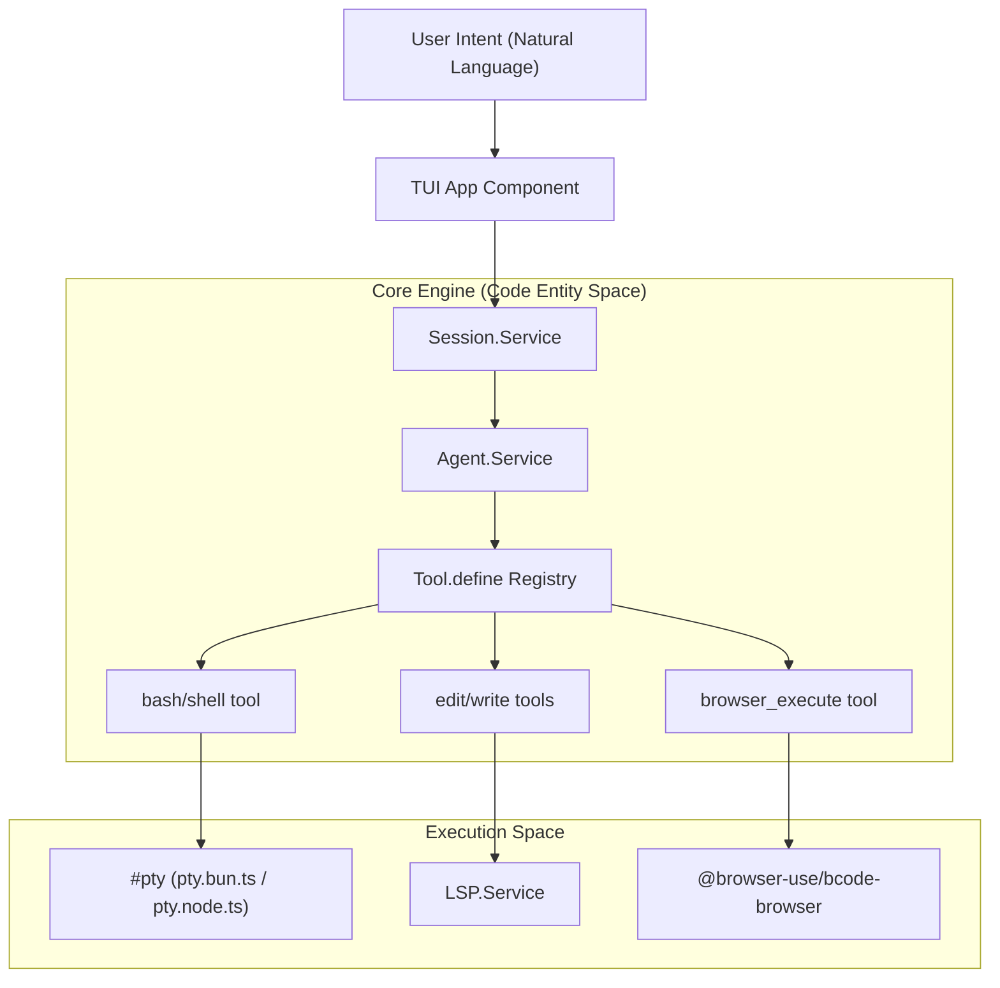
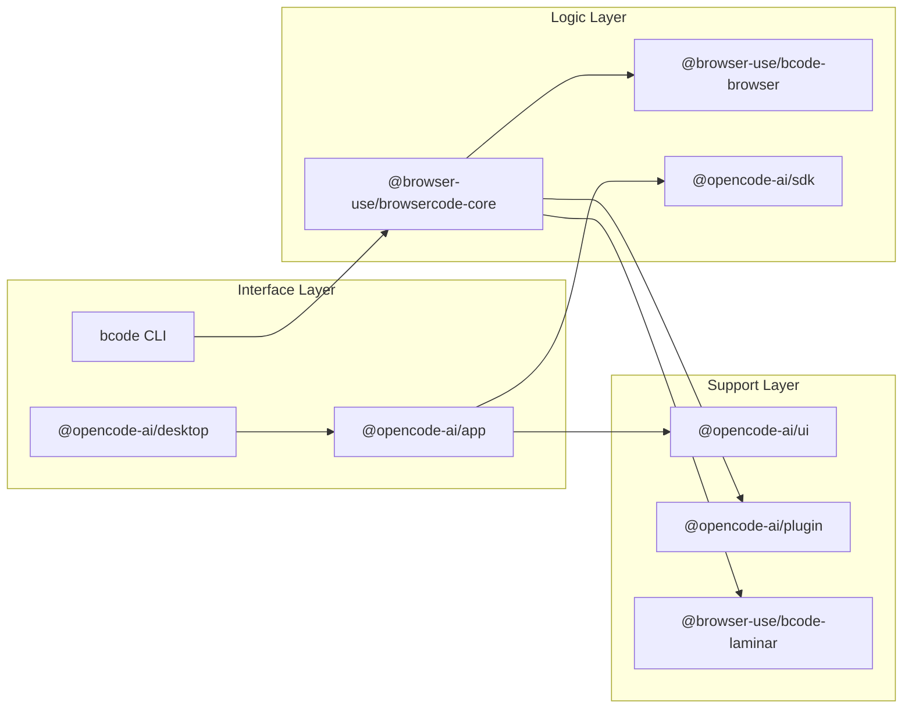

<!-- source: DeepWiki mcp.deepwiki.com · repo browser-use/browsercode · page 1 Overview · fetched 2026-10-30 -->

# Overview

Relevant source files

The following files were used as context for generating this wiki page:

- [.github/ISSUE_TEMPLATE/bug-report.yml](.github/ISSUE_TEMPLATE/bug-report.yml)
- [.github/ISSUE_TEMPLATE/config.yml](.github/ISSUE_TEMPLATE/config.yml)
- [.github/ISSUE_TEMPLATE/feature-request.yml](.github/ISSUE_TEMPLATE/feature-request.yml)
- [.github/ISSUE_TEMPLATE/question.yml](.github/ISSUE_TEMPLATE/question.yml)
- [.opencode/opencode.jsonc](.opencode/opencode.jsonc)
- [.vscode/launch.example.json](.vscode/launch.example.json)
- [.vscode/settings.example.json](.vscode/settings.example.json)
- [AGENTS.md](AGENTS.md)
- [CONTRIBUTING.md](CONTRIBUTING.md)
- [README.md](README.md)
- [STATS.md](STATS.md)
- [bun.lock](bun.lock)
- [packages/console/app/package.json](packages/console/app/package.json)
- [packages/console/core/package.json](packages/console/core/package.json)
- [packages/console/function/package.json](packages/console/function/package.json)
- [packages/console/mail/package.json](packages/console/mail/package.json)
- [packages/desktop/README.md](packages/desktop/README.md)
- [packages/desktop/package.json](packages/desktop/package.json)
- [packages/function/package.json](packages/function/package.json)
- [packages/opencode/package.json](packages/opencode/package.json)
- [packages/opencode/src/cli/cmd/tui/routes/session/permission.tsx](packages/opencode/src/cli/cmd/tui/routes/session/permission.tsx)
- [packages/plugin/package.json](packages/plugin/package.json)
- [packages/sdk/js/package.json](packages/sdk/js/package.json)
- [packages/web/package.json](packages/web/package.json)
- [packages/web/src/components/Lander.astro](packages/web/src/components/Lander.astro)
- [packages/web/src/content/docs/index.mdx](packages/web/src/content/docs/index.mdx)
- [packages/web/src/content/docs/troubleshooting.mdx](packages/web/src/content/docs/troubleshooting.mdx)
- [sdks/vscode/package.json](sdks/vscode/package.json)
- [specs/project.md](specs/project.md)
- [static/browser_harness_by_model_dark.png](static/browser_harness_by_model_dark.png)
- [static/browser_harness_by_model_light.png](static/browser_harness_by_model_light.png)

BrowserCode (also referred to as OpenCode in its open-source core) is a high-performance, AI-native development environment designed to bridge the gap between Large Language Models (LLMs) and local/cloud execution environments. It provides a suite of tools for agents to browse the web, edit code, execute terminal commands, and interact with complex repository structures.

The system is built as a modular monorepo using [Bun](https://bun.sh) and [Turbo](https://turbo.build), enabling it to run as a CLI, a headless server, a TUI (Terminal User Interface), or a full desktop application.

## Key Capabilities

*   **Autonomous Agent Loop**: A sophisticated agent runtime that handles multi-step planning, tool execution, and context compaction [packages/opencode/package.json:72-91]().
*   **Deep Browser Integration**: Native Chrome DevTools Protocol (CDP) support for direct browser manipulation and "skills" for complex web interactions [packages/bcode-browser/package.json:85-91]().
*   **Multi-Provider LLM Support**: A unified abstraction layer for Anthropic, OpenAI, Bedrock, Vertex AI, and more [packages/opencode/package.json:73-91]().
*   **Extensible Tooling**: Built-in tools for LSP diagnostics, file manipulation, shell execution, and MCP (Model Context Protocol) integration [packages/opencode/package.json:100-113]().
*   **Cross-Platform Interfaces**: Support for Terminal (TUI), Web (SolidJS), and Desktop (Electron) environments [packages/desktop/package.json:1-35]().

## System Architecture

The following diagram illustrates how natural language intents from a user are transformed into concrete code entities and executed through the system's core services.

### From Intent to Execution

Sources: [packages/opencode/package.json:19-36](), [packages/opencode/package.json:93-100](), [packages/plugin/package.json:11-15]()

## Repository Structure

The project is organized as a Bun monorepo. The core logic resides in `packages/opencode`, while specialized integrations and UI surfaces are split into separate packages to maintain a clean dependency graph.

| Package | Purpose |
| :--- | :--- |
| `packages/opencode` | The core engine, CLI, and agent runtime. |
| `packages/bcode-browser` | Browser automation and CDP integration layer. |
| `packages/sdk` | JS/TS client for interacting with the OpenCode server. |
| `packages/ui` | Shared SolidJS component library for all UI surfaces. |
| `packages/desktop` | Electron-based desktop application wrapper. |
| `packages/app` | SolidJS SPA web interface. |
| `packages/console` | Managed cloud infrastructure and billing dashboard. |

For a detailed breakdown of the directory layout and build pipeline, see [Repository Structure](#1.2).

### Component Relationships

Sources: [bun.lock:1-150](), [packages/opencode/package.json:1-107](), [packages/desktop/package.json:36-45]()

## Navigation Guide

This wiki is structured to guide you from initial setup to deep technical contributions.

*   **[Getting Started](#1.1)**: If you are new to the codebase, start here to set up your environment using the `install.sh` script and connect your first LLM provider.
*   **[Repository Structure](#1.2)**: Understand the monorepo layout, how `turbo.json` manages the build pipeline, and how to run specific packages in development mode.
*   **Core Engine (Section 2)**: Deep dives into the agent runtime, the permission system, and the tool registry within `packages/opencode`.
*   **Browser Integration (Section 3)**: Technical details on the CDP layer and browser skills.
*   **User Interfaces (Section 4)**: Architecture of the TUI, Web, and Desktop applications.
*   **SDK and API (Section 5)**: Documentation for the REST API and the generated TypeScript SDK.
*   **Plugin System (Section 6)**: How to extend the system with custom tools and agents.

Sources: [README.md:1-50](), [packages/opencode/package.json:1-171]()

---

