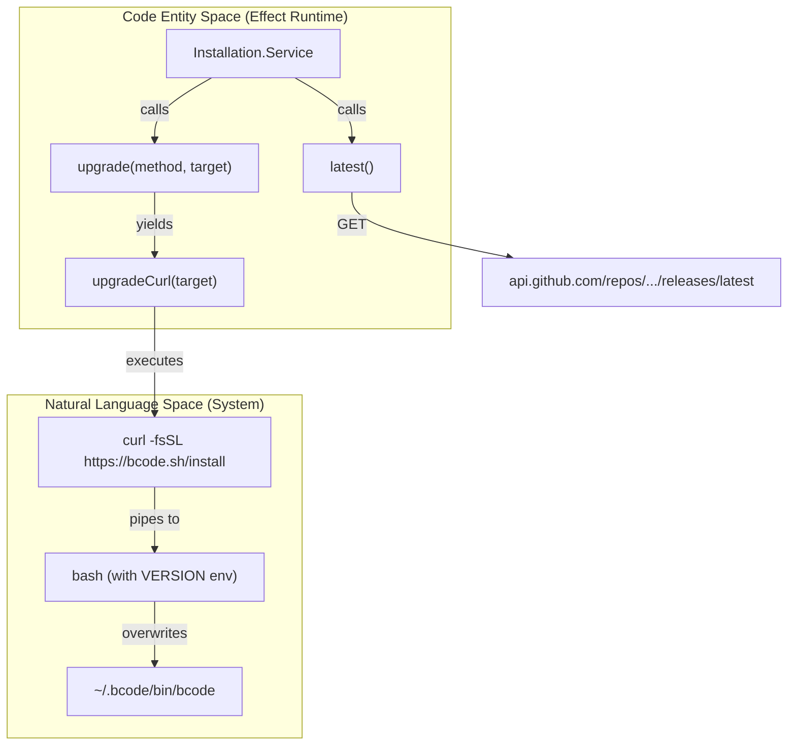
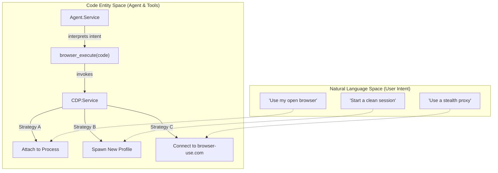

<!-- source: DeepWiki mcp.deepwiki.com · repo browser-use/browsercode · page 1.1 Getting Started · fetched 2026-10-30 -->

# Getting Started

Relevant source files

The following files were used as context for generating this wiki page:

- [.github/actions/setup-bun/action.yml](.github/actions/setup-bun/action.yml)
- [README.md](README.md)
- [install](install)
- [install.sh](install.sh)
- [packages/desktop/scripts/predev.ts](packages/desktop/scripts/predev.ts)
- [packages/desktop/scripts/prepare.ts](packages/desktop/scripts/prepare.ts)
- [packages/desktop/scripts/utils.ts](packages/desktop/scripts/utils.ts)
- [packages/opencode/BUN_SHELL_MIGRATION_PLAN.md](packages/opencode/BUN_SHELL_MIGRATION_PLAN.md)
- [packages/opencode/Dockerfile](packages/opencode/Dockerfile)
- [packages/opencode/src/cli/cmd/tui/util/editor.ts](packages/opencode/src/cli/cmd/tui/util/editor.ts)
- [packages/opencode/src/cli/cmd/uninstall.ts](packages/opencode/src/cli/cmd/uninstall.ts)
- [packages/opencode/src/cli/cmd/upgrade.ts](packages/opencode/src/cli/cmd/upgrade.ts)
- [packages/opencode/src/cli/upgrade.ts](packages/opencode/src/cli/upgrade.ts)
- [packages/opencode/src/command/template/initialize.txt](packages/opencode/src/command/template/initialize.txt)
- [packages/opencode/src/installation/index.ts](packages/opencode/src/installation/index.ts)
- [packages/opencode/src/util/process.ts](packages/opencode/src/util/process.ts)
- [packages/opencode/test/installation/installation.test.ts](packages/opencode/test/installation/installation.test.ts)
- [packages/opencode/test/util/process.test.ts](packages/opencode/test/util/process.test.ts)
- [packages/plugin/src/tool.ts](packages/plugin/src/tool.ts)
- [packages/sdk/js/src/gen/client.gen.ts](packages/sdk/js/src/gen/client.gen.ts)
- [packages/sdk/js/src/index.ts](packages/sdk/js/src/index.ts)
- [packages/web/src/components/Lander.astro](packages/web/src/components/Lander.astro)
- [packages/web/src/content/docs/agents.mdx](packages/web/src/content/docs/agents.mdx)
- [packages/web/src/content/docs/cli.mdx](packages/web/src/content/docs/cli.mdx)
- [packages/web/src/content/docs/config.mdx](packages/web/src/content/docs/config.mdx)
- [packages/web/src/content/docs/custom-tools.mdx](packages/web/src/content/docs/custom-tools.mdx)
- [packages/web/src/content/docs/ide.mdx](packages/web/src/content/docs/ide.mdx)
- [packages/web/src/content/docs/index.mdx](packages/web/src/content/docs/index.mdx)
- [packages/web/src/content/docs/keybinds.mdx](packages/web/src/content/docs/keybinds.mdx)
- [packages/web/src/content/docs/models.mdx](packages/web/src/content/docs/models.mdx)
- [packages/web/src/content/docs/permissions.mdx](packages/web/src/content/docs/permissions.mdx)
- [packages/web/src/content/docs/plugins.mdx](packages/web/src/content/docs/plugins.mdx)
- [packages/web/src/content/docs/rules.mdx](packages/web/src/content/docs/rules.mdx)
- [packages/web/src/content/docs/sdk.mdx](packages/web/src/content/docs/sdk.mdx)
- [packages/web/src/content/docs/server.mdx](packages/web/src/content/docs/server.mdx)
- [packages/web/src/content/docs/tools.mdx](packages/web/src/content/docs/tools.mdx)
- [packages/web/src/content/docs/troubleshooting.mdx](packages/web/src/content/docs/troubleshooting.mdx)
- [packages/web/src/content/docs/tui.mdx](packages/web/src/content/docs/tui.mdx)
- [static/browser_harness_by_model_dark.png](static/browser_harness_by_model_dark.png)
- [static/browser_harness_by_model_light.png](static/browser_harness_by_model_light.png)

This page provides technical details on installing and initializing BrowserCode. It covers the installation infrastructure, first-run workflows, and the mechanisms for connecting LLM providers and browsers.

## Installation Infrastructure

The primary entry point for users is a one-line install script that detects the host environment and fetches the appropriate pre-compiled binary.

### The `install.sh` Script
The installation script (`install.sh`) performs environment detection for OS (Darwin, Linux, Windows), architecture (x64, arm64), and C library (glibc vs musl) [install:79-130](). It also checks for AVX2 support to determine if a "baseline" build is required for older CPUs [install:131-163]().

The script creates a local bin directory at `$HOME/.opencode/bin` [install:68-69]() and downloads the corresponding release archive from GitHub [install:184-204]().

### Automated Upgrades
BrowserCode includes a built-in upgrade mechanism managed by the `Installation.Service`. This service handles version checking and the execution of the upgrade flow.

| Function | Description | File Reference |
| :--- | :--- | :--- |
| `latest()` | Fetches the latest version tag from the GitHub repository API. | [packages/opencode/src/installation/index.ts:140-152]() |
| `method()` | Detects if the current binary was installed via `curl` by checking the `execPath`. | [packages/opencode/src/installation/index.ts:135-139]() |
| `upgrade()` | Downloads the latest `install.sh` and executes it with the target version. | [packages/opencode/src/installation/index.ts:153-169]() |

**Upgrade Flow Diagram**
This diagram illustrates the transition from the `Installation.Service` logic to the physical system execution.

"Installation Logic to System Execution"

Sources: [packages/opencode/src/installation/index.ts:107-169](), [install:1-30]()

## First-Run Usage

BrowserCode can be operated in two primary modes: an interactive Terminal User Interface (TUI) and a non-interactive headless mode.

### TUI Mode
Invoking the binary without arguments starts the TUI [packages/web/src/content/docs/cli.mdx:8-12]().
- **Command:** `bcode`
- **Key Bindings:** Uses a "Leader" key (default `ctrl+x`) for complex actions like starting a new session (`leader n`) or switching models (`leader m`) [packages/web/src/content/docs/keybinds.mdx:12-176]().
- **Agent Switching:** Use `Tab` to cycle between primary agents (e.g., `Build` and `Plan`) [packages/web/src/content/docs/agents.mdx:24-31]().

### Headless Mode
The `run` command allows for one-off task execution directly from the shell [README.md:29-33]().
- **Command:** `bcode run "task description"`
- **Implementation:** This bypasses the TUI rendering loop and streams agent turns directly to the standard output.

## Connecting an LLM Provider

BrowserCode abstracts LLM communication through a provider system. It supports both environment-variable-based configuration and interactive connection via the TUI.

### Connection Methods
1.  **Environment Variables:** Set keys like `ANTHROPIC_API_KEY` or `OPENAI_API_KEY` in the shell [README.md:45]().
2.  **Interactive Connect:** Run `/connect` within the TUI to open the provider selection dialog [packages/web/src/content/docs/index.mdx:141-145]().
3.  **Managed Proxy (Zen):** BrowserCode can route requests through a managed proxy at `opencode.ai/auth` for simplified billing and access to multiple models [packages/web/src/content/docs/index.mdx:137-141]().

Sources: [README.md:43-51](), [packages/web/src/content/docs/index.mdx:133-158]()

## Connecting a Browser

The core differentiator of BrowserCode is its ability to drive browsers via the Chrome DevTools Protocol (CDP). Unlike standard agents that use high-level wrappers, BrowserCode's `browser_execute` tool runs raw JavaScript in the browser context [README.md:94-102]().

### Connection Modes
The agent selects the connection strategy based on the user's natural language prompt:

| Mode | Prompt Example | Behavior |
| :--- | :--- | :--- |
| **Current Tab** | "Connect to my current tab..." | Attaches to an existing open Chrome instance via CDP port. |
| **New Profile** | "Make a new browser profile..." | Launches a fresh, isolated local browser instance. |
| **Cloud Browser** | "Open a remote browser..." | Connects to Browser Use Cloud via `BROWSER_USE_API_KEY`. |

**Browser Connection Logic**
"Natural Language Intent to Code Entity"

Sources: [README.md:53-81](), [README.md:94-102]()

---

