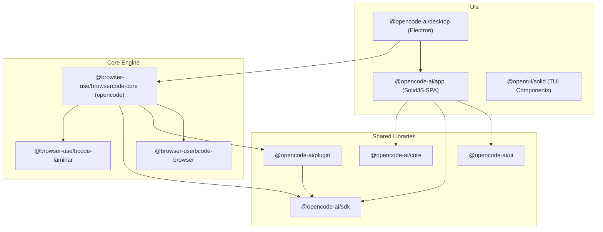
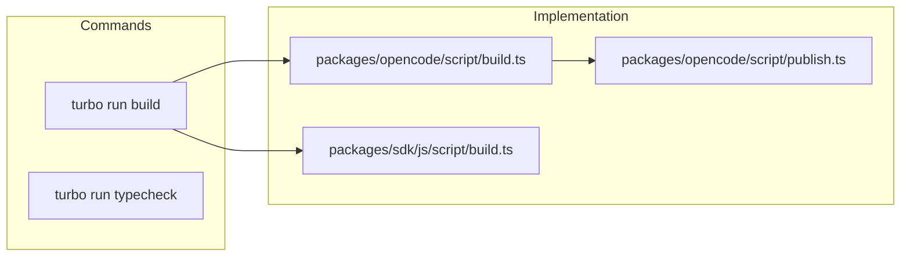

<!-- source: DeepWiki mcp.deepwiki.com · repo browser-use/browsercode · page 1.2 Repository Structure · fetched 2026-10-30 -->

# Repository Structure

Relevant source files

The following files were used as context for generating this wiki page:

- [.opencode/command/changelog.md](.opencode/command/changelog.md)
- [bun.lock](bun.lock)
- [package.json](package.json)
- [packages/app/AGENTS.md](packages/app/AGENTS.md)
- [packages/app/src/components/session/index.ts](packages/app/src/components/session/index.ts)
- [packages/app/src/index.css](packages/app/src/index.css)
- [packages/console/app/package.json](packages/console/app/package.json)
- [packages/console/core/package.json](packages/console/core/package.json)
- [packages/console/function/package.json](packages/console/function/package.json)
- [packages/console/mail/package.json](packages/console/mail/package.json)
- [packages/desktop/package.json](packages/desktop/package.json)
- [packages/function/package.json](packages/function/package.json)
- [packages/opencode/AGENTS.md](packages/opencode/AGENTS.md)
- [packages/opencode/package.json](packages/opencode/package.json)
- [packages/opencode/script/build.ts](packages/opencode/script/build.ts)
- [packages/opencode/script/postinstall.mjs](packages/opencode/script/postinstall.mjs)
- [packages/opencode/script/publish.ts](packages/opencode/script/publish.ts)
- [packages/plugin/package.json](packages/plugin/package.json)
- [packages/plugin/script/publish.ts](packages/plugin/script/publish.ts)
- [packages/script/package.json](packages/script/package.json)
- [packages/script/src/index.ts](packages/script/src/index.ts)
- [packages/sdk/js/package.json](packages/sdk/js/package.json)
- [packages/sdk/js/script/build.ts](packages/sdk/js/script/build.ts)
- [packages/sdk/js/script/publish.ts](packages/sdk/js/script/publish.ts)
- [packages/ui/src/components/session-diff.test.ts](packages/ui/src/components/session-diff.test.ts)
- [packages/ui/src/components/session-diff.ts](packages/ui/src/components/session-diff.ts)
- [packages/web/package.json](packages/web/package.json)
- [script/beta.ts](script/beta.ts)
- [script/changelog.ts](script/changelog.ts)
- [script/hooks](script/hooks)
- [script/publish.ts](script/publish.ts)
- [script/raw-changelog.ts](script/raw-changelog.ts)
- [script/release](script/release)
- [script/stats.ts](script/stats.ts)
- [script/version.ts](script/version.ts)
- [sdks/vscode/package.json](sdks/vscode/package.json)
- [turbo.json](turbo.json)

This page describes the technical architecture and organization of the BrowserCode monorepo. The project is managed as a **Bun monorepo** using **Turborepo** for build orchestration. It encompasses the core agent engine, multiple user interfaces (TUI, Web, Desktop), SDKs, and cloud infrastructure.

## Monorepo Overview

The repository is organized into `packages/`, `sdks/`, and `infra/` directories. It utilizes Bun workspaces to manage internal dependencies and shared code.

### Core Dependency Graph
The following diagram illustrates how major packages relate to one another in the build and dependency hierarchy.

**Package Relationship Diagram**

Sources: [bun.lock:4-114](), [packages/opencode/package.json:93-107](), [packages/app/package.json:33-37](), [packages/desktop/package.json:39-40]()

---

## Key Packages

### 1. `@browser-use/browsercode-core` (packages/opencode)
The heart of the system. It contains the CLI entrypoint, the HTTP server, and the agent runtime.
- **Entrypoint:** `src/index.ts` is the main entry for the CLI and server [packages/opencode/package.json:15-15]().
- **Binaries:** Exports the `bcode` binary [packages/opencode/package.json:19-21]().
- **Responsibilities:** Session management, tool execution, LLM provider abstraction, and the Agent Client Protocol (ACP) implementation.

### 2. `@opencode-ai/sdk` (packages/sdk/js)
The TypeScript SDK used for programmatic interaction with the OpenCode server.
- **Exports:** Provides both `v1` and `v2` clients [packages/sdk/js/package.json:11-19]().
- **Generation:** Uses `@hey-api/openapi-ts` to generate types and clients from the OpenAPI spec [packages/sdk/js/package.json:24-24]().

### 3. `@opencode-ai/ui` (packages/ui)
A shared library of SolidJS components used across the Web App, Desktop App, and Console.
- **Key Entities:** Includes complex UI logic like the `Pierre` diffing engine and `SessionTurn` components.

### 4. `@opencode-ai/app` (packages/app)
The main web-based interface built with SolidJS.
- **Technology:** Uses Vite, TailwindCSS, and Kobalte [packages/app/package.json:34-82]().
- **Integration:** This package is embedded into the `opencode` binary during the build process to provide the local web UI [packages/opencode/script/build.ts:13-13]().

### 5. `@browser-use/bcode-browser` (packages/bcode-browser)
Specialized integration for browser-based automation.
- **Functionality:** Implements the CDP (Chrome DevTools Protocol) layer and browser-specific skills [packages/bcode-browser/package.json:85-91]().

### 6. `@opencode-ai/plugin` (packages/plugin)
The framework for extending OpenCode.
- **API:** Provides `tool.ts` and `tui.ts` for plugins to define custom tools and TUI components [packages/plugin/package.json:11-15]().

---

## Build Pipeline (turbo.json)

The project uses `turbo` to handle task execution and caching across the monorepo.

**Code to Build Mapping**

### Key Build Scripts
- **Main Build:** `packages/opencode/script/build.ts` orchestrates the compilation of the CLI, embedding the UI, and preparing cross-platform binaries [packages/opencode/package.json:13-13]().
- **Publishing:** `packages/opencode/script/publish.ts` handles the release cascade to npm and other targets [packages/opencode/script/publish.ts:1-10]().
- **SDK Generation:** `packages/sdk/js/script/build.ts` triggers the OpenAPI client generation [packages/sdk/js/package.json:9-9]().

Sources: [turbo.json:1-27](), [packages/opencode/package.json:8-17](), [packages/sdk/js/package.json:7-10]()

---

## Cloud and Console Infrastructure

The `packages/console/` directory contains the managed cloud offering components.

| Package | Purpose | Technology |
| :--- | :--- | :--- |
| `console-app` | The user dashboard (billing, workspace mgmt) | SolidStart, Cloudflare [packages/console/app/package.json:14-35]() |
| `console-core` | Shared database logic and Drizzle schemas | Drizzle ORM, PlanetScale [packages/console/core/package.json:8-20]() |
| `console-function` | Zen AI Proxy and cloud functions | Cloudflare Workers, AI SDK [packages/console/function/package.json:19-28]() |
| `console-mail` | Email templates for notifications | JSX-Email [packages/console/mail/package.json:4-11]() |

Sources: [packages/console/app/package.json:1-48](), [packages/console/core/package.json:1-53](), [packages/console/function/package.json:1-30]()

---

## External Integrations

Beyond the core monorepo, the repository hosts various extensions in `sdks/` and `packages/github/`.

- **VS Code Extension:** Located in `sdks/vscode/`, it provides commands like `opencode.openTerminal` and `opencode.addFilepathToTerminal` [sdks/vscode/package.json:26-47]().
- **GitHub Integration:** Found in `packages/function/` (specifically for GitHub App auth) and related scripts for CI/CD automation [packages/function/package.json:15-18]().
- **Desktop App:** The `packages/desktop/` package uses Electron to wrap the `@opencode-ai/app` and manage the local `opencode` server as a sidecar [packages/desktop/package.json:25-53]().

Sources: [sdks/vscode/package.json:1-109](), [packages/desktop/package.json:1-77](), [packages/function/package.json:1-21]()

---

