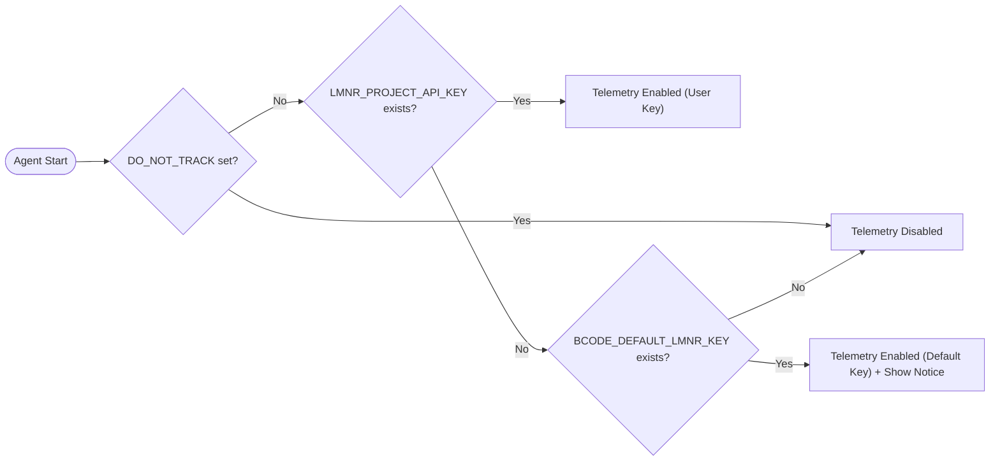

<!-- source: DeepWiki mcp.deepwiki.com · repo browser-use/browsercode · page 10 Observability and Telemetry · fetched 2026-10-30 -->

# Observability and Telemetry

Relevant source files

The following files were used as context for generating this wiki page:

- [.github/workflows/release.yml](.github/workflows/release.yml)
- [infra/enterprise.ts](infra/enterprise.ts)
- [infra/monitoring.ts](infra/monitoring.ts)
- [infra/secret.ts](infra/secret.ts)
- [infra/stage.ts](infra/stage.ts)
- [packages/bcode-browser/src/telemetry.ts](packages/bcode-browser/src/telemetry.ts)
- [packages/bcode-laminar/LICENSE](packages/bcode-laminar/LICENSE)
- [packages/bcode-laminar/VENDOR.md](packages/bcode-laminar/VENDOR.md)
- [packages/bcode-laminar/package.json](packages/bcode-laminar/package.json)
- [packages/bcode-laminar/src/attributes.ts](packages/bcode-laminar/src/attributes.ts)
- [packages/bcode-laminar/src/compat.ts](packages/bcode-laminar/src/compat.ts)
- [packages/bcode-laminar/src/exporter.ts](packages/bcode-laminar/src/exporter.ts)
- [packages/bcode-laminar/src/index.ts](packages/bcode-laminar/src/index.ts)
- [packages/bcode-laminar/src/plugin.ts](packages/bcode-laminar/src/plugin.ts)
- [packages/bcode-laminar/src/processor.ts](packages/bcode-laminar/src/processor.ts)
- [packages/console/app/src/routes/honeycomb/webhook.ts](packages/console/app/src/routes/honeycomb/webhook.ts)
- [packages/console/app/src/routes/t/[...path].tsx](packages/console/app/src/routes/t/[...path].tsx)
- [packages/console/core/src/util/crypto.ts](packages/console/core/src/util/crypto.ts)
- [packages/enterprise/src/routes/index.tsx](packages/enterprise/src/routes/index.tsx)
- [packages/enterprise/tsconfig.json](packages/enterprise/tsconfig.json)
- [packages/enterprise/vite.config.ts](packages/enterprise/vite.config.ts)
- [packages/ui/vite.config.ts](packages/ui/vite.config.ts)

This section covers the observability stack within BrowserCode, ranging from local agent execution tracing to cloud-scale infrastructure monitoring. The system utilizes OpenTelemetry (OTel) for tracing agent "turns" and tool executions, while using Honeycomb and Cloudflare for infrastructure health and usage analytics.

## High-Level Telemetry Architecture

BrowserCode's telemetry is split into two primary domains: **Execution Tracing** (tracking what the AI agent is doing) and **Infrastructure Monitoring** (tracking the health of the services providing model access and hosting).

### Natural Language to Code Entity Mapping

The following diagram maps high-level telemetry concepts to their specific implementations in the codebase.

| Concept | Code Entity | File Path |
| :--- | :--- | :--- |
| **Trace Provider** | `NodeSDK` | [packages/bcode-laminar/src/plugin.ts:68-69]() |
| **Span Logic** | `OpenCodeLaminarSpanProcessor` | [packages/bcode-laminar/src/processor.ts:44-45]() |
| **Telemetry Gate** | `applyTelemetryKey` | [packages/bcode-browser/src/telemetry.ts:34-46]() |
| **Alert Webhook** | `POST` (API Route) | [packages/console/app/src/routes/honeycomb/webhook.ts:77-105]() |
| **Monitor Resource** | `honeycomb.Trigger` | [infra/monitoring.ts:142-159]() |

```mermaid
graph TD
    subgraph "Agent Runtime (Local/CLI)"
        A["bcode CLI"] -- "imports" --> B["Telemetry Module"]
        B -- "gated by" --> C["DO_NOT_TRACK"]
        B -- "initializes" --> D["LaminarPlugin"]
        D -- "manages" --> E["OpenCodeLaminarSpanProcessor"]
        E -- "exports to" --> F["Laminar / OTel Collector"]
    end

    subgraph "Cloud Infrastructure"
        G["Zen AI Proxy"] -- "logs to" --> H["Cloudflare Logpush"]
        H -- "ingests to" --> I["Honeycomb"]
        I -- "triggers" --> J["Honeycomb Webhook"]
        J -- "POSTs to" --> K["Console API /webhook"]
        K -- "notifies" --> L["Discord Alerts"]
    end

    style B font-weight:bold
    style E font-weight:bold
    style I font-weight:bold
```

Sources: [packages/bcode-browser/src/telemetry.ts:34-80](), [packages/bcode-laminar/src/plugin.ts:31-70](), [infra/monitoring.ts:142-159](), [packages/console/app/src/routes/honeycomb/webhook.ts:77-105]()

## bcode-laminar Tracing

The `@browser-use/bcode-laminar` package provides deep visibility into the agent's internal reasoning and tool execution. It is implemented as an OpenCode plugin that hooks into the session lifecycle to wrap every agent "turn" in an OpenTelemetry span.

- **Span Re-parenting**: The `OpenCodeLaminarSpanProcessor` automatically re-parents AI-SDK spans onto the current session "turn" span [packages/bcode-laminar/src/processor.ts:70-89]().
- **Sub-agent Linking**: Spans created by the `task` tool are tracked so that sub-agent traces can be linked back to the parent's tool call [packages/bcode-laminar/src/processor.ts:91-104]().
- **Graceful Shutdown**: The plugin implements a `shutdown` hook that awaits `forceFlush()` on the span processor to ensure in-flight traces are not lost when the CLI exits [packages/bcode-laminar/src/plugin.ts:93-108]().

For details, see [bcode-laminar Tracing](#10.1).

## Infrastructure Monitoring

The infrastructure monitoring layer focuses on the reliability of the managed cloud services, specifically the Zen AI Proxy and the Console.

- **Honeycomb Integration**: The system uses SST to manage Honeycomb triggers that monitor for increased HTTP errors (4xx/5xx) or low Tokens Per Second (TPS) across different model providers [infra/monitoring.ts:40-71]().
- **Automated Alerting**: When thresholds are exceeded, Honeycomb sends a webhook to the Console application, which formats the data and forwards it to a Discord incident channel [packages/console/app/src/routes/honeycomb/webhook.ts:40-75]().
- **Enterprise Monitoring**: Managed deployments can utilize the `EnterpriseStorage` R2 buckets and Cloudflare Workers defined in the infrastructure stack for isolated logging [infra/enterprise.ts:4-17]().

For details, see [Infrastructure Monitoring](#10.2).

## Telemetry Gating and Privacy

BrowserCode adheres to standard privacy conventions. Telemetry is only enabled if the user has not opted out and a valid API key is present.

| Mechanism | Description | Code Reference |
| :--- | :--- | :--- |
| **DO_NOT_TRACK** | Any non-empty value in this environment variable disables all telemetry. | [packages/bcode-browser/src/telemetry.ts:37-37]() |
| **First-Run Notice** | A one-time notice is printed to `stderr` upon the first execution where telemetry is active. | [packages/bcode-browser/src/telemetry.ts:54-64]() |
| **Default Keys** | A default Laminar key is embedded during the official build process via Bun `define`. | [packages/bcode-browser/src/telemetry.ts:43-44]() |

Sources: [packages/bcode-browser/src/telemetry.ts:34-46](), [.github/workflows/release.yml:115-118]()

---

