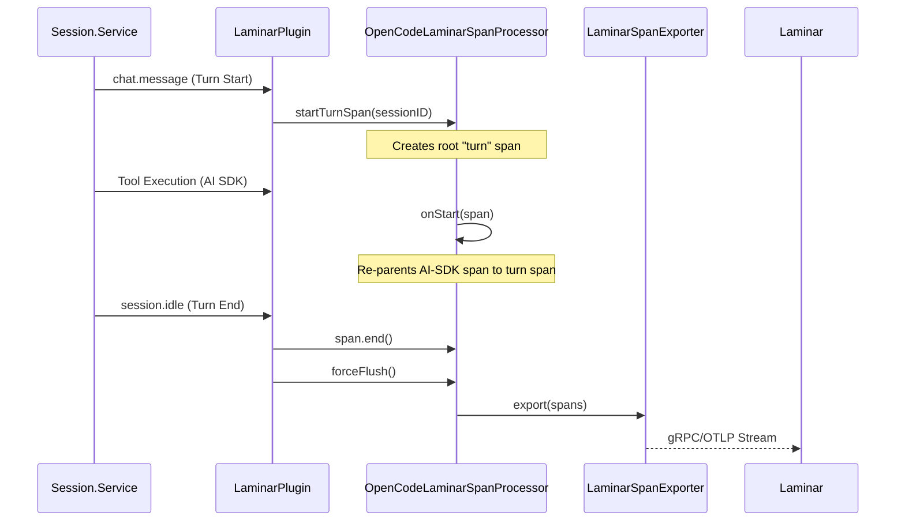
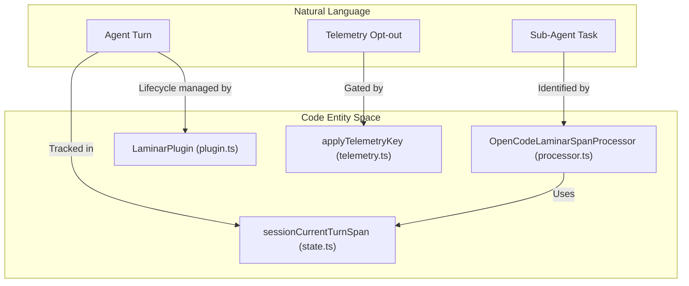

<!-- source: DeepWiki mcp.deepwiki.com · repo browser-use/browsercode · page 10.1 bcode-laminar Tracing · fetched 2026-10-30 -->

# bcode-laminar Tracing

Relevant source files

The following files were used as context for generating this wiki page:

- [.github/workflows/release.yml](.github/workflows/release.yml)
- [packages/bcode-browser/src/telemetry.ts](packages/bcode-browser/src/telemetry.ts)
- [packages/bcode-laminar/LICENSE](packages/bcode-laminar/LICENSE)
- [packages/bcode-laminar/VENDOR.md](packages/bcode-laminar/VENDOR.md)
- [packages/bcode-laminar/package.json](packages/bcode-laminar/package.json)
- [packages/bcode-laminar/src/attributes.ts](packages/bcode-laminar/src/attributes.ts)
- [packages/bcode-laminar/src/compat.ts](packages/bcode-laminar/src/compat.ts)
- [packages/bcode-laminar/src/exporter.ts](packages/bcode-laminar/src/exporter.ts)
- [packages/bcode-laminar/src/index.ts](packages/bcode-laminar/src/index.ts)
- [packages/bcode-laminar/src/plugin.ts](packages/bcode-laminar/src/plugin.ts)
- [packages/bcode-laminar/src/processor.ts](packages/bcode-laminar/src/processor.ts)

The `@browser-use/bcode-laminar` package provides OpenTelemetry (OTel) instrumentation for the BrowserCode agent runtime. It is a vendored and optimized version of the Laminar OpenCode plugin, designed to capture AI tool execution, agent turns, and sub-agent lifecycles [packages/bcode-laminar/VENDOR.md:1-14]().

The package integrates with the Laminar observability platform by default but supports any OTLP-compliant collector (e.g., Honeycomb, Jaeger) via standard environment variables [packages/bcode-laminar/src/exporter.ts:47-56]().

## Architecture and Data Flow

The tracing system operates as an `opencode` plugin. It hooks into the session lifecycle to group individual AI SDK spans into cohesive "turns," ensuring that the complex, multi-step execution of an agent is represented as a single nested trace in the observability UI.

### Tracing Lifecycle Diagram

This diagram illustrates how the `LaminarPlugin` transforms discrete agent events into an OpenTelemetry trace structure.

**Agent Event to Trace Mapping**

**Sources:** [packages/bcode-laminar/src/plugin.ts:31-158](), [packages/bcode-laminar/src/processor.ts:70-89]()

## Key Components

### 1. LaminarPlugin
The entry point for the tracing system. It configures the `NodeSDK` and registers handlers for `opencode` bus events [packages/bcode-laminar/src/plugin.ts:31-69]().

*   **Initialization**: Activated if `LMNR_PROJECT_API_KEY` or `OTEL_EXPORTER_OTLP_ENDPOINT` is present [packages/bcode-laminar/src/plugin.ts:61]().
*   **Turn Management**: Starts a new span for every `chat.message` and ends it when the session becomes idle (`session.idle`) or is deleted (`session.deleted`) [packages/bcode-laminar/src/plugin.ts:111-121, 159-160]().
*   **Graceful Shutdown**: Hooks into the plugin `shutdown` lifecycle to await pending OTLP exports before the process exits [packages/bcode-laminar/src/plugin.ts:93-108]().

### 2. OpenCodeLaminarSpanProcessor
A custom `SpanProcessor` that handles the heavy lifting of span manipulation and hierarchy management [packages/bcode-laminar/src/processor.ts:44]().

*   **Re-parenting**: It detects AI-SDK spans (via `ai.telemetry.metadata.sessionId`) and manually re-parents them under the current "turn" span. This prevents a "forest" of orphan traces [packages/bcode-laminar/src/processor.ts:73-89]().
*   **Path Stamping**: Unlike standard OTel which uses `parentSpanId`, the Laminar UI nests spans using specific path attributes: `lmnr.span.path` and `lmnr.span.ids_path` [packages/bcode-laminar/src/processor.ts:106-131]().
*   **Sub-agent Tracking**: It tracks spans from the `task` tool. Any descendant spans created by sub-agents are tagged with `lmnr.spawning_subagent.tool_use_id` to link them back to the parent's tool call [packages/bcode-laminar/src/processor.ts:93-104, 132-149]().

### 3. LaminarSpanExporter
Handles the transmission of spans to the collector [packages/bcode-laminar/src/exporter.ts:14]().

*   **Transport Selection**: By default, it uses gRPC with bearer-token authentication for Laminar [packages/bcode-laminar/src/exporter.ts:23-31](). If OTel-standard environment variables are set, it switches to `ExporterHttpProto` (OTLP/HTTP+protobuf) [packages/bcode-laminar/src/exporter.ts:57-67]().

**Sources:** [packages/bcode-laminar/src/plugin.ts:1-160](), [packages/bcode-laminar/src/processor.ts:1-165](), [packages/bcode-laminar/src/exporter.ts:1-68]()

## Code Entity Mapping

This diagram bridges the natural language concepts of "Sessions" and "Turns" to the specific classes and state objects in the codebase.

**Tracing Entity Map**

**Sources:** [packages/bcode-laminar/src/state.ts:20](), [packages/bcode-laminar/src/processor.ts:37](), [packages/bcode-laminar/src/plugin.ts:31](), [packages/bcode-browser/src/telemetry.ts:34]()

## Telemetry and Privacy

BrowserCode includes a default telemetry key for anonymous usage tracing in official releases.

*   **Key Injection**: The `BCODE_DEFAULT_LMNR_KEY` is injected at build time via Bun `define` [packages/bcode-browser/src/telemetry.ts:32](), [packages/bcode-browser/src/telemetry.ts:3-7]().
*   **Opt-out**: Users can opt out by setting `DO_NOT_TRACK=1` [packages/bcode-browser/src/telemetry.ts:37]().
*   **Priority**: A user-supplied `LMNR_PROJECT_API_KEY` always overrides the default key [packages/bcode-browser/src/telemetry.ts:40]().
*   **First-run Notice**: On the first launch where telemetry is enabled, a short notice is printed to `stderr` and a marker file is created in the user's state directory (e.g., `~/.local/state/bcode/telemetry-notice-shown`) [packages/bcode-browser/src/telemetry.ts:54-64]().

**Sources:** [packages/bcode-browser/src/telemetry.ts:1-83](), [.github/workflows/release.yml:118]()

## Attribute Definitions

The plugin stamps several custom attributes onto spans to facilitate advanced filtering and visualization in Laminar.

| Attribute | Purpose |
| :--- | :--- |
| `lmnr.span.path` | Array of span names representing the hierarchy [packages/bcode-laminar/src/attributes.ts:6](). |
| `lmnr.span.ids_path` | Array of UUID-formatted span IDs for the hierarchy [packages/bcode-laminar/src/attributes.ts:7](). |
| `lmnr.spawning_subagent.tool_use_id` | Links a sub-agent's trace to the specific tool call that created it [packages/bcode-laminar/src/processor.ts:145](). |
| `lmnr.association.properties.session_id` | Identifies the BrowserCode session [packages/bcode-laminar/src/attributes.ts:13](). |

**Sources:** [packages/bcode-laminar/src/attributes.ts:1-14](), [packages/bcode-laminar/src/processor.ts:125-148]()

## Graceful Shutdown and Flush

Because OpenTelemetry exports are often asynchronous and buffered, the plugin implements a robust shutdown mechanism to prevent span loss when the CLI exits.

1.  **Pending Track**: Every `forceFlush()` call returns a Promise which is tracked in a `pendingFlushes` Set [packages/bcode-laminar/src/plugin.ts:80-85]().
2.  **Turn Closure**: When the `shutdown` hook is called, any still-open turn spans are explicitly ended [packages/bcode-laminar/src/plugin.ts:100-105]().
3.  **Final Await**: The plugin awaits all `pendingFlushes` before returning control to the host, ensuring in-flight HTTP/gRPC requests complete [packages/bcode-laminar/src/plugin.ts:107]().

**Sources:** [packages/bcode-laminar/src/plugin.ts:72-108]()

---

